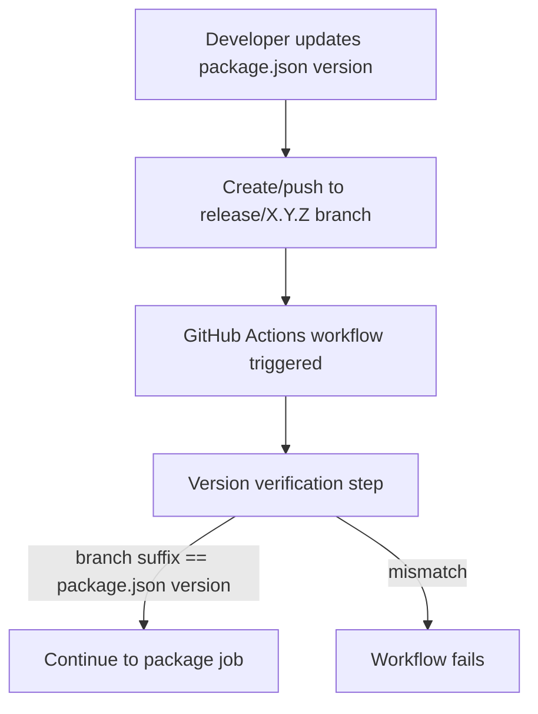
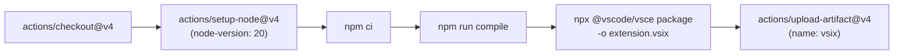
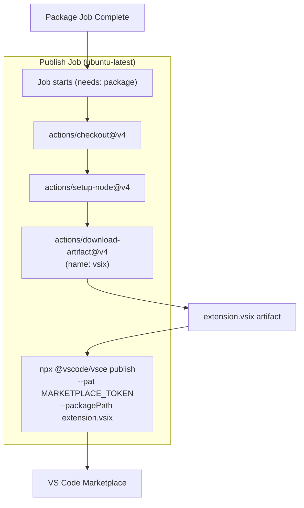
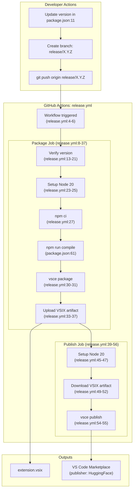

<!-- source: DeepWiki mcp.deepwiki.com · repo huggingface/huggingface-vscode-chat · page 5.5 Release Process · fetched 2026-10-26 -->

# Release Process

<details>
<summary>Relevant source files</summary>

The following files were used as context for generating this wiki page:

- [.github/workflows/release.yml](.github/workflows/release.yml)
- [README.md](README.md)
- [package.json](package.json)

</details>


This document describes the automated release pipeline for publishing new versions of the extension to the VS Code Marketplace. It covers the branching strategy, version verification, packaging steps, and the GitHub Actions workflow that orchestrates the deployment.

For information about building and compiling the extension during development, see [Building and Compilation](#5.2). For setting up your development environment, see [Development Environment Setup](#5.1).

---

## Overview

The extension uses an automated release workflow triggered by pushing to specially named branches. The process ensures version consistency, compiles the TypeScript source, packages the extension into a `.vsix` file, and publishes it to the VS Code Marketplace.

The release pipeline consists of two main phases:
1. **Package** - Version verification, compilation, and VSIX creation
2. **Publish** - Deployment to the VS Code Marketplace

**Sources:** [.github/workflows/release.yml:1-56](), [package.json:1-83]()

---

## Release Workflow Trigger

The release process is initiated when code is pushed to a branch matching the pattern `release/**`, where the branch suffix must match the version number in [package.json:11](). The workflow can also be triggered manually via the GitHub Actions UI using `workflow_dispatch`.



**Sources:** [.github/workflows/release.yml:2-6](), [.github/workflows/release.yml:13-21]()

---

## Version Verification

The first critical step in the release pipeline validates that the branch name matches the version specified in `package.json`. This prevents accidental releases with mismatched version information.

The verification is performed using a shell script that:
1. Extracts the version suffix from the branch name (e.g., `release/0.0.5` → `0.0.5`)
2. Reads the version field from [package.json:11]()
3. Compares the two values and fails the workflow if they differ

```bash
TAG="${BRANCH##*/}"
PKG_VERSION=$(node -p "require('./package.json').version")
if [ "$TAG" != "$PKG_VERSION" ]; then
  echo "package.json version ($PKG_VERSION) does not match branch tag ($TAG)"; exit 1;
fi
```

**Sources:** [.github/workflows/release.yml:13-21]()

---

## Package Job

The `package` job is responsible for building the extension and creating a distributable `.vsix` file. This job runs on `ubuntu-latest` and performs the following steps:

### Build Steps

| Step | Command | Purpose |
|------|---------|---------|
| Checkout | `actions/checkout@v4` | Clone the repository |
| Setup Node.js | `actions/setup-node@v4` (Node 20) | Install Node.js runtime |
| Install Dependencies | `npm ci` | Install exact versions from lock file |
| Compile TypeScript | `npm run compile` | Execute TypeScript compilation |
| Package VSIX | `npx @vscode/vsce package` | Create extension.vsix file |
| Upload Artifact | `actions/upload-artifact@v4` | Store VSIX for publish job |



The compilation step invokes the `compile` script defined in [package.json:61](), which runs `tsc -p ./` to compile all TypeScript files according to the configuration in `tsconfig.json`.

**Sources:** [.github/workflows/release.yml:8-37](), [package.json:61]()

---

## Packaging with VSCE

The extension is packaged using the Visual Studio Code Extension Manager (`vsce`), which is the official tool for creating and publishing VS Code extensions. The command used is:

```bash
npx @vscode/vsce package -o extension.vsix
```

This command:
- Validates the extension manifest in [package.json:1-83]()
- Bundles the compiled JavaScript from `./out/extension.js` (as specified in [package.json:55]())
- Includes the icon from `assets/logo.png` ([package.json:6]())
- Packages all necessary files into a single `extension.vsix` file

The resulting VSIX file is uploaded as a GitHub Actions artifact named `vsix`, making it available to the subsequent publish job.

**Sources:** [.github/workflows/release.yml:30-37](), [package.json:55]()

---

## Publish Job

The `publish` job depends on successful completion of the `package` job and handles deployment to the VS Code Marketplace. It runs after the VSIX artifact has been created and uploaded.



**Sources:** [.github/workflows/release.yml:39-56]()

---

## Marketplace Authentication

Publishing to the VS Code Marketplace requires a Personal Access Token (PAT) from Azure DevOps. This token is stored as a GitHub repository secret named `MARKETPLACE_TOKEN` and is passed to the `vsce publish` command:

```bash
npx @vscode/vsce publish --pat ${{ secrets.MARKETPLACE_TOKEN }} --packagePath ./extension.vsix
```

The PAT must have the `Marketplace (Manage)` scope to authorize publishing extensions under the `HuggingFace` publisher account (as defined in [package.json:3]()).

**Sources:** [.github/workflows/release.yml:54-55](), [package.json:3]()

---

## Complete Release Pipeline

The following diagram shows the complete end-to-end release process, mapping GitHub Actions workflow steps to specific files and commands in the codebase:



**Sources:** [.github/workflows/release.yml:1-56](), [package.json:11](), [package.json:61]()

---

## Pre-Release Checklist

Before initiating a release, developers should verify the following:

| Item | Description | File Reference |
|------|-------------|----------------|
| Version Number | Update version field in package.json | [package.json:11]() |
| Changelog | Document changes in release notes | N/A |
| Tests Pass | Run `npm run test` successfully | [package.json:65]() |
| Code Quality | Run `npm run lint` and `npm run format` | [package.json:62-63]() |
| Compilation | Verify `npm run compile` completes without errors | [package.json:61]() |
| Publisher Account | Confirm publisher is `HuggingFace` | [package.json:3]() |
| Marketplace Token | Verify `MARKETPLACE_TOKEN` secret exists in GitHub | N/A |

**Sources:** [package.json:3](), [package.json:11](), [package.json:61-65]()

---

## NPM Scripts for Release Preparation

The following npm scripts are relevant for preparing a release:

```typescript
// From package.json:56-66
"vscode:prepublish": "npm run compile"  // Runs automatically before publish
"compile": "tsc -p ./"                  // Compiles TypeScript to JavaScript
"lint": "eslint"                        // Validates code quality
"format": "prettier --write ."          // Formats code consistently
"test": "pnpm run compile && vscode-test"  // Runs test suite
```

The `vscode:prepublish` script ([package.json:57]()) is automatically invoked by `vsce` before packaging, ensuring the extension is compiled even if manually running `vsce package` locally.

**Sources:** [package.json:56-66]()

---

## Manual Release Process

While the automated workflow is the recommended approach, developers can manually create and publish releases if needed:

### Manual Packaging

```bash
# Install dependencies
npm ci

# Compile TypeScript
npm run compile

# Create VSIX package
npx @vscode/vsce package -o extension.vsix
```

### Manual Publishing

```bash
# Publish to marketplace (requires PAT)
npx @vscode/vsce publish --pat YOUR_MARKETPLACE_TOKEN --packagePath ./extension.vsix
```

**Note:** Manual releases should be avoided as they bypass version verification and may result in inconsistent release artifacts.

**Sources:** [.github/workflows/release.yml:27-31](), [.github/workflows/release.yml:54-55]()

---

## Extension Metadata for Marketplace

The following fields in `package.json` control how the extension appears in the VS Code Marketplace:

| Field | Value | Line Reference |
|-------|-------|----------------|
| `name` | `huggingface-vscode-chat` | [package.json:2]() |
| `publisher` | `HuggingFace` | [package.json:3]() |
| `displayName` | Hugging Face Provider for GitHub Copilot Chat | [package.json:4]() |
| `description` | Extension description for marketplace listing | [package.json:5]() |
| `icon` | `assets/logo.png` | [package.json:6]() |
| `version` | Current version number | [package.json:11]() |
| `repository` | GitHub repository URL | [package.json:7-10]() |
| `categories` | `["AI", "Chat"]` | [package.json:15-18]() |

**Sources:** [package.json:2-18]()

---

## Post-Release Verification

After a successful release, verify the deployment by:

1. **Check Marketplace Listing**: Visit `https://marketplace.visualstudio.com/items?itemName=HuggingFace.huggingface-vscode-chat`
2. **Verify Version Number**: Ensure the published version matches [package.json:11]()
3. **Test Installation**: Install the extension in VS Code via the Extensions view
4. **Functional Testing**: Verify core functionality works as expected
5. **Monitor Issues**: Check the repository issues for any installation or runtime problems

**Sources:** [package.json:3](), [package.json:11]()

---

## Troubleshooting Release Failures

### Version Mismatch Error

If the workflow fails with a version mismatch error:

```
package.json version (X.Y.Z) does not match branch tag (A.B.C)
```

**Solution:** Ensure the branch name suffix exactly matches the version in [package.json:11](). For example, if `package.json` specifies version `0.0.5`, the branch must be named `release/0.0.5`.

### Compilation Errors

If `npm run compile` fails during the package job:

**Solution:** Run `npm run compile` locally to identify TypeScript errors. Fix any type errors or configuration issues in `tsconfig.json` before pushing.

### Authentication Failures

If the publish step fails with authentication errors:

**Solution:** Verify that the `MARKETPLACE_TOKEN` GitHub secret is set correctly and has the `Marketplace (Manage)` scope in Azure DevOps.

**Sources:** [.github/workflows/release.yml:13-21](), [.github/workflows/release.yml:28](), [.github/workflows/release.yml:54-55]()

---

