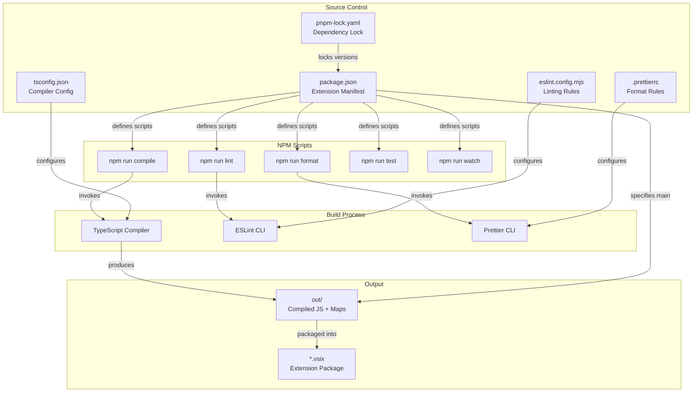
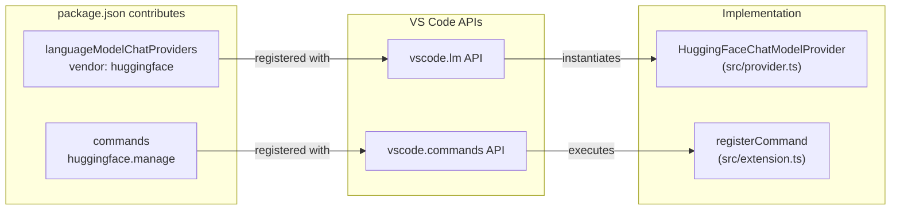
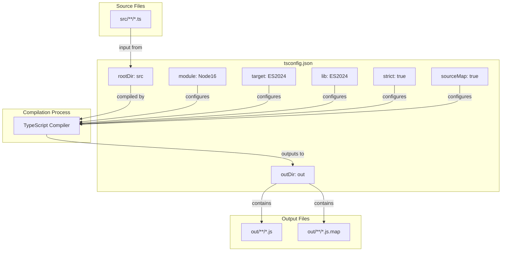
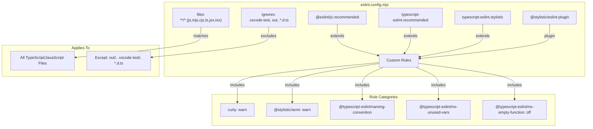
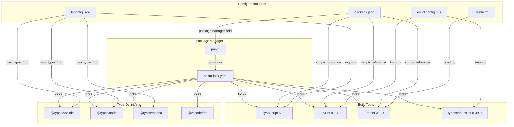

<!-- source: DeepWiki mcp.deepwiki.com · repo huggingface/huggingface-vscode-chat · page 6 Configuration Reference · fetched 2026-10-26 -->

# Configuration Reference

<details>
<summary>Relevant source files</summary>

The following files were used as context for generating this wiki page:

- [eslint.config.mjs](eslint.config.mjs)
- [package.json](package.json)
- [tsconfig.json](tsconfig.json)

</details>


This page provides a comprehensive reference for all configuration files used in the huggingface-vscode-chat extension project. These files control the build process, code quality enforcement, TypeScript compilation, package management, and VS Code integration.

For user-facing configuration (API keys, model selection), see [Configuration](#2.2). For detailed build and development instructions, see [Development Guide](#5).

## Overview

The extension uses multiple configuration files to manage different aspects of the development workflow:

| Configuration File | Purpose | Key Responsibilities |
|-------------------|---------|---------------------|
| `package.json` | Extension manifest and npm configuration | Extension metadata, VS Code contributions, scripts, dependencies |
| `tsconfig.json` | TypeScript compiler settings | Compilation targets, module resolution, output directory |
| `eslint.config.mjs` | Code linting rules | Code quality, style enforcement, TypeScript-specific rules |
| `.prettierrc` | Code formatting | Consistent code style across the project |
| `pnpm-lock.yaml` | Dependency lock file | Deterministic dependency resolution |
| `.vscode/` | VS Code workspace settings | Editor configuration, debug settings |

Sources: [package.json:1-83](), [tsconfig.json:1-17](), [eslint.config.mjs:1-49]()

## Configuration File Architecture



Sources: [package.json:56-65](), [tsconfig.json:1-17](), [eslint.config.mjs:1-49]()

## Extension Manifest (package.json)

The `package.json` file serves as the extension's manifest and defines all VS Code contributions, metadata, and build scripts.

### Key Sections

#### Extension Identity
- **name**: `huggingface-vscode-chat` - unique identifier
- **publisher**: `HuggingFace` - marketplace publisher ID
- **version**: `0.0.5` - current extension version
- **displayName**: User-friendly name shown in VS Code
- **description**: Extension description for marketplace

Sources: [package.json:2-5](), [package.json:11]()

#### Engine Requirements
```json
"engines": {
    "vscode": "^1.104.0"
}
```
Specifies minimum VS Code version required. The extension uses features from the Language Model API introduced in VS Code 1.104.

Sources: [package.json:12-14]()

#### VS Code Contributions

The extension contributes two primary features to VS Code:



**Language Model Chat Provider** ([package.json:41-46]()):
- `vendor`: `"huggingface"` - unique vendor identifier
- `displayName`: `"Hugging Face"` - shown in model picker
- `managementCommand`: `"huggingface.manage"` - command for API key setup

**Commands** ([package.json:48-52]()):
- `huggingface.manage` - Opens API key configuration dialog

Sources: [package.json:40-53]()

#### NPM Scripts

| Script | Command | Purpose |
|--------|---------|---------|
| `compile` | `tsc -p ./` | Compiles TypeScript to JavaScript |
| `watch` | `tsc -watch -p ./` | Compiles in watch mode for development |
| `lint` | `eslint` | Runs ESLint on all source files |
| `format` | `prettier --write .` | Formats all files with Prettier |
| `test` | `pnpm run compile && vscode-test` | Compiles and runs tests |
| `vscode:prepublish` | `npm run compile` | Pre-publish hook for marketplace |
| `download-api` | `dts dev` | Downloads VS Code API types |

Sources: [package.json:56-65]()

#### Dependencies

The extension has **zero runtime dependencies** ([package.json:67]()), ensuring:
- Minimal bundle size
- No security vulnerabilities from third-party packages
- Faster installation and activation

All dependencies are `devDependencies`:

| Category | Packages | Purpose |
|----------|----------|---------|
| TypeScript | `typescript@^5.9.2` | Language compiler |
| Type Definitions | `@types/vscode`, `@types/node`, `@types/mocha` | TypeScript type checking |
| Linting | `eslint`, `typescript-eslint`, `@eslint/js` | Code quality enforcement |
| Formatting | `prettier`, `@stylistic/eslint-plugin` | Code style consistency |
| Testing | `@vscode/test-cli`, `@vscode/test-electron`, `mocha` | Test framework |
| Tooling | `@vscode/dts` | VS Code API type downloader |

Sources: [package.json:68-81]()

#### Package Manager

The project uses **pnpm 8.15.4** with a specific SHA-512 hash for version pinning ([package.json:82]()):

```
packageManager: "pnpm@8.15.4+sha512.0bd3a9be9eb0e9a692676deec00a303ba218ba279d99241475616b398dbaeedd11146f92c2843458f557b1d127e09d4c171e105bdcd6b61002b39685a8016b9e"
```

This ensures:
- Deterministic dependency installation across environments
- Faster installation with efficient disk usage
- Strict version control via `pnpm-lock.yaml`

Sources: [package.json:82]()

## TypeScript Configuration (tsconfig.json)

The TypeScript configuration defines compilation behavior and project structure.

### Compiler Options



#### Module and Target Settings

**Module Resolution** ([tsconfig.json:3]()):
- `"module": "Node16"` - Uses Node.js 16+ ESM/CommonJS module resolution
- Supports both `import` and `require` patterns
- Compatible with VS Code extension host

**Compilation Target** ([tsconfig.json:4-5]()):
- `"target": "ES2024"` - Compiles to modern JavaScript
- `"lib": ["ES2024"]` - Includes ES2024 standard library types
- Assumes Node.js runtime in VS Code supports ES2024 features

Sources: [tsconfig.json:3-5]()

#### Project Structure

| Option | Value | Effect |
|--------|-------|--------|
| `rootDir` | `"src"` | All TypeScript source files must be in `src/` |
| `outDir` | `"out"` | Compiled JavaScript outputs to `out/` |
| `sourceMap` | `true` | Generates `.js.map` files for debugging |

The compiled entry point is referenced in `package.json` as `"main": "./out/extension.js"` ([package.json:55]()).

Sources: [tsconfig.json:6-9](), [package.json:55]()

#### Type Checking

**Strict Mode** ([tsconfig.json:8]()):
- `"strict": true` - Enables all strict type-checking options
- Includes: `strictNullChecks`, `strictFunctionTypes`, `strictBindCallApply`, etc.
- Ensures maximum type safety

**Type Definitions** ([tsconfig.json:11]()):
- `"types": ["node", "mocha"]` - Includes Node.js and Mocha type definitions
- VS Code types loaded from `@types/vscode` automatically

**Additional Options** ([tsconfig.json:10]()):
- `"skipLibCheck": true` - Skips type checking of `.d.ts` files for faster compilation

Sources: [tsconfig.json:8-11]()

## Linting Configuration (eslint.config.mjs)

The ESLint configuration enforces code quality and style consistency using the new flat config format.

### Configuration Structure



Sources: [eslint.config.mjs:11-48]()

### Rule Sets

**Base Configurations** ([eslint.config.mjs:22-24]()):
1. `@eslint/js.configs.recommended` - Standard JavaScript rules
2. `typescript-eslint.configs.recommended` - TypeScript-specific rules
3. `typescript-eslint.configs.stylistic` - TypeScript style rules

**Ignored Paths** ([eslint.config.mjs:13-17]()):
- `.vscode-test/` - Test execution directory
- `out/` - Compiled output
- `**/*.d.ts` - TypeScript declaration files

Sources: [eslint.config.mjs:11-24]()

### Custom Rules

| Rule | Setting | Purpose |
|------|---------|---------|
| `curly` | `"warn"` | Requires curly braces for all control statements |
| `@stylistic/semi` | `["warn", "always"]` | Requires semicolons at statement ends |
| `@typescript-eslint/no-empty-function` | `"off"` | Allows empty functions (common in VS Code APIs) |
| `@typescript-eslint/array-type` | `"off"` | Allows both `Array<T>` and `T[]` syntax |
| `@typescript-eslint/naming-convention` | Import format | Enforces camelCase/PascalCase for imports |
| `@typescript-eslint/no-unused-vars` | Ignore `_` prefix | Allows unused vars prefixed with underscore |

**Import Naming Convention** ([eslint.config.mjs:34-40]()):
```javascript
{
    'selector': 'import',
    'format': ['camelCase', 'PascalCase']
}
```

**Unused Variables** ([eslint.config.mjs:41-46]()):
```javascript
{
    'argsIgnorePattern': '^_'
}
```
Allows intentionally unused parameters like `_token` or `_context`.

Sources: [eslint.config.mjs:29-47]()

## Configuration Dependencies



Sources: [package.json:68-82](), [tsconfig.json:11](), [eslint.config.mjs:7-9]()

## Additional Configuration Files

### Prettier Configuration

While not included in the provided files, the extension uses Prettier for code formatting ([package.json:63]()):

```bash
npm run format  # Executes: prettier --write .
```

Expected `.prettierrc` configuration typically includes:
- Tab width
- Quote style (single vs double)
- Trailing commas
- Line width limits

Sources: [package.json:63]()

### VS Code Workspace Settings

The `.vscode/` directory likely contains:
- `settings.json` - Editor preferences
- `launch.json` - Debug configurations
- `tasks.json` - Build task definitions
- `extensions.json` - Recommended extensions

These are standard for VS Code extension development but not included in the provided files.

## Configuration Validation

The extension ensures configuration integrity through:

1. **Lock Files**: `pnpm-lock.yaml` ensures deterministic builds
2. **Version Pinning**: `packageManager` field enforces exact pnpm version
3. **Engine Constraints**: `engines.vscode` enforces minimum VS Code version
4. **Type Checking**: Strict TypeScript configuration catches errors early
5. **CI Validation**: GitHub Actions workflow validates all configurations before release

For detailed information on:
- **Package configuration and npm scripts**, see [Package Configuration](#6.1)
- **TypeScript compiler settings**, see [TypeScript Configuration](#6.2)  
- **Linting and formatting setup**, see [Development Tools Configuration](#6.3)

Sources: [package.json:12-14](), [package.json:82](), [tsconfig.json:8]()

---

