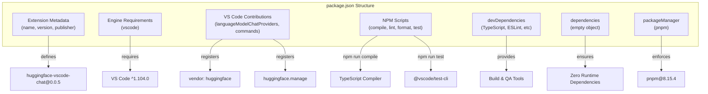
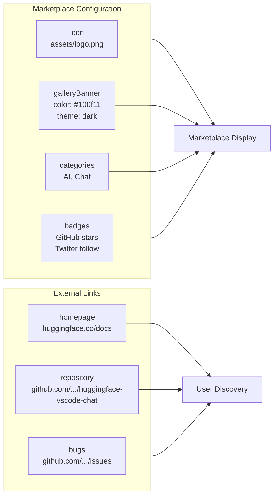
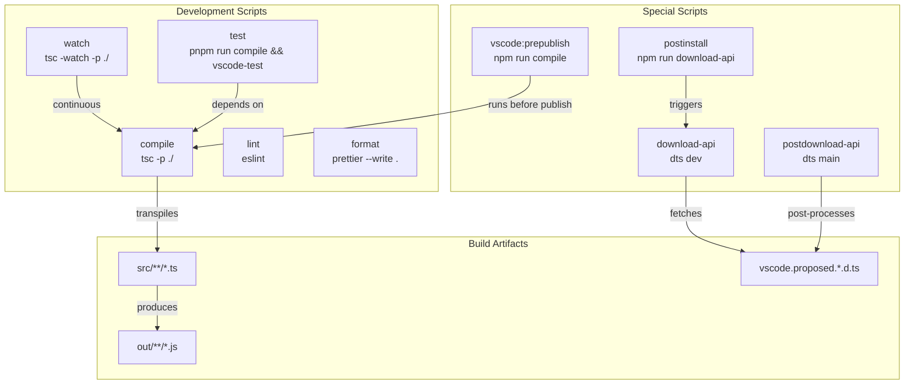
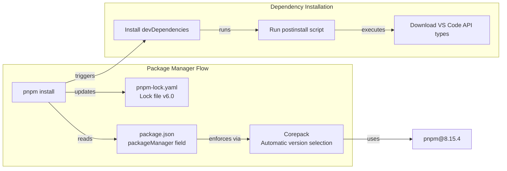

<!-- source: DeepWiki mcp.deepwiki.com · repo huggingface/huggingface-vscode-chat · page 6.1 Package Configuration · fetched 2026-10-26 -->

# Package Configuration

<details>
<summary>Relevant source files</summary>

The following files were used as context for generating this wiki page:

- [package-lock.json](package-lock.json)
- [package.json](package.json)
- [pnpm-lock.yaml](pnpm-lock.yaml)

</details>


This document provides a comprehensive reference for the package configuration of the huggingface-vscode-chat extension. It details the structure and contents of `package.json`, the extension manifest that defines metadata, VS Code integration points, build scripts, and dependencies. This configuration file is the primary descriptor for how the extension is built, tested, and published to the VS Code Marketplace.

For information about TypeScript compiler settings, see [TypeScript Configuration](#6.2). For development tool configurations like ESLint and Prettier, see [Development Tools Configuration](#6.3).

## Extension Manifest Overview

The `package.json` file serves as the central configuration document for the VS Code extension. It follows both the npm package format and the VS Code extension manifest schema, defining how the extension integrates with the VS Code ecosystem.



**Sources:** [package.json:1-83]()

## Extension Metadata

The extension metadata section defines the identity, branding, and discovery information for the VS Code Marketplace.

### Core Identity

| Field | Value | Purpose |
|-------|-------|---------|
| `name` | `huggingface-vscode-chat` | Package identifier (npm format) |
| `version` | `0.0.5` | Semantic version number |
| `publisher` | `HuggingFace` | Marketplace publisher identifier |
| `displayName` | `Hugging Face Provider for GitHub Copilot Chat` | Human-readable name in VS Code UI |
| `description` | Extension that integrates Hugging Face Inference Providers | Short description for marketplace |
| `license` | `MIT` | Open source license |

**Sources:** [package.json:2-5,11,39]()

### Marketplace Presentation

The extension includes several fields that control its appearance in the VS Code Marketplace:

- **Icon:** `assets/logo.png` provides the extension's visual identity
- **Gallery Banner:** Dark theme (`#100f11`) for consistent branding
- **Categories:** `["AI", "Chat"]` for marketplace discovery
- **Badges:** GitHub stars and Twitter follow badges for social proof
- **Homepage:** Links to Hugging Face Inference Providers documentation
- **Repository:** GitHub repository URL for source code access
- **Bug Tracking:** GitHub Issues URL for user feedback



**Sources:** [package.json:6-38]()

## VS Code Integration

The extension integrates with VS Code through engine requirements and contribution points.

### Engine Requirements

The `engines` field specifies the minimum VS Code version required:

```json
"engines": {
  "vscode": "^1.104.0"
}
```

This ensures the extension only activates in VS Code versions that support the Language Model Chat API, which was introduced in VS Code 1.104.0.

**Sources:** [package.json:12-14]()

### Contribution Points

The extension declares two contribution points that extend VS Code's functionality:

#### Language Model Chat Provider

```json
"languageModelChatProviders": [
  {
    "vendor": "huggingface",
    "displayName": "Hugging Face",
    "managementCommand": "huggingface.manage"
  }
]
```

This registers the extension as a chat model provider with:
- `vendor`: Unique identifier `"huggingface"` for the provider
- `displayName`: User-facing name shown in VS Code UI
- `managementCommand`: Command to invoke for API key management

**Sources:** [package.json:41-46]()

#### Management Command

```json
"commands": [
  {
    "command": "huggingface.manage",
    "title": "Manage Hugging Face Provider"
  }
]
```

This declares the `huggingface.manage` command that users can invoke from the Command Palette to configure their API key.

**Sources:** [package.json:48-53]()

### Entry Point

The `main` field specifies the compiled extension entry point:

```json
"main": "./out/extension.js"
```

This points to the compiled JavaScript file that exports the `activate` and `deactivate` functions required by VS Code.

**Sources:** [package.json:55]()

## Build Scripts

The `scripts` section defines npm commands for the development workflow. These scripts are invoked using `npm run <script-name>` or `pnpm run <script-name>`.

### Script Overview



**Sources:** [package.json:56-66]()

### Script Definitions

| Script | Command | Purpose |
|--------|---------|---------|
| `vscode:prepublish` | `npm run compile` | Runs before extension is packaged for publishing |
| `download-api` | `dts dev` | Downloads VS Code proposed API type definitions (dev channel) |
| `postdownload-api` | `dts main` | Downloads VS Code stable API type definitions |
| `postinstall` | `npm run download-api` | Automatically runs after `npm install` |
| `compile` | `tsc -p ./` | Compiles TypeScript to JavaScript |
| `lint` | `eslint` | Runs ESLint on source files |
| `format` | `prettier --write .` | Formats code with Prettier |
| `watch` | `tsc -watch -p ./` | Compiles TypeScript in watch mode |
| `test` | `pnpm run compile && vscode-test` | Compiles and runs tests |

### Lifecycle Scripts

The extension uses npm lifecycle hooks for automation:

1. **`postinstall`**: Automatically runs after dependency installation to download VS Code API types using `@vscode/dts`
2. **`vscode:prepublish`**: Automatically runs before publishing to marketplace, ensuring code is compiled

### API Type Management

The `download-api` and `postdownload-api` scripts use the `@vscode/dts` package to download VS Code type definitions. This ensures the extension has access to the latest API types, including proposed APIs that may not yet be in `@types/vscode`.

**Sources:** [package.json:56-66]()

## Dependencies

The extension has a distinctive dependency structure: all dependencies are development-only, with zero runtime dependencies.

### Runtime Dependencies

```json
"dependencies": {}
```

The empty `dependencies` object indicates the compiled extension has no external runtime dependencies. This is intentional and provides several benefits:

- **Smaller package size**: No node_modules to bundle
- **Faster activation**: No dependencies to load at runtime
- **Fewer security concerns**: Reduced attack surface
- **Simpler deployment**: Extension is self-contained

**Sources:** [package.json:67]()

### Development Dependencies

All dependencies are declared as `devDependencies`, used only during development and build processes.

```mermaid
graph TB
    subgraph "TypeScript Ecosystem"
        TS["typescript@^5.9.2"]
        TSNode["@types/node@^22"]
        TSVSCode["@types/vscode@^1.103.0"]
        TSMocha["@types/mocha@^10.0.6"]
    end
    
    subgraph "Linting & Formatting"
        ESLint["eslint@^9.13.0"]
        ESLintJS["@eslint/js@^9.13.0"]
        TSESLint["typescript-eslint@^8.39.0"]
        Stylistic["@stylistic/eslint-plugin@^2.9.0"]
        Prettier["prettier@^3.1.0"]
    end
    
    subgraph "Testing Infrastructure"
        VSCodeDTS["@vscode/dts@^0.4.1"]
        VSCodeTestCLI["@vscode/test-cli@^0.0.11"]
        VSCodeTestElectron["@vscode/test-electron@^2.5.2"]
    end
    
    TS -->|"compiles"| SourceCode["src/**/*.ts"]
    TSNode -->|"provides types for"| NodeAPI["Node.js APIs"]
    TSVSCode -->|"provides types for"| VSCodeAPI["VS Code API"]
    TSMocha -->|"provides types for"| TestFramework["Mocha test framework"]
    
    ESLint -->|"lints with"| ESLintJS
    ESLint -->|"configured by"| TSESLint
    ESLint -->|"styled by"| Stylistic
    Prettier -->|"formats"| SourceCode
    
    VSCodeDTS -->|"downloads"| ProposedAPI["Proposed API types"]
    VSCodeTestCLI -->|"runs"| Tests["Test suite"]
    VSCodeTestElectron -->|"provides"| TestEnvironment["VS Code test environment"]
```



**Sources:** [package.json:68-81]()

### Dependency Categories

#### TypeScript Compilation

| Package | Version | Purpose |
|---------|---------|---------|
| `typescript` | `^5.9.2` | TypeScript compiler |
| `@types/node` | `^22` | Node.js type definitions |
| `@types/vscode` | `^1.103.0` | VS Code API type definitions |
| `@types/mocha` | `^10.0.6` | Mocha test framework types |

#### Code Quality Tools

| Package | Version | Purpose |
|---------|---------|---------|
| `eslint` | `^9.13.0` | JavaScript/TypeScript linter |
| `@eslint/js` | `^9.13.0` | ESLint JavaScript rules |
| `typescript-eslint` | `^8.39.0` | TypeScript-specific ESLint rules |
| `@stylistic/eslint-plugin` | `^2.9.0` | Code style linting rules |
| `prettier` | `^3.1.0` | Code formatter |

#### Testing Infrastructure

| Package | Version | Purpose |
|---------|---------|---------|
| `@vscode/dts` | `^0.4.1` | VS Code API type downloader |
| `@vscode/test-cli` | `^0.0.11` | Test CLI for VS Code extensions |
| `@vscode/test-electron` | `^2.5.2` | Electron-based test environment |

**Sources:** [package.json:68-81]()

## Package Management

The extension uses pnpm as its package manager, enforced through the `packageManager` field.

### Package Manager Configuration

```json
"packageManager": "pnpm@8.15.4+sha512.0bd3a9be9eb0e9a692676deec00a303ba218ba279d99241475616b398dbaeedd11146f92c2843458f557b1d127e09d4c171e105bdcd6b61002b39685a8016b9e"
```

This field:
- **Enforces pnpm version**: Specifically `8.15.4`
- **Includes integrity hash**: The SHA-512 hash ensures the exact binary is used
- **Enables Corepack**: VS Code and Node.js use Corepack to automatically use the correct package manager

**Sources:** [package.json:82]()

### Lock Files

The repository contains two lock files:

1. **`pnpm-lock.yaml`**: The primary lock file for pnpm (not included in provided files)
2. **`package-lock.json`**: npm lock file for compatibility

The `package-lock.json` file has several characteristics:

- **Lock file version**: 3 (npm v7+ format)
- **Install script**: Marked as `"hasInstallScript": true` due to `postinstall` script
- **Engines constraint**: Enforces `vscode ^1.104.0`



**Sources:** [package.json:82](), [package-lock.json:1-29]()

## Build and Distribution

The package configuration supports the complete build and distribution workflow.

### Build Process

1. **TypeScript Compilation**: `npm run compile` invokes `tsc -p ./`
2. **Source Maps**: Generated alongside compiled JavaScript files
3. **Output Directory**: Compiled files written to `out/` directory
4. **Entry Point**: `./out/extension.js` is the main module

### Pre-Publish Steps

The `vscode:prepublish` script ensures code is compiled before packaging:

```bash
npm run vscode:prepublish  # Compiles TypeScript
vsce package               # Creates .vsix file
vsce publish               # Publishes to marketplace
```

### Quality Assurance

Before publishing, developers should run:

```bash
npm run lint      # Check code quality
npm run format    # Format code
npm run test      # Run test suite
```

**Sources:** [package.json:56-66]()

## Configuration Summary

The package configuration demonstrates several best practices for VS Code extensions:

1. **Zero Runtime Dependencies**: Compiled extension is self-contained
2. **Comprehensive Dev Tooling**: TypeScript, ESLint, Prettier, and testing tools
3. **Automated API Types**: Downloads VS Code API definitions automatically
4. **Consistent Package Management**: Enforces pnpm version via Corepack
5. **Marketplace Optimization**: Complete metadata for discovery and branding
6. **VS Code Integration**: Proper contribution points and engine requirements

This configuration enables a professional development workflow while maintaining a lean, efficient runtime bundle.

**Sources:** [package.json:1-83]()

---

