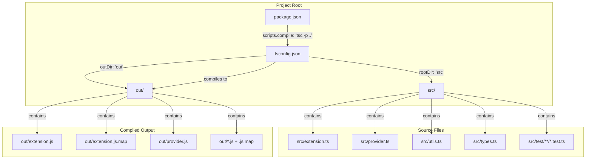
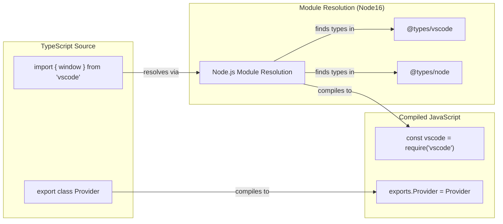
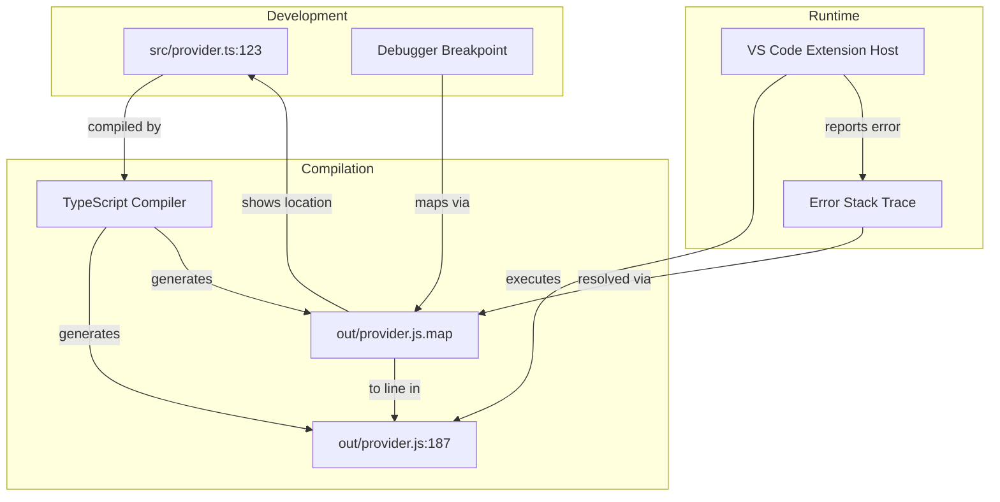
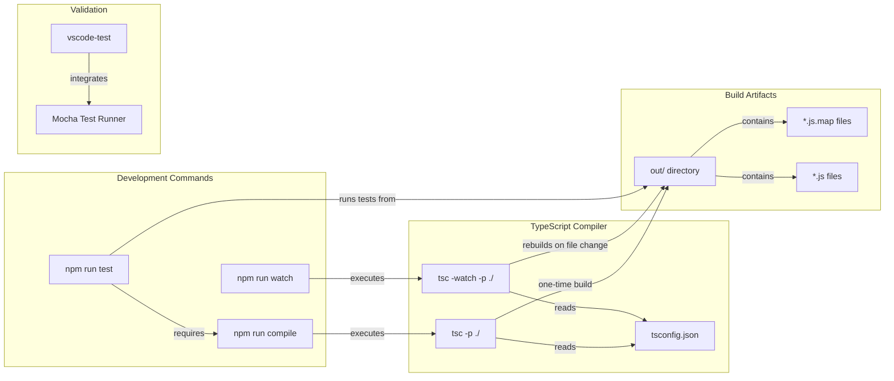

<!-- source: DeepWiki mcp.deepwiki.com · repo huggingface/huggingface-vscode-chat · page 6.2 TypeScript Configuration · fetched 2026-10-26 -->

# TypeScript Configuration

<details>
<summary>Relevant source files</summary>

The following files were used as context for generating this wiki page:

- [package.json](package.json)
- [tsconfig.json](tsconfig.json)

</details>


## Purpose and Scope

This document details the TypeScript compiler configuration for the huggingface-vscode-chat extension. It explains the settings in `tsconfig.json`, their rationale, and how they integrate with the build pipeline. 

For information about package scripts and build execution, see [Package Configuration](#6.1). For linting and formatting configuration, see [Development Tools Configuration](#6.3). For compilation instructions, see [Building and Compilation](#5.2).

**Sources:** [tsconfig.json:1-17]()

---

## Configuration File Location and Structure

The TypeScript configuration is defined in `tsconfig.json` at the repository root. This file controls how the TypeScript compiler (`tsc`) processes source files and generates JavaScript output.



**Sources:** [tsconfig.json:1-17](), [package.json:61]()

---

## Compiler Options Reference

The following table details all compiler options configured in `tsconfig.json`:

| Option | Value | Purpose |
|--------|-------|---------|
| `module` | `"Node16"` | Specifies Node.js 16+ module resolution and ES module interop |
| `target` | `"ES2024"` | Compiles to ES2024 JavaScript features |
| `lib` | `["ES2024"]` | Includes ES2024 type definitions for modern JavaScript APIs |
| `sourceMap` | `true` | Generates `.js.map` files for debugging TypeScript in VS Code |
| `rootDir` | `"src"` | Sets source file directory, preserving structure in output |
| `strict` | `true` | Enables all strict type-checking options |
| `outDir` | `"out"` | Specifies output directory for compiled JavaScript |
| `skipLibCheck` | `true` | Skips type checking of `.d.ts` files for faster compilation |
| `types` | `["node", "mocha"]` | Includes type definitions for Node.js APIs and Mocha testing |

**Sources:** [tsconfig.json:2-11]()

---

## Module System Configuration

The extension uses Node.js 16+ module resolution (`"module": "Node16"`), which provides:

- **CommonJS and ES Module Interoperability**: Handles both `require()` and `import` statements correctly
- **Package Exports Field Support**: Respects `exports` field in `package.json` dependencies
- **Conditional Exports**: Supports Node.js conditional exports patterns

This module system aligns with VS Code's extension host environment, which runs on Node.js.



**Sources:** [tsconfig.json:3](), [package.json:12-14]()

---

## Target and Library Settings

### Target: ES2024

The `"target": "ES2024"` setting compiles TypeScript to ES2024 JavaScript, enabling:

- Modern async/await patterns
- Object spread/rest operators
- Optional chaining (`?.`) and nullish coalescing (`??`)
- Class fields and private methods
- Top-level await (where supported)

### Library: ES2024

The `"lib": ["ES2024"]` setting provides type definitions for:

- `Promise`, `async`/`await` APIs
- `Array.prototype.at()`, `String.prototype.replaceAll()`
- `Object.hasOwn()`, `Array.prototype.findLast()`
- ES2024 global types and built-in objects

This configuration assumes the VS Code extension host (Electron/Node.js) supports these features, which it does as of VS Code 1.104.0.

**Sources:** [tsconfig.json:4-5](), [package.json:12-14]()

---

## Strict Type Checking

The `"strict": true` option enables all strict type-checking options, including:

| Strict Option | Effect |
|---------------|--------|
| `strictNullChecks` | `null` and `undefined` require explicit handling |
| `strictFunctionTypes` | Function parameter types are checked contravariantly |
| `strictBindCallApply` | `bind`, `call`, `apply` have accurate type signatures |
| `strictPropertyInitialization` | Class properties must be initialized |
| `noImplicitAny` | Variables must have explicit or inferred types |
| `noImplicitThis` | `this` expressions require explicit typing |
| `alwaysStrict` | Emits `"use strict"` in JavaScript output |

This ensures type safety throughout the codebase, preventing common runtime errors.

**Sources:** [tsconfig.json:8]()

---

## Source Mapping and Debugging

The `"sourceMap": true` option generates `.js.map` files alongside compiled JavaScript. This enables:

1. **Breakpoint Debugging**: Set breakpoints in `.ts` files that map to compiled `.js` code
2. **Stack Traces**: Error stack traces reference original TypeScript line numbers
3. **Variable Inspection**: Inspect TypeScript variables during debugging sessions

The source maps are used by VS Code's debugger when developing or debugging the extension.



**Sources:** [tsconfig.json:6]()

---

## Directory Structure Configuration

### Root Directory

The `"rootDir": "src"` setting specifies that all source files reside in the `src/` directory. This ensures:

- Output directory structure mirrors source directory structure
- Import paths are resolved relative to `src/`
- TypeScript only compiles files under `src/` (plus type definitions)

### Output Directory

The `"outDir": "out"` setting directs all compiled JavaScript to the `out/` directory. The `package.json` main entry point references this compiled output:

```json
"main": "./out/extension.js"
```

| Source File | Output File |
|-------------|-------------|
| `src/extension.ts` | `out/extension.js` |
| `src/provider.ts` | `out/provider.js` |
| `src/utils.ts` | `out/utils.js` |
| `src/types.ts` | `out/types.js` |
| `src/test/suite/extension.test.ts` | `out/test/suite/extension.test.js` |

**Sources:** [tsconfig.json:7,9](), [package.json:55]()

---

## Type Definitions

The `"types": ["node", "mocha"]` option explicitly includes type definitions for:

### @types/node

Provides Node.js API type definitions used throughout the extension:

- `fetch()` for HTTP requests to Hugging Face API
- `Buffer` for handling streaming response chunks
- `URL` for endpoint construction
- `AbortController` for request cancellation

These types are referenced in files like [src/provider.ts]() for API communication.

### @types/mocha

Provides Mocha testing framework type definitions:

- `describe()`, `it()` test structure functions
- `before()`, `after()` lifecycle hooks
- Assertion types for test files

These types are used in test files under [src/test/]().

### VS Code Types

While not listed in `"types"` (as it's inferred), `@types/vscode` is the primary type definition package, providing:

- `vscode.LanguageModelChatProvider` interface
- `vscode.SecretStorage` API types
- Extension activation context types

**Sources:** [tsconfig.json:11](), [package.json:71-76]()

---

## Build Pipeline Integration

The TypeScript compiler integrates with npm scripts defined in `package.json`:



### Compilation Commands

| Command | Script | Purpose |
|---------|--------|---------|
| `npm run compile` | `tsc -p ./` | One-time compilation for production/testing |
| `npm run watch` | `tsc -watch -p ./` | Continuous compilation during development |
| `npm run test` | `pnpm run compile && vscode-test` | Compiles before running tests |
| `npm run vscode:prepublish` | `npm run compile` | Pre-publish hook for marketplace packaging |

The `-p ./` flag tells `tsc` to use the `tsconfig.json` in the current directory.

**Sources:** [package.json:56-65](), [tsconfig.json:1-17]()

---

## Performance Optimizations

### Skip Library Checking

The `"skipLibCheck": true` option skips type checking of all `.d.ts` declaration files. This:

- **Reduces Compilation Time**: Avoids checking third-party type definitions
- **Prevents Type Conflicts**: Ignores inconsistencies in dependency type files
- **Maintains Safety**: Still checks project source code strictly

This is standard practice for VS Code extensions, as dependency types are maintained by their respective packages.

### Commented Options

The configuration includes commented-out options that may be enabled for stricter checking:

```typescript
// "noImplicitReturns": true  // Ensures all code paths return a value
// "noFallthroughCasesInSwitch": true  // Requires explicit break/return in switches
// "noUnusedParameters": true  // Reports unused function parameters
```

These are disabled to maintain development flexibility while `strict: true` provides baseline safety.

**Sources:** [tsconfig.json:10,13-15]()

---

## Version Compatibility

The TypeScript configuration ensures compatibility with:

| Dependency | Version Requirement | Reason |
|------------|-------------------|---------|
| TypeScript | `^5.9.2` | Compiler version with ES2024 support |
| VS Code | `^1.104.0` | Extension host with required APIs |
| Node.js | v16+ (implicit via `Node16` module) | Runtime environment for extension |

The `Node16` module setting assumes Node.js 16 or higher, which VS Code 1.104.0 provides (Electron with Node.js 18+).

**Sources:** [tsconfig.json:3](), [package.json:12-14,79]()

---

## Summary

The TypeScript configuration provides:

1. **Modern JavaScript Support**: ES2024 target and library features
2. **Strict Type Safety**: Full strict mode enabled for error prevention  
3. **Debugging Support**: Source maps for TypeScript debugging in VS Code
4. **Node.js Compatibility**: Node16 module resolution for extension host
5. **Optimized Performance**: Library checking skipped for faster builds
6. **Clear Structure**: Separated source (`src/`) and output (`out/`) directories

This configuration balances developer experience with type safety and runtime compatibility requirements for VS Code extensions.

**Sources:** [tsconfig.json:1-17](), [package.json:55-65]()

---

