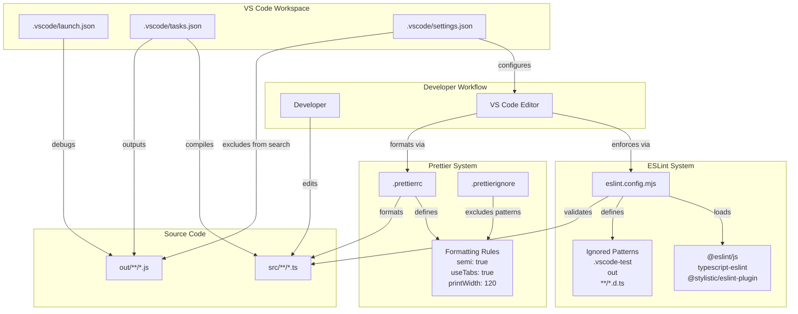
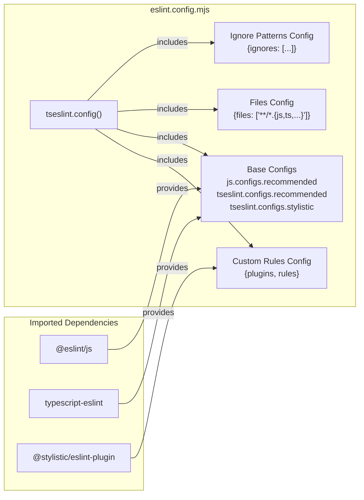
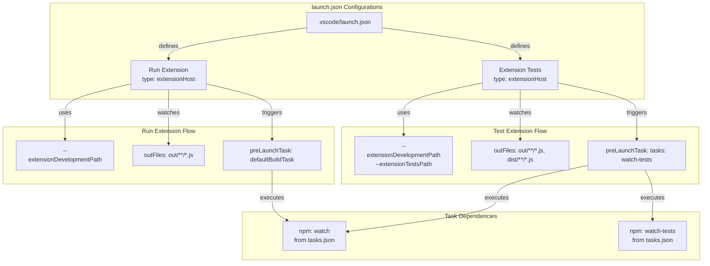
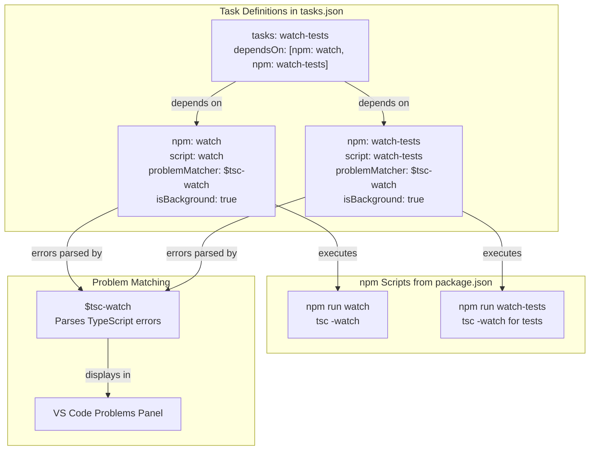
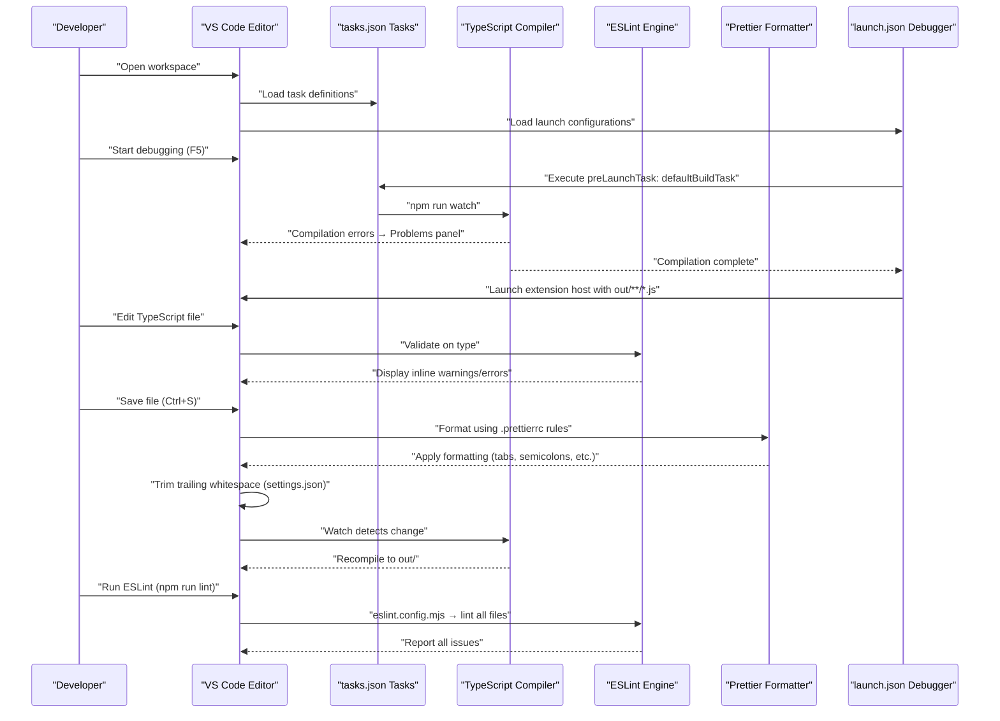

<!-- source: DeepWiki mcp.deepwiki.com · repo huggingface/huggingface-vscode-chat · page 6.3 Development Tools Configuration · fetched 2026-10-26 -->

# Development Tools Configuration

<details>
<summary>Relevant source files</summary>

The following files were used as context for generating this wiki page:

- [.prettierignore](.prettierignore)
- [.prettierrc](.prettierrc)
- [.vscode/launch.json](.vscode/launch.json)
- [.vscode/settings.json](.vscode/settings.json)
- [.vscode/tasks.json](.vscode/tasks.json)
- [eslint.config.mjs](eslint.config.mjs)

</details>


## Purpose and Scope

This document provides a comprehensive reference for all development tool configurations in the huggingface-vscode-chat extension. It covers ESLint linting rules, Prettier formatting settings, and VS Code workspace configurations that ensure code quality and developer productivity.

For information about using these tools in development workflows, see [Code Quality Tools](#5.4). For TypeScript compiler configuration, see [TypeScript Configuration](#6.2). For build scripts that invoke these tools, see [Package Configuration](#6.1).

---

## Configuration File Ecosystem

The extension uses three primary development tools, each with dedicated configuration files:

| Tool | Configuration Files | Primary Purpose |
|------|-------------------|-----------------|
| **ESLint** | `eslint.config.mjs` | Code quality enforcement and TypeScript-specific linting |
| **Prettier** | `.prettierrc`, `.prettierignore` | Code formatting and style consistency |
| **VS Code** | `.vscode/launch.json`, `.vscode/tasks.json`, `.vscode/settings.json` | Debugging, task automation, and workspace settings |

### Configuration File Relationships



**Sources:** [eslint.config.mjs:1-49](), [.prettierrc:1-7](), [.prettierignore:1-10](), [.vscode/launch.json:1-35](), [.vscode/tasks.json:1-40](), [.vscode/settings.json:1-9]()

---

## ESLint Configuration

The extension uses ESLint 9.x with the new flat configuration format defined in `eslint.config.mjs`. This configuration integrates TypeScript-specific rules and stylistic preferences.

### Configuration Structure



**Sources:** [eslint.config.mjs:1-49]()

### Ignore Patterns

The ESLint configuration excludes specific directories and file patterns from linting:

| Pattern | Purpose |
|---------|---------|
| `.vscode-test` | VS Code test runner temporary files |
| `out` | Compiled JavaScript output |
| `**/*.d.ts` | TypeScript declaration files (auto-generated) |

**Sources:** [eslint.config.mjs:13-17]()

### Plugin Configuration

The configuration loads three plugin systems:

1. **@eslint/js** - Core JavaScript recommended rules
2. **typescript-eslint** - TypeScript-specific linting and type checking
3. **@stylistic/eslint-plugin** - Style-focused rules for code formatting

**Sources:** [eslint.config.mjs:7-9](), [eslint.config.mjs:22-24]()

### Custom Rule Set

The following table documents all custom rules configured in [eslint.config.mjs:29-47]():

| Rule | Configuration | Purpose |
|------|--------------|---------|
| `curly` | `'warn'` | Enforces consistent brace style for control statements |
| `@stylistic/semi` | `['warn', 'always']` | Requires semicolons at the end of statements |
| `@typescript-eslint/no-empty-function` | `'off'` | Allows empty function bodies (common in stubs) |
| `@typescript-eslint/array-type` | `'off'` | No enforcement of array type syntax (allows both `T[]` and `Array<T>`) |
| `@typescript-eslint/naming-convention` | `['warn', {...}]` | Enforces camelCase or PascalCase for imports |
| `@typescript-eslint/no-unused-vars` | `['error', {...}]` | Errors on unused variables, except those prefixed with `_` |

**Sources:** [eslint.config.mjs:29-47]()

---

## Prettier Configuration

Prettier provides automated code formatting with configuration split across two files: `.prettierrc` for formatting rules and `.prettierignore` for exclusion patterns.

### Formatting Rules

The `.prettierrc` file defines the following formatting preferences:

```json
{
  "semi": true,
  "useTabs": true,
  "tabWidth": 2,
  "printWidth": 120,
  "trailingComma": "es5"
}
```

| Property | Value | Effect |
|----------|-------|--------|
| `semi` | `true` | Adds semicolons at the end of statements |
| `useTabs` | `true` | Uses tabs for indentation instead of spaces |
| `tabWidth` | `2` | Sets tab width to 2 spaces when displayed |
| `printWidth` | `120` | Wraps lines at 120 characters |
| `trailingComma` | `"es5"` | Adds trailing commas where valid in ES5 (objects, arrays) |

**Sources:** [.prettierrc:1-7]()

### Exclusion Patterns

The `.prettierignore` file prevents Prettier from formatting specific file types and directories:

| Pattern | Reason for Exclusion |
|---------|---------------------|
| `dist/**` | Distribution artifacts |
| `.vscode/**` | VS Code configuration (JSON formatting may differ) |
| `.vscode-test/**` | Test runner temporary files |
| `.git-blame-ignore-revs` | Git metadata file |
| `**/*.md` | Markdown files (preserve manual formatting) |
| `**/*.yml` | YAML files (sensitive to whitespace) |
| `**/*.json` | JSON files (may have specific formatting requirements) |
| `**/*.mjs` | Module JavaScript (including `eslint.config.mjs`) |
| `**/*vscode.d.ts` | VS Code type definitions (external) |
| `.build/**` | Build output directory |

**Sources:** [.prettierignore:1-10]()

---

## VS Code Workspace Configuration

The `.vscode` directory contains three configuration files that define the development experience within VS Code.

### Launch Configuration Architecture



**Sources:** [.vscode/launch.json:1-35](), [.vscode/tasks.json:1-40]()

### Launch Configurations

The `launch.json` file defines two debugging configurations:

#### Run Extension Configuration

Located at [.vscode/launch.json:8-19](), this configuration launches the extension in a development host:

- **Name:** `"Run Extension"`
- **Type:** `"extensionHost"`
- **Arguments:**
  - `--extensionDevelopmentPath=${workspaceFolder}` - Points to the extension root
- **Output Files:** `${workspaceFolder}/out/**/*.js` - JavaScript files for debugging
- **Pre-Launch Task:** `${defaultBuildTask}` - Compiles TypeScript before launching

#### Extension Tests Configuration

Located at [.vscode/launch.json:21-33](), this configuration runs the test suite:

- **Name:** `"Extension Tests"`
- **Type:** `"extensionHost"`
- **Arguments:**
  - `--extensionDevelopmentPath=${workspaceFolder}`
  - `--extensionTestsPath=${workspaceFolder}/out/test/suite/index` - Test entry point
- **Output Files:** Includes both `out/**/*.js` and `dist/**/*.js`
- **Pre-Launch Task:** `"tasks: watch-tests"` - Multi-task watcher

**Sources:** [.vscode/launch.json:1-35]()

### Task Configuration

The `tasks.json` file defines build automation tasks referenced by the launch configurations.

#### Task Definitions

| Task Label | Type | Script | Problem Matcher | Purpose |
|-----------|------|--------|----------------|---------|
| *(default)* | `npm` | `watch` | `$tsc-watch` | Watches and compiles TypeScript in real-time |
| *(unnamed)* | `npm` | `watch-tests` | `$tsc-watch` | Watches test files for changes |
| `tasks: watch-tests` | *(composite)* | N/A | None | Runs both `npm: watch` and `npm: watch-tests` in parallel |

**Sources:** [.vscode/tasks.json:1-40]()

#### Task Workflow



**Sources:** [.vscode/tasks.json:6-18](), [.vscode/tasks.json:20-29](), [.vscode/tasks.json:31-38]()

#### Build Task Configuration

The default build task ([.vscode/tasks.json:15-18]()) is configured with:

- **Group:** `"build"` with `"isDefault": true` - Makes it the default build task (Ctrl+Shift+B)
- **Presentation:** `"reveal": "never"` and `"group": "watchers"` - Runs silently in background

**Sources:** [.vscode/tasks.json:6-18]()

### Workspace Settings

The `settings.json` file configures workspace-specific VS Code behavior:

```json
{
    "search.exclude": {
        "out": true
    },
    "git.branchProtection": [
        "main"
    ],
    "files.trimTrailingWhitespace": true
}
```

| Setting | Value | Purpose |
|---------|-------|---------|
| `search.exclude.out` | `true` | Excludes compiled `out/` directory from search results |
| `git.branchProtection` | `["main"]` | Prevents direct commits to the `main` branch |
| `files.trimTrailingWhitespace` | `true` | Automatically removes trailing whitespace on save |

**Sources:** [.vscode/settings.json:1-9]()

---

## Tool Integration and Workflow

### Development Workflow Integration



**Sources:** [.vscode/launch.json:1-35](), [.vscode/tasks.json:1-40](), [.vscode/settings.json:1-9](), [eslint.config.mjs:1-49](), [.prettierrc:1-7]()

### Configuration File Dependencies

The following table shows how configuration files reference each other:

| Configuration File | References | Referenced By |
|-------------------|-----------|---------------|
| `eslint.config.mjs` | `@eslint/js`, `typescript-eslint`, `@stylistic/eslint-plugin` | `package.json` (npm scripts) |
| `.prettierrc` | None | `package.json` (npm scripts) |
| `.prettierignore` | `.prettierrc` (implicit) | Prettier CLI |
| `.vscode/launch.json` | `.vscode/tasks.json` (via `preLaunchTask`) | VS Code debugger |
| `.vscode/tasks.json` | `package.json` (via npm scripts) | `.vscode/launch.json` |
| `.vscode/settings.json` | None | VS Code editor |

**Sources:** [eslint.config.mjs:7-9](), [.vscode/launch.json:18](), [.vscode/launch.json:32](), [.vscode/tasks.json:8](), [.vscode/tasks.json:22]()

### Problem Matcher Configuration

Both watch tasks in `tasks.json` use the `$tsc-watch` problem matcher, which:

1. **Parses TypeScript Compiler Output:** Detects error messages from `tsc -watch`
2. **Updates Problems Panel:** Displays compilation errors in real-time
3. **Enables Background Mode:** Allows tasks to run continuously with `"isBackground": true`

The problem matcher patterns are built into VS Code and match TypeScript compiler output format.

**Sources:** [.vscode/tasks.json:9](), [.vscode/tasks.json:23]()

---

## Summary

The development tools configuration ecosystem consists of:

- **ESLint** ([eslint.config.mjs]()) - Enforces code quality with TypeScript-specific rules, stylistic preferences, and custom naming conventions
- **Prettier** ([.prettierrc](), [.prettierignore]()) - Ensures consistent formatting with tab-based indentation, 120-character line width, and ES5 trailing commas
- **VS Code Workspace** ([.vscode/*]()) - Provides debugging configurations, automated build tasks, and workspace-specific editor settings

These tools integrate seamlessly through VS Code's task system, pre-launch hooks, and problem matchers to provide real-time feedback during development.

---

