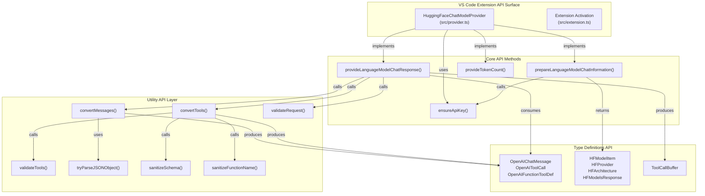
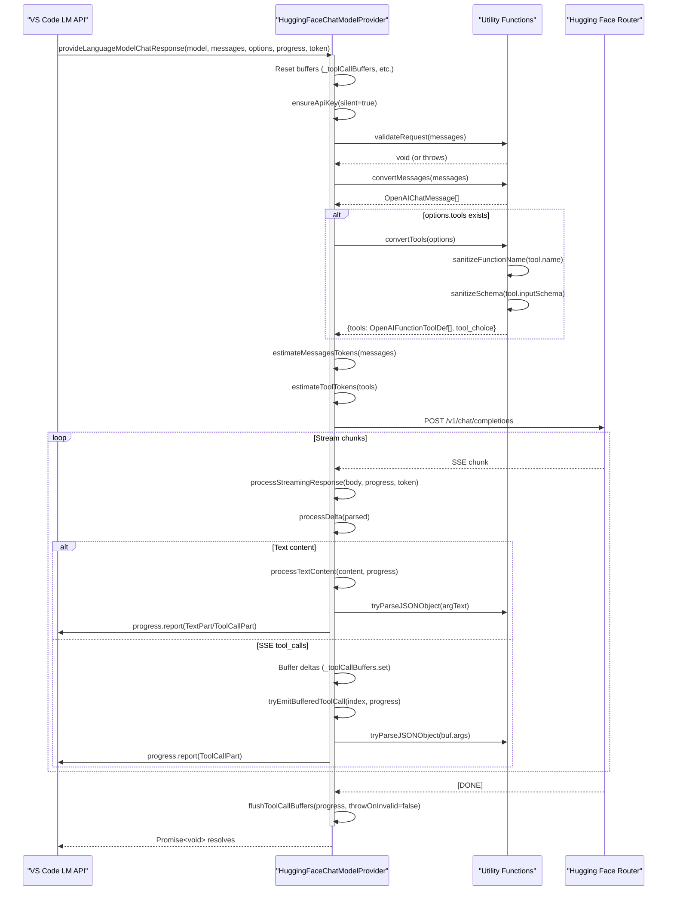
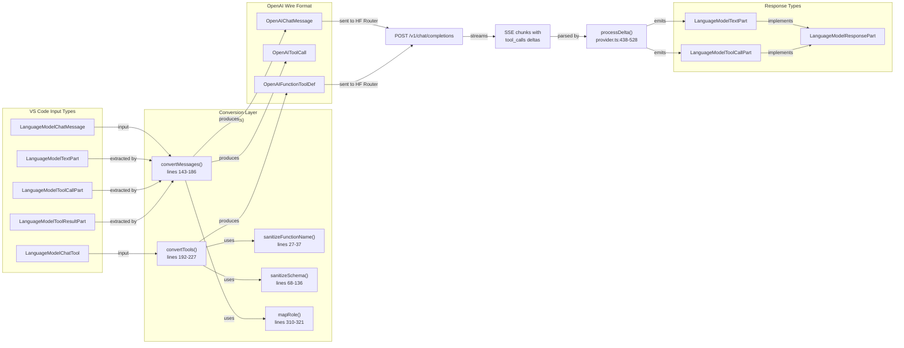
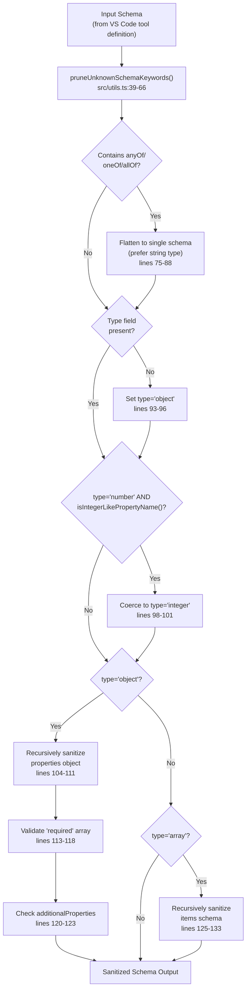

<!-- source: DeepWiki mcp.deepwiki.com · repo huggingface/huggingface-vscode-chat · page 7 API Reference · fetched 2026-10-26 -->

# API Reference

<details>
<summary>Relevant source files</summary>

The following files were used as context for generating this wiki page:

- [src/provider.ts](src/provider.ts)
- [src/types.ts](src/types.ts)
- [src/utils.ts](src/utils.ts)

</details>


This document provides a comprehensive reference for the extension's public and internal APIs. It covers the provider implementation, utility functions, and type definitions that together enable the Hugging Face chat integration with VS Code.

For configuration-related APIs and options, see [Configuration Reference](#6). For architectural patterns and design decisions, see [Architecture](#3).

## API Overview

The extension's API surface consists of three primary layers: the VS Code provider interface implementation, data conversion utilities, and type definitions for internal and external data structures.



**Sources:** [src/provider.ts](), [src/utils.ts](), [src/types.ts](), [src/extension.ts]()

## Core API Components

### Provider Interface

The `HuggingFaceChatModelProvider` class implements VS Code's `LanguageModelChatProvider` interface, providing the primary integration point with the editor's language model API.

| Method | Purpose | Return Type |
|--------|---------|-------------|
| `prepareLanguageModelChatInformation()` | Discovers and returns available Hugging Face models | `Promise<LanguageModelChatInformation[]>` |
| `provideLanguageModelChatResponse()` | Streams chat completion responses with tool calling support | `Promise<void>` |
| `provideTokenCount()` | Estimates token count for messages or text | `Promise<number>` |

Detailed method signatures and implementation details are documented in [Provider API](#7.1).

**Sources:** [src/provider.ts:23-781]()

### Conversion Utilities

The utility layer transforms VS Code data structures into OpenAI-compatible formats for the Hugging Face Router API:

| Function | Input | Output | Purpose |
|----------|-------|--------|---------|
| `convertMessages()` | `LanguageModelChatMessage[]` | `OpenAIChatMessage[]` | Converts VS Code messages to OpenAI format |
| `convertTools()` | `LanguageModelChatRequestHandleOptions` | `{tools?, tool_choice?}` | Converts tool definitions with sanitization |
| `validateRequest()` | `LanguageModelChatMessage[]` | `void` (throws on error) | Validates tool call/result pairing |
| `validateTools()` | `LanguageModelChatTool[]` | `void` (throws on error) | Validates tool name format |
| `tryParseJSONObject()` | `string` | `{ok: boolean, value?}` | Safely parses JSON objects |

Complete function documentation is available in [Utility Functions API](#7.2).

**Sources:** [src/utils.ts:143-363]()

### Type System

The type definitions provide contracts between VS Code, the extension, and the Hugging Face API:

- **OpenAI Types**: `OpenAIChatMessage`, `OpenAIToolCall`, `OpenAIFunctionToolDef` - wire format for API requests
- **Hugging Face Types**: `HFModelItem`, `HFProvider`, `HFModelsResponse` - model discovery responses
- **Internal Types**: `ToolCallBuffer` - streaming state management

Type definitions are fully documented in [Type Definitions](#7.3).

**Sources:** [src/types.ts:1-85]()

## API Interaction Flow

The following diagram illustrates how API components interact during a typical chat request:



**Sources:** [src/provider.ts:214-327](), [src/provider.ts:381-431](), [src/provider.ts:438-528](), [src/utils.ts:143-227]()

## Data Transformation Architecture

This diagram maps the transformation pipeline from VS Code types through internal processing to external API formats:



**Sources:** [src/utils.ts:143-186](), [src/utils.ts:192-227](), [src/provider.ts:438-528](), [src/types.ts:1-28]()

## Internal State Management API

The provider maintains several internal state maps and buffers for streaming response processing:

| Property | Type | Purpose | Location |
|----------|------|---------|----------|
| `_toolCallBuffers` | `Map<number, {id?, name?, args}>` | Accumulates streamed tool call deltas by index | [src/provider.ts:26-29]() |
| `_completedToolCallIndices` | `Set<number>` | Tracks emitted tool calls to prevent duplicates | [src/provider.ts:32]() |
| `_hasEmittedAssistantText` | `boolean` | Tracks if text was emitted before tool calls | [src/provider.ts:35]() |
| `_emittedBeginToolCallsHint` | `boolean` | Tracks whitespace flush for UI linkifier | [src/provider.ts:38]() |
| `_textToolParserBuffer` | `string` | Buffers partial control tokens | [src/provider.ts:41]() |
| `_textToolActive` | `{name?, index?, argBuffer, emitted?}` | Active text-embedded tool call state | [src/provider.ts:42-49]() |
| `_emittedTextToolCallKeys` | `Set<string>` | Deduplication for text-based tool calls | [src/provider.ts:50]() |
| `_emittedTextToolCallIds` | `Set<string>` | Identity-based deduplication | [src/provider.ts:51]() |

These state properties are reset at the beginning of each `provideLanguageModelChatResponse()` call [src/provider.ts:222-229]() and cleaned up in the finally block [src/provider.ts:422-430]().

**Sources:** [src/provider.ts:24-51](), [src/provider.ts:222-229](), [src/provider.ts:420-430]()

## Schema Sanitization API

The schema sanitization system ensures tool definitions are compatible with the Hugging Face Router API:



**Sources:** [src/utils.ts:39-136](), [src/utils.ts:6-25]()

## Tool Calling Protocol Support

The extension supports two parallel tool calling protocols:

### SSE-Based Tool Calls

Standard Server-Sent Events format with `tool_calls` deltas:

```typescript
// Streamed delta format from Hugging Face Router
{
  choices: [{
    delta: {
      tool_calls: [{
        index: 0,
        id: "call_abc123",
        function: {
          name: "get_weather",
          arguments: "{\"location\":"  // streamed incrementally
        }
      }]
    }
  }]
}
```

Processing occurs in [src/provider.ts:488-520](), with buffering at [src/provider.ts:504-515]() and emission at [src/provider.ts:709-733]().

### Text-Embedded Tool Calls

Control token-based format embedded in content stream:

```typescript
// Format: <|tool_call_begin|>name:index<|tool_call_argument_begin|>{"arg":"val"}<|tool_call_end|>
const BEGIN = "<|tool_call_begin|>";
const ARG_BEGIN = "<|tool_call_argument_begin|>";
const END = "<|tool_call_end|>";
```

Processing occurs in [src/provider.ts:534-657]() with state machine parsing and incremental JSON validation.

**Sources:** [src/provider.ts:488-520](), [src/provider.ts:534-657](), [src/provider.ts:709-733]()

## Error Handling Patterns

The API uses consistent error handling patterns across all layers:

| Error Type | Detection Location | Handling Strategy |
|------------|-------------------|-------------------|
| Invalid API key | `ensureApiKey()` [src/provider.ts:358-373]() | Prompt user (non-silent) or return undefined |
| Invalid tool names | `validateTools()` [src/utils.ts:233-242]() | Throw with descriptive message |
| Malformed messages | `validateRequest()` [src/utils.ts:248-290]() | Throw when tool calls lack matching results |
| Invalid JSON tool args | `tryParseJSONObject()` [src/utils.ts:350-363]() | Return `{ok: false}` for safe handling |
| Token limit exceeded | `provideLanguageModelChatResponse()` [src/provider.ts:264-267]() | Throw before API call |
| API HTTP errors | `fetchModels()` [src/provider.ts:178-189]() | Throw with status and response text |
| Streaming parse errors | `processStreamingResponse()` [src/provider.ts:412-417]() | Silently ignore malformed SSE lines |

All errors are logged with contextual information using `console.error()` with structured data objects.

**Sources:** [src/provider.ts:358-373](), [src/utils.ts:233-242](), [src/utils.ts:248-290](), [src/utils.ts:350-363](), [src/provider.ts:264-267]()

## API Constants and Defaults

| Constant | Value | Location | Purpose |
|----------|-------|----------|---------|
| `BASE_URL` | `"https://router.huggingface.co/v1"` | [src/provider.ts:16]() | Hugging Face Router API endpoint |
| `DEFAULT_MAX_OUTPUT_TOKENS` | `16000` | [src/provider.ts:17]() | Default max completion tokens |
| `DEFAULT_CONTEXT_LENGTH` | `128000` | [src/provider.ts:18]() | Default context window size |
| Token estimate divisor | `4` | [src/provider.ts:65](), [src/provider.ts:342]() | Characters per token approximation |
| Tool name max length | `64` | [src/utils.ts:36]() | Maximum sanitized function name length |
| Max tools per request | `128` | [src/provider.ts:257-259]() | Hard limit on tool count |

**Sources:** [src/provider.ts:16-18](), [src/provider.ts:257-259](), [src/utils.ts:36]()

## API Extension Points

For detailed API usage and examples, refer to the following sub-sections:

- **[Provider API](#7.1)**: Complete method signatures, parameter details, and return types for `HuggingFaceChatModelProvider`
- **[Utility Functions API](#7.2)**: Function signatures, parameter validation rules, and transformation logic
- **[Type Definitions](#7.3)**: Complete TypeScript interface definitions and type aliases

---

