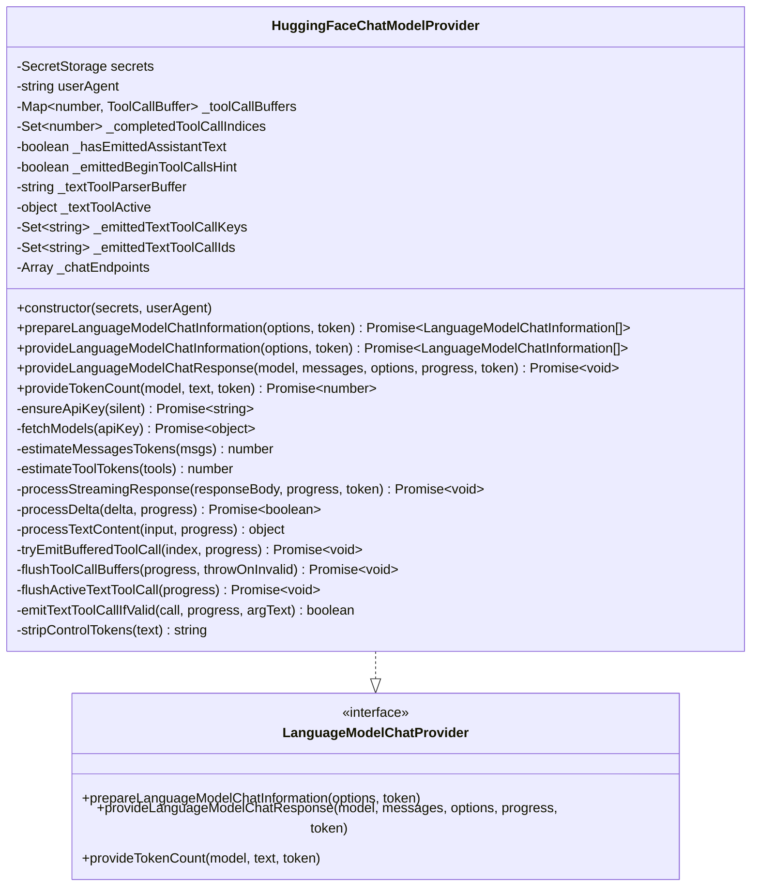
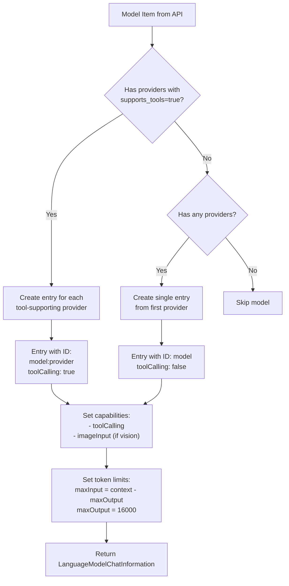
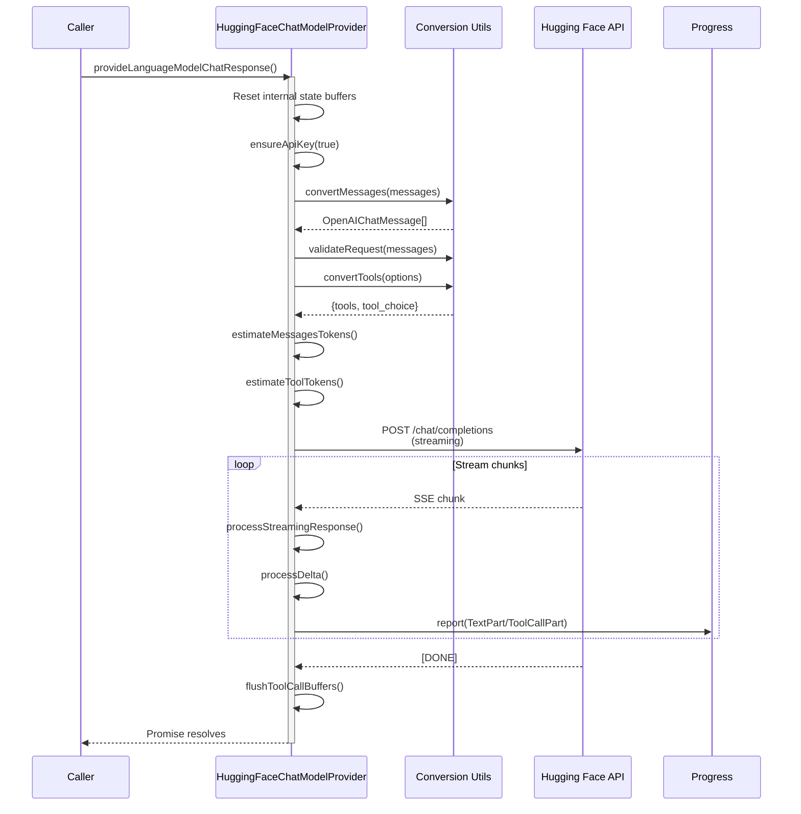
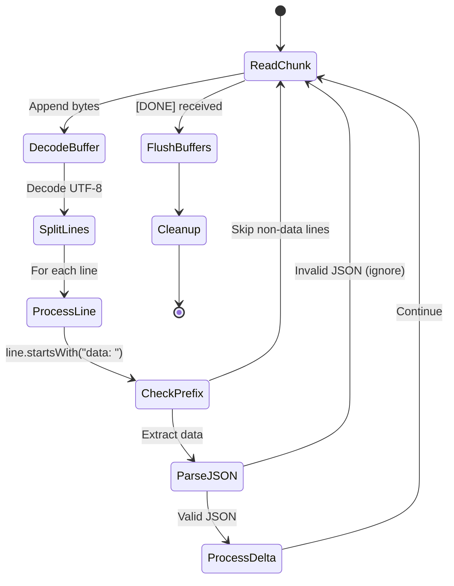
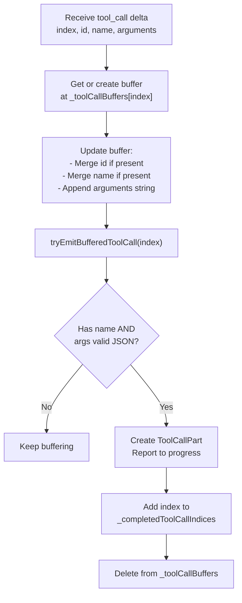
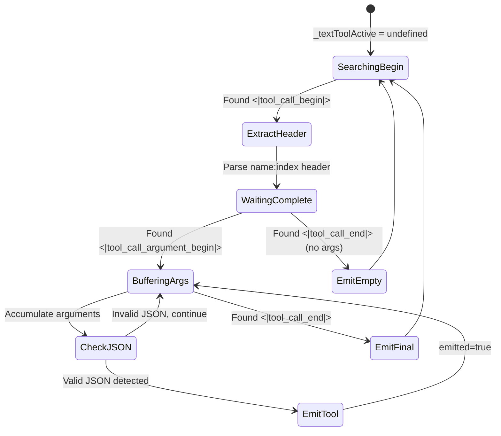
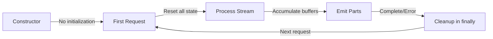
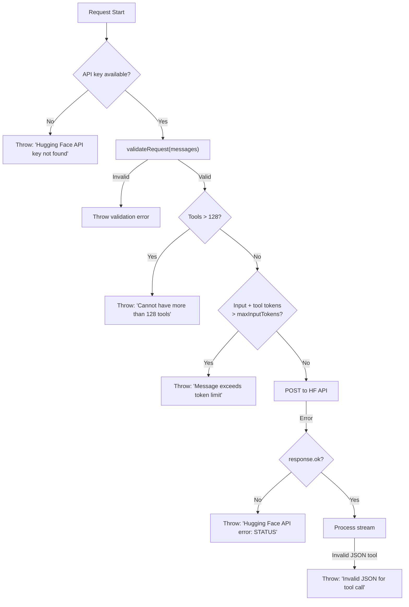

<!-- source: DeepWiki mcp.deepwiki.com · repo huggingface/huggingface-vscode-chat · page 7.1 Provider API · fetched 2026-10-26 -->

# Provider API

<details>
<summary>Relevant source files</summary>

The following files were used as context for generating this wiki page:

- [src/provider.ts](src/provider.ts)
- [src/test/provider.test.ts](src/test/provider.test.ts)
- [src/types.ts](src/types.ts)

</details>


This document provides a complete technical reference for the `HuggingFaceChatModelProvider` class and its associated implementation details. The Provider API serves as the core integration point between VS Code's Language Model Chat API and the Hugging Face Router API.

For information about utility functions used by the provider (message conversion, validation, etc.), see [Utility Functions API](#7.2). For type definitions referenced in this API, see [Type Definitions](#7.3). For architectural context on how the provider fits into the extension lifecycle, see [Chat Provider Implementation](#3.3).

## Class Overview

The `HuggingFaceChatModelProvider` class implements VS Code's `LanguageModelChatProvider` interface and manages all interactions with the Hugging Face inference infrastructure.



**Sources:** [src/provider.ts:23-781]()

## Constructor

### `constructor(secrets: vscode.SecretStorage, userAgent: string)`

Creates a new instance of the Hugging Face chat model provider.

**Parameters:**
- `secrets`: VS Code's `SecretStorage` instance for secure API key management
- `userAgent`: User-Agent string for HTTP requests to Hugging Face API

**State Initialization:**
The constructor only stores references to dependencies. All internal state buffers are initialized lazily or reset per-request.

**Sources:** [src/provider.ts:57]()

## Public API Methods

### Model Discovery

#### `prepareLanguageModelChatInformation(options, token): Promise<LanguageModelChatInformation[]>`

Retrieves and prepares the list of available language models from Hugging Face.

**Parameters:**
- `options: { silent: boolean }` - If `silent` is `true`, does not prompt user for API key
- `token: CancellationToken` - Cancellation token for the request

**Returns:** Array of `LanguageModelChatInformation` objects describing available models

**Behavior:**
1. Calls `ensureApiKey(options.silent)` to retrieve or prompt for API key
2. Fetches models from `https://router.huggingface.co/v1/models` via `fetchModels()`
3. Transforms `HFModelItem[]` into `LanguageModelChatInformation[]`
4. Populates `_chatEndpoints` internal cache with model metadata
5. Returns empty array if no API key is available

**Model Selection Logic:**


**Sources:** [src/provider.ts:89-157](), [src/provider.ts:170-202]()

#### `provideLanguageModelChatInformation(options, token): Promise<LanguageModelChatInformation[]>`

Wrapper method that delegates to `prepareLanguageModelChatInformation`.

**Sources:** [src/provider.ts:159-164]()

### Chat Response Generation

#### `provideLanguageModelChatResponse(model, messages, options, progress, token): Promise<void>`

Handles a chat request and streams the response through the progress callback.

**Parameters:**
- `model: LanguageModelChatInformation` - The selected language model
- `messages: readonly LanguageModelChatMessage[]` - Conversation history
- `options: LanguageModelChatRequestHandleOptions` - Request options including tools and model parameters
- `progress: Progress<LanguageModelResponsePart>` - Callback for streaming response parts
- `token: CancellationToken` - Cancellation token

**Returns:** Promise that resolves when streaming is complete

**Request Flow:**



**Key Operations:**

| Step | Method/Operation | Purpose |
|------|-----------------|---------|
| 1 | State reset | Clear all buffer maps and flags from previous requests |
| 2 | `ensureApiKey(true)` | Retrieve API key (silent mode) |
| 3 | `convertMessages()` | Transform VS Code messages to OpenAI format |
| 4 | `validateRequest()` | Ensure tool call/result pairing is valid |
| 5 | `convertTools()` | Transform VS Code tools to OpenAI function definitions |
| 6 | Token estimation | Check if request fits within model limits |
| 7 | Build request body | Assemble POST payload with messages, tools, model options |
| 8 | Stream processing | Parse SSE chunks and emit progress |
| 9 | Buffer flushing | Emit any remaining buffered tool calls |

**Sources:** [src/provider.ts:214-327]()

### Token Counting

#### `provideTokenCount(model, text, token): Promise<number>`

Estimates token count for text or messages using a simple heuristic.

**Parameters:**
- `model: LanguageModelChatInformation` - The language model (unused but required by interface)
- `text: string | LanguageModelChatMessage` - Text or message to count
- `token: CancellationToken` - Cancellation token

**Returns:** Estimated token count

**Algorithm:**
- For strings: `Math.ceil(text.length / 4)`
- For messages: Sum of all text parts, each estimated as `Math.ceil(part.value.length / 4)`

**Note:** This is a rough estimation. Actual tokenization may differ based on the model's tokenizer.

**Sources:** [src/provider.ts:336-352]()

## Internal Implementation

### API Key Management

#### `ensureApiKey(silent: boolean): Promise<string | undefined>`

Retrieves API key from secure storage or prompts the user.

**Parameters:**
- `silent: boolean` - If `true`, does not show input prompt when key is missing

**Behavior:**
1. Attempts to retrieve key from `secrets.get("huggingface.apiKey")`
2. If not found and `silent` is `false`:
   - Shows password input box with title "Hugging Face API Key"
   - Stores entered key in `secrets.store()`
3. Returns key or `undefined`

**Sources:** [src/provider.ts:358-373]()

### Streaming Response Processing

#### `processStreamingResponse(responseBody, progress, token): Promise<void>`

Reads and processes Server-Sent Events (SSE) stream from Hugging Face API.

**Stream Format:**
```
data: {"choices":[{"delta":{"content":"Hello"}}]}
data: {"choices":[{"delta":{"tool_calls":[...]}}]}
data: [DONE]
```

**Processing Loop:**



**Cleanup on completion or error:**
- `_toolCallBuffers.clear()`
- `_completedToolCallIndices.clear()`
- `_hasEmittedAssistantText = false`
- `_emittedBeginToolCallsHint = false`
- `_textToolParserBuffer = ""`
- `_textToolActive = undefined`
- `_emittedTextToolCallKeys.clear()`

**Sources:** [src/provider.ts:381-431]()

#### `processDelta(delta, progress): Promise<boolean>`

Processes a single parsed SSE chunk and emits appropriate response parts.

**Delta Structure:**
```typescript
{
  choices: [{
    delta: {
      content?: string,
      tool_calls?: Array<{
        index: number,
        id?: string,
        function?: { name?: string, arguments?: string }
      }>,
      thinking?: string | object
    },
    finish_reason?: "tool_calls" | "stop" | null
  }]
}
```

**Processing Priority:**
1. **Thinking content** (if supported by VS Code version)
2. **Text content** via `processTextContent()`
3. **Tool calls** via buffering and `tryEmitBufferedToolCall()`
4. **Finish reason handling** via `flushToolCallBuffers()`

**Sources:** [src/provider.ts:438-528]()

### Tool Call Buffering

The provider supports two tool call formats:
1. **SSE-style**: Tool calls in `delta.tool_calls` array
2. **Text-embedded**: Tool calls in text with control tokens

#### SSE-Style Tool Call Buffering



**Deduplication Strategy:**
- Completed indices are tracked in `_completedToolCallIndices`
- Further deltas for completed indices are ignored
- Tool call signature (`name:canonicalJSON`) tracked in `_emittedTextToolCallKeys`

**Sources:** [src/provider.ts:709-733](), [src/provider.ts:740-767]()

#### Text-Embedded Tool Call Parsing

Handles tool calls embedded in text using control tokens:
- `<|tool_call_begin|>` - Starts tool call
- `<|tool_call_argument_begin|>` - Starts arguments section
- `<|tool_call_end|>` - Ends tool call

**Parser State Machine:**



**Control Token Stripping:**
Additional control tokens removed from visible text:
- `<|*_section_begin|>` and `<|*_section_end|>` patterns
- `<|tool_call_begin|>`, `<|tool_call_argument_begin|>`, `<|tool_call_end|>`

**Sources:** [src/provider.ts:534-657](), [src/provider.ts:769-779]()

### Token Estimation

#### `estimateMessagesTokens(msgs): number`

Simple heuristic for message token estimation.

**Algorithm:**
```
total = 0
for each message in msgs:
  for each part in message.content:
    if part is LanguageModelTextPart:
      total += ceil(part.value.length / 4)
return total
```

**Sources:** [src/provider.ts:60-70]()

#### `estimateToolTokens(tools): number`

Estimates tokens consumed by tool definitions.

**Algorithm:**
```
if tools is empty: return 0
json = JSON.stringify(tools)
return ceil(json.length / 4)
```

**Sources:** [src/provider.ts:73-81]()

## Internal State Management

### State Variables

| Variable | Type | Purpose |
|----------|------|---------|
| `_chatEndpoints` | `Array<{model: string, modelMaxPromptTokens: number}>` | Cache of model metadata from discovery |
| `_toolCallBuffers` | `Map<number, ToolCallBuffer>` | SSE-style tool call assembly by index |
| `_completedToolCallIndices` | `Set<number>` | Indices of fully emitted SSE tool calls |
| `_hasEmittedAssistantText` | `boolean` | Whether any text was emitted before tool calls |
| `_emittedBeginToolCallsHint` | `boolean` | Whether whitespace flush was emitted before tool calls |
| `_textToolParserBuffer` | `string` | Buffered text for control token parsing |
| `_textToolActive` | `object \| undefined` | Active text-embedded tool call being parsed |
| `_emittedTextToolCallKeys` | `Set<string>` | Signature-based deduplication for text tools |
| `_emittedTextToolCallIds` | `Set<string>` | Identity-based deduplication for text tools |

**State Lifecycle:**



**Sources:** [src/provider.ts:24-51](), [src/provider.ts:222-230](), [src/provider.ts:420-430]()

## Constants and Configuration

### API Endpoints

| Constant | Value | Usage |
|----------|-------|-------|
| `BASE_URL` | `"https://router.huggingface.co/v1"` | Base URL for Hugging Face Router API |
| Models endpoint | `${BASE_URL}/models` | GET request for model discovery |
| Chat endpoint | `${BASE_URL}/chat/completions` | POST request for chat completions |

**Sources:** [src/provider.ts:16]()

### Token Limits

| Constant | Value | Purpose |
|----------|-------|---------|
| `DEFAULT_MAX_OUTPUT_TOKENS` | `16000` | Default maximum output tokens when not specified by provider |
| `DEFAULT_CONTEXT_LENGTH` | `128000` | Default context window when not specified by provider |

**Token Calculation:**
```
maxInput = max(1, contextLength - maxOutput)
```

**Sources:** [src/provider.ts:17-18](), [src/provider.ts:111-112](), [src/provider.ts:130-132]()

### Request Constraints

| Constraint | Value | Enforcement |
|------------|-------|-------------|
| Maximum tools | `128` | Throws error if `options.tools.length > 128` |
| Token limit | `model.maxInputTokens` | Throws error if `inputTokens + toolTokens > limit` |

**Sources:** [src/provider.ts:257-259](), [src/provider.ts:264-267]()

### Model Options Allowlist

The following `modelOptions` are forwarded to the API:

| Option | Type | Default |
|--------|------|---------|
| `max_tokens` | `number` | Capped at `model.maxOutputTokens`, otherwise `4096` |
| `temperature` | `number` | `0.7` |
| `stop` | `string \| string[]` | Not set |
| `frequency_penalty` | `number` | Not set |
| `presence_penalty` | `number` | Not set |

**Sources:** [src/provider.ts:273-289]()

## Error Handling

### Common Error Scenarios



**Error Messages:**
- API key missing: `"Hugging Face API key not found"`
- Too many tools: `"Cannot have more than 128 tools per request."`
- Token limit exceeded: `"Message exceeds token limit."`
- API error: `"Hugging Face API error: {status} {statusText}\n{errorBody}"`
- Invalid tool call JSON: `"Invalid JSON for tool call"` (only when `finish_reason` is set)

**Sources:** [src/provider.ts:246-249](), [src/provider.ts:257-267](), [src/provider.ts:307-313](), [src/provider.ts:750-752]()

---

