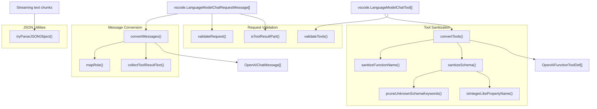
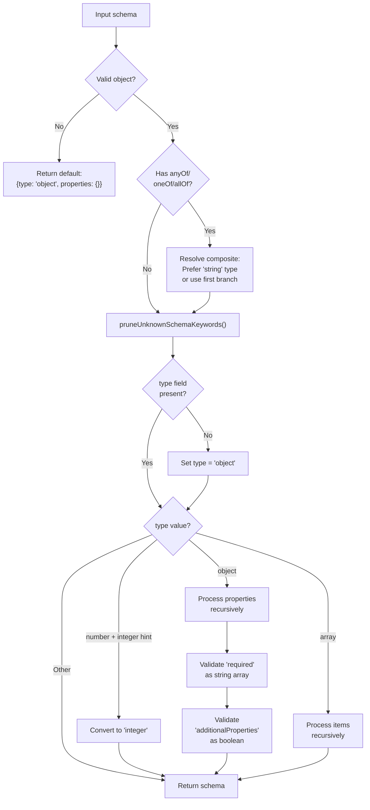
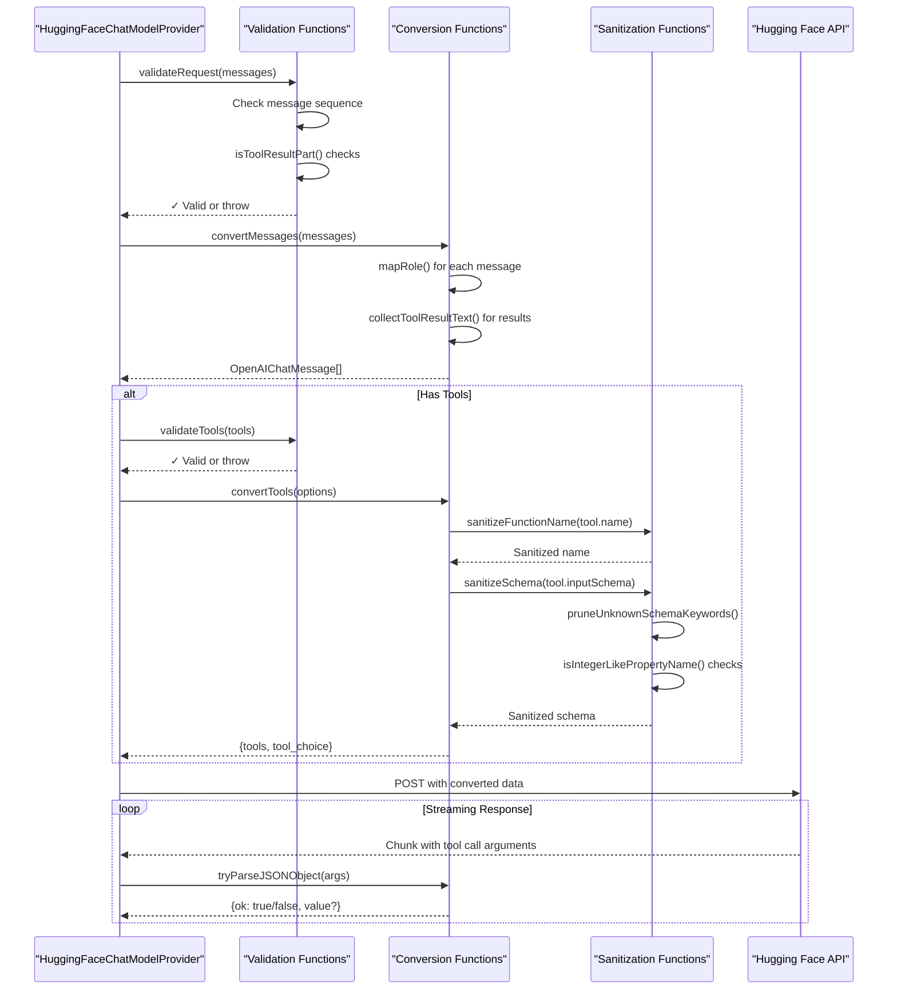

<!-- source: DeepWiki mcp.deepwiki.com · repo huggingface/huggingface-vscode-chat · page 7.2 Utility Functions API · fetched 2026-10-26 -->

# Utility Functions API

Relevant source files

The following files were used as context for generating this wiki page:

- [src/test/provider.test.ts](src/test/provider.test.ts)
- [src/types.ts](src/types.ts)
- [src/utils.ts](src/utils.ts)

## Purpose and Scope

This document provides comprehensive API reference for the utility functions defined in [src/utils.ts](). These functions serve as the conversion and validation layer between VS Code's Language Model API types and the OpenAI-compatible format required by the Hugging Face Router API. The utilities handle message transformation, tool definition sanitization, request validation, and JSON parsing.

For information about how these utilities are used within the provider implementation, see [Provider API](#7.1). For complete type definitions referenced by these functions, see [Type Definitions](#7.3).

**Sources:** [src/utils.ts:1-364]()

---

## Utility Function Categories

The utility functions are organized into four primary categories based on their responsibilities:

**Sources:** [src/utils.ts:1-364](), [src/types.ts:1-85]()

---

## Message Conversion Functions

These functions transform VS Code's message format into OpenAI-compatible message structures.

### convertMessages

**Signature:** `convertMessages(messages: readonly vscode.LanguageModelChatRequestMessage[]): OpenAIChatMessage[]`

Converts VS Code chat request messages into OpenAI-compatible message objects. This is the primary entry point for message transformation.

**Behavior:**
- Maps VS Code message roles to OpenAI roles (`user`, `assistant`, `system`, `tool`)
- Extracts text parts from message content
- Converts `LanguageModelToolCallPart` to OpenAI `tool_calls` format
- Converts `LanguageModelToolResultPart` to OpenAI `tool` messages
- Generates call IDs for tool calls if not provided
- Handles mixed content (text + tool calls) in single messages

**Returns:** Array of `OpenAIChatMessage` objects with the following structure:

| Field | Type | Description |
|-------|------|-------------|
| `role` | `OpenAIChatRole` | Message role: `user`, `assistant`, `system`, or `tool` |
| `content` | `string` (optional) | Text content of the message |
| `tool_calls` | `OpenAIToolCall[]` (optional) | Tool calls made by assistant |
| `tool_call_id` | `string` (optional) | ID referencing the tool call (for tool role messages) |

**Sources:** [src/utils.ts:138-186](), [src/types.ts:21-27]()

### mapRole

**Signature:** `mapRole(message: vscode.LanguageModelChatRequestMessage): Exclude<OpenAIChatRole, "tool">`

Maps VS Code's message role enum to OpenAI-style role strings. This is an internal helper used by `convertMessages`.

**Role Mapping:**

| VS Code Role | OpenAI Role |
|--------------|-------------|
| `LanguageModelChatMessageRole.User` | `"user"` |
| `LanguageModelChatMessageRole.Assistant` | `"assistant"` |
| Default (other) | `"system"` |

**Implementation Note:** Uses numeric comparison to map enum values, as VS Code roles are internally represented as numbers.

**Sources:** [src/utils.ts:310-321]()

### collectToolResultText

**Signature:** `collectToolResultText(pr: { content?: ReadonlyArray<unknown> }): string`

Concatenates tool result content parts into a single text string. This internal helper extracts text from various content types found in tool results.

**Content Handling:**
- `LanguageModelTextPart` → Extracts `.value` property
- String values → Appends directly
- Other objects → JSON stringifies (with error suppression)

**Sources:** [src/utils.ts:323-343]()

---

## Tool Conversion and Sanitization

These functions transform and sanitize VS Code tool definitions to ensure compatibility with the OpenAI/Hugging Face API constraints.

### convertTools

**Signature:** `convertTools(options: vscode.LanguageModelChatRequestHandleOptions): { tools?: OpenAIFunctionToolDef[]; tool_choice?: "auto" | { type: "function"; function: { name: string } } }`

Converts VS Code tool definitions to OpenAI function tool definitions with sanitized schemas and names.

**Behavior:**
- Filters valid tool objects from options
- Sanitizes function names using `sanitizeFunctionName`
- Sanitizes input schemas using `sanitizeSchema`
- Handles `LanguageModelChatToolMode.Required` by setting explicit `tool_choice`
- Returns empty object if no tools provided

**Tool Choice Logic:**

| Tool Mode | Tools Count | Result |
|-----------|-------------|--------|
| `Required` | 1 | `{ type: "function", function: { name: "..." } }` |
| `Required` | >1 | Throws error |
| Other | Any | `"auto"` |

**Sources:** [src/utils.ts:188-227](), [src/test/provider.test.ts:179-208]()

### sanitizeFunctionName

**Signature:** `sanitizeFunctionName(name: unknown): string`

Sanitizes function names to match OpenAI's naming constraints: alphanumeric characters, underscores, and hyphens only, starting with a letter, maximum 64 characters.

**Transformation Rules:**
1. Non-string or empty input → Returns `"tool"`
2. Replace invalid characters with underscores
3. Ensure name starts with letter (prefix with `tool_` if not)
4. Collapse multiple consecutive underscores
5. Truncate to 64 characters

**Examples:**
- `"my-function"` → `"my-function"`
- `"123invalid"` → `"tool_123invalid"`
- `"bad name!"` → `"tool_bad_name_"`
- `"a__b__c"` → `"a_b_c"`

**Sources:** [src/utils.ts:27-37]()

### sanitizeSchema

**Signature:** `sanitizeSchema(input: unknown, propName?: string): Record<string, unknown>`

Recursively sanitizes JSON schemas to ensure compatibility with OpenAI's schema validation requirements. This is the most complex sanitization function.

**Sanitization Steps:**

**Key Behaviors:**
- **Composite schema resolution:** For `anyOf`/`oneOf`/`allOf`, prefers branches with `type: "string"` or uses first branch
- **Type defaulting:** Missing `type` defaults to `"object"`
- **Integer inference:** Converts `number` to `integer` for properties with integer-like names (see `isIntegerLikePropertyName`)
- **Recursive sanitization:** Processes nested properties and array items
- **Validation enforcement:** Ensures `required` is string array, `additionalProperties` is boolean

**Sources:** [src/utils.ts:68-136]()

### pruneUnknownSchemaKeywords

**Signature:** `pruneUnknownSchemaKeywords(schema: unknown): Record<string, unknown>`

Removes schema keywords not recognized by the OpenAI API, keeping only a whitelist of allowed properties.

**Allowed Keywords:**

| Keyword | Purpose |
|---------|---------|
| `type` | JSON Schema type |
| `properties` | Object property definitions |
| `required` | Required property names |
| `additionalProperties` | Whether extra properties allowed |
| `description` | Human-readable description |
| `enum` | Enumerated values |
| `default` | Default value |
| `items` | Array item schema |
| `minLength`, `maxLength` | String length constraints |
| `minimum`, `maximum` | Numeric value constraints |
| `pattern` | Regex pattern for strings |
| `format` | String format (e.g., "email") |

**Sources:** [src/utils.ts:39-66]()

### isIntegerLikePropertyName

**Signature:** `isIntegerLikePropertyName(propertyName: string | undefined): boolean`

Determines if a property name suggests an integer type based on common naming patterns. Used by `sanitizeSchema` to convert `number` types to `integer`.

**Integer Markers:**
- Properties containing: `id`, `limit`, `count`, `index`, `size`, `offset`, `length`, `results_limit`, `maxresults`, `debugsessionid`, `cellid`
- Properties ending with: `_id`

**Examples:**
- `"user_id"` → `true`
- `"maxResults"` → `true`
- `"count"` → `true`
- `"price"` → `false`

**Sources:** [src/utils.ts:6-25]()

---

## Validation Functions

These functions validate request structure and tool definitions to prevent malformed API calls.

### validateRequest

**Signature:** `validateRequest(messages: readonly vscode.LanguageModelChatRequestMessage[]): void`

Validates that tool calls in assistant messages are properly followed by matching tool result messages from the user. Throws an error if validation fails.

**Validation Rules:**
1. Request must contain at least one message
2. Each assistant message with tool calls must be followed by user messages containing tool results
3. Every tool call ID must have a corresponding tool result with matching `callId`
4. Tool result messages must use `LanguageModelToolResultPart`

**Error Conditions:**
- No messages in request
- Tool call not followed by user message
- Missing tool result for a call ID
- Invalid part type in tool result message

**Sources:** [src/utils.ts:244-290](), [src/test/provider.test.ts:218-234]()

### validateTools

**Signature:** `validateTools(tools: readonly vscode.LanguageModelChatTool[]): void`

Validates tool names to ensure they contain only alphanumeric characters, hyphens, and underscores. Throws an error if any tool has an invalid name.

**Validation Pattern:** `/^[\w-]+$/` (word characters and hyphens only)

**Valid Examples:**
- `"my_tool"`
- `"search-web"`
- `"tool123"`

**Invalid Examples:**
- `"bad name!"` (space and special character)
- `"tool.function"` (period not allowed)
- `"my/tool"` (slash not allowed)

**Sources:** [src/utils.ts:229-242](), [src/test/provider.test.ts:210-215]()

### isToolResultPart

**Signature:** `isToolResultPart(value: unknown): value is { callId: string; content?: ReadonlyArray<unknown> }`

Type guard function to check if a value is a tool result part. Used during message validation to identify tool results.

**Requirements:**
- Value must be an object
- Must have `callId` property of type string
- Must have `content` property (value type not checked)

**Sources:** [src/utils.ts:292-304]()

---

## JSON Utilities

### tryParseJSONObject

**Signature:** `tryParseJSONObject(text: string): { ok: true; value: Record<string, unknown> } | { ok: false }`

Attempts to parse a string as a JSON object, returning a discriminated union indicating success or failure. Used for parsing streamed tool call arguments.

**Success Conditions:**
- Input contains `{` character
- Valid JSON syntax
- Parsed value is an object (not array or primitive)

**Return Types:**

| Success | Return Value |
|---------|--------------|
| Yes | `{ ok: true, value: Record<string, unknown> }` |
| No | `{ ok: false }` |

**Error Handling:** All parsing errors are caught and return `{ ok: false }` without throwing.

**Sources:** [src/utils.ts:345-363](), [src/test/provider.test.ts:237-242]()

---

## Function Integration Flow

The following diagram shows how utility functions integrate with the provider's request processing pipeline:

**Sources:** [src/utils.ts:1-364](), [src/provider.ts:104-348]()

---

## Utility Function Reference Table

| Function | Input | Output | Primary Purpose | Throws |
|----------|-------|--------|-----------------|--------|
| `convertMessages` | `vscode.LanguageModelChatRequestMessage[]` | `OpenAIChatMessage[]` | Transform VS Code messages to OpenAI format | No |
| `convertTools` | `vscode.LanguageModelChatRequestHandleOptions` | `{tools?, tool_choice?}` | Transform VS Code tools to OpenAI format | Yes (multiple tools with Required mode) |
| `validateRequest` | `vscode.LanguageModelChatRequestMessage[]` | `void` | Validate tool call/result pairing | Yes |
| `validateTools` | `vscode.LanguageModelChatTool[]` | `void` | Validate tool name format | Yes |
| `sanitizeFunctionName` | `unknown` | `string` | Sanitize function name | No |
| `sanitizeSchema` | `unknown`, `string?` | `Record<string, unknown>` | Sanitize JSON schema | No |
| `pruneUnknownSchemaKeywords` | `unknown` | `Record<string, unknown>` | Remove unsupported schema keywords | No |
| `isIntegerLikePropertyName` | `string \| undefined` | `boolean` | Check if property name suggests integer | No |
| `isToolResultPart` | `unknown` | `boolean` | Type guard for tool results | No |
| `tryParseJSONObject` | `string` | `{ok: true, value} \| {ok: false}` | Safe JSON object parsing | No |
| `mapRole` | `vscode.LanguageModelChatRequestMessage` | `OpenAIChatRole` (except "tool") | Map VS Code role to OpenAI role | No |
| `collectToolResultText` | `{content?: ReadonlyArray<unknown>}` | `string` | Extract text from tool result | No |

**Sources:** [src/utils.ts:1-364]()

---

## Error Handling Patterns

The utility functions employ consistent error handling strategies:

**Validation Functions** (`validateRequest`, `validateTools`):
- Throw descriptive errors immediately on validation failure
- Log error details to console before throwing
- Used before API calls to fail fast

**Sanitization Functions** (`sanitizeFunctionName`, `sanitizeSchema`):
- Never throw errors
- Return safe defaults for invalid input
- Gracefully handle edge cases

**Parsing Functions** (`tryParseJSONObject`):
- Return discriminated unions instead of throwing
- Allow caller to handle success/failure cases
- Used in streaming contexts where partial data is expected

**Sources:** [src/utils.ts:1-364]()

---

