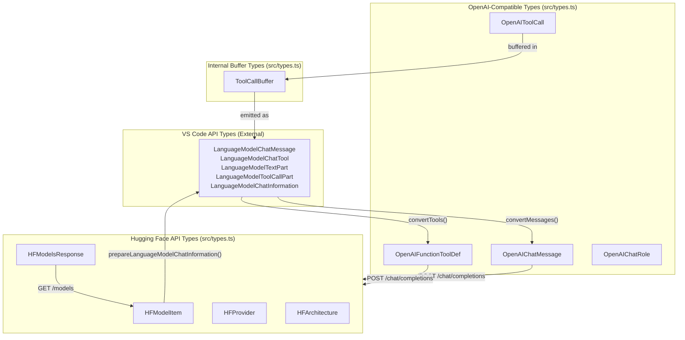
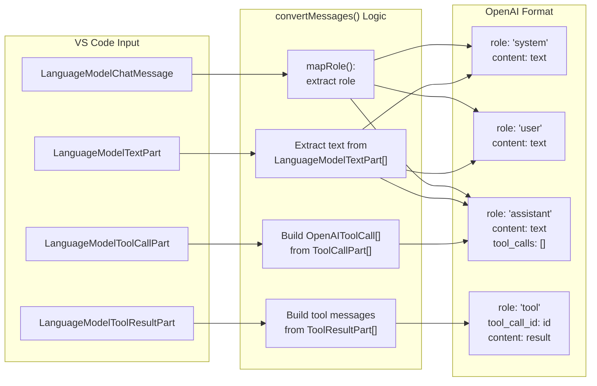
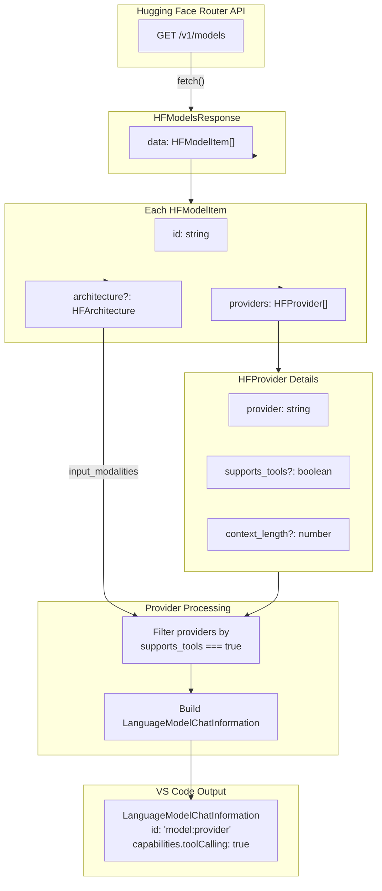
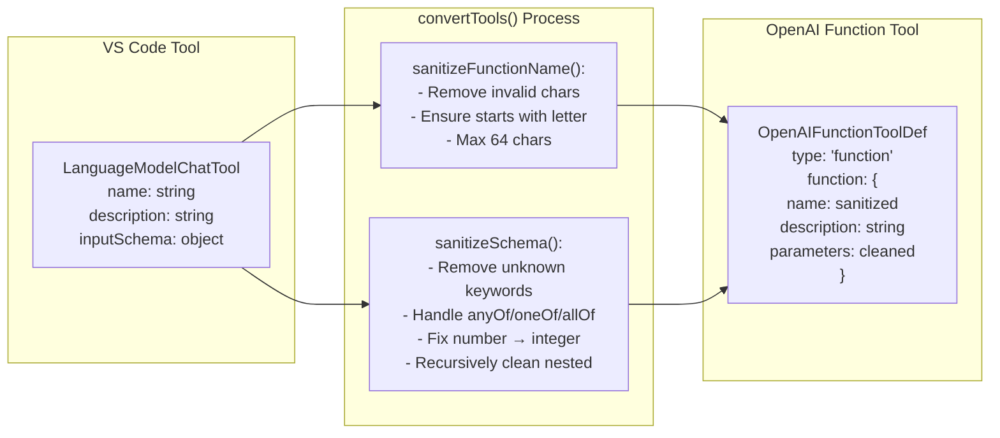
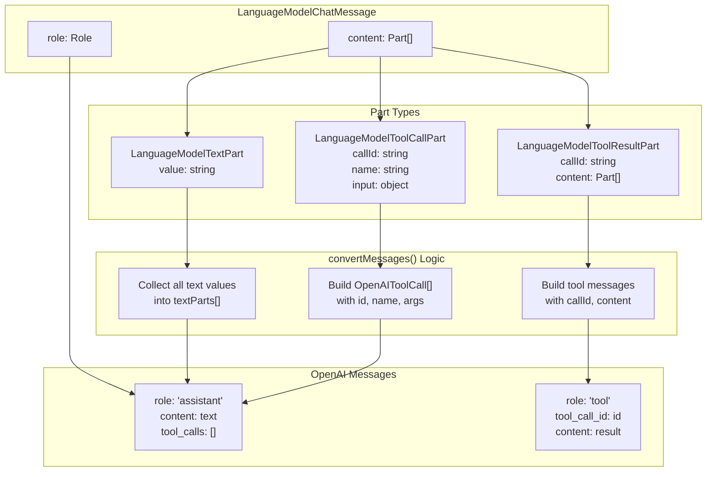
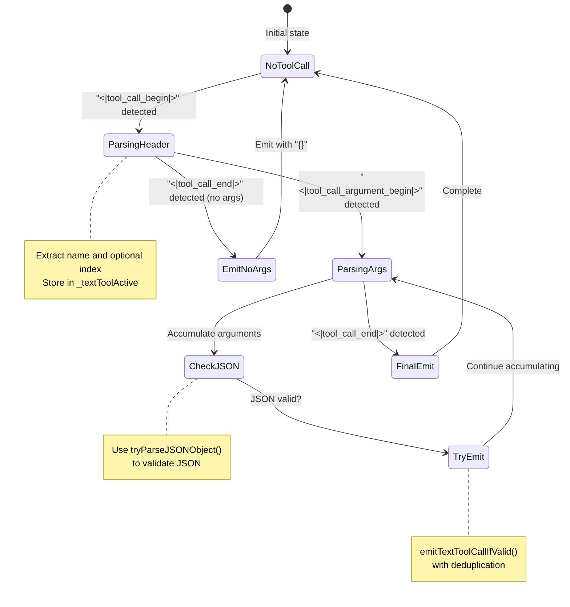

<!-- source: DeepWiki mcp.deepwiki.com · repo huggingface/huggingface-vscode-chat · page 7.3 Type Definitions · fetched 2026-10-26 -->

# Type Definitions

<details>
<summary>Relevant source files</summary>

The following files were used as context for generating this wiki page:

- [src/provider.ts](src/provider.ts)
- [src/types.ts](src/types.ts)
- [src/utils.ts](src/utils.ts)

</details>


This document provides a comprehensive reference for all TypeScript type definitions used in the huggingface-vscode-chat extension. It covers the type system architecture, including OpenAI-compatible types for API communication, Hugging Face-specific types for model discovery, internal buffering types, and how these types interact with VS Code's Language Model API.

For information about the conversion functions that transform between these types, see [Utility Functions API](#7.2). For details on how the provider implementation uses these types, see [Provider API](#7.1).

## Type System Architecture

The extension employs a multi-layered type system that bridges VS Code's Language Model API with Hugging Face's Router API through OpenAI-compatible formats.

### Type Categories Overview



**Sources:** [src/types.ts:1-85](), [src/provider.ts:1-11](), [src/utils.ts:1-3]()

## OpenAI-Compatible Types

These types define the OpenAI-compatible message format used to communicate with the Hugging Face Router API at `router.huggingface.co/v1`.

### OpenAIChatMessage

The primary message format for chat completions requests.

| Property | Type | Required | Description |
|----------|------|----------|-------------|
| `role` | `OpenAIChatRole` | Yes | Message role: "system", "user", "assistant", or "tool" |
| `content` | `string` | No | Text content of the message |
| `name` | `string` | No | Name of the message author (optional) |
| `tool_calls` | `OpenAIToolCall[]` | No | Tool calls made by the assistant |
| `tool_call_id` | `string` | No | ID of the tool call this message is responding to (for "tool" role) |

**Sources:** [src/types.ts:18-27]()

### OpenAIToolCall

Represents a function tool call made by the assistant.

| Property | Type | Required | Description |
|----------|------|----------|-------------|
| `id` | `string` | Yes | Unique identifier for the tool call |
| `type` | `"function"` | Yes | Always "function" |
| `function` | `{ name: string; arguments: string }` | Yes | Function name and JSON-stringified arguments |

**Sources:** [src/types.ts:1-8]()

### OpenAIFunctionToolDef

Defines a tool/function available for the model to call.

| Property | Type | Required | Description |
|----------|------|----------|-------------|
| `type` | `"function"` | Yes | Always "function" |
| `function` | `{ name: string; description?: string; parameters?: object }` | Yes | Function definition with JSON schema parameters |

**Sources:** [src/types.ts:10-16]()

### OpenAIChatRole

Type alias for valid message roles.

```typescript
type OpenAIChatRole = "system" | "user" | "assistant" | "tool"
```

**Sources:** [src/types.ts:84]()

### Message Conversion Flow



**Sources:** [src/utils.ts:143-186](), [src/utils.ts:310-321]()

## Hugging Face API Types

These types model the responses from the Hugging Face Router API's model discovery endpoint.

### HFModelsResponse

Top-level response envelope from `GET /v1/models`.

| Property | Type | Description |
|----------|------|-------------|
| `object` | `string` | Response type identifier |
| `data` | `HFModelItem[]` | Array of available models |

**Sources:** [src/types.ts:66-72]()

### HFModelItem

Represents a single model with its metadata and providers.

| Property | Type | Required | Description |
|----------|------|----------|-------------|
| `id` | `string` | Yes | Model identifier (e.g., "meta-llama/Llama-3.3-70B-Instruct") |
| `object` | `string` | Yes | Object type |
| `created` | `number` | Yes | Creation timestamp |
| `owned_by` | `string` | Yes | Owner organization |
| `providers` | `HFProvider[]` | Yes | Array of available providers for this model |
| `architecture` | `HFArchitecture` | No | Model architecture metadata |

**Sources:** [src/types.ts:48-55]()

### HFProvider

Describes a single inference provider for a model.

| Property | Type | Required | Description |
|----------|------|----------|-------------|
| `provider` | `string` | Yes | Provider name (e.g., "together", "groq") |
| `status` | `string` | Yes | Provider status |
| `supports_tools` | `boolean` | No | Whether this provider supports tool calling |
| `supports_structured_output` | `boolean` | No | Whether this provider supports structured output |
| `context_length` | `number` | No | Maximum context window in tokens |

**Sources:** [src/types.ts:30-38]()

### HFArchitecture

Model architecture capabilities.

| Property | Type | Description |
|----------|------|-------------|
| `input_modalities` | `string[]` | Supported input types (e.g., ["text", "image"]) |
| `output_modalities` | `string[]` | Supported output types |

**Sources:** [src/types.ts:43-46]()

### Model Discovery Type Flow



**Sources:** [src/provider.ts:89-157](), [src/provider.ts:170-202]()

### HFExtraModelInfo (Deprecated)

Previously used to fetch additional model information from the Hugging Face Hub API.

| Property | Type | Description |
|----------|------|-------------|
| `id` | `string` | Model identifier |
| `pipeline_tag` | `string` | Pipeline type (deprecated) |

**Note:** This interface is no longer actively used but remains for backward compatibility.

**Sources:** [src/types.ts:57-64]()

## Internal Buffer Types

### ToolCallBuffer

Used internally to accumulate streaming tool call fragments until complete.

| Property | Type | Required | Description |
|----------|------|----------|-------------|
| `id` | `string` | No | Tool call identifier (may arrive in later chunks) |
| `name` | `string` | No | Function name (may arrive in later chunks) |
| `args` | `string` | Yes | Accumulated JSON arguments string |

The provider maintains a `Map<number, ToolCallBuffer>` where the key is the tool call index from the streaming response.

**Sources:** [src/types.ts:74-81](), [src/provider.ts:25-29]()

### Tool Call Buffering System

```mermaid
graph TB
    subgraph Stream["Streaming Response"]
        Chunk1["Chunk 1:<br/>index: 0<br/>id: 'call_abc'"]
        Chunk2["Chunk 2:<br/>index: 0<br/>function.name: 'search'"]
        Chunk3["Chunk 3:<br/>index: 0<br/>function.arguments: '{\"q\"'"]
        Chunk4["Chunk 4:<br/>index: 0<br/>function.arguments: '\":\"test\"}'"]
    end
    
    subgraph Buffer["_toolCallBuffers Map"]
        Entry0["Index 0:<br/>id: 'call_abc'<br/>name: 'search'<br/>args: '{\"q\":\"test\"}'"]
    end
    
    subgraph Validation["tryParseJSONObject()"]
        Check["Is args valid JSON?"]
        ParseOk["ok: true<br/>value: {q: 'test'}"]
    end
    
    subgraph Emit["tryEmitBufferedToolCall()"]
        CreatePart["new LanguageModelToolCallPart(<br/>id: 'call_abc',<br/>name: 'search',<br/>input: {q: 'test'}<br/>)"]
    end
    
    subgraph Tracking["State Tracking"]
        Completed["_completedToolCallIndices<br/>Set: {0}"]
        EmittedKeys["_emittedTextToolCallKeys<br/>Set: {'search:{\"q\":\"test\"}''}"]
    end
    
    Chunk1 --> Entry0
    Chunk2 --> Entry0
    Chunk3 --> Entry0
    Chunk4 --> Entry0
    Entry0 --> Check
    Check -->|"JSON.parse()"| ParseOk
    ParseOk --> CreatePart
    CreatePart --> Completed
    CreatePart --> EmittedKeys
```

**Sources:** [src/provider.ts:498-533](), [src/provider.ts:709-733](), [src/provider.ts:740-767]()

## VS Code Language Model API Types

The extension extensively uses types from the `vscode` module. These are external types but are fundamental to the extension's operation.

### Key VS Code Types Referenced

| Type | Purpose | Used In |
|------|---------|---------|
| `LanguageModelChatMessage` | Input messages from chat requests | [src/provider.ts:5](), [src/utils.ts:143]() |
| `LanguageModelChatTool` | Tool definitions from requests | [src/utils.ts:233]() |
| `LanguageModelTextPart` | Text content in messages | [src/provider.ts:64](), [src/utils.ts:152]() |
| `LanguageModelToolCallPart` | Tool call content in messages | [src/utils.ts:154]() |
| `LanguageModelToolResultPart` | Tool execution results | [src/utils.ts:296-304]() |
| `LanguageModelChatInformation` | Model capability metadata | [src/provider.ts:4](), [src/provider.ts:100-145]() |
| `LanguageModelResponsePart` | Base type for response parts | [src/provider.ts:8]() |
| `LanguageModelChatRequestHandleOptions` | Request options including tools | [src/provider.ts:7]() |
| `LanguageModelChatToolMode` | Tool calling mode (Required/Auto) | [src/utils.ts:218]() |
| `LanguageModelChatMessageRole` | Message role enumeration | [src/utils.ts:256]() |

**Sources:** [src/provider.ts:1-10](), [src/utils.ts:1-2]()

## Type Transformations

### Tool Definition Conversion

The extension converts VS Code tool definitions to OpenAI function tool definitions with schema sanitization.



**Sources:** [src/utils.ts:192-227](), [src/utils.ts:27-37](), [src/utils.ts:68-136]()

### Message Part Extraction

VS Code messages contain multiple part types that must be extracted and organized into OpenAI messages.



**Sources:** [src/utils.ts:143-186]()

## Text-Embedded Tool Call Types

In addition to SSE-formatted tool calls, the provider supports text-embedded tool calls using control tokens.

### Text Tool Call Parser State

The provider maintains specialized state for parsing tool calls embedded in text streams:

| Field | Type | Purpose |
|-------|------|---------|
| `_textToolParserBuffer` | `string` | Accumulates partial control tokens across chunks |
| `_textToolActive` | `{ name?: string; index?: number; argBuffer: string; emitted?: boolean }` | Currently parsing tool call |
| `_emittedTextToolCallKeys` | `Set<string>` | Deduplication set using `name:canonicalJSON` |
| `_emittedTextToolCallIds` | `Set<string>` | Deduplication set using `name:index` |

**Sources:** [src/provider.ts:41-51]()

### Control Token Format

The text-embedded format uses three control tokens:

| Token | Purpose |
|-------|---------|
| `<\|tool_call_begin\|>` | Marks start of tool call, followed by `name` or `name:index` |
| `<\|tool_call_argument_begin\|>` | Separates header from JSON arguments |
| `<\|tool_call_end\|>` | Marks end of tool call and its arguments |

Example: `<|tool_call_begin|>search:0<|tool_call_argument_begin|>{"q":"test"}<|tool_call_end|>`

**Sources:** [src/provider.ts:534-657]()

### Text Tool Call State Machine



**Sources:** [src/provider.ts:534-657](), [src/provider.ts:659-686]()

## Type Guard Functions

The extension provides type guard functions for runtime type checking.

### isToolResultPart

Validates whether a value conforms to the tool result part structure.

```typescript
function isToolResultPart(value: unknown): value is { 
    callId: string; 
    content?: ReadonlyArray<unknown> 
}
```

**Returns:** `true` if the value has a string `callId` property and a `content` property.

**Sources:** [src/utils.ts:296-304]()

### tryParseJSONObject

Safely attempts to parse a string as a JSON object.

```typescript
function tryParseJSONObject(text: string): 
    | { ok: true; value: Record<string, unknown> } 
    | { ok: false }
```

**Returns:** A discriminated union indicating parse success or failure.

**Sources:** [src/utils.ts:350-363]()

## Type Validation

The extension includes validation functions that throw errors for invalid type usage.

### validateRequest

Ensures messages follow the correct tool call/result pairing pattern.

**Validates:**
- Non-empty message list
- Tool calls in assistant messages are followed by matching tool results in user messages
- Tool result parts have matching call IDs

**Sources:** [src/utils.ts:248-290]()

### validateTools

Validates tool names contain only allowed characters.

**Validates:**
- Tool names match pattern `/^[\w-]+$/` (alphanumeric, hyphens, underscores only)

**Sources:** [src/utils.ts:233-242]()

## Type Usage Summary

| Type Category | Definition Location | Primary Usage |
|--------------|-------------------|---------------|
| OpenAI Types | [src/types.ts:1-27]() | Request/response format for Hugging Face Router API |
| Hugging Face Types | [src/types.ts:30-72]() | Model discovery and provider metadata |
| Buffer Types | [src/types.ts:74-81]() | Internal streaming state management |
| VS Code Types | `vscode` module | Input/output boundary with VS Code API |
| Conversion Types | [src/utils.ts:1-363]() | Type transformations and validations |

**Sources:** [src/types.ts:1-85](), [src/utils.ts:1-363](), [src/provider.ts:1-782]()