# Page: Home

# Home

<details>
<summary>Relevant source files</summary>

The following files were used as context for generating this wiki page:

- [README.md](README.md)
- [package.json](package.json)

</details>


## Purpose and Scope

This wiki provides comprehensive technical documentation for the **Hugging Face Provider for GitHub Copilot Chat** VS Code extension. The extension bridges GitHub Copilot Chat with Hugging Face Inference Providers, enabling users to access state-of-the-art open-source language models directly within VS Code's chat interface.

This page provides a high-level overview of the extension's architecture, core components, and system design. For detailed setup instructions, see [Getting Started](#2). For architectural deep-dives, see [Architecture](#3). For development workflows, see [Development Guide](#5).

**Sources:** [README.md:1-57](), [package.json:1-83]()

## What This Extension Does

The extension implements a VS Code language model chat provider that:

1. **Integrates with GitHub Copilot Chat** - Registers as a chat provider vendor named `huggingface` in VS Code's Language Model Chat API
2. **Connects to Hugging Face Inference Providers** - Routes chat requests to `router.huggingface.co/v1` API endpoints
3. **Provides Model Discovery** - Fetches and displays available models from multiple inference providers (Cerebras, Cohere, Fireworks AI, Groq, Hyperbolic, Nebius, Novita, Nscale, SambaNova, Together AI, etc.)
4. **Handles Message Conversion** - Transforms VS Code message formats to OpenAI-compatible formats required by the Hugging Face Router API
5. **Supports Tool Calling** - Enables function/tool calling capabilities with proper validation and streaming support
6. **Manages Secure Authentication** - Stores Hugging Face API tokens securely using VS Code's Secret Storage API

**Sources:** [README.md:1-23](), [package.json:40-53]()

## System Architecture Overview

The extension follows a layered architecture pattern, with clear separation between VS Code integration, business logic, and external API communication:

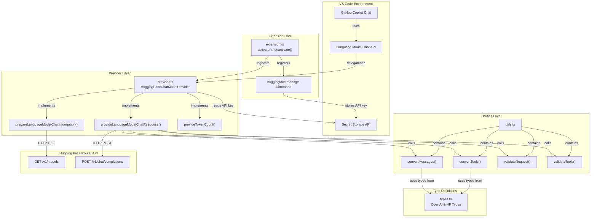

**Sources:** [package.json:40-53](), [README.md:10-15]()

## Core Components and File Structure

The extension codebase is organized into distinct modules, each with specific responsibilities:

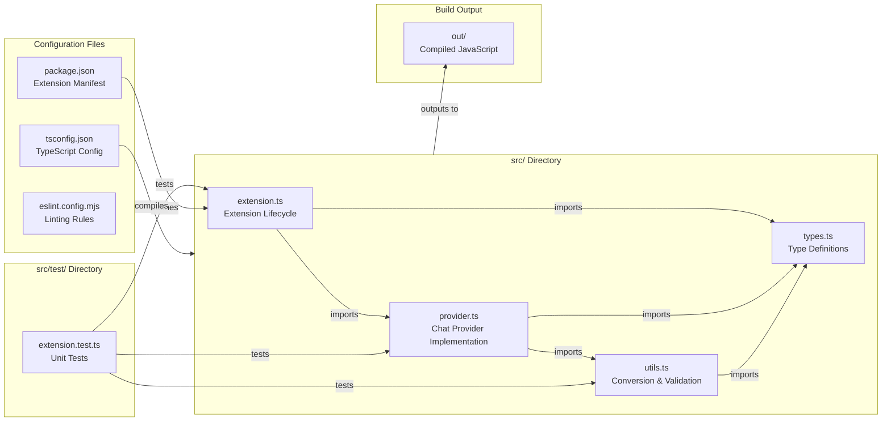

### Key Files

| File Path | Primary Classes/Functions | Responsibility |
|-----------|---------------------------|----------------|
| `src/extension.ts` | `activate()`, `deactivate()` | Extension lifecycle management, provider registration |
| `src/provider.ts` | `HuggingFaceChatModelProvider` | Core chat provider implementation, API communication |
| `src/utils.ts` | `convertMessages()`, `convertTools()`, `validateRequest()` | Message/tool conversion, validation logic |
| `src/types.ts` | `OpenAIChatMessage`, `HFModelsResponse`, `ToolCallBuffer` | Type definitions for OpenAI and HF API contracts |
| `package.json` | N/A | Extension manifest, contributions, metadata |

**Sources:** [package.json:1-83](), [README.md:31-44]()

## Request Processing Flow

The following diagram shows the complete request flow with actual function names and data transformations:

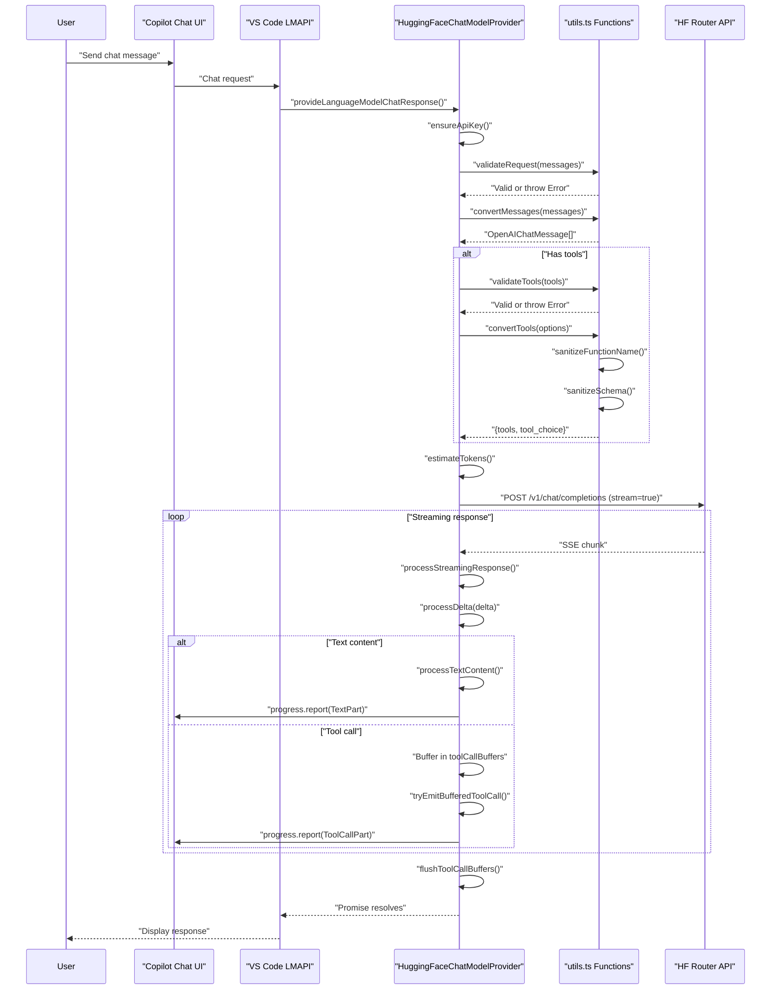

**Sources:** [package.json:40-46](), [README.md:10-15]()

## Key Architectural Patterns

### 1. Provider Pattern
The extension implements VS Code's `LanguageModelChatProvider` interface through the `HuggingFaceChatModelProvider` class. This class is registered with the VS Code API during extension activation in `activate()` and provides three core methods:
- `prepareLanguageModelChatInformation()` - Fetches available models
- `provideLanguageModelChatResponse()` - Handles chat completions
- `provideTokenCount()` - Estimates token usage

### 2. Adapter Pattern
The conversion utilities in `utils.ts` act as adapters between VS Code's message format (`vscode.LanguageModelChatMessage`) and OpenAI-compatible formats (`OpenAIChatMessage`). Key conversion functions:
- `convertMessages()` - Maps VS Code messages to OpenAI chat messages
- `convertTools()` - Transforms VS Code tool definitions to OpenAI function schemas
- Schema sanitization functions ensure compatibility with the HF Router API

### 3. Streaming Parser Pattern
The provider implements a streaming response parser that handles:
- Server-Sent Events (SSE) parsing
- Tool call buffering across multiple chunks
- Progressive text emission
- Both SSE-formatted and text-embedded tool calls (using `<|tool_call|>` control tokens)

**Sources:** [README.md:31-44](), [package.json:40-53]()

## Security and Configuration

### API Key Management
The extension uses VS Code's Secret Storage API for secure credential management:

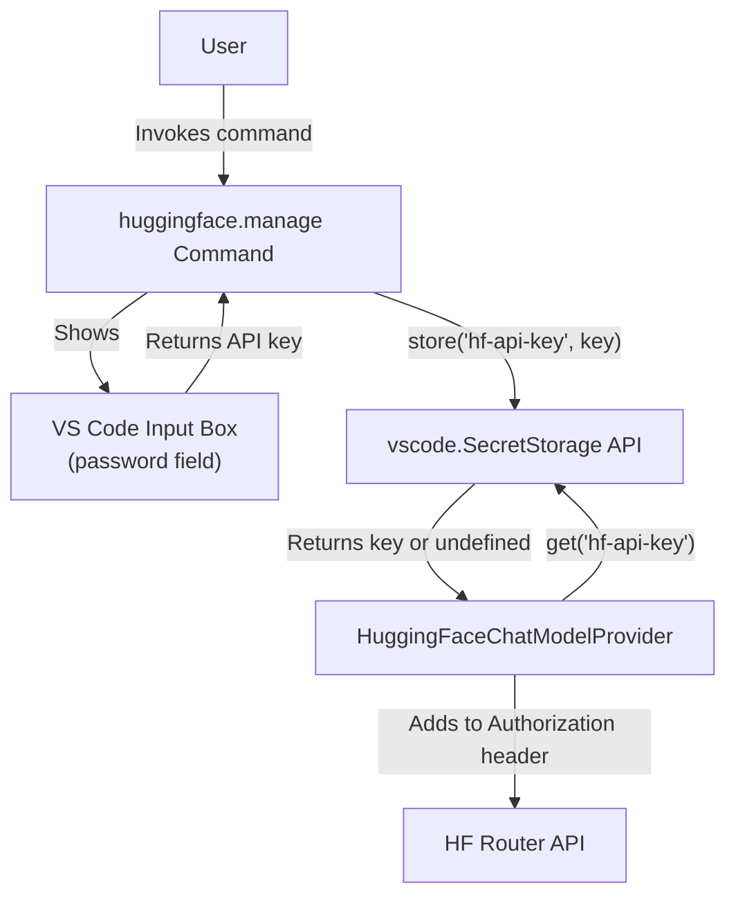

- API keys are stored encrypted in the OS keychain
- Never exposed in logs or error messages
- The `huggingface.manage` command provides a user-friendly input interface
- The `ensureApiKey()` method in the provider handles key retrieval with optional silent mode

### User-Agent Construction
The extension constructs a User-Agent header for telemetry and debugging:
```
HuggingFaceVSCode/<extension-version> VSCode/<vscode-version>
```

**Sources:** [package.json:48-53](), [README.md:14-15]()

## Extension Contributions

The extension registers the following contributions to VS Code (defined in `package.json`):

| Contribution Type | Identifier | Description |
|------------------|------------|-------------|
| `languageModelChatProviders` | `vendor: "huggingface"` | Registers the HF chat provider with display name "Hugging Face" |
| `commands` | `huggingface.manage` | Command to manage API keys and model selection |

**Sources:** [package.json:40-53]()

## Quick Navigation

- **New to this extension?** Start with [Getting Started](#2) for installation and setup
- **Want to understand the architecture?** See [Architecture](#3) for detailed system design
- **Looking to contribute?** Check the [Development Guide](#5) for dev environment setup
- **Need API reference?** Browse the [API Reference](#7) for complete function documentation
- **Configuration details?** Visit [Configuration Reference](#6) for all config files

## Requirements

| Requirement | Version/Details |
|-------------|-----------------|
| VS Code | ^1.104.0 or higher |
| Hugging Face Token | Access token with `inference.serverless` permissions |
| Node.js | (for development only) |
| pnpm | 8.15.4+ (for development only) |

**Sources:** [README.md:27-29](), [package.json:12-14]()

## Technology Stack

The extension is built with:

- **Language:** TypeScript 5.9.2
- **Runtime:** VS Code Extension Host (no runtime dependencies)
- **Build System:** TypeScript Compiler
- **Testing:** Mocha + VS Code Test Runner
- **Code Quality:** ESLint, Prettier
- **Package Manager:** pnpm 8.15.4

All dependencies are development-only (`devDependencies`). The compiled extension has zero runtime dependencies, making it lightweight and fast to load.

**Sources:** [package.json:67-82](), [README.md:31-37]()

## External Dependencies

The extension communicates with the following external services:

| Service | Base URL | Purpose |
|---------|----------|---------|
| HF Router API | `https://router.huggingface.co/v1` | Model discovery and chat completions |
| Models Endpoint | `GET /v1/models` | Fetch available models with provider info |
| Chat Endpoint | `POST /v1/chat/completions` | Stream chat responses with tool calling support |

**Sources:** [README.md:18-21](), [package.json:35]()

---

# Page: Getting Started

# Getting Started

<details>
<summary>Relevant source files</summary>

The following files were used as context for generating this wiki page:

- [README.md](README.md)
- [package.json](package.json)

</details>


This page provides an overview of how to get started with the Hugging Face Provider for GitHub Copilot Chat extension. It covers the prerequisites, initial setup process, and how the extension integrates into VS Code. For detailed installation steps, see [Installation](#2.1). For configuration details including API key management and model selection, see [Configuration](#2.2).

## Purpose and Scope

This document introduces the Hugging Face VS Code extension and guides you through the initial setup process. It explains what you need before installing, provides a high-level overview of the setup flow, and maps the user-facing setup experience to the underlying code architecture. Detailed procedures for each setup step are covered in the child pages.

## Prerequisites

Before installing the extension, ensure you have the following:

| Requirement | Specification | Location |
|-------------|--------------|----------|
| **VS Code Version** | 1.104.0 or higher | [package.json:12-14]() |
| **Hugging Face Account** | Free or PRO/Enterprise tier | https://huggingface.co |
| **Access Token** | Fine-grained token with `inference.serverless.write` permission | https://huggingface.co/settings/tokens |

The extension requires VS Code's Language Model Chat API, which is only available in version 1.104.0 and above. The Hugging Face access token is used to authenticate requests to the Hugging Face Router API for model discovery and chat completions.

**Sources:** [README.md:27-29](), [package.json:12-14]()

## Quick Start Overview

The setup process consists of four main steps:

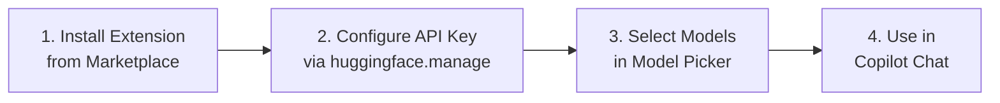

**Detailed Steps:**

1. **Install the Extension** - Install from VS Code Marketplace or build from source. See [Installation](#2.1) for detailed instructions.

2. **Configure API Key** - Provide your Hugging Face token through the management interface. The token is securely stored using VS Code's Secret Storage API. See [Configuration](#2.2) for details.

3. **Select Models** - Choose which Hugging Face models appear in your model picker. The extension fetches available models from the Hugging Face Router API.

4. **Start Using** - Access selected models through GitHub Copilot Chat interface with full tool calling support.

**Sources:** [README.md:9-15](), [package.json:40-53]()

## Extension Integration Architecture

The extension integrates with VS Code through two main contribution points defined in [package.json:40-53]():

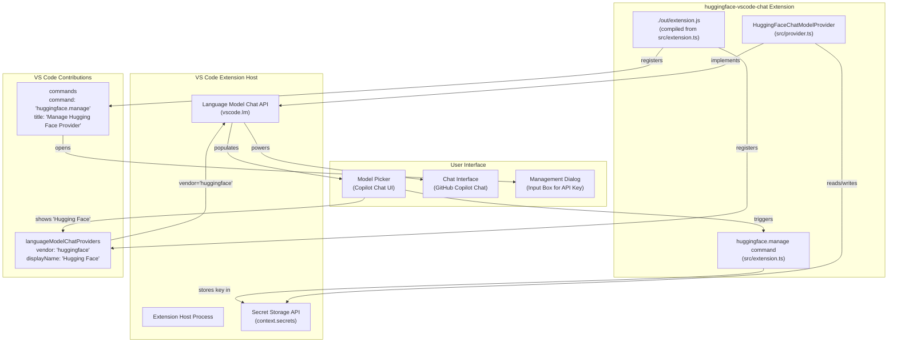

The extension makes two contributions to VS Code:

1. **Language Model Chat Provider** ([package.json:41-46]())
   - Vendor identifier: `huggingface`
   - Display name: `Hugging Face`
   - Management command: `huggingface.manage`
   - Implementation: `HuggingFaceChatModelProvider` class in [src/provider.ts]()

2. **Management Command** ([package.json:48-52]())
   - Command ID: `huggingface.manage`
   - Handles API key configuration
   - Registered in [src/extension.ts]()

**Sources:** [package.json:40-53](), [package.json:55]()

## First-Time Setup Flow

The following sequence diagram shows what happens during the initial setup, mapping user actions to code execution:

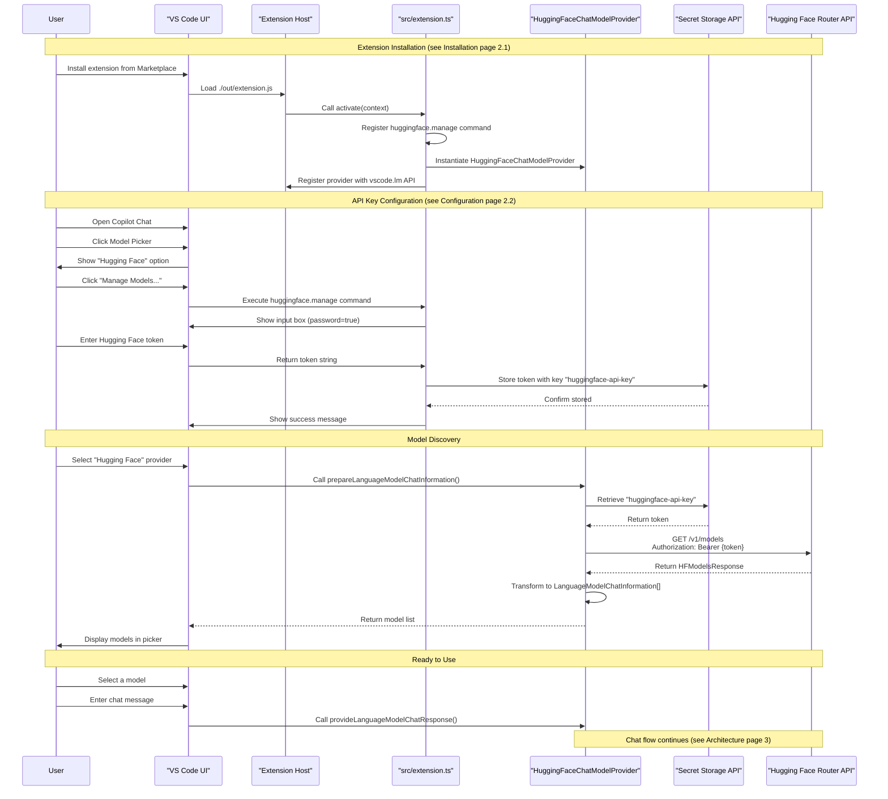

**Key Code Entities:**

- **Extension Activation**: [src/extension.ts]() - `activate()` function registers the provider and command
- **Provider Registration**: Uses `vscode.lm.registerChatModelProvider()` with vendor `"huggingface"`
- **Command Handler**: `huggingface.manage` command shows input box and stores token
- **Secret Storage**: Uses `context.secrets.store("huggingface-api-key", token)` for secure persistence
- **Model Discovery**: `prepareLanguageModelChatInformation()` in `HuggingFaceChatModelProvider` fetches models
- **API Endpoint**: `https://router.huggingface.co/v1/models` for model listing

**Sources:** [package.json:40-53](), [package.json:55](), [README.md:9-15]()

## Extension Activation and Registration

When VS Code loads the extension, the following initialization occurs:

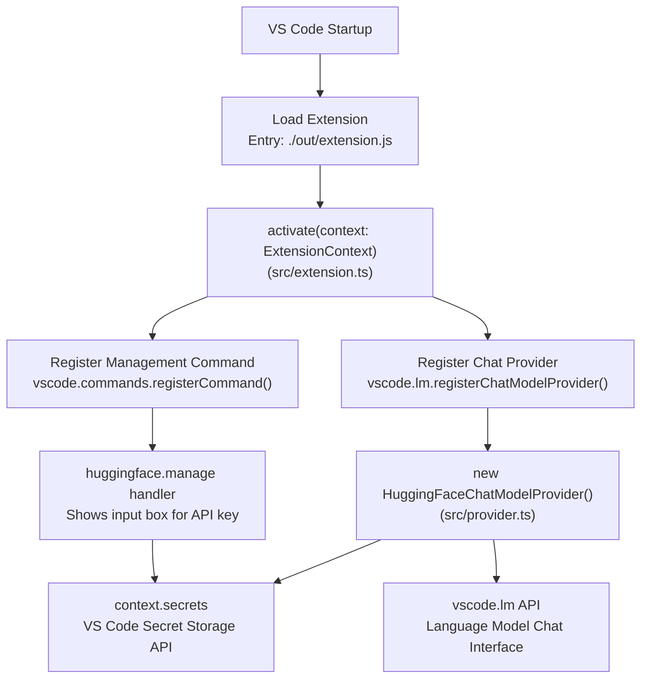

The `activate()` function in [src/extension.ts]() is the entry point that:

1. **Instantiates the Provider** - Creates a `HuggingFaceChatModelProvider` instance
2. **Registers with Language Model API** - Calls `vscode.lm.registerChatModelProvider("huggingface", provider)`
3. **Registers Management Command** - Sets up `huggingface.manage` command handler for API key configuration
4. **Returns Disposables** - Returns cleanup functions for proper deactivation

The provider is now available in the VS Code model picker with the display name "Hugging Face" as configured in [package.json:44]().

**Sources:** [package.json:40-53](), [package.json:55]()

## What Happens After Setup

Once configured, the extension operates as follows:

1. **Model Selection**: User selects a Hugging Face model from the Copilot Chat model picker
2. **Chat Requests**: User sends messages through the Copilot Chat interface
3. **Request Processing**: `HuggingFaceChatModelProvider.provideLanguageModelChatResponse()` handles requests
4. **API Communication**: Provider forwards requests to Hugging Face Router API
5. **Streaming Response**: Server-sent events are parsed and streamed back to VS Code
6. **Tool Calling**: Function calls are buffered, validated, and executed (see [Tool Call System](#3.6))

For architectural details on how chat requests flow through the system, see [Architecture](#3). For information on the streaming response mechanism, see [Streaming Response Handling](#3.5).

**Sources:** [README.md:1-23]()

## Next Steps

After completing the setup:

- **[Installation](#2.1)** - Detailed installation instructions including building from source
- **[Configuration](#2.2)** - In-depth configuration guide covering API key management and model selection
- **[Features](#4)** - Learn about all available features including tool calling and model discovery
- **[Development Guide](#5)** - If you want to contribute or modify the extension

**Sources:** [README.md:9-50]()

---

# Page: Installation

# Installation

<details>
<summary>Relevant source files</summary>

The following files were used as context for generating this wiki page:

- [README.md](README.md)
- [package.json](package.json)

</details>


This document provides instructions for installing the Hugging Face Provider for GitHub Copilot Chat extension. It covers system requirements, installation methods, and verification steps. For information about configuring the extension after installation, see [Configuration](#2.2).

## Prerequisites

Before installing the extension, ensure your environment meets the following requirements:

| Requirement | Specification | Notes |
|-------------|---------------|-------|
| **VS Code Version** | 1.104.0 or higher | Specified in [package.json:12-14]() |
| **GitHub Copilot** | Active subscription | Extension integrates with Copilot Chat interface |
| **Hugging Face Account** | Free or paid tier | Required for API token generation |
| **Hugging Face API Token** | `inference.serverless` permissions | Can be created at https://huggingface.co/settings/tokens/new |

The extension has zero runtime dependencies - all `devDependencies` in [package.json:68-81]() are used only for development and are not bundled with the distributed extension.

**Sources:** [package.json:12-14](), [package.json:67-81](), [README.md:27-29]()

## Installation Methods

### From VS Code Marketplace

The recommended installation method is through the Visual Studio Code Marketplace:

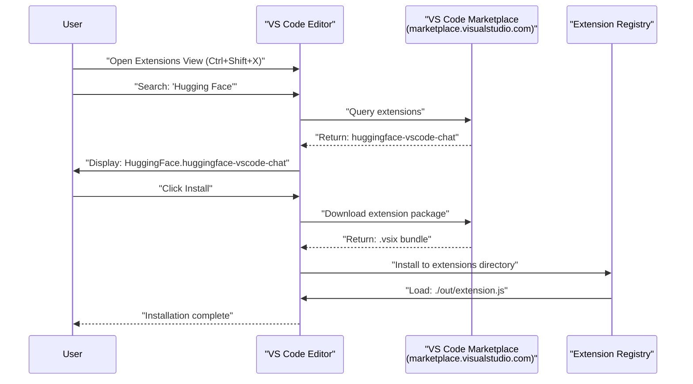

**Installation Steps:**

1. Open Visual Studio Code
2. Open the Extensions view (`Ctrl+Shift+X` or `Cmd+Shift+X` on macOS)
3. Search for `Hugging Face` or `huggingface-vscode-chat`
4. Locate the extension published by `HuggingFace` [package.json:3]()
5. Click the **Install** button
6. Wait for installation to complete (no reload required for modern VS Code versions)

**Direct Marketplace Link:** The extension can also be installed directly from https://marketplace.visualstudio.com/items?itemName=HuggingFace.huggingface-vscode-chat as referenced in [README.md:10]()

**Sources:** [README.md:10](), [package.json:2-4](), [package.json:55]()

### From VSIX Package

For offline installation or testing pre-release versions, install from a `.vsix` package file:

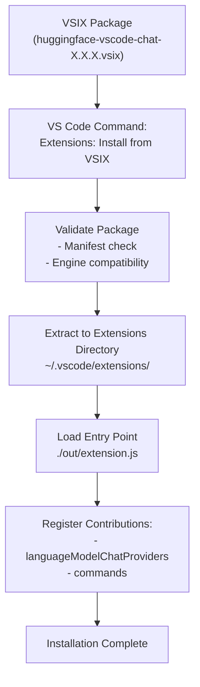

**Installation Steps:**

1. Obtain the `.vsix` file from GitHub releases or build from source
2. Open VS Code Command Palette (`Ctrl+Shift+P` or `Cmd+Shift+P`)
3. Run command: `Extensions: Install from VSIX...`
4. Select the downloaded `.vsix` file
5. Wait for installation confirmation

**Sources:** [package.json:55](), [package.json:40-53]()

## Extension Package Structure

Once installed, the extension's package structure maps to VS Code's extension model:

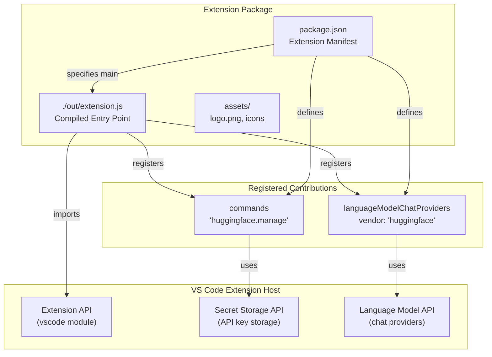

**Key Package Components:**

| Component | Location | Purpose |
|-----------|----------|---------|
| **Extension Manifest** | `package.json` | Defines metadata, contributions, and requirements |
| **Main Entry Point** | `./out/extension.js` | Compiled activation logic from [src/extension.ts]() |
| **Chat Provider** | Registered as `vendor: huggingface` | Implements `vscode.lm.registerChatModelProvider` API |
| **Management Command** | `huggingface.manage` | Command for API key configuration |
| **Extension Icon** | `assets/logo.png` | Displayed in Extensions view |

**Sources:** [package.json:40-53](), [package.json:55](), [package.json:6]()

## Verifying Installation

After installation, verify the extension is properly loaded:

### Check Extension Status

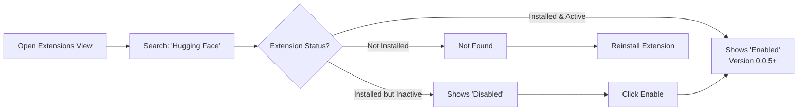

**Verification Steps:**

1. **Extensions View Check:**
   - Open Extensions view (`Ctrl+Shift+X`)
   - Search for "Hugging Face"
   - Verify extension shows as "Enabled"
   - Check version matches expected release (e.g., `0.0.5` from [package.json:11]())

2. **Chat Provider Check:**
   - Open GitHub Copilot Chat panel
   - Click the model picker dropdown
   - Verify "Hugging Face" appears as a provider option
   - This confirms the `languageModelChatProviders` contribution from [package.json:41-46]() is registered

3. **Command Availability:**
   - Open Command Palette (`Ctrl+Shift+P`)
   - Type "Manage Hugging Face"
   - Verify command `Hugging Face: Manage Hugging Face Provider` appears
   - This confirms the command from [package.json:48-52]() is registered

**Sources:** [package.json:11](), [package.json:41-46](), [package.json:48-52]()

### Troubleshooting Installation Issues

| Issue | Likely Cause | Resolution |
|-------|--------------|------------|
| Extension not found in Marketplace | Network connectivity | Check internet connection; try direct URL |
| Installation fails with version error | VS Code too old | Update VS Code to 1.104.0+ |
| Extension installed but not active | Extension disabled by user | Enable in Extensions view |
| Command not available | Extension activation failed | Check Output panel > Extension Host logs |
| Provider not in model picker | GitHub Copilot not installed | Install GitHub Copilot extension first |

**Sources:** [package.json:12-14](), [README.md:27-29]()

## Post-Installation

After successful installation, the extension is ready for configuration:

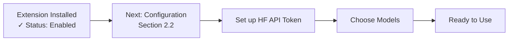

The extension will not function until configured with a valid Hugging Face API token. Proceed to [Configuration](#2.2) to:

- Set up your Hugging Face API token via the `huggingface.manage` command
- Select which Hugging Face models to use in Copilot Chat
- Configure model-specific settings

The configuration process uses VS Code's Secret Storage API to securely store your API token, ensuring credentials are never exposed in plaintext.

**Sources:** [README.md:9-15](), [package.json:45]()

## Alternative: Development Installation

For contributors or developers who want to run the extension from source, see [Development Environment Setup](#5.1) for instructions on:

- Cloning the repository from https://github.com/huggingface/huggingface-vscode-chat
- Installing development dependencies with `npm install` or `pnpm install`
- Compiling TypeScript source with `npm run compile`
- Launching the Extension Development Host with F5

Development installation is not recommended for end users. Use the Marketplace installation method described above for production use.

**Sources:** [README.md:31-44](), [package.json:56-65]()

---

# Page: Configuration

# Configuration

<details>
<summary>Relevant source files</summary>

The following files were used as context for generating this wiki page:

- [README.md](README.md)
- [src/extension.ts](src/extension.ts)
- [src/provider.ts](src/provider.ts)

</details>


## Purpose and Scope

This document covers the configuration requirements and options for the Hugging Face VS Code Chat extension. It details API key setup, model discovery and selection, and request-level configuration parameters. For installation instructions, see [Installation](#2.1). For information on the underlying provider implementation, see [Chat Provider Implementation](#3.3).

## API Key Setup

### Obtaining an API Key

The extension requires a Hugging Face API key with `inference.serverless.write` permissions to authenticate with the Hugging Face Router API at `https://router.huggingface.co/v1`. 

To obtain a key:
1. Navigate to https://huggingface.co/settings/tokens/new
2. Select "Fine-grained" token type
3. Enable the `inference.serverless.write` permission
4. Generate and copy the token (format: `hf_***`)

**Sources:** [README.md:14](), [README.md:29](), [src/provider.ts:16]()

### Configuring the API Key

The extension provides the `huggingface.manage` command to configure the API key securely. This command is registered during extension activation and interacts with VS Code's Secret Storage API.

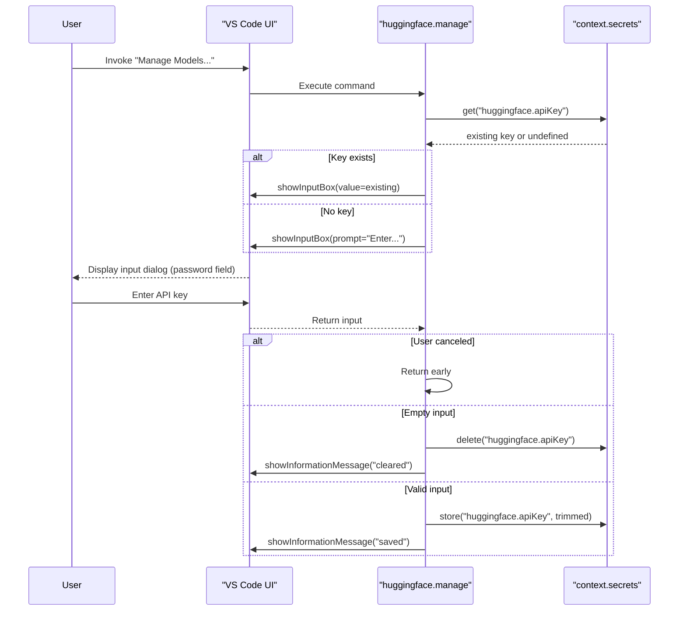

**Diagram: API Key Configuration Flow**

The management command implementation demonstrates several key behaviors:
- **Password field masking**: The input box uses `password: true` to hide the API key
- **Pre-population**: Existing keys are loaded as the default value for updates
- **Deletion support**: Empty input deletes the stored key
- **Trimming**: Input is trimmed before storage to prevent whitespace issues

**Sources:** [src/extension.ts:17-38](), [src/provider.ts:358-373]()

### API Key Retrieval and Validation

The provider's `ensureApiKey` method handles key retrieval with optional user prompting:

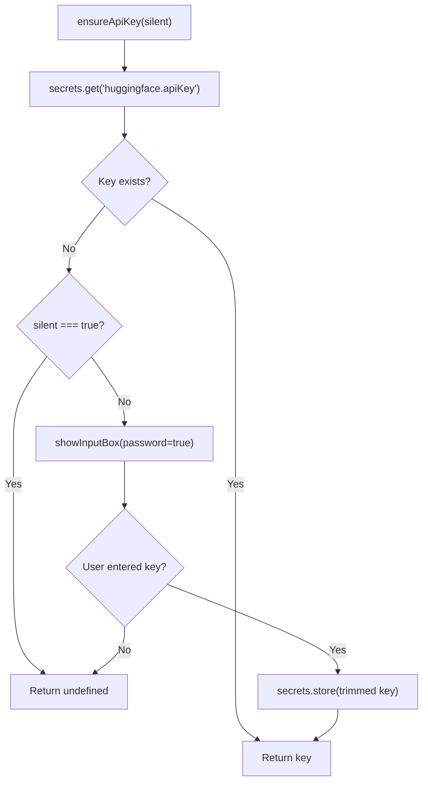

**Diagram: API Key Retrieval Logic**

The `silent` parameter controls prompting behavior:
- `silent=true`: Used during model list fetching to avoid interrupting the user
- `silent=false`: Used during chat requests to ensure a key is available

**Sources:** [src/provider.ts:358-373]()

## Model Discovery and Selection

### Model List Endpoint

The extension fetches available models from the Hugging Face Router API's `/v1/models` endpoint. This occurs during the `prepareLanguageModelChatInformation` phase, which is invoked when VS Code queries for available language models.

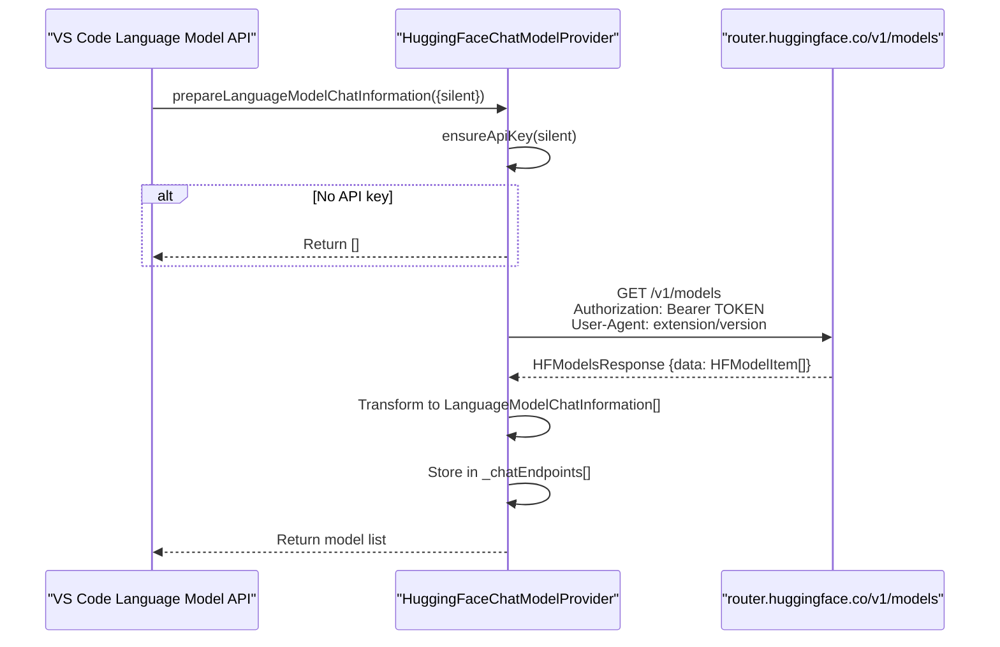

**Diagram: Model Discovery Process**

**Sources:** [src/provider.ts:89-157](), [src/provider.ts:170-202]()

### Model Metadata and Capabilities

Each model in the response contains provider-specific metadata that determines the available configurations:

| Model Field | Type | Usage |
|------------|------|-------|
| `id` | `string` | Model identifier (e.g., `"meta-llama/Llama-3.3-70B-Instruct"`) |
| `providers` | `HFProvider[]` | List of inference providers supporting this model |
| `architecture.input_modalities` | `string[]` | Supported input types (e.g., `["text", "image"]`) |

Each `HFProvider` object contains:

| Provider Field | Type | Usage |
|---------------|------|-------|
| `provider` | `string` | Provider name (e.g., `"cerebras"`, `"together"`) |
| `supports_tools` | `boolean` | Whether tool calling is supported |
| `context_length` | `number` | Maximum context window size |

**Sources:** [src/types.ts:1-22](), [src/provider.ts:100-149]()

### Model Information Construction

The provider builds `LanguageModelChatInformation` objects for each model-provider combination:

```typescript
// For providers with tool support
{
    id: `${m.id}:${p.provider}`,           // "model:provider" format
    name: `${m.id} via ${p.provider}`,      // Display name
    family: "huggingface",
    maxInputTokens: contextLength - DEFAULT_MAX_OUTPUT_TOKENS,
    maxOutputTokens: DEFAULT_MAX_OUTPUT_TOKENS,
    capabilities: {
        toolCalling: true,
        imageInput: vision
    }
}
```

Models without tool-supporting providers fall back to a base configuration with `toolCalling: false`.

**Constants:**
- `DEFAULT_MAX_OUTPUT_TOKENS = 16000`
- `DEFAULT_CONTEXT_LENGTH = 128000`

**Sources:** [src/provider.ts:17-18](), [src/provider.ts:109-126](), [src/provider.ts:128-146]()

## Request Configuration

### Request Body Structure

When `provideLanguageModelChatResponse` is invoked, the provider constructs an OpenAI-compatible request body:

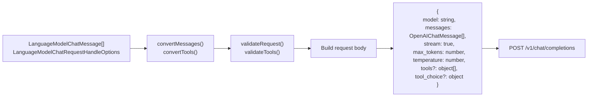

**Diagram: Request Construction Pipeline**

**Sources:** [src/provider.ts:214-327](), [src/provider.ts:269-296]()

### Model Options

The extension supports a subset of OpenAI-compatible model options via the `options.modelOptions` parameter:

| Option | Type | Default | Constraint |
|--------|------|---------|------------|
| `max_tokens` | `number` | `4096` | Capped at `model.maxOutputTokens` |
| `temperature` | `number` | `0.7` | - |
| `stop` | `string \| string[]` | - | Allow-listed |
| `frequency_penalty` | `number` | - | Allow-listed |
| `presence_penalty` | `number` | - | Allow-listed |

The allow-list mechanism ensures only supported parameters are forwarded:

```typescript
if (options.modelOptions) {
    const mo = options.modelOptions as Record<string, unknown>;
    if (typeof mo.stop === "string" || Array.isArray(mo.stop)) {
        requestBody.stop = mo.stop;
    }
    if (typeof mo.frequency_penalty === "number") {
        requestBody.frequency_penalty = mo.frequency_penalty;
    }
    if (typeof mo.presence_penalty === "number") {
        requestBody.presence_penalty = mo.presence_penalty;
    }
}
```

**Sources:** [src/provider.ts:273-289]()

### Tool Configuration

Tools are converted from VS Code's `LanguageModelChatTool` format to OpenAI's function tool format via `convertTools`:

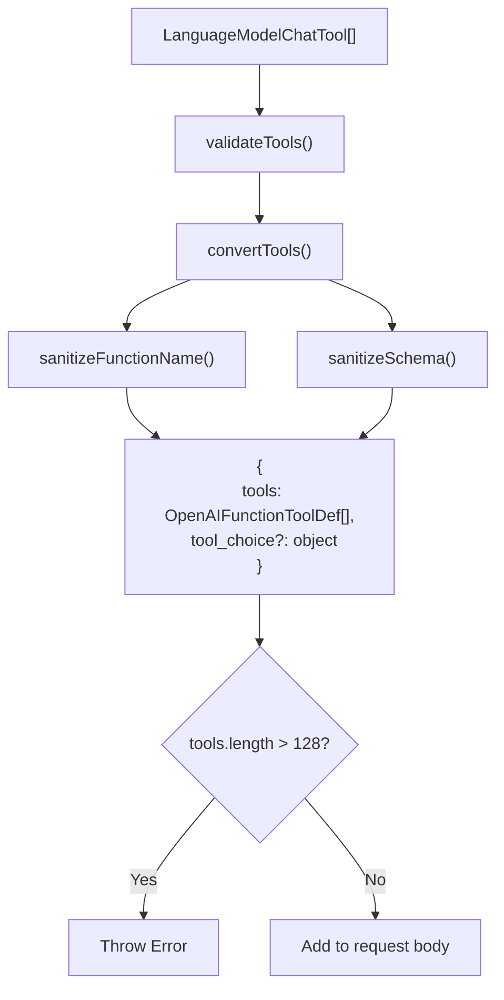

**Diagram: Tool Configuration Pipeline**

The tool conversion process:
1. Validates tool definitions
2. Sanitizes function names (removes invalid characters)
3. Cleans JSON schemas (removes `$schema`, `additionalProperties: false`)
4. Enforces a maximum of 128 tools per request

**Sources:** [src/provider.ts:255](), [src/provider.ts:257-259](), [src/provider.ts:291-296](), [src/utils.ts:98-133]()

### Token Limit Validation

The provider estimates token usage to prevent exceeding model limits:

```typescript
const inputTokenCount = this.estimateMessagesTokens(messages);
const toolTokenCount = this.estimateToolTokens(toolConfig.tools);
const tokenLimit = Math.max(1, model.maxInputTokens);

if (inputTokenCount + toolTokenCount > tokenLimit) {
    throw new Error("Message exceeds token limit.");
}
```

Token estimation uses a simple heuristic: **1 token ≈ 4 characters**

**Sources:** [src/provider.ts:60-81](), [src/provider.ts:261-267]()

## Configuration Storage and Security

### Secret Storage API

The extension uses VS Code's Secret Storage API, which provides:
- **OS-level encryption**: Keys are stored in the system keychain (Keychain on macOS, Credential Manager on Windows, Secret Service on Linux)
- **Workspace isolation**: Secrets are scoped to the extension
- **Async access**: All operations return promises

The storage key is `"huggingface.apiKey"` and is accessed via `context.secrets`:

```typescript
// Store
await context.secrets.store("huggingface.apiKey", apiKey);

// Retrieve
const apiKey = await context.secrets.get("huggingface.apiKey");

// Delete
await context.secrets.delete("huggingface.apiKey");
```

**Sources:** [src/extension.ts:19](), [src/extension.ts:31](), [src/extension.ts:35](), [src/provider.ts:359]()

### User-Agent Construction

The extension constructs a descriptive User-Agent header for API telemetry:

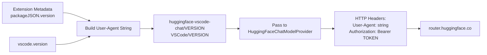

**Diagram: User-Agent and Authentication Header Construction**

The User-Agent format is: `huggingface-vscode-chat/{extensionVersion} VSCode/{vscodeVersion}`

This enables Hugging Face to track API usage by extension version and VS Code version.

**Sources:** [src/extension.ts:5-10](), [src/extension.ts:12](), [src/provider.ts:176](), [src/provider.ts:302]()

### Authentication Headers

All API requests include authentication and identification headers:

| Header | Value | Purpose |
|--------|-------|---------|
| `Authorization` | `Bearer {apiKey}` | API authentication |
| `User-Agent` | `huggingface-vscode-chat/{version} VSCode/{version}` | Telemetry |
| `Content-Type` | `application/json` | Request body format (POST only) |

**Sources:** [src/provider.ts:176](), [src/provider.ts:300-302]()

---

# Page: Architecture

# Architecture

<details>
<summary>Relevant source files</summary>

The following files were used as context for generating this wiki page:

- [src/extension.ts](src/extension.ts)
- [src/provider.ts](src/provider.ts)
- [src/types.ts](src/types.ts)
- [src/utils.ts](src/utils.ts)

</details>


## Purpose and Scope

This document provides a comprehensive overview of the extension's internal architecture, design patterns, and component interactions. It describes how the extension bridges VS Code's Language Model Chat API with Hugging Face's inference router, focusing on the core technical implementation.

For user-facing feature documentation, see [Features](#4). For detailed API method signatures, see [API Reference](#7). For extension activation and lifecycle hooks, see [Extension Lifecycle](#3.2).

## System Overview

The extension implements a language model chat provider that adapts VS Code's chat interface to work with Hugging Face's inference API. The architecture follows a layered design with clear separation of concerns:

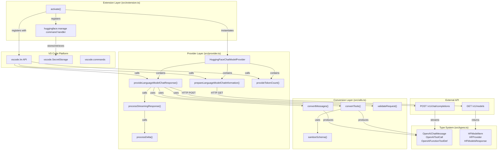

**Sources:** [src/extension.ts:1-42](), [src/provider.ts:1-782](), [src/utils.ts:1-364](), [src/types.ts:1-85]()

### Component Responsibilities

| Component | File | Primary Responsibilities |
|-----------|------|-------------------------|
| `activate()` | [src/extension.ts:4-39]() | Extension registration, command setup, provider instantiation |
| `HuggingFaceChatModelProvider` | [src/provider.ts:23-781]() | Implements VS Code's `LanguageModelChatProvider` interface |
| `convertMessages()` | [src/utils.ts:143-186]() | Transforms VS Code messages to OpenAI format |
| `convertTools()` | [src/utils.ts:192-227]() | Transforms VS Code tools to OpenAI function definitions |
| `validateRequest()` | [src/utils.ts:248-290]() | Validates message sequences and tool call/result pairing |
| `sanitizeSchema()` | [src/utils.ts:68-136]() | Cleans JSON schemas for API compatibility |

**Sources:** [src/extension.ts:4-39](), [src/provider.ts:23-781](), [src/utils.ts:143-290]()

## Extension Activation and Registration

The extension activates through the `activate()` function, which orchestrates provider registration and command setup:

```mermaid
sequenceDiagram
    participant VSCode as "VS Code Extension Host"
    participant activate as "activate()"
    participant HFProvider as "HuggingFaceChatModelProvider"
    participant LMAPI as "vscode.lm"
    participant Commands as "vscode.commands"
    
    VSCode->>activate: activate(context)
    activate->>activate: Build User-Agent string
    Note over activate: UA: huggingface-vscode-chat/{version}<br/>VSCode/{vscodeVersion}
    
    activate->>HFProvider: new HuggingFaceChatModelProvider(secrets, ua)
    activate->>LMAPI: registerLanguageModelChatProvider("huggingface", provider)
    
    activate->>Commands: registerCommand("huggingface.manage", handler)
    Note over Commands: Command allows users to<br/>configure API key
    
    activate-->>VSCode: Registration complete
```

The `activate()` function performs three critical operations:

1. **User-Agent Construction** ([src/extension.ts:6-10]()): Builds a tracking string combining extension version and VS Code version
2. **Provider Instantiation** ([src/extension.ts:12]()): Creates `HuggingFaceChatModelProvider` with secret storage access
3. **Registration** ([src/extension.ts:14]()): Registers the provider under vendor ID `"huggingface"` matching [package.json]()

**Sources:** [src/extension.ts:4-39]()

## Provider Implementation

### LanguageModelChatProvider Interface

The `HuggingFaceChatModelProvider` class implements the required VS Code interface:

```mermaid
classDiagram
    class LanguageModelChatProvider {
        <<interface>>
        +prepareLanguageModelChatInformation(options, token) Promise~LanguageModelChatInformation[]~
        +provideLanguageModelChatResponse(model, messages, options, progress, token) Promise~void~
        +provideTokenCount(model, text, token) Promise~number~
    }
    
    class HuggingFaceChatModelProvider {
        -secrets: SecretStorage
        -userAgent: string
        -_chatEndpoints: Array
        -_toolCallBuffers: Map
        -_completedToolCallIndices: Set
        -_hasEmittedAssistantText: boolean
        -_emittedBeginToolCallsHint: boolean
        -_textToolParserBuffer: string
        -_textToolActive: object
        +prepareLanguageModelChatInformation()
        +provideLanguageModelChatResponse()
        +provideTokenCount()
        -fetchModels()
        -ensureApiKey()
        -processStreamingResponse()
        -processDelta()
        -processTextContent()
        -tryEmitBufferedToolCall()
        -flushToolCallBuffers()
        -stripControlTokens()
    }
    
    LanguageModelChatProvider <|.. HuggingFaceChatModelProvider
```

**Sources:** [src/provider.ts:23-781]()

### State Management

The provider maintains several internal state variables for streaming response handling:

| State Variable | Type | Purpose |
|---------------|------|---------|
| `_toolCallBuffers` | `Map<number, {id?, name?, args}>` | Accumulates streamed tool call fragments by index |
| `_completedToolCallIndices` | `Set<number>` | Tracks which tool call indices have been emitted |
| `_hasEmittedAssistantText` | `boolean` | Flags whether assistant text preceded tool calls |
| `_emittedBeginToolCallsHint` | `boolean` | Tracks whitespace flush for UI buffer clearing |
| `_textToolParserBuffer` | `string` | Buffer for parsing control-token-embedded tool calls |
| `_textToolActive` | `object` | Current in-progress text-embedded tool call state |
| `_emittedTextToolCallKeys` | `Set<string>` | Deduplication set for tool call content |
| `_emittedTextToolCallIds` | `Set<string>` | Deduplication set for tool call identities |

State is reset at the beginning of each request ([src/provider.ts:222-229]()) and cleaned up after streaming completes ([src/provider.ts:422-430]()).

**Sources:** [src/provider.ts:24-51](), [src/provider.ts:222-230](), [src/provider.ts:422-430]()

## Message Conversion Pipeline

The conversion layer transforms VS Code's message format to OpenAI-compatible structures:

```mermaid
graph LR
    subgraph "Input (VS Code Types)"
        VSCodeMsg["LanguageModelChatMessage<br/>- role: LanguageModelChatMessageRole<br/>- content: LanguageModelChatRequestPart[]"]
        TextPart["LanguageModelTextPart"]
        ToolCallPart["LanguageModelToolCallPart"]
        ToolResultPart["LanguageModelToolResultPart"]
    end
    
    subgraph "Conversion (src/utils.ts)"
        convertMessages["convertMessages()"]
        mapRole["mapRole()"]
        collectToolResult["collectToolResultText()"]
    end
    
    subgraph "Output (OpenAI Types)"
        OpenAIMsg["OpenAIChatMessage<br/>- role: 'system'|'user'|'assistant'|'tool'<br/>- content?: string<br/>- tool_calls?: OpenAIToolCall[]<br/>- tool_call_id?: string"]
    end
    
    VSCodeMsg -->|"iterates"| convertMessages
    TextPart -->|"aggregated"| convertMessages
    ToolCallPart -->|"mapped"| convertMessages
    ToolResultPart -->|"processed"| collectToolResult
    
    convertMessages -->|"uses"| mapRole
    convertMessages -->|"uses"| collectToolResult
    convertMessages -->|"produces"| OpenAIMsg
```

The `convertMessages()` function ([src/utils.ts:143-186]()) processes each message part:

1. **Text Parts** ([src/utils.ts:152-153]()): Concatenated into message content
2. **Tool Call Parts** ([src/utils.ts:154-162]()): Converted to `OpenAIToolCall` objects with serialized arguments
3. **Tool Result Parts** ([src/utils.ts:163-167]()): Extracted into separate `role: "tool"` messages

Role mapping ([src/utils.ts:310-321]()) converts enum values to string literals:
- `LanguageModelChatMessageRole.User` → `"user"`
- `LanguageModelChatMessageRole.Assistant` → `"assistant"`
- Default → `"system"`

**Sources:** [src/utils.ts:143-186](), [src/utils.ts:310-343]()

## Tool Definition Conversion

Tool conversion sanitizes and formats tool definitions for API compatibility:

```mermaid
graph TB
    subgraph "Input Validation"
        VSCodeTools["LanguageModelChatTool[]<br/>- name: string<br/>- description?: string<br/>- inputSchema?: object"]
        validateTools["validateTools()"]
    end
    
    subgraph "Name Sanitization"
        sanitizeFunctionName["sanitizeFunctionName()"]
        NameRules["1. Replace non-alphanumeric with '_'<br/>2. Ensure starts with letter<br/>3. Deduplicate underscores<br/>4. Truncate to 64 chars"]
    end
    
    subgraph "Schema Sanitization"
        sanitizeSchema["sanitizeSchema()"]
        SchemaSteps["1. Resolve anyOf/oneOf/allOf<br/>2. Prune unknown keywords<br/>3. Infer integer types<br/>4. Recursively sanitize properties<br/>5. Clean arrays/objects"]
    end
    
    subgraph "Tool Choice Logic"
        toolMode["options.toolMode"]
        toolChoice["tool_choice:<br/>'auto' | {type:'function', function:{name}}"]
    end
    
    subgraph "Output"
        OpenAITools["OpenAIFunctionToolDef[]<br/>- type: 'function'<br/>- function: {name, description, parameters}"]
    end
    
    VSCodeTools -->|"check names"| validateTools
    VSCodeTools -->|"process"| sanitizeFunctionName
    VSCodeTools -->|"process schema"| sanitizeSchema
    
    sanitizeFunctionName -->|"applies"| NameRules
    sanitizeSchema -->|"applies"| SchemaSteps
    
    toolMode -->|"Required + 1 tool"| toolChoice
    toolMode -->|"else"| toolChoice
    
    sanitizeFunctionName -->|"cleaned name"| OpenAITools
    sanitizeSchema -->|"cleaned schema"| OpenAITools
    toolChoice -->|"attached to request"| OpenAITools
```

### Schema Sanitization Rules

The `sanitizeSchema()` function ([src/utils.ts:68-136]()) applies several transformations:

1. **Composite Schema Resolution** ([src/utils.ts:75-88]()): Flattens `anyOf`/`oneOf`/`allOf`, preferring `type: "string"` variants
2. **Keyword Pruning** ([src/utils.ts:39-66]()): Allows only recognized JSON Schema keywords
3. **Integer Type Inference** ([src/utils.ts:98-101]()): Converts `number` to `integer` for properties matching patterns like `*_id`, `limit`, `count`
4. **Recursive Property Cleaning** ([src/utils.ts:103-111]()): Applies sanitization to nested object properties
5. **Array Item Normalization** ([src/utils.ts:124-133]()): Ensures `items` is a single schema, not tuple validation

**Sources:** [src/utils.ts:27-136](), [src/utils.ts:192-227](), [src/utils.ts:233-242]()

## Streaming Response Handling

The streaming pipeline processes Server-Sent Events from Hugging Face's chat completion endpoint:

```mermaid
sequenceDiagram
    participant API as "POST /v1/chat/completions"
    participant processStream as "processStreamingResponse()"
    participant decoder as "TextDecoder"
    participant processDelta as "processDelta()"
    participant processText as "processTextContent()"
    participant tryEmit as "tryEmitBufferedToolCall()"
    participant progress as "Progress<LanguageModelResponsePart>"
    
    API->>processStream: ReadableStream<Uint8Array>
    
    loop Until done or cancelled
        processStream->>decoder: decode(chunk)
        decoder-->>processStream: text
        
        processStream->>processStream: Split by '\n', keep partial line
        
        loop For each complete line
            alt Line starts with "data: "
                processStream->>processStream: Extract data = line.slice(6)
                
                alt data === "[DONE]"
                    processStream->>processStream: flushToolCallBuffers(throwOnInvalid=false)
                    processStream->>processStream: flushActiveTextToolCall()
                else JSON chunk
                    processStream->>processDelta: processDelta(parsed)
                    
                    alt Has thinking content
                        processDelta->>progress: report(LanguageModelThinkingPart)
                    end
                    
                    alt Has deltaObj.content
                        processDelta->>processText: processTextContent(content)
                        processText->>processText: Parse control tokens
                        processText->>progress: report(LanguageModelTextPart)
                        processText->>progress: report(LanguageModelToolCallPart)
                    end
                    
                    alt Has deltaObj.tool_calls
                        processDelta->>processDelta: Update _toolCallBuffers
                        processDelta->>tryEmit: tryEmitBufferedToolCall(index)
                        tryEmit->>tryEmit: Check if args are valid JSON
                        alt Valid JSON
                            tryEmit->>progress: report(LanguageModelToolCallPart)
                        end
                    end
                    
                    alt finish_reason in ['tool_calls', 'stop']
                        processDelta->>processDelta: flushToolCallBuffers(throwOnInvalid=true)
                    end
                end
            end
        end
    end
    
    processStream->>processStream: Clean up state variables
```

**Sources:** [src/provider.ts:381-431](), [src/provider.ts:438-528]()

### Tool Call Buffering System

The provider supports two tool call formats:

1. **SSE Tool Calls** ([src/provider.ts:488-520]()): Standard OpenAI streaming format with `tool_calls` array
2. **Text-Embedded Tool Calls** ([src/provider.ts:534-657]()): Control token format used by some providers

#### SSE Tool Call Processing

```mermaid
stateDiagram-v2
    [*] --> ReceiveDelta: tool_calls delta arrives
    ReceiveDelta --> UpdateBuffer: Extract index, id, function.name, function.arguments
    UpdateBuffer --> CheckJSON: Append arguments to buffer[index]
    CheckJSON --> EmitToolCall: tryParseJSONObject() succeeds
    CheckJSON --> WaitMore: JSON incomplete
    WaitMore --> ReceiveDelta: More deltas arrive
    EmitToolCall --> MarkComplete: report(LanguageModelToolCallPart)
    MarkComplete --> [*]
    
    state CheckJSON {
        [*] --> TryParse
        TryParse --> Valid: JSON.parse succeeds
        TryParse --> Invalid: JSON.parse fails
    }
```

Buffer entries ([src/provider.ts:26-29]()) accumulate:
- `id`: Tool call identifier from SSE
- `name`: Function name from `function.name`
- `args`: Concatenated `function.arguments` strings

The `tryEmitBufferedToolCall()` method ([src/provider.ts:709-733]()) attempts emission when `args` becomes valid JSON, marking the index complete to ignore subsequent deltas.

**Sources:** [src/provider.ts:488-520](), [src/provider.ts:709-733]()

#### Text-Embedded Tool Call Parsing

Some providers embed tool calls in text using control tokens:

```
<|tool_call_begin|>function_name:0<|tool_call_argument_begin|>{"key":"value"}<|tool_call_end|>
```

The `processTextContent()` method ([src/provider.ts:534-657]()) implements a state machine parser:

| State | Trigger | Action |
|-------|---------|--------|
| Not active | `<|tool_call_begin|>` found | Extract name/index, enter active state |
| Active, no args | `<|tool_call_argument_begin|>` | Begin accumulating arguments |
| Active, no args | `<|tool_call_end|>` | Emit with empty args `"{}"` |
| Active, accumulating | Characters | Append to `argBuffer` |
| Active, accumulating | Valid JSON detected | Emit tool call early (don't wait for end) |
| Active, accumulating | `<|tool_call_end|>` | Final emission attempt, reset state |

Deduplication ([src/provider.ts:669-682]()) uses:
- **Identity-based**: `name:index` for indexed calls
- **Content-based**: `name:canonicalJSON` otherwise

**Sources:** [src/provider.ts:534-657](), [src/provider.ts:659-702]()

## API Integration

### Model Discovery

The `prepareLanguageModelChatInformation()` method ([src/provider.ts:89-157]()) fetches available models:

```mermaid
sequenceDiagram
    participant VSCode as "VS Code"
    participant prepare as "prepareLanguageModelChatInformation()"
    participant ensureKey as "ensureApiKey()"
    participant fetchModels as "fetchModels()"
    participant API as "GET router.huggingface.co/v1/models"
    
    VSCode->>prepare: Request model list (silent=true/false)
    prepare->>ensureKey: Check for API key
    
    alt No API key and silent=false
        ensureKey->>ensureKey: showInputBox(password=true)
        ensureKey->>ensureKey: secrets.store("huggingface.apiKey", key)
    end
    
    ensureKey-->>prepare: API key or undefined
    
    alt Has API key
        prepare->>fetchModels: fetchModels(apiKey)
        fetchModels->>API: Authorization: Bearer {apiKey}
        API-->>fetchModels: HFModelsResponse {data: HFModelItem[]}
        
        fetchModels-->>prepare: {models: HFModelItem[]}
        
        prepare->>prepare: Build LanguageModelChatInformation[] entries
        
        loop For each model
            prepare->>prepare: Filter providers with supports_tools=true
            
            alt Has tool-supporting providers
                loop For each tool provider
                    prepare->>prepare: Create entry "{model.id}:{provider}"
                    Note over prepare: maxInputTokens = context_length - 16000<br/>maxOutputTokens = 16000<br/>toolCalling = true
                end
            else No tool providers
                prepare->>prepare: Create base entry "{model.id}"
                Note over prepare: toolCalling = false
            end
        end
        
        prepare-->>VSCode: LanguageModelChatInformation[]
    else No API key
        prepare-->>VSCode: []
    end
```

Model entries include capabilities derived from provider metadata:
- **Tool Calling** ([src/provider.ts:106-126]()): `supports_tools === true` on provider
- **Vision** ([src/provider.ts:102-103]()): `input_modalities` includes `"image"`
- **Token Limits** ([src/provider.ts:110-112]()): Context length from provider, output fixed at 16000

**Sources:** [src/provider.ts:89-157](), [src/provider.ts:170-202](), [src/provider.ts:358-373]()

### Chat Completion Request

The `provideLanguageModelChatResponse()` method ([src/provider.ts:214-327]()) constructs and sends requests:

```mermaid
graph TB
    subgraph "Request Construction"
        msgs["messages: LanguageModelChatMessage[]"]
        opts["options: LanguageModelChatRequestHandleOptions"]
        
        convertMsgs["convertMessages()"]
        convertToolsDef["convertTools()"]
        validateReq["validateRequest()"]
        
        estimate["estimateMessagesTokens()<br/>estimateToolTokens()"]
        checkLimit{"inputTokens + toolTokens<br/>> maxInputTokens?"}
    end
    
    subgraph "Request Body"
        body["{\n  model: string,\n  messages: OpenAIChatMessage[],\n  stream: true,\n  max_tokens: number,\n  temperature: number,\n  tools?: OpenAIFunctionToolDef[],\n  tool_choice?: 'auto' | {...},\n  stop?: string | string[],\n  frequency_penalty?: number,\n  presence_penalty?: number\n}"]
    end
    
    subgraph "API Call"
        fetch["fetch('router.huggingface.co/v1/chat/completions')"]
        headers["Authorization: Bearer {apiKey}<br/>Content-Type: application/json<br/>User-Agent: {userAgent}"]
    end
    
    msgs --> convertMsgs
    msgs --> validateReq
    opts --> convertToolsDef
    
    convertMsgs --> body
    convertToolsDef --> body
    opts --> body
    
    msgs --> estimate
    opts --> estimate
    estimate --> checkLimit
    
    checkLimit -->|"Yes"| Error["throw 'Message exceeds token limit'"]
    checkLimit -->|"No"| body
    
    body --> fetch
    headers --> fetch
```

Request body assembly ([src/provider.ts:269-296]()):
1. **Required Fields**: `model`, `messages`, `stream: true`, `max_tokens`, `temperature`
2. **Optional Tools**: Added when `options.tools` present
3. **Model Options Allowlist** ([src/provider.ts:278-289]()): `stop`, `frequency_penalty`, `presence_penalty`

Token limit validation ([src/provider.ts:261-267]()) prevents oversized requests by estimating tokens using character count divided by 4.

**Sources:** [src/provider.ts:214-327](), [src/provider.ts:59-81]()

## Request Validation

The `validateRequest()` function ([src/utils.ts:248-290]()) ensures tool call/result pairing:

```mermaid
graph TD
    Start["validateRequest(messages)"] --> CheckEmpty{"messages.length === 0?"}
    CheckEmpty -->|"Yes"| ThrowEmpty["throw 'Invalid request: no messages'"]
    CheckEmpty -->|"No"| IterateMsgs["Iterate messages"]
    
    IterateMsgs --> CheckRole{"role === Assistant?"}
    CheckRole -->|"No"| NextMsg["Next message"]
    CheckRole -->|"Yes"| ExtractCalls["Extract tool call IDs from LanguageModelToolCallPart"]
    
    ExtractCalls --> HasCalls{"toolCallIds.size > 0?"}
    HasCalls -->|"No"| NextMsg
    HasCalls -->|"Yes"| CheckNext["Get next message"]
    
    CheckNext --> ValidateNext{"nextMessage exists<br/>AND role === User?"}
    ValidateNext -->|"No"| ThrowMissing["throw 'Tool call must be followed by User message'"]
    ValidateNext -->|"Yes"| CheckParts["Iterate message.content parts"]
    
    CheckParts --> IsToolResult{"part is LanguageModelToolResultPart?"}
    IsToolResult -->|"No"| ThrowWrongType["throw 'Expected tool result part'"]
    IsToolResult -->|"Yes"| RemoveId["toolCallIds.delete(part.callId)"]
    
    RemoveId --> MoreParts{"More parts?"}
    MoreParts -->|"Yes"| CheckParts
    MoreParts -->|"No"| AllMatched{"toolCallIds.size === 0?"}
    
    AllMatched -->|"No"| CheckNext
    AllMatched -->|"Yes"| NextMsg
    
    NextMsg --> MoreMsgs{"More messages?"}
    MoreMsgs -->|"Yes"| CheckRole
    MoreMsgs -->|"No"| Done["Validation complete"]
```

This validation enforces the conversation protocol:
1. Every `LanguageModelToolCallPart` in an assistant message must have a corresponding `LanguageModelToolResultPart` in a subsequent user message
2. The `callId` values must match exactly
3. Tool results must appear in user messages immediately following the assistant tool call message

**Sources:** [src/utils.ts:248-290]()

## Type System

The extension defines type hierarchies for both VS Code and OpenAI formats:

### OpenAI Type Definitions

```typescript
// From src/types.ts:4-27

interface OpenAIToolCall {
  id: string;
  type: "function";
  function: { name: string; arguments: string };
}

interface OpenAIFunctionToolDef {
  type: "function";
  function: { 
    name: string; 
    description?: string; 
    parameters?: object;
  };
}

interface OpenAIChatMessage {
  role: "system" | "user" | "assistant" | "tool";
  content?: string;
  name?: string;
  tool_calls?: OpenAIToolCall[];
  tool_call_id?: string;
}
```

### Hugging Face Response Types

```typescript
// From src/types.ts:32-72

interface HFProvider {
  provider: string;
  status: string;
  supports_tools?: boolean;
  supports_structured_output?: boolean;
  context_length?: number;
}

interface HFArchitecture {
  input_modalities?: string[];
  output_modalities?: string[];
}

interface HFModelItem {
  id: string;
  object: string;
  created: number;
  owned_by: string;
  providers: HFProvider[];
  architecture?: HFArchitecture;
}

interface HFModelsResponse {
  object: string;
  data: HFModelItem[];
}
```

**Sources:** [src/types.ts:1-85]()

## Security Architecture

API key management uses VS Code's secure storage:

```mermaid
graph TB
    subgraph "User Interaction"
        User["User"]
        ManageCmd["Command: huggingface.manage"]
        InputBox["showInputBox(password=true)"]
    end
    
    subgraph "Secure Storage Layer"
        SecretStorage["vscode.SecretStorage"]
        Key["Key: 'huggingface.apiKey'"]
        OS["OS-level encryption<br/>(Keychain/Credential Manager)"]
    end
    
    subgraph "Provider Usage"
        ensureApiKey["ensureApiKey(silent)"]
        CheckSilent{"silent === true?"}
        HasKey{"API key exists?"}
        ProvideResponse["provideLanguageModelChatResponse()"]
    end
    
    subgraph "HTTP Layer"
        Headers["Authorization: Bearer {apiKey}"]
        HFRouter["router.huggingface.co"]
    end
    
    User -->|"Invokes"| ManageCmd
    ManageCmd -->|"Shows"| InputBox
    InputBox -->|"User enters key"| ManageCmd
    ManageCmd -->|"secrets.store()"| SecretStorage
    
    SecretStorage -->|"Persists to"| OS
    
    ProvideResponse -->|"Calls"| ensureApiKey
    ensureApiKey -->|"secrets.get()"| SecretStorage
    SecretStorage -->|"Retrieves from"| OS
    
    ensureApiKey --> CheckSilent
    CheckSilent -->|"No"| HasKey
    HasKey -->|"No"| InputBox
    HasKey -->|"Yes"| Headers
    CheckSilent -->|"Yes"| HasKey
    
    Headers -->|"Authenticates"| HFRouter
```

The `ensureApiKey()` method ([src/provider.ts:358-373]()) implements conditional prompting:
- **Silent Mode** (`silent: true`): Returns `undefined` if no key exists, never prompts
- **Interactive Mode** (`silent: false`): Shows input dialog when key missing

The management command ([src/extension.ts:16-38]()) supports:
- **Setting**: Store trimmed API key
- **Updating**: Pre-populate with existing value
- **Clearing**: Delete key when empty string submitted

**Sources:** [src/extension.ts:16-38](), [src/provider.ts:358-373]()

---

# Page: System Overview

# System Overview

<details>
<summary>Relevant source files</summary>

The following files were used as context for generating this wiki page:

- [src/extension.ts](src/extension.ts)
- [src/provider.ts](src/provider.ts)
- [src/types.ts](src/types.ts)

</details>


## Purpose and Scope

This document provides a high-level architectural overview of the huggingface-vscode-chat extension, describing how its core components interact to bridge VS Code's Language Model Chat API with Hugging Face's Router API. This page focuses on the system's structure, component relationships, and primary data flows.

For detailed information about specific subsystems, see:
- Extension initialization and lifecycle: [Extension Lifecycle](#3.2)
- Provider implementation details: [Chat Provider Implementation](#3.3)
- Message format conversion: [Message Conversion Layer](#3.4)
- Streaming response processing: [Streaming Response Handling](#3.5)
- Tool call handling specifics: [Tool Call System](#3.6)

## Core Architecture

The extension implements a three-layer architecture that adapts VS Code's Language Model Chat API to communicate with the Hugging Face Router API.

### Component Overview

```mermaid
graph TB
    subgraph VSCode["VS Code Extension Host"]
        ExtensionActivation["activate()<br/>[src/extension.ts:4-39]"]
        ManageCommand["huggingface.manage command<br/>[src/extension.ts:18-38]"]
        SecretStorage["context.secrets<br/>(VS Code SecretStorage API)"]
        LMAPI["vscode.lm.registerLanguageModelChatProvider<br/>[src/extension.ts:14]"]
    end
    
    subgraph ProviderLayer["Provider Layer"]
        Provider["HuggingFaceChatModelProvider<br/>[src/provider.ts:23]"]
        PrepareInfo["prepareLanguageModelChatInformation<br/>[src/provider.ts:89-157]"]
        ProvideResponse["provideLanguageModelChatResponse<br/>[src/provider.ts:214-327]"]
        ProvideTokenCount["provideTokenCount<br/>[src/provider.ts:336-352]"]
        EnsureApiKey["ensureApiKey<br/>[src/provider.ts:358-373]"]
    end
    
    subgraph UtilityLayer["Utility Layer"]
        ConvertMessages["convertMessages<br/>[src/utils.ts]"]
        ConvertTools["convertTools<br/>[src/utils.ts]"]
        ValidateRequest["validateRequest<br/>[src/utils.ts]"]
        TryParseJSON["tryParseJSONObject<br/>[src/utils.ts]"]
    end
    
    subgraph TypeSystem["Type System"]
        OpenAITypes["OpenAIChatMessage<br/>OpenAIToolCall<br/>OpenAIFunctionToolDef<br/>[src/types.ts:4-27]"]
        HFTypes["HFModelItem<br/>HFProvider<br/>HFModelsResponse<br/>[src/types.ts:32-72]"]
    end
    
    subgraph ExternalAPI["Hugging Face Router API"]
        ModelsEndpoint["GET /v1/models<br/>[src/provider.ts:174]"]
        ChatEndpoint["POST /v1/chat/completions<br/>[src/provider.ts:297]"]
    end
    
    ExtensionActivation -->|"instantiates"| Provider
    ExtensionActivation -->|"registers"| ManageCommand
    ExtensionActivation -->|"registers with"| LMAPI
    
    ManageCommand -->|"stores to"| SecretStorage
    Provider -->|"reads from"| SecretStorage
    
    Provider -->|"implements"| PrepareInfo
    Provider -->|"implements"| ProvideResponse
    Provider -->|"implements"| ProvideTokenCount
    Provider -->|"uses"| EnsureApiKey
    
    PrepareInfo -->|"HTTP GET"| ModelsEndpoint
    ProvideResponse -->|"HTTP POST"| ChatEndpoint
    
    ProvideResponse -->|"calls"| ConvertMessages
    ProvideResponse -->|"calls"| ConvertTools
    ProvideResponse -->|"calls"| ValidateRequest
    Provider -->|"calls"| TryParseJSON
    
    ConvertMessages -->|"produces"| OpenAITypes
    ConvertTools -->|"produces"| OpenAITypes
    ModelsEndpoint -->|"returns"| HFTypes
```

**Sources:** [src/extension.ts:1-42](), [src/provider.ts:1-782](), [src/types.ts:1-85]()

### Entry Points and Command Registration

The extension defines two primary entry points that are registered with VS Code during activation:

| Entry Point | Registration | Purpose |
|-------------|-------------|---------|
| `HuggingFaceChatModelProvider` | `vscode.lm.registerLanguageModelChatProvider("huggingface", provider)` | Provides language model chat capabilities to VS Code's Chat API |
| `huggingface.manage` | `vscode.commands.registerCommand("huggingface.manage", ...)` | User-facing command to configure the Hugging Face API key |

The `activate` function [src/extension.ts:4-39]() constructs a User-Agent string from the extension version and VS Code version, then instantiates `HuggingFaceChatModelProvider` with the secret storage and User-Agent.

**Sources:** [src/extension.ts:4-39]()

## Primary Data Flow

### Chat Request Processing

The following diagram illustrates the complete data flow for a chat request with tool calling support:

```mermaid
sequenceDiagram
    participant User
    participant VSCodeChat["VS Code Copilot Chat"]
    participant LMAPI["vscode.lm API"]
    participant Provider["HuggingFaceChatModelProvider"]
    participant Utils["Utility Functions"]
    participant Router["Hugging Face Router API"]
    
    User->>VSCodeChat: "Send message with @workspace tool"
    VSCodeChat->>LMAPI: "Request language model response"
    LMAPI->>Provider: "provideLanguageModelChatResponse(model, messages, options, progress, token)"
    
    activate Provider
    Provider->>Provider: "Reset internal buffers<br/>[src/provider.ts:222-229]"
    Provider->>Provider: "ensureApiKey(silent=true)<br/>[src/provider.ts:246]"
    
    Provider->>Utils: "convertMessages(messages)<br/>[src/provider.ts:251]"
    Utils-->>Provider: "OpenAIChatMessage[]"
    
    Provider->>Utils: "validateRequest(messages)<br/>[src/provider.ts:253]"
    
    Provider->>Utils: "convertTools(options)<br/>[src/provider.ts:255]"
    Utils-->>Provider: "{tools, tool_choice}"
    
    Provider->>Provider: "estimateMessagesTokens<br/>[src/provider.ts:261]"
    Provider->>Provider: "estimateToolTokens<br/>[src/provider.ts:262]"
    
    Provider->>Router: "POST /v1/chat/completions<br/>(streaming=true)<br/>[src/provider.ts:297-305]"
    
    loop "For each SSE chunk"
        Router-->>Provider: "data: {...delta...}"
        Provider->>Provider: "processStreamingResponse<br/>[src/provider.ts:381-431]"
        Provider->>Provider: "processDelta<br/>[src/provider.ts:438-528]"
        
        alt "Text content"
            Provider->>Provider: "processTextContent<br/>[src/provider.ts:534-657]"
            Provider->>VSCodeChat: "progress.report(LanguageModelTextPart)"
        else "SSE tool_calls delta"
            Provider->>Provider: "Buffer in _toolCallBuffers<br/>[src/provider.ts:504-515]"
            Provider->>Provider: "tryEmitBufferedToolCall<br/>[src/provider.ts:709-733]"
            Provider->>VSCodeChat: "progress.report(LanguageModelToolCallPart)"
        else "Thinking token"
            Provider->>VSCodeChat: "progress.report(LanguageModelThinkingPart)"
        end
    end
    
    Router-->>Provider: "data: [DONE]"
    Provider->>Provider: "flushToolCallBuffers<br/>[src/provider.ts:406]"
    Provider->>Provider: "flushActiveTextToolCall<br/>[src/provider.ts:408]"
    deactivate Provider
    
    Provider-->>LMAPI: "Promise<void> resolves"
    LMAPI-->>VSCodeChat: "Streaming complete"
    VSCodeChat-->>User: "Display response with tool results"
```

**Sources:** [src/provider.ts:214-327](), [src/provider.ts:381-431](), [src/provider.ts:438-528]()

### State Management During Streaming

The `HuggingFaceChatModelProvider` maintains several pieces of state to handle streaming responses correctly:

| State Field | Type | Purpose | Reset Location |
|-------------|------|---------|----------------|
| `_toolCallBuffers` | `Map<number, {id?, name?, args}>` | Accumulates SSE tool call deltas by index | [src/provider.ts:222]() |
| `_completedToolCallIndices` | `Set<number>` | Tracks which SSE tool calls have been emitted | [src/provider.ts:223]() |
| `_hasEmittedAssistantText` | `boolean` | Flags if text was emitted before tool calls | [src/provider.ts:224]() |
| `_emittedBeginToolCallsHint` | `boolean` | Tracks whitespace flush for tool call transition | [src/provider.ts:225]() |
| `_textToolParserBuffer` | `string` | Buffers partial control tokens from text stream | [src/provider.ts:226]() |
| `_textToolActive` | `{name?, index?, argBuffer, emitted?}` | Tracks in-progress text-embedded tool call | [src/provider.ts:227]() |
| `_emittedTextToolCallKeys` | `Set<string>` | Deduplicates tool calls by `name:args` signature | [src/provider.ts:228]() |
| `_emittedTextToolCallIds` | `Set<string>` | Deduplicates tool calls by `name:index` identity | [src/provider.ts:229]() |

All state is reset at the beginning of each `provideLanguageModelChatResponse` call [src/provider.ts:222-229]() and cleaned up in the `finally` block [src/provider.ts:420-430]().

**Sources:** [src/provider.ts:26-51](), [src/provider.ts:222-229](), [src/provider.ts:420-430]()

## External Dependencies

### Hugging Face Router API

The extension communicates with two endpoints on the Hugging Face Router API (`https://router.huggingface.co/v1`):

```mermaid
graph LR
    Provider["HuggingFaceChatModelProvider"]
    
    subgraph RouterAPI["router.huggingface.co/v1"]
        ModelsEndpoint["GET /models"]
        ChatEndpoint["POST /chat/completions"]
    end
    
    Provider -->|"prepareLanguageModelChatInformation<br/>[src/provider.ts:174]"| ModelsEndpoint
    Provider -->|"provideLanguageModelChatResponse<br/>[src/provider.ts:297]"| ChatEndpoint
    
    ModelsEndpoint -->|"HFModelsResponse<br/>{data: HFModelItem[]}"| Provider
    ChatEndpoint -->|"Server-Sent Events<br/>OpenAI-compatible format"| Provider
```

**Authentication:** All requests include `Authorization: Bearer ${apiKey}` and `User-Agent: huggingface-vscode-chat/{version} VSCode/{version}` headers [src/provider.ts:176](), [src/provider.ts:300-302]().

**Sources:** [src/provider.ts:16](), [src/provider.ts:170-202](), [src/provider.ts:297-305]()

### VS Code APIs

The extension relies on several VS Code Extension APIs:

| API | Usage | Location |
|-----|-------|----------|
| `vscode.lm.registerLanguageModelChatProvider` | Registers the provider under vendor ID `"huggingface"` | [src/extension.ts:14]() |
| `vscode.SecretStorage` | Stores encrypted API key at `"huggingface.apiKey"` | [src/extension.ts:12](), [src/provider.ts:359]() |
| `vscode.commands.registerCommand` | Registers `"huggingface.manage"` command | [src/extension.ts:18]() |
| `vscode.window.showInputBox` | Prompts user for API key input | [src/extension.ts:20-26](), [src/provider.ts:361-366]() |
| `vscode.LanguageModelTextPart` | Emits text chunks to chat UI | [src/provider.ts:648]() |
| `vscode.LanguageModelToolCallPart` | Emits tool call requests to chat UI | [src/provider.ts:684](), [src/provider.ts:730]() |

**Sources:** [src/extension.ts:1-42](), [src/provider.ts:1-782]()

## Type System and Data Transformation

The extension acts as an adapter between VS Code's type system and the OpenAI-compatible format expected by Hugging Face Router:

```mermaid
graph LR
    subgraph VSCodeTypes["VS Code Types"]
        LMChatMessage["LanguageModelChatMessage<br/>(role + content parts)"]
        LMTextPart["LanguageModelTextPart"]
        LMToolCallPart["LanguageModelToolCallPart"]
        LMTool["LanguageModelChatTool"]
    end
    
    subgraph InternalTypes["Internal Types [src/types.ts]"]
        OpenAIChatMessage["OpenAIChatMessage<br/>{role, content, tool_calls, tool_call_id}"]
        OpenAIToolCall["OpenAIToolCall<br/>{id, type, function}"]
        OpenAIFunctionToolDef["OpenAIFunctionToolDef<br/>{type, function}"]
    end
    
    subgraph HFTypes["Hugging Face Types [src/types.ts]"]
        HFModelItem["HFModelItem<br/>{id, providers, architecture}"]
        HFProvider["HFProvider<br/>{provider, supports_tools, context_length}"]
    end
    
    LMChatMessage -->|"convertMessages<br/>[src/utils.ts]"| OpenAIChatMessage
    LMTool -->|"convertTools<br/>[src/utils.ts]"| OpenAIFunctionToolDef
    
    OpenAIToolCall -->|"emitted as"| LMToolCallPart
    OpenAIChatMessage -.->|"includes"| OpenAIToolCall
    
    HFModelItem -->|"transformed to"| LMChatInfo["LanguageModelChatInformation"]
```

**Key Transformations:**
- **Message Conversion:** [src/utils.ts]() maps VS Code roles (`user`, `assistant`, `tool`) to OpenAI roles and extracts content parts into `content` strings and `tool_calls` arrays
- **Tool Conversion:** [src/utils.ts]() sanitizes function names (replacing invalid characters with underscores) and cleans JSON schemas by removing `$schema` and `additionalProperties` fields
- **Model Discovery:** [src/provider.ts:89-157]() transforms `HFModelItem` entries into `LanguageModelChatInformation` objects with `toolCalling` capability flags

**Sources:** [src/types.ts:1-85](), [src/provider.ts:89-157]()

## Configuration and Secrets Management

API key management follows a secure, user-friendly flow:

```mermaid
stateDiagram-v2
    [*] --> CheckSecrets: "provideLanguageModelChatResponse called"
    
    CheckSecrets --> KeyExists: "ensureApiKey(silent=true)<br/>[src/provider.ts:358]"
    CheckSecrets --> NoKeySilent: "No key in secrets"
    
    NoKeySilent --> ThrowError: "silent=true"
    NoKeySilent --> PromptUser: "silent=false"
    
    PromptUser --> ShowInputBox: "vscode.window.showInputBox<br/>[src/provider.ts:361]"
    ShowInputBox --> StoreKey: "User enters key"
    ShowInputBox --> ThrowError: "User cancels"
    
    StoreKey --> KeyExists: "secrets.store()<br/>[src/provider.ts:369]"
    
    KeyExists --> MakeRequest: "Return apiKey"
    MakeRequest --> [*]
    
    ThrowError --> [*]: "Error: API key not found"
```

The `huggingface.manage` command [src/extension.ts:18-38]() provides an alternative path for users to explicitly configure or clear their API key through the Command Palette.

**Sources:** [src/extension.ts:18-38](), [src/provider.ts:358-373]()

---

# Page: Extension Lifecycle

# Extension Lifecycle

<details>
<summary>Relevant source files</summary>

The following files were used as context for generating this wiki page:

- [package.json](package.json)
- [src/extension.ts](src/extension.ts)

</details>


## Purpose and Scope

This page documents the lifecycle of the huggingface-vscode-chat extension, covering the activation process, component registration, and deactivation sequence. It explains how the extension initializes, registers with VS Code's APIs, and prepares for user interaction.

For details about the chat provider's internal implementation, see [Chat Provider Implementation](#3.3). For information about the overall system architecture, see [System Overview](#3.1).

## Extension Entry Point

The extension follows the standard VS Code extension pattern with an entry module specified in `package.json`:

| Configuration | Value |
|---------------|-------|
| Main entry | `./out/extension.js` |
| Source file | `src/extension.ts` |
| Activation events | Automatic (via contributions) |

The compiled JavaScript output at `./out/extension.js` is loaded by VS Code's extension host when the extension activates.

**Sources:** [package.json:55](), [src/extension.ts:1-42]()

## Activation Sequence

```mermaid
sequenceDiagram
    participant VSCode as "VS Code Extension Host"
    participant activate as "activate(context)"
    participant ExtAPI as "vscode.extensions API"
    participant Provider as "HuggingFaceChatModelProvider"
    participant LMAPI as "vscode.lm API"
    participant CmdAPI as "vscode.commands API"
    participant Secrets as "context.secrets"
    
    VSCode->>activate: "Call activate() on extension load"
    activate activate
    
    activate->>ExtAPI: "getExtension('HuggingFace.huggingface-vscode-chat')"
    ExtAPI-->>activate: "Extension object with packageJSON"
    
    activate->>activate: "Extract version from packageJSON"
    activate->>activate: "Get vscode.version"
    activate->>activate: "Construct User-Agent string"
    
    activate->>Provider: "new HuggingFaceChatModelProvider(secrets, ua)"
    Provider-->>activate: "provider instance"
    
    activate->>LMAPI: "registerLanguageModelChatProvider('huggingface', provider)"
    LMAPI-->>activate: "Disposable"
    
    activate->>CmdAPI: "registerCommand('huggingface.manage', handler)"
    CmdAPI-->>activate: "Disposable"
    
    activate->>activate: "Add disposables to context.subscriptions"
    
    deactivate activate
    activate-->>VSCode: "Activation complete"
```

**Activation Function Breakdown**

The `activate` function in [src/extension.ts:4-39]() executes the following steps:

**Sources:** [src/extension.ts:4-39]()

### User-Agent Construction

The extension constructs a descriptive User-Agent string to identify API requests:

```mermaid
graph LR
    ExtAPI["vscode.extensions.getExtension()"] --> ExtObj["Extension Object"]
    ExtObj --> PkgJSON["packageJSON.version"]
    VSCodeAPI["vscode.version"] --> VSVer["VS Code Version"]
    PkgJSON --> UA["User-Agent String"]
    VSVer --> UA
    UA --> Format["'huggingface-vscode-chat/{extVersion} VSCode/{vscodeVersion}'"]
```

The User-Agent format is: `huggingface-vscode-chat/{extVersion} VSCode/{vscodeVersion}`

**Sources:** [src/extension.ts:5-10]()

### Provider Instantiation

The `HuggingFaceChatModelProvider` is instantiated with two dependencies:

| Parameter | Type | Source | Purpose |
|-----------|------|--------|---------|
| `secrets` | `vscode.SecretStorage` | `context.secrets` | Secure API key storage |
| `ua` | `string` | Constructed User-Agent | API request identification |

**Sources:** [src/extension.ts:12]()

## Registration Process

### Language Model Provider Registration

The provider is registered with VS Code's language model API using a vendor identifier:

```mermaid
graph TD
    PackageJSON["package.json contributions"] --> VendorID["vendor: 'huggingface'"]
    VendorID --> DisplayName["displayName: 'Hugging Face'"]
    VendorID --> MgmtCmd["managementCommand: 'huggingface.manage'"]
    
    RuntimeReg["Runtime Registration"] --> RegisterCall["vscode.lm.registerLanguageModelChatProvider()"]
    RegisterCall --> VendorParam["vendorId: 'huggingface'"]
    RegisterCall --> ProviderParam["provider: HuggingFaceChatModelProvider"]
    
    VendorID -.->|"Must match"| VendorParam
    MgmtCmd -.->|"Links to"| CommandReg["Command Registration"]
```

**Registration Code Mapping:**

- **Package Contribution:** [package.json:41-46]()
- **Runtime Registration:** [src/extension.ts:14]()

The vendor ID `"huggingface"` must match between the package.json contribution and the runtime registration call. This identifier is used by VS Code to route language model requests to the correct provider.

**Sources:** [package.json:41-46](), [src/extension.ts:14]()

### Command Registration

The `huggingface.manage` command handles API key configuration:

```mermaid
graph TB
    CmdContrib["package.json commands contribution"] --> CmdDef["command: 'huggingface.manage'<br/>title: 'Manage Hugging Face Provider'"]
    
    RuntimeReg["Runtime Registration<br/>src/extension.ts:17-38"] --> RegisterCmd["vscode.commands.registerCommand()"]
    RegisterCmd --> CmdID["commandId: 'huggingface.manage'"]
    RegisterCmd --> Handler["async handler function"]
    
    Handler --> GetKey["context.secrets.get('huggingface.apiKey')"]
    Handler --> ShowInput["vscode.window.showInputBox()"]
    Handler --> StoreKey["context.secrets.store('huggingface.apiKey', ...)"]
    Handler --> DeleteKey["context.secrets.delete('huggingface.apiKey')"]
    
    CmdDef -.->|"Must match"| CmdID
    
    LMProvider["languageModelChatProviders<br/>managementCommand"] -.->|"References"| CmdID
```

**Command Handler Flow:**

1. Retrieves existing API key from `context.secrets`
2. Shows password input box with existing value (if any)
3. Handles three cases:
   - User cancels → No action
   - Empty input → Deletes stored key
   - Valid input → Stores trimmed key

**Sources:** [package.json:48-53](), [src/extension.ts:17-38]()

## Subscription Management

All disposables are added to `context.subscriptions` to ensure proper cleanup:

```mermaid
graph LR
    LMDisposable["vscode.lm.registerLanguageModelChatProvider()<br/>returns Disposable"] --> Subscriptions["context.subscriptions"]
    CmdDisposable["vscode.commands.registerCommand()<br/>returns Disposable"] --> Subscriptions
    Subscriptions --> AutoCleanup["Automatic disposal on deactivation"]
```

The `context.subscriptions` array automatically disposes all registered items when the extension deactivates, preventing resource leaks.

**Sources:** [src/extension.ts:17]()

## Deactivation Process

The extension exports a `deactivate` function that VS Code calls when the extension is deactivated:

```mermaid
graph TD
    VSCode["VS Code Extension Host"] --> Deactivate["deactivate() function called"]
    Deactivate --> ImplEmpty["Implementation: empty function"]
    
    AutoDispose["Automatic Disposal"] --> Subscriptions["context.subscriptions items"]
    Subscriptions --> LMProvider["Language Model Provider"]
    Subscriptions --> Command["Management Command"]
    
    Deactivate -.->|"Triggers"| AutoDispose
```

The `deactivate` function at [src/extension.ts:41]() is currently empty. VS Code automatically handles disposal of all items in `context.subscriptions`, including:

- The language model provider registration
- The management command registration

No manual cleanup is required because all resources are properly registered as disposables.

**Sources:** [src/extension.ts:41]()

## Lifecycle State Diagram

```mermaid
stateDiagram-v2
    [*] --> Inactive
    Inactive --> Activating: "VS Code loads extension"
    
    Activating --> ConstructingUA: "activate() called"
    ConstructingUA --> InstantiatingProvider: "User-Agent built"
    InstantiatingProvider --> RegisteringLM: "Provider created"
    RegisteringLM --> RegisteringCommand: "LM provider registered"
    RegisteringCommand --> Active: "Command registered"
    
    Active --> Active: "Handle chat requests<br/>Handle manage command"
    
    Active --> Deactivating: "Extension deactivation triggered"
    Deactivating --> DisposingResources: "deactivate() called"
    DisposingResources --> Inactive: "Subscriptions disposed"
    Inactive --> [*]
```

**State Descriptions:**

| State | Description | Code Location |
|-------|-------------|---------------|
| **Inactive** | Extension not loaded | N/A |
| **Activating** | VS Code invoking activate function | [src/extension.ts:4]() |
| **ConstructingUA** | Building User-Agent string from metadata | [src/extension.ts:6-10]() |
| **InstantiatingProvider** | Creating provider with dependencies | [src/extension.ts:12]() |
| **RegisteringLM** | Registering with language model API | [src/extension.ts:14]() |
| **RegisteringCommand** | Registering management command | [src/extension.ts:17-38]() |
| **Active** | Ready to handle requests | N/A |
| **Deactivating** | Cleanup initiated | [src/extension.ts:41]() |
| **DisposingResources** | Automatic disposal of subscriptions | Handled by VS Code |

**Sources:** [src/extension.ts:1-42](), [package.json:40-54]()

## Extension Metadata and Version Management

The extension's identity and version information flows from package.json through the activation process:

| Metadata Field | Value | Usage |
|----------------|-------|-------|
| `name` | `"huggingface-vscode-chat"` | Extension identifier |
| `publisher` | `"HuggingFace"` | Publisher namespace |
| `version` | `"0.0.5"` | Used in User-Agent construction |
| `engines.vscode` | `"^1.104.0"` | Minimum VS Code version required |

The full extension ID is constructed as `{publisher}.{name}`, resulting in `"HuggingFace.huggingface-vscode-chat"`, which is used in [src/extension.ts:6]() to retrieve the extension object.

**Sources:** [package.json:2-14](), [src/extension.ts:6]()

## Security Considerations

The extension lifecycle includes security-conscious design:

- **API Key Storage:** Uses `vscode.SecretStorage` API instead of workspace settings
- **No Key Exposure:** API key never logged or exposed in telemetry
- **Password Input:** Management command uses password-masked input field
- **Secure Secrets:** [src/extension.ts:19]() retrieves, [src/extension.ts:35]() stores, [src/extension.ts:31]() deletes

For detailed security architecture, see [Security and Configuration Management](#6).

**Sources:** [src/extension.ts:19-36]()

---

# Page: Chat Provider Implementation

# Chat Provider Implementation

<details>
<summary>Relevant source files</summary>

The following files were used as context for generating this wiki page:

- [src/provider.ts](src/provider.ts)
- [src/types.ts](src/types.ts)

</details>


This document provides detailed documentation of the `HuggingFaceChatModelProvider` class, which serves as the core implementation of VS Code's `LanguageModelChatProvider` interface for Hugging Face models. This provider is responsible for managing API authentication, discovering available models, handling chat requests, and processing streaming responses.

For information about message format conversion, see [Message Conversion Layer](#3.4). For streaming response parsing details, see [Streaming Response Handling](#3.5). For tool calling architecture, see [Tool Call System](#3.6).

## Provider Class Overview

The `HuggingFaceChatModelProvider` class is defined in [src/provider.ts:23-781]() and implements the `LanguageModelChatProvider` interface from VS Code's Language Model API. This class acts as the bridge between VS Code's chat interface and the Hugging Face Router API.

```mermaid
classDiagram
    class HuggingFaceChatModelProvider {
        -secrets: SecretStorage
        -userAgent: string
        -_chatEndpoints: Array
        -_toolCallBuffers: Map
        -_completedToolCallIndices: Set
        -_hasEmittedAssistantText: boolean
        -_emittedBeginToolCallsHint: boolean
        -_textToolParserBuffer: string
        -_textToolActive: object
        -_emittedTextToolCallKeys: Set
        -_emittedTextToolCallIds: Set
        
        +constructor(secrets, userAgent)
        +prepareLanguageModelChatInformation(options, token)
        +provideLanguageModelChatInformation(options, token)
        +provideLanguageModelChatResponse(model, messages, options, progress, token)
        +provideTokenCount(model, text, token)
        
        -ensureApiKey(silent): Promise~string~
        -fetchModels(apiKey): Promise~Object~
        -processStreamingResponse(responseBody, progress, token)
        -processDelta(delta, progress)
        -processTextContent(input, progress)
        -tryEmitBufferedToolCall(index, progress)
        -flushToolCallBuffers(progress, throwOnInvalid)
        -estimateMessagesTokens(msgs): number
        -estimateToolTokens(tools): number
        -stripControlTokens(text): string
    }
    
    class LanguageModelChatProvider {
        <<interface>>
        +prepareLanguageModelChatInformation()
        +provideLanguageModelChatResponse()
        +provideTokenCount()
    }
    
    class SecretStorage {
        <<VS Code API>>
        +get(key): Promise~string~
        +store(key, value): Promise~void~
    }
    
    HuggingFaceChatModelProvider ..|> LanguageModelChatProvider
    HuggingFaceChatModelProvider --> SecretStorage
```

**Sources:** [src/provider.ts:23-57](), [src/provider.ts:89-781]()

### Constructor and Dependencies

The provider is instantiated with two dependencies:

| Parameter | Type | Purpose |
|-----------|------|---------|
| `secrets` | `vscode.SecretStorage` | Secure storage for the Hugging Face API key |
| `userAgent` | `string` | User-Agent header for API requests, includes extension version |

The constructor initializes the provider instance and sets up empty state containers for streaming response management. The actual state initialization happens at the start of each request.

**Sources:** [src/provider.ts:57]()

## API Key Management

The provider uses VS Code's encrypted secret storage to securely persist the Hugging Face API key. The key is stored with the identifier `"huggingface.apiKey"`.

### ensureApiKey Method

The `ensureApiKey` method [src/provider.ts:358-373]() implements a lazy authentication flow:

```mermaid
flowchart TD
    Start["ensureApiKey(silent)"] --> GetKey["secrets.get('huggingface.apiKey')"]
    GetKey --> HasKey{Key exists?}
    HasKey -->|Yes| Return["Return API key"]
    HasKey -->|No| CheckSilent{silent == true?}
    CheckSilent -->|Yes| ReturnUndef["Return undefined"]
    CheckSilent -->|No| ShowInput["vscode.window.showInputBox()"]
    ShowInput --> ValidateInput{Input valid?}
    ValidateInput -->|Yes| StoreKey["secrets.store(key)"]
    StoreKey --> Return
    ValidateInput -->|No| ReturnUndef
```

**Authentication Flow:**

1. **Retrieve:** Attempts to get the API key from secret storage
2. **Silent Mode:** If `silent=true` and no key exists, returns `undefined` without prompting
3. **Interactive Mode:** If `silent=false`, shows an input box with password masking
4. **Validation:** Trims and validates the entered key
5. **Persistence:** Stores the validated key in secret storage for future use

**Sources:** [src/provider.ts:358-373]()

## Model Discovery

The provider discovers available Hugging Face models through the Router API's `/v1/models` endpoint. This process is handled by two coordinating methods.

### fetchModels Method

The private `fetchModels` method [src/provider.ts:170-202]() performs the actual HTTP request:

```mermaid
sequenceDiagram
    participant Provider as HuggingFaceChatModelProvider
    participant API as router.huggingface.co/v1/models
    participant Storage as Secret Storage
    
    Provider->>Storage: ensureApiKey(silent)
    Storage-->>Provider: API key
    Provider->>API: GET /models<br/>Authorization: Bearer {key}<br/>User-Agent: {userAgent}
    
    alt Success
        API-->>Provider: 200 OK + HFModelsResponse
        Provider->>Provider: Extract models from response.data
        Provider-->>Provider: Return {models}
    else Error
        API-->>Provider: Error status
        Provider->>Provider: Log error with status/text
        Provider-->>Provider: Throw Error
    end
```

The request includes:
- **Authorization:** Bearer token with the API key
- **User-Agent:** Extension version information for telemetry

**Sources:** [src/provider.ts:170-202]()

### prepareLanguageModelChatInformation Method

The `prepareLanguageModelChatInformation` method [src/provider.ts:89-157]() transforms the raw model data into VS Code's `LanguageModelChatInformation` format:

| Field | Source | Purpose |
|-------|--------|---------|
| `id` | `{model.id}:{provider.provider}` or `{model.id}` | Unique identifier for the model-provider combination |
| `name` | `{model.id} via {provider.provider}` or `{model.id}` | Display name in UI |
| `family` | `"huggingface"` | Groups models in VS Code UI |
| `maxInputTokens` | `context_length - DEFAULT_MAX_OUTPUT_TOKENS` | Calculated input limit |
| `maxOutputTokens` | `DEFAULT_MAX_OUTPUT_TOKENS` (16000) | Fixed output limit |
| `capabilities.toolCalling` | `provider.supports_tools === true` | Enables tool use features |
| `capabilities.imageInput` | `"image" in input_modalities` | Enables vision features |

**Model Entry Logic:**

```mermaid
flowchart TD
    Start["For each model in response"] --> GetProviders["Extract providers array"]
    GetProviders --> FilterTools["Filter providers with supports_tools==true"]
    FilterTools --> HasTools{toolProviders.length > 0?}
    
    HasTools -->|Yes| CreateToolEntries["Create entry for each tool provider<br/>with toolCalling: true"]
    CreateToolEntries --> StoreEndpoints["Store in _chatEndpoints array"]
    
    HasTools -->|No| CheckProviders{providers.length > 0?}
    CheckProviders -->|Yes| CreateBaseEntry["Create single entry<br/>with toolCalling: false"]
    CreateBaseEntry --> StoreEndpoints
    
    CheckProviders -->|No| Skip["Skip model"]
    
    StoreEndpoints --> CheckVision["Check input_modalities for 'image'"]
    CheckVision --> SetCapabilities["Set imageInput capability"]
    SetCapabilities --> ReturnInfo["Add to LanguageModelChatInformation[]"]
```

The method also caches model information in the `_chatEndpoints` array for internal use.

**Sources:** [src/provider.ts:89-157]()

## Chat Request Handling

The `provideLanguageModelChatResponse` method [src/provider.ts:214-327]() is the core handler for chat requests. It orchestrates message conversion, validation, token estimation, API communication, and response streaming.

### Request Processing Flow

```mermaid
flowchart TD
    Start["provideLanguageModelChatResponse()"] --> ResetState["Reset all buffer/flag state"]
    ResetState --> GetKey["ensureApiKey(silent=true)"]
    GetKey --> ValidateKey{API key exists?}
    ValidateKey -->|No| ThrowError["Throw 'API key not found'"]
    ValidateKey -->|Yes| Convert["convertMessages(messages)"]
    
    Convert --> Validate["validateRequest(messages)"]
    Validate --> ConvertTools["convertTools(options)"]
    ConvertTools --> CheckToolLimit{tools.length > 128?}
    CheckToolLimit -->|Yes| ThrowToolLimit["Throw 'Cannot have more than 128 tools'"]
    CheckToolLimit -->|No| EstimateTokens["estimateMessagesTokens()<br/>+ estimateToolTokens()"]
    
    EstimateTokens --> CheckLimit{total > maxInputTokens?}
    CheckLimit -->|Yes| ThrowLimit["Throw 'Message exceeds token limit'"]
    CheckLimit -->|No| BuildRequest["Build request body with:<br/>- model, messages, stream=true<br/>- max_tokens, temperature<br/>- tools, tool_choice (if present)<br/>- stop, frequency_penalty, presence_penalty"]
    
    BuildRequest --> PostAPI["POST /chat/completions"]
    PostAPI --> CheckResponse{response.ok?}
    CheckResponse -->|No| ThrowAPI["Throw API error with status"]
    CheckResponse -->|Yes| Stream["processStreamingResponse()"]
    Stream --> Done["Promise resolves"]
```

**Sources:** [src/provider.ts:214-327]()

### State Initialization

At the start of each request, the provider resets all streaming state [src/provider.ts:222-229]():

| State Variable | Type | Initial Value | Purpose |
|----------------|------|---------------|---------|
| `_toolCallBuffers` | `Map<number, ToolCallBuffer>` | Empty map | Accumulates SSE tool call deltas |
| `_completedToolCallIndices` | `Set<number>` | Empty set | Tracks emitted tool calls |
| `_hasEmittedAssistantText` | `boolean` | `false` | Detects text before tool calls |
| `_emittedBeginToolCallsHint` | `boolean` | `false` | Whitespace flush flag |
| `_textToolParserBuffer` | `string` | `""` | Buffer for control token parsing |
| `_textToolActive` | `object \| undefined` | `undefined` | Active text-embedded tool call |
| `_emittedTextToolCallKeys` | `Set<string>` | Empty set | Deduplication for tool calls |
| `_emittedTextToolCallIds` | `Set<string>` | Empty set | Identity-based deduplication |

**Sources:** [src/provider.ts:26-51](), [src/provider.ts:222-229]()

### Request Body Construction

The request body is constructed with the following structure [src/provider.ts:269-296]():

```typescript
{
  model: string,              // Model ID from LanguageModelChatInformation
  messages: OpenAIChatMessage[], // Converted from VS Code format
  stream: true,               // Always streaming
  max_tokens: number,         // Min of options or maxOutputTokens
  temperature: number,        // Default 0.7
  
  // Optional fields:
  tools?: OpenAIFunctionToolDef[],
  tool_choice?: string | object,
  stop?: string | string[],
  frequency_penalty?: number,
  presence_penalty?: number
}
```

**Sources:** [src/provider.ts:269-296]()

### Token Estimation

The provider implements simple token estimation for quota checking:

**Message Tokens** [src/provider.ts:59-70]():
- Extracts text from `LanguageModelTextPart` instances
- Estimates 1 token per 4 characters
- Ignores non-text parts

**Tool Tokens** [src/provider.ts:72-81]():
- Serializes tools array to JSON
- Estimates 1 token per 4 characters
- Returns 0 if no tools or serialization fails

**Sources:** [src/provider.ts:59-81](), [src/provider.ts:261-267]()

## Token Counting

The `provideTokenCount` method [src/provider.ts:336-352]() implements VS Code's token counting interface using the same character-based estimation:

```mermaid
flowchart TD
    Start["provideTokenCount(model, text, token)"] --> CheckType{text type?}
    CheckType -->|string| CountString["Math.ceil(text.length / 4)"]
    CheckType -->|LanguageModelChatMessage| ExtractParts["Extract content parts"]
    
    ExtractParts --> LoopParts["For each part"]
    LoopParts --> IsText{part instanceof TextPart?}
    IsText -->|Yes| AddTokens["totalTokens += Math.ceil(value.length / 4)"]
    IsText -->|No| Skip["Skip part"]
    AddTokens --> NextPart{More parts?}
    NextPart -->|Yes| LoopParts
    NextPart -->|No| ReturnTotal["Return totalTokens"]
    
    CountString --> Return["Return count"]
```

**Sources:** [src/provider.ts:336-352]()

## State Management

The provider maintains complex state across the streaming response lifecycle to handle both SSE-formatted tool calls and text-embedded tool calls with control tokens.

### Tool Call Buffer System

**SSE Tool Call Buffers** [src/provider.ts:26-32]():

The `_toolCallBuffers` map accumulates streaming deltas by index:

```typescript
Map<number, {
  id?: string,      // Tool call ID from SSE
  name?: string,    // Function name
  args: string      // Accumulated JSON arguments
}>
```

The `_completedToolCallIndices` set prevents re-emission of already completed tool calls when subsequent deltas arrive for the same index.

**Text Tool Call State** [src/provider.ts:41-51]():

For text-embedded tool calls using control tokens like `<|tool_call_begin|>`:

```typescript
_textToolActive: undefined | {
  name?: string,      // Extracted from header
  index?: number,     // Extracted from header (optional)
  argBuffer: string,  // Accumulated arguments
  emitted?: boolean   // Prevents double emission
}
```

Deduplication uses two sets:
- `_emittedTextToolCallKeys`: Content-based deduplication using `"name:canonicalJSON"`
- `_emittedTextToolCallIds`: Identity-based deduplication using `"name:index"` when index is present

**Sources:** [src/provider.ts:26-51](), [src/provider.ts:504-516](), [src/provider.ts:659-686]()

### Emission Control Flags

**Text Emission Tracking** [src/provider.ts:34-38]():

- `_hasEmittedAssistantText`: Set to `true` when any text content is emitted
- `_emittedBeginToolCallsHint`: Set to `true` when whitespace flush is emitted

When the first SSE tool call appears after text has been emitted, the provider emits a single space character [src/provider.ts:493-496](). This ensures UI buffers and linkifiers are flushed without adding visible noise.

**Sources:** [src/provider.ts:34-38](), [src/provider.ts:477-486](), [src/provider.ts:488-496]()

## Integration Points

The provider integrates with multiple VS Code and external APIs:

### VS Code API Integration

```mermaid
graph TB
    subgraph "VS Code Extension Host"
        LMAPI["vscode.lm.languageModels API"]
        SecretAPI["vscode.SecretStorage"]
        WindowAPI["vscode.window"]
        Progress["vscode.Progress&lt;ResponsePart&gt;"]
    end
    
    subgraph "HuggingFaceChatModelProvider"
        Constructor["constructor()"]
        PrepareInfo["prepareLanguageModelChatInformation()"]
        ProvideResponse["provideLanguageModelChatResponse()"]
        ProvideCount["provideTokenCount()"]
        EnsureKey["ensureApiKey()"]
    end
    
    subgraph "External APIs"
        ModelsAPI["GET /v1/models"]
        ChatAPI["POST /v1/chat/completions"]
    end
    
    Constructor -->|receives| SecretAPI
    EnsureKey -->|reads from| SecretAPI
    EnsureKey -->|writes to| SecretAPI
    EnsureKey -->|prompts via| WindowAPI
    
    PrepareInfo -->|calls| EnsureKey
    PrepareInfo -->|requests| ModelsAPI
    PrepareInfo -->|returns| LMAPI
    
    ProvideResponse -->|calls| EnsureKey
    ProvideResponse -->|posts to| ChatAPI
    ProvideResponse -->|reports via| Progress
    
    ProvideCount -->|returns to| LMAPI
```

**Sources:** [src/provider.ts:1-10](), [src/provider.ts:57](), [src/provider.ts:89-157](), [src/provider.ts:214-327]()

### External API Configuration

| Constant | Value | Usage |
|----------|-------|-------|
| `BASE_URL` | `"https://router.huggingface.co/v1"` | Base URL for all API requests |
| `DEFAULT_MAX_OUTPUT_TOKENS` | `16000` | Default output token limit |
| `DEFAULT_CONTEXT_LENGTH` | `128000` | Fallback context length |

**Headers:**
- **Authorization:** `Bearer {apiKey}` for authentication
- **Content-Type:** `application/json` for POST requests  
- **User-Agent:** `{userAgent}` for telemetry and debugging

**Sources:** [src/provider.ts:16-18](), [src/provider.ts:176](), [src/provider.ts:299-302]()

## Error Handling

The provider implements comprehensive error handling across multiple failure points:

### API Key Errors

- **Missing Key (Silent):** Returns empty model list or throws depending on context
- **Missing Key (Interactive):** Prompts user with input box
- **Invalid Entry:** Returns `undefined` and doesn't store

**Sources:** [src/provider.ts:93-96](), [src/provider.ts:246-249](), [src/provider.ts:358-373]()

### Model Fetch Errors

- **HTTP Error:** Logs error with status/response text and throws
- **Parse Error:** Propagates JSON parsing exceptions
- **Network Error:** Logs and re-throws with context

**Sources:** [src/provider.ts:178-190](), [src/provider.ts:195-201]()

### Chat Request Errors

- **Tool Limit:** Throws if more than 128 tools provided
- **Token Limit:** Throws if input + tools exceed `maxInputTokens`
- **API Error:** Logs response text and throws with status
- **Stream Error:** Logs with model ID and error details

**Sources:** [src/provider.ts:257-259](), [src/provider.ts:264-267](), [src/provider.ts:307-313](), [src/provider.ts:319-326]()

### Progress Reporting Errors

The provider wraps the progress reporter to catch and log reporting failures without disrupting the stream:

```typescript
const trackingProgress = {
  report: (part) => {
    try {
      progress.report(part);
    } catch (e) {
      console.error("[Hugging Face Model Provider] Progress.report failed", {
        modelId: model.id,
        error: e instanceof Error ? { name: e.name, message: e.message } : String(e)
      });
    }
  }
};
```

**Sources:** [src/provider.ts:233-244]()

## Control Token Support

The provider supports text-embedded tool calls using special control tokens for backends that stream tool calls as text rather than SSE:

| Token | Purpose |
|-------|---------|
| `<|tool_call_begin|>` | Marks start of tool call, followed by `name:index` header |
| `<|tool_call_argument_begin|>` | Marks start of JSON arguments |
| `<|tool_call_end|>` | Marks end of tool call |

**Stripping Logic** [src/provider.ts:770-779]():
- Removes section markers: `<|*_section_begin|>`, `<|*_section_end|>`
- Removes tool call markers when not in parsing mode
- Preserves text content between/outside markers

**Sources:** [src/provider.ts:538-541](), [src/provider.ts:534-657](), [src/provider.ts:770-779]()

---

# Page: Message Conversion Layer

# Message Conversion Layer

<details>
<summary>Relevant source files</summary>

The following files were used as context for generating this wiki page:

- [src/provider.ts](src/provider.ts)
- [src/types.ts](src/types.ts)
- [src/utils.ts](src/utils.ts)

</details>


## Purpose and Scope

The Message Conversion Layer is the adapter system that transforms VS Code's Language Model API data structures into OpenAI-compatible formats consumed by the Hugging Face Router API. This layer ensures bidirectional compatibility between VS Code's chat interface and Hugging Face's inference endpoints.

For information about how the provider uses these conversions during chat requests, see [Chat Provider Implementation](#3.3). For details on how converted messages flow through the streaming response parser, see [Streaming Response Handling](#3.5).

## Conversion Architecture

The conversion layer consists of utility functions in [src/utils.ts]() that transform messages, tools, and schemas between VS Code and OpenAI formats. The provider calls these functions during request preparation to ensure API compatibility.

```mermaid
graph TB
    subgraph "VS Code API Types"
        VSMsg["LanguageModelChatMessage"]
        VSTools["LanguageModelChatTool[]"]
        VSParts["Content Parts:<br/>- LanguageModelTextPart<br/>- LanguageModelToolCallPart<br/>- LanguageModelToolResultPart"]
    end
    
    subgraph "Conversion Functions (src/utils.ts)"
        ConvertMsg["convertMessages()"]
        ConvertTools["convertTools()"]
        ValidateReq["validateRequest()"]
        ValidateTools["validateTools()"]
    end
    
    subgraph "OpenAI-Compatible Types"
        OpenAIMsg["OpenAIChatMessage[]"]
        OpenAITools["OpenAIFunctionToolDef[]"]
        ToolChoice["tool_choice"]
    end
    
    subgraph "Sanitization Helpers"
        SanitizeName["sanitizeFunctionName()"]
        SanitizeSchema["sanitizeSchema()"]
        PruneKeywords["pruneUnknownSchemaKeywords()"]
    end
    
    VSMsg -->|input| ConvertMsg
    VSTools -->|input| ConvertTools
    VSMsg -->|validate| ValidateReq
    VSTools -->|validate| ValidateTools
    
    ConvertMsg -->|produces| OpenAIMsg
    ConvertTools -->|produces| OpenAITools
    ConvertTools -->|produces| ToolChoice
    
    ConvertTools -->|uses| SanitizeName
    ConvertTools -->|uses| SanitizeSchema
    SanitizeSchema -->|uses| PruneKeywords
    
    VSParts -.->|extracted by| ConvertMsg
```

**Sources:** [src/utils.ts:1-364](), [src/types.ts:1-85]()

## Message Conversion Flow

### convertMessages Function

The `convertMessages` function transforms VS Code's `LanguageModelChatMessage` array into OpenAI-compatible `OpenAIChatMessage` structures. This is the primary entry point for message transformation.

```mermaid
sequenceDiagram
    participant Provider as HuggingFaceChatModelProvider
    participant ConvertMsg as convertMessages
    participant MapRole as mapRole
    participant CollectText as Content Extraction
    
    Provider->>ConvertMsg: LanguageModelChatMessage[]
    
    loop For each message
        ConvertMsg->>MapRole: message.role
        MapRole-->>ConvertMsg: "user" | "assistant" | "system"
        
        ConvertMsg->>CollectText: message.content parts
        
        alt LanguageModelTextPart
            CollectText-->>ConvertMsg: text string
        else LanguageModelToolCallPart
            CollectText-->>ConvertMsg: OpenAIToolCall object
        else LanguageModelToolResultPart
            CollectText-->>ConvertMsg: tool result for separate message
        end
        
        ConvertMsg->>ConvertMsg: Build OpenAIChatMessage
        
        alt Has tool calls
            ConvertMsg->>ConvertMsg: Emit assistant message with tool_calls
        end
        
        alt Has tool results
            ConvertMsg->>ConvertMsg: Emit tool messages with tool_call_id
        end
        
        alt Has text content
            ConvertMsg->>ConvertMsg: Emit message with content
        end
    end
    
    ConvertMsg-->>Provider: OpenAIChatMessage[]
```

**Sources:** [src/utils.ts:143-186](), [src/provider.ts:251]()

### Role Mapping

The `mapRole` function converts VS Code's enumerated role types to OpenAI role strings:

| VS Code Role | OpenAI Role | Description |
|--------------|-------------|-------------|
| `LanguageModelChatMessageRole.User` | `"user"` | User-generated messages |
| `LanguageModelChatMessageRole.Assistant` | `"assistant"` | Model-generated responses |
| Any other role | `"system"` | System instructions and context |

The mapping uses numeric comparison to avoid dependency on specific enum values [src/utils.ts:310-321]().

**Sources:** [src/utils.ts:310-321]()

### Content Part Processing

The conversion function processes three types of content parts:

#### Text Parts
`LanguageModelTextPart` instances are collected into an array and joined into a single content string [src/utils.ts:152-153]().

#### Tool Call Parts
`LanguageModelToolCallPart` instances are transformed into `OpenAIToolCall` objects with the structure:
```typescript
{
  id: string,              // from part.callId or generated
  type: "function",
  function: {
    name: string,          // from part.name
    arguments: string      // JSON.stringify(part.input)
  }
}
```

**Sources:** [src/utils.ts:154-162]()

#### Tool Result Parts
Tool result parts are extracted using the `isToolResultPart` type guard and converted to separate OpenAI `tool` role messages:
```typescript
{
  role: "tool",
  tool_call_id: string,    // from part.callId
  content: string          // collected from part.content
}
```

**Sources:** [src/utils.ts:163-178](), [src/utils.ts:296-304](), [src/utils.ts:327-343]()

### Message Assembly Logic

The conversion follows this message emission pattern:

1. **If tool calls present:** Emit assistant message with `tool_calls` array [src/utils.ts:171-174]()
2. **For each tool result:** Emit separate `tool` role message [src/utils.ts:176-178]()
3. **If text content exists and not already emitted:** Emit message with role and content [src/utils.ts:180-183]()

This ensures proper OpenAI message structure where tool calls and results are separate messages in the conversation.

**Sources:** [src/utils.ts:170-184]()

## Tool Definition Conversion

### convertTools Function

The `convertTools` function transforms VS Code tool definitions into OpenAI function tool definitions and determines the `tool_choice` parameter.

```mermaid
graph TD
    Input["LanguageModelChatRequestHandleOptions"]
    Extract["Extract options.tools"]
    
    Filter["Filter valid tools"]
    Map["Map each tool"]
    
    SanitizeName["sanitizeFunctionName(t.name)"]
    GetDesc["Extract t.description"]
    SanitizeSchema["sanitizeSchema(t.inputSchema)"]
    
    BuildDef["Build OpenAIFunctionToolDef"]
    
    CheckMode{"options.toolMode === Required?"}
    CheckCount{"tools.length === 1?"}
    SetRequired["tool_choice = {type: 'function', function: {name}}"]
    SetAuto["tool_choice = 'auto'"]
    
    Output["Return {tools, tool_choice}"]
    
    Input --> Extract
    Extract --> Filter
    Filter --> Map
    Map --> SanitizeName
    Map --> GetDesc
    Map --> SanitizeSchema
    SanitizeName --> BuildDef
    GetDesc --> BuildDef
    SanitizeSchema --> BuildDef
    BuildDef --> CheckMode
    CheckMode -->|Yes| CheckCount
    CheckMode -->|No| SetAuto
    CheckCount -->|Yes| SetRequired
    CheckCount -->|No| Error["Throw Error: Required mode<br/>with multiple tools"]
    SetRequired --> Output
    SetAuto --> Output
    Error --> Output
```

**Sources:** [src/utils.ts:192-227](), [src/provider.ts:255]()

### Function Name Sanitization

The `sanitizeFunctionName` function ensures tool names comply with OpenAI's naming constraints:

1. **Replace invalid characters:** All non-alphanumeric characters (except `_` and `-`) become `_` [src/utils.ts:31]()
2. **Ensure alphabetic start:** Prefix with `tool_` if name doesn't start with a letter [src/utils.ts:32-34]()
3. **Collapse underscores:** Replace multiple consecutive underscores with single `_` [src/utils.ts:35]()
4. **Truncate:** Limit to 64 characters [src/utils.ts:36]()

**Sources:** [src/utils.ts:27-37]()

### Schema Sanitization

The `sanitizeSchema` function recursively processes JSON schemas to ensure compatibility with Hugging Face providers:

#### Composite Schema Resolution

Handles `anyOf`, `oneOf`, and `allOf` by selecting a preferred branch:
- Prefers branches with `type: "string"` [src/utils.ts:79-82]()
- Falls back to first branch if no string type found [src/utils.ts:85]()

**Sources:** [src/utils.ts:75-88]()

#### Keyword Pruning

Only allows these JSON Schema keywords:
- Type constraints: `type`, `enum`, `default`
- Object properties: `properties`, `required`, `additionalProperties`
- String constraints: `minLength`, `maxLength`, `pattern`, `format`
- Number constraints: `minimum`, `maximum`
- Array constraints: `items`
- Documentation: `description`

All other keywords are removed [src/utils.ts:39-66]().

**Sources:** [src/utils.ts:39-66]()

#### Type Inference and Correction

1. **Default to object:** If no type specified, set to `"object"` [src/utils.ts:92-96]()
2. **Number to integer conversion:** Properties with integer-like names (id, count, limit, etc.) are converted from `"number"` to `"integer"` [src/utils.ts:98-101]()
3. **Recursive property sanitization:** Object properties are recursively sanitized [src/utils.ts:103-111]()
4. **Array items handling:** Ensures array schemas have properly sanitized items [src/utils.ts:124-133]()

**Sources:** [src/utils.ts:68-136](), [src/utils.ts:6-25]()

## Validation Functions

### Request Validation

The `validateRequest` function ensures proper tool call/result pairing in the message sequence:

```mermaid
graph TD
    Start["validateRequest(messages)"]
    CheckEmpty{"messages.length > 0?"}
    Empty["Throw: No messages"]
    
    Iterate["For each message"]
    CheckRole{"role === Assistant?"}
    ExtractCallIds["Extract tool call IDs"]
    CheckHasCalls{"Has tool calls?"}
    
    LoopResults["While call IDs remain"]
    GetNext["Get next message"]
    CheckNext{"Next exists AND<br/>role === User?"}
    
    CheckParts["Check message parts"]
    IsToolResult{"All parts are<br/>ToolResultPart?"}
    
    RemoveId["Remove matching call ID"]
    
    Success["Validation passes"]
    Fail["Throw: Invalid pairing"]
    
    Start --> CheckEmpty
    CheckEmpty -->|No| Empty
    CheckEmpty -->|Yes| Iterate
    Iterate --> CheckRole
    CheckRole -->|No| Iterate
    CheckRole -->|Yes| ExtractCallIds
    ExtractCallIds --> CheckHasCalls
    CheckHasCalls -->|No| Iterate
    CheckHasCalls -->|Yes| LoopResults
    LoopResults --> GetNext
    GetNext --> CheckNext
    CheckNext -->|No| Fail
    CheckNext -->|Yes| CheckParts
    CheckParts --> IsToolResult
    IsToolResult -->|No| Fail
    IsToolResult -->|Yes| RemoveId
    RemoveId --> LoopResults
    LoopResults -->|No IDs left| Success
```

The validation enforces this pattern:
1. Assistant messages with tool calls must be followed by user messages
2. User messages must contain only `LanguageModelToolResultPart` instances
3. Each tool call ID must have a matching tool result

**Sources:** [src/utils.ts:248-290](), [src/provider.ts:253]()

### Tool Validation

The `validateTools` function ensures tool names match the pattern `[\w-]+` (alphanumeric, underscores, and hyphens only). This validation happens before the provider processes tools [src/utils.ts:233-242]().

**Sources:** [src/utils.ts:233-242]()

## Type Mapping Reference

### Message Types

| VS Code Type | OpenAI Type | Field Mapping |
|--------------|-------------|---------------|
| `LanguageModelChatMessage` | `OpenAIChatMessage` | role → role (mapped)<br/>content parts → content/tool_calls/tool_call_id |
| `LanguageModelTextPart` | `content: string` | value → content |
| `LanguageModelToolCallPart` | `tool_calls: OpenAIToolCall[]` | callId → id<br/>name → function.name<br/>input → function.arguments (JSON) |
| `LanguageModelToolResultPart` | `role: "tool"` message | callId → tool_call_id<br/>content → content (collected text) |

**Sources:** [src/types.ts:4-27](), [src/utils.ts:143-186]()

### Tool Definition Types

| VS Code Type | OpenAI Type | Field Mapping |
|--------------|-------------|---------------|
| `LanguageModelChatTool` | `OpenAIFunctionToolDef` | name → function.name (sanitized)<br/>description → function.description<br/>inputSchema → function.parameters (sanitized) |
| `LanguageModelChatToolMode.Required` | `tool_choice: {type: "function", function: {name}}` | Single tool name |
| `LanguageModelChatToolMode` (default) | `tool_choice: "auto"` | Auto selection |

**Sources:** [src/types.ts:10-16](), [src/utils.ts:192-227]()

## Utility Functions

### JSON Parsing

The `tryParseJSONObject` function safely parses JSON with validation:
- Returns `{ok: true, value}` for valid JSON objects
- Returns `{ok: false}` for invalid/non-object JSON
- Used for tool call argument validation during streaming [src/utils.ts:350-363]()

**Sources:** [src/utils.ts:350-363]()

### Tool Result Collection

The `collectToolResultText` function concatenates mixed content arrays from tool results:
- Extracts text from `LanguageModelTextPart` instances
- Concatenates raw strings
- Serializes objects to JSON
- Used when building tool role messages [src/utils.ts:327-343]()

**Sources:** [src/utils.ts:327-343]()

### Type Guards

The `isToolResultPart` function provides runtime type checking for tool result parts:
- Validates presence of `callId` string property
- Validates presence of `content` property
- Enables safe extraction of tool results from unknown part types [src/utils.ts:296-304]()

**Sources:** [src/utils.ts:296-304]()

---

# Page: Streaming Response Handling

# Streaming Response Handling

<details>
<summary>Relevant source files</summary>

The following files were used as context for generating this wiki page:

- [src/provider.ts](src/provider.ts)
- [src/types.ts](src/types.ts)

</details>


## Purpose and Scope

This document details the streaming response handling system within the HuggingFaceChatModelProvider. The system processes Server-Sent Events (SSE) from the Hugging Face Router API, progressively emits text and tool call parts to VS Code's chat interface, and manages two distinct tool call formats: SSE-structured tool calls and text-embedded tool calls with control tokens.

For information about how messages are converted before being sent to the API, see [Message Conversion Layer](#3.4). For details on tool call validation and conversion, see [Tool Call System](#3.6).

## SSE Stream Processing Architecture

The streaming response system implements a robust SSE parser that reads chunks from the Hugging Face Router API and extracts structured data from each event.

```mermaid
flowchart TD
    Entry["provideLanguageModelChatResponse<br/>[src/provider.ts:214]"] --> Reset["Reset State<br/>Clear buffers, flags<br/>[src/provider.ts:222-229]"]
    Reset --> Fetch["HTTP POST to<br/>router.huggingface.co/v1/chat/completions<br/>[src/provider.ts:297-305]"]
    Fetch --> Check{Response OK?}
    Check -->|No| Error["Throw Error<br/>[src/provider.ts:307-313]"]
    Check -->|Yes| Stream["processStreamingResponse<br/>[src/provider.ts:318]"]
    
    Stream --> Reader["responseBody.getReader()<br/>[src/provider.ts:386]"]
    Reader --> Decoder["TextDecoder instance<br/>[src/provider.ts:387]"]
    Decoder --> Loop{Token cancelled?}
    
    Loop -->|Yes| Cleanup["Clean up state<br/>[src/provider.ts:422-430]"]
    Loop -->|No| Read["reader.read()<br/>[src/provider.ts:392]"]
    
    Read --> Done{done?}
    Done -->|Yes| Cleanup
    Done -->|No| Decode["decoder.decode(value)<br/>[src/provider.ts:395]"]
    
    Decode --> Buffer["Append to buffer<br/>[src/provider.ts:395]"]
    Buffer --> Split["Split by newline<br/>[src/provider.ts:396]"]
    Split --> Lines["Process each line<br/>[src/provider.ts:399-418]"]
    
    Lines --> DataCheck{Starts with<br/>'data: '?}
    DataCheck -->|No| Loop
    DataCheck -->|Yes| Extract["Extract data.slice(6)<br/>[src/provider.ts:403]"]
    
    Extract --> DoneCheck{data === '[DONE]'?}
    DoneCheck -->|Yes| Flush["flushToolCallBuffers(false)<br/>flushActiveTextToolCall()<br/>[src/provider.ts:406-408]"]
    DoneCheck -->|No| Parse["JSON.parse(data)<br/>[src/provider.ts:413]"]
    
    Parse --> Delta["processDelta(parsed)<br/>[src/provider.ts:414]"]
    Delta --> Loop
    Flush --> Loop
```

**Sources:** [src/provider.ts:214-220](), [src/provider.ts:381-431]()

The stream processing follows this protocol:

| Stage | Implementation | Purpose |
|-------|---------------|---------|
| Reader Initialization | `responseBody.getReader()` | Obtain readable stream reader |
| Text Decoding | `TextDecoder` with `{stream: true}` | Convert Uint8Array chunks to UTF-8 strings |
| Line Buffering | `buffer.split("\n")` with remainder tracking | Handle partial SSE events across chunks |
| SSE Parsing | `line.startsWith("data: ")` check | Extract SSE data payload |
| Termination Detection | `data === "[DONE]"` | Identify stream completion |
| Delta Processing | `processDelta(parsed)` | Handle individual response chunks |

**Sources:** [src/provider.ts:386-418]()

## Response Delta Processing

Each parsed SSE chunk is processed through `processDelta`, which handles multiple response types: text content, SSE-structured tool calls, and thinking annotations.

```mermaid
flowchart TD
    Delta["processDelta(delta, progress)<br/>[src/provider.ts:438]"] --> Extract["Extract choice[0]<br/>[src/provider.ts:443-444]"]
    Extract --> Check{choice exists?}
    Check -->|No| Return["return false<br/>[src/provider.ts:444]"]
    
    Check -->|Yes| GetDelta["deltaObj = choice.delta<br/>[src/provider.ts:446]"]
    
    GetDelta --> ThinkCheck{Has thinking field?}
    ThinkCheck -->|Yes| ThinkEmit["LanguageModelThinkingPart<br/>[src/provider.ts:449-476]"]
    ThinkEmit --> ContentCheck
    ThinkCheck -->|No| ContentCheck
    
    ContentCheck{Has content?} -->|Yes| TextProcess["processTextContent(content)<br/>[src/provider.ts:477-486]"]
    TextProcess --> ToolCheck
    ContentCheck -->|No| ToolCheck
    
    ToolCheck{Has tool_calls?} -->|Yes| HintCheck{First tool after text?}
    HintCheck -->|Yes| WhiteSpace["Emit whitespace hint<br/>_emittedBeginToolCallsHint=true<br/>[src/provider.ts:493-496]"]
    HintCheck -->|No| ToolLoop
    WhiteSpace --> ToolLoop
    
    ToolLoop["For each tool_call<br/>[src/provider.ts:498]"] --> IdxCheck{Index completed?}
    IdxCheck -->|Yes| Skip["Skip<br/>[src/provider.ts:501-503]"]
    IdxCheck -->|No| BufferGet["Get/create buffer<br/>[src/provider.ts:504]"]
    
    BufferGet --> UpdateId{Has id?}
    UpdateId -->|Yes| SetId["buf.id = tc.id<br/>[src/provider.ts:505-507]"]
    UpdateId -->|No| UpdateName
    SetId --> UpdateName
    
    UpdateName{Has function.name?} -->|Yes| SetName["buf.name = func.name<br/>[src/provider.ts:509-511]"]
    UpdateName -->|No| UpdateArgs
    SetName --> UpdateArgs
    
    UpdateArgs{Has arguments?} -->|Yes| AppendArgs["buf.args += arguments<br/>[src/provider.ts:512-514]"]
    UpdateArgs -->|No| Store
    AppendArgs --> Store
    
    Store["Store buffer<br/>[src/provider.ts:515]"] --> TryEmit["tryEmitBufferedToolCall<br/>[src/provider.ts:518]"]
    TryEmit --> FinishCheck
    ToolCheck -->|No| FinishCheck
    Skip --> ToolLoop
    
    FinishCheck{finish_reason?} -->|tool_calls or stop| FlushAll["flushToolCallBuffers(true)<br/>[src/provider.ts:525]"]
    FlushAll --> End["return emitted<br/>[src/provider.ts:527]"]
    FinishCheck -->|None| End
```

**Sources:** [src/provider.ts:438-528]()

### Thinking Part Support

The system detects and emits thinking annotations when the backend provides them and VS Code supports the experimental `LanguageModelThinkingPart` API:

```mermaid
flowchart LR
    Check["Check choice.thinking or<br/>deltaObj.thinking<br/>[src/provider.ts:450]"] --> Ctor["Resolve LanguageModelThinkingPart<br/>constructor<br/>[src/provider.ts:452-455]"]
    Ctor --> Extract["Extract text, id, metadata<br/>[src/provider.ts:457-467]"]
    Extract --> Emit["progress.report(ThinkingPart)<br/>[src/provider.ts:469]"]
```

**Sources:** [src/provider.ts:449-476]()

## Tool Call Buffer Management

The system maintains a stateful buffer system to assemble tool calls from fragmented SSE chunks. Tool calls are emitted progressively as soon as their JSON arguments become valid.

### Buffer State Variables

| Variable | Type | Purpose |
|----------|------|---------|
| `_toolCallBuffers` | `Map<number, {id?, name?, args: string}>` | Accumulate tool call fragments by index |
| `_completedToolCallIndices` | `Set<number>` | Track fully emitted tool calls |
| `_hasEmittedAssistantText` | `boolean` | Detect if text was emitted before tool calls |
| `_emittedBeginToolCallsHint` | `boolean` | Track whitespace hint emission |
| `_emittedTextToolCallKeys` | `Set<string>` | Deduplication for text-embedded tool calls |
| `_emittedTextToolCallIds` | `Set<string>` | Identity-based deduplication |

**Sources:** [src/provider.ts:25-51]()

### Buffer Lifecycle

```mermaid
stateDiagram-v2
    [*] --> Empty: Request starts<br/>(clear all buffers)
    
    Empty --> Accumulating: Receive tool_call delta<br/>[src/provider.ts:498-515]
    
    Accumulating --> Accumulating: More arguments arrive<br/>(buf.args += delta)
    
    Accumulating --> ValidJSON: tryParseJSONObject succeeds<br/>[src/provider.ts:720]
    
    ValidJSON --> Emitted: progress.report(ToolCallPart)<br/>[src/provider.ts:730]
    
    Emitted --> Completed: Delete buffer<br/>Add to completedIndices<br/>[src/provider.ts:731-732]
    
    Accumulating --> Flushed: finish_reason received<br/>or [DONE] marker
    
    Flushed --> Validated: JSON valid<br/>[src/provider.ts:748]
    
    Validated --> Emitted
    
    Flushed --> Dropped: JSON invalid<br/>(throwOnInvalid=false)
    
    Completed --> [*]: Request completes
    Dropped --> [*]: Request completes
```

**Sources:** [src/provider.ts:709-767]()

### Progressive Emission Strategy

The `tryEmitBufferedToolCall` method implements a progressive emission strategy to minimize perceived latency:

```mermaid
flowchart TD
    Try["tryEmitBufferedToolCall(index)<br/>[src/provider.ts:709]"] --> GetBuf["Get buffer[index]<br/>[src/provider.ts:713]"]
    GetBuf --> BufExists{Buffer exists?}
    BufExists -->|No| ReturnEarly["return<br/>[src/provider.ts:715]"]
    
    BufExists -->|Yes| NameCheck{Has name?}
    NameCheck -->|No| ReturnEarly2["return<br/>[src/provider.ts:718]"]
    
    NameCheck -->|Yes| Parse["tryParseJSONObject(args)<br/>[src/provider.ts:720]"]
    Parse --> Valid{JSON valid?}
    Valid -->|No| ReturnEarly3["return<br/>[src/provider.ts:722]"]
    
    Valid -->|Yes| GenId["id = buf.id ?? generate random<br/>[src/provider.ts:724]"]
    GenId --> Dedupe["Add to emittedTextToolCallKeys<br/>[src/provider.ts:727-729]"]
    Dedupe --> Report["progress.report(ToolCallPart)<br/>[src/provider.ts:730]"]
    Report --> Cleanup["Delete buffer<br/>Add to completedIndices<br/>[src/provider.ts:731-732]"]
```

**Sources:** [src/provider.ts:709-733]()

This approach ensures:
- Tool calls appear as soon as arguments are complete JSON (no waiting for `finish_reason`)
- Subsequent deltas for completed indices are ignored
- Invalid JSON is silently buffered until valid or stream ends

## Text-Embedded Tool Call Parsing

Some Hugging Face models emit tool calls inline within text content using control tokens. The system parses these using a state machine that handles partial tokens across stream chunks.

### Control Token Protocol

| Token | Purpose | Example |
|-------|---------|---------|
| `<|tool_call_begin|>` | Start tool call | `<|tool_call_begin|>calculate:0` |
| `<|tool_call_argument_begin|>` | Separate header from arguments | `calculate:0<|tool_call_argument_begin|>{"x":5}` |
| `<|tool_call_end|>` | End tool call | `{"x":5}<|tool_call_end|>` |

**Sources:** [src/provider.ts:538-540]()

### Text Parsing State Machine

```mermaid
stateDiagram-v2
    [*] --> ScanningText: processTextContent called<br/>[src/provider.ts:534]
    
    ScanningText --> ScanningText: Regular text<br/>(emit after stripping control tokens)
    
    ScanningText --> PartialBegin: Possible BEGIN prefix at end<br/>(buffer for next chunk)<br/>[src/provider.ts:551-563]
    
    ScanningText --> InHeader: <|tool_call_begin|> found<br/>[src/provider.ts:549-577]
    
    InHeader --> InHeader: Accumulate name:index
    
    InHeader --> IncompleteHeader: No delimiter yet<br/>(buffer for next chunk)<br/>[src/provider.ts:586-591]
    
    InHeader --> InArguments: <|tool_call_argument_begin|><br/>[src/provider.ts:599-600]
    
    InHeader --> Finalized: <|tool_call_end|> (no args)<br/>[src/provider.ts:601-610]
    
    InArguments --> InArguments: Accumulate JSON<br/>(try early emit)<br/>[src/provider.ts:616-628]
    
    InArguments --> ValidEarly: JSON becomes valid<br/>!emitted<br/>[src/provider.ts:621-625]
    
    ValidEarly --> Emitted: emitTextToolCallIfValid<br/>[src/provider.ts:621]
    
    InArguments --> Finalized: <|tool_call_end|><br/>[src/provider.ts:630-640]
    
    Finalized --> ScanningText: Reset _textToolActive<br/>[src/provider.ts:609,640]
    
    Emitted --> InArguments: Continue buffering<br/>(emitted=true)
    
    IncompleteHeader --> [*]: Buffer saved for next chunk
    PartialBegin --> [*]: Buffer saved for next chunk
```

**Sources:** [src/provider.ts:534-657]()

### Text Tool Call Emission Logic

The `emitTextToolCallIfValid` method handles deduplication and validation:

```mermaid
flowchart TD
    Emit["emitTextToolCallIfValid(progress, call, argText)<br/>[src/provider.ts:659]"] --> Name["name = call.name ?? 'unknown_tool'<br/>[src/provider.ts:664]"]
    Name --> Parse["parsed = tryParseJSONObject(argText)<br/>[src/provider.ts:665]"]
    
    Parse --> Valid{parsed.ok?}
    Valid -->|No| ReturnFalse["return false<br/>[src/provider.ts:667]"]
    
    Valid -->|Yes| Canonical["canonical = JSON.stringify<br/>[src/provider.ts:669]"]
    Canonical --> Key["key = name:canonical<br/>[src/provider.ts:670]"]
    
    Key --> HasIndex{Has index?}
    HasIndex -->|Yes| IdKey["idKey = name:index<br/>[src/provider.ts:673]"]
    IdKey --> IdCheck{ID already emitted?}
    IdCheck -->|Yes| ReturnFalse2["return false<br/>[src/provider.ts:675]"]
    IdCheck -->|No| AddId["Add to emittedTextToolCallIds<br/>[src/provider.ts:678]"]
    
    HasIndex -->|No| KeyCheck{Key already emitted?}
    KeyCheck -->|Yes| ReturnFalse3["return false<br/>[src/provider.ts:680]"]
    KeyCheck -->|No| AddKey
    AddId --> AddKey
    
    AddKey["Add to emittedTextToolCallKeys<br/>[src/provider.ts:682]"] --> GenId["Generate random ID<br/>[src/provider.ts:683]"]
    GenId --> Report["progress.report(ToolCallPart)<br/>[src/provider.ts:684]"]
    Report --> ReturnTrue["return true<br/>[src/provider.ts:685]"]
```

**Sources:** [src/provider.ts:659-686]()

### Control Token Stripping

Regular text content has control tokens removed before emission:

```javascript
// Pattern: <|section_begin|>, <|tool_call_begin|>, etc.
text.replace(/<\|[a-zA-Z0-9_-]+_section_(?:begin|end)\|>/g, "")
    .replace(/<\|tool_call_(?:argument_)?(?:begin|end)\|>/g, "")
```

**Sources:** [src/provider.ts:769-779]()

## State Lifecycle and Cleanup

All streaming state is reset at request start and cleaned up on completion to prevent cross-contamination between requests.

### State Initialization

```mermaid
flowchart LR
    Start["provideLanguageModelChatResponse<br/>[src/provider.ts:214]"] --> Clear1["_toolCallBuffers.clear()<br/>[src/provider.ts:222]"]
    Clear1 --> Clear2["_completedToolCallIndices.clear()<br/>[src/provider.ts:223]"]
    Clear2 --> Clear3["_hasEmittedAssistantText = false<br/>[src/provider.ts:224]"]
    Clear3 --> Clear4["_emittedBeginToolCallsHint = false<br/>[src/provider.ts:225]"]
    Clear4 --> Clear5["_textToolParserBuffer = ''<br/>[src/provider.ts:226]"]
    Clear5 --> Clear6["_textToolActive = undefined<br/>[src/provider.ts:227]"]
    Clear6 --> Clear7["_emittedTextToolCallKeys.clear()<br/>[src/provider.ts:228]"]
    Clear7 --> Clear8["_emittedTextToolCallIds.clear()<br/>[src/provider.ts:229]"]
```

**Sources:** [src/provider.ts:222-229]()

### Cleanup on Completion

The `finally` block ensures proper cleanup regardless of success or failure:

```mermaid
flowchart TD
    Finally["finally block<br/>[src/provider.ts:420]"] --> Release["reader.releaseLock()<br/>[src/provider.ts:421]"]
    Release --> ClearBuf["Clear _toolCallBuffers<br/>[src/provider.ts:423]"]
    ClearBuf --> ClearComp["Clear _completedToolCallIndices<br/>[src/provider.ts:424]"]
    ClearComp --> ClearFlags["Reset flags<br/>[src/provider.ts:425-426]"]
    ClearFlags --> ClearText["Clear text tool state<br/>[src/provider.ts:427-429]"]
```

**Sources:** [src/provider.ts:420-430]()

## Error Handling and Edge Cases

The streaming system handles various error conditions gracefully:

| Condition | Handling | Location |
|-----------|----------|----------|
| Malformed SSE line | Silent ignore (catch block) | [src/provider.ts:415-417]() |
| Invalid JSON in buffer | Throw on `finish_reason`, silent on `[DONE]` | [src/provider.ts:749-755]() |
| Missing tool call name | Buffer without emitting | [src/provider.ts:717-719]() |
| Incomplete control token | Buffer for next chunk | [src/provider.ts:551-563]() |
| Cancellation | Exit loop, run cleanup | [src/provider.ts:391-393]() |
| HTTP error | Throw with status and body | [src/provider.ts:307-313]() |
| Missing response body | Throw error | [src/provider.ts:315-317]() |

**Sources:** [src/provider.ts:307-431]()

### Flush Behavior on Stream End

The `[DONE]` marker triggers a non-throwing flush to gracefully handle incomplete tool calls:

```javascript
if (data === "[DONE]") {
    await this.flushToolCallBuffers(progress, /*throwOnInvalid*/ false);
    await this.flushActiveTextToolCall(progress);
    continue;
}
```

**Sources:** [src/provider.ts:404-410]()

This ensures that:
- Valid buffered tool calls are emitted
- Invalid JSON is silently dropped (reducing noise)
- Text-embedded tool calls in progress are finalized if valid

---

# Page: Tool Call System

# Tool Call System

<details>
<summary>Relevant source files</summary>

The following files were used as context for generating this wiki page:

- [src/provider.ts](src/provider.ts)
- [src/types.ts](src/types.ts)
- [src/utils.ts](src/utils.ts)

</details>


This document describes the tool calling architecture in the Hugging Face VS Code chat extension, including tool definition conversion, validation, buffering, and emission during streaming responses. For message conversion outside of tool calls, see [Message Conversion Layer](#3.4). For general streaming response handling, see [Streaming Response Handling](#3.5). For user-facing tool calling features, see [Tool Calling Capabilities](#4.3).

## Overview

The tool call system bridges VS Code's Language Model API tool calling interface with the Hugging Face Router API's OpenAI-compatible tool calling format. It handles two distinct tool call formats in streaming responses:

1. **SSE-formatted tool calls**: Tool calls embedded in delta chunks with `tool_calls` arrays
2. **Text-embedded tool calls**: Tool calls encoded in streamed text using control tokens like `<|tool_call_begin|>`

The system performs schema sanitization, name validation, incremental buffering during streaming, and deduplication to ensure complete, valid tool calls are emitted to VS Code.

**Sources**: [src/provider.ts:1-782](), [src/utils.ts:1-364]()

## Architecture Overview

```mermaid
graph TB
    subgraph "Input Layer"
        VSCodeTools["vscode.LanguageModelChatTool[]<br/>Input from VS Code"]
        VSCodeMessages["vscode.LanguageModelChatMessage[]<br/>With tool calls/results"]
    end
    
    subgraph "Conversion Layer (utils.ts)"
        ConvertTools["convertTools()<br/>Tool definitions → OpenAI format"]
        SanitizeName["sanitizeFunctionName()<br/>Ensure alphanumeric + _ - only"]
        SanitizeSchema["sanitizeSchema()<br/>Normalize JSON schemas"]
        ValidateTools["validateTools()<br/>Check name format"]
        ValidateRequest["validateRequest()<br/>Check call/result pairing"]
    end
    
    subgraph "Request Assembly (provider.ts)"
        RequestBody["HTTP Request Body<br/>{tools, tool_choice, messages}"]
    end
    
    subgraph "Response Processing (provider.ts)"
        StreamParser["processStreamingResponse()<br/>Parse SSE stream"]
        DeltaProcessor["processDelta()<br/>Handle delta chunks"]
        TextProcessor["processTextContent()<br/>Parse embedded tool calls"]
        SSEBuffer["_toolCallBuffers<br/>Map<index, ToolCallBuffer>"]
        TextBuffer["_textToolActive<br/>In-progress text tool state"]
    end
    
    subgraph "Emission Layer"
        TryEmit["tryEmitBufferedToolCall()<br/>Emit when JSON valid"]
        FlushBuffers["flushToolCallBuffers()<br/>Emit all at end"]
        EmitTextTool["emitTextToolCallIfValid()<br/>Emit text-embedded tool"]
        Dedupe["Deduplication<br/>_emittedTextToolCallKeys<br/>_emittedTextToolCallIds"]
    end
    
    subgraph "Output"
        VSCodeToolCall["vscode.LanguageModelToolCallPart<br/>Emitted to progress"]
    end
    
    VSCodeTools -->|input| ConvertTools
    ConvertTools --> SanitizeName
    ConvertTools --> SanitizeSchema
    VSCodeTools --> ValidateTools
    VSCodeMessages --> ValidateRequest
    
    ConvertTools --> RequestBody
    ValidateTools --> RequestBody
    ValidateRequest --> RequestBody
    
    RequestBody -->|POST /chat/completions| StreamParser
    
    StreamParser --> DeltaProcessor
    DeltaProcessor -->|delta.tool_calls| SSEBuffer
    DeltaProcessor -->|delta.content| TextProcessor
    
    TextProcessor --> TextBuffer
    
    SSEBuffer --> TryEmit
    SSEBuffer --> FlushBuffers
    TextBuffer --> EmitTextTool
    
    TryEmit --> Dedupe
    FlushBuffers --> Dedupe
    EmitTextTool --> Dedupe
    
    Dedupe --> VSCodeToolCall
```

**Sources**: [src/utils.ts:27-227](), [src/provider.ts:214-327](), [src/provider.ts:381-431]()

## Tool Definition Conversion

### VS Code to OpenAI Format Mapping

The `convertTools()` function transforms VS Code tool definitions into OpenAI-compatible function tool definitions:

| VS Code Type | Field | OpenAI Equivalent | Transformation |
|--------------|-------|-------------------|----------------|
| `LanguageModelChatTool` | `name` | `function.name` | Sanitized via `sanitizeFunctionName()` |
| `LanguageModelChatTool` | `description` | `function.description` | Passed through as string |
| `LanguageModelChatTool` | `inputSchema` | `function.parameters` | Sanitized via `sanitizeSchema()` |
| `LanguageModelChatToolMode.Required` | N/A | `tool_choice` | Maps to `{type: "function", function: {name}}` |

**Sources**: [src/utils.ts:192-227]()

### Function Name Sanitization

Tool names must conform to OpenAI's requirements (alphanumeric, hyphens, underscores only). The `sanitizeFunctionName()` function at [src/utils.ts:27-37]() applies these rules:

1. Replace non-conforming characters with underscores: `/[^a-zA-Z0-9_-]/g` → `_`
2. Ensure name starts with letter: prepend `tool_` if necessary
3. Collapse consecutive underscores: `/_+/g` → `_`
4. Truncate to 64 characters maximum

```mermaid
flowchart LR
    Input["Input name<br/>(any string)"]
    ReplaceInvalid["Replace [^a-zA-Z0-9_-]<br/>with '_'"]
    EnsureLetter["Starts with letter?<br/>No → prepend 'tool_'"]
    CollapseUnderscores["Replace /_+/ with '_'"]
    Truncate["Slice to 64 chars"]
    Output["Sanitized name"]
    
    Input --> ReplaceInvalid
    ReplaceInvalid --> EnsureLetter
    EnsureLetter --> CollapseUnderscores
    CollapseUnderscores --> Truncate
    Truncate --> Output
```

**Sources**: [src/utils.ts:27-37]()

### Schema Sanitization

The `sanitizeSchema()` function at [src/utils.ts:68-136]() normalizes JSON schemas to ensure compatibility with LLM inference providers:

#### Composite Schema Handling

When a schema contains `anyOf`, `oneOf`, or `allOf` branches, the system selects a single preferred branch:

1. Prefer the first branch with `type: "string"`
2. Fallback to the first branch if no string type found

```typescript
// Example: anyOf with multiple types
// Input: { anyOf: [{ type: "number" }, { type: "string" }] }
// Output: { type: "string" }  // String type preferred
```

**Sources**: [src/utils.ts:75-88]()

#### Type Inference and Correction

The schema sanitizer performs automatic type corrections:

- **Missing type**: Default to `"object"`
- **Integer detection**: Properties with names matching `isIntegerLikePropertyName()` convert `type: "number"` to `type: "integer"`

Integer-like property names include: `id`, `limit`, `count`, `index`, `size`, `offset`, `length`, or any property ending in `_id`.

**Sources**: [src/utils.ts:6-25](), [src/utils.ts:98-101]()

#### Schema Keyword Allowlist

Only specific JSON Schema keywords are preserved by `pruneUnknownSchemaKeywords()`:

| Allowed Keywords | Purpose |
|------------------|---------|
| `type`, `properties`, `required`, `additionalProperties` | Structure |
| `description`, `enum`, `default` | Metadata |
| `items` | Array items |
| `minLength`, `maxLength`, `minimum`, `maximum`, `pattern`, `format` | Validation constraints |

**Sources**: [src/utils.ts:39-66]()

#### Recursive Processing

For `type: "object"`, properties are recursively sanitized. For `type: "array"`, items are sanitized:

```mermaid
graph TD
    Schema["Input Schema"]
    CheckType{"type?"}
    Object["Object Processing"]
    Array["Array Processing"]
    Primitive["Primitive Type"]
    
    RecurseProps["Recursively sanitize<br/>each property"]
    RecurseItems["Sanitize items schema"]
    
    Schema --> CheckType
    CheckType -->|object| Object
    CheckType -->|array| Array
    CheckType -->|other| Primitive
    
    Object --> RecurseProps
    Array --> RecurseItems
```

**Sources**: [src/utils.ts:103-133]()

## Tool Call Validation

### Tool Name Validation

The `validateTools()` function at [src/utils.ts:233-242]() ensures tool names match the pattern `/^[\w-]+$/` before conversion. This catches invalid names early and provides clear error messages.

**Sources**: [src/utils.ts:233-242]()

### Request Sequence Validation

The `validateRequest()` function at [src/utils.ts:248-290]() verifies that every tool call in an assistant message is followed by a corresponding tool result in a user message:

```mermaid
sequenceDiagram
    participant Validator as validateRequest()
    participant AssistantMsg as Assistant Message
    participant UserMsg as User Message
    
    Validator->>AssistantMsg: Extract tool call IDs
    Note over AssistantMsg: LanguageModelToolCallPart.callId
    
    loop For each tool call ID
        Validator->>UserMsg: Find matching result
        Note over UserMsg: LanguageModelToolResultPart.callId
        
        alt Result found
            Validator->>Validator: Remove ID from pending set
        else No result
            Validator-->>Validator: throw Error
        end
    end
    
    Note over Validator: All calls matched → valid
```

Validation enforces:
- Each `LanguageModelToolCallPart` must have a matching `LanguageModelToolResultPart` with the same `callId`
- Tool results must appear in a subsequent user message
- All parts in tool result messages must be `LanguageModelToolResultPart` instances

**Sources**: [src/utils.ts:248-290]()

## SSE-Formatted Tool Call Processing

### Buffering System

The provider maintains a `Map<number, ToolCallBuffer>` at [src/provider.ts:26-29]() to accumulate streamed tool call fragments indexed by their position in the `tool_calls` array:

```typescript
interface ToolCallBuffer {
    id?: string;      // Tool call identifier from delta
    name?: string;    // Function name from delta.function.name
    args: string;     // Accumulated JSON arguments
}
```

**Sources**: [src/types.ts:77-81](), [src/provider.ts:26-29]()

### Delta Processing Flow

When `processDelta()` at [src/provider.ts:438-528]() encounters a delta with `tool_calls`:

```mermaid
flowchart TD
    Delta["Delta chunk<br/>delta.tool_calls"]
    ExtractIndex["Extract index<br/>(default 0)"]
    CheckCompleted{"Index in<br/>_completedToolCallIndices?"}
    Skip["Skip delta"]
    GetBuffer["Get or create buffer<br/>from _toolCallBuffers"]
    
    UpdateID{"delta.id present?"}
    StoreID["Store id in buffer"]
    
    UpdateName{"delta.function.name<br/>present?"}
    StoreName["Store name in buffer"]
    
    UpdateArgs{"delta.function.arguments<br/>present?"}
    AppendArgs["Append to buffer.args"]
    
    TryEmit["tryEmitBufferedToolCall(index)"]
    
    Delta --> ExtractIndex
    ExtractIndex --> CheckCompleted
    CheckCompleted -->|Yes| Skip
    CheckCompleted -->|No| GetBuffer
    
    GetBuffer --> UpdateID
    UpdateID -->|Yes| StoreID
    UpdateID -->|No| UpdateName
    StoreID --> UpdateName
    
    UpdateName -->|Yes| StoreName
    UpdateName -->|No| UpdateArgs
    StoreName --> UpdateArgs
    
    UpdateArgs -->|Yes| AppendArgs
    UpdateArgs -->|No| TryEmit
    AppendArgs --> TryEmit
```

**Sources**: [src/provider.ts:488-520]()

### Early Emission on Valid JSON

The `tryEmitBufferedToolCall()` function at [src/provider.ts:709-733]() attempts to emit a tool call as soon as the buffered arguments become valid JSON, avoiding perceived latency:

1. Check if buffer has a name
2. Parse `buffer.args` using `tryParseJSONObject()`
3. If valid JSON, emit `LanguageModelToolCallPart`
4. Add index to `_completedToolCallIndices` to ignore future deltas
5. Add to deduplication tracking

**Sources**: [src/provider.ts:709-733](), [src/utils.ts:350-363]()

### Final Flush

When `finish_reason` is `"tool_calls"` or `"stop"`, `flushToolCallBuffers()` at [src/provider.ts:740-767]() emits all remaining buffered tool calls, throwing an error if any have invalid JSON (when `throwOnInvalid=true`).

**Sources**: [src/provider.ts:522-526](), [src/provider.ts:740-767]()

## Text-Embedded Tool Call Processing

### Control Token Format

Some models embed tool calls directly in streamed text using control tokens:

| Token | Purpose | Example |
|-------|---------|---------|
| `<|tool_call_begin|>` | Start of tool call | `<|tool_call_begin|>get_weather:0` |
| `<|tool_call_argument_begin|>` | Start of arguments | `<|tool_call_argument_begin|>{"city": "SF"}` |
| `<|tool_call_end|>` | End of tool call | `<|tool_call_end|>` |

The format is: `<|tool_call_begin|>name:index<|tool_call_argument_begin|>json_args<|tool_call_end|>`

**Sources**: [src/provider.ts:534-657]()

### Parsing State Machine

The `processTextContent()` function at [src/provider.ts:534-657]() implements a state machine that accumulates text in `_textToolParserBuffer` and maintains active tool state in `_textToolActive`:

```typescript
_textToolActive?: {
    name?: string;     // Extracted from header
    index?: number;    // Extracted from header (optional)
    argBuffer: string; // Accumulated argument JSON
    emitted?: boolean; // Whether already emitted
}
```

**Sources**: [src/provider.ts:42-49]()

### Parsing Flow

```mermaid
stateDiagram-v2
    [*] --> Scanning: Receive text chunk
    
    Scanning --> ParseHeader: Find <|tool_call_begin|>
    Scanning --> EmitText: No token found
    
    ParseHeader --> WaitArgs: Find <|tool_call_argument_begin|>
    ParseHeader --> Complete: Find <|tool_call_end|> (no args)
    ParseHeader --> Scanning: Incomplete header
    
    WaitArgs --> Accumulate: Found delimiter
    
    Accumulate --> TryEarlyEmit: JSON valid?
    TryEarlyEmit --> Accumulate: Continue accumulating
    
    Accumulate --> Complete: Find <|tool_call_end|>
    
    Complete --> EmitTool: Valid JSON
    EmitTool --> Scanning: Reset state
    
    Complete --> Scanning: Invalid JSON (skip)
    
    EmitText --> [*]
    Scanning --> [*]
```

**Sources**: [src/provider.ts:534-657]()

### Header Parsing

When `<|tool_call_begin|>` is found, the system parses the header using regex `/^([A-Za-z0-9_\-.]+)(?::(\d+))?/`:

- **Group 1**: Function name
- **Group 2**: Optional index (numeric)

Example: `get_weather:0` → `name="get_weather"`, `index=0`

**Sources**: [src/provider.ts:593-596]()

### Early Emission for Text Tools

Similar to SSE tool calls, text-embedded tool calls are emitted as soon as arguments become valid JSON via `emitTextToolCallIfValid()` at [src/provider.ts:659-686](), even if `<|tool_call_end|>` hasn't been received yet.

**Sources**: [src/provider.ts:617-626](), [src/provider.ts:659-686]()

## Deduplication System

To prevent duplicate tool calls from being emitted when both SSE and text formats are present, or when early emission occurs, the provider maintains deduplication tracking:

### Deduplication Structures

```mermaid
graph TB
    subgraph "Deduplication State"
        TextKeys["_emittedTextToolCallKeys<br/>Set<string><br/>Format: 'name:canonicalJSON'"]
        TextIds["_emittedTextToolCallIds<br/>Set<string><br/>Format: 'name:index'"]
        CompletedIndices["_completedToolCallIndices<br/>Set<number><br/>SSE tool call indices"]
    end
    
    subgraph "Emission Points"
        SSEEmit["SSE tool call emission<br/>tryEmitBufferedToolCall()"]
        TextEmit["Text tool call emission<br/>emitTextToolCallIfValid()"]
    end
    
    SSEEmit -->|Add canonical key| TextKeys
    SSEEmit -->|Add index| CompletedIndices
    
    TextEmit -->|Check & add ID key| TextIds
    TextEmit -->|Check & add canonical key| TextKeys
    
    TextKeys -->|Prevent re-emission| SSEEmit
    TextKeys -->|Prevent re-emission| TextEmit
    TextIds -->|Prevent re-emission| TextEmit
    CompletedIndices -->|Skip delta| SSEEmit
```

**Sources**: [src/provider.ts:32-51](), [src/provider.ts:672-682](), [src/provider.ts:727-729]()

### Canonical Key Format

Both SSE and text-embedded tool calls generate a canonical key for deduplication:

```typescript
const canonical = JSON.stringify(parameters);  // Normalized JSON
const key = `${functionName}:${canonical}`;
```

This ensures that identical tool calls (same name and parameters) are only emitted once, regardless of format.

**Sources**: [src/provider.ts:727-729](), [src/provider.ts:669-682](), [src/provider.ts:759-762]()

### Identity-Based Deduplication

For text-embedded tool calls with an explicit index, identity-based deduplication is used:

```typescript
if (typeof call.index === "number") {
    const idKey = `${name}:${call.index}`;
    if (this._emittedTextToolCallIds.has(idKey)) {
        return false;  // Already emitted
    }
    this._emittedTextToolCallIds.add(idKey);
}
```

This prevents the same indexed tool call from being emitted multiple times during incremental streaming.

**Sources**: [src/provider.ts:672-678]()

## State Management and Cleanup

### Request-Level State Reset

At the beginning of each `provideLanguageModelChatResponse()` call at [src/provider.ts:222-229](), all tool call state is reset:

```typescript
this._toolCallBuffers.clear();
this._completedToolCallIndices.clear();
this._hasEmittedAssistantText = false;
this._emittedBeginToolCallsHint = false;
this._textToolParserBuffer = "";
this._textToolActive = undefined;
this._emittedTextToolCallKeys.clear();
this._emittedTextToolCallIds.clear();
```

**Sources**: [src/provider.ts:222-229]()

### Stream Completion Cleanup

When the stream completes, the `processStreamingResponse()` finally block at [src/provider.ts:420-430]() cleans up all remaining state to prevent memory leaks between requests.

**Sources**: [src/provider.ts:420-430]()

## Tool Choice Handling

The `tool_choice` parameter controls LLM tool selection behavior:

| VS Code ToolMode | OpenAI tool_choice | Behavior |
|------------------|-------------------|----------|
| `undefined` (default) | `"auto"` | Model decides whether to call tools |
| `LanguageModelChatToolMode.Required` | `{type: "function", function: {name}}` | Model must call the specified tool |

**Constraint**: `ToolMode.Required` is only supported when exactly one tool is provided. Multiple tools with required mode throw an error at [src/utils.ts:218-222]().

**Sources**: [src/utils.ts:217-224](), [src/provider.ts:291-296]()

## Error Handling

### Tool Call Validation Errors

| Error Condition | Validation Point | Error Message |
|----------------|------------------|---------------|
| Invalid tool name characters | `validateTools()` | `"Invalid tool name ... only alphanumeric characters, hyphens, and underscores are allowed"` |
| Tool call without matching result | `validateRequest()` | `"Tool call part must be followed by a User message with a LanguageModelToolResultPart"` |
| Required mode with multiple tools | `convertTools()` | `"LanguageModelChatToolMode.Required is not supported with more than one tool"` |
| More than 128 tools | `provideLanguageModelChatResponse()` | `"Cannot have more than 128 tools per request"` |

**Sources**: [src/utils.ts:237-239](), [src/utils.ts:268-273](), [src/utils.ts:218-222](), [src/provider.ts:257-259]()

### Tool Call JSON Parsing Errors

When `finish_reason` is `"tool_calls"` or `"stop"`, invalid JSON in buffered tool calls throws an error from `flushToolCallBuffers()` with `throwOnInvalid=true`:

```typescript
if (!parsed.ok) {
    if (throwOnInvalid) {
        console.error("[...] Invalid JSON for tool call", { idx, snippet });
        throw new Error("Invalid JSON for tool call");
    }
}
```

When `[DONE]` is received, `flushToolCallBuffers()` is called with `throwOnInvalid=false` to silently drop incomplete tool calls.

**Sources**: [src/provider.ts:747-755](), [src/provider.ts:404-409]()

---

# Page: Features

# Features

<details>
<summary>Relevant source files</summary>

The following files were used as context for generating this wiki page:

- [README.md](README.md)
- [src/provider.ts](src/provider.ts)

</details>


This document describes the user-facing capabilities of the huggingface-vscode-chat extension and how they are implemented. It covers model discovery, chat interface integration, tool calling, and streaming response handling from a feature perspective.

For architectural details of these systems, see [Architecture](#3). For setup instructions, see [Getting Started](#2).

---

## Model Discovery and Selection

The extension dynamically discovers available Hugging Face models and their capabilities through the Hugging Face Router API. Models are presented to users through VS Code's model picker with provider-specific metadata.

### Model Discovery Process

The `HuggingFaceChatModelProvider` fetches available models from the `/v1/models` endpoint and transforms them into VS Code's `LanguageModelChatInformation` format.

```mermaid
flowchart TD
    User["User Opens Model Picker"]
    VSCode["VS Code Language Model API"]
    Provider["prepareLanguageModelChatInformation()"]
    FetchAPI["GET /v1/models"]
    Parse["Parse HFModelsResponse"]
    Filter["Filter by Tool Support"]
    Transform["Transform to LanguageModelChatInformation[]"]
    Display["Display in Model Picker"]
    
    User --> VSCode
    VSCode --> Provider
    Provider --> FetchAPI
    FetchAPI --> Parse
    Parse --> Filter
    Filter --> Transform
    Transform --> Display
```

**Sources:** [src/provider.ts:89-157]()

### Model Information Structure

Each model entry includes:

| Property | Description | Source |
|----------|-------------|--------|
| `id` | Model identifier with provider suffix (e.g., `model:provider`) | [src/provider.ts:114]() |
| `name` | Human-readable name | [src/provider.ts:115]() |
| `family` | Always `"huggingface"` | [src/provider.ts:117]() |
| `maxInputTokens` | Context length minus output budget | [src/provider.ts:119]() |
| `maxOutputTokens` | Maximum tokens for completion | [src/provider.ts:120]() |
| `capabilities.toolCalling` | Whether model supports function calling | [src/provider.ts:122]() |
| `capabilities.imageInput` | Whether model supports vision | [src/provider.ts:123]() |

### Provider-Specific Model Entries

The extension creates separate model entries for each provider that supports a given model with tool calling enabled. This allows users to select specific providers (e.g., Cerebras, Groq, Together AI) from the model picker.

```mermaid
graph LR
    subgraph "HFModelItem"
        ModelID["Model: 'deepseek-ai/DeepSeek-V3'"]
        Providers["providers[]"]
        Architecture["architecture.input_modalities"]
    end
    
    subgraph "Provider Entries"
        P1["Cerebras (supports_tools: true)"]
        P2["Together AI (supports_tools: true)"]
        P3["Groq (supports_tools: false)"]
    end
    
    subgraph "Model Picker Entries"
        E1["deepseek-ai/DeepSeek-V3:cerebras<br/>toolCalling: true"]
        E2["deepseek-ai/DeepSeek-V3:together<br/>toolCalling: true"]
        E3["deepseek-ai/DeepSeek-V3<br/>toolCalling: false"]
    end
    
    ModelID --> Providers
    Providers --> P1
    Providers --> P2
    Providers --> P3
    
    P1 --> E1
    P2 --> E2
    P3 --> E3
```

**Sources:** [src/provider.ts:100-149](), [src/types.ts:10-25]()

### Vision Capability Detection

Vision support is detected from the model's `architecture.input_modalities` array. If `"image"` is present, the model is marked with `imageInput: true`.

```typescript
// Example from provider logic
const modalities = m.architecture?.input_modalities ?? [];
const vision = Array.isArray(modalities) && modalities.includes("image");
```

**Sources:** [src/provider.ts:102-103]()

### Context Length Management

The extension calculates input token limits by reserving a fixed output budget:

- Default context length: 128,000 tokens ([src/provider.ts:18]())
- Default output budget: 16,000 tokens ([src/provider.ts:17]())
- Calculated max input: `contextLength - maxOutputTokens`

**Sources:** [src/provider.ts:17-18](), [src/provider.ts:110-132]()

---

## Chat Interface Integration

The extension integrates with VS Code's Language Model Chat API and GitHub Copilot Chat through the `LanguageModelChatProvider` interface.

### Chat Request Flow

```mermaid
sequenceDiagram
    participant User
    participant CopilotChat as "GitHub Copilot Chat"
    participant LMAPI as "VS Code Language Model API"
    participant Provider as "HuggingFaceChatModelProvider"
    participant Utils as "Conversion Utilities"
    participant HFAPI as "Hugging Face Router API"
    
    User->>CopilotChat: Send message
    CopilotChat->>LMAPI: Request completion
    LMAPI->>Provider: provideLanguageModelChatResponse()
    
    Provider->>Provider: ensureApiKey()
    Provider->>Utils: convertMessages()
    Provider->>Utils: convertTools()
    Provider->>Provider: estimateMessagesTokens()
    Provider->>Provider: Build request body
    
    Provider->>HFAPI: POST /chat/completions (stream: true)
    
    loop Streaming Chunks
        HFAPI-->>Provider: SSE chunk
        Provider->>Provider: processStreamingResponse()
        Provider->>LMAPI: progress.report(part)
        LMAPI-->>CopilotChat: Display part
    end
    
    HFAPI-->>Provider: [DONE]
    Provider->>Provider: flushToolCallBuffers()
    Provider-->>LMAPI: Promise resolves
```

**Sources:** [src/provider.ts:214-327]()

### Message Format Conversion

The extension converts VS Code's `LanguageModelChatMessage` format to OpenAI-compatible messages using `convertMessages()`.

**VS Code Message Structure:**
```typescript
{
  role: LanguageModelChatMessageRole,
  content: LanguageModelChatMessagePart[], // TextPart or ToolResultPart
  name?: string
}
```

**Converted OpenAI Format:**
```typescript
{
  role: "user" | "assistant" | "system",
  content: string | Array<{type: "text", text: string} | {type: "image_url", image_url: {url: string}}>,
  tool_calls?: Array<{id: string, type: "function", function: {name: string, arguments: string}}>
}
```

**Sources:** [src/utils.ts:1-107](), [src/provider.ts:251]()

### Token Estimation

The extension provides token count estimates for context management through `provideTokenCount()`, using a simple heuristic of 4 characters per token.

```mermaid
flowchart LR
    Input["Text or LanguageModelChatMessage"]
    IsString{"Is String?"}
    CountChars["Count characters"]
    ExtractText["Extract text from content parts"]
    Divide["Divide by 4"]
    Return["Return token count"]
    
    Input --> IsString
    IsString -->|Yes| CountChars
    IsString -->|No| ExtractText
    CountChars --> Divide
    ExtractText --> Divide
    Divide --> Return
```

**Sources:** [src/provider.ts:336-352](), [src/provider.ts:59-82]()

### Request Validation

Before sending requests, the extension validates:
- Message array is not empty ([src/utils.ts:127-129]())
- No more than 128 tools per request ([src/provider.ts:257-259]())
- Total tokens (messages + tools) within context limit ([src/provider.ts:261-267]())

**Sources:** [src/provider.ts:253-267](), [src/utils.ts:125-139]()

---

## Tool Calling Capabilities

The extension supports function/tool calling through two distinct formats: SSE-based streaming tool calls and text-embedded tool calls with control tokens.

### Tool Definition Conversion

VS Code's `LanguageModelChatTool` definitions are converted to OpenAI-compatible function schemas using `convertTools()`.

```mermaid
graph TD
    VSCodeTool["LanguageModelChatTool<br/>{name, description, inputSchema}"]
    Sanitize["sanitizeFunctionName()"]
    CleanSchema["sanitizeSchema()"]
    OpenAITool["OpenAIFunctionToolDef<br/>{type: 'function', function: {...}}"]
    ToolChoice["Convert tool_choice option"]
    Result["Returns {tools[], tool_choice}"]
    
    VSCodeTool --> Sanitize
    VSCodeTool --> CleanSchema
    Sanitize --> OpenAITool
    CleanSchema --> OpenAITool
    OpenAITool --> Result
    ToolChoice --> Result
```

**Sources:** [src/utils.ts:156-230]()

### Schema Sanitization

The `sanitizeSchema()` function removes VS Code-specific and incompatible fields from JSON schemas:

**Removed Fields:**
- `$schema`
- `default`
- `defaultSnippets`
- `errorMessage`
- `patternErrorMessage`
- `deprecationMessage`
- `markdownDeprecationMessage`
- `enumDescriptions`
- `markdownEnumDescriptions`
- `markdownDescription`
- `doNotSuggest`
- `allowComments`
- `allowTrailingCommas`

**Sources:** [src/utils.ts:46-123]()

### Tool Call Buffering System

The extension buffers streaming tool call deltas until complete, valid JSON is available before emitting to VS Code.

```mermaid
stateDiagram-v2
    [*] --> Idle
    Idle --> Buffering: Receive tool_call delta
    Buffering --> Buffering: Accumulate arguments
    Buffering --> ValidJSON: tryParseJSONObject() succeeds
    ValidJSON --> Emitted: Emit LanguageModelToolCallPart
    Emitted --> Completed: Mark index as completed
    Completed --> [*]
    
    note right of ValidJSON
        Emits immediately when
        JSON becomes valid to
        avoid perceived hanging
    end note
```

**Data Structures:**

| Structure | Purpose | Location |
|-----------|---------|----------|
| `_toolCallBuffers` | Map of index → `{id?, name?, args: string}` | [src/provider.ts:26-29]() |
| `_completedToolCallIndices` | Set of indices already emitted | [src/provider.ts:32]() |
| `_emittedTextToolCallKeys` | Dedupe set for text-embedded tool calls | [src/provider.ts:50]() |

**Sources:** [src/provider.ts:709-733](), [src/provider.ts:740-767]()

### SSE-Based Tool Calls

Tool calls streamed in the standard OpenAI SSE format are buffered by index and emitted when valid JSON is detected.

**Example SSE Chunk:**
```json
{
  "choices": [{
    "delta": {
      "tool_calls": [{
        "index": 0,
        "id": "call_abc123",
        "function": {
          "name": "get_weather",
          "arguments": "{\"loc"
        }
      }]
    }
  }]
}
```

**Sources:** [src/provider.ts:488-520]()

### Text-Embedded Tool Calls

Some models emit tool calls as text with special control tokens. The extension parses these in real-time.

**Control Tokens:**
- `<|tool_call_begin|>` - Starts a tool call
- `<|tool_call_argument_begin|>` - Starts argument section
- `<|tool_call_end|>` - Ends a tool call

**Example:**
```
Here's the weather: <|tool_call_begin|>get_weather:0<|tool_call_argument_begin|>{"location": "NYC"}<|tool_call_end|>
```

**Parsing State Machine:**

```mermaid
stateDiagram-v2
    [*] --> NoToolCall
    NoToolCall --> ParseHeader: Found BEGIN
    ParseHeader --> CollectArgs: Found ARG_BEGIN
    ParseHeader --> Complete: Found END (no args)
    CollectArgs --> CollectArgs: Accumulate arguments
    CollectArgs --> TryEmit: tryParseJSONObject() valid
    TryEmit --> CollectArgs: Continue buffering
    CollectArgs --> Complete: Found END
    Complete --> NoToolCall
    Complete --> [*]
```

**Sources:** [src/provider.ts:534-657](), [src/provider.ts:659-702]()

### Tool Call Deduplication

The extension prevents duplicate tool call emissions using two strategies:

1. **Identity-based:** For tool calls with explicit indices, track `{name}:{index}`
2. **Content-based:** For tool calls without indices, track `{name}:{canonicalJSON}`

**Sources:** [src/provider.ts:671-682](), [src/provider.ts:727-729]()

---

## Streaming Response Handling

The extension processes Server-Sent Events (SSE) from the Hugging Face Router API and reports progress in real-time.

### Response Part Types

```mermaid
graph TD
    SSEChunk["SSE Chunk<br/>data: {...}"]
    ProcessDelta["processDelta()"]
    
    TextContent["delta.content"]
    ToolCalls["delta.tool_calls[]"]
    Thinking["choice.thinking"]
    
    TextPart["LanguageModelTextPart"]
    ToolCallPart["LanguageModelToolCallPart"]
    ThinkingPart["LanguageModelThinkingPart"]
    
    Progress["progress.report()"]
    
    SSEChunk --> ProcessDelta
    ProcessDelta --> TextContent
    ProcessDelta --> ToolCalls
    ProcessDelta --> Thinking
    
    TextContent --> TextPart
    ToolCalls --> ToolCallPart
    Thinking --> ThinkingPart
    
    TextPart --> Progress
    ToolCallPart --> Progress
    ThinkingPart --> Progress
```

**Sources:** [src/provider.ts:438-528]()

### Thinking Progress Support

The extension supports the experimental `LanguageModelThinkingPart` API when available in the VS Code version.

**Detection and Emission:**
```typescript
const ThinkingCtor = vscode["LanguageModelThinkingPart"];
if (ThinkingCtor) {
  progress.report(new ThinkingCtor(text, id, metadata));
}
```

**Sources:** [src/provider.ts:449-476]()

### Stream Processing Pipeline

```mermaid
flowchart TD
    Start["ReadableStream<Uint8Array>"]
    Reader["getReader()"]
    Decode["TextDecoder.decode()"]
    Split["Split by newlines"]
    Filter["Filter 'data: ' lines"]
    ParseJSON["JSON.parse()"]
    ProcessDelta["processDelta()"]
    ProcessText["processTextContent()"]
    ProcessTools["Buffer tool calls"]
    TryEmit["tryEmitBufferedToolCall()"]
    Flush["flushToolCallBuffers()"]
    Done["[DONE] marker"]
    
    Start --> Reader
    Reader --> Decode
    Decode --> Split
    Split --> Filter
    Filter --> ParseJSON
    ParseJSON --> ProcessDelta
    ProcessDelta --> ProcessText
    ProcessDelta --> ProcessTools
    ProcessTools --> TryEmit
    Filter --> Done
    Done --> Flush
```

**Sources:** [src/provider.ts:381-431]()

### Control Token Stripping

Text content has provider-specific control tokens removed before emission:

**Stripped Patterns:**
- `<|*_section_begin|>` and `<|*_section_end|>`
- `<|tool_call_begin|>`, `<|tool_call_argument_begin|>`, `<|tool_call_end|>`

**Sources:** [src/provider.ts:770-779]()

### Early Emission Optimization

To avoid perceived hanging, the extension emits tool calls as soon as their arguments become valid JSON, rather than waiting for the stream to complete.

```mermaid
sequenceDiagram
    participant Stream
    participant Buffer
    participant Parser as "tryParseJSONObject()"
    participant Progress
    
    Stream->>Buffer: Add argument chunk "{\"loc"
    Buffer->>Parser: Try parse
    Parser-->>Buffer: Not valid
    
    Stream->>Buffer: Add chunk "ation\":"
    Buffer->>Parser: Try parse
    Parser-->>Buffer: Not valid
    
    Stream->>Buffer: Add chunk " \"NYC\"}"
    Buffer->>Parser: Try parse
    Parser-->>Buffer: Valid JSON!
    Buffer->>Progress: Emit ToolCallPart
    
    Note over Buffer,Progress: User sees tool call immediately,<br/>not after stream completes
```

**Sources:** [src/provider.ts:518-519](), [src/provider.ts:709-733]()

---

## API Key Management

The extension securely stores and manages Hugging Face API keys using VS Code's Secret Storage API.

### Storage and Retrieval

```mermaid
flowchart TD
    Request["Chat Request Initiated"]
    EnsureKey["ensureApiKey(silent)"]
    Check["secrets.get('huggingface.apiKey')"]
    Exists{"Key Exists?"}
    Silent{"silent === true?"}
    Prompt["showInputBox(password: true)"]
    Store["secrets.store('huggingface.apiKey', key)"]
    Return["Return API Key"]
    
    Request --> EnsureKey
    EnsureKey --> Check
    Check --> Exists
    Exists -->|Yes| Return
    Exists -->|No| Silent
    Silent -->|Yes| Return
    Silent -->|No| Prompt
    Prompt --> Store
    Store --> Return
```

**Sources:** [src/provider.ts:358-373](), [src/extension.ts:25-42]()

### Management Command

Users can update their API key using the `huggingface.manage` command, which is registered in the extension manifest.

**Command Registration:**
```json
{
  "command": "huggingface.manage",
  "title": "Manage Hugging Face API Key"
}
```

**Sources:** [package.json:38-41](), [src/extension.ts:25-42]()

### Authentication Headers

Each API request includes:
- `Authorization: Bearer {apiKey}`
- `User-Agent: HuggingFaceVSCode/{version} VSCode/{vscodeVersion}`

**Sources:** [src/provider.ts:176](), [src/provider.ts:300-302](), [src/extension.ts:20]()

---

## Error Handling

The extension provides detailed error messages and logging for troubleshooting.

### Validation Errors

| Error Condition | Error Message | Source |
|----------------|---------------|--------|
| Empty message array | "Messages cannot be empty" | [src/utils.ts:127-129]() |
| Too many tools | "Cannot have more than 128 tools per request." | [src/provider.ts:258]() |
| Token limit exceeded | "Message exceeds token limit." | [src/provider.ts:266]() |
| Invalid tool call JSON | "Invalid JSON for tool call" | [src/provider.ts:751-752]() |

### API Error Responses

HTTP errors from the Hugging Face Router API include:
- Status code and status text
- Response body content
- Request model ID and message count in logs

**Sources:** [src/provider.ts:307-313](), [src/provider.ts:319-325]()

### Logging Strategy

All errors are logged to the console with structured context:

```typescript
console.error("[Hugging Face Model Provider] {operation} failed", {
  modelId: model.id,
  messageCount: messages.length,
  error: err instanceof Error ? { name: err.name, message: err.message } : String(err)
});
```

**Sources:** [src/provider.ts:238-242](), [src/provider.ts:320-324]()

---

# Page: Model Discovery and Selection

# Model Discovery and Selection

<details>
<summary>Relevant source files</summary>

The following files were used as context for generating this wiki page:

- [README.md](README.md)
- [src/provider.ts](src/provider.ts)
- [src/types.ts](src/types.ts)

</details>


## Purpose and Scope

This document describes how the Hugging Face extension discovers available language models from the Hugging Face Router API and presents them to users in VS Code's model picker interface. It covers the API integration for model listing, capability detection, and the filtering logic that determines which models appear in the selection UI.

For information about the actual chat provider implementation that uses these models, see [Chat Provider Implementation](#3.3). For details on the API key management required for model discovery, see [Configuration](#2.2).

## Model Discovery Architecture

The extension discovers models through a dedicated API endpoint exposed by the Hugging Face Router. The discovery process is triggered when VS Code requests available language models from the provider, typically when a user opens the model picker or the extension activates.

```mermaid
graph TB
    VSCode["VS Code<br/>LanguageModelChatRegistry"]
    PrepareMethod["prepareLanguageModelChatInformation()"]
    EnsureKey["ensureApiKey()"]
    SecretStorage["vscode.SecretStorage"]
    FetchModels["fetchModels()"]
    RouterAPI["GET /v1/models<br/>router.huggingface.co"]
    
    VSCode -->|"calls"| PrepareMethod
    PrepareMethod -->|"checks API key"| EnsureKey
    EnsureKey -->|"retrieves from"| SecretStorage
    PrepareMethod -->|"requests model list"| FetchModels
    FetchModels -->|"HTTP GET"| RouterAPI
    RouterAPI -->|"returns HFModelsResponse"| FetchModels
    FetchModels -->|"models[]"| PrepareMethod
    PrepareMethod -->|"returns LanguageModelChatInformation[]"| VSCode
```

**Sources:** [src/provider.ts:89-157](), [src/provider.ts:170-202]()

## API Request Flow

Model discovery begins when VS Code invokes the `prepareLanguageModelChatInformation` method on the provider. This method orchestrates the authentication and API request process.

```mermaid
sequenceDiagram
    participant VSCode as "VS Code Extension Host"
    participant Provider as "HuggingFaceChatModelProvider"
    participant Secrets as "SecretStorage"
    participant API as "router.huggingface.co"
    
    VSCode->>Provider: prepareLanguageModelChatInformation({silent: boolean})
    Provider->>Provider: ensureApiKey(silent)
    Provider->>Secrets: get("huggingface.apiKey")
    
    alt API key exists
        Secrets-->>Provider: apiKey
    else No API key and not silent
        Provider->>VSCode: showInputBox("Enter your Hugging Face API key")
        VSCode-->>Provider: entered key
        Provider->>Secrets: store("huggingface.apiKey", key)
    end
    
    Provider->>API: GET /v1/models<br/>Authorization: Bearer {apiKey}<br/>User-Agent: {userAgent}
    API-->>Provider: HFModelsResponse
    Provider->>Provider: Transform to LanguageModelChatInformation[]
    Provider-->>VSCode: model list
```

The `ensureApiKey` method [src/provider.ts:358-373]() handles authentication by retrieving the stored API key or prompting the user if necessary. The `silent` parameter controls whether user prompts are shown.

**Sources:** [src/provider.ts:89-157](), [src/provider.ts:358-373]()

## Model Response Structure

The Hugging Face Router API returns a structured response containing detailed information about available models, their providers, and capabilities.

### HFModelsResponse Type Structure

| Field | Type | Description |
|-------|------|-------------|
| `object` | `string` | Response type identifier |
| `data` | `HFModelItem[]` | Array of available models |

### HFModelItem Type Structure

| Field | Type | Description |
|-------|------|-------------|
| `id` | `string` | Model identifier (e.g., `"meta-llama/Llama-3.3-70B-Instruct"`) |
| `object` | `string` | Object type |
| `created` | `number` | Creation timestamp |
| `owned_by` | `string` | Model owner |
| `providers` | `HFProvider[]` | Available inference providers |
| `architecture` | `HFArchitecture` | Model architecture metadata |

### HFProvider Type Structure

| Field | Type | Description |
|-------|------|-------------|
| `provider` | `string` | Provider name (e.g., `"together"`, `"groq"`, `"fireworks"`) |
| `status` | `string` | Provider status |
| `supports_tools` | `boolean?` | Tool calling capability flag |
| `supports_structured_output` | `boolean?` | Structured output capability flag |
| `context_length` | `number?` | Maximum context window in tokens |

**Sources:** [src/types.ts:29-72]()

## Model Filtering and Capability Detection

The provider transforms raw model data into VS Code-compatible `LanguageModelChatInformation` objects, filtering and organizing models based on their capabilities.

```mermaid
graph TB
    subgraph "Input: HFModelItem"
        ModelData["Model Data<br/>{id, providers[], architecture}"]
    end
    
    subgraph "Provider Filtering Logic"
        CheckTools{"Any provider<br/>supports_tools?"}
        ToolProviders["Filter to<br/>toolProviders[]"]
        CreateToolEntries["Create entry for each<br/>tool-supporting provider"]
        CreateBasicEntry["Create single entry<br/>from first provider"]
    end
    
    subgraph "Capability Detection"
        VisionCheck{"architecture.input_modalities<br/>includes 'image'?"}
        SetImageInput["Set capabilities.imageInput = true"]
    end
    
    subgraph "Output: LanguageModelChatInformation[]"
        ToolEntry1["Entry 1: model:provider1<br/>toolCalling: true"]
        ToolEntry2["Entry 2: model:provider2<br/>toolCalling: true"]
        BasicEntry["Entry: model<br/>toolCalling: false"]
    end
    
    ModelData --> CheckTools
    CheckTools -->|"Yes"| ToolProviders
    CheckTools -->|"No"| CreateBasicEntry
    ToolProviders --> CreateToolEntries
    CreateToolEntries --> VisionCheck
    CreateBasicEntry --> VisionCheck
    VisionCheck -->|"Yes"| SetImageInput
    VisionCheck -->|"No"| ToolEntry1
    SetImageInput --> ToolEntry1
    CreateToolEntries --> ToolEntry1
    CreateToolEntries --> ToolEntry2
    CreateBasicEntry --> BasicEntry
```

The filtering logic [src/provider.ts:100-149]() prioritizes tool-calling capable providers. For models with multiple providers supporting tools, separate entries are created for each provider combination using the ID format `{model.id}:{provider.provider}`.

**Sources:** [src/provider.ts:100-149]()

## Token Limit Calculation

Each model entry includes token limits that determine the maximum input and output sizes for chat requests. The calculation follows a conservative strategy to ensure requests stay within model constraints.

```mermaid
graph LR
    subgraph "Input Parameters"
        ProviderContext["provider.context_length"]
        DefaultContext["DEFAULT_CONTEXT_LENGTH<br/>(128000)"]
        DefaultMaxOutput["DEFAULT_MAX_OUTPUT_TOKENS<br/>(16000)"]
    end
    
    subgraph "Calculation Steps"
        DetermineContext["contextLen = provider.context_length<br/>?? DEFAULT_CONTEXT_LENGTH"]
        CalcMaxInput["maxInput = max(1,<br/>contextLen - DEFAULT_MAX_OUTPUT_TOKENS)"]
    end
    
    subgraph "LanguageModelChatInformation"
        MaxInputField["maxInputTokens"]
        MaxOutputField["maxOutputTokens"]
    end
    
    ProviderContext --> DetermineContext
    DefaultContext --> DetermineContext
    DefaultMaxOutput --> CalcMaxInput
    DetermineContext --> CalcMaxInput
    CalcMaxInput --> MaxInputField
    DefaultMaxOutput --> MaxOutputField
```

The token limit calculation [src/provider.ts:110-112](), [src/provider.ts:130-132]() ensures a consistent maximum output token budget of 16,000 tokens, with the remaining context window allocated to input. Constants are defined at [src/provider.ts:17-18]().

**Example Calculation:**

```
Given: provider.context_length = 128000
       DEFAULT_MAX_OUTPUT_TOKENS = 16000

Result: maxInputTokens = max(1, 128000 - 16000) = 112000
        maxOutputTokens = 16000
```

**Sources:** [src/provider.ts:17-18](), [src/provider.ts:110-112](), [src/provider.ts:130-132]()

## Model Information Construction

The provider constructs `LanguageModelChatInformation` objects that VS Code uses to present models in the picker UI. The construction differs based on whether the model supports tool calling.

### Tool-Calling Model Entry

For providers that support tool calling (`supports_tools === true`), the extension creates entries with provider-specific identifiers:

| Property | Value | Example |
|----------|-------|---------|
| `id` | `{model.id}:{provider.provider}` | `"meta-llama/Llama-3.3-70B-Instruct:together"` |
| `name` | `{model.id} via {provider.provider}` | `"meta-llama/Llama-3.3-70B-Instruct via together"` |
| `tooltip` | `Hugging Face via {provider.provider}` | `"Hugging Face via together"` |
| `family` | `"huggingface"` | `"huggingface"` |
| `capabilities.toolCalling` | `true` | `true` |
| `capabilities.imageInput` | Based on `input_modalities` | `true` if `"image"` in modalities |

Code reference: [src/provider.ts:113-125]()

### Non-Tool-Calling Model Entry

For models without tool-calling support, a single entry is created using the base model ID:

| Property | Value | Example |
|----------|-------|---------|
| `id` | `{model.id}` | `"meta-llama/Llama-3.3-70B-Instruct"` |
| `name` | `{model.id}` | `"meta-llama/Llama-3.3-70B-Instruct"` |
| `tooltip` | `"Hugging Face"` | `"Hugging Face"` |
| `family` | `"huggingface"` | `"huggingface"` |
| `capabilities.toolCalling` | `false` | `false` |
| `capabilities.imageInput` | Based on `input_modalities` | `true` if `"image"` in modalities |

Code reference: [src/provider.ts:133-145]()

**Sources:** [src/provider.ts:100-149]()

## Vision Capability Detection

The extension detects multimodal (vision) capabilities by examining the model's architecture metadata. A model is marked as vision-capable if its `input_modalities` array includes the string `"image"`.

```typescript
// Detection logic
const modalities = m.architecture?.input_modalities ?? [];
const vision = Array.isArray(modalities) && modalities.includes("image");
```

This boolean value is then assigned to `capabilities.imageInput` in the model information [src/provider.ts:102-103](), [src/provider.ts:123](), [src/provider.ts:143]().

**Sources:** [src/provider.ts:102-103](), [src/provider.ts:123](), [src/provider.ts:143]()

## Model Registry Caching

After successfully fetching and transforming the model list, the provider caches model metadata in the `_chatEndpoints` array for use during chat requests:

```mermaid
graph LR
    PrepareMethod["prepareLanguageModelChatInformation()"]
    InfoArray["LanguageModelChatInformation[]"]
    CacheArray["_chatEndpoints[]"]
    
    PrepareMethod -->|"generates"| InfoArray
    InfoArray -->|"mapped to"| CacheArray
    
    subgraph "Cached Data Structure"
        Entry1["{ model: 'id1',<br/>modelMaxPromptTokens: 128000 }"]
        Entry2["{ model: 'id2',<br/>modelMaxPromptTokens: 128000 }"]
    end
    
    CacheArray --> Entry1
    CacheArray --> Entry2
```

The caching logic [src/provider.ts:151-154]() stores the model ID and total token capacity (`maxInputTokens + maxOutputTokens`) for validation during chat requests.

**Sources:** [src/provider.ts:24](), [src/provider.ts:151-154]()

## Error Handling

The model discovery process includes robust error handling for API failures:

```mermaid
graph TD
    FetchModels["fetchModels(apiKey)"]
    HTTPRequest["fetch('/v1/models')"]
    CheckStatus{"response.ok?"}
    ReadError["Read error text"]
    LogError["console.error<br/>'Failed to fetch Hugging Face models'"]
    ThrowError["throw new Error()"]
    ParseJSON["Parse JSON as HFModelsResponse"]
    ReturnModels["return { models: data }"]
    
    FetchModels --> HTTPRequest
    HTTPRequest --> CheckStatus
    CheckStatus -->|"No"| ReadError
    ReadError --> LogError
    LogError --> ThrowError
    CheckStatus -->|"Yes"| ParseJSON
    ParseJSON --> ReturnModels
```

Error handling occurs at [src/provider.ts:178-190]() for HTTP errors and [src/provider.ts:195-201]() for exception catching, ensuring users receive informative error messages when model discovery fails.

**Sources:** [src/provider.ts:170-202]()

## Integration with VS Code UI

Once model information is prepared, VS Code presents the models in its standard model picker interface. Users interact with the picker through the following steps:

1. **Open Model Picker**: Click the model selector in the Copilot Chat interface
2. **View Available Models**: See the list of models returned by `prepareLanguageModelChatInformation`
3. **Select Model**: Choose a model from the list
4. **Model ID Usage**: The selected model's `id` property is passed to `provideLanguageModelChatResponse` during chat requests

The model selection persists across sessions, and the selected model ID determines which Hugging Face model and provider combination handles subsequent chat requests.

**Sources:** [src/provider.ts:89-157](), [README.md:10-16]()

---

# Page: Chat Interface Integration

# Chat Interface Integration

<details>
<summary>Relevant source files</summary>

The following files were used as context for generating this wiki page:

- [README.md](README.md)
- [package.json](package.json)
- [src/provider.ts](src/provider.ts)

</details>


## Purpose and Scope

This document describes how the Hugging Face extension integrates with GitHub Copilot Chat through VS Code's Language Model Chat API. It covers the integration points, API contracts, and communication protocols that enable the extension to function as a chat provider within the VS Code environment.

For details about the internal provider implementation, see [Chat Provider Implementation](#3.3). For information about streaming response handling, see [Streaming Response Handling](#3.5). For message format conversion, see [Message Conversion Layer](#3.4).

**Sources:** [README.md:1-57](), [package.json:40-54]()

---

## Integration Architecture

The extension integrates with VS Code through two primary mechanisms: a contribution point declared in the extension manifest and an implementation of the `LanguageModelChatProvider` interface. This dual integration allows the extension to appear as a selectable provider in the GitHub Copilot Chat model picker while handling chat requests through VS Code's standardized API.

```mermaid
graph TB
    VSCode["VS Code Extension Host"]
    CopilotChat["GitHub Copilot Chat UI"]
    LMAPI["Language Model Chat API<br/>(vscode.lm)"]
    ExtManifest["Extension Manifest<br/>(package.json)"]
    ExtActivation["Extension Activation<br/>(src/extension.ts)"]
    Provider["HuggingFaceChatModelProvider<br/>(src/provider.ts)"]
    
    VSCode -->|"loads"| ExtManifest
    ExtManifest -->|"declares contribution<br/>languageModelChatProviders"| LMAPI
    VSCode -->|"activates"| ExtActivation
    ExtActivation -->|"instantiates & registers"| Provider
    Provider -->|"implements"| LMAPI
    CopilotChat -->|"sends chat requests via"| LMAPI
    LMAPI -->|"delegates to"| Provider
    
    style Provider fill:#f0f0f0
    style LMAPI fill:#f0f0f0
```

**Sources:** [package.json:40-54](), [src/provider.ts:23-57]()

---

## Contribution Point Declaration

The extension declares its language model chat provider through the `languageModelChatProviders` contribution point in `package.json`. This contribution makes the provider discoverable to VS Code's language model system.

### Manifest Configuration

| Property | Value | Description |
|----------|-------|-------------|
| `vendor` | `"huggingface"` | Unique identifier for the provider vendor |
| `displayName` | `"Hugging Face"` | Human-readable name shown in UI |
| `managementCommand` | `"huggingface.manage"` | Command ID for provider configuration |

The contribution is defined in [package.json:40-46]():

```json
"languageModelChatProviders": [
  {
    "vendor": "huggingface",
    "displayName": "Hugging Face",
    "managementCommand": "huggingface.manage"
  }
]
```

The `managementCommand` links to a command that allows users to configure their API key through a secure input dialog. This command is implemented in the extension activation code and registered separately in [package.json:48-53]().

**Sources:** [package.json:40-54]()

---

## Language Model Chat Provider Interface

The `HuggingFaceChatModelProvider` class implements the `vscode.LanguageModelChatProvider` interface, which defines three required methods for provider functionality.

```mermaid
classDiagram
    class LanguageModelChatProvider {
        <<interface>>
        +prepareLanguageModelChatInformation(options, token) Promise~LanguageModelChatInformation[]~
        +provideLanguageModelChatResponse(model, messages, options, progress, token) Promise~void~
        +provideTokenCount(model, text, token) Promise~number~
    }
    
    class HuggingFaceChatModelProvider {
        -secrets: SecretStorage
        -userAgent: string
        -_chatEndpoints: Array
        -_toolCallBuffers: Map
        +prepareLanguageModelChatInformation(options, token)
        +provideLanguageModelChatResponse(model, messages, options, progress, token)
        +provideTokenCount(model, text, token)
        -ensureApiKey(silent)
        -fetchModels(apiKey)
        -processStreamingResponse(body, progress, token)
    }
    
    HuggingFaceChatModelProvider ..|> LanguageModelChatProvider
```

### Interface Methods

#### prepareLanguageModelChatInformation

Returns the list of available language models that the provider can offer. This method is called when VS Code needs to populate the model picker or when users manage their model selections.

**Signature:** [src/provider.ts:89-92]()

```typescript
async prepareLanguageModelChatInformation(
  options: { silent: boolean },
  token: CancellationToken
): Promise<LanguageModelChatInformation[]>
```

**Parameters:**
- `options.silent`: If `true`, the provider should not prompt the user for credentials
- `token`: Cancellation token for the request

**Returns:** Array of `LanguageModelChatInformation` objects, each describing a model variant

The implementation fetches available models from Hugging Face and transforms them into VS Code's expected format. Models with tool-calling support create separate entries per provider (e.g., "model-name via cerebras", "model-name via fireworks"). See [src/provider.ts:89-157]() for the complete implementation.

#### provideLanguageModelChatResponse

Handles chat requests and streams responses back to VS Code through a progress reporter. This is the core method for all chat interactions.

**Signature:** [src/provider.ts:214-220]()

```typescript
async provideLanguageModelChatResponse(
  model: LanguageModelChatInformation,
  messages: readonly LanguageModelChatMessage[],
  options: LanguageModelChatRequestHandleOptions,
  progress: Progress<LanguageModelResponsePart>,
  token: CancellationToken
): Promise<void>
```

**Parameters:**
- `model`: The selected model information
- `messages`: The conversation history
- `options`: Request options including tools, model parameters
- `progress`: Progress reporter for streaming response parts
- `token`: Cancellation token for the request

**Returns:** Promise that resolves when the response is complete

The method converts VS Code messages to OpenAI format, validates the request, sends it to Hugging Face, and streams the response back through the `progress` reporter. See [src/provider.ts:214-327]() for the full implementation.

#### provideTokenCount

Returns an estimated token count for text or messages, used by VS Code for token budget management.

**Signature:** [src/provider.ts:336-340]()

```typescript
async provideTokenCount(
  model: LanguageModelChatInformation,
  text: string | LanguageModelChatMessage,
  token: CancellationToken
): Promise<number>
```

The implementation uses a simple heuristic of approximately 4 characters per token. See [src/provider.ts:336-352]() for the implementation.

**Sources:** [src/provider.ts:23-57](), [src/provider.ts:89-352]()

---

## VS Code API Type System

The integration uses several key types from VS Code's Language Model Chat API. Understanding these types is essential for comprehending the message exchange protocol.

### Core Message Types

```mermaid
graph LR
    subgraph "Input Types"
        LMChatMsg["LanguageModelChatMessage<br/>{role, content[]}"]
        LMTextPart["LanguageModelTextPart<br/>{value}"]
        LMToolResultPart["LanguageModelToolResultPart<br/>{toolCallId, content}"]
    end
    
    subgraph "Output Types"
        LMResponsePart["LanguageModelResponsePart"]
        OutTextPart["LanguageModelTextPart<br/>{value}"]
        OutToolCallPart["LanguageModelToolCallPart<br/>{callId, name, parameters}"]
        ThinkingPart["LanguageModelThinkingPart<br/>{text, id?, metadata?}"]
    end
    
    subgraph "Tool Definition Types"
        LMChatTool["LanguageModelChatTool<br/>{name, description, inputSchema}"]
    end
    
    LMChatMsg -->|"content contains"| LMTextPart
    LMChatMsg -->|"content contains"| LMToolResultPart
    LMResponsePart -->|"can be"| OutTextPart
    LMResponsePart -->|"can be"| OutToolCallPart
    LMResponsePart -->|"can be"| ThinkingPart
```

### Message Structure

**LanguageModelChatMessage** represents a single message in the conversation:
- `role`: One of `"user"`, `"assistant"`, or `"system"`
- `content`: Array of message parts (text or tool results)

The provider receives these from VS Code and must convert them to OpenAI-compatible format before sending to Hugging Face. See [Message Conversion Layer](#3.4) for conversion details.

### Response Part Types

The provider emits response parts through the `Progress<LanguageModelResponsePart>` reporter:

| Type | Purpose | Properties |
|------|---------|------------|
| `LanguageModelTextPart` | Text content from the model | `value: string` |
| `LanguageModelToolCallPart` | Function/tool call request | `callId: string, name: string, parameters: object` |
| `LanguageModelThinkingPart` | Model reasoning/thinking content | `text: string, id?: string, metadata?: unknown` |

The provider implementation emits these parts incrementally as the streaming response arrives from Hugging Face. See [src/provider.ts:381-431]() for streaming logic.

**Sources:** [src/provider.ts:1-10](), [src/provider.ts:214-220]()

---

## Request Flow

The complete flow from user input to response involves multiple transformations and validations.

```mermaid
sequenceDiagram
    participant User
    participant CopilotUI as "Copilot Chat UI"
    participant LMAPI as "VS Code LM API"
    participant Provider as "HuggingFaceChatModelProvider"
    participant Utils as "Conversion Utils"
    participant HFAPI as "Hugging Face Router"
    
    User->>CopilotUI: "Type message + select model"
    CopilotUI->>LMAPI: "Create chat request"
    LMAPI->>Provider: "provideLanguageModelChatResponse()"
    
    activate Provider
    Provider->>Provider: "Reset buffers & state"
    Provider->>Provider: "ensureApiKey(silent=true)"
    
    Provider->>Utils: "validateRequest(messages)"
    Utils-->>Provider: "✓ valid"
    
    Provider->>Utils: "convertMessages(messages)"
    Utils-->>Provider: "OpenAIChatMessage[]"
    
    alt Has tools
        Provider->>Utils: "convertTools(options)"
        Utils-->>Provider: "{tools, tool_choice}"
    end
    
    Provider->>Provider: "estimateTokens()"
    Provider->>Provider: "Build request body"
    
    Provider->>HFAPI: "POST /chat/completions<br/>(streaming)"
    
    loop For each SSE chunk
        HFAPI-->>Provider: "Stream delta"
        Provider->>Provider: "processDelta()"
        Provider->>LMAPI: "progress.report(part)"
        LMAPI->>CopilotUI: "Display part"
        CopilotUI->>User: "Show text/tool call"
    end
    
    HFAPI-->>Provider: "[DONE]"
    Provider->>Provider: "flushToolCallBuffers()"
    deactivate Provider
    
    Provider-->>LMAPI: "Promise resolves"
```

### Request Validation

Before sending requests to Hugging Face, the provider validates:
1. Messages array is not empty - [src/utils.ts:125-127]()
2. Tool definitions are valid if provided - [src/utils.ts:136-189]()
3. Token count does not exceed model limits - [src/provider.ts:261-267]()

### Token Budget Management

The provider estimates token usage using simple heuristics:
- **Message tokens**: `Math.ceil(text.length / 4)` - [src/provider.ts:59-70]()
- **Tool tokens**: `Math.ceil(JSON.stringify(tools).length / 4)` - [src/provider.ts:72-81]()

Total usage is compared against `model.maxInputTokens` and an error is thrown if exceeded. See [src/provider.ts:261-267]().

**Sources:** [src/provider.ts:214-327](), [src/utils.ts:125-189]()

---

## Progress Reporting

The provider uses the `Progress<LanguageModelResponsePart>` callback to stream response chunks back to VS Code in real-time. This enables incremental UI updates as the model generates content.

### Progress Reporter Pattern

The provider wraps the progress reporter to handle errors gracefully:

[src/provider.ts:233-244]()
```typescript
const trackingProgress: Progress<LanguageModelResponsePart> = {
  report: (part) => {
    try {
      progress.report(part);
    } catch (e) {
      console.error("[...] Progress.report failed", {
        modelId: model.id,
        error: e instanceof Error ? { name: e.name, message: e.message } : String(e),
      });
    }
  },
};
```

### Response Part Emission

The provider emits different response parts based on the streaming content:

```mermaid
graph TD
    StreamDelta["Streaming Delta<br/>from HF API"]
    
    StreamDelta --> CheckContent{"Check delta<br/>content type"}
    
    CheckContent -->|"delta.content"| TextContent["Process text content<br/>processTextContent()"]
    CheckContent -->|"delta.tool_calls"| ToolCalls["Buffer tool calls<br/>tryEmitBufferedToolCall()"]
    CheckContent -->|"delta.thinking"| Thinking["Emit thinking part<br/>(if supported)"]
    
    TextContent --> EmitText["progress.report(<br/>LanguageModelTextPart)"]
    ToolCalls --> EmitToolCall["progress.report(<br/>LanguageModelToolCallPart)"]
    Thinking --> EmitThinking["progress.report(<br/>LanguageModelThinkingPart)"]
    
    EmitText --> VSCode["VS Code UI"]
    EmitToolCall --> VSCode
    EmitThinking --> VSCode
```

### Text Content Processing

Text content may contain inline tool call control tokens. The provider parses these tokens and emits either text or tool call parts accordingly:
- Visible text is emitted immediately via `LanguageModelTextPart` - [src/provider.ts:646-651]()
- Tool calls enclosed in control tokens are parsed and emitted via `LanguageModelToolCallPart` - [src/provider.ts:659-686]()

### Tool Call Buffering

Tool calls may arrive fragmented across multiple stream chunks. The provider maintains a buffer system to accumulate fragments until complete:
- Partial tool calls are buffered by index - [src/provider.ts:26-29]()
- Complete tool calls are emitted immediately when JSON becomes valid - [src/provider.ts:709-733]()
- Remaining buffers are flushed at stream end - [src/provider.ts:740-767]()

### Thinking Part Support

Some models provide reasoning/thinking content. The provider detects and emits these if the VS Code API version supports it:

[src/provider.ts:449-476]()
```typescript
const vsAny = (vscode as unknown as Record<string, unknown>);
const ThinkingCtor = vsAny["LanguageModelThinkingPart"] as
  | (new (text: string, id?: string, metadata?: unknown) => unknown)
  | undefined;
if (ThinkingCtor) {
  // Extract and emit thinking content
  progress.report(new ThinkingCtor(text, id, metadata) as LanguageModelResponsePart);
}
```

This dynamic detection ensures compatibility with older VS Code versions that don't support thinking parts.

**Sources:** [src/provider.ts:233-244](), [src/provider.ts:381-431](), [src/provider.ts:438-528](), [src/provider.ts:534-657](), [src/provider.ts:709-767]()

---

## Cancellation Support

The provider respects cancellation tokens to allow users to abort in-flight requests. The cancellation token is checked during stream processing:

[src/provider.ts:391-393]()
```typescript
while (!token.isCancellationRequested) {
  const { done, value } = await reader.read();
  if (done) { break; }
  // ... process chunk
}
```

When cancellation is detected:
1. The stream reading loop exits immediately
2. The reader lock is released in the `finally` block - [src/provider.ts:420-430]()
3. All buffered state is cleaned up
4. The promise rejects, signaling VS Code to stop waiting for the response

This ensures responsive cancellation when users stop a request or switch to a different conversation.

**Sources:** [src/provider.ts:381-431]()

---

## Model Information Protocol

The provider communicates available models to VS Code through the `LanguageModelChatInformation` interface, which describes each model's capabilities and constraints.

### Model Information Structure

```mermaid
graph TB
    ModelInfo["LanguageModelChatInformation"]
    
    ModelInfo --> ID["id: string<br/>(e.g., 'model:provider')"]
    ModelInfo --> Name["name: string<br/>(display name)"]
    ModelInfo --> Family["family: 'huggingface'"]
    ModelInfo --> MaxInput["maxInputTokens: number"]
    ModelInfo --> MaxOutput["maxOutputTokens: number"]
    ModelInfo --> Caps["capabilities: object"]
    
    Caps --> ToolCalling["toolCalling: boolean"]
    Caps --> ImageInput["imageInput: boolean"]
```

### Model ID Format

The provider uses a composite ID format for models with multiple provider backends:
- **With tool support:** `{model_id}:{provider_name}` (e.g., `"meta-llama/Llama-3.3-70B-Instruct:cerebras"`)
- **Without tool support:** `{model_id}` only

This allows the same base model to appear multiple times in the picker with different infrastructure providers, each potentially having different capabilities. See [src/provider.ts:100-149]().

### Capability Declaration

The `capabilities` field informs VS Code what the model supports:

| Capability | Type | Description |
|------------|------|-------------|
| `toolCalling` | `boolean` | Whether the model supports function/tool calling |
| `imageInput` | `boolean` | Whether the model can process image inputs (vision) |

Tool calling is determined by the provider's `supports_tools` flag from the HF API response. Image support is derived from the model's `architecture.input_modalities` array. See [src/provider.ts:101-125]().

### Token Limits

Token limits are calculated from the model's context length:
- **maxInputTokens:** `contextLength - maxOutputTokens`
- **maxOutputTokens:** Fixed at 16,000 tokens (see [src/provider.ts:17]())

The total context length defaults to 128,000 if not provided by the API. See [src/provider.ts:110-120]() and [src/provider.ts:130-140]().

**Sources:** [src/provider.ts:89-157](), [src/provider.ts:17-18](), [src/types.ts:1-21]()

---

## Error Handling

The provider implements comprehensive error handling to ensure graceful failures and informative error messages.

### Error Categories

```mermaid
graph TD
    ErrorSources["Error Sources"]
    
    ErrorSources --> APIErrors["API Errors"]
    ErrorSources --> ValidationErrors["Validation Errors"]
    ErrorSources --> StreamErrors["Stream Processing Errors"]
    ErrorSources --> AuthErrors["Authentication Errors"]
    
    APIErrors --> LogAPI["Log error details<br/>+ HTTP status"]
    ValidationErrors --> ThrowValidation["Throw with<br/>descriptive message"]
    StreamErrors --> SilentIgnore["Silently ignore<br/>malformed chunks"]
    AuthErrors --> PromptUser["Prompt for API key<br/>(if not silent)"]
    
    LogAPI --> UserError["Propagate to user"]
    ThrowValidation --> UserError
    SilentIgnore --> Continue["Continue processing"]
    PromptUser --> Retry["Retry request"]
```

### API Error Handling

When HTTP requests to Hugging Face fail, the provider extracts and logs the error response:

[src/provider.ts:178-190]()
```typescript
if (!resp.ok) {
  let text = "";
  try {
    text = await resp.text();
  } catch (error) {
    console.error("[...] Failed to read response text", error);
  }
  const err = new Error(
    `Failed to fetch Hugging Face models: ${resp.status} ${resp.statusText}${text ? `\n${text}` : ""}`
  );
  console.error("[...] Failed to fetch Hugging Face models", err);
  throw err;
}
```

Similar error handling occurs for chat completion requests at [src/provider.ts:307-313]().

### Validation Error Handling

Request validation occurs before sending to the API:
- Empty messages array throws immediately - [src/utils.ts:125-127]()
- Invalid tool schemas throw with specific error messages - [src/utils.ts:136-189]()
- Token limit exceeded throws before API call - [src/provider.ts:264-267]()

### Stream Processing Error Handling

Malformed streaming chunks are handled gracefully:
- Invalid JSON lines are silently ignored - [src/provider.ts:415-417]()
- Incomplete tool call buffers are dropped without throwing on `[DONE]` - [src/provider.ts:406-409](), [src/provider.ts:749-756]()
- Control token parsing errors are caught and text returned as-is - [src/provider.ts:771-778]()

This prevents transient network issues or malformed responses from completely breaking the chat experience.

### Progress Reporting Error Handling

The provider wraps progress reporting to catch and log errors without crashing:

[src/provider.ts:233-244]()
```typescript
const trackingProgress: Progress<LanguageModelResponsePart> = {
  report: (part) => {
    try {
      progress.report(part);
    } catch (e) {
      console.error("[...] Progress.report failed", {
        modelId: model.id,
        error: e instanceof Error ? { name: e.name, message: e.message } : String(e),
      });
    }
  },
};
```

This ensures that if VS Code's progress callback throws, the provider can continue processing the stream.

**Sources:** [src/provider.ts:178-202](), [src/provider.ts:307-327](), [src/provider.ts:381-431](), [src/utils.ts:125-189]()

---

## Extension Activation and Registration

The extension registers its provider with VS Code during activation. This occurs when the extension is loaded by the VS Code Extension Host.

### Activation Sequence

[src/extension.ts]() (referenced conceptually based on standard VS Code extension patterns):
1. VS Code calls the extension's `activate()` function
2. The extension instantiates `HuggingFaceChatModelProvider` with secret storage
3. The provider is registered with the Language Model API using the vendor ID from `package.json`
4. The management command is registered for user configuration

### User-Agent Construction

The provider includes a custom User-Agent header in all API requests to identify the extension:

Format: `HuggingFaceVSCode/{extensionVersion} VSCode/{vscodeVersion}`

The user agent is constructed during activation and passed to the provider constructor. See [src/provider.ts:57]() where it's stored, and [src/provider.ts:176](), [src/provider.ts:302]() where it's used in HTTP headers.

**Sources:** [package.json:40-54](), [src/provider.ts:57](), [src/provider.ts:176](), [src/provider.ts:302]()

---

## Summary

The Chat Interface Integration enables the Hugging Face extension to function as a language model provider within VS Code's ecosystem. Key integration points include:

1. **Contribution Declaration:** The `languageModelChatProviders` contribution point makes the provider discoverable
2. **Provider Interface:** Implementation of `LanguageModelChatProvider` handles model discovery, chat requests, and token counting
3. **Type System:** VS Code's message and response part types define the contract for data exchange
4. **Progress Reporting:** Incremental streaming of text and tool call parts enables responsive UI updates
5. **Error Handling:** Comprehensive error handling ensures graceful failures and informative messages
6. **Cancellation Support:** Respect for cancellation tokens allows users to abort in-flight requests

The integration leverages VS Code's standardized APIs to provide a seamless user experience while maintaining compatibility with the broader ecosystem of language model providers.

**Sources:** [package.json:40-54](), [src/provider.ts:1-782]()

---

# Page: Tool Calling Capabilities

# Tool Calling Capabilities

<details>
<summary>Relevant source files</summary>

The following files were used as context for generating this wiki page:

- [README.md](README.md)
- [src/provider.ts](src/provider.ts)
- [src/utils.ts](src/utils.ts)

</details>


This document describes the tool calling (function calling) features of the Hugging Face VS Code Chat extension, including how tools are defined, validated, converted, streamed, and reported to the VS Code chat interface. For information about the underlying chat provider implementation, see [Chat Provider Implementation](#3.3). For details on message conversion, see [Message Conversion Layer](#3.4).

## Purpose and Scope

The extension enables VS Code chat participants to invoke tools/functions through supported Hugging Face models. This page covers:

- Tool definition conversion from VS Code format to OpenAI-compatible format
- Tool name and schema validation and sanitization
- Dual-mode streaming support (SSE-based and text-embedded tool calls)
- Tool call buffering and deduplication mechanisms
- Progress reporting of tool calls to the VS Code UI

## Tool Definition and Conversion

The extension accepts tool definitions from VS Code's `LanguageModelChatRequestHandleOptions` and converts them to OpenAI-compatible function tool definitions for the Hugging Face Router API.

### Tool Definition Flow

```mermaid
graph TB
    VSCodeTool["vscode.LanguageModelChatTool"]
    ConvertTools["convertTools(options)"]
    SanitizeName["sanitizeFunctionName(name)"]
    SanitizeSchema["sanitizeSchema(inputSchema)"]
    OpenAIToolDef["OpenAIFunctionToolDef"]
    HFRequest["Hugging Face Router Request"]
    
    VSCodeTool -->|"tools array"| ConvertTools
    ConvertTools -->|"for each tool"| SanitizeName
    ConvertTools -->|"for each tool"| SanitizeSchema
    SanitizeName -->|"cleaned name"| OpenAIToolDef
    SanitizeSchema -->|"cleaned parameters"| OpenAIToolDef
    OpenAIToolDef -->|"tools: []"| HFRequest
    
    ConvertTools -->|"also produces"| ToolChoice["tool_choice: auto | function"]
    ToolChoice -->|"when toolMode=Required"| HFRequest
```

**Sources:** [src/utils.ts:192-227](), [src/provider.ts:255]()

### Function Name Sanitization

Tool names are sanitized to meet API requirements using `sanitizeFunctionName`:

| Original Name | Sanitized Name | Reason |
|--------------|----------------|--------|
| `my-tool!` | `my-tool_` | Non-alphanumeric chars replaced with `_` |
| `123tool` | `tool_123tool` | Names must start with letter |
| `foo___bar` | `foo_bar` | Consecutive underscores collapsed |
| Long names (>64 chars) | Truncated to 64 chars | API length limits |

The function ensures all names match the pattern `^[a-zA-Z][a-zA-Z0-9_-]{0,63}$`.

**Sources:** [src/utils.ts:27-37]()

### Schema Sanitization

Tool parameter schemas are cleaned to ensure compatibility:

1. **Composite schema resolution** - `anyOf`/`oneOf`/`allOf` are flattened by selecting the first `type: "string"` branch, or the first branch if no string type exists
2. **Unknown keyword removal** - Only allowed JSON Schema keywords are preserved (type, properties, required, enum, items, min/max/pattern, etc.)
3. **Integer type inference** - Properties with names like `id`, `count`, `index`, `*_id` are auto-converted from `number` to `integer`
4. **Required field validation** - Non-string entries in `required` arrays are filtered out
5. **Recursive sanitization** - Applied to nested objects and array items

**Sources:** [src/utils.ts:68-136]()

### Tool Mode Support

The extension supports VS Code's `LanguageModelChatToolMode`:

| Mode | Behavior | OpenAI Mapping |
|------|----------|----------------|
| `Auto` (default) | Model decides whether to call tools | `tool_choice: "auto"` |
| `Required` | Model must call exactly one tool | `tool_choice: {type: "function", function: {name: "..."}}` |

If `Required` mode is used with multiple tools, the extension throws an error.

**Sources:** [src/utils.ts:218-224](), [src/provider.ts:257-259]()

## Streaming Tool Call Support

The extension supports two distinct mechanisms for receiving tool calls from the Hugging Face Router API, handling both standardized SSE format and text-embedded control tokens.

### Dual-Mode Architecture

```mermaid
graph TB
    subgraph "HF Router Response Stream"
        SSEChunk["SSE Chunk: data: {...}"]
        TextChunk["Text Chunk with Control Tokens"]
    end
    
    subgraph "Provider Processing (processDelta)"
        DeltaHandler["processDelta(delta, progress)"]
    end
    
    subgraph "SSE Tool Call Path"
        ToolCallsField["delta.tool_calls array"]
        BufferSSE["_toolCallBuffers Map<index, buffer>"]
        EmitSSE["tryEmitBufferedToolCall(index)"]
    end
    
    subgraph "Text-Embedded Tool Call Path"
        ContentField["delta.content string"]
        TextParser["processTextContent(content)"]
        TextBuffer["_textToolActive state"]
        EmitText["emitTextToolCallIfValid(call)"]
    end
    
    subgraph "Output"
        VSCodePart["vscode.LanguageModelToolCallPart"]
    end
    
    SSEChunk --> DeltaHandler
    TextChunk --> DeltaHandler
    
    DeltaHandler -->|"has tool_calls"| ToolCallsField
    DeltaHandler -->|"has content"| ContentField
    
    ToolCallsField --> BufferSSE
    BufferSSE --> EmitSSE
    EmitSSE -->|"when JSON valid"| VSCodePart
    
    ContentField --> TextParser
    TextParser --> TextBuffer
    TextBuffer --> EmitText
    EmitText -->|"when JSON valid"| VSCodePart
```

**Sources:** [src/provider.ts:438-528]()

### SSE-Based Tool Calls

When the model returns tool calls in the standard OpenAI streaming format, the extension buffers and assembles them incrementally:

**Delta Format:**
```json
{
  "choices": [{
    "delta": {
      "tool_calls": [
        {
          "index": 0,
          "id": "call_abc123",
          "function": {
            "name": "search",
            "arguments": "{\"query\":"
          }
        }
      ]
    }
  }]
}
```

**Buffering Process:**

1. Each delta updates the buffer at `_toolCallBuffers[index]`
2. The `id` and `name` fields are stored when first encountered
3. The `arguments` field is concatenated as fragments arrive
4. `tryEmitBufferedToolCall` attempts to emit as soon as arguments become valid JSON
5. Once emitted, the index is added to `_completedToolCallIndices` to ignore further deltas

**Sources:** [src/provider.ts:488-520](), [src/provider.ts:709-733]()

### Text-Embedded Tool Calls

Some models emit tool calls within the text stream using control tokens:

**Control Token Format:**
```
<|tool_call_begin|>function_name:0<|tool_call_argument_begin|>{"arg":"value"}<|tool_call_end|>
```

**Token Structure:**

| Token | Purpose |
|-------|---------|
| `<|tool_call_begin|>` | Marks start of tool call |
| `function_name:0` | Function name and optional index |
| `<|tool_call_argument_begin|>` | Marks start of arguments |
| `{"arg":"value"}` | JSON arguments |
| `<|tool_call_end|>` | Marks end of tool call |

**Parsing State Machine:**

```mermaid
stateDiagram-v2
    [*] --> LookingForBegin
    
    LookingForBegin --> ReadingHeader : Found BEGIN token
    LookingForBegin --> EmitText : No BEGIN found
    
    ReadingHeader --> ReadingArgs : Found ARG_BEGIN
    ReadingHeader --> Finalize : Found END (no args)
    ReadingHeader --> LookingForBegin : Incomplete, buffer
    
    ReadingArgs --> TryEmit : Accumulate chunk
    ReadingArgs --> Finalize : Found END token
    
    TryEmit --> Emitted : JSON valid
    TryEmit --> ReadingArgs : JSON incomplete
    
    Finalize --> EmitIfValid : Check final JSON
    EmitIfValid --> LookingForBegin
    Emitted --> LookingForBegin
    EmitText --> LookingForBegin
```

The parser maintains state in `_textToolActive` and buffers partial tokens in `_textToolParserBuffer` to handle streaming fragmentation.

**Sources:** [src/provider.ts:534-657]()

## Tool Call Emission and Deduplication

### Early Emission Strategy

The extension emits tool calls as soon as their arguments become valid JSON, rather than waiting for the complete stream. This provides faster UI feedback and reduces perceived latency.

**Emission Timing:**

```mermaid
sequenceDiagram
    participant Stream
    participant Buffer
    participant Parser
    participant Progress
    
    Stream->>Buffer: {"query":"sea
    Buffer->>Parser: tryParseJSONObject
    Parser-->>Buffer: ok: false
    
    Stream->>Buffer: rch term"}
    Buffer->>Parser: tryParseJSONObject
    Parser-->>Buffer: ok: true
    Buffer->>Progress: report(ToolCallPart)
    Buffer->>Buffer: Mark index as completed
    
    Stream->>Buffer: (more fragments)
    Note over Buffer: Ignore - already emitted
```

**Sources:** [src/provider.ts:518-519](), [src/provider.ts:620-626]()

### Deduplication Mechanisms

To prevent duplicate tool calls when both SSE and text modes emit the same call, the extension uses multiple deduplication strategies:

| Strategy | Storage | Key Format | Purpose |
|----------|---------|------------|---------|
| Index-based (SSE) | `_completedToolCallIndices` | `number` | Prevents re-emission for same index |
| Content-based | `_emittedTextToolCallKeys` | `"name:canonical_json"` | Prevents duplicate calls with same content |
| Identity-based | `_emittedTextToolCallIds` | `"name:index"` | Prevents duplicates when index is known |

**Canonical JSON Comparison:**

```typescript
// Both arguments stringify to same canonical form
const canonical = JSON.stringify(parsed.value);
const key = `${name}:${canonical}`;
if (this._emittedTextToolCallKeys.has(key)) {
    return false; // Already emitted
}
```

This ensures that `{"a":1,"b":2}` and `{"b":2,"a":1}` are recognized as duplicates.

**Sources:** [src/provider.ts:659-686](), [src/provider.ts:726-729]()

## Validation and Error Handling

### Tool Name Validation

Before sending to the API, tool names are validated to contain only alphanumeric characters, hyphens, and underscores:

```typescript
validateTools(tools: readonly vscode.LanguageModelChatTool[]): void {
    for (const tool of tools) {
        if (!tool.name.match(/^[\w-]+$/)) {
            throw new Error(`Invalid tool name "${tool.name}"`);
        }
    }
}
```

**Sources:** [src/utils.ts:233-242]()

### Request Validation

The extension validates that tool call and tool result messages are properly paired:

1. Every assistant message with `LanguageModelToolCallPart` must be followed by a user message
2. That user message must contain `LanguageModelToolResultPart` instances
3. Each `callId` in tool calls must have a matching result

**Error Example:**
```
Invalid request: Tool call part must be followed by a User message 
with a LanguageModelToolResultPart with a matching callId.
```

**Sources:** [src/utils.ts:248-290]()

### Buffer Flush Behavior

When the stream ends with `finish_reason: "tool_calls"` or `"stop"`, the extension flushes all buffered tool calls:

| Finish Reason | Behavior |
|--------------|----------|
| `tool_calls` | Flush all buffers, throw error on invalid JSON |
| `stop` | Flush all buffers, throw error on invalid JSON |
| `[DONE]` signal | Flush all buffers, silently drop invalid JSON |
| Cancellation | Clean up all state, no emission |

**Sources:** [src/provider.ts:522-527](), [src/provider.ts:740-767]()

## Tool Call Message Conversion

When tool calls appear in the message history (e.g., in multi-turn conversations), they are converted to OpenAI format:

### VS Code to OpenAI Mapping

```mermaid
graph LR
    subgraph "VS Code Format"
        VSCodeAssistant["Assistant Message"]
        ToolCallPart["LanguageModelToolCallPart"]
        VSCodeUser["User Message"]
        ToolResultPart["LanguageModelToolResultPart"]
    end
    
    subgraph "OpenAI Format"
        AssistantMsg["role: assistant<br/>tool_calls: [...]"]
        ToolMsg["role: tool<br/>tool_call_id: ...<br/>content: ..."]
    end
    
    VSCodeAssistant --> AssistantMsg
    ToolCallPart -->|"callId, name, input"| AssistantMsg
    VSCodeUser --> ToolMsg
    ToolResultPart -->|"callId, content"| ToolMsg
```

**Conversion Example:**

| VS Code Part | OpenAI Field | Value |
|-------------|--------------|-------|
| `ToolCallPart.callId` | `tool_calls[].id` | `"call_abc123"` |
| `ToolCallPart.name` | `tool_calls[].function.name` | `"search"` |
| `ToolCallPart.input` | `tool_calls[].function.arguments` | `'{"query":"test"}'` |
| `ToolResultPart.callId` | `tool_call_id` | `"call_abc123"` |
| `ToolResultPart.content` | `content` | Concatenated text parts |

**Sources:** [src/utils.ts:143-186]()

## Control Token Stripping

Text responses may contain provider-specific control tokens that should not be displayed to users. The extension strips these patterns from visible text:

| Pattern | Example | Purpose |
|---------|---------|---------|
| `<\|[a-zA-Z0-9_-]+_section_(?:begin\|end)\|>` | `<\|tool_calls_section_begin\|>` | Section delimiters |
| `<\|tool_call_(?:argument_)?(?:begin\|end)\|>` | `<\|tool_call_argument_begin\|>` | Tool call boundaries |

The stripping occurs in `stripControlTokens` before emitting text parts to the progress reporter.

**Sources:** [src/provider.ts:770-779]()

## Token Estimation

Tool definitions consume tokens from the model's context window. The extension estimates tool token usage:

```typescript
private estimateToolTokens(tools): number {
    const json = JSON.stringify(tools);
    return Math.ceil(json.length / 4);
}
```

This rough estimate (4 characters per token) is added to message token counts and validated against `model.maxInputTokens`.

**Sources:** [src/provider.ts:73-81](), [src/provider.ts:261-267]()

## Model Capability Discovery

The extension discovers which models support tool calling through the Hugging Face Router's `/v1/models` endpoint:

```mermaid
graph TB
    FetchModels["fetchModels(apiKey)"]
    ModelsEndpoint["/v1/models"]
    ParseResponse["Parse HFModelsResponse"]
    FilterProviders["Filter providers where<br/>supports_tools === true"]
    CreateInfo["Create LanguageModelChatInformation<br/>with capabilities.toolCalling = true"]
    
    FetchModels --> ModelsEndpoint
    ModelsEndpoint --> ParseResponse
    ParseResponse --> FilterProviders
    FilterProviders --> CreateInfo
    
    CreateInfo --> Entry1["Entry: model_id:provider_name<br/>toolCalling: true"]
    CreateInfo --> Entry2["Entry: model_id<br/>toolCalling: false<br/>(fallback for non-tool providers)"]
```

Models are registered with separate entries per provider that supports tools, allowing users to select provider-specific tool calling implementations.

**Sources:** [src/provider.ts:100-149]()

## Implementation Classes and Methods

### Key Provider Methods

| Method | Purpose | Returns |
|--------|---------|---------|
| `processDelta` | Route SSE chunk to SSE or text parser | `Promise<boolean>` |
| `processTextContent` | Parse text-embedded tool calls | `{emittedText, emittedAny}` |
| `tryEmitBufferedToolCall` | Emit SSE tool call when valid | `Promise<void>` |
| `emitTextToolCallIfValid` | Emit text tool call when valid | `boolean` |
| `flushToolCallBuffers` | Emit all buffered SSE tool calls | `Promise<void>` |
| `flushActiveTextToolCall` | Finalize in-progress text tool call | `Promise<void>` |

**Sources:** [src/provider.ts:438-767]()

### Key Utility Functions

| Function | Purpose | Location |
|----------|---------|----------|
| `convertTools` | VS Code tools → OpenAI format | [src/utils.ts:192-227]() |
| `sanitizeFunctionName` | Clean tool names | [src/utils.ts:27-37]() |
| `sanitizeSchema` | Clean JSON schemas | [src/utils.ts:68-136]() |
| `validateTools` | Verify tool name format | [src/utils.ts:233-242]() |
| `validateRequest` | Check tool call/result pairing | [src/utils.ts:248-290]() |
| `tryParseJSONObject` | Attempt JSON parse | [src/utils.ts:350-363]() |

**Sources:** [src/utils.ts:1-364]()

---

# Page: Development Guide

# Development Guide

<details>
<summary>Relevant source files</summary>

The following files were used as context for generating this wiki page:

- [README.md](README.md)
- [package.json](package.json)
- [tsconfig.json](tsconfig.json)

</details>


## Purpose and Scope

This document provides a comprehensive guide for developers who want to contribute to or modify the huggingface-vscode-chat extension. It covers the development workflow, build process, testing infrastructure, code quality enforcement, and the release pipeline. This guide assumes familiarity with TypeScript, VS Code extension development, and Node.js tooling.

For end-user installation and configuration instructions, see [Getting Started](#2). For detailed architecture and implementation information, see [Architecture](#3). For specific configuration file reference, see [Configuration Reference](#6).

## Development Workflow Overview

The extension follows a standard TypeScript-based VS Code extension development workflow. The project uses `pnpm` as the package manager, TypeScript for type-safe development, and includes automated code quality enforcement through ESLint and Prettier.

### Typical Development Cycle

```mermaid
graph LR
    Clone["git clone<br/>repository"] --> Install["pnpm install<br/>Install dependencies"]
    Install --> Develop["Edit TypeScript files<br/>src/**/*.ts"]
    Develop --> Compile["npm run compile<br/>tsc -p ./"]
    Compile --> Test["F5 to launch<br/>Extension Development Host"]
    Test --> Iterate{Changes<br/>needed?}
    Iterate -->|Yes| Develop
    Iterate -->|No| Quality["npm run lint<br/>npm run format"]
    Quality --> Commit["git commit<br/>git push"]
    Commit --> PR["Create pull request"]
```

**Sources:** [README.md:31-45](), [package.json:56-66]()

## Prerequisites

Before starting development, ensure you have the following installed:

| Requirement | Version | Purpose |
|-------------|---------|---------|
| VS Code | ≥ 1.104.0 | Extension host and testing environment |
| Node.js | Compatible with pnpm 8.15.4 | Runtime for build tools |
| pnpm | 8.15.4 | Package manager |
| Git | Latest | Version control |

The VS Code version requirement is enforced in [package.json:12-14]() via the `engines.vscode` field.

**Sources:** [package.json:12-14](), [package.json:82](), [README.md:27-29]()

## Quick Start

### Clone and Install

```bash
git clone https://github.com/huggingface/huggingface-vscode-chat
cd huggingface-vscode-chat
pnpm install
```

The `pnpm install` command will automatically run the `postinstall` script defined in [package.json:60](), which downloads the VS Code API type definitions using `@vscode/dts`.

### Initial Build

```bash
npm run compile
```

This executes the TypeScript compiler (`tsc -p ./`) as defined in [package.json:61](), compiling all source files from `src/` to JavaScript in the `out/` directory with source maps enabled.

### Launch Extension Development Host

Press **F5** in VS Code to launch the Extension Development Host. This starts a new VS Code instance with the extension loaded for testing. The debugger will attach automatically, allowing you to set breakpoints in the TypeScript source files.

**Sources:** [README.md:31-38](), [package.json:56-66]()

## Development Scripts Reference

The [package.json:56-66]() file defines the following npm scripts for development workflows:

### Build Scripts

```mermaid
graph TB
    subgraph "Build Pipeline"
        prepublish["vscode:prepublish<br/>Pre-packaging script"] --> compile["compile<br/>tsc -p ./"]
        compile --> out["out/<br/>JavaScript + source maps"]
        watch["watch<br/>tsc -watch -p ./"] -.->|continuous| out
    end
    
    subgraph "Quality Scripts"
        lint["lint<br/>eslint"] --> check1["Validate code quality"]
        format["format<br/>prettier --write ."] --> check2["Format all files"]
    end
    
    subgraph "Testing"
        test["test<br/>pnpm run compile<br/>vscode-test"] --> testout["Run unit tests"]
    end
    
    subgraph "Type Generation"
        downloadapi["download-api<br/>dts dev"] --> types1["Download VS Code types"]
        postdownloadapi["postdownload-api<br/>dts main"] --> types2["Finalize types"]
        postinstall["postinstall<br/>npm run download-api"] --> auto["Auto-run after install"]
    end
```

**Sources:** [package.json:56-66]()

### Script Descriptions

| Script | Command | Purpose |
|--------|---------|---------|
| `compile` | `tsc -p ./` | Compiles TypeScript to JavaScript using [tsconfig.json]() |
| `watch` | `tsc -watch -p ./` | Continuous compilation on file changes |
| `lint` | `eslint` | Validates code against ESLint rules |
| `format` | `prettier --write .` | Formats all files according to Prettier configuration |
| `test` | `pnpm run compile && vscode-test` | Compiles and runs test suite using `@vscode/test-cli` |
| `vscode:prepublish` | `npm run compile` | Pre-packaging hook for marketplace publishing |
| `download-api` | `dts dev` | Downloads development VS Code API definitions |
| `postdownload-api` | `dts main` | Downloads stable VS Code API definitions |
| `postinstall` | `npm run download-api` | Automatically downloads API types after dependency installation |

**Sources:** [package.json:56-66]()

## Project Structure

The extension follows a standard VS Code extension project layout:

```
huggingface-vscode-chat/
├── src/                    # TypeScript source files
│   ├── extension.ts        # Extension activation entry point
│   ├── provider.ts         # HuggingFaceChatModelProvider implementation
│   ├── utils.ts           # Conversion and validation utilities
│   ├── types.ts           # Type definitions
│   └── test/              # Test files
│       └── *.test.ts      # Mocha test suites
├── out/                    # Compiled JavaScript (generated)
│   ├── extension.js       # Compiled entry point
│   ├── provider.js        # Compiled provider
│   ├── utils.js           # Compiled utilities
│   └── *.js.map           # Source maps for debugging
├── package.json           # Extension manifest and npm scripts
├── tsconfig.json          # TypeScript compiler configuration
├── eslint.config.mjs      # ESLint configuration
├── .prettierrc            # Prettier configuration
└── .vscode/               # VS Code workspace settings
    └── tasks.json         # Build tasks
```

### Key Directories

- **`src/`**: Contains all TypeScript source code. The [tsconfig.json:7]() `rootDir` setting points here.
- **`out/`**: Build output directory specified in [tsconfig.json:9]() `outDir`. Generated JavaScript and source maps are placed here.
- **`node_modules/`**: Managed by pnpm, contains all development dependencies.

### Entry Points

- **Extension Entry**: [package.json:55]() specifies `./out/extension.js` as the `main` entry point.
- **Source Entry**: The TypeScript entry point is [src/extension.ts](), which exports `activate()` and `deactivate()` functions.

**Sources:** [package.json:55](), [tsconfig.json:7-9]()

## TypeScript Configuration

The [tsconfig.json]() file configures the TypeScript compiler with the following key settings:

| Setting | Value | Purpose |
|---------|-------|---------|
| `module` | `Node16` | Use Node.js module resolution |
| `target` | `ES2024` | Compile to modern JavaScript |
| `lib` | `["ES2024"]` | Include ES2024 standard library |
| `sourceMap` | `true` | Generate source maps for debugging |
| `rootDir` | `src` | TypeScript source root directory |
| `outDir` | `out` | JavaScript output directory |
| `strict` | `true` | Enable all strict type checking |
| `skipLibCheck` | `true` | Skip type checking of `.d.ts` files |
| `types` | `["node", "mocha"]` | Include Node.js and Mocha types |

The `strict` mode enabled in [tsconfig.json:8]() enforces:
- No implicit `any` types
- Strict null checks
- Strict function types
- Strict property initialization
- No implicit `this`

For detailed TypeScript configuration reference, see [TypeScript Configuration](#6.2).

**Sources:** [tsconfig.json:1-17]()

## Dependencies

The extension has **zero runtime dependencies**, as indicated by the empty `dependencies` object in [package.json:67](). All dependencies are development-only:

```mermaid
graph TB
    subgraph "Type System"
        vscode["@types/vscode<br/>VS Code API types"]
        node["@types/node<br/>Node.js types"]
        mocha["@types/mocha<br/>Test framework types"]
        dts["@vscode/dts<br/>Type definition downloader"]
    end
    
    subgraph "Compilation"
        typescript["typescript ^5.9.2<br/>TypeScript compiler"]
    end
    
    subgraph "Code Quality"
        eslint["eslint ^9.13.0<br/>Linting engine"]
        eslintjs["@eslint/js<br/>Base config"]
        tseslint["typescript-eslint ^8.39.0<br/>TypeScript rules"]
        stylistic["@stylistic/eslint-plugin ^2.9.0<br/>Style rules"]
        prettier["prettier ^3.1.0<br/>Code formatter"]
    end
    
    subgraph "Testing"
        testcli["@vscode/test-cli ^0.0.11<br/>Test runner"]
        testelectron["@vscode/test-electron ^2.5.2<br/>VS Code test environment"]
    end
    
    typescript --> out["out/ directory"]
    eslint --> quality["Code quality checks"]
    prettier --> formatting["Code formatting"]
    testcli --> tests["Test execution"]
```

**Sources:** [package.json:67-81]()

### Development Tool Versions

All development dependencies are pinned to specific versions or version ranges in [package.json:68-81]() to ensure reproducible builds. The `pnpm-lock.yaml` file (generated by pnpm) locks exact dependency versions, including transitive dependencies.

## Development Environment Setup

For detailed instructions on setting up your development environment, including IDE configuration, debugging setup, and recommended VS Code extensions, see [Development Environment Setup](#5.1).

## Building and Compilation

The extension uses the TypeScript compiler for building. For detailed information about the compilation process, incremental builds, watch mode, and troubleshooting compilation errors, see [Building and Compilation](#5.2).

### Quick Build Commands

```bash
# One-time compilation
npm run compile

# Continuous compilation (watches for changes)
npm run watch
```

**Sources:** [package.json:61-64]()

## Testing

The extension uses Mocha as the test framework with VS Code's test infrastructure. For comprehensive testing documentation, including writing tests, running specific test suites, and debugging test failures, see [Testing](#5.3).

### Quick Test Commands

```bash
# Run all tests
npm run test
```

The test script first compiles the TypeScript code, then uses `@vscode/test-cli` to run tests in a VS Code environment as defined in [package.json:65]().

**Sources:** [package.json:65]()

## Code Quality Tools

The project enforces code quality through ESLint and Prettier. For detailed configuration, custom rules, and integration with your editor, see [Code Quality Tools](#5.4).

### Development Workflow with Code Quality

```mermaid
sequenceDiagram
    participant Dev as Developer
    participant Files as Source Files
    participant ESLint as ESLint Validator
    participant Prettier as Prettier Formatter
    participant Git as Git Repository
    
    Dev->>Files: Edit TypeScript files
    Dev->>ESLint: npm run lint
    ESLint->>Files: Validate against rules
    ESLint-->>Dev: Report violations
    
    alt Has ESLint errors
        Dev->>Files: Fix violations
        Dev->>ESLint: npm run lint
    end
    
    Dev->>Prettier: npm run format
    Prettier->>Files: Auto-format code
    Prettier-->>Dev: Files formatted
    
    Dev->>Git: git commit
```

### Quick Quality Commands

```bash
# Check code quality
npm run lint

# Auto-format all files
npm run format
```

**Sources:** [package.json:62-63]()

## Release Process

The extension uses GitHub Actions for automated releases to the VS Code Marketplace. For detailed information about versioning, the CI/CD pipeline, and creating releases, see [Release Process](#5.5).

### Release Workflow Overview

```mermaid
graph LR
    Dev["Developer creates<br/>release/** branch"] --> Push["git push origin<br/>release/**"]
    Push --> GHA["GitHub Actions<br/>.github/workflows/release.yml"]
    GHA --> VerVer["Verify version in<br/>package.json"]
    VerVer --> Compile["npm run compile"]
    Compile --> Package["vsce package<br/>Create .vsix"]
    Package --> Publish["vsce publish<br/>to Marketplace"]
    Publish --> Live["Extension available<br/>in VS Code Marketplace"]
```

**Sources:** [README.md:31-45]()

## Debugging

### Debugging the Extension

When launching the Extension Development Host with **F5**, VS Code automatically attaches the debugger. You can:

1. Set breakpoints in TypeScript files in `src/`
2. Breakpoints will work correctly because source maps are enabled in [tsconfig.json:6]()
3. Use the Debug Console to evaluate expressions in the extension context
4. Inspect variables, call stacks, and execution flow

### Debugging Tips

- The extension activates when the Copilot Chat interface is opened or when the `huggingface.manage` command is executed
- The `HuggingFaceChatModelProvider` is instantiated during extension activation in [src/extension.ts]()
- Set breakpoints in `provideLanguageModelChatResponse()` to debug chat request handling
- Set breakpoints in `processStreamingResponse()` to debug response parsing

**Sources:** [tsconfig.json:6](), [README.md:38]()

## Common Development Tasks

### Adding a New Feature

1. Create TypeScript files in `src/`
2. Update type definitions in [src/types.ts]() if needed
3. Add tests in `src/test/`
4. Run `npm run lint` and `npm run format`
5. Test with **F5** in Extension Development Host
6. Run `npm run test` to validate test suite

### Modifying the Provider

The `HuggingFaceChatModelProvider` in [src/provider.ts]() implements VS Code's `vscode.LanguageModelChatProvider` interface. When modifying:

1. Ensure compatibility with the VS Code API version specified in [package.json:13]()
2. Update conversion logic in [src/utils.ts]() if message format changes
3. Test with various model configurations and tool calling scenarios
4. Validate streaming response handling in `processStreamingResponse()`

### Updating Dependencies

```bash
# Update all dependencies to latest compatible versions
pnpm update

# Install a new development dependency
pnpm add -D <package-name>

# Update pnpm itself
npm install -g pnpm@8.15.4
```

After updating dependencies, always run the full test suite with `npm run test` to ensure compatibility.

**Sources:** [package.json:82]()

## Troubleshooting

### Common Issues

| Issue | Solution |
|-------|----------|
| TypeScript compilation errors | Run `npm run compile` to see detailed error messages. Check [tsconfig.json]() for configuration issues. |
| Extension not activating in Development Host | Check the Debug Console for activation errors. Ensure [package.json:40-47]() contributes are correct. |
| Tests failing | Ensure `npm run compile` completes successfully before running tests. Check test output for specific failures. |
| ESLint errors | Run `npm run lint` to see all violations. Many can be auto-fixed with editor integrations. |
| Source maps not working | Verify [tsconfig.json:6]() has `"sourceMap": true` and rebuild with `npm run compile`. |

### Getting Help

- Check the [Issues](https://github.com/huggingface/huggingface-vscode-chat/issues) page for known problems
- Review VS Code's [Extension API documentation](https://code.visualstudio.com/api)
- Consult the [Architecture](#3) documentation for system design details

**Sources:** [tsconfig.json:6](), [package.json:40-47](), [README.md:55]()

## Next Steps

- Set up your development environment: [Development Environment Setup](#5.1)
- Learn about the build process: [Building and Compilation](#5.2)
- Understand testing: [Testing](#5.3)
- Configure code quality tools: [Code Quality Tools](#5.4)
- Prepare for releases: [Release Process](#5.5)

---

# Page: Development Environment Setup

# Development Environment Setup

<details>
<summary>Relevant source files</summary>

The following files were used as context for generating this wiki page:

- [.vscode/launch.json](.vscode/launch.json)
- [.vscode/tasks.json](.vscode/tasks.json)
- [README.md](README.md)
- [package.json](package.json)
- [pnpm-lock.yaml](pnpm-lock.yaml)

</details>


## Purpose and Scope

This page provides instructions for setting up a local development environment for the `huggingface-vscode-chat` extension. It covers prerequisites, repository cloning, dependency installation, and VS Code workspace configuration needed to begin developing the extension.

For information about building and compiling the extension, see [Building and Compilation](#5.2). For testing procedures, see [Testing](#5.3). For code quality tools configuration, see [Code Quality Tools](#5.4).

---

## Prerequisites

### VS Code Version

The extension requires **VS Code 1.104.0 or higher** as specified in [package.json:13]().

```json
"engines": {
  "vscode": "^1.104.0"
}
```

### Node.js

The extension development toolchain requires Node.js version compatible with the development dependencies. The TypeScript compiler and tooling require **Node.js >=18.18.0** as indicated by various dependency engine requirements in [pnpm-lock.yaml:71]().

### Package Manager

The repository uses **pnpm 8.15.4** as the package manager, specified in [package.json:82]():

```json
"packageManager": "pnpm@8.15.4+sha512.0bd3a9be9eb0e9a692676deec00a303ba218ba279d99241475616b398dbaeedd11146f92c2843458f557b1d127e09d4c171e105bdcd6b61002b39685a8016b9e"
```

**Sources:** [package.json:12-14](), [package.json:82](), [pnpm-lock.yaml:71]()

---

## Repository Setup

### Cloning the Repository

Clone the repository from GitHub:

```bash
git clone https://github.com/huggingface/huggingface-vscode-chat
cd huggingface-vscode-chat
```

### Repository Structure

```mermaid
graph TD
    Root["huggingface-vscode-chat/"]
    
    Root --> Src["src/<br/>TypeScript source files"]
    Root --> Out["out/<br/>Compiled JavaScript<br/>(generated)"]
    Root --> VSCode[".vscode/<br/>VS Code configuration"]
    Root --> Config["Configuration files<br/>package.json, tsconfig.json,<br/>eslint.config.mjs"]
    
    Src --> Extension["extension.ts<br/>Entry point"]
    Src --> Provider["provider.ts<br/>Chat provider"]
    Src --> Utils["utils.ts<br/>Utilities"]
    Src --> Types["types.ts<br/>Type definitions"]
    Src --> Test["test/<br/>Test suite"]
    
    VSCode --> Launch["launch.json<br/>Debug configurations"]
    VSCode --> Tasks["tasks.json<br/>Build tasks"]
```

**Sources:** [README.md:32-38](), [package.json:55]()

---

## Dependency Installation

The extension has **zero runtime dependencies** and uses only development dependencies for the build and test toolchain. All dependencies are declared in the `devDependencies` section of [package.json:68-81]().

### Installing Dependencies

From the repository root, run:

```bash
npm install
```

or with pnpm directly:

```bash
pnpm install
```

The `postinstall` script [package.json:60]() automatically runs `npm run download-api` to fetch VS Code API type definitions using `@vscode/dts`.

### Development Dependency Categories

| Category | Packages | Purpose |
|----------|----------|---------|
| **TypeScript** | `typescript@5.9.2` | TypeScript compiler |
| **Type Definitions** | `@types/vscode@1.103.0`<br/>`@types/node@22`<br/>`@types/mocha@10.0.6` | Type definitions for VS Code API, Node.js, and Mocha |
| **Linting** | `eslint@9.34.0`<br/>`typescript-eslint@8.42.0`<br/>`@stylistic/eslint-plugin@2.13.0` | Code linting and style checking |
| **Formatting** | `prettier@3.6.2` | Code formatting |
| **Testing** | `@vscode/test-cli@0.0.11`<br/>`@vscode/test-electron@2.5.2`<br/>`mocha` | VS Code extension testing framework |
| **API Tools** | `@vscode/dts@0.4.1` | VS Code API definition downloader |

**Sources:** [package.json:68-81](), [pnpm-lock.yaml:7-43]()

---

## VS Code Workspace Configuration

The repository includes VS Code configuration files in the `.vscode/` directory that configure debugging and build tasks.

### Launch Configurations

The [.vscode/launch.json]() file defines two launch configurations:

#### 1. Run Extension

Launches the extension in a new Extension Development Host window:

```mermaid
graph LR
    F5["Press F5"] --> PreLaunch["preLaunchTask:<br/>defaultBuildTask"]
    PreLaunch --> Compile["Compile TypeScript<br/>to out/ directory"]
    Compile --> Launch["Launch Extension<br/>Development Host"]
    Launch --> Debug["Extension running<br/>with debugger attached"]
```

Configuration details from [.vscode/launch.json:8-19]():
- **Name:** `Run Extension`
- **Type:** `extensionHost`
- **Args:** `--extensionDevelopmentPath=${workspaceFolder}`
- **Output Files:** `${workspaceFolder}/out/**/*.js`
- **Pre-Launch Task:** `${defaultBuildTask}` (TypeScript watch compilation)

#### 2. Extension Tests

Launches the extension test suite:

Configuration details from [.vscode/launch.json:20-33]():
- **Name:** `Extension Tests`
- **Type:** `extensionHost`
- **Args:** Includes `--extensionTestsPath=${workspaceFolder}/out/test/suite/index`
- **Pre-Launch Task:** `tasks: watch-tests`

**Sources:** [.vscode/launch.json:1-35]()

### Build Tasks

The [.vscode/tasks.json]() file defines NPM-based build tasks:

| Task | Script | Purpose | Problem Matcher |
|------|--------|---------|-----------------|
| `npm: watch` | `npm run watch` | Watch and compile TypeScript on file changes | `$tsc-watch` |
| `npm: watch-tests` | `npm run watch-tests` | Watch and compile test files | `$tsc-watch` |
| `tasks: watch-tests` | Composite task | Runs both watch tasks in parallel | None |

The default build task is `npm: watch` [.vscode/tasks.json:15-18](), configured as a background task that runs continuously.

**Sources:** [.vscode/tasks.json:1-40]()

---

## Development Workflow Setup

### Initial Compilation

After installing dependencies, perform an initial compilation:

```bash
npm run compile
```

This runs the TypeScript compiler as defined in [package.json:61](), compiling all source files from `src/` to `out/`.

### Launching the Extension Development Host

```mermaid
sequenceDiagram
    participant Dev as Developer
    participant VSCode as VS Code
    participant Task as Build Task
    participant TSC as TypeScript Compiler
    participant Host as Extension Host
    
    Dev->>VSCode: Press F5
    VSCode->>Task: Execute preLaunchTask
    Task->>TSC: Run tsc -p ./
    TSC->>TSC: Compile src/ to out/
    TSC-->>Task: Compilation complete
    Task-->>VSCode: Build successful
    VSCode->>Host: Launch with out/extension.js
    Host->>Host: Load extension
    Host-->>Dev: New window with extension running
```

**Method 1: Using F5**
1. Open the repository in VS Code
2. Press `F5` to launch the Extension Development Host
3. The `Run Extension` configuration automatically:
   - Runs the watch task to compile TypeScript
   - Launches a new VS Code window with the extension loaded
   - Attaches the debugger

**Method 2: Using Debug Panel**
1. Open the Debug view (`Ctrl+Shift+D` or `Cmd+Shift+D`)
2. Select `Run Extension` from the dropdown
3. Click the green play button or press `F5`

**Sources:** [.vscode/launch.json:8-19](), [README.md:38]()

---

## Extension Entry Point

Once the development host launches, VS Code loads the extension from the compiled entry point:

- **Main Entry:** [package.json:55]() specifies `./out/extension.js`
- **Source File:** This is compiled from `src/extension.ts`
- **Activation:** The extension activates when the language model chat provider is needed

```mermaid
graph TD
    VSCode["VS Code Extension Host"] --> Main["./out/extension.js"]
    Main --> Activate["activate() function"]
    
    Activate --> Register1["Register languageModelChatProviders<br/>vendor: huggingface"]
    Activate --> Register2["Register commands<br/>huggingface.manage"]
    Activate --> Provider["Instantiate<br/>HuggingFaceChatModelProvider"]
    
    Register1 --> LMApi["VS Code Language Model API<br/>vscode.lm"]
    Register2 --> CmdApi["VS Code Commands API<br/>vscode.commands"]
```

**Sources:** [package.json:55](), [package.json:40-53]()

---

## Verifying the Setup

After launching the Extension Development Host, verify the setup:

1. **Extension Loaded:** Check the Extension Development Host window title
2. **Provider Registered:** Open the Command Palette (`Ctrl+Shift+P`) and search for "Manage Hugging Face Provider"
3. **Chat Integration:** Click the model picker in Copilot Chat and verify "Hugging Face" appears as a provider

### Development Dependencies Installed

Verify all development tools are available:

```bash
# TypeScript compiler
npx tsc --version

# ESLint
npx eslint --version

# Prettier
npx prettier --version

# VS Code test CLI
npx vscode-test --version
```

**Sources:** [README.md:32-44](), [package.json:56-65]()

---

## Next Steps

With the development environment set up:

- **Build the extension:** See [Building and Compilation](#5.2) for compilation options and watch mode
- **Run tests:** See [Testing](#5.3) for test execution procedures
- **Configure code quality:** See [Code Quality Tools](#5.4) for linting and formatting setup
- **Understand the architecture:** See [System Overview](#3.1) for the extension's internal structure

**Sources:** [README.md:31-44](), [.vscode/launch.json:1-35](), [.vscode/tasks.json:1-40]()

---

# Page: Building and Compilation

# Building and Compilation

<details>
<summary>Relevant source files</summary>

The following files were used as context for generating this wiki page:

- [README.md](README.md)
- [package.json](package.json)
- [tsconfig.json](tsconfig.json)

</details>


## Purpose and Scope

This document describes the TypeScript compilation process for the huggingface-vscode-chat extension, including build scripts, compiler configuration, and generated artifacts. It covers how source code in `src/` is transformed into executable JavaScript in `out/`.

For information about setting up your development environment before building, see [Development Environment Setup](#5.1). For information about the CI/CD pipeline and publishing, see [Release Process](#5.5).

---

## TypeScript Compilation Overview

The extension is written entirely in TypeScript and must be compiled to JavaScript before it can run in VS Code. The compilation process is managed by the TypeScript compiler (`tsc`) with configuration specified in `tsconfig.json`.

### Compilation Flow

```mermaid
graph LR
    subgraph "Source Files"
        ExtensionTS["src/extension.ts"]
        ProviderTS["src/provider.ts"]
        UtilsTS["src/utils.ts"]
        TypesTS["src/types.ts"]
        TestsTS["src/test/**/*.test.ts"]
    end
    
    subgraph "Build Configuration"
        TSConfig["tsconfig.json"]
        PackageJSON["package.json<br/>scripts section"]
    end
    
    subgraph "TypeScript Compiler"
        TSC["tsc compiler<br/>version 5.9.2"]
    end
    
    subgraph "Build Artifacts"
        ExtensionJS["out/extension.js"]
        ProviderJS["out/provider.js"]
        UtilsJS["out/utils.js"]
        TypesJS["out/types.js"]
        TestsJS["out/test/**/*.test.js"]
        SourceMaps["out/**/*.js.map"]
    end
    
    ExtensionTS --> TSC
    ProviderTS --> TSC
    UtilsTS --> TSC
    TypesTS --> TSC
    TestsTS --> TSC
    
    TSConfig --> TSC
    PackageJSON --> TSC
    
    TSC --> ExtensionJS
    TSC --> ProviderJS
    TSC --> UtilsJS
    TSC --> TypesJS
    TSC --> TestsJS
    TSC --> SourceMaps
```

**Sources:** [README.md:31-44](), [package.json:56-65](), [tsconfig.json:1-17]()

---

## Build Scripts

The extension provides several npm scripts for building and compilation, defined in [package.json:56-65]().

### Primary Build Commands

| Script | Command | Purpose |
|--------|---------|---------|
| `compile` | `tsc -p ./` | One-time compilation of all TypeScript files |
| `watch` | `tsc -watch -p ./` | Continuous compilation on file changes |
| `vscode:prepublish` | `npm run compile` | Pre-packaging hook that ensures clean build |

### Script Relationships

```mermaid
graph TD
    subgraph "User Actions"
        DevRun["Developer runs<br/>npm run compile"]
        DevWatch["Developer runs<br/>npm run watch"]
        Package["vsce package or<br/>vsce publish"]
    end
    
    subgraph "npm Scripts"
        CompileScript["compile script<br/>tsc -p ./"]
        WatchScript["watch script<br/>tsc -watch -p ./"]
        PrepublishScript["vscode:prepublish script<br/>npm run compile"]
    end
    
    subgraph "TypeScript Compiler"
        TSCOnce["tsc<br/>single compilation"]
        TSCWatch["tsc -watch<br/>continuous compilation"]
    end
    
    subgraph "Outputs"
        OutDir["out/ directory<br/>*.js + *.js.map files"]
    end
    
    DevRun --> CompileScript
    DevWatch --> WatchScript
    Package --> PrepublishScript
    
    CompileScript --> TSCOnce
    WatchScript --> TSCWatch
    PrepublishScript --> CompileScript
    
    TSCOnce --> OutDir
    TSCWatch --> OutDir
```

**Sources:** [package.json:56-65](), [README.md:40-44]()

### Script Details

#### `npm run compile`

Executes a single compilation pass using `tsc -p ./`. The `-p` flag specifies the project directory containing `tsconfig.json`.

```bash
npm run compile
```

This is the standard build command used during:
- Initial development setup
- Manual builds
- Pre-publish preparation
- CI/CD pipelines

**Sources:** [package.json:61](), [README.md:36](), [README.md:41]()

#### `npm run watch`

Starts the TypeScript compiler in watch mode, automatically recompiling when source files change:

```bash
npm run watch
```

The watch mode is useful during active development because:
- Changes are compiled immediately
- No manual rebuild required
- Integrates with VS Code's debugging (F5 key)
- Compilation errors appear in real-time

**Sources:** [package.json:64](), [README.md:42]()

#### `npm run vscode:prepublish`

Lifecycle hook automatically executed by `vsce` before packaging or publishing:

```bash
npm run vscode:prepublish
```

This ensures that the latest compiled JavaScript is always included in the published extension package.

**Sources:** [package.json:57]()

---

## Build Configuration

The TypeScript compilation is configured via [tsconfig.json:1-17]().

### Compiler Options Breakdown

```mermaid
graph TB
    subgraph "tsconfig.json Configuration"
        CompilerOpts["compilerOptions"]
    end
    
    subgraph "Module System"
        Module["module: Node16<br/>ES module resolution"]
        Target["target: ES2024<br/>Modern JavaScript features"]
        Lib["lib: ES2024<br/>Standard library"]
    end
    
    subgraph "Input/Output"
        RootDir["rootDir: src<br/>Source directory"]
        OutDir["outDir: out<br/>Output directory"]
        SourceMap["sourceMap: true<br/>Generate .js.map files"]
    end
    
    subgraph "Type Checking"
        Strict["strict: true<br/>All strict checks enabled"]
        SkipLibCheck["skipLibCheck: true<br/>Skip .d.ts validation"]
        Types["types: node, mocha<br/>Include type definitions"]
    end
    
    CompilerOpts --> Module
    CompilerOpts --> Target
    CompilerOpts --> Lib
    CompilerOpts --> RootDir
    CompilerOpts --> OutDir
    CompilerOpts --> SourceMap
    CompilerOpts --> Strict
    CompilerOpts --> SkipLibCheck
    CompilerOpts --> Types
```

**Sources:** [tsconfig.json:1-17]()

### Key Configuration Settings

| Option | Value | Purpose |
|--------|-------|---------|
| `module` | `"Node16"` | Uses Node.js ESM resolution with `.js` extensions in imports |
| `target` | `"ES2024"` | Compiles to modern JavaScript with latest ECMAScript features |
| `lib` | `["ES2024"]` | Includes ES2024 standard library type definitions |
| `sourceMap` | `true` | Generates `.js.map` files for debugging TypeScript from JavaScript |
| `rootDir` | `"src"` | All source files must be under `src/` directory |
| `outDir` | `"out"` | Compiled JavaScript outputs to `out/` directory |
| `strict` | `true` | Enables all strict type-checking: `strictNullChecks`, `strictFunctionTypes`, etc. |
| `skipLibCheck` | `true` | Skips type checking of declaration files (`.d.ts`) for faster compilation |
| `types` | `["node", "mocha"]` | Includes Node.js and Mocha type definitions globally |

**Sources:** [tsconfig.json:2-11]()

### Why ES2024 Target?

The extension targets ES2024 to leverage modern JavaScript features while maintaining compatibility with VS Code's Electron runtime. VS Code 1.104.0+ (the minimum required version specified in [package.json:13]()) supports these features natively.

**Sources:** [tsconfig.json:4-5](), [package.json:12-14]()

---

## Build Artifacts

The compilation process generates JavaScript files and source maps in the `out/` directory, mirroring the structure of `src/`.

### Output Directory Structure

```mermaid
graph TD
    subgraph "Source Structure src/"
        SrcExt["extension.ts"]
        SrcProvider["provider.ts"]
        SrcUtils["utils.ts"]
        SrcTypes["types.ts"]
        SrcTest["test/suite/"]
    end
    
    subgraph "Compiler Process"
        TSC["tsc compiler"]
    end
    
    subgraph "Output Structure out/"
        OutExt["extension.js<br/>extension.js.map"]
        OutProvider["provider.js<br/>provider.js.map"]
        OutUtils["utils.js<br/>utils.js.map"]
        OutTypes["types.js<br/>types.js.map"]
        OutTest["test/suite/<br/>*.js + *.js.map"]
    end
    
    SrcExt --> TSC
    SrcProvider --> TSC
    SrcUtils --> TSC
    SrcTypes --> TSC
    SrcTest --> TSC
    
    TSC --> OutExt
    TSC --> OutProvider
    TSC --> OutUtils
    TSC --> OutTypes
    TSC --> OutTest
```

**Sources:** [tsconfig.json:7-9]()

### Artifact Types

#### JavaScript Files (`*.js`)

Executable JavaScript code that VS Code loads. The entry point is `out/extension.js`, referenced in [package.json:55]():

```json
"main": "./out/extension.js"
```

These files contain the compiled TypeScript with:
- ES2024 syntax preserved
- Type annotations stripped
- Module imports using `.js` extensions (per Node16 module resolution)

**Sources:** [package.json:55](), [tsconfig.json:2-4]()

#### Source Map Files (`*.js.map`)

Source maps enable debugging TypeScript code directly in VS Code by mapping compiled JavaScript back to original TypeScript. When you set breakpoints in `.ts` files, VS Code uses these maps to pause execution at the correct location.

Generated because [tsconfig.json:6]() sets `"sourceMap": true`.

**Sources:** [tsconfig.json:6]()

---

## Development Workflow

### Standard Development Build

For initial setup or after pulling changes:

```bash
npm install
npm run compile
```

This ensures all dependencies are installed and the extension is built before debugging.

**Sources:** [README.md:32-36]()

### Active Development with Watch Mode

For iterative development with automatic recompilation:

1. Start watch mode in a terminal:
   ```bash
   npm run watch
   ```

2. Press F5 in VS Code to launch Extension Development Host

3. Edit TypeScript files - they automatically recompile

4. Reload the Extension Development Host window to test changes

Watch mode continuously monitors the `src/` directory and recompiles on any `.ts` file change. Compilation errors appear immediately in the terminal.

**Sources:** [README.md:38](), [README.md:42](), [package.json:64]()

### Integration with VS Code Debugging

The extension's launch configuration (defined in `.vscode/launch.json`) automatically uses the compiled output from `out/`:

```mermaid
sequenceDiagram
    participant Dev as "Developer"
    participant VSCode as "VS Code"
    participant Watch as "tsc -watch"
    participant OutDir as "out/ directory"
    participant ExtHost as "Extension Development Host"
    
    Dev->>VSCode: Press F5
    VSCode->>OutDir: Read out/extension.js
    VSCode->>ExtHost: Launch with extension
    
    Dev->>Watch: npm run watch (in terminal)
    Watch->>Watch: Monitor src/**/*.ts
    
    Dev->>Dev: Edit src/provider.ts
    Watch->>Watch: Detect change
    Watch->>OutDir: Write out/provider.js
    Watch->>OutDir: Write out/provider.js.map
    
    Dev->>ExtHost: Reload window (Ctrl+R)
    ExtHost->>OutDir: Load updated out/provider.js
    ExtHost->>Dev: Run updated code
```

**Sources:** [README.md:38](), [README.md:42](), [package.json:55]()

---

## Build Verification

After compilation completes, verify the build succeeded:

### Check for Compilation Errors

The `tsc` compiler exits with status code 0 on success. Any type errors or syntax issues will:
- Display in the terminal
- Prevent file generation for affected modules
- Exit with non-zero status code

### Verify Output Files

Check that `out/` contains compiled files:

```bash
ls -la out/
# Should show:
# extension.js, extension.js.map
# provider.js, provider.js.map
# utils.js, utils.js.map
# types.js, types.js.map
# test/ directory with compiled tests
```

The presence of both `.js` and `.js.map` files indicates successful compilation with source maps enabled.

**Sources:** [tsconfig.json:6-9](), [package.json:55]()

### Test the Extension

Run the extension in the Extension Development Host:

```bash
# In VS Code, press F5
# Or manually compile and test:
npm run compile
code --extensionDevelopmentPath=$PWD
```

If the extension activates without errors, the build is valid.

**Sources:** [README.md:38]()

---

## Incremental Compilation

The TypeScript compiler performs incremental compilation by default, only recompiling changed files and their dependents. This significantly speeds up watch mode during development.

The compiler determines dependencies by analyzing:
- Import statements in `.ts` files
- Type dependencies across modules
- Configuration changes in `tsconfig.json`

When you modify `src/utils.ts`, only files importing from `utils.ts` (like `src/provider.ts` and `src/extension.ts`) are recompiled, not the entire project.

**Sources:** [package.json:64](), [tsconfig.json:1-17]()

---

## Common Build Issues

| Issue | Cause | Solution |
|-------|-------|----------|
| `Cannot find module` errors | Missing `npm install` or outdated dependencies | Run `npm install` to install/update dependencies |
| Type errors despite valid code | Stale `node_modules/@types` | Delete `node_modules/` and run `npm install` |
| `out/` directory missing | Compilation failed | Check terminal for TypeScript errors, fix and recompile |
| Breakpoints not working | Missing source maps | Verify `"sourceMap": true` in `tsconfig.json` |
| Extension not loading | `main` field incorrect | Ensure [package.json:55]() points to `"./out/extension.js"` |
| Watch mode not detecting changes | File system watcher limit | Increase system file watcher limit (Linux) |

**Sources:** [tsconfig.json:6](), [package.json:55]()

---

## Summary

The build process transforms TypeScript source code into executable JavaScript through the TypeScript compiler configured via `tsconfig.json`. The `npm run compile` script performs a single build, while `npm run watch` provides continuous compilation during development. All compiled artifacts are generated in the `out/` directory with source maps for debugging support.

For the next steps after building, see [Testing](#5.3) to run the test suite against your compiled extension.

**Sources:** [package.json:56-65](), [tsconfig.json:1-17](), [README.md:31-44]()

---

# Page: Testing

# Testing

<details>
<summary>Relevant source files</summary>

The following files were used as context for generating this wiki page:

- [.vscode-test.mjs](.vscode-test.mjs)
- [.vscode/launch.json](.vscode/launch.json)
- [package.json](package.json)
- [src/test/provider.test.ts](src/test/provider.test.ts)

</details>


This document describes the testing infrastructure and practices for the huggingface-vscode-chat extension. It covers the test framework, test execution, test suite organization, and guidelines for writing and debugging tests. For information about code quality tools like linting and formatting, see [Code Quality Tools](#5.4). For build and compilation processes, see [Building and Compilation](#5.2).

## Overview

The extension uses a VS Code-specific testing infrastructure built on the Mocha test framework. Tests validate the core functionality of the chat provider, message conversion utilities, tool handling, and validation logic. All tests are located in the `src/test/` directory and are written in TypeScript.

**Sources:** [package.json:65-66](), [.vscode-test.mjs:1-10]()

## Test Infrastructure Architecture

The testing system consists of multiple layers that enable testing of VS Code extension code in an isolated environment:

```mermaid
graph TB
    subgraph "Test Execution Layer"
        NPMTest["npm test script"]
        CompileStep["tsc -p ./"]
        VSCodeTest["@vscode/test-cli"]
    end
    
    subgraph "Test Configuration"
        VSCodeTestConfig[".vscode-test.mjs"]
        MochaConfig["Mocha Configuration<br/>ui: 'tdd'<br/>timeout: 20000"]
    end
    
    subgraph "Test Framework"
        VSCodeTestElectron["@vscode/test-electron"]
        MochaFramework["Mocha Test Framework"]
        AssertModule["Node assert module"]
    end
    
    subgraph "Test Files"
        ProviderTest["src/test/provider.test.ts"]
        CompiledTests["out/test/**/*.test.js"]
    end
    
    subgraph "Code Under Test"
        Provider["HuggingFaceChatModelProvider"]
        Utils["convertMessages<br/>convertTools<br/>validateRequest<br/>validateTools<br/>tryParseJSONObject"]
    end
    
    NPMTest -->|runs| CompileStep
    CompileStep -->|compiles| ProviderTest
    ProviderTest -->|outputs to| CompiledTests
    CompileStep -->|then runs| VSCodeTest
    
    VSCodeTest -->|configured by| VSCodeTestConfig
    VSCodeTestConfig -->|defines| MochaConfig
    
    VSCodeTest -->|uses| VSCodeTestElectron
    VSCodeTestElectron -->|runs tests in| MochaFramework
    
    MochaFramework -->|executes| CompiledTests
    CompiledTests -->|imports| Provider
    CompiledTests -->|imports| Utils
    CompiledTests -->|uses| AssertModule
```

**Sources:** [package.json:65-66](), [.vscode-test.mjs:1-10](), [src/test/provider.test.ts:1-4]()

### Framework Components

| Component | Purpose | Version/Details |
|-----------|---------|-----------------|
| `@vscode/test-cli` | Test runner orchestrator | ^0.0.11 |
| `@vscode/test-electron` | VS Code extension host environment | ^2.5.2 |
| `mocha` | Test framework | ^10.0.6 |
| `@types/mocha` | TypeScript type definitions | ^10.0.6 |

The test infrastructure uses the Test-Driven Development (TDD) style with Mocha's `suite()` and `test()` functions rather than BDD-style `describe()` and `it()`.

**Sources:** [package.json:72-76](), [.vscode-test.mjs:6-7]()

## Running Tests

### Command-Line Execution

Execute all tests using the npm test script:

```bash
npm run test
```

This command performs two sequential operations:
1. Compiles TypeScript source files using `tsc -p ./`
2. Runs tests using `vscode-test` CLI

**Sources:** [package.json:65-66]()

### Test Execution Flow

```mermaid
sequenceDiagram
    participant Dev as Developer
    participant NPM as npm test
    participant TSC as TypeScript Compiler
    participant VSCodeTest as @vscode/test-cli
    participant Electron as @vscode/test-electron
    participant Mocha as Mocha Framework
    participant Tests as Test Files
    
    Dev->>NPM: npm run test
    NPM->>TSC: pnpm run compile
    TSC->>TSC: Read tsconfig.json
    TSC->>TSC: Compile src/**/*.ts
    TSC->>TSC: Output to out/
    TSC-->>NPM: Compilation complete
    
    NPM->>VSCodeTest: vscode-test
    VSCodeTest->>VSCodeTest: Read .vscode-test.mjs
    VSCodeTest->>Electron: Launch extension host
    Electron->>Mocha: Initialize with TDD ui
    Mocha->>Tests: Load out/test/**/*.test.js
    Tests->>Tests: Import code under test
    Mocha->>Tests: Execute test suites
    Tests->>Tests: Run assertions
    Tests-->>Mocha: Test results
    Mocha-->>VSCodeTest: Exit code
    VSCodeTest-->>NPM: Test run complete
    NPM-->>Dev: Display results
```

**Sources:** [package.json:65-66](), [.vscode-test.mjs:1-10]()

### Debugging Tests

VS Code provides a dedicated launch configuration for debugging tests:

1. Open the Run and Debug panel (Ctrl+Shift+D / Cmd+Shift+D)
2. Select "Extension Tests" from the dropdown
3. Set breakpoints in test files or source files
4. Press F5 to start debugging

The launch configuration is defined in [.vscode/launch.json:20-34]() and uses the following settings:

- **Type:** `extensionHost`
- **Extension Development Path:** Current workspace
- **Extension Tests Path:** `out/test/suite/index`
- **Pre-launch Task:** `tasks: watch-tests`

**Sources:** [.vscode/launch.json:20-34]()

## Test Suite Structure

The test file [src/test/provider.test.ts]() contains multiple test suites organized by the code modules they test:

```mermaid
graph TB
    subgraph TestFile["src/test/provider.test.ts"]
        MainSuite["HuggingFace Chat Provider Extension<br/>(root suite)"]
    end
    
    subgraph ProviderSuite["suite: provider"]
        PrepareInfo["test: prepareLanguageModelChatInformation<br/>returns array"]
        ProvideToken1["test: provideTokenCount<br/>counts simple string"]
        ProvideToken2["test: provideTokenCount<br/>counts message parts"]
        ProvideResponse["test: provideLanguageModelChatResponse<br/>throws without API key"]
    end
    
    subgraph ConvertSuite["suite: utils/convertMessages"]
        MapText["test: maps user/assistant text"]
        MapTools["test: maps tool calls and results"]
        MixedContent["test: handles mixed text + tool calls"]
    end
    
    subgraph ToolsSuite["suite: utils/tools"]
        ConvertToolsDef["test: convertTools returns<br/>function tool definitions"]
        ToolModeRequired["test: convertTools respects<br/>ToolMode.Required"]
        ValidateToolsReject["test: validateTools rejects<br/>invalid names"]
    end
    
    subgraph ValidationSuite["suite: utils/validation"]
        ValidateReqPairing["test: validateRequest enforces<br/>tool result pairing"]
    end
    
    subgraph JSONSuite["suite: utils/json"]
        TryParse["test: tryParseJSONObject handles<br/>valid and invalid JSON"]
    end
    
    MainSuite --> ProviderSuite
    MainSuite --> ConvertSuite
    MainSuite --> ToolsSuite
    MainSuite --> ValidationSuite
    MainSuite --> JSONSuite
    
    ProviderSuite -.tests.-> ProviderClass["HuggingFaceChatModelProvider"]
    ConvertSuite -.tests.-> ConvertMsgFunc["convertMessages()"]
    ToolsSuite -.tests.-> ConvertToolsFunc["convertTools()"]
    ToolsSuite -.tests.-> ValidateToolsFunc["validateTools()"]
    ValidationSuite -.tests.-> ValidateReqFunc["validateRequest()"]
    JSONSuite -.tests.-> TryParseFunc["tryParseJSONObject()"]
```

**Sources:** [src/test/provider.test.ts:19-244]()

### Test Suite Categories

| Suite Name | Tests Count | Code Under Test | Purpose |
|------------|-------------|-----------------|---------|
| `provider` | 4 | `HuggingFaceChatModelProvider` | Tests provider lifecycle methods |
| `utils/convertMessages` | 3 | `convertMessages()` | Tests message conversion from VS Code to OpenAI format |
| `utils/tools` | 3 | `convertTools()`, `validateTools()` | Tests tool definition conversion and validation |
| `utils/validation` | 1 | `validateRequest()` | Tests message validation logic |
| `utils/json` | 1 | `tryParseJSONObject()` | Tests JSON parsing utility |

**Sources:** [src/test/provider.test.ts:19-244]()

## Test Coverage by Module

### Provider Tests

The provider test suite validates the core `HuggingFaceChatModelProvider` methods:

**prepareLanguageModelChatInformation** [src/test/provider.test.ts:21-34]()
- Verifies method returns an array
- Tests behavior without API key (silent mode)
- Uses mock `SecretStorage` implementation

**provideTokenCount** [src/test/provider.test.ts:36-89]()
- Tests token counting for simple strings
- Tests token counting for `LanguageModelChatMessage` objects with parts
- Validates return type is a positive number

**provideLanguageModelChatResponse** [src/test/provider.test.ts:91-120]()
- Verifies method throws when API key is missing
- Tests error handling in chat response generation

**Sources:** [src/test/provider.test.ts:20-121]()

### Message Conversion Tests

The conversion test suite validates transformation of VS Code message formats to OpenAI-compatible formats:

**User/Assistant Text Mapping** [src/test/provider.test.ts:124-142]()
- Converts `LanguageModelTextPart` to simple string content
- Maps `LanguageModelChatMessageRole` to OpenAI role strings

**Tool Call and Result Mapping** [src/test/provider.test.ts:144-155]()
- Converts `LanguageModelToolCallPart` to OpenAI `tool_calls` array
- Converts `LanguageModelToolResultPart` to `tool` role messages
- Validates tool call ID preservation

**Mixed Content Handling** [src/test/provider.test.ts:157-175]()
- Tests messages containing both text and tool calls
- Ensures text content is concatenated properly
- Verifies tool calls are extracted into separate array

**Sources:** [src/test/provider.test.ts:123-176]()

### Tool Conversion Tests

The tool conversion suite validates transformation of VS Code tool definitions:

**Function Tool Definition Generation** [src/test/provider.test.ts:179-194]()
- Converts `LanguageModelChatTool` to OpenAI function tool format
- Validates default `tool_choice` is "auto"
- Tests schema conversion with `additionalProperties`

**Tool Mode Handling** [src/test/provider.test.ts:196-208]()
- Tests `ToolMode.Required` conversion to forced tool choice
- Validates single tool forces specific function selection

**Tool Name Validation** [src/test/provider.test.ts:210-215]()
- Rejects tool names with invalid characters
- Tests name sanitization requirements

**Sources:** [src/test/provider.test.ts:178-216]()

### Validation Tests

**Tool Result Pairing** [src/test/provider.test.ts:219-234]()
- Ensures tool calls have corresponding tool results
- Validates tool call ID matching between calls and results
- Tests that missing tool results cause validation errors

**Sources:** [src/test/provider.test.ts:218-235]()

### JSON Parsing Tests

**Object Parsing** [src/test/provider.test.ts:238-242]()
- Tests successful parsing of valid JSON objects
- Rejects JSON arrays (non-object types)
- Handles malformed JSON gracefully

**Sources:** [src/test/provider.test.ts:237-243]()

## Writing New Tests

### Test Structure Pattern

All tests follow the TDD-style Mocha pattern with mock implementations for VS Code APIs:

```typescript
suite("Suite Name", () => {
    test("test description", async () => {
        // Arrange: Set up test data and mocks
        const mockSecretStorage = {
            get: async () => undefined,
            store: async () => {},
            delete: async () => {},
            onDidChange: (_listener: unknown) => ({ dispose() {} }),
        } as unknown as vscode.SecretStorage;
        
        // Act: Execute the code under test
        const result = await someFunction(mockSecretStorage);
        
        // Assert: Verify the results
        assert.ok(result);
    });
});
```

**Sources:** [src/test/provider.test.ts:19-244]()

### Mock SecretStorage Pattern

Since the provider requires `vscode.SecretStorage`, tests use a consistent mock implementation:

```typescript
const mockSecretStorage = {
    get: async () => undefined,
    store: async () => {},
    delete: async () => {},
    onDidChange: (_listener: unknown) => ({ dispose() {} }),
} as unknown as vscode.SecretStorage;
```

This mock is defined inline in each test at [src/test/provider.test.ts:22-26](), [src/test/provider.test.ts:37-41](), [src/test/provider.test.ts:62-66](), and [src/test/provider.test.ts:92-96]().

**Sources:** [src/test/provider.test.ts:22-26](), [src/test/provider.test.ts:37-41]()

### Assertion Methods

Tests use Node.js's built-in `assert` module:

| Method | Purpose | Example Usage |
|--------|---------|---------------|
| `assert.ok()` | Truthy assertion | `assert.ok(Array.isArray(result))` |
| `assert.equal()` | Equality assertion | `assert.equal(typeof est, "number")` |
| `assert.deepEqual()` | Deep equality | `assert.deepEqual(out, expected)` |
| `assert.throws()` | Exception assertion | `assert.throws(() => validateTools(bad))` |
| `assert.doesNotThrow()` | No exception assertion | `assert.doesNotThrow(() => validate(good))` |

**Sources:** [src/test/provider.test.ts:1-2](), [src/test/provider.test.ts:33-242]()

### Test Data Construction

Tests construct VS Code types using their constructors:

```typescript
const textPart = new vscode.LanguageModelTextPart("hello");
const toolCall = new vscode.LanguageModelToolCallPart("id", "name", { arg: 1 });
const toolResult = new vscode.LanguageModelToolResultPart("id", [textPart]);
const message: vscode.LanguageModelChatMessage = {
    role: vscode.LanguageModelChatMessageRole.User,
    content: [textPart],
    name: undefined,
};
```

**Sources:** [src/test/provider.test.ts:145-149](), [src/test/provider.test.ts:159-167]()

## Test Configuration

### Mocha Configuration

The test configuration in [.vscode-test.mjs]() specifies:

| Setting | Value | Purpose |
|---------|-------|---------|
| `files` | `'out/test/**/*.test.js'` | Test file glob pattern |
| `mocha.ui` | `'tdd'` | Use TDD-style suite/test |
| `mocha.timeout` | `20000` | 20-second timeout per test |
| `mocha.color` | `true` | Colorized console output |

**Sources:** [.vscode-test.mjs:3-9]()

### Test File Patterns

The test infrastructure expects:
- Source test files: `src/test/**/*.test.ts`
- Compiled test files: `out/test/**/*.test.js`
- Test discovery uses the compiled `.js` files

**Sources:** [.vscode-test.mjs:4]()

## Continuous Integration

While the repository includes test infrastructure, the CI/CD pipeline defined in GitHub Actions workflows primarily focuses on packaging and publishing. The test suite can be integrated into CI by adding a test step before the package step in the release workflow.

**Sources:** [package.json:65-66]()

## Best Practices

### Test Isolation

Each test should:
- Create its own mock instances
- Not depend on other tests' execution order
- Clean up resources (though current tests use simple mocks without cleanup needs)

### Async Handling

Provider methods are asynchronous and tests use `async`/`await`:

```typescript
test("async test", async () => {
    const result = await provider.provideTokenCount(model, "text", token);
    assert.ok(result > 0);
});
```

**Sources:** [src/test/provider.test.ts:36-59]()

### Error Testing

Tests verify both success and failure paths:

```typescript
// Success path
assert.doesNotThrow(() => validateRequest(valid));

// Failure path
assert.throws(() => validateRequest(invalid));
```

**Sources:** [src/test/provider.test.ts:227-233]()

### Type Safety

Tests import and use proper TypeScript types to ensure type-safe test data:

```typescript
interface OpenAIToolCall {
    id: string;
    type: "function";
    function: { name: string; arguments: string };
}
```

**Sources:** [src/test/provider.test.ts:6-10]()

---

# Page: Code Quality Tools

# Code Quality Tools

<details>
<summary>Relevant source files</summary>

The following files were used as context for generating this wiki page:

- [.prettierignore](.prettierignore)
- [.prettierrc](.prettierrc)
- [eslint.config.mjs](eslint.config.mjs)
- [package.json](package.json)

</details>


## Purpose and Scope

This document describes the code quality enforcement tools used in the huggingface-vscode-chat extension. It covers the configuration and usage of ESLint for linting, Prettier for code formatting, and how TypeScript compilation contributes to code quality. For information about building and compiling the extension, see [Building and Compilation](#5.2). For information about testing, see [Testing](#5.3).

## Overview

The extension uses three primary tools to maintain code quality:

1. **ESLint** - Static analysis and linting with TypeScript-specific rules
2. **Prettier** - Automatic code formatting for consistent style
3. **TypeScript Compiler** - Type checking and compilation

```mermaid
graph TD
    subgraph "Source Files"
        TS["TypeScript Source Files<br/>src/**/*.ts"]
        Config["Configuration Files<br/>.prettierrc<br/>eslint.config.mjs"]
    end
    
    subgraph "Code Quality Tools"
        ESLint["ESLint 9.13.0<br/>eslint.config.mjs"]
        Prettier["Prettier 3.1.0<br/>.prettierrc"]
        TSC["TypeScript Compiler 5.9.2<br/>tsconfig.json"]
    end
    
    subgraph "ESLint Plugins"
        ESLintJS["@eslint/js"]
        TSESLint["typescript-eslint 8.39.0"]
        Stylistic["@stylistic/eslint-plugin 2.9.0"]
    end
    
    subgraph "NPM Scripts"
        LintScript["npm run lint"]
        FormatScript["npm run format"]
        CompileScript["npm run compile"]
    end
    
    subgraph "Ignored Files"
        PrettierIgnore[".prettierignore<br/>dist/**, .vscode/**<br/>**/*.md, **/*.json"]
        ESLintIgnore["eslint.config.mjs ignores<br/>.vscode-test, out/<br/>**/*.d.ts"]
    end
    
    TS --> LintScript
    TS --> FormatScript
    TS --> CompileScript
    
    LintScript --> ESLint
    FormatScript --> Prettier
    CompileScript --> TSC
    
    ESLint --> ESLintJS
    ESLint --> TSESLint
    ESLint --> Stylistic
    
    Config --> ESLint
    Config --> Prettier
    
    PrettierIgnore -.excludes.-> Prettier
    ESLintIgnore -.excludes.-> ESLint
    
    ESLint --> |"validates"| TS
    Prettier --> |"formats"| TS
    TSC --> |"type checks"| TS
```

**Sources:** [package.json:56-66](), [eslint.config.mjs:1-49](), [.prettierrc:1-7](), [.prettierignore:1-10]()

## ESLint Configuration

### Configuration File Structure

The ESLint configuration is defined in `eslint.config.mjs` using the new flat config format. The configuration extends multiple recommended rulesets and adds custom rules.

```mermaid
graph LR
    subgraph "Base Configurations"
        JSRec["js.configs.recommended"]
        TSRec["tseslint.configs.recommended"]
        TSStyle["tseslint.configs.stylistic"]
    end
    
    subgraph "eslint.config.mjs"
        Config["ESLint Configuration"]
        Ignores["Ignore Patterns"]
        Files["File Patterns"]
        Plugins["Plugin Registration"]
        Rules["Custom Rules"]
    end
    
    subgraph "Applied Rules"
        Curly["curly: warn"]
        Semi["@stylistic/semi: warn"]
        EmptyFn["@typescript-eslint/no-empty-function: off"]
        ArrayType["@typescript-eslint/array-type: off"]
        Naming["@typescript-eslint/naming-convention"]
        UnusedVars["@typescript-eslint/no-unused-vars"]
    end
    
    JSRec --> Config
    TSRec --> Config
    TSStyle --> Config
    
    Config --> Ignores
    Config --> Files
    Config --> Plugins
    Config --> Rules
    
    Rules --> Curly
    Rules --> Semi
    Rules --> EmptyFn
    Rules --> ArrayType
    Rules --> Naming
    Rules --> UnusedVars
```

**Sources:** [eslint.config.mjs:1-49]()

### Ignore Patterns

The following directories and file patterns are excluded from linting:

| Pattern | Description |
|---------|-------------|
| `.vscode-test` | VS Code test runner output |
| `out` | Compiled JavaScript output |
| `**/*.d.ts` | TypeScript declaration files |

**Sources:** [eslint.config.mjs:13-17]()

### File Patterns

ESLint processes the following file types:

```
**/*.{js,mjs,cjs,ts,jsx,tsx}
```

**Sources:** [eslint.config.mjs:20]()

### Rule Configuration

#### Core Rules

| Rule | Severity | Description |
|------|----------|-------------|
| `curly` | warn | Requires curly braces for all control statements |
| `@stylistic/semi` | warn | Requires semicolons at the end of statements |

**Sources:** [eslint.config.mjs:30-31]()

#### TypeScript-Specific Rules

| Rule | Configuration | Purpose |
|------|--------------|---------|
| `@typescript-eslint/no-empty-function` | off | Allows empty functions (common in VS Code API) |
| `@typescript-eslint/array-type` | off | No enforcement of array type syntax |
| `@typescript-eslint/naming-convention` | warn | Enforces camelCase/PascalCase for imports |
| `@typescript-eslint/no-unused-vars` | error | Errors on unused variables (except prefixed with `_`) |

**Sources:** [eslint.config.mjs:32-46]()

#### Naming Convention Details

The `naming-convention` rule specifically targets imports:

```javascript
{
  'selector': 'import',
  'format': ['camelCase', 'PascalCase']
}
```

This ensures all imported modules follow either camelCase or PascalCase naming.

**Sources:** [eslint.config.mjs:34-39]()

#### Unused Variables Configuration

The `no-unused-vars` rule allows variables prefixed with underscore to be unused:

```javascript
{
  'argsIgnorePattern': '^_'
}
```

This is useful for callback parameters that must be declared but aren't used.

**Sources:** [eslint.config.mjs:41-46]()

### Plugins

The configuration uses three plugin packages:

1. **@eslint/js** (v9.13.0) - Core JavaScript linting rules
2. **typescript-eslint** (v8.39.0) - TypeScript-specific linting rules
3. **@stylistic/eslint-plugin** (v2.9.0) - Stylistic formatting rules

**Sources:** [eslint.config.mjs:7-9](), [package.json:69-80]()

## Prettier Configuration

### Formatting Rules

Prettier is configured with the following style rules in `.prettierrc`:

| Option | Value | Description |
|--------|-------|-------------|
| `semi` | `true` | Add semicolons at the end of statements |
| `useTabs` | `true` | Use tabs for indentation |
| `tabWidth` | `2` | Tab width is 2 spaces |
| `printWidth` | `120` | Maximum line length of 120 characters |
| `trailingComma` | `"es5"` | Add trailing commas where valid in ES5 |

**Sources:** [.prettierrc:1-7]()

### Ignored Files

The `.prettierignore` file excludes the following paths from formatting:

| Pattern | Reason |
|---------|--------|
| `dist/**` | Distribution output |
| `.vscode/**` | VS Code configuration |
| `.vscode-test/**` | Test output |
| `.git-blame-ignore-revs` | Git metadata |
| `**/*.md` | Markdown files |
| `**/*.yml` | YAML files |
| `**/*.json` | JSON files |
| `**/*.mjs` | Module JavaScript files |
| `**/*vscode.d.ts` | VS Code type definitions |
| `.build/**` | Build output |

**Sources:** [.prettierignore:1-10]()

## NPM Scripts Integration

The code quality tools are integrated into the development workflow through npm scripts:

```mermaid
graph TD
    subgraph "Developer Actions"
        Dev["Developer"]
        Edit["Edit Code"]
    end
    
    subgraph "NPM Scripts (package.json)"
        Lint["npm run lint<br/>Runs: eslint"]
        Format["npm run format<br/>Runs: prettier --write ."]
        Compile["npm run compile<br/>Runs: tsc -p ./"]
        Prepublish["npm run vscode:prepublish<br/>Runs: npm run compile"]
    end
    
    subgraph "Tools Execution"
        ESLintRun["ESLint validates code"]
        PrettierRun["Prettier formats code"]
        TSCRun["TypeScript compiles & checks types"]
    end
    
    subgraph "Output/Results"
        LintErrors["Linting errors/warnings"]
        FormattedCode["Formatted source files"]
        CompiledJS["out/*.js + source maps"]
    end
    
    Dev --> Edit
    Edit --> Lint
    Edit --> Format
    Edit --> Compile
    
    Lint --> ESLintRun
    Format --> PrettierRun
    Compile --> TSCRun
    
    ESLintRun --> LintErrors
    PrettierRun --> FormattedCode
    TSCRun --> CompiledJS
    
    Prepublish --> Compile
```

**Sources:** [package.json:56-66]()

### Script Reference

| Script | Command | Purpose |
|--------|---------|---------|
| `lint` | `eslint` | Run ESLint on all eligible files |
| `format` | `prettier --write .` | Format all files in place |
| `compile` | `tsc -p ./` | Compile TypeScript to JavaScript |
| `vscode:prepublish` | `npm run compile` | Pre-publish hook for packaging |

**Sources:** [package.json:62-64]()

## Code Quality Workflow

The following diagram illustrates the typical developer workflow when contributing to the codebase:

```mermaid
sequenceDiagram
    participant Dev as "Developer"
    participant Editor as "Code Editor"
    participant Lint as "npm run lint"
    participant Format as "npm run format"
    participant Compile as "npm run compile"
    participant Git as "Git Commit"
    
    Dev->>Editor: "Edit TypeScript files"
    Editor->>Dev: "Save changes"
    
    Dev->>Format: "Run formatter"
    Format->>Editor: "Apply formatting rules"
    Note over Format: ".prettierrc configuration<br/>Tabs, 120 char width, semicolons"
    
    Dev->>Lint: "Run linter"
    Lint->>Lint: "Check against ESLint rules"
    Note over Lint: "curly, semi, naming-convention<br/>no-unused-vars, etc."
    
    alt Linting Errors
        Lint-->>Dev: "Report errors/warnings"
        Dev->>Editor: "Fix issues"
    else No Errors
        Lint-->>Dev: "✓ No issues"
    end
    
    Dev->>Compile: "Compile TypeScript"
    Compile->>Compile: "Type checking + compilation"
    Note over Compile: "tsconfig.json settings<br/>Target: ES2020, module: Node16"
    
    alt Compilation Errors
        Compile-->>Dev: "Report type errors"
        Dev->>Editor: "Fix type issues"
    else Success
        Compile-->>Dev: "✓ Compiled to out/"
    end
    
    Dev->>Git: "Commit changes"
```

**Sources:** [package.json:56-66](), [eslint.config.mjs:1-49](), [.prettierrc:1-7]()

## TypeScript and Code Quality

While the TypeScript compiler (`tsc`) is primarily used for compilation, it also serves as a critical code quality tool through type checking. The compiler configuration in `tsconfig.json` enforces:

- Strict type checking
- No implicit any types
- Unused local/parameter detection
- Proper module resolution

When `npm run compile` is executed, TypeScript performs both type checking and code generation. Any type errors will prevent successful compilation, ensuring type safety before the extension can run.

**Sources:** [package.json:61]()

## DevDependencies Overview

All code quality tools are installed as development dependencies:

| Package | Version | Purpose |
|---------|---------|---------|
| `eslint` | ^9.13.0 | ESLint core |
| `@eslint/js` | ^9.13.0 | JavaScript linting rules |
| `typescript-eslint` | ^8.39.0 | TypeScript ESLint integration |
| `@stylistic/eslint-plugin` | ^2.9.0 | Stylistic rules |
| `prettier` | ^3.1.0 | Code formatter |
| `typescript` | ^5.9.2 | TypeScript compiler |

**Sources:** [package.json:68-80]()

## Best Practices

When working with the codebase, follow this sequence:

1. **Make code changes** in your editor
2. **Run `npm run format`** to apply consistent formatting
3. **Run `npm run lint`** to check for code quality issues
4. **Run `npm run compile`** to verify type correctness
5. **Fix any errors** reported by these tools before committing

The `vscode:prepublish` script automatically runs compilation before packaging, ensuring only well-formed code is distributed.

**Sources:** [package.json:56-66]()

---

# Page: Release Process

# Release Process

<details>
<summary>Relevant source files</summary>

The following files were used as context for generating this wiki page:

- [.github/workflows/release.yml](.github/workflows/release.yml)
- [README.md](README.md)
- [package.json](package.json)

</details>


This document describes the automated release pipeline for publishing new versions of the extension to the VS Code Marketplace. It covers the branching strategy, version verification, packaging steps, and the GitHub Actions workflow that orchestrates the deployment.

For information about building and compiling the extension during development, see [Building and Compilation](#5.2). For setting up your development environment, see [Development Environment Setup](#5.1).

---

## Overview

The extension uses an automated release workflow triggered by pushing to specially named branches. The process ensures version consistency, compiles the TypeScript source, packages the extension into a `.vsix` file, and publishes it to the VS Code Marketplace.

The release pipeline consists of two main phases:
1. **Package** - Version verification, compilation, and VSIX creation
2. **Publish** - Deployment to the VS Code Marketplace

**Sources:** [.github/workflows/release.yml:1-56](), [package.json:1-83]()

---

## Release Workflow Trigger

The release process is initiated when code is pushed to a branch matching the pattern `release/**`, where the branch suffix must match the version number in [package.json:11](). The workflow can also be triggered manually via the GitHub Actions UI using `workflow_dispatch`.

```mermaid
graph TD
    Dev["Developer updates package.json version"]
    Branch["Create/push to release/X.Y.Z branch"]
    Trigger["GitHub Actions workflow triggered"]
    Verify["Version verification step"]
    Success["Continue to package job"]
    Fail["Workflow fails"]
    
    Dev --> Branch
    Branch --> Trigger
    Trigger --> Verify
    Verify -->|"branch suffix == package.json version"| Success
    Verify -->|"mismatch"| Fail
```

**Sources:** [.github/workflows/release.yml:2-6](), [.github/workflows/release.yml:13-21]()

---

## Version Verification

The first critical step in the release pipeline validates that the branch name matches the version specified in `package.json`. This prevents accidental releases with mismatched version information.

The verification is performed using a shell script that:
1. Extracts the version suffix from the branch name (e.g., `release/0.0.5` → `0.0.5`)
2. Reads the version field from [package.json:11]()
3. Compares the two values and fails the workflow if they differ

```bash
TAG="${BRANCH##*/}"
PKG_VERSION=$(node -p "require('./package.json').version")
if [ "$TAG" != "$PKG_VERSION" ]; then
  echo "package.json version ($PKG_VERSION) does not match branch tag ($TAG)"; exit 1;
fi
```

**Sources:** [.github/workflows/release.yml:13-21]()

---

## Package Job

The `package` job is responsible for building the extension and creating a distributable `.vsix` file. This job runs on `ubuntu-latest` and performs the following steps:

### Build Steps

| Step | Command | Purpose |
|------|---------|---------|
| Checkout | `actions/checkout@v4` | Clone the repository |
| Setup Node.js | `actions/setup-node@v4` (Node 20) | Install Node.js runtime |
| Install Dependencies | `npm ci` | Install exact versions from lock file |
| Compile TypeScript | `npm run compile` | Execute TypeScript compilation |
| Package VSIX | `npx @vscode/vsce package` | Create extension.vsix file |
| Upload Artifact | `actions/upload-artifact@v4` | Store VSIX for publish job |

```mermaid
flowchart LR
    Checkout["actions/checkout@v4"] --> SetupNode["actions/setup-node@v4<br/>(node-version: 20)"]
    SetupNode --> Install["npm ci"]
    Install --> Compile["npm run compile"]
    Compile --> Package["npx @vscode/vsce package<br/>-o extension.vsix"]
    Package --> Upload["actions/upload-artifact@v4<br/>(name: vsix)"]
```

The compilation step invokes the `compile` script defined in [package.json:61](), which runs `tsc -p ./` to compile all TypeScript files according to the configuration in `tsconfig.json`.

**Sources:** [.github/workflows/release.yml:8-37](), [package.json:61]()

---

## Packaging with VSCE

The extension is packaged using the Visual Studio Code Extension Manager (`vsce`), which is the official tool for creating and publishing VS Code extensions. The command used is:

```bash
npx @vscode/vsce package -o extension.vsix
```

This command:
- Validates the extension manifest in [package.json:1-83]()
- Bundles the compiled JavaScript from `./out/extension.js` (as specified in [package.json:55]())
- Includes the icon from `assets/logo.png` ([package.json:6]())
- Packages all necessary files into a single `extension.vsix` file

The resulting VSIX file is uploaded as a GitHub Actions artifact named `vsix`, making it available to the subsequent publish job.

**Sources:** [.github/workflows/release.yml:30-37](), [package.json:55]()

---

## Publish Job

The `publish` job depends on successful completion of the `package` job and handles deployment to the VS Code Marketplace. It runs after the VSIX artifact has been created and uploaded.

```mermaid
graph TB
    subgraph "Publish Job (ubuntu-latest)"
        Start["Job starts (needs: package)"]
        Checkout["actions/checkout@v4"]
        SetupNode["actions/setup-node@v4"]
        Download["actions/download-artifact@v4<br/>(name: vsix)"]
        Publish["npx @vscode/vsce publish<br/>--pat MARKETPLACE_TOKEN<br/>--packagePath extension.vsix"]
    end
    
    PackageJob["Package Job Complete"]
    Artifact["extension.vsix artifact"]
    Marketplace["VS Code Marketplace"]
    
    PackageJob --> Start
    Start --> Checkout
    Checkout --> SetupNode
    SetupNode --> Download
    Download --> Artifact
    Artifact --> Publish
    Publish --> Marketplace
```

**Sources:** [.github/workflows/release.yml:39-56]()

---

## Marketplace Authentication

Publishing to the VS Code Marketplace requires a Personal Access Token (PAT) from Azure DevOps. This token is stored as a GitHub repository secret named `MARKETPLACE_TOKEN` and is passed to the `vsce publish` command:

```bash
npx @vscode/vsce publish --pat ${{ secrets.MARKETPLACE_TOKEN }} --packagePath ./extension.vsix
```

The PAT must have the `Marketplace (Manage)` scope to authorize publishing extensions under the `HuggingFace` publisher account (as defined in [package.json:3]()).

**Sources:** [.github/workflows/release.yml:54-55](), [package.json:3]()

---

## Complete Release Pipeline

The following diagram shows the complete end-to-end release process, mapping GitHub Actions workflow steps to specific files and commands in the codebase:

```mermaid
flowchart TD
    subgraph "Developer Actions"
        UpdateVersion["Update version in package.json:11"]
        CreateBranch["Create branch: release/X.Y.Z"]
        Push["git push origin release/X.Y.Z"]
    end
    
    subgraph "GitHub Actions: release.yml"
        Trigger["Workflow triggered<br/>(release.yml:4-6)"]
        
        subgraph "Package Job (release.yml:8-37)"
            VerifyStep["Verify version<br/>(release.yml:13-21)"]
            SetupPkg["Setup Node 20<br/>(release.yml:23-25)"]
            InstallPkg["npm ci<br/>(release.yml:27)"]
            CompilePkg["npm run compile<br/>(package.json:61)"]
            VSCEPkg["vsce package<br/>(release.yml:30-31)"]
            UploadPkg["Upload VSIX artifact<br/>(release.yml:33-37)"]
        end
        
        subgraph "Publish Job (release.yml:39-56)"
            SetupPub["Setup Node 20<br/>(release.yml:45-47)"]
            DownloadPub["Download VSIX artifact<br/>(release.yml:49-52)"]
            VSCEPub["vsce publish<br/>(release.yml:54-55)"]
        end
    end
    
    subgraph "Outputs"
        VSIX["extension.vsix"]
        Marketplace["VS Code Marketplace<br/>(publisher: HuggingFace)"]
    end
    
    UpdateVersion --> CreateBranch
    CreateBranch --> Push
    Push --> Trigger
    
    Trigger --> VerifyStep
    VerifyStep --> SetupPkg
    SetupPkg --> InstallPkg
    InstallPkg --> CompilePkg
    CompilePkg --> VSCEPkg
    VSCEPkg --> UploadPkg
    UploadPkg --> VSIX
    
    UploadPkg --> SetupPub
    SetupPub --> DownloadPub
    DownloadPub --> VSCEPub
    VSCEPub --> Marketplace
```

**Sources:** [.github/workflows/release.yml:1-56](), [package.json:11](), [package.json:61]()

---

## Pre-Release Checklist

Before initiating a release, developers should verify the following:

| Item | Description | File Reference |
|------|-------------|----------------|
| Version Number | Update version field in package.json | [package.json:11]() |
| Changelog | Document changes in release notes | N/A |
| Tests Pass | Run `npm run test` successfully | [package.json:65]() |
| Code Quality | Run `npm run lint` and `npm run format` | [package.json:62-63]() |
| Compilation | Verify `npm run compile` completes without errors | [package.json:61]() |
| Publisher Account | Confirm publisher is `HuggingFace` | [package.json:3]() |
| Marketplace Token | Verify `MARKETPLACE_TOKEN` secret exists in GitHub | N/A |

**Sources:** [package.json:3](), [package.json:11](), [package.json:61-65]()

---

## NPM Scripts for Release Preparation

The following npm scripts are relevant for preparing a release:

```typescript
// From package.json:56-66
"vscode:prepublish": "npm run compile"  // Runs automatically before publish
"compile": "tsc -p ./"                  // Compiles TypeScript to JavaScript
"lint": "eslint"                        // Validates code quality
"format": "prettier --write ."          // Formats code consistently
"test": "pnpm run compile && vscode-test"  // Runs test suite
```

The `vscode:prepublish` script ([package.json:57]()) is automatically invoked by `vsce` before packaging, ensuring the extension is compiled even if manually running `vsce package` locally.

**Sources:** [package.json:56-66]()

---

## Manual Release Process

While the automated workflow is the recommended approach, developers can manually create and publish releases if needed:

### Manual Packaging

```bash
# Install dependencies
npm ci

# Compile TypeScript
npm run compile

# Create VSIX package
npx @vscode/vsce package -o extension.vsix
```

### Manual Publishing

```bash
# Publish to marketplace (requires PAT)
npx @vscode/vsce publish --pat YOUR_MARKETPLACE_TOKEN --packagePath ./extension.vsix
```

**Note:** Manual releases should be avoided as they bypass version verification and may result in inconsistent release artifacts.

**Sources:** [.github/workflows/release.yml:27-31](), [.github/workflows/release.yml:54-55]()

---

## Extension Metadata for Marketplace

The following fields in `package.json` control how the extension appears in the VS Code Marketplace:

| Field | Value | Line Reference |
|-------|-------|----------------|
| `name` | `huggingface-vscode-chat` | [package.json:2]() |
| `publisher` | `HuggingFace` | [package.json:3]() |
| `displayName` | Hugging Face Provider for GitHub Copilot Chat | [package.json:4]() |
| `description` | Extension description for marketplace listing | [package.json:5]() |
| `icon` | `assets/logo.png` | [package.json:6]() |
| `version` | Current version number | [package.json:11]() |
| `repository` | GitHub repository URL | [package.json:7-10]() |
| `categories` | `["AI", "Chat"]` | [package.json:15-18]() |

**Sources:** [package.json:2-18]()

---

## Post-Release Verification

After a successful release, verify the deployment by:

1. **Check Marketplace Listing**: Visit `https://marketplace.visualstudio.com/items?itemName=HuggingFace.huggingface-vscode-chat`
2. **Verify Version Number**: Ensure the published version matches [package.json:11]()
3. **Test Installation**: Install the extension in VS Code via the Extensions view
4. **Functional Testing**: Verify core functionality works as expected
5. **Monitor Issues**: Check the repository issues for any installation or runtime problems

**Sources:** [package.json:3](), [package.json:11]()

---

## Troubleshooting Release Failures

### Version Mismatch Error

If the workflow fails with a version mismatch error:

```
package.json version (X.Y.Z) does not match branch tag (A.B.C)
```

**Solution:** Ensure the branch name suffix exactly matches the version in [package.json:11](). For example, if `package.json` specifies version `0.0.5`, the branch must be named `release/0.0.5`.

### Compilation Errors

If `npm run compile` fails during the package job:

**Solution:** Run `npm run compile` locally to identify TypeScript errors. Fix any type errors or configuration issues in `tsconfig.json` before pushing.

### Authentication Failures

If the publish step fails with authentication errors:

**Solution:** Verify that the `MARKETPLACE_TOKEN` GitHub secret is set correctly and has the `Marketplace (Manage)` scope in Azure DevOps.

**Sources:** [.github/workflows/release.yml:13-21](), [.github/workflows/release.yml:28](), [.github/workflows/release.yml:54-55]()

---

# Page: Configuration Reference

# Configuration Reference

<details>
<summary>Relevant source files</summary>

The following files were used as context for generating this wiki page:

- [eslint.config.mjs](eslint.config.mjs)
- [package.json](package.json)
- [tsconfig.json](tsconfig.json)

</details>


This page provides a comprehensive reference for all configuration files used in the huggingface-vscode-chat extension project. These files control the build process, code quality enforcement, TypeScript compilation, package management, and VS Code integration.

For user-facing configuration (API keys, model selection), see [Configuration](#2.2). For detailed build and development instructions, see [Development Guide](#5).

## Overview

The extension uses multiple configuration files to manage different aspects of the development workflow:

| Configuration File | Purpose | Key Responsibilities |
|-------------------|---------|---------------------|
| `package.json` | Extension manifest and npm configuration | Extension metadata, VS Code contributions, scripts, dependencies |
| `tsconfig.json` | TypeScript compiler settings | Compilation targets, module resolution, output directory |
| `eslint.config.mjs` | Code linting rules | Code quality, style enforcement, TypeScript-specific rules |
| `.prettierrc` | Code formatting | Consistent code style across the project |
| `pnpm-lock.yaml` | Dependency lock file | Deterministic dependency resolution |
| `.vscode/` | VS Code workspace settings | Editor configuration, debug settings |

Sources: [package.json:1-83](), [tsconfig.json:1-17](), [eslint.config.mjs:1-49]()

## Configuration File Architecture

```mermaid
graph TB
    subgraph "Source Control"
        package["package.json<br/>Extension Manifest"]
        tsconfig["tsconfig.json<br/>Compiler Config"]
        eslint["eslint.config.mjs<br/>Linting Rules"]
        prettier[".prettierrc<br/>Format Rules"]
        pnpmlock["pnpm-lock.yaml<br/>Dependency Lock"]
    end
    
    subgraph "Build Process"
        tsc["TypeScript Compiler"]
        eslintcli["ESLint CLI"]
        prettiercli["Prettier CLI"]
    end
    
    subgraph "NPM Scripts"
        compile["npm run compile"]
        lint["npm run lint"]
        format["npm run format"]
        test["npm run test"]
        watch["npm run watch"]
    end
    
    subgraph "Output"
        outdir["out/<br/>Compiled JS + Maps"]
        vsix["*.vsix<br/>Extension Package"]
    end
    
    package -->|"defines scripts"| compile
    package -->|"defines scripts"| lint
    package -->|"defines scripts"| format
    package -->|"defines scripts"| test
    package -->|"defines scripts"| watch
    
    compile -->|"invokes"| tsc
    lint -->|"invokes"| eslintcli
    format -->|"invokes"| prettiercli
    
    tsconfig -->|"configures"| tsc
    eslint -->|"configures"| eslintcli
    prettier -->|"configures"| prettiercli
    
    pnpmlock -->|"locks versions"| package
    
    tsc -->|"produces"| outdir
    outdir -->|"packaged into"| vsix
    
    package -->|"specifies main"| outdir
```

Sources: [package.json:56-65](), [tsconfig.json:1-17](), [eslint.config.mjs:1-49]()

## Extension Manifest (package.json)

The `package.json` file serves as the extension's manifest and defines all VS Code contributions, metadata, and build scripts.

### Key Sections

#### Extension Identity
- **name**: `huggingface-vscode-chat` - unique identifier
- **publisher**: `HuggingFace` - marketplace publisher ID
- **version**: `0.0.5` - current extension version
- **displayName**: User-friendly name shown in VS Code
- **description**: Extension description for marketplace

Sources: [package.json:2-5](), [package.json:11]()

#### Engine Requirements
```json
"engines": {
    "vscode": "^1.104.0"
}
```
Specifies minimum VS Code version required. The extension uses features from the Language Model API introduced in VS Code 1.104.

Sources: [package.json:12-14]()

#### VS Code Contributions

The extension contributes two primary features to VS Code:

```mermaid
graph LR
    subgraph "package.json contributes"
        provider["languageModelChatProviders<br/>vendor: huggingface"]
        command["commands<br/>huggingface.manage"]
    end
    
    subgraph "Implementation"
        providerclass["HuggingFaceChatModelProvider<br/>(src/provider.ts)"]
        managecmd["registerCommand<br/>(src/extension.ts)"]
    end
    
    subgraph "VS Code APIs"
        lmapi["vscode.lm API"]
        cmdapi["vscode.commands API"]
    end
    
    provider -->|"registered with"| lmapi
    command -->|"registered with"| cmdapi
    
    lmapi -->|"instantiates"| providerclass
    cmdapi -->|"executes"| managecmd
```

**Language Model Chat Provider** ([package.json:41-46]()):
- `vendor`: `"huggingface"` - unique vendor identifier
- `displayName`: `"Hugging Face"` - shown in model picker
- `managementCommand`: `"huggingface.manage"` - command for API key setup

**Commands** ([package.json:48-52]()):
- `huggingface.manage` - Opens API key configuration dialog

Sources: [package.json:40-53]()

#### NPM Scripts

| Script | Command | Purpose |
|--------|---------|---------|
| `compile` | `tsc -p ./` | Compiles TypeScript to JavaScript |
| `watch` | `tsc -watch -p ./` | Compiles in watch mode for development |
| `lint` | `eslint` | Runs ESLint on all source files |
| `format` | `prettier --write .` | Formats all files with Prettier |
| `test` | `pnpm run compile && vscode-test` | Compiles and runs tests |
| `vscode:prepublish` | `npm run compile` | Pre-publish hook for marketplace |
| `download-api` | `dts dev` | Downloads VS Code API types |

Sources: [package.json:56-65]()

#### Dependencies

The extension has **zero runtime dependencies** ([package.json:67]()), ensuring:
- Minimal bundle size
- No security vulnerabilities from third-party packages
- Faster installation and activation

All dependencies are `devDependencies`:

| Category | Packages | Purpose |
|----------|----------|---------|
| TypeScript | `typescript@^5.9.2` | Language compiler |
| Type Definitions | `@types/vscode`, `@types/node`, `@types/mocha` | TypeScript type checking |
| Linting | `eslint`, `typescript-eslint`, `@eslint/js` | Code quality enforcement |
| Formatting | `prettier`, `@stylistic/eslint-plugin` | Code style consistency |
| Testing | `@vscode/test-cli`, `@vscode/test-electron`, `mocha` | Test framework |
| Tooling | `@vscode/dts` | VS Code API type downloader |

Sources: [package.json:68-81]()

#### Package Manager

The project uses **pnpm 8.15.4** with a specific SHA-512 hash for version pinning ([package.json:82]()):

```
packageManager: "pnpm@8.15.4+sha512.0bd3a9be9eb0e9a692676deec00a303ba218ba279d99241475616b398dbaeedd11146f92c2843458f557b1d127e09d4c171e105bdcd6b61002b39685a8016b9e"
```

This ensures:
- Deterministic dependency installation across environments
- Faster installation with efficient disk usage
- Strict version control via `pnpm-lock.yaml`

Sources: [package.json:82]()

## TypeScript Configuration (tsconfig.json)

The TypeScript configuration defines compilation behavior and project structure.

### Compiler Options

```mermaid
graph TB
    subgraph "tsconfig.json"
        module["module: Node16"]
        target["target: ES2024"]
        lib["lib: ES2024"]
        rootDir["rootDir: src"]
        outDir["outDir: out"]
        sourceMap["sourceMap: true"]
        strict["strict: true"]
    end
    
    subgraph "Source Files"
        srcfiles["src/**/*.ts"]
    end
    
    subgraph "Compilation Process"
        tsc["TypeScript Compiler"]
    end
    
    subgraph "Output Files"
        jsfiles["out/**/*.js"]
        mapfiles["out/**/*.js.map"]
    end
    
    srcfiles -->|"input from"| rootDir
    rootDir -->|"compiled by"| tsc
    module -->|"configures"| tsc
    target -->|"configures"| tsc
    lib -->|"configures"| tsc
    strict -->|"configures"| tsc
    sourceMap -->|"configures"| tsc
    
    tsc -->|"outputs to"| outDir
    outDir -->|"contains"| jsfiles
    outDir -->|"contains"| mapfiles
```

#### Module and Target Settings

**Module Resolution** ([tsconfig.json:3]()):
- `"module": "Node16"` - Uses Node.js 16+ ESM/CommonJS module resolution
- Supports both `import` and `require` patterns
- Compatible with VS Code extension host

**Compilation Target** ([tsconfig.json:4-5]()):
- `"target": "ES2024"` - Compiles to modern JavaScript
- `"lib": ["ES2024"]` - Includes ES2024 standard library types
- Assumes Node.js runtime in VS Code supports ES2024 features

Sources: [tsconfig.json:3-5]()

#### Project Structure

| Option | Value | Effect |
|--------|-------|--------|
| `rootDir` | `"src"` | All TypeScript source files must be in `src/` |
| `outDir` | `"out"` | Compiled JavaScript outputs to `out/` |
| `sourceMap` | `true` | Generates `.js.map` files for debugging |

The compiled entry point is referenced in `package.json` as `"main": "./out/extension.js"` ([package.json:55]()).

Sources: [tsconfig.json:6-9](), [package.json:55]()

#### Type Checking

**Strict Mode** ([tsconfig.json:8]()):
- `"strict": true` - Enables all strict type-checking options
- Includes: `strictNullChecks`, `strictFunctionTypes`, `strictBindCallApply`, etc.
- Ensures maximum type safety

**Type Definitions** ([tsconfig.json:11]()):
- `"types": ["node", "mocha"]` - Includes Node.js and Mocha type definitions
- VS Code types loaded from `@types/vscode` automatically

**Additional Options** ([tsconfig.json:10]()):
- `"skipLibCheck": true` - Skips type checking of `.d.ts` files for faster compilation

Sources: [tsconfig.json:8-11]()

## Linting Configuration (eslint.config.mjs)

The ESLint configuration enforces code quality and style consistency using the new flat config format.

### Configuration Structure

```mermaid
graph TB
    subgraph "eslint.config.mjs"
        ignores["ignores:<br/>.vscode-test, out, *.d.ts"]
        files["files:<br/>**/*.{js,mjs,cjs,ts,jsx,tsx}"]
        jsconfig["@eslint/js.recommended"]
        tsconfig["typescript-eslint.recommended"]
        tsstyle["typescript-eslint.stylistic"]
        stylistic["@stylistic/eslint-plugin"]
        customrules["Custom Rules"]
    end
    
    subgraph "Rule Categories"
        curly["curly: warn"]
        semi["@stylistic/semi: warn"]
        naming["@typescript-eslint/naming-convention"]
        unused["@typescript-eslint/no-unused-vars"]
        noempty["@typescript-eslint/no-empty-function: off"]
    end
    
    subgraph "Applies To"
        allfiles["All TypeScript/JavaScript Files"]
        except["Except: out/, .vscode-test/, *.d.ts"]
    end
    
    files -->|"matches"| allfiles
    ignores -->|"excludes"| except
    
    jsconfig -->|"extends"| customrules
    tsconfig -->|"extends"| customrules
    tsstyle -->|"extends"| customrules
    stylistic -->|"plugin"| customrules
    
    customrules -->|"includes"| curly
    customrules -->|"includes"| semi
    customrules -->|"includes"| naming
    customrules -->|"includes"| unused
    customrules -->|"includes"| noempty
```

Sources: [eslint.config.mjs:11-48]()

### Rule Sets

**Base Configurations** ([eslint.config.mjs:22-24]()):
1. `@eslint/js.configs.recommended` - Standard JavaScript rules
2. `typescript-eslint.configs.recommended` - TypeScript-specific rules
3. `typescript-eslint.configs.stylistic` - TypeScript style rules

**Ignored Paths** ([eslint.config.mjs:13-17]()):
- `.vscode-test/` - Test execution directory
- `out/` - Compiled output
- `**/*.d.ts` - TypeScript declaration files

Sources: [eslint.config.mjs:11-24]()

### Custom Rules

| Rule | Setting | Purpose |
|------|---------|---------|
| `curly` | `"warn"` | Requires curly braces for all control statements |
| `@stylistic/semi` | `["warn", "always"]` | Requires semicolons at statement ends |
| `@typescript-eslint/no-empty-function` | `"off"` | Allows empty functions (common in VS Code APIs) |
| `@typescript-eslint/array-type` | `"off"` | Allows both `Array<T>` and `T[]` syntax |
| `@typescript-eslint/naming-convention` | Import format | Enforces camelCase/PascalCase for imports |
| `@typescript-eslint/no-unused-vars` | Ignore `_` prefix | Allows unused vars prefixed with underscore |

**Import Naming Convention** ([eslint.config.mjs:34-40]()):
```javascript
{
    'selector': 'import',
    'format': ['camelCase', 'PascalCase']
}
```

**Unused Variables** ([eslint.config.mjs:41-46]()):
```javascript
{
    'argsIgnorePattern': '^_'
}
```
Allows intentionally unused parameters like `_token` or `_context`.

Sources: [eslint.config.mjs:29-47]()

## Configuration Dependencies

```mermaid
graph TB
    subgraph "Configuration Files"
        pkg["package.json"]
        tsc["tsconfig.json"]
        esl["eslint.config.mjs"]
        pret[".prettierrc"]
    end
    
    subgraph "Package Manager"
        pnpm["pnpm"]
        lock["pnpm-lock.yaml"]
    end
    
    subgraph "Build Tools"
        typescript["TypeScript 5.9.2"]
        eslint["ESLint 9.13.0"]
        prettier["Prettier 3.1.0"]
        tseslint["typescript-eslint 8.39.0"]
    end
    
    subgraph "Type Definitions"
        vscodeTypes["@types/vscode"]
        nodeTypes["@types/node"]
        mochaTypes["@types/mocha"]
        dts["@vscode/dts"]
    end
    
    pkg -->|"packageManager field"| pnpm
    pnpm -->|"generates"| lock
    lock -->|"locks"| typescript
    lock -->|"locks"| eslint
    lock -->|"locks"| prettier
    lock -->|"locks"| tseslint
    lock -->|"locks"| vscodeTypes
    lock -->|"locks"| nodeTypes
    lock -->|"locks"| mochaTypes
    lock -->|"locks"| dts
    
    pkg -->|"scripts reference"| typescript
    pkg -->|"scripts reference"| eslint
    pkg -->|"scripts reference"| prettier
    
    tsc -->|"requires"| typescript
    tsc -->|"uses types from"| vscodeTypes
    tsc -->|"uses types from"| nodeTypes
    tsc -->|"uses types from"| mochaTypes
    
    esl -->|"imports"| eslint
    esl -->|"imports"| tseslint
    
    pret -->|"used by"| prettier
```

Sources: [package.json:68-82](), [tsconfig.json:11](), [eslint.config.mjs:7-9]()

## Additional Configuration Files

### Prettier Configuration

While not included in the provided files, the extension uses Prettier for code formatting ([package.json:63]()):

```bash
npm run format  # Executes: prettier --write .
```

Expected `.prettierrc` configuration typically includes:
- Tab width
- Quote style (single vs double)
- Trailing commas
- Line width limits

Sources: [package.json:63]()

### VS Code Workspace Settings

The `.vscode/` directory likely contains:
- `settings.json` - Editor preferences
- `launch.json` - Debug configurations
- `tasks.json` - Build task definitions
- `extensions.json` - Recommended extensions

These are standard for VS Code extension development but not included in the provided files.

## Configuration Validation

The extension ensures configuration integrity through:

1. **Lock Files**: `pnpm-lock.yaml` ensures deterministic builds
2. **Version Pinning**: `packageManager` field enforces exact pnpm version
3. **Engine Constraints**: `engines.vscode` enforces minimum VS Code version
4. **Type Checking**: Strict TypeScript configuration catches errors early
5. **CI Validation**: GitHub Actions workflow validates all configurations before release

For detailed information on:
- **Package configuration and npm scripts**, see [Package Configuration](#6.1)
- **TypeScript compiler settings**, see [TypeScript Configuration](#6.2)  
- **Linting and formatting setup**, see [Development Tools Configuration](#6.3)

Sources: [package.json:12-14](), [package.json:82](), [tsconfig.json:8]()

---

# Page: Package Configuration

# Package Configuration

<details>
<summary>Relevant source files</summary>

The following files were used as context for generating this wiki page:

- [package-lock.json](package-lock.json)
- [package.json](package.json)
- [pnpm-lock.yaml](pnpm-lock.yaml)

</details>


This document provides a comprehensive reference for the package configuration of the huggingface-vscode-chat extension. It details the structure and contents of `package.json`, the extension manifest that defines metadata, VS Code integration points, build scripts, and dependencies. This configuration file is the primary descriptor for how the extension is built, tested, and published to the VS Code Marketplace.

For information about TypeScript compiler settings, see [TypeScript Configuration](#6.2). For development tool configurations like ESLint and Prettier, see [Development Tools Configuration](#6.3).

## Extension Manifest Overview

The `package.json` file serves as the central configuration document for the VS Code extension. It follows both the npm package format and the VS Code extension manifest schema, defining how the extension integrates with the VS Code ecosystem.

```mermaid
graph TB
    subgraph "package.json Structure"
        Metadata["Extension Metadata<br/>(name, version, publisher)"]
        Engines["Engine Requirements<br/>(vscode)"]
        Contributes["VS Code Contributions<br/>(languageModelChatProviders, commands)"]
        Scripts["NPM Scripts<br/>(compile, lint, format, test)"]
        DevDeps["devDependencies<br/>(TypeScript, ESLint, etc)"]
        RuntimeDeps["dependencies<br/>(empty object)"]
        PackageManager["packageManager<br/>(pnpm)"]
    end
    
    Metadata -->|"defines"| Identity["huggingface-vscode-chat@0.0.5"]
    Engines -->|"requires"| VSCodeVersion["VS Code ^1.104.0"]
    Contributes -->|"registers"| Provider["vendor: huggingface"]
    Contributes -->|"registers"| Command["huggingface.manage"]
    Scripts -->|"npm run compile"| TSCompiler["TypeScript Compiler"]
    Scripts -->|"npm run test"| VSCodeTest["@vscode/test-cli"]
    DevDeps -->|"provides"| BuildTools["Build & QA Tools"]
    RuntimeDeps -->|"ensures"| ZeroRuntime["Zero Runtime Dependencies"]
    PackageManager -->|"enforces"| PNPM["pnpm@8.15.4"]
```

**Sources:** [package.json:1-83]()

## Extension Metadata

The extension metadata section defines the identity, branding, and discovery information for the VS Code Marketplace.

### Core Identity

| Field | Value | Purpose |
|-------|-------|---------|
| `name` | `huggingface-vscode-chat` | Package identifier (npm format) |
| `version` | `0.0.5` | Semantic version number |
| `publisher` | `HuggingFace` | Marketplace publisher identifier |
| `displayName` | `Hugging Face Provider for GitHub Copilot Chat` | Human-readable name in VS Code UI |
| `description` | Extension that integrates Hugging Face Inference Providers | Short description for marketplace |
| `license` | `MIT` | Open source license |

**Sources:** [package.json:2-5,11,39]()

### Marketplace Presentation

The extension includes several fields that control its appearance in the VS Code Marketplace:

- **Icon:** `assets/logo.png` provides the extension's visual identity
- **Gallery Banner:** Dark theme (`#100f11`) for consistent branding
- **Categories:** `["AI", "Chat"]` for marketplace discovery
- **Badges:** GitHub stars and Twitter follow badges for social proof
- **Homepage:** Links to Hugging Face Inference Providers documentation
- **Repository:** GitHub repository URL for source code access
- **Bug Tracking:** GitHub Issues URL for user feedback

```mermaid
graph LR
    subgraph "Marketplace Configuration"
        Icon["icon<br/>assets/logo.png"]
        Banner["galleryBanner<br/>color: #100f11<br/>theme: dark"]
        Categories["categories<br/>AI, Chat"]
        Badges["badges<br/>GitHub stars<br/>Twitter follow"]
    end
    
    subgraph "External Links"
        Homepage["homepage<br/>huggingface.co/docs"]
        Repo["repository<br/>github.com/.../huggingface-vscode-chat"]
        Bugs["bugs<br/>github.com/.../issues"]
    end
    
    Icon --> Display["Marketplace Display"]
    Banner --> Display
    Categories --> Display
    Badges --> Display
    Homepage --> Discovery["User Discovery"]
    Repo --> Discovery
    Bugs --> Discovery
```

**Sources:** [package.json:6-38]()

## VS Code Integration

The extension integrates with VS Code through engine requirements and contribution points.

### Engine Requirements

The `engines` field specifies the minimum VS Code version required:

```json
"engines": {
  "vscode": "^1.104.0"
}
```

This ensures the extension only activates in VS Code versions that support the Language Model Chat API, which was introduced in VS Code 1.104.0.

**Sources:** [package.json:12-14]()

### Contribution Points

The extension declares two contribution points that extend VS Code's functionality:

#### Language Model Chat Provider

```json
"languageModelChatProviders": [
  {
    "vendor": "huggingface",
    "displayName": "Hugging Face",
    "managementCommand": "huggingface.manage"
  }
]
```

This registers the extension as a chat model provider with:
- `vendor`: Unique identifier `"huggingface"` for the provider
- `displayName`: User-facing name shown in VS Code UI
- `managementCommand`: Command to invoke for API key management

**Sources:** [package.json:41-46]()

#### Management Command

```json
"commands": [
  {
    "command": "huggingface.manage",
    "title": "Manage Hugging Face Provider"
  }
]
```

This declares the `huggingface.manage` command that users can invoke from the Command Palette to configure their API key.

**Sources:** [package.json:48-53]()

### Entry Point

The `main` field specifies the compiled extension entry point:

```json
"main": "./out/extension.js"
```

This points to the compiled JavaScript file that exports the `activate` and `deactivate` functions required by VS Code.

**Sources:** [package.json:55]()

## Build Scripts

The `scripts` section defines npm commands for the development workflow. These scripts are invoked using `npm run <script-name>` or `pnpm run <script-name>`.

### Script Overview

```mermaid
graph TB
    subgraph "Development Scripts"
        Compile["compile<br/>tsc -p ./"]
        Watch["watch<br/>tsc -watch -p ./"]
        Lint["lint<br/>eslint"]
        Format["format<br/>prettier --write ."]
        Test["test<br/>pnpm run compile && vscode-test"]
    end
    
    subgraph "Special Scripts"
        Prepublish["vscode:prepublish<br/>npm run compile"]
        Postinstall["postinstall<br/>npm run download-api"]
        DownloadAPI["download-api<br/>dts dev"]
        PostDownloadAPI["postdownload-api<br/>dts main"]
    end
    
    subgraph "Build Artifacts"
        TSFiles["src/**/*.ts"]
        JSFiles["out/**/*.js"]
        APITypes["vscode.proposed.*.d.ts"]
    end
    
    Compile -->|"transpiles"| TSFiles
    TSFiles -->|"produces"| JSFiles
    Watch -->|"continuous"| Compile
    Test -->|"depends on"| Compile
    Prepublish -->|"runs before publish"| Compile
    
    DownloadAPI -->|"fetches"| APITypes
    PostDownloadAPI -->|"post-processes"| APITypes
    Postinstall -->|"triggers"| DownloadAPI
```

**Sources:** [package.json:56-66]()

### Script Definitions

| Script | Command | Purpose |
|--------|---------|---------|
| `vscode:prepublish` | `npm run compile` | Runs before extension is packaged for publishing |
| `download-api` | `dts dev` | Downloads VS Code proposed API type definitions (dev channel) |
| `postdownload-api` | `dts main` | Downloads VS Code stable API type definitions |
| `postinstall` | `npm run download-api` | Automatically runs after `npm install` |
| `compile` | `tsc -p ./` | Compiles TypeScript to JavaScript |
| `lint` | `eslint` | Runs ESLint on source files |
| `format` | `prettier --write .` | Formats code with Prettier |
| `watch` | `tsc -watch -p ./` | Compiles TypeScript in watch mode |
| `test` | `pnpm run compile && vscode-test` | Compiles and runs tests |

### Lifecycle Scripts

The extension uses npm lifecycle hooks for automation:

1. **`postinstall`**: Automatically runs after dependency installation to download VS Code API types using `@vscode/dts`
2. **`vscode:prepublish`**: Automatically runs before publishing to marketplace, ensuring code is compiled

### API Type Management

The `download-api` and `postdownload-api` scripts use the `@vscode/dts` package to download VS Code type definitions. This ensures the extension has access to the latest API types, including proposed APIs that may not yet be in `@types/vscode`.

**Sources:** [package.json:56-66]()

## Dependencies

The extension has a distinctive dependency structure: all dependencies are development-only, with zero runtime dependencies.

### Runtime Dependencies

```json
"dependencies": {}
```

The empty `dependencies` object indicates the compiled extension has no external runtime dependencies. This is intentional and provides several benefits:

- **Smaller package size**: No node_modules to bundle
- **Faster activation**: No dependencies to load at runtime
- **Fewer security concerns**: Reduced attack surface
- **Simpler deployment**: Extension is self-contained

**Sources:** [package.json:67]()

### Development Dependencies

All dependencies are declared as `devDependencies`, used only during development and build processes.

```mermaid
graph TB
    subgraph "TypeScript Ecosystem"
        TS["typescript@^5.9.2"]
        TSNode["@types/node@^22"]
        TSVSCode["@types/vscode@^1.103.0"]
        TSMocha["@types/mocha@^10.0.6"]
    end
    
    subgraph "Linting & Formatting"
        ESLint["eslint@^9.13.0"]
        ESLintJS["@eslint/js@^9.13.0"]
        TSESLint["typescript-eslint@^8.39.0"]
        Stylistic["@stylistic/eslint-plugin@^2.9.0"]
        Prettier["prettier@^3.1.0"]
    end
    
    subgraph "Testing Infrastructure"
        VSCodeDTS["@vscode/dts@^0.4.1"]
        VSCodeTestCLI["@vscode/test-cli@^0.0.11"]
        VSCodeTestElectron["@vscode/test-electron@^2.5.2"]
    end
    
    TS -->|"compiles"| SourceCode["src/**/*.ts"]
    TSNode -->|"provides types for"| NodeAPI["Node.js APIs"]
    TSVSCode -->|"provides types for"| VSCodeAPI["VS Code API"]
    TSMocha -->|"provides types for"| TestFramework["Mocha test framework"]
    
    ESLint -->|"lints with"| ESLintJS
    ESLint -->|"configured by"| TSESLint
    ESLint -->|"styled by"| Stylistic
    Prettier -->|"formats"| SourceCode
    
    VSCodeDTS -->|"downloads"| ProposedAPI["Proposed API types"]
    VSCodeTestCLI -->|"runs"| Tests["Test suite"]
    VSCodeTestElectron -->|"provides"| TestEnvironment["VS Code test environment"]
```

**Sources:** [package.json:68-81]()

### Dependency Categories

#### TypeScript Compilation

| Package | Version | Purpose |
|---------|---------|---------|
| `typescript` | `^5.9.2` | TypeScript compiler |
| `@types/node` | `^22` | Node.js type definitions |
| `@types/vscode` | `^1.103.0` | VS Code API type definitions |
| `@types/mocha` | `^10.0.6` | Mocha test framework types |

#### Code Quality Tools

| Package | Version | Purpose |
|---------|---------|---------|
| `eslint` | `^9.13.0` | JavaScript/TypeScript linter |
| `@eslint/js` | `^9.13.0` | ESLint JavaScript rules |
| `typescript-eslint` | `^8.39.0` | TypeScript-specific ESLint rules |
| `@stylistic/eslint-plugin` | `^2.9.0` | Code style linting rules |
| `prettier` | `^3.1.0` | Code formatter |

#### Testing Infrastructure

| Package | Version | Purpose |
|---------|---------|---------|
| `@vscode/dts` | `^0.4.1` | VS Code API type downloader |
| `@vscode/test-cli` | `^0.0.11` | Test CLI for VS Code extensions |
| `@vscode/test-electron` | `^2.5.2` | Electron-based test environment |

**Sources:** [package.json:68-81]()

## Package Management

The extension uses pnpm as its package manager, enforced through the `packageManager` field.

### Package Manager Configuration

```json
"packageManager": "pnpm@8.15.4+sha512.0bd3a9be9eb0e9a692676deec00a303ba218ba279d99241475616b398dbaeedd11146f92c2843458f557b1d127e09d4c171e105bdcd6b61002b39685a8016b9e"
```

This field:
- **Enforces pnpm version**: Specifically `8.15.4`
- **Includes integrity hash**: The SHA-512 hash ensures the exact binary is used
- **Enables Corepack**: VS Code and Node.js use Corepack to automatically use the correct package manager

**Sources:** [package.json:82]()

### Lock Files

The repository contains two lock files:

1. **`pnpm-lock.yaml`**: The primary lock file for pnpm (not included in provided files)
2. **`package-lock.json`**: npm lock file for compatibility

The `package-lock.json` file has several characteristics:

- **Lock file version**: 3 (npm v7+ format)
- **Install script**: Marked as `"hasInstallScript": true` due to `postinstall` script
- **Engines constraint**: Enforces `vscode ^1.104.0`

```mermaid
graph LR
    subgraph "Package Manager Flow"
        Install["pnpm install"]
        LockFile["pnpm-lock.yaml<br/>Lock file v6.0"]
        PackageJSON["package.json<br/>packageManager field"]
        Corepack["Corepack<br/>Automatic version selection"]
    end
    
    subgraph "Dependency Installation"
        DevDeps["Install devDependencies"]
        Postinstall["Run postinstall script"]
        DownloadAPI["Download VS Code API types"]
    end
    
    Install -->|"reads"| PackageJSON
    PackageJSON -->|"enforces via"| Corepack
    Corepack -->|"uses"| PNPM["pnpm@8.15.4"]
    Install -->|"updates"| LockFile
    Install -->|"triggers"| DevDeps
    DevDeps -->|"runs"| Postinstall
    Postinstall -->|"executes"| DownloadAPI
```

**Sources:** [package.json:82](), [package-lock.json:1-29]()

## Build and Distribution

The package configuration supports the complete build and distribution workflow.

### Build Process

1. **TypeScript Compilation**: `npm run compile` invokes `tsc -p ./`
2. **Source Maps**: Generated alongside compiled JavaScript files
3. **Output Directory**: Compiled files written to `out/` directory
4. **Entry Point**: `./out/extension.js` is the main module

### Pre-Publish Steps

The `vscode:prepublish` script ensures code is compiled before packaging:

```bash
npm run vscode:prepublish  # Compiles TypeScript
vsce package               # Creates .vsix file
vsce publish               # Publishes to marketplace
```

### Quality Assurance

Before publishing, developers should run:

```bash
npm run lint      # Check code quality
npm run format    # Format code
npm run test      # Run test suite
```

**Sources:** [package.json:56-66]()

## Configuration Summary

The package configuration demonstrates several best practices for VS Code extensions:

1. **Zero Runtime Dependencies**: Compiled extension is self-contained
2. **Comprehensive Dev Tooling**: TypeScript, ESLint, Prettier, and testing tools
3. **Automated API Types**: Downloads VS Code API definitions automatically
4. **Consistent Package Management**: Enforces pnpm version via Corepack
5. **Marketplace Optimization**: Complete metadata for discovery and branding
6. **VS Code Integration**: Proper contribution points and engine requirements

This configuration enables a professional development workflow while maintaining a lean, efficient runtime bundle.

**Sources:** [package.json:1-83]()

---

# Page: TypeScript Configuration

# TypeScript Configuration

<details>
<summary>Relevant source files</summary>

The following files were used as context for generating this wiki page:

- [package.json](package.json)
- [tsconfig.json](tsconfig.json)

</details>


## Purpose and Scope

This document details the TypeScript compiler configuration for the huggingface-vscode-chat extension. It explains the settings in `tsconfig.json`, their rationale, and how they integrate with the build pipeline. 

For information about package scripts and build execution, see [Package Configuration](#6.1). For linting and formatting configuration, see [Development Tools Configuration](#6.3). For compilation instructions, see [Building and Compilation](#5.2).

**Sources:** [tsconfig.json:1-17]()

---

## Configuration File Location and Structure

The TypeScript configuration is defined in `tsconfig.json` at the repository root. This file controls how the TypeScript compiler (`tsc`) processes source files and generates JavaScript output.

```mermaid
graph TD
    subgraph "Project Root"
        TSConfig["tsconfig.json"]
        SrcDir["src/"]
        OutDir["out/"]
        PackageJSON["package.json"]
    end
    
    subgraph "Source Files"
        ExtensionTS["src/extension.ts"]
        ProviderTS["src/provider.ts"]
        UtilsTS["src/utils.ts"]
        TypesTS["src/types.ts"]
        TestFiles["src/test/**/*.test.ts"]
    end
    
    subgraph "Compiled Output"
        ExtensionJS["out/extension.js"]
        ExtensionMap["out/extension.js.map"]
        ProviderJS["out/provider.js"]
        OtherJS["out/*.js + .js.map"]
    end
    
    TSConfig -->|"rootDir: 'src'"| SrcDir
    TSConfig -->|"outDir: 'out'"| OutDir
    SrcDir -->|"contains"| ExtensionTS
    SrcDir -->|"contains"| ProviderTS
    SrcDir -->|"contains"| UtilsTS
    SrcDir -->|"contains"| TypesTS
    SrcDir -->|"contains"| TestFiles
    
    PackageJSON -->|"scripts.compile: 'tsc -p ./'"| TSConfig
    TSConfig -->|"compiles to"| OutDir
    OutDir -->|"contains"| ExtensionJS
    OutDir -->|"contains"| ExtensionMap
    OutDir -->|"contains"| ProviderJS
    OutDir -->|"contains"| OtherJS
```

**Sources:** [tsconfig.json:1-17](), [package.json:61]()

---

## Compiler Options Reference

The following table details all compiler options configured in `tsconfig.json`:

| Option | Value | Purpose |
|--------|-------|---------|
| `module` | `"Node16"` | Specifies Node.js 16+ module resolution and ES module interop |
| `target` | `"ES2024"` | Compiles to ES2024 JavaScript features |
| `lib` | `["ES2024"]` | Includes ES2024 type definitions for modern JavaScript APIs |
| `sourceMap` | `true` | Generates `.js.map` files for debugging TypeScript in VS Code |
| `rootDir` | `"src"` | Sets source file directory, preserving structure in output |
| `strict` | `true` | Enables all strict type-checking options |
| `outDir` | `"out"` | Specifies output directory for compiled JavaScript |
| `skipLibCheck` | `true` | Skips type checking of `.d.ts` files for faster compilation |
| `types` | `["node", "mocha"]` | Includes type definitions for Node.js APIs and Mocha testing |

**Sources:** [tsconfig.json:2-11]()

---

## Module System Configuration

The extension uses Node.js 16+ module resolution (`"module": "Node16"`), which provides:

- **CommonJS and ES Module Interoperability**: Handles both `require()` and `import` statements correctly
- **Package Exports Field Support**: Respects `exports` field in `package.json` dependencies
- **Conditional Exports**: Supports Node.js conditional exports patterns

This module system aligns with VS Code's extension host environment, which runs on Node.js.

```mermaid
graph LR
    subgraph "TypeScript Source"
        ImportStmt["import { window } from 'vscode'"]
        ExportStmt["export class Provider"]
    end
    
    subgraph "Module Resolution (Node16)"
        NodeResolver["Node.js Module Resolution"]
        VSCodeTypes["@types/vscode"]
        NodeTypes["@types/node"]
    end
    
    subgraph "Compiled JavaScript"
        RequireStmt["const vscode = require('vscode')"]
        ExportsObj["exports.Provider = Provider"]
    end
    
    ImportStmt -->|"resolves via"| NodeResolver
    NodeResolver -->|"finds types in"| VSCodeTypes
    NodeResolver -->|"finds types in"| NodeTypes
    NodeResolver -->|"compiles to"| RequireStmt
    ExportStmt -->|"compiles to"| ExportsObj
```

**Sources:** [tsconfig.json:3](), [package.json:12-14]()

---

## Target and Library Settings

### Target: ES2024

The `"target": "ES2024"` setting compiles TypeScript to ES2024 JavaScript, enabling:

- Modern async/await patterns
- Object spread/rest operators
- Optional chaining (`?.`) and nullish coalescing (`??`)
- Class fields and private methods
- Top-level await (where supported)

### Library: ES2024

The `"lib": ["ES2024"]` setting provides type definitions for:

- `Promise`, `async`/`await` APIs
- `Array.prototype.at()`, `String.prototype.replaceAll()`
- `Object.hasOwn()`, `Array.prototype.findLast()`
- ES2024 global types and built-in objects

This configuration assumes the VS Code extension host (Electron/Node.js) supports these features, which it does as of VS Code 1.104.0.

**Sources:** [tsconfig.json:4-5](), [package.json:12-14]()

---

## Strict Type Checking

The `"strict": true` option enables all strict type-checking options, including:

| Strict Option | Effect |
|---------------|--------|
| `strictNullChecks` | `null` and `undefined` require explicit handling |
| `strictFunctionTypes` | Function parameter types are checked contravariantly |
| `strictBindCallApply` | `bind`, `call`, `apply` have accurate type signatures |
| `strictPropertyInitialization` | Class properties must be initialized |
| `noImplicitAny` | Variables must have explicit or inferred types |
| `noImplicitThis` | `this` expressions require explicit typing |
| `alwaysStrict` | Emits `"use strict"` in JavaScript output |

This ensures type safety throughout the codebase, preventing common runtime errors.

**Sources:** [tsconfig.json:8]()

---

## Source Mapping and Debugging

The `"sourceMap": true` option generates `.js.map` files alongside compiled JavaScript. This enables:

1. **Breakpoint Debugging**: Set breakpoints in `.ts` files that map to compiled `.js` code
2. **Stack Traces**: Error stack traces reference original TypeScript line numbers
3. **Variable Inspection**: Inspect TypeScript variables during debugging sessions

The source maps are used by VS Code's debugger when developing or debugging the extension.

```mermaid
graph TD
    subgraph "Development"
        TSFile["src/provider.ts:123"]
        Breakpoint["Debugger Breakpoint"]
    end
    
    subgraph "Compilation"
        TSC["TypeScript Compiler"]
        JSFile["out/provider.js:187"]
        MapFile["out/provider.js.map"]
    end
    
    subgraph "Runtime"
        ExtensionHost["VS Code Extension Host"]
        StackTrace["Error Stack Trace"]
    end
    
    TSFile -->|"compiled by"| TSC
    TSC -->|"generates"| JSFile
    TSC -->|"generates"| MapFile
    
    Breakpoint -->|"maps via"| MapFile
    MapFile -->|"to line in"| JSFile
    
    ExtensionHost -->|"executes"| JSFile
    ExtensionHost -->|"reports error"| StackTrace
    StackTrace -->|"resolved via"| MapFile
    MapFile -->|"shows location"| TSFile
```

**Sources:** [tsconfig.json:6]()

---

## Directory Structure Configuration

### Root Directory

The `"rootDir": "src"` setting specifies that all source files reside in the `src/` directory. This ensures:

- Output directory structure mirrors source directory structure
- Import paths are resolved relative to `src/`
- TypeScript only compiles files under `src/` (plus type definitions)

### Output Directory

The `"outDir": "out"` setting directs all compiled JavaScript to the `out/` directory. The `package.json` main entry point references this compiled output:

```json
"main": "./out/extension.js"
```

| Source File | Output File |
|-------------|-------------|
| `src/extension.ts` | `out/extension.js` |
| `src/provider.ts` | `out/provider.js` |
| `src/utils.ts` | `out/utils.js` |
| `src/types.ts` | `out/types.js` |
| `src/test/suite/extension.test.ts` | `out/test/suite/extension.test.js` |

**Sources:** [tsconfig.json:7,9](), [package.json:55]()

---

## Type Definitions

The `"types": ["node", "mocha"]` option explicitly includes type definitions for:

### @types/node

Provides Node.js API type definitions used throughout the extension:

- `fetch()` for HTTP requests to Hugging Face API
- `Buffer` for handling streaming response chunks
- `URL` for endpoint construction
- `AbortController` for request cancellation

These types are referenced in files like [src/provider.ts]() for API communication.

### @types/mocha

Provides Mocha testing framework type definitions:

- `describe()`, `it()` test structure functions
- `before()`, `after()` lifecycle hooks
- Assertion types for test files

These types are used in test files under [src/test/]().

### VS Code Types

While not listed in `"types"` (as it's inferred), `@types/vscode` is the primary type definition package, providing:

- `vscode.LanguageModelChatProvider` interface
- `vscode.SecretStorage` API types
- Extension activation context types

**Sources:** [tsconfig.json:11](), [package.json:71-76]()

---

## Build Pipeline Integration

The TypeScript compiler integrates with npm scripts defined in `package.json`:

```mermaid
graph LR
    subgraph "Development Commands"
        Watch["npm run watch"]
        Compile["npm run compile"]
        Test["npm run test"]
    end
    
    subgraph "TypeScript Compiler"
        TSC_Watch["tsc -watch -p ./"]
        TSC_Compile["tsc -p ./"]
        TSConfig["tsconfig.json"]
    end
    
    subgraph "Build Artifacts"
        OutDir["out/ directory"]
        SourceMaps["*.js.map files"]
        JSFiles["*.js files"]
    end
    
    subgraph "Validation"
        VSCodeTest["vscode-test"]
        Mocha["Mocha Test Runner"]
    end
    
    Watch -->|"executes"| TSC_Watch
    Compile -->|"executes"| TSC_Compile
    Test -->|"requires"| Compile
    
    TSC_Watch -->|"reads"| TSConfig
    TSC_Compile -->|"reads"| TSConfig
    
    TSC_Watch -->|"rebuilds on file change"| OutDir
    TSC_Compile -->|"one-time build"| OutDir
    
    OutDir -->|"contains"| JSFiles
    OutDir -->|"contains"| SourceMaps
    
    Test -->|"runs tests from"| OutDir
    VSCodeTest -->|"integrates"| Mocha
```

### Compilation Commands

| Command | Script | Purpose |
|---------|--------|---------|
| `npm run compile` | `tsc -p ./` | One-time compilation for production/testing |
| `npm run watch` | `tsc -watch -p ./` | Continuous compilation during development |
| `npm run test` | `pnpm run compile && vscode-test` | Compiles before running tests |
| `npm run vscode:prepublish` | `npm run compile` | Pre-publish hook for marketplace packaging |

The `-p ./` flag tells `tsc` to use the `tsconfig.json` in the current directory.

**Sources:** [package.json:56-65](), [tsconfig.json:1-17]()

---

## Performance Optimizations

### Skip Library Checking

The `"skipLibCheck": true` option skips type checking of all `.d.ts` declaration files. This:

- **Reduces Compilation Time**: Avoids checking third-party type definitions
- **Prevents Type Conflicts**: Ignores inconsistencies in dependency type files
- **Maintains Safety**: Still checks project source code strictly

This is standard practice for VS Code extensions, as dependency types are maintained by their respective packages.

### Commented Options

The configuration includes commented-out options that may be enabled for stricter checking:

```typescript
// "noImplicitReturns": true  // Ensures all code paths return a value
// "noFallthroughCasesInSwitch": true  // Requires explicit break/return in switches
// "noUnusedParameters": true  // Reports unused function parameters
```

These are disabled to maintain development flexibility while `strict: true` provides baseline safety.

**Sources:** [tsconfig.json:10,13-15]()

---

## Version Compatibility

The TypeScript configuration ensures compatibility with:

| Dependency | Version Requirement | Reason |
|------------|-------------------|---------|
| TypeScript | `^5.9.2` | Compiler version with ES2024 support |
| VS Code | `^1.104.0` | Extension host with required APIs |
| Node.js | v16+ (implicit via `Node16` module) | Runtime environment for extension |

The `Node16` module setting assumes Node.js 16 or higher, which VS Code 1.104.0 provides (Electron with Node.js 18+).

**Sources:** [tsconfig.json:3](), [package.json:12-14,79]()

---

## Summary

The TypeScript configuration provides:

1. **Modern JavaScript Support**: ES2024 target and library features
2. **Strict Type Safety**: Full strict mode enabled for error prevention  
3. **Debugging Support**: Source maps for TypeScript debugging in VS Code
4. **Node.js Compatibility**: Node16 module resolution for extension host
5. **Optimized Performance**: Library checking skipped for faster builds
6. **Clear Structure**: Separated source (`src/`) and output (`out/`) directories

This configuration balances developer experience with type safety and runtime compatibility requirements for VS Code extensions.

**Sources:** [tsconfig.json:1-17](), [package.json:55-65]()

---

# Page: Development Tools Configuration

# Development Tools Configuration

<details>
<summary>Relevant source files</summary>

The following files were used as context for generating this wiki page:

- [.prettierignore](.prettierignore)
- [.prettierrc](.prettierrc)
- [.vscode/launch.json](.vscode/launch.json)
- [.vscode/settings.json](.vscode/settings.json)
- [.vscode/tasks.json](.vscode/tasks.json)
- [eslint.config.mjs](eslint.config.mjs)

</details>


## Purpose and Scope

This document provides a comprehensive reference for all development tool configurations in the huggingface-vscode-chat extension. It covers ESLint linting rules, Prettier formatting settings, and VS Code workspace configurations that ensure code quality and developer productivity.

For information about using these tools in development workflows, see [Code Quality Tools](#5.4). For TypeScript compiler configuration, see [TypeScript Configuration](#6.2). For build scripts that invoke these tools, see [Package Configuration](#6.1).

---

## Configuration File Ecosystem

The extension uses three primary development tools, each with dedicated configuration files:

| Tool | Configuration Files | Primary Purpose |
|------|-------------------|-----------------|
| **ESLint** | `eslint.config.mjs` | Code quality enforcement and TypeScript-specific linting |
| **Prettier** | `.prettierrc`, `.prettierignore` | Code formatting and style consistency |
| **VS Code** | `.vscode/launch.json`, `.vscode/tasks.json`, `.vscode/settings.json` | Debugging, task automation, and workspace settings |

### Configuration File Relationships

```mermaid
graph TB
    subgraph "Developer Workflow"
        Developer["Developer"]
        VSCode["VS Code Editor"]
    end
    
    subgraph "ESLint System"
        ESLintConfig["eslint.config.mjs"]
        ESLintPlugins["@eslint/js<br/>typescript-eslint<br/>@stylistic/eslint-plugin"]
        ESLintIgnores["Ignored Patterns<br/>.vscode-test<br/>out<br/>**/*.d.ts"]
    end
    
    subgraph "Prettier System"
        PrettierConfig[".prettierrc"]
        PrettierIgnore[".prettierignore"]
        PrettierRules["Formatting Rules<br/>semi: true<br/>useTabs: true<br/>printWidth: 120"]
    end
    
    subgraph "VS Code Workspace"
        LaunchJSON[".vscode/launch.json"]
        TasksJSON[".vscode/tasks.json"]
        SettingsJSON[".vscode/settings.json"]
    end
    
    subgraph "Source Code"
        TSFiles["src/**/*.ts"]
        OutFiles["out/**/*.js"]
    end
    
    Developer -->|edits| TSFiles
    VSCode -->|enforces via| ESLintConfig
    VSCode -->|formats via| PrettierConfig
    
    ESLintConfig -->|loads| ESLintPlugins
    ESLintConfig -->|defines| ESLintIgnores
    ESLintConfig -->|validates| TSFiles
    
    PrettierConfig -->|defines| PrettierRules
    PrettierIgnore -->|excludes patterns| PrettierRules
    PrettierConfig -->|formats| TSFiles
    
    LaunchJSON -->|debugs| OutFiles
    TasksJSON -->|compiles| TSFiles
    TasksJSON -->|outputs| OutFiles
    SettingsJSON -->|configures| VSCode
    
    SettingsJSON -->|excludes from search| OutFiles
```

**Sources:** [eslint.config.mjs:1-49](), [.prettierrc:1-7](), [.prettierignore:1-10](), [.vscode/launch.json:1-35](), [.vscode/tasks.json:1-40](), [.vscode/settings.json:1-9]()

---

## ESLint Configuration

The extension uses ESLint 9.x with the new flat configuration format defined in `eslint.config.mjs`. This configuration integrates TypeScript-specific rules and stylistic preferences.

### Configuration Structure

```mermaid
graph LR
    subgraph "eslint.config.mjs"
        ConfigExport["tseslint.config()"]
        
        IgnoreConfig["Ignore Patterns Config<br/>{ignores: [...]}"]
        FilesConfig["Files Config<br/>{files: ['**/*.{js,ts,...}']}"]
        BaseConfigs["Base Configs<br/>js.configs.recommended<br/>tseslint.configs.recommended<br/>tseslint.configs.stylistic"]
        CustomRules["Custom Rules Config<br/>{plugins, rules}"]
    end
    
    subgraph "Imported Dependencies"
        ESLintJS["@eslint/js"]
        TSESLint["typescript-eslint"]
        Stylistic["@stylistic/eslint-plugin"]
    end
    
    ESLintJS -->|provides| BaseConfigs
    TSESLint -->|provides| BaseConfigs
    Stylistic -->|provides| CustomRules
    
    ConfigExport -->|includes| IgnoreConfig
    ConfigExport -->|includes| FilesConfig
    ConfigExport -->|includes| BaseConfigs
    ConfigExport -->|includes| CustomRules
```

**Sources:** [eslint.config.mjs:1-49]()

### Ignore Patterns

The ESLint configuration excludes specific directories and file patterns from linting:

| Pattern | Purpose |
|---------|---------|
| `.vscode-test` | VS Code test runner temporary files |
| `out` | Compiled JavaScript output |
| `**/*.d.ts` | TypeScript declaration files (auto-generated) |

**Sources:** [eslint.config.mjs:13-17]()

### Plugin Configuration

The configuration loads three plugin systems:

1. **@eslint/js** - Core JavaScript recommended rules
2. **typescript-eslint** - TypeScript-specific linting and type checking
3. **@stylistic/eslint-plugin** - Style-focused rules for code formatting

**Sources:** [eslint.config.mjs:7-9](), [eslint.config.mjs:22-24]()

### Custom Rule Set

The following table documents all custom rules configured in [eslint.config.mjs:29-47]():

| Rule | Configuration | Purpose |
|------|--------------|---------|
| `curly` | `'warn'` | Enforces consistent brace style for control statements |
| `@stylistic/semi` | `['warn', 'always']` | Requires semicolons at the end of statements |
| `@typescript-eslint/no-empty-function` | `'off'` | Allows empty function bodies (common in stubs) |
| `@typescript-eslint/array-type` | `'off'` | No enforcement of array type syntax (allows both `T[]` and `Array<T>`) |
| `@typescript-eslint/naming-convention` | `['warn', {...}]` | Enforces camelCase or PascalCase for imports |
| `@typescript-eslint/no-unused-vars` | `['error', {...}]` | Errors on unused variables, except those prefixed with `_` |

**Sources:** [eslint.config.mjs:29-47]()

---

## Prettier Configuration

Prettier provides automated code formatting with configuration split across two files: `.prettierrc` for formatting rules and `.prettierignore` for exclusion patterns.

### Formatting Rules

The `.prettierrc` file defines the following formatting preferences:

```json
{
  "semi": true,
  "useTabs": true,
  "tabWidth": 2,
  "printWidth": 120,
  "trailingComma": "es5"
}
```

| Property | Value | Effect |
|----------|-------|--------|
| `semi` | `true` | Adds semicolons at the end of statements |
| `useTabs` | `true` | Uses tabs for indentation instead of spaces |
| `tabWidth` | `2` | Sets tab width to 2 spaces when displayed |
| `printWidth` | `120` | Wraps lines at 120 characters |
| `trailingComma` | `"es5"` | Adds trailing commas where valid in ES5 (objects, arrays) |

**Sources:** [.prettierrc:1-7]()

### Exclusion Patterns

The `.prettierignore` file prevents Prettier from formatting specific file types and directories:

| Pattern | Reason for Exclusion |
|---------|---------------------|
| `dist/**` | Distribution artifacts |
| `.vscode/**` | VS Code configuration (JSON formatting may differ) |
| `.vscode-test/**` | Test runner temporary files |
| `.git-blame-ignore-revs` | Git metadata file |
| `**/*.md` | Markdown files (preserve manual formatting) |
| `**/*.yml` | YAML files (sensitive to whitespace) |
| `**/*.json` | JSON files (may have specific formatting requirements) |
| `**/*.mjs` | Module JavaScript (including `eslint.config.mjs`) |
| `**/*vscode.d.ts` | VS Code type definitions (external) |
| `.build/**` | Build output directory |

**Sources:** [.prettierignore:1-10]()

---

## VS Code Workspace Configuration

The `.vscode` directory contains three configuration files that define the development experience within VS Code.

### Launch Configuration Architecture

```mermaid
graph TB
    subgraph "launch.json Configurations"
        LaunchFile[".vscode/launch.json"]
        
        RunExtConfig["Run Extension<br/>type: extensionHost"]
        TestConfig["Extension Tests<br/>type: extensionHost"]
    end
    
    subgraph "Run Extension Flow"
        RunArgs["--extensionDevelopmentPath"]
        RunOutFiles["outFiles: out/**/*.js"]
        RunPreLaunch["preLaunchTask: defaultBuildTask"]
    end
    
    subgraph "Test Extension Flow"
        TestArgs["--extensionDevelopmentPath<br/>--extensionTestsPath"]
        TestOutFiles["outFiles: out/**/*.js, dist/**/*.js"]
        TestPreLaunch["preLaunchTask: tasks: watch-tests"]
    end
    
    subgraph "Task Dependencies"
        WatchTask["npm: watch<br/>from tasks.json"]
        WatchTestsTask["npm: watch-tests<br/>from tasks.json"]
    end
    
    LaunchFile -->|defines| RunExtConfig
    LaunchFile -->|defines| TestConfig
    
    RunExtConfig -->|uses| RunArgs
    RunExtConfig -->|watches| RunOutFiles
    RunExtConfig -->|triggers| RunPreLaunch
    
    TestConfig -->|uses| TestArgs
    TestConfig -->|watches| TestOutFiles
    TestConfig -->|triggers| TestPreLaunch
    
    RunPreLaunch -->|executes| WatchTask
    TestPreLaunch -->|executes| WatchTask
    TestPreLaunch -->|executes| WatchTestsTask
```

**Sources:** [.vscode/launch.json:1-35](), [.vscode/tasks.json:1-40]()

### Launch Configurations

The `launch.json` file defines two debugging configurations:

#### Run Extension Configuration

Located at [.vscode/launch.json:8-19](), this configuration launches the extension in a development host:

- **Name:** `"Run Extension"`
- **Type:** `"extensionHost"`
- **Arguments:**
  - `--extensionDevelopmentPath=${workspaceFolder}` - Points to the extension root
- **Output Files:** `${workspaceFolder}/out/**/*.js` - JavaScript files for debugging
- **Pre-Launch Task:** `${defaultBuildTask}` - Compiles TypeScript before launching

#### Extension Tests Configuration

Located at [.vscode/launch.json:21-33](), this configuration runs the test suite:

- **Name:** `"Extension Tests"`
- **Type:** `"extensionHost"`
- **Arguments:**
  - `--extensionDevelopmentPath=${workspaceFolder}`
  - `--extensionTestsPath=${workspaceFolder}/out/test/suite/index` - Test entry point
- **Output Files:** Includes both `out/**/*.js` and `dist/**/*.js`
- **Pre-Launch Task:** `"tasks: watch-tests"` - Multi-task watcher

**Sources:** [.vscode/launch.json:1-35]()

### Task Configuration

The `tasks.json` file defines build automation tasks referenced by the launch configurations.

#### Task Definitions

| Task Label | Type | Script | Problem Matcher | Purpose |
|-----------|------|--------|----------------|---------|
| *(default)* | `npm` | `watch` | `$tsc-watch` | Watches and compiles TypeScript in real-time |
| *(unnamed)* | `npm` | `watch-tests` | `$tsc-watch` | Watches test files for changes |
| `tasks: watch-tests` | *(composite)* | N/A | None | Runs both `npm: watch` and `npm: watch-tests` in parallel |

**Sources:** [.vscode/tasks.json:1-40]()

#### Task Workflow

```mermaid
graph TB
    subgraph "Task Definitions in tasks.json"
        WatchTask["npm: watch<br/>script: watch<br/>problemMatcher: $tsc-watch<br/>isBackground: true"]
        WatchTestsTask["npm: watch-tests<br/>script: watch-tests<br/>problemMatcher: $tsc-watch<br/>isBackground: true"]
        CompositeTask["tasks: watch-tests<br/>dependsOn: [npm: watch, npm: watch-tests]"]
    end
    
    subgraph "npm Scripts from package.json"
        WatchScript["npm run watch<br/>tsc -watch"]
        WatchTestsScript["npm run watch-tests<br/>tsc -watch for tests"]
    end
    
    subgraph "Problem Matching"
        TSCWatch["$tsc-watch<br/>Parses TypeScript errors"]
        VSCodeProblems["VS Code Problems Panel"]
    end
    
    WatchTask -->|executes| WatchScript
    WatchTestsTask -->|executes| WatchTestsScript
    
    CompositeTask -->|depends on| WatchTask
    CompositeTask -->|depends on| WatchTestsTask
    
    WatchTask -->|errors parsed by| TSCWatch
    WatchTestsTask -->|errors parsed by| TSCWatch
    TSCWatch -->|displays in| VSCodeProblems
```

**Sources:** [.vscode/tasks.json:6-18](), [.vscode/tasks.json:20-29](), [.vscode/tasks.json:31-38]()

#### Build Task Configuration

The default build task ([.vscode/tasks.json:15-18]()) is configured with:

- **Group:** `"build"` with `"isDefault": true` - Makes it the default build task (Ctrl+Shift+B)
- **Presentation:** `"reveal": "never"` and `"group": "watchers"` - Runs silently in background

**Sources:** [.vscode/tasks.json:6-18]()

### Workspace Settings

The `settings.json` file configures workspace-specific VS Code behavior:

```json
{
    "search.exclude": {
        "out": true
    },
    "git.branchProtection": [
        "main"
    ],
    "files.trimTrailingWhitespace": true
}
```

| Setting | Value | Purpose |
|---------|-------|---------|
| `search.exclude.out` | `true` | Excludes compiled `out/` directory from search results |
| `git.branchProtection` | `["main"]` | Prevents direct commits to the `main` branch |
| `files.trimTrailingWhitespace` | `true` | Automatically removes trailing whitespace on save |

**Sources:** [.vscode/settings.json:1-9]()

---

## Tool Integration and Workflow

### Development Workflow Integration

```mermaid
sequenceDiagram
    participant Dev as "Developer"
    participant VSCode as "VS Code Editor"
    participant Tasks as "tasks.json Tasks"
    participant TSC as "TypeScript Compiler"
    participant ESLint as "ESLint Engine"
    participant Prettier as "Prettier Formatter"
    participant Launch as "launch.json Debugger"
    
    Dev->>VSCode: "Open workspace"
    VSCode->>Tasks: "Load task definitions"
    VSCode->>Launch: "Load launch configurations"
    
    Dev->>VSCode: "Start debugging (F5)"
    Launch->>Tasks: "Execute preLaunchTask: defaultBuildTask"
    Tasks->>TSC: "npm run watch"
    TSC-->>VSCode: "Compilation errors → Problems panel"
    TSC-->>Launch: "Compilation complete"
    Launch->>VSCode: "Launch extension host with out/**/*.js"
    
    Dev->>VSCode: "Edit TypeScript file"
    VSCode->>ESLint: "Validate on type"
    ESLint-->>VSCode: "Display inline warnings/errors"
    
    Dev->>VSCode: "Save file (Ctrl+S)"
    VSCode->>Prettier: "Format using .prettierrc rules"
    Prettier-->>VSCode: "Apply formatting (tabs, semicolons, etc.)"
    VSCode->>VSCode: "Trim trailing whitespace (settings.json)"
    VSCode->>TSC: "Watch detects change"
    TSC-->>VSCode: "Recompile to out/"
    
    Dev->>VSCode: "Run ESLint (npm run lint)"
    VSCode->>ESLint: "eslint.config.mjs → lint all files"
    ESLint-->>VSCode: "Report all issues"
```

**Sources:** [.vscode/launch.json:1-35](), [.vscode/tasks.json:1-40](), [.vscode/settings.json:1-9](), [eslint.config.mjs:1-49](), [.prettierrc:1-7]()

### Configuration File Dependencies

The following table shows how configuration files reference each other:

| Configuration File | References | Referenced By |
|-------------------|-----------|---------------|
| `eslint.config.mjs` | `@eslint/js`, `typescript-eslint`, `@stylistic/eslint-plugin` | `package.json` (npm scripts) |
| `.prettierrc` | None | `package.json` (npm scripts) |
| `.prettierignore` | `.prettierrc` (implicit) | Prettier CLI |
| `.vscode/launch.json` | `.vscode/tasks.json` (via `preLaunchTask`) | VS Code debugger |
| `.vscode/tasks.json` | `package.json` (via npm scripts) | `.vscode/launch.json` |
| `.vscode/settings.json` | None | VS Code editor |

**Sources:** [eslint.config.mjs:7-9](), [.vscode/launch.json:18](), [.vscode/launch.json:32](), [.vscode/tasks.json:8](), [.vscode/tasks.json:22]()

### Problem Matcher Configuration

Both watch tasks in `tasks.json` use the `$tsc-watch` problem matcher, which:

1. **Parses TypeScript Compiler Output:** Detects error messages from `tsc -watch`
2. **Updates Problems Panel:** Displays compilation errors in real-time
3. **Enables Background Mode:** Allows tasks to run continuously with `"isBackground": true`

The problem matcher patterns are built into VS Code and match TypeScript compiler output format.

**Sources:** [.vscode/tasks.json:9](), [.vscode/tasks.json:23]()

---

## Summary

The development tools configuration ecosystem consists of:

- **ESLint** ([eslint.config.mjs]()) - Enforces code quality with TypeScript-specific rules, stylistic preferences, and custom naming conventions
- **Prettier** ([.prettierrc](), [.prettierignore]()) - Ensures consistent formatting with tab-based indentation, 120-character line width, and ES5 trailing commas
- **VS Code Workspace** ([.vscode/*]()) - Provides debugging configurations, automated build tasks, and workspace-specific editor settings

These tools integrate seamlessly through VS Code's task system, pre-launch hooks, and problem matchers to provide real-time feedback during development.

---

# Page: API Reference

# API Reference

<details>
<summary>Relevant source files</summary>

The following files were used as context for generating this wiki page:

- [src/provider.ts](src/provider.ts)
- [src/types.ts](src/types.ts)
- [src/utils.ts](src/utils.ts)

</details>


This document provides a comprehensive reference for the extension's public and internal APIs. It covers the provider implementation, utility functions, and type definitions that together enable the Hugging Face chat integration with VS Code.

For configuration-related APIs and options, see [Configuration Reference](#6). For architectural patterns and design decisions, see [Architecture](#3).

## API Overview

The extension's API surface consists of three primary layers: the VS Code provider interface implementation, data conversion utilities, and type definitions for internal and external data structures.

```mermaid
graph TB
    subgraph "VS Code Extension API Surface"
        ProviderClass["HuggingFaceChatModelProvider<br/>(src/provider.ts)"]
        ExtActivation["Extension Activation<br/>(src/extension.ts)"]
    end
    
    subgraph "Core API Methods"
        PrepareInfo["prepareLanguageModelChatInformation()"]
        ProvideResponse["provideLanguageModelChatResponse()"]
        ProvideTokens["provideTokenCount()"]
        EnsureKey["ensureApiKey()"]
    end
    
    subgraph "Utility API Layer"
        ConvertMsg["convertMessages()"]
        ConvertTools["convertTools()"]
        ValidateReq["validateRequest()"]
        ValidateTools["validateTools()"]
        TryParse["tryParseJSONObject()"]
        SanitizeSchema["sanitizeSchema()"]
        SanitizeName["sanitizeFunctionName()"]
    end
    
    subgraph "Type Definitions API"
        OpenAITypes["OpenAIChatMessage<br/>OpenAIToolCall<br/>OpenAIFunctionToolDef"]
        HFTypes["HFModelItem<br/>HFProvider<br/>HFArchitecture<br/>HFModelsResponse"]
        BufferTypes["ToolCallBuffer"]
    end
    
    ProviderClass -->|implements| PrepareInfo
    ProviderClass -->|implements| ProvideResponse
    ProviderClass -->|implements| ProvideTokens
    ProviderClass -->|uses| EnsureKey
    
    PrepareInfo -->|calls| EnsureKey
    ProvideResponse -->|calls| ConvertMsg
    ProvideResponse -->|calls| ConvertTools
    ProvideResponse -->|calls| ValidateReq
    
    ConvertTools -->|calls| ValidateTools
    ConvertTools -->|calls| SanitizeSchema
    ConvertTools -->|calls| SanitizeName
    ConvertMsg -->|uses| TryParse
    
    PrepareInfo -->|returns| HFTypes
    ProvideResponse -->|consumes| OpenAITypes
    ProvideResponse -->|produces| BufferTypes
    
    ConvertMsg -->|produces| OpenAITypes
    ConvertTools -->|produces| OpenAITypes
```

**Sources:** [src/provider.ts](), [src/utils.ts](), [src/types.ts](), [src/extension.ts]()

## Core API Components

### Provider Interface

The `HuggingFaceChatModelProvider` class implements VS Code's `LanguageModelChatProvider` interface, providing the primary integration point with the editor's language model API.

| Method | Purpose | Return Type |
|--------|---------|-------------|
| `prepareLanguageModelChatInformation()` | Discovers and returns available Hugging Face models | `Promise<LanguageModelChatInformation[]>` |
| `provideLanguageModelChatResponse()` | Streams chat completion responses with tool calling support | `Promise<void>` |
| `provideTokenCount()` | Estimates token count for messages or text | `Promise<number>` |

Detailed method signatures and implementation details are documented in [Provider API](#7.1).

**Sources:** [src/provider.ts:23-781]()

### Conversion Utilities

The utility layer transforms VS Code data structures into OpenAI-compatible formats for the Hugging Face Router API:

| Function | Input | Output | Purpose |
|----------|-------|--------|---------|
| `convertMessages()` | `LanguageModelChatMessage[]` | `OpenAIChatMessage[]` | Converts VS Code messages to OpenAI format |
| `convertTools()` | `LanguageModelChatRequestHandleOptions` | `{tools?, tool_choice?}` | Converts tool definitions with sanitization |
| `validateRequest()` | `LanguageModelChatMessage[]` | `void` (throws on error) | Validates tool call/result pairing |
| `validateTools()` | `LanguageModelChatTool[]` | `void` (throws on error) | Validates tool name format |
| `tryParseJSONObject()` | `string` | `{ok: boolean, value?}` | Safely parses JSON objects |

Complete function documentation is available in [Utility Functions API](#7.2).

**Sources:** [src/utils.ts:143-363]()

### Type System

The type definitions provide contracts between VS Code, the extension, and the Hugging Face API:

- **OpenAI Types**: `OpenAIChatMessage`, `OpenAIToolCall`, `OpenAIFunctionToolDef` - wire format for API requests
- **Hugging Face Types**: `HFModelItem`, `HFProvider`, `HFModelsResponse` - model discovery responses
- **Internal Types**: `ToolCallBuffer` - streaming state management

Type definitions are fully documented in [Type Definitions](#7.3).

**Sources:** [src/types.ts:1-85]()

## API Interaction Flow

The following diagram illustrates how API components interact during a typical chat request:

```mermaid
sequenceDiagram
    participant VSCode as "VS Code LM API"
    participant Provider as "HuggingFaceChatModelProvider"
    participant Utils as "Utility Functions"
    participant HF as "Hugging Face Router"
    
    VSCode->>Provider: provideLanguageModelChatResponse(model, messages, options, progress, token)
    
    activate Provider
    Provider->>Provider: Reset buffers (_toolCallBuffers, etc.)
    Provider->>Provider: ensureApiKey(silent=true)
    
    Provider->>Utils: validateRequest(messages)
    Utils-->>Provider: void (or throws)
    
    Provider->>Utils: convertMessages(messages)
    Utils-->>Provider: OpenAIChatMessage[]
    
    alt options.tools exists
        Provider->>Utils: convertTools(options)
        Utils->>Utils: sanitizeFunctionName(tool.name)
        Utils->>Utils: sanitizeSchema(tool.inputSchema)
        Utils-->>Provider: {tools: OpenAIFunctionToolDef[], tool_choice}
    end
    
    Provider->>Provider: estimateMessagesTokens(messages)
    Provider->>Provider: estimateToolTokens(tools)
    
    Provider->>HF: POST /v1/chat/completions
    
    loop Stream chunks
        HF-->>Provider: SSE chunk
        Provider->>Provider: processStreamingResponse(body, progress, token)
        Provider->>Provider: processDelta(parsed)
        
        alt Text content
            Provider->>Provider: processTextContent(content, progress)
            Provider->>Utils: tryParseJSONObject(argText)
            Provider->>VSCode: progress.report(TextPart/ToolCallPart)
        else SSE tool_calls
            Provider->>Provider: Buffer deltas (_toolCallBuffers.set)
            Provider->>Provider: tryEmitBufferedToolCall(index, progress)
            Provider->>Utils: tryParseJSONObject(buf.args)
            Provider->>VSCode: progress.report(ToolCallPart)
        end
    end
    
    HF-->>Provider: [DONE]
    Provider->>Provider: flushToolCallBuffers(progress, throwOnInvalid=false)
    deactivate Provider
    
    Provider-->>VSCode: Promise<void> resolves
```

**Sources:** [src/provider.ts:214-327](), [src/provider.ts:381-431](), [src/provider.ts:438-528](), [src/utils.ts:143-227]()

## Data Transformation Architecture

This diagram maps the transformation pipeline from VS Code types through internal processing to external API formats:

```mermaid
graph LR
    subgraph "VS Code Input Types"
        VSLM["LanguageModelChatMessage"]
        VSTool["LanguageModelChatTool"]
        VSText["LanguageModelTextPart"]
        VSToolCall["LanguageModelToolCallPart"]
        VSToolResult["LanguageModelToolResultPart"]
    end
    
    subgraph "Conversion Layer<br/>(src/utils.ts)"
        ConvMsg["convertMessages()<br/>lines 143-186"]
        ConvTools["convertTools()<br/>lines 192-227"]
        SanitName["sanitizeFunctionName()<br/>lines 27-37"]
        SanitSchema["sanitizeSchema()<br/>lines 68-136"]
        MapRole["mapRole()<br/>lines 310-321"]
    end
    
    subgraph "OpenAI Wire Format"
        OAIMsg["OpenAIChatMessage"]
        OAIToolCall["OpenAIToolCall"]
        OAIToolDef["OpenAIFunctionToolDef"]
    end
    
    subgraph "Response Types"
        VSResponse["LanguageModelResponsePart"]
        VSRespText["LanguageModelTextPart"]
        VSRespTool["LanguageModelToolCallPart"]
    end
    
    VSLM -->|input| ConvMsg
    VSText -->|extracted by| ConvMsg
    VSToolCall -->|extracted by| ConvMsg
    VSToolResult -->|extracted by| ConvMsg
    
    VSTool -->|input| ConvTools
    ConvTools -->|uses| SanitName
    ConvTools -->|uses| SanitSchema
    ConvMsg -->|uses| MapRole
    
    ConvMsg -->|produces| OAIMsg
    ConvMsg -->|produces| OAIToolCall
    ConvTools -->|produces| OAIToolDef
    
    OAIMsg -->|sent to HF Router| API["POST /v1/chat/completions"]
    OAIToolDef -->|sent to HF Router| API
    
    API -->|streams| StreamData["SSE chunks with<br/>tool_calls deltas"]
    StreamData -->|parsed by| ProcessDelta["processDelta()<br/>provider.ts:438-528"]
    ProcessDelta -->|emits| VSRespText
    ProcessDelta -->|emits| VSRespTool
    VSRespText -->|implements| VSResponse
    VSRespTool -->|implements| VSResponse
```

**Sources:** [src/utils.ts:143-186](), [src/utils.ts:192-227](), [src/provider.ts:438-528](), [src/types.ts:1-28]()

## Internal State Management API

The provider maintains several internal state maps and buffers for streaming response processing:

| Property | Type | Purpose | Location |
|----------|------|---------|----------|
| `_toolCallBuffers` | `Map<number, {id?, name?, args}>` | Accumulates streamed tool call deltas by index | [src/provider.ts:26-29]() |
| `_completedToolCallIndices` | `Set<number>` | Tracks emitted tool calls to prevent duplicates | [src/provider.ts:32]() |
| `_hasEmittedAssistantText` | `boolean` | Tracks if text was emitted before tool calls | [src/provider.ts:35]() |
| `_emittedBeginToolCallsHint` | `boolean` | Tracks whitespace flush for UI linkifier | [src/provider.ts:38]() |
| `_textToolParserBuffer` | `string` | Buffers partial control tokens | [src/provider.ts:41]() |
| `_textToolActive` | `{name?, index?, argBuffer, emitted?}` | Active text-embedded tool call state | [src/provider.ts:42-49]() |
| `_emittedTextToolCallKeys` | `Set<string>` | Deduplication for text-based tool calls | [src/provider.ts:50]() |
| `_emittedTextToolCallIds` | `Set<string>` | Identity-based deduplication | [src/provider.ts:51]() |

These state properties are reset at the beginning of each `provideLanguageModelChatResponse()` call [src/provider.ts:222-229]() and cleaned up in the finally block [src/provider.ts:422-430]().

**Sources:** [src/provider.ts:24-51](), [src/provider.ts:222-229](), [src/provider.ts:420-430]()

## Schema Sanitization API

The schema sanitization system ensures tool definitions are compatible with the Hugging Face Router API:

```mermaid
graph TD
    Input["Input Schema<br/>(from VS Code tool definition)"]
    
    Input --> Prune["pruneUnknownSchemaKeywords()<br/>src/utils.ts:39-66"]
    
    Prune --> CheckComposite{"Contains anyOf/<br/>oneOf/allOf?"}
    CheckComposite -->|Yes| FlattenComposite["Flatten to single schema<br/>(prefer string type)<br/>lines 75-88"]
    CheckComposite -->|No| CheckType
    
    FlattenComposite --> CheckType{"Type field<br/>present?"}
    CheckType -->|No| SetObject["Set type='object'<br/>lines 93-96"]
    CheckType -->|Yes| CheckNumber
    
    SetObject --> CheckNumber
    CheckNumber{"type='number' AND<br/>isIntegerLikePropertyName()?"}
    CheckNumber -->|Yes| CoerceInt["Coerce to type='integer'<br/>lines 98-101"]
    CheckNumber -->|No| CheckObjType
    
    CoerceInt --> CheckObjType
    CheckObjType{"type='object'?"}
    CheckObjType -->|Yes| RecurseProps["Recursively sanitize<br/>properties object<br/>lines 104-111"]
    CheckObjType -->|No| CheckArrayType
    
    RecurseProps --> ValidateRequired["Validate 'required' array<br/>lines 113-118"]
    ValidateRequired --> CheckAdditional["Check additionalProperties<br/>lines 120-123"]
    CheckAdditional --> Output
    
    CheckArrayType{"type='array'?"}
    CheckArrayType -->|Yes| SanitizeItems["Recursively sanitize<br/>items schema<br/>lines 125-133"]
    CheckArrayType -->|No| Output
    
    SanitizeItems --> Output["Sanitized Schema Output"]
```

**Sources:** [src/utils.ts:39-136](), [src/utils.ts:6-25]()

## Tool Calling Protocol Support

The extension supports two parallel tool calling protocols:

### SSE-Based Tool Calls

Standard Server-Sent Events format with `tool_calls` deltas:

```typescript
// Streamed delta format from Hugging Face Router
{
  choices: [{
    delta: {
      tool_calls: [{
        index: 0,
        id: "call_abc123",
        function: {
          name: "get_weather",
          arguments: "{\"location\":"  // streamed incrementally
        }
      }]
    }
  }]
}
```

Processing occurs in [src/provider.ts:488-520](), with buffering at [src/provider.ts:504-515]() and emission at [src/provider.ts:709-733]().

### Text-Embedded Tool Calls

Control token-based format embedded in content stream:

```typescript
// Format: <|tool_call_begin|>name:index<|tool_call_argument_begin|>{"arg":"val"}<|tool_call_end|>
const BEGIN = "<|tool_call_begin|>";
const ARG_BEGIN = "<|tool_call_argument_begin|>";
const END = "<|tool_call_end|>";
```

Processing occurs in [src/provider.ts:534-657]() with state machine parsing and incremental JSON validation.

**Sources:** [src/provider.ts:488-520](), [src/provider.ts:534-657](), [src/provider.ts:709-733]()

## Error Handling Patterns

The API uses consistent error handling patterns across all layers:

| Error Type | Detection Location | Handling Strategy |
|------------|-------------------|-------------------|
| Invalid API key | `ensureApiKey()` [src/provider.ts:358-373]() | Prompt user (non-silent) or return undefined |
| Invalid tool names | `validateTools()` [src/utils.ts:233-242]() | Throw with descriptive message |
| Malformed messages | `validateRequest()` [src/utils.ts:248-290]() | Throw when tool calls lack matching results |
| Invalid JSON tool args | `tryParseJSONObject()` [src/utils.ts:350-363]() | Return `{ok: false}` for safe handling |
| Token limit exceeded | `provideLanguageModelChatResponse()` [src/provider.ts:264-267]() | Throw before API call |
| API HTTP errors | `fetchModels()` [src/provider.ts:178-189]() | Throw with status and response text |
| Streaming parse errors | `processStreamingResponse()` [src/provider.ts:412-417]() | Silently ignore malformed SSE lines |

All errors are logged with contextual information using `console.error()` with structured data objects.

**Sources:** [src/provider.ts:358-373](), [src/utils.ts:233-242](), [src/utils.ts:248-290](), [src/utils.ts:350-363](), [src/provider.ts:264-267]()

## API Constants and Defaults

| Constant | Value | Location | Purpose |
|----------|-------|----------|---------|
| `BASE_URL` | `"https://router.huggingface.co/v1"` | [src/provider.ts:16]() | Hugging Face Router API endpoint |
| `DEFAULT_MAX_OUTPUT_TOKENS` | `16000` | [src/provider.ts:17]() | Default max completion tokens |
| `DEFAULT_CONTEXT_LENGTH` | `128000` | [src/provider.ts:18]() | Default context window size |
| Token estimate divisor | `4` | [src/provider.ts:65](), [src/provider.ts:342]() | Characters per token approximation |
| Tool name max length | `64` | [src/utils.ts:36]() | Maximum sanitized function name length |
| Max tools per request | `128` | [src/provider.ts:257-259]() | Hard limit on tool count |

**Sources:** [src/provider.ts:16-18](), [src/provider.ts:257-259](), [src/utils.ts:36]()

## API Extension Points

For detailed API usage and examples, refer to the following sub-sections:

- **[Provider API](#7.1)**: Complete method signatures, parameter details, and return types for `HuggingFaceChatModelProvider`
- **[Utility Functions API](#7.2)**: Function signatures, parameter validation rules, and transformation logic
- **[Type Definitions](#7.3)**: Complete TypeScript interface definitions and type aliases

---

# Page: Provider API

# Provider API

<details>
<summary>Relevant source files</summary>

The following files were used as context for generating this wiki page:

- [src/provider.ts](src/provider.ts)
- [src/test/provider.test.ts](src/test/provider.test.ts)
- [src/types.ts](src/types.ts)

</details>


This document provides a complete technical reference for the `HuggingFaceChatModelProvider` class and its associated implementation details. The Provider API serves as the core integration point between VS Code's Language Model Chat API and the Hugging Face Router API.

For information about utility functions used by the provider (message conversion, validation, etc.), see [Utility Functions API](#7.2). For type definitions referenced in this API, see [Type Definitions](#7.3). For architectural context on how the provider fits into the extension lifecycle, see [Chat Provider Implementation](#3.3).

## Class Overview

The `HuggingFaceChatModelProvider` class implements VS Code's `LanguageModelChatProvider` interface and manages all interactions with the Hugging Face inference infrastructure.

```mermaid
classDiagram
    class HuggingFaceChatModelProvider {
        -SecretStorage secrets
        -string userAgent
        -Map~number, ToolCallBuffer~ _toolCallBuffers
        -Set~number~ _completedToolCallIndices
        -boolean _hasEmittedAssistantText
        -boolean _emittedBeginToolCallsHint
        -string _textToolParserBuffer
        -object _textToolActive
        -Set~string~ _emittedTextToolCallKeys
        -Set~string~ _emittedTextToolCallIds
        -Array _chatEndpoints
        
        +constructor(secrets, userAgent)
        +prepareLanguageModelChatInformation(options, token) Promise~LanguageModelChatInformation[]~
        +provideLanguageModelChatInformation(options, token) Promise~LanguageModelChatInformation[]~
        +provideLanguageModelChatResponse(model, messages, options, progress, token) Promise~void~
        +provideTokenCount(model, text, token) Promise~number~
        
        -ensureApiKey(silent) Promise~string~
        -fetchModels(apiKey) Promise~object~
        -estimateMessagesTokens(msgs) number
        -estimateToolTokens(tools) number
        -processStreamingResponse(responseBody, progress, token) Promise~void~
        -processDelta(delta, progress) Promise~boolean~
        -processTextContent(input, progress) object
        -tryEmitBufferedToolCall(index, progress) Promise~void~
        -flushToolCallBuffers(progress, throwOnInvalid) Promise~void~
        -flushActiveTextToolCall(progress) Promise~void~
        -emitTextToolCallIfValid(call, progress, argText) boolean
        -stripControlTokens(text) string
    }
    
    class LanguageModelChatProvider {
        <<interface>>
        +prepareLanguageModelChatInformation(options, token)
        +provideLanguageModelChatResponse(model, messages, options, progress, token)
        +provideTokenCount(model, text, token)
    }
    
    HuggingFaceChatModelProvider ..|> LanguageModelChatProvider
```

**Sources:** [src/provider.ts:23-781]()

## Constructor

### `constructor(secrets: vscode.SecretStorage, userAgent: string)`

Creates a new instance of the Hugging Face chat model provider.

**Parameters:**
- `secrets`: VS Code's `SecretStorage` instance for secure API key management
- `userAgent`: User-Agent string for HTTP requests to Hugging Face API

**State Initialization:**
The constructor only stores references to dependencies. All internal state buffers are initialized lazily or reset per-request.

**Sources:** [src/provider.ts:57]()

## Public API Methods

### Model Discovery

#### `prepareLanguageModelChatInformation(options, token): Promise<LanguageModelChatInformation[]>`

Retrieves and prepares the list of available language models from Hugging Face.

**Parameters:**
- `options: { silent: boolean }` - If `silent` is `true`, does not prompt user for API key
- `token: CancellationToken` - Cancellation token for the request

**Returns:** Array of `LanguageModelChatInformation` objects describing available models

**Behavior:**
1. Calls `ensureApiKey(options.silent)` to retrieve or prompt for API key
2. Fetches models from `https://router.huggingface.co/v1/models` via `fetchModels()`
3. Transforms `HFModelItem[]` into `LanguageModelChatInformation[]`
4. Populates `_chatEndpoints` internal cache with model metadata
5. Returns empty array if no API key is available

**Model Selection Logic:**
```mermaid
flowchart TD
    Start["Model Item from API"] --> HasTools{"Has providers with<br/>supports_tools=true?"}
    HasTools -->|Yes| CreateToolProviders["Create entry for each<br/>tool-supporting provider"]
    HasTools -->|No| HasProviders{"Has any providers?"}
    HasProviders -->|Yes| CreateBase["Create single entry<br/>from first provider"]
    HasProviders -->|No| Skip["Skip model"]
    
    CreateToolProviders --> ToolEntry["Entry with ID:<br/>model:provider<br/>toolCalling: true"]
    CreateBase --> BaseEntry["Entry with ID: model<br/>toolCalling: false"]
    
    ToolEntry --> SetCapabilities["Set capabilities:<br/>- toolCalling<br/>- imageInput (if vision)"]
    BaseEntry --> SetCapabilities
    
    SetCapabilities --> SetTokens["Set token limits:<br/>maxInput = context - maxOutput<br/>maxOutput = 16000"]
    SetTokens --> Return["Return LanguageModelChatInformation"]
```

**Sources:** [src/provider.ts:89-157](), [src/provider.ts:170-202]()

#### `provideLanguageModelChatInformation(options, token): Promise<LanguageModelChatInformation[]>`

Wrapper method that delegates to `prepareLanguageModelChatInformation`.

**Sources:** [src/provider.ts:159-164]()

### Chat Response Generation

#### `provideLanguageModelChatResponse(model, messages, options, progress, token): Promise<void>`

Handles a chat request and streams the response through the progress callback.

**Parameters:**
- `model: LanguageModelChatInformation` - The selected language model
- `messages: readonly LanguageModelChatMessage[]` - Conversation history
- `options: LanguageModelChatRequestHandleOptions` - Request options including tools and model parameters
- `progress: Progress<LanguageModelResponsePart>` - Callback for streaming response parts
- `token: CancellationToken` - Cancellation token

**Returns:** Promise that resolves when streaming is complete

**Request Flow:**

```mermaid
sequenceDiagram
    participant Caller
    participant Provider as HuggingFaceChatModelProvider
    participant Utils as Conversion Utils
    participant HF as Hugging Face API
    participant Progress
    
    Caller->>Provider: provideLanguageModelChatResponse()
    activate Provider
    
    Provider->>Provider: Reset internal state buffers
    Provider->>Provider: ensureApiKey(true)
    
    Provider->>Utils: convertMessages(messages)
    Utils-->>Provider: OpenAIChatMessage[]
    
    Provider->>Utils: validateRequest(messages)
    Provider->>Utils: convertTools(options)
    Utils-->>Provider: {tools, tool_choice}
    
    Provider->>Provider: estimateMessagesTokens()
    Provider->>Provider: estimateToolTokens()
    
    Provider->>HF: POST /chat/completions<br/>(streaming)
    
    loop Stream chunks
        HF-->>Provider: SSE chunk
        Provider->>Provider: processStreamingResponse()
        Provider->>Provider: processDelta()
        Provider->>Progress: report(TextPart/ToolCallPart)
    end
    
    HF-->>Provider: [DONE]
    Provider->>Provider: flushToolCallBuffers()
    Provider-->>Caller: Promise resolves
    deactivate Provider
```

**Key Operations:**

| Step | Method/Operation | Purpose |
|------|-----------------|---------|
| 1 | State reset | Clear all buffer maps and flags from previous requests |
| 2 | `ensureApiKey(true)` | Retrieve API key (silent mode) |
| 3 | `convertMessages()` | Transform VS Code messages to OpenAI format |
| 4 | `validateRequest()` | Ensure tool call/result pairing is valid |
| 5 | `convertTools()` | Transform VS Code tools to OpenAI function definitions |
| 6 | Token estimation | Check if request fits within model limits |
| 7 | Build request body | Assemble POST payload with messages, tools, model options |
| 8 | Stream processing | Parse SSE chunks and emit progress |
| 9 | Buffer flushing | Emit any remaining buffered tool calls |

**Sources:** [src/provider.ts:214-327]()

### Token Counting

#### `provideTokenCount(model, text, token): Promise<number>`

Estimates token count for text or messages using a simple heuristic.

**Parameters:**
- `model: LanguageModelChatInformation` - The language model (unused but required by interface)
- `text: string | LanguageModelChatMessage` - Text or message to count
- `token: CancellationToken` - Cancellation token

**Returns:** Estimated token count

**Algorithm:**
- For strings: `Math.ceil(text.length / 4)`
- For messages: Sum of all text parts, each estimated as `Math.ceil(part.value.length / 4)`

**Note:** This is a rough estimation. Actual tokenization may differ based on the model's tokenizer.

**Sources:** [src/provider.ts:336-352]()

## Internal Implementation

### API Key Management

#### `ensureApiKey(silent: boolean): Promise<string | undefined>`

Retrieves API key from secure storage or prompts the user.

**Parameters:**
- `silent: boolean` - If `true`, does not show input prompt when key is missing

**Behavior:**
1. Attempts to retrieve key from `secrets.get("huggingface.apiKey")`
2. If not found and `silent` is `false`:
   - Shows password input box with title "Hugging Face API Key"
   - Stores entered key in `secrets.store()`
3. Returns key or `undefined`

**Sources:** [src/provider.ts:358-373]()

### Streaming Response Processing

#### `processStreamingResponse(responseBody, progress, token): Promise<void>`

Reads and processes Server-Sent Events (SSE) stream from Hugging Face API.

**Stream Format:**
```
data: {"choices":[{"delta":{"content":"Hello"}}]}
data: {"choices":[{"delta":{"tool_calls":[...]}}]}
data: [DONE]
```

**Processing Loop:**

```mermaid
stateDiagram-v2
    [*] --> ReadChunk
    ReadChunk --> DecodeBuffer: Append bytes
    DecodeBuffer --> SplitLines: Decode UTF-8
    SplitLines --> ProcessLine: For each line
    ProcessLine --> CheckPrefix: line.startsWith("data: ")
    CheckPrefix --> ParseJSON: Extract data
    CheckPrefix --> ReadChunk: Skip non-data lines
    ParseJSON --> ProcessDelta: Valid JSON
    ParseJSON --> ReadChunk: Invalid JSON (ignore)
    ProcessDelta --> ReadChunk: Continue
    ReadChunk --> FlushBuffers: [DONE] received
    FlushBuffers --> Cleanup
    Cleanup --> [*]
```

**Cleanup on completion or error:**
- `_toolCallBuffers.clear()`
- `_completedToolCallIndices.clear()`
- `_hasEmittedAssistantText = false`
- `_emittedBeginToolCallsHint = false`
- `_textToolParserBuffer = ""`
- `_textToolActive = undefined`
- `_emittedTextToolCallKeys.clear()`

**Sources:** [src/provider.ts:381-431]()

#### `processDelta(delta, progress): Promise<boolean>`

Processes a single parsed SSE chunk and emits appropriate response parts.

**Delta Structure:**
```typescript
{
  choices: [{
    delta: {
      content?: string,
      tool_calls?: Array<{
        index: number,
        id?: string,
        function?: { name?: string, arguments?: string }
      }>,
      thinking?: string | object
    },
    finish_reason?: "tool_calls" | "stop" | null
  }]
}
```

**Processing Priority:**
1. **Thinking content** (if supported by VS Code version)
2. **Text content** via `processTextContent()`
3. **Tool calls** via buffering and `tryEmitBufferedToolCall()`
4. **Finish reason handling** via `flushToolCallBuffers()`

**Sources:** [src/provider.ts:438-528]()

### Tool Call Buffering

The provider supports two tool call formats:
1. **SSE-style**: Tool calls in `delta.tool_calls` array
2. **Text-embedded**: Tool calls in text with control tokens

#### SSE-Style Tool Call Buffering

```mermaid
graph TB
    Receive["Receive tool_call delta<br/>index, id, name, arguments"] --> GetBuffer["Get or create buffer<br/>at _toolCallBuffers[index]"]
    GetBuffer --> UpdateBuffer["Update buffer:<br/>- Merge id if present<br/>- Merge name if present<br/>- Append arguments string"]
    UpdateBuffer --> TryEmit["tryEmitBufferedToolCall(index)"]
    TryEmit --> CheckValid{"Has name AND<br/>args valid JSON?"}
    CheckValid -->|No| Wait["Keep buffering"]
    CheckValid -->|Yes| Emit["Create ToolCallPart<br/>Report to progress"]
    Emit --> MarkComplete["Add index to<br/>_completedToolCallIndices"]
    MarkComplete --> DeleteBuffer["Delete from _toolCallBuffers"]
```

**Deduplication Strategy:**
- Completed indices are tracked in `_completedToolCallIndices`
- Further deltas for completed indices are ignored
- Tool call signature (`name:canonicalJSON`) tracked in `_emittedTextToolCallKeys`

**Sources:** [src/provider.ts:709-733](), [src/provider.ts:740-767]()

#### Text-Embedded Tool Call Parsing

Handles tool calls embedded in text using control tokens:
- `<|tool_call_begin|>` - Starts tool call
- `<|tool_call_argument_begin|>` - Starts arguments section
- `<|tool_call_end|>` - Ends tool call

**Parser State Machine:**

```mermaid
stateDiagram-v2
    [*] --> SearchingBegin: _textToolActive = undefined
    SearchingBegin --> ExtractHeader: Found <|tool_call_begin|>
    ExtractHeader --> WaitingComplete: Parse name:index header
    WaitingComplete --> BufferingArgs: Found <|tool_call_argument_begin|>
    WaitingComplete --> EmitEmpty: Found <|tool_call_end|> (no args)
    BufferingArgs --> CheckJSON: Accumulate arguments
    CheckJSON --> EmitTool: Valid JSON detected
    CheckJSON --> BufferingArgs: Invalid JSON, continue
    BufferingArgs --> EmitFinal: Found <|tool_call_end|>
    EmitEmpty --> SearchingBegin
    EmitTool --> BufferingArgs: emitted=true
    EmitFinal --> SearchingBegin
```

**Control Token Stripping:**
Additional control tokens removed from visible text:
- `<|*_section_begin|>` and `<|*_section_end|>` patterns
- `<|tool_call_begin|>`, `<|tool_call_argument_begin|>`, `<|tool_call_end|>`

**Sources:** [src/provider.ts:534-657](), [src/provider.ts:769-779]()

### Token Estimation

#### `estimateMessagesTokens(msgs): number`

Simple heuristic for message token estimation.

**Algorithm:**
```
total = 0
for each message in msgs:
  for each part in message.content:
    if part is LanguageModelTextPart:
      total += ceil(part.value.length / 4)
return total
```

**Sources:** [src/provider.ts:60-70]()

#### `estimateToolTokens(tools): number`

Estimates tokens consumed by tool definitions.

**Algorithm:**
```
if tools is empty: return 0
json = JSON.stringify(tools)
return ceil(json.length / 4)
```

**Sources:** [src/provider.ts:73-81]()

## Internal State Management

### State Variables

| Variable | Type | Purpose |
|----------|------|---------|
| `_chatEndpoints` | `Array<{model: string, modelMaxPromptTokens: number}>` | Cache of model metadata from discovery |
| `_toolCallBuffers` | `Map<number, ToolCallBuffer>` | SSE-style tool call assembly by index |
| `_completedToolCallIndices` | `Set<number>` | Indices of fully emitted SSE tool calls |
| `_hasEmittedAssistantText` | `boolean` | Whether any text was emitted before tool calls |
| `_emittedBeginToolCallsHint` | `boolean` | Whether whitespace flush was emitted before tool calls |
| `_textToolParserBuffer` | `string` | Buffered text for control token parsing |
| `_textToolActive` | `object \| undefined` | Active text-embedded tool call being parsed |
| `_emittedTextToolCallKeys` | `Set<string>` | Signature-based deduplication for text tools |
| `_emittedTextToolCallIds` | `Set<string>` | Identity-based deduplication for text tools |

**State Lifecycle:**

```mermaid
graph LR
    A["Constructor"] -->|"No initialization"| B["First Request"]
    B -->|"Reset all state"| C["Process Stream"]
    C -->|"Accumulate buffers"| D["Emit Parts"]
    D -->|"Complete/Error"| E["Cleanup in finally"]
    E -->|"Next request"| B
```

**Sources:** [src/provider.ts:24-51](), [src/provider.ts:222-230](), [src/provider.ts:420-430]()

## Constants and Configuration

### API Endpoints

| Constant | Value | Usage |
|----------|-------|-------|
| `BASE_URL` | `"https://router.huggingface.co/v1"` | Base URL for Hugging Face Router API |
| Models endpoint | `${BASE_URL}/models` | GET request for model discovery |
| Chat endpoint | `${BASE_URL}/chat/completions` | POST request for chat completions |

**Sources:** [src/provider.ts:16]()

### Token Limits

| Constant | Value | Purpose |
|----------|-------|---------|
| `DEFAULT_MAX_OUTPUT_TOKENS` | `16000` | Default maximum output tokens when not specified by provider |
| `DEFAULT_CONTEXT_LENGTH` | `128000` | Default context window when not specified by provider |

**Token Calculation:**
```
maxInput = max(1, contextLength - maxOutput)
```

**Sources:** [src/provider.ts:17-18](), [src/provider.ts:111-112](), [src/provider.ts:130-132]()

### Request Constraints

| Constraint | Value | Enforcement |
|------------|-------|-------------|
| Maximum tools | `128` | Throws error if `options.tools.length > 128` |
| Token limit | `model.maxInputTokens` | Throws error if `inputTokens + toolTokens > limit` |

**Sources:** [src/provider.ts:257-259](), [src/provider.ts:264-267]()

### Model Options Allowlist

The following `modelOptions` are forwarded to the API:

| Option | Type | Default |
|--------|------|---------|
| `max_tokens` | `number` | Capped at `model.maxOutputTokens`, otherwise `4096` |
| `temperature` | `number` | `0.7` |
| `stop` | `string \| string[]` | Not set |
| `frequency_penalty` | `number` | Not set |
| `presence_penalty` | `number` | Not set |

**Sources:** [src/provider.ts:273-289]()

## Error Handling

### Common Error Scenarios

```mermaid
graph TD
    Start["Request Start"] --> CheckKey{"API key available?"}
    CheckKey -->|No| ThrowKeyError["Throw: 'Hugging Face API key not found'"]
    CheckKey -->|Yes| ValidateMsg["validateRequest(messages)"]
    ValidateMsg -->|Invalid| ThrowValidation["Throw validation error"]
    ValidateMsg -->|Valid| CheckTools{"Tools > 128?"}
    CheckTools -->|Yes| ThrowTools["Throw: 'Cannot have more than 128 tools'"]
    CheckTools -->|No| CheckTokens{"Input + tool tokens<br/>> maxInputTokens?"}
    CheckTokens -->|Yes| ThrowTokens["Throw: 'Message exceeds token limit'"]
    CheckTokens -->|No| MakeRequest["POST to HF API"]
    MakeRequest -->|Error| CheckStatus{"response.ok?"}
    CheckStatus -->|No| ThrowAPI["Throw: 'Hugging Face API error: STATUS'"]
    CheckStatus -->|Yes| ProcessStream["Process stream"]
    ProcessStream -->|Invalid JSON tool| ThrowJSON["Throw: 'Invalid JSON for tool call'"]
```

**Error Messages:**
- API key missing: `"Hugging Face API key not found"`
- Too many tools: `"Cannot have more than 128 tools per request."`
- Token limit exceeded: `"Message exceeds token limit."`
- API error: `"Hugging Face API error: {status} {statusText}\n{errorBody}"`
- Invalid tool call JSON: `"Invalid JSON for tool call"` (only when `finish_reason` is set)

**Sources:** [src/provider.ts:246-249](), [src/provider.ts:257-267](), [src/provider.ts:307-313](), [src/provider.ts:750-752]()

---

# Page: Utility Functions API

# Utility Functions API

<details>
<summary>Relevant source files</summary>

The following files were used as context for generating this wiki page:

- [src/test/provider.test.ts](src/test/provider.test.ts)
- [src/types.ts](src/types.ts)
- [src/utils.ts](src/utils.ts)

</details>


## Purpose and Scope

This document provides comprehensive API reference for the utility functions defined in [src/utils.ts](). These functions serve as the conversion and validation layer between VS Code's Language Model API types and the OpenAI-compatible format required by the Hugging Face Router API. The utilities handle message transformation, tool definition sanitization, request validation, and JSON parsing.

For information about how these utilities are used within the provider implementation, see [Provider API](#7.1). For complete type definitions referenced by these functions, see [Type Definitions](#7.3).

**Sources:** [src/utils.ts:1-364]()

---

## Utility Function Categories

The utility functions are organized into four primary categories based on their responsibilities:

```mermaid
graph TB
    subgraph "Message Conversion"
        convertMessages["convertMessages()"]
        mapRole["mapRole()"]
        collectToolResultText["collectToolResultText()"]
    end
    
    subgraph "Tool Sanitization"
        convertTools["convertTools()"]
        sanitizeFunctionName["sanitizeFunctionName()"]
        sanitizeSchema["sanitizeSchema()"]
        pruneUnknownSchemaKeywords["pruneUnknownSchemaKeywords()"]
        isIntegerLikePropertyName["isIntegerLikePropertyName()"]
    end
    
    subgraph "Request Validation"
        validateRequest["validateRequest()"]
        validateTools["validateTools()"]
        isToolResultPart["isToolResultPart()"]
    end
    
    subgraph "JSON Utilities"
        tryParseJSONObject["tryParseJSONObject()"]
    end
    
    VSCodeMessages["vscode.LanguageModelChatRequestMessage[]"] --> convertMessages
    convertMessages --> mapRole
    convertMessages --> collectToolResultText
    convertMessages --> OpenAIChatMessage["OpenAIChatMessage[]"]
    
    VSCodeTools["vscode.LanguageModelChatTool[]"] --> convertTools
    convertTools --> sanitizeFunctionName
    convertTools --> sanitizeSchema
    sanitizeSchema --> pruneUnknownSchemaKeywords
    sanitizeSchema --> isIntegerLikePropertyName
    convertTools --> OpenAIToolDef["OpenAIFunctionToolDef[]"]
    
    VSCodeMessages --> validateRequest
    VSCodeMessages --> isToolResultPart
    VSCodeTools --> validateTools
    
    StreamText["Streaming text chunks"] --> tryParseJSONObject
```

**Sources:** [src/utils.ts:1-364](), [src/types.ts:1-85]()

---

## Message Conversion Functions

These functions transform VS Code's message format into OpenAI-compatible message structures.

### convertMessages

**Signature:** `convertMessages(messages: readonly vscode.LanguageModelChatRequestMessage[]): OpenAIChatMessage[]`

Converts VS Code chat request messages into OpenAI-compatible message objects. This is the primary entry point for message transformation.

**Behavior:**
- Maps VS Code message roles to OpenAI roles (`user`, `assistant`, `system`, `tool`)
- Extracts text parts from message content
- Converts `LanguageModelToolCallPart` to OpenAI `tool_calls` format
- Converts `LanguageModelToolResultPart` to OpenAI `tool` messages
- Generates call IDs for tool calls if not provided
- Handles mixed content (text + tool calls) in single messages

**Returns:** Array of `OpenAIChatMessage` objects with the following structure:

| Field | Type | Description |
|-------|------|-------------|
| `role` | `OpenAIChatRole` | Message role: `user`, `assistant`, `system`, or `tool` |
| `content` | `string` (optional) | Text content of the message |
| `tool_calls` | `OpenAIToolCall[]` (optional) | Tool calls made by assistant |
| `tool_call_id` | `string` (optional) | ID referencing the tool call (for tool role messages) |

**Sources:** [src/utils.ts:138-186](), [src/types.ts:21-27]()

### mapRole

**Signature:** `mapRole(message: vscode.LanguageModelChatRequestMessage): Exclude<OpenAIChatRole, "tool">`

Maps VS Code's message role enum to OpenAI-style role strings. This is an internal helper used by `convertMessages`.

**Role Mapping:**

| VS Code Role | OpenAI Role |
|--------------|-------------|
| `LanguageModelChatMessageRole.User` | `"user"` |
| `LanguageModelChatMessageRole.Assistant` | `"assistant"` |
| Default (other) | `"system"` |

**Implementation Note:** Uses numeric comparison to map enum values, as VS Code roles are internally represented as numbers.

**Sources:** [src/utils.ts:310-321]()

### collectToolResultText

**Signature:** `collectToolResultText(pr: { content?: ReadonlyArray<unknown> }): string`

Concatenates tool result content parts into a single text string. This internal helper extracts text from various content types found in tool results.

**Content Handling:**
- `LanguageModelTextPart` → Extracts `.value` property
- String values → Appends directly
- Other objects → JSON stringifies (with error suppression)

**Sources:** [src/utils.ts:323-343]()

---

## Tool Conversion and Sanitization

These functions transform and sanitize VS Code tool definitions to ensure compatibility with the OpenAI/Hugging Face API constraints.

### convertTools

**Signature:** `convertTools(options: vscode.LanguageModelChatRequestHandleOptions): { tools?: OpenAIFunctionToolDef[]; tool_choice?: "auto" | { type: "function"; function: { name: string } } }`

Converts VS Code tool definitions to OpenAI function tool definitions with sanitized schemas and names.

**Behavior:**
- Filters valid tool objects from options
- Sanitizes function names using `sanitizeFunctionName`
- Sanitizes input schemas using `sanitizeSchema`
- Handles `LanguageModelChatToolMode.Required` by setting explicit `tool_choice`
- Returns empty object if no tools provided

**Tool Choice Logic:**

| Tool Mode | Tools Count | Result |
|-----------|-------------|--------|
| `Required` | 1 | `{ type: "function", function: { name: "..." } }` |
| `Required` | >1 | Throws error |
| Other | Any | `"auto"` |

**Sources:** [src/utils.ts:188-227](), [src/test/provider.test.ts:179-208]()

### sanitizeFunctionName

**Signature:** `sanitizeFunctionName(name: unknown): string`

Sanitizes function names to match OpenAI's naming constraints: alphanumeric characters, underscores, and hyphens only, starting with a letter, maximum 64 characters.

**Transformation Rules:**
1. Non-string or empty input → Returns `"tool"`
2. Replace invalid characters with underscores
3. Ensure name starts with letter (prefix with `tool_` if not)
4. Collapse multiple consecutive underscores
5. Truncate to 64 characters

**Examples:**
- `"my-function"` → `"my-function"`
- `"123invalid"` → `"tool_123invalid"`
- `"bad name!"` → `"tool_bad_name_"`
- `"a__b__c"` → `"a_b_c"`

**Sources:** [src/utils.ts:27-37]()

### sanitizeSchema

**Signature:** `sanitizeSchema(input: unknown, propName?: string): Record<string, unknown>`

Recursively sanitizes JSON schemas to ensure compatibility with OpenAI's schema validation requirements. This is the most complex sanitization function.

**Sanitization Steps:**

```mermaid
graph TD
    input["Input schema"] --> validate{"Valid object?"}
    validate -->|No| default["Return default:<br/>{type: 'object', properties: {}}"]
    validate -->|Yes| composite{"Has anyOf/<br/>oneOf/allOf?"}
    
    composite -->|Yes| resolve["Resolve composite:<br/>Prefer 'string' type<br/>or use first branch"]
    composite -->|No| prune["pruneUnknownSchemaKeywords()"]
    
    resolve --> prune
    prune --> setType{"type field<br/>present?"}
    setType -->|No| defaultType["Set type = 'object'"]
    setType -->|Yes| checkType{"type value?"}
    
    defaultType --> checkType
    checkType -->|"number" + integer hint| convertInt["Convert to 'integer'"]
    checkType -->|"object"| processObj["Process properties<br/>recursively"]
    checkType -->|"array"| processArr["Process items<br/>recursively"]
    checkType -->|Other| done["Return schema"]
    
    convertInt --> done
    processObj --> validateReq["Validate 'required'<br/>as string array"]
    validateReq --> validateAddl["Validate<br/>'additionalProperties'<br/>as boolean"]
    validateAddl --> done
    processArr --> done
```

**Key Behaviors:**
- **Composite schema resolution:** For `anyOf`/`oneOf`/`allOf`, prefers branches with `type: "string"` or uses first branch
- **Type defaulting:** Missing `type` defaults to `"object"`
- **Integer inference:** Converts `number` to `integer` for properties with integer-like names (see `isIntegerLikePropertyName`)
- **Recursive sanitization:** Processes nested properties and array items
- **Validation enforcement:** Ensures `required` is string array, `additionalProperties` is boolean

**Sources:** [src/utils.ts:68-136]()

### pruneUnknownSchemaKeywords

**Signature:** `pruneUnknownSchemaKeywords(schema: unknown): Record<string, unknown>`

Removes schema keywords not recognized by the OpenAI API, keeping only a whitelist of allowed properties.

**Allowed Keywords:**

| Keyword | Purpose |
|---------|---------|
| `type` | JSON Schema type |
| `properties` | Object property definitions |
| `required` | Required property names |
| `additionalProperties` | Whether extra properties allowed |
| `description` | Human-readable description |
| `enum` | Enumerated values |
| `default` | Default value |
| `items` | Array item schema |
| `minLength`, `maxLength` | String length constraints |
| `minimum`, `maximum` | Numeric value constraints |
| `pattern` | Regex pattern for strings |
| `format` | String format (e.g., "email") |

**Sources:** [src/utils.ts:39-66]()

### isIntegerLikePropertyName

**Signature:** `isIntegerLikePropertyName(propertyName: string | undefined): boolean`

Determines if a property name suggests an integer type based on common naming patterns. Used by `sanitizeSchema` to convert `number` types to `integer`.

**Integer Markers:**
- Properties containing: `id`, `limit`, `count`, `index`, `size`, `offset`, `length`, `results_limit`, `maxresults`, `debugsessionid`, `cellid`
- Properties ending with: `_id`

**Examples:**
- `"user_id"` → `true`
- `"maxResults"` → `true`
- `"count"` → `true`
- `"price"` → `false`

**Sources:** [src/utils.ts:6-25]()

---

## Validation Functions

These functions validate request structure and tool definitions to prevent malformed API calls.

### validateRequest

**Signature:** `validateRequest(messages: readonly vscode.LanguageModelChatRequestMessage[]): void`

Validates that tool calls in assistant messages are properly followed by matching tool result messages from the user. Throws an error if validation fails.

**Validation Rules:**
1. Request must contain at least one message
2. Each assistant message with tool calls must be followed by user messages containing tool results
3. Every tool call ID must have a corresponding tool result with matching `callId`
4. Tool result messages must use `LanguageModelToolResultPart`

**Error Conditions:**
- No messages in request
- Tool call not followed by user message
- Missing tool result for a call ID
- Invalid part type in tool result message

**Sources:** [src/utils.ts:244-290](), [src/test/provider.test.ts:218-234]()

### validateTools

**Signature:** `validateTools(tools: readonly vscode.LanguageModelChatTool[]): void`

Validates tool names to ensure they contain only alphanumeric characters, hyphens, and underscores. Throws an error if any tool has an invalid name.

**Validation Pattern:** `/^[\w-]+$/` (word characters and hyphens only)

**Valid Examples:**
- `"my_tool"`
- `"search-web"`
- `"tool123"`

**Invalid Examples:**
- `"bad name!"` (space and special character)
- `"tool.function"` (period not allowed)
- `"my/tool"` (slash not allowed)

**Sources:** [src/utils.ts:229-242](), [src/test/provider.test.ts:210-215]()

### isToolResultPart

**Signature:** `isToolResultPart(value: unknown): value is { callId: string; content?: ReadonlyArray<unknown> }`

Type guard function to check if a value is a tool result part. Used during message validation to identify tool results.

**Requirements:**
- Value must be an object
- Must have `callId` property of type string
- Must have `content` property (value type not checked)

**Sources:** [src/utils.ts:292-304]()

---

## JSON Utilities

### tryParseJSONObject

**Signature:** `tryParseJSONObject(text: string): { ok: true; value: Record<string, unknown> } | { ok: false }`

Attempts to parse a string as a JSON object, returning a discriminated union indicating success or failure. Used for parsing streamed tool call arguments.

**Success Conditions:**
- Input contains `{` character
- Valid JSON syntax
- Parsed value is an object (not array or primitive)

**Return Types:**

| Success | Return Value |
|---------|--------------|
| Yes | `{ ok: true, value: Record<string, unknown> }` |
| No | `{ ok: false }` |

**Error Handling:** All parsing errors are caught and return `{ ok: false }` without throwing.

**Sources:** [src/utils.ts:345-363](), [src/test/provider.test.ts:237-242]()

---

## Function Integration Flow

The following diagram shows how utility functions integrate with the provider's request processing pipeline:

```mermaid
sequenceDiagram
    participant Provider as "HuggingFaceChatModelProvider"
    participant Validate as "Validation Functions"
    participant Convert as "Conversion Functions"
    participant Sanitize as "Sanitization Functions"
    participant API as "Hugging Face API"
    
    Provider->>Validate: validateRequest(messages)
    Validate->>Validate: Check message sequence
    Validate->>Validate: isToolResultPart() checks
    Validate-->>Provider: ✓ Valid or throw
    
    Provider->>Convert: convertMessages(messages)
    Convert->>Convert: mapRole() for each message
    Convert->>Convert: collectToolResultText() for results
    Convert-->>Provider: OpenAIChatMessage[]
    
    alt Has Tools
        Provider->>Validate: validateTools(tools)
        Validate-->>Provider: ✓ Valid or throw
        
        Provider->>Convert: convertTools(options)
        Convert->>Sanitize: sanitizeFunctionName(tool.name)
        Sanitize-->>Convert: Sanitized name
        Convert->>Sanitize: sanitizeSchema(tool.inputSchema)
        Sanitize->>Sanitize: pruneUnknownSchemaKeywords()
        Sanitize->>Sanitize: isIntegerLikePropertyName() checks
        Sanitize-->>Convert: Sanitized schema
        Convert-->>Provider: {tools, tool_choice}
    end
    
    Provider->>API: POST with converted data
    
    loop Streaming Response
        API-->>Provider: Chunk with tool call arguments
        Provider->>Convert: tryParseJSONObject(args)
        Convert-->>Provider: {ok: true/false, value?}
    end
```

**Sources:** [src/utils.ts:1-364](), [src/provider.ts:104-348]()

---

## Utility Function Reference Table

| Function | Input | Output | Primary Purpose | Throws |
|----------|-------|--------|-----------------|--------|
| `convertMessages` | `vscode.LanguageModelChatRequestMessage[]` | `OpenAIChatMessage[]` | Transform VS Code messages to OpenAI format | No |
| `convertTools` | `vscode.LanguageModelChatRequestHandleOptions` | `{tools?, tool_choice?}` | Transform VS Code tools to OpenAI format | Yes (multiple tools with Required mode) |
| `validateRequest` | `vscode.LanguageModelChatRequestMessage[]` | `void` | Validate tool call/result pairing | Yes |
| `validateTools` | `vscode.LanguageModelChatTool[]` | `void` | Validate tool name format | Yes |
| `sanitizeFunctionName` | `unknown` | `string` | Sanitize function name | No |
| `sanitizeSchema` | `unknown`, `string?` | `Record<string, unknown>` | Sanitize JSON schema | No |
| `pruneUnknownSchemaKeywords` | `unknown` | `Record<string, unknown>` | Remove unsupported schema keywords | No |
| `isIntegerLikePropertyName` | `string \| undefined` | `boolean` | Check if property name suggests integer | No |
| `isToolResultPart` | `unknown` | `boolean` | Type guard for tool results | No |
| `tryParseJSONObject` | `string` | `{ok: true, value} \| {ok: false}` | Safe JSON object parsing | No |
| `mapRole` | `vscode.LanguageModelChatRequestMessage` | `OpenAIChatRole` (except "tool") | Map VS Code role to OpenAI role | No |
| `collectToolResultText` | `{content?: ReadonlyArray<unknown>}` | `string` | Extract text from tool result | No |

**Sources:** [src/utils.ts:1-364]()

---

## Error Handling Patterns

The utility functions employ consistent error handling strategies:

**Validation Functions** (`validateRequest`, `validateTools`):
- Throw descriptive errors immediately on validation failure
- Log error details to console before throwing
- Used before API calls to fail fast

**Sanitization Functions** (`sanitizeFunctionName`, `sanitizeSchema`):
- Never throw errors
- Return safe defaults for invalid input
- Gracefully handle edge cases

**Parsing Functions** (`tryParseJSONObject`):
- Return discriminated unions instead of throwing
- Allow caller to handle success/failure cases
- Used in streaming contexts where partial data is expected

**Sources:** [src/utils.ts:1-364]()

---

# Page: Type Definitions

# Type Definitions

<details>
<summary>Relevant source files</summary>

The following files were used as context for generating this wiki page:

- [src/provider.ts](src/provider.ts)
- [src/types.ts](src/types.ts)
- [src/utils.ts](src/utils.ts)

</details>


This document provides a comprehensive reference for all TypeScript type definitions used in the huggingface-vscode-chat extension. It covers the type system architecture, including OpenAI-compatible types for API communication, Hugging Face-specific types for model discovery, internal buffering types, and how these types interact with VS Code's Language Model API.

For information about the conversion functions that transform between these types, see [Utility Functions API](#7.2). For details on how the provider implementation uses these types, see [Provider API](#7.1).

## Type System Architecture

The extension employs a multi-layered type system that bridges VS Code's Language Model API with Hugging Face's Router API through OpenAI-compatible formats.

### Type Categories Overview

```mermaid
graph TB
    subgraph VSCode["VS Code API Types (External)"]
        VSLM["LanguageModelChatMessage<br/>LanguageModelChatTool<br/>LanguageModelTextPart<br/>LanguageModelToolCallPart<br/>LanguageModelChatInformation"]
    end
    
    subgraph OpenAI["OpenAI-Compatible Types (src/types.ts)"]
        OAIMsg["OpenAIChatMessage"]
        OAITool["OpenAIToolCall"]
        OAIToolDef["OpenAIFunctionToolDef"]
        OAIRole["OpenAIChatRole"]
    end
    
    subgraph HF["Hugging Face API Types (src/types.ts)"]
        HFModel["HFModelItem"]
        HFProv["HFProvider"]
        HFArch["HFArchitecture"]
        HFResp["HFModelsResponse"]
    end
    
    subgraph Internal["Internal Buffer Types (src/types.ts)"]
        TCBuf["ToolCallBuffer"]
    end
    
    VSLM -->|"convertMessages()"| OAIMsg
    VSLM -->|"convertTools()"| OAIToolDef
    OAIMsg -->|"POST /chat/completions"| HF
    OAIToolDef -->|"POST /chat/completions"| HF
    HFResp -->|"GET /models"| HFModel
    HFModel -->|"prepareLanguageModelChatInformation()"| VSLM
    OAITool -->|"buffered in"| TCBuf
    TCBuf -->|"emitted as"| VSLM
```

**Sources:** [src/types.ts:1-85](), [src/provider.ts:1-11](), [src/utils.ts:1-3]()

## OpenAI-Compatible Types

These types define the OpenAI-compatible message format used to communicate with the Hugging Face Router API at `router.huggingface.co/v1`.

### OpenAIChatMessage

The primary message format for chat completions requests.

| Property | Type | Required | Description |
|----------|------|----------|-------------|
| `role` | `OpenAIChatRole` | Yes | Message role: "system", "user", "assistant", or "tool" |
| `content` | `string` | No | Text content of the message |
| `name` | `string` | No | Name of the message author (optional) |
| `tool_calls` | `OpenAIToolCall[]` | No | Tool calls made by the assistant |
| `tool_call_id` | `string` | No | ID of the tool call this message is responding to (for "tool" role) |

**Sources:** [src/types.ts:18-27]()

### OpenAIToolCall

Represents a function tool call made by the assistant.

| Property | Type | Required | Description |
|----------|------|----------|-------------|
| `id` | `string` | Yes | Unique identifier for the tool call |
| `type` | `"function"` | Yes | Always "function" |
| `function` | `{ name: string; arguments: string }` | Yes | Function name and JSON-stringified arguments |

**Sources:** [src/types.ts:1-8]()

### OpenAIFunctionToolDef

Defines a tool/function available for the model to call.

| Property | Type | Required | Description |
|----------|------|----------|-------------|
| `type` | `"function"` | Yes | Always "function" |
| `function` | `{ name: string; description?: string; parameters?: object }` | Yes | Function definition with JSON schema parameters |

**Sources:** [src/types.ts:10-16]()

### OpenAIChatRole

Type alias for valid message roles.

```typescript
type OpenAIChatRole = "system" | "user" | "assistant" | "tool"
```

**Sources:** [src/types.ts:84]()

### Message Conversion Flow

```mermaid
graph LR
    subgraph Input["VS Code Input"]
        VSMsg["LanguageModelChatMessage"]
        VSText["LanguageModelTextPart"]
        VSToolCall["LanguageModelToolCallPart"]
        VSToolResult["LanguageModelToolResultPart"]
    end
    
    subgraph Conversion["convertMessages() Logic"]
        ExtractRole["mapRole():<br/>extract role"]
        ExtractText["Extract text from<br/>LanguageModelTextPart[]"]
        ExtractCalls["Build OpenAIToolCall[]<br/>from ToolCallPart[]"]
        ExtractResults["Build tool messages<br/>from ToolResultPart[]"]
    end
    
    subgraph Output["OpenAI Format"]
        OAISystem["role: 'system'<br/>content: text"]
        OAIUser["role: 'user'<br/>content: text"]
        OAIAssist["role: 'assistant'<br/>content: text<br/>tool_calls: []"]
        OAITool["role: 'tool'<br/>tool_call_id: id<br/>content: result"]
    end
    
    VSMsg --> ExtractRole
    VSText --> ExtractText
    VSToolCall --> ExtractCalls
    VSToolResult --> ExtractResults
    
    ExtractRole --> OAISystem
    ExtractRole --> OAIUser
    ExtractRole --> OAIAssist
    ExtractText --> OAISystem
    ExtractText --> OAIUser
    ExtractText --> OAIAssist
    ExtractCalls --> OAIAssist
    ExtractResults --> OAITool
```

**Sources:** [src/utils.ts:143-186](), [src/utils.ts:310-321]()

## Hugging Face API Types

These types model the responses from the Hugging Face Router API's model discovery endpoint.

### HFModelsResponse

Top-level response envelope from `GET /v1/models`.

| Property | Type | Description |
|----------|------|-------------|
| `object` | `string` | Response type identifier |
| `data` | `HFModelItem[]` | Array of available models |

**Sources:** [src/types.ts:66-72]()

### HFModelItem

Represents a single model with its metadata and providers.

| Property | Type | Required | Description |
|----------|------|----------|-------------|
| `id` | `string` | Yes | Model identifier (e.g., "meta-llama/Llama-3.3-70B-Instruct") |
| `object` | `string` | Yes | Object type |
| `created` | `number` | Yes | Creation timestamp |
| `owned_by` | `string` | Yes | Owner organization |
| `providers` | `HFProvider[]` | Yes | Array of available providers for this model |
| `architecture` | `HFArchitecture` | No | Model architecture metadata |

**Sources:** [src/types.ts:48-55]()

### HFProvider

Describes a single inference provider for a model.

| Property | Type | Required | Description |
|----------|------|----------|-------------|
| `provider` | `string` | Yes | Provider name (e.g., "together", "groq") |
| `status` | `string` | Yes | Provider status |
| `supports_tools` | `boolean` | No | Whether this provider supports tool calling |
| `supports_structured_output` | `boolean` | No | Whether this provider supports structured output |
| `context_length` | `number` | No | Maximum context window in tokens |

**Sources:** [src/types.ts:30-38]()

### HFArchitecture

Model architecture capabilities.

| Property | Type | Description |
|----------|------|-------------|
| `input_modalities` | `string[]` | Supported input types (e.g., ["text", "image"]) |
| `output_modalities` | `string[]` | Supported output types |

**Sources:** [src/types.ts:43-46]()

### Model Discovery Type Flow

```mermaid
graph TB
    subgraph API["Hugging Face Router API"]
        Endpoint["GET /v1/models"]
    end
    
    subgraph Response["HFModelsResponse"]
        Data["data: HFModelItem[]"]
    end
    
    subgraph ModelItem["Each HFModelItem"]
        ModelId["id: string"]
        Providers["providers: HFProvider[]"]
        Arch["architecture?: HFArchitecture"]
    end
    
    subgraph ProviderInfo["HFProvider Details"]
        ProvName["provider: string"]
        SupportTools["supports_tools?: boolean"]
        ContextLen["context_length?: number"]
    end
    
    subgraph Transform["Provider Processing"]
        Filter["Filter providers by<br/>supports_tools === true"]
        BuildInfo["Build LanguageModelChatInformation"]
    end
    
    subgraph VSCode["VS Code Output"]
        ChatInfo["LanguageModelChatInformation<br/>id: 'model:provider'<br/>capabilities.toolCalling: true"]
    end
    
    Endpoint -->|"fetch()"| Response
    Response --> Data
    Data --> ModelItem
    ModelItem --> Providers
    ModelItem --> Arch
    Providers --> ProviderInfo
    ProviderInfo --> Filter
    Arch -->|"input_modalities"| Filter
    Filter --> BuildInfo
    BuildInfo --> ChatInfo
```

**Sources:** [src/provider.ts:89-157](), [src/provider.ts:170-202]()

### HFExtraModelInfo (Deprecated)

Previously used to fetch additional model information from the Hugging Face Hub API.

| Property | Type | Description |
|----------|------|-------------|
| `id` | `string` | Model identifier |
| `pipeline_tag` | `string` | Pipeline type (deprecated) |

**Note:** This interface is no longer actively used but remains for backward compatibility.

**Sources:** [src/types.ts:57-64]()

## Internal Buffer Types

### ToolCallBuffer

Used internally to accumulate streaming tool call fragments until complete.

| Property | Type | Required | Description |
|----------|------|----------|-------------|
| `id` | `string` | No | Tool call identifier (may arrive in later chunks) |
| `name` | `string` | No | Function name (may arrive in later chunks) |
| `args` | `string` | Yes | Accumulated JSON arguments string |

The provider maintains a `Map<number, ToolCallBuffer>` where the key is the tool call index from the streaming response.

**Sources:** [src/types.ts:74-81](), [src/provider.ts:25-29]()

### Tool Call Buffering System

```mermaid
graph TB
    subgraph Stream["Streaming Response"]
        Chunk1["Chunk 1:<br/>index: 0<br/>id: 'call_abc'"]
        Chunk2["Chunk 2:<br/>index: 0<br/>function.name: 'search'"]
        Chunk3["Chunk 3:<br/>index: 0<br/>function.arguments: '{\"q\"'"]
        Chunk4["Chunk 4:<br/>index: 0<br/>function.arguments: '\":\"test\"}'"]
    end
    
    subgraph Buffer["_toolCallBuffers Map"]
        Entry0["Index 0:<br/>id: 'call_abc'<br/>name: 'search'<br/>args: '{\"q\":\"test\"}'"]
    end
    
    subgraph Validation["tryParseJSONObject()"]
        Check["Is args valid JSON?"]
        ParseOk["ok: true<br/>value: {q: 'test'}"]
    end
    
    subgraph Emit["tryEmitBufferedToolCall()"]
        CreatePart["new LanguageModelToolCallPart(<br/>id: 'call_abc',<br/>name: 'search',<br/>input: {q: 'test'}<br/>)"]
    end
    
    subgraph Tracking["State Tracking"]
        Completed["_completedToolCallIndices<br/>Set: {0}"]
        EmittedKeys["_emittedTextToolCallKeys<br/>Set: {'search:{\"q\":\"test\"}''}"]
    end
    
    Chunk1 --> Entry0
    Chunk2 --> Entry0
    Chunk3 --> Entry0
    Chunk4 --> Entry0
    Entry0 --> Check
    Check -->|"JSON.parse()"| ParseOk
    ParseOk --> CreatePart
    CreatePart --> Completed
    CreatePart --> EmittedKeys
```

**Sources:** [src/provider.ts:498-533](), [src/provider.ts:709-733](), [src/provider.ts:740-767]()

## VS Code Language Model API Types

The extension extensively uses types from the `vscode` module. These are external types but are fundamental to the extension's operation.

### Key VS Code Types Referenced

| Type | Purpose | Used In |
|------|---------|---------|
| `LanguageModelChatMessage` | Input messages from chat requests | [src/provider.ts:5](), [src/utils.ts:143]() |
| `LanguageModelChatTool` | Tool definitions from requests | [src/utils.ts:233]() |
| `LanguageModelTextPart` | Text content in messages | [src/provider.ts:64](), [src/utils.ts:152]() |
| `LanguageModelToolCallPart` | Tool call content in messages | [src/utils.ts:154]() |
| `LanguageModelToolResultPart` | Tool execution results | [src/utils.ts:296-304]() |
| `LanguageModelChatInformation` | Model capability metadata | [src/provider.ts:4](), [src/provider.ts:100-145]() |
| `LanguageModelResponsePart` | Base type for response parts | [src/provider.ts:8]() |
| `LanguageModelChatRequestHandleOptions` | Request options including tools | [src/provider.ts:7]() |
| `LanguageModelChatToolMode` | Tool calling mode (Required/Auto) | [src/utils.ts:218]() |
| `LanguageModelChatMessageRole` | Message role enumeration | [src/utils.ts:256]() |

**Sources:** [src/provider.ts:1-10](), [src/utils.ts:1-2]()

## Type Transformations

### Tool Definition Conversion

The extension converts VS Code tool definitions to OpenAI function tool definitions with schema sanitization.

```mermaid
graph LR
    subgraph Input["VS Code Tool"]
        VSToolIn["LanguageModelChatTool<br/>name: string<br/>description: string<br/>inputSchema: object"]
    end
    
    subgraph Sanitization["convertTools() Process"]
        SanitizeName["sanitizeFunctionName():<br/>- Remove invalid chars<br/>- Ensure starts with letter<br/>- Max 64 chars"]
        SanitizeSchema["sanitizeSchema():<br/>- Remove unknown keywords<br/>- Handle anyOf/oneOf/allOf<br/>- Fix number → integer<br/>- Recursively clean nested"]
    end
    
    subgraph Output["OpenAI Function Tool"]
        OAIToolOut["OpenAIFunctionToolDef<br/>type: 'function'<br/>function: {<br/>  name: sanitized<br/>  description: string<br/>  parameters: cleaned<br/>}"]
    end
    
    VSToolIn --> SanitizeName
    VSToolIn --> SanitizeSchema
    SanitizeName --> OAIToolOut
    SanitizeSchema --> OAIToolOut
```

**Sources:** [src/utils.ts:192-227](), [src/utils.ts:27-37](), [src/utils.ts:68-136]()

### Message Part Extraction

VS Code messages contain multiple part types that must be extracted and organized into OpenAI messages.

```mermaid
graph TB
    subgraph VSCodeMsg["LanguageModelChatMessage"]
        Role["role: Role"]
        Content["content: Part[]"]
    end
    
    subgraph PartTypes["Part Types"]
        TextPart["LanguageModelTextPart<br/>value: string"]
        ToolCallPart["LanguageModelToolCallPart<br/>callId: string<br/>name: string<br/>input: object"]
        ToolResultPart["LanguageModelToolResultPart<br/>callId: string<br/>content: Part[]"]
    end
    
    subgraph Processing["convertMessages() Logic"]
        CollectText["Collect all text values<br/>into textParts[]"]
        BuildToolCalls["Build OpenAIToolCall[]<br/>with id, name, args"]
        BuildToolResults["Build tool messages<br/>with callId, content"]
    end
    
    subgraph OpenAIOutput["OpenAI Messages"]
        AssistMsg["role: 'assistant'<br/>content: text<br/>tool_calls: []"]
        ToolMsg["role: 'tool'<br/>tool_call_id: id<br/>content: result"]
    end
    
    Content --> TextPart
    Content --> ToolCallPart
    Content --> ToolResultPart
    
    TextPart --> CollectText
    ToolCallPart --> BuildToolCalls
    ToolResultPart --> BuildToolResults
    
    Role --> AssistMsg
    CollectText --> AssistMsg
    BuildToolCalls --> AssistMsg
    BuildToolResults --> ToolMsg
```

**Sources:** [src/utils.ts:143-186]()

## Text-Embedded Tool Call Types

In addition to SSE-formatted tool calls, the provider supports text-embedded tool calls using control tokens.

### Text Tool Call Parser State

The provider maintains specialized state for parsing tool calls embedded in text streams:

| Field | Type | Purpose |
|-------|------|---------|
| `_textToolParserBuffer` | `string` | Accumulates partial control tokens across chunks |
| `_textToolActive` | `{ name?: string; index?: number; argBuffer: string; emitted?: boolean }` | Currently parsing tool call |
| `_emittedTextToolCallKeys` | `Set<string>` | Deduplication set using `name:canonicalJSON` |
| `_emittedTextToolCallIds` | `Set<string>` | Deduplication set using `name:index` |

**Sources:** [src/provider.ts:41-51]()

### Control Token Format

The text-embedded format uses three control tokens:

| Token | Purpose |
|-------|---------|
| `<\|tool_call_begin\|>` | Marks start of tool call, followed by `name` or `name:index` |
| `<\|tool_call_argument_begin\|>` | Separates header from JSON arguments |
| `<\|tool_call_end\|>` | Marks end of tool call and its arguments |

Example: `<|tool_call_begin|>search:0<|tool_call_argument_begin|>{"q":"test"}<|tool_call_end|>`

**Sources:** [src/provider.ts:534-657]()

### Text Tool Call State Machine

```mermaid
stateDiagram-v2
    [*] --> NoToolCall: Initial state
    
    NoToolCall --> ParsingHeader: "<|tool_call_begin|>" detected
    
    ParsingHeader --> ParsingArgs: "<|tool_call_argument_begin|>" detected
    ParsingHeader --> EmitNoArgs: "<|tool_call_end|>" detected (no args)
    
    ParsingArgs --> CheckJSON: Accumulate arguments
    CheckJSON --> TryEmit: JSON valid?
    TryEmit --> ParsingArgs: Continue accumulating
    ParsingArgs --> FinalEmit: "<|tool_call_end|>" detected
    
    EmitNoArgs --> NoToolCall: Emit with "{}"
    FinalEmit --> NoToolCall: Complete
    
    note right of ParsingHeader
        Extract name and optional index
        Store in _textToolActive
    end note
    
    note right of CheckJSON
        Use tryParseJSONObject()
        to validate JSON
    end note
    
    note right of TryEmit
        emitTextToolCallIfValid()
        with deduplication
    end note
```

**Sources:** [src/provider.ts:534-657](), [src/provider.ts:659-686]()

## Type Guard Functions

The extension provides type guard functions for runtime type checking.

### isToolResultPart

Validates whether a value conforms to the tool result part structure.

```typescript
function isToolResultPart(value: unknown): value is { 
    callId: string; 
    content?: ReadonlyArray<unknown> 
}
```

**Returns:** `true` if the value has a string `callId` property and a `content` property.

**Sources:** [src/utils.ts:296-304]()

### tryParseJSONObject

Safely attempts to parse a string as a JSON object.

```typescript
function tryParseJSONObject(text: string): 
    | { ok: true; value: Record<string, unknown> } 
    | { ok: false }
```

**Returns:** A discriminated union indicating parse success or failure.

**Sources:** [src/utils.ts:350-363]()

## Type Validation

The extension includes validation functions that throw errors for invalid type usage.

### validateRequest

Ensures messages follow the correct tool call/result pairing pattern.

**Validates:**
- Non-empty message list
- Tool calls in assistant messages are followed by matching tool results in user messages
- Tool result parts have matching call IDs

**Sources:** [src/utils.ts:248-290]()

### validateTools

Validates tool names contain only allowed characters.

**Validates:**
- Tool names match pattern `/^[\w-]+$/` (alphanumeric, hyphens, underscores only)

**Sources:** [src/utils.ts:233-242]()

## Type Usage Summary

| Type Category | Definition Location | Primary Usage |
|--------------|-------------------|---------------|
| OpenAI Types | [src/types.ts:1-27]() | Request/response format for Hugging Face Router API |
| Hugging Face Types | [src/types.ts:30-72]() | Model discovery and provider metadata |
| Buffer Types | [src/types.ts:74-81]() | Internal streaming state management |
| VS Code Types | `vscode` module | Input/output boundary with VS Code API |
| Conversion Types | [src/utils.ts:1-363]() | Type transformations and validations |

**Sources:** [src/types.ts:1-85](), [src/utils.ts:1-363](), [src/provider.ts:1-782]()