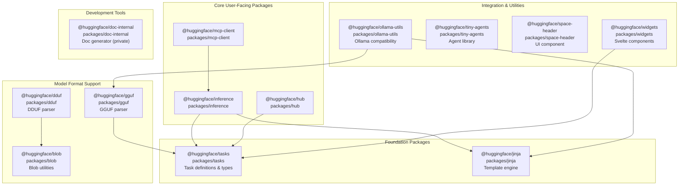
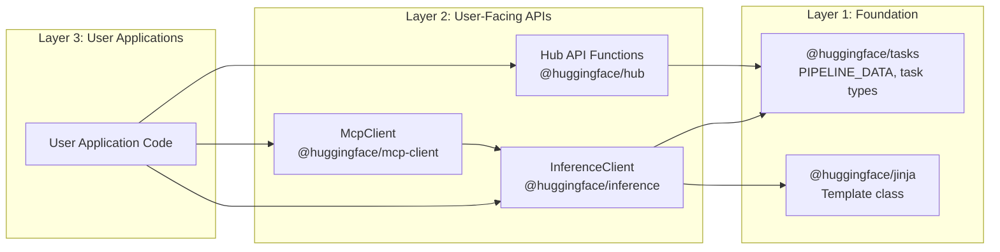
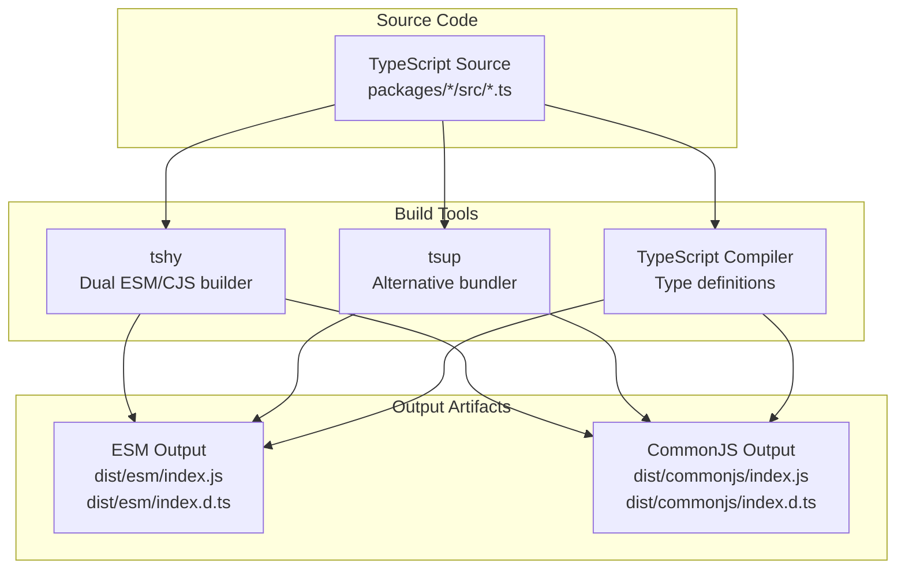
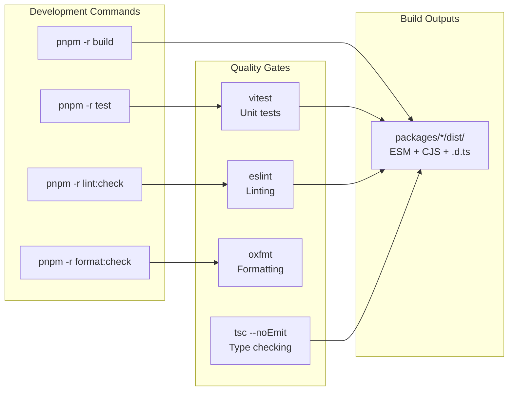
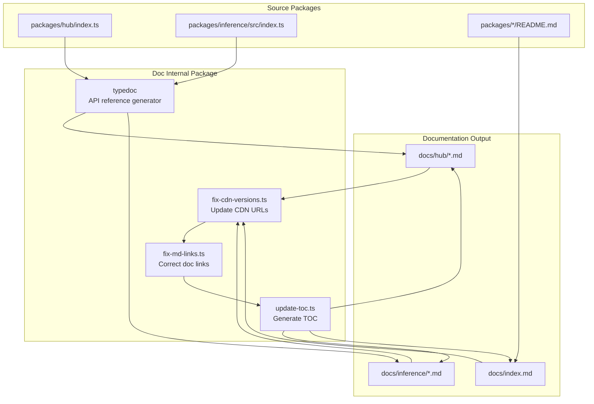

<!-- source: DeepWiki mcp.deepwiki.com · repo huggingface/huggingface.js · page 1 Overview · fetched 2026-10-26 -->

# Overview

<details>
<summary>Relevant source files</summary>

The following files were used as context for generating this wiki page:

- [README.md](README.md)
- [package.json](package.json)
- [packages/doc-internal/fix-cdn-versions.ts](packages/doc-internal/fix-cdn-versions.ts)
- [packages/doc-internal/package.json](packages/doc-internal/package.json)
- [packages/doc-internal/pnpm-lock.yaml](packages/doc-internal/pnpm-lock.yaml)
- [packages/hub/package.json](packages/hub/package.json)
- [packages/hub/pnpm-lock.yaml](packages/hub/pnpm-lock.yaml)
- [packages/inference/package.json](packages/inference/package.json)
- [packages/inference/pnpm-lock.yaml](packages/inference/pnpm-lock.yaml)
- [packages/inference/src/package.ts](packages/inference/src/package.ts)
- [packages/inference/test/global.d.ts](packages/inference/test/global.d.ts)
- [pnpm-lock.yaml](pnpm-lock.yaml)

</details>


## Purpose and Scope

The Hugging Face.js monorepo provides a collection of JavaScript and TypeScript libraries for interacting with the Hugging Face ecosystem. These libraries enable developers to perform machine learning inference, manage repositories and files on the Hugging Face Hub, parse model formats, and integrate with AI agent frameworks—all from JavaScript/TypeScript environments including Node.js, browsers, Deno, and Bun.

This overview introduces the monorepo's structure, package organization, and architectural principles. For detailed information about specific packages:
- ML inference capabilities, see [Inference Library](#2.1)
- Repository and file management, see [Hub Library](#2.2)
- AI agent development, see [Agents and MCP Library](#2.3)
- Task definitions and type system, see [Tasks Library](#3.1)

**Sources:** [README.md:54-73]()

## Monorepo Structure

The repository contains 12+ packages organized in the `packages/` directory, with three primary user-facing libraries and several supporting packages:



**Sources:** [README.md:54-68](), [packages/inference/package.json:61-64](), [packages/hub/package.json:64-66]()

## Package Dependency Structure

The packages follow a layered dependency architecture where foundation packages have no dependencies on user-facing packages:



The foundation packages (`@huggingface/tasks` and `@huggingface/jinja`) are workspace dependencies declared in package.json files using the `workspace:^` protocol, enabling monorepo version management.

**Sources:** [packages/inference/pnpm-lock.yaml:10-16](), [packages/hub/pnpm-lock.yaml:10-13]()

## Installation and Distribution

### NPM Installation

Packages are published to the public NPM registry and can be installed individually:

```bash
npm install @huggingface/inference
npm install @huggingface/hub
npm install @huggingface/mcp-client
```

Each package is configured with `publishConfig.access: "public"` to enable public distribution.

**Sources:** [README.md:76-84](), [packages/inference/package.json:43-45](), [packages/hub/package.json:46-48]()

### CDN and Browser Usage

Packages support direct browser usage via CDN without bundlers, using ES modules:

```html
<script type="module">
  import { InferenceClient } from 'https://cdn.jsdelivr.net/npm/@huggingface/inference@4.13.11/+esm';
  import { createRepo } from "https://cdn.jsdelivr.net/npm/@huggingface/hub@2.8.0/+esm";
</script>
```

Version numbers in CDN URLs are automatically maintained by the `fix-cdn-versions.ts` script during documentation generation, which reads version numbers from package.json files and updates README.md files.

**Sources:** [README.md:95-104](), [packages/doc-internal/fix-cdn-versions.ts:1-17]()

### Deno Support

Packages work with Deno through esm.sh or npm: protocol:

```typescript
import { InferenceClient } from "https://esm.sh/@huggingface/inference"
import { createRepo } from "npm:@huggingface/hub"
```

**Sources:** [README.md:106-117]()

## Module Format Architecture

All packages are built to support both ESM (ECMAScript Modules) and CommonJS formats for maximum compatibility:



The package.json files configure export mappings to support both formats:

```json
{
  "type": "module",
  "main": "./dist/commonjs/index.js",
  "module": "./dist/esm/index.js",
  "exports": {
    ".": {
      "import": {
        "types": "./dist/esm/index.d.ts",
        "default": "./dist/esm/index.js"
      },
      "require": {
        "types": "./dist/commonjs/index.d.ts",
        "default": "./dist/commonjs/index.js"
      }
    }
  }
}
```

**Sources:** [packages/inference/package.json:26-42](), [README.md:273-276](), [package.json:24-26]()

## Environment Requirements

The libraries target modern JavaScript environments and avoid polyfills and legacy dependencies:

| Environment | Minimum Version | Notes |
|-------------|----------------|-------|
| Node.js | >= 18 | Specified in engines field |
| Browsers | Modern (ES2020+) | Native ES modules support required |
| Bun | Latest | Full compatibility |
| Deno | Latest | Via esm.sh or npm: protocol |

The strict version requirement enables use of modern features like native `fetch`, `crypto`, and async iterators without polyfills.

**Sources:** [README.md:70-71](), [packages/inference/package.json:75-77](), [packages/hub/package.json:73-75]()

## Build and Development Workflow



The monorepo uses `pnpm` with workspace support and `-r` (recursive) flag to execute commands across all packages. The package manager is enforced with `"packageManager": "pnpm@10.10.0"` in package.json.

**Sources:** [README.md:259-276](), [package.json:5-11](), [package.json:32]()

## Documentation Generation

Documentation is generated using TypeDoc and processed through custom scripts:



The `@huggingface/doc-internal` package (private, not published) orchestrates the documentation build process through its `start` script which runs TypeDoc with the `typedoc-plugin-markdown` plugin and post-processes the output.

**Sources:** [packages/doc-internal/package.json:8-24](), [packages/doc-internal/fix-cdn-versions.ts:1-17]()

## Primary Use Cases

### ML Inference

```typescript
import { InferenceClient } from "@huggingface/inference";

const client = new InferenceClient("hf_...");

// Chat completion with provider selection
await client.chatCompletion({
  model: "meta-llama/Llama-3.1-8B-Instruct",
  provider: "sambanova",
  messages: [{ role: "user", content: "Hello!" }],
  max_tokens: 512
});

// Image generation
await client.textToImage({
  model: "black-forest-labs/FLUX.1-dev",
  provider: "replicate",
  inputs: "a picture of a green bird"
});
```

The `InferenceClient` class provides 25+ task-specific methods that route requests to multiple inference providers.

**Sources:** [README.md:30-51](), [README.md:125-194]()

### Repository Management

```typescript
import { createRepo, uploadFile, deleteFiles } from "@huggingface/hub";

await createRepo({
  repo: "my-user/nlp-model",
  accessToken: "hf_..."
});

await uploadFile({
  repo: "my-user/nlp-model",
  accessToken: "hf_...",
  file: {
    path: "pytorch_model.bin",
    content: new Blob(...)
  }
});
```

The Hub package provides functions for creating repositories, uploading/downloading files, and managing model metadata.

**Sources:** [README.md:13-28](), [README.md:196-223]()

### AI Agent Development

```typescript
import { Agent } from '@huggingface/mcp-client';

const agent = new Agent({
  provider: "auto",
  model: "Qwen/Qwen2.5-72B-Instruct",
  apiKey: "hf_...",
  servers: [{
    command: "npx",
    args: ["@playwright/mcp@latest"]
  }]
});

await agent.loadTools();

for await (const chunk of agent.run("What are trending models?")) {
  if ("choices" in chunk) {
    console.log(chunk.choices[0]?.delta.content);
  }
}
```

The MCP client enables building AI agents that can use tools via the Model Context Protocol.

**Sources:** [README.md:225-256]()

## Version Management

Package versions are managed independently with semantic versioning. Current versions are stored in package.json files and referenced throughout the codebase:

- `@huggingface/inference`: Version exported from [packages/inference/src/package.ts:2]() as `PACKAGE_VERSION` constant
- `@huggingface/hub`: Version in [packages/hub/package.json:3]()

Version synchronization across documentation and examples is handled by the `fix-cdn-versions.ts` script which reads package.json files and updates CDN URLs in README files.

**Sources:** [packages/inference/src/package.ts:1-4](), [packages/inference/package.json:3](), [packages/hub/package.json:3]()

---

