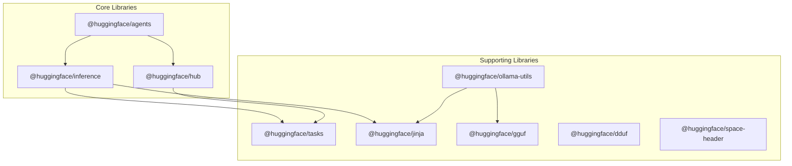
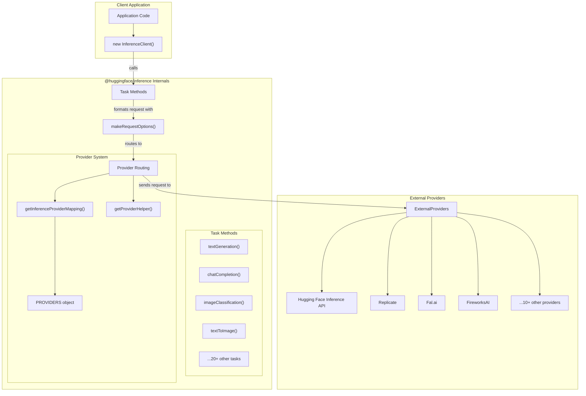
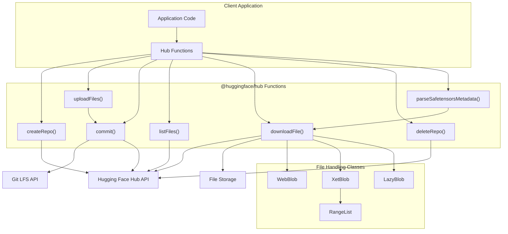
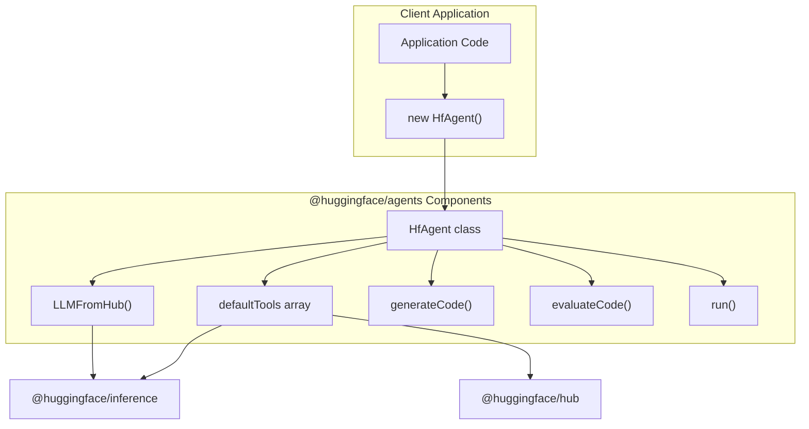
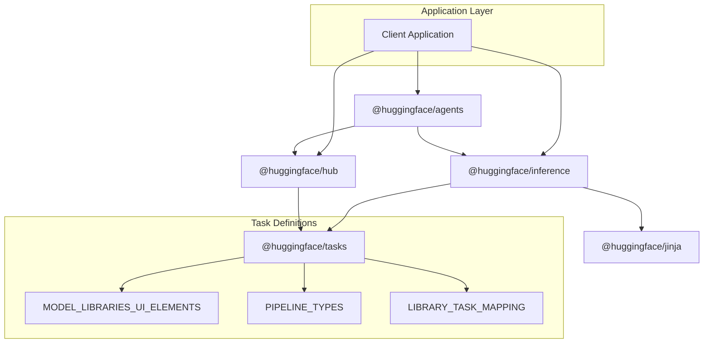

<!-- source: DeepWiki mcp.deepwiki.com · repo huggingface/huggingface.js · page 2 Core Libraries · fetched 2026-10-26 -->

# Core Libraries

<details>
<summary>Relevant source files</summary>

The following files were used as context for generating this wiki page:

- [README.md](README.md)
- [package.json](package.json)
- [packages/doc-internal/fix-cdn-versions.ts](packages/doc-internal/fix-cdn-versions.ts)
- [packages/doc-internal/package.json](packages/doc-internal/package.json)
- [packages/doc-internal/pnpm-lock.yaml](packages/doc-internal/pnpm-lock.yaml)
- [packages/hub/package.json](packages/hub/package.json)
- [packages/hub/pnpm-lock.yaml](packages/hub/pnpm-lock.yaml)
- [packages/inference/package.json](packages/inference/package.json)
- [packages/inference/pnpm-lock.yaml](packages/inference/pnpm-lock.yaml)
- [packages/inference/src/package.ts](packages/inference/src/package.ts)
- [packages/inference/test/global.d.ts](packages/inference/test/global.d.ts)
- [pnpm-lock.yaml](pnpm-lock.yaml)

</details>


This document provides a technical overview of the core JavaScript libraries that form the foundation of the Hugging Face JS ecosystem. These libraries enable developers to interact with machine learning models, manage content on the Hugging Face Hub, and build AI-powered applications. For information about supporting libraries that extend this functionality, see [Supporting Libraries](#3).

## Overview

The Hugging Face JavaScript ecosystem is built around three primary core libraries:

1. **@huggingface/inference** - A TypeScript client for making inference requests to Hugging Face models and other AI providers
2. **@huggingface/hub** - Utilities for programmatically interacting with the Hugging Face Hub API
3. **@huggingface/agents** - Tools for building agent-based applications with Hugging Face models

These libraries are designed for modern JavaScript environments and require Node.js >= 18, Bun, or Deno. They work in both server-side and client-side contexts, with browser-specific optimizations where needed.

## Core Architecture

The following diagram illustrates the high-level architecture of the core libraries and their relationships with supporting libraries:



Sources: [README.md:54-67](README.md:54-67), [packages/hub/package.json:6-7](packages/hub/package.json:6-7), [packages/inference/package.json:6-11](packages/inference/package.json:6-11)

The core libraries follow a modular design with clear separation of concerns. They depend on supporting libraries that provide shared functionality such as task definitions, templating, and file format parsing.

## Inference Library (@huggingface/inference)

The Inference library provides a unified client for making inference requests to various AI providers. It abstracts away the complexities of different provider APIs behind a consistent interface.



Sources: [packages/inference/package.json:14-18](packages/inference/package.json:14-18), [README.md:127-194](README.md:127-194)

### Key Components

- **InferenceClient** - Main client class for making inference requests
- **Task Methods** - Methods for different ML tasks (textGeneration, imageClassification, etc.)
- **Provider Routing** - System for routing requests to different providers based on the model and task

### Features

- Support for 20+ machine learning tasks
- Integration with 10+ inference providers
- Streaming support for applicable tasks (using async iterators)
- Type-safe API with comprehensive TypeScript definitions

### Usage Example

```ts
import { InferenceClient } from "@huggingface/inference";

const client = new InferenceClient("hf_token");

// Chat completion API
const response = await client.chatCompletion({
  model: "meta-llama/Llama-3.1-8B-Instruct",
  messages: [{ role: "user", content: "Hello, nice to meet you!" }],
  max_tokens: 512
});
console.log(response.choices[0].message);

// Using a third-party provider
await client.textToImage({
  model: "black-forest-labs/FLUX.1-dev",
  inputs: "a picture of a green bird",
  provider: "replicate"
});
```

## Hub Library (@huggingface/hub)

The Hub library provides utilities for interacting with the Hugging Face Hub API, enabling programmatic management of repositories and files.



Sources: [packages/hub/package.json:3-10](packages/hub/package.json:3-10), [README.md:199-223](README.md:199-223)

### Key Components

- **Repository Management** - Functions for creating, deleting, and managing repositories
- **File Operations** - Functions for uploading, downloading, and managing files
- **Blob Handling** - Classes for handling different types of file blobs

### Features

- Support for all Hugging Face Hub repository types (models, datasets, spaces)
- File upload and download with chunking support
- Git LFS support for large file storage
- Browser and Node.js compatibility with environment-specific optimizations

### Usage Example

```ts
import { createRepo, uploadFile, deleteFiles } from "@huggingface/hub";

// Create a new repository
await createRepo({
  repo: "my-user/nlp-model",
  accessToken: "hf_token"
});

// Upload a file
await uploadFile({
  repo: "my-user/nlp-model",
  accessToken: "hf_token",
  file: {
    path: "model.safetensors",
    content: new Blob([...])
  }
});

// Delete files
await deleteFiles({
  repo: { type: "space", name: "my-user/my-space" },
  accessToken: "hf_token",
  paths: ["README.md", ".gitattributes"]
});
```

## Agents Library (@huggingface/agents)

The Agents library provides tools for building agent-based applications that can interact with Hugging Face models through natural language interfaces.



Sources: [README.md:227-248](README.md:227-248)

### Key Components

- **HfAgent** - Main class for creating agents
- **LLMFromHub** - Function for loading language models from the Hub
- **defaultTools** - Set of default tools for agents

### Features

- Code generation and evaluation based on natural language instructions
- Integration with various tools for different tasks
- Safety features for code execution

### Usage Example

```ts
import { HfAgent, LLMFromHub, defaultTools } from '@huggingface/agents';

const agent = new HfAgent(
  "hf_token",
  LLMFromHub("hf_token"),
  [...defaultTools]
);

// Generate code from natural language
const code = await agent.generateCode(
  "Draw a picture of a cat wearing a top hat. Then caption the picture."
);
console.log(code);

// Evaluate the generated code
const messages = await agent.evaluateCode(code);
console.log(messages);
```

## Installation and Usage

### Package Installation

The libraries can be installed via npm, yarn, or pnpm:

```bash
npm install @huggingface/inference
npm install @huggingface/hub
npm install @huggingface/agents
```

### CDN Usage

For browser environments, you can use the libraries directly from a CDN:

```html
<script type="module">
    import { InferenceClient } from 'https://cdn.jsdelivr.net/npm/@huggingface/inference@3.8.1/+esm';
    import { createRepo } from "https://cdn.jsdelivr.net/npm/@huggingface/hub@1.1.2/+esm";
</script>
```

### Deno Usage

```ts
import { InferenceClient } from "https://esm.sh/@huggingface/inference";
import { createRepo } from "https://esm.sh/@huggingface/hub";
// or
import { InferenceClient } from "npm:@huggingface/inference";
import { createRepo } from "npm:@huggingface/hub";
```

## Library Dependencies

The following diagram shows the dependencies between the core libraries and supporting packages:



Sources: [packages/tasks/src/index.ts:1-69](packages/tasks/src/index.ts:1-69), [packages/inference/package.json:57-60](packages/inference/package.json:57-60), [packages/hub/package.json:64-66](packages/hub/package.json:64-66)

The `@huggingface/tasks` package serves as a central registry for the relationships between model libraries, pipeline types, and supported tasks. It defines:

- The full list of supported model libraries (100+ libraries)
- All available pipeline types (30+ task types)
- Which tasks are supported by which libraries

## Summary

The Hugging Face JavaScript core libraries provide a comprehensive foundation for integrating machine learning capabilities into JavaScript applications. With these libraries, developers can:

1. **Make inference requests** to any model on the Hugging Face Hub or through third-party providers
2. **Manage repositories and files** on the Hugging Face Hub programmatically
3. **Create intelligent agents** that interact with models through natural language

These libraries work together to enable a wide range of AI-powered applications, from simple model inference to complex agent-based systems.

Sources: [README.md:54-71](README.md:54-71), [packages/tasks/src/model-libraries.ts:44-60](packages/tasks/src/model-libraries.ts:44-60)

---

