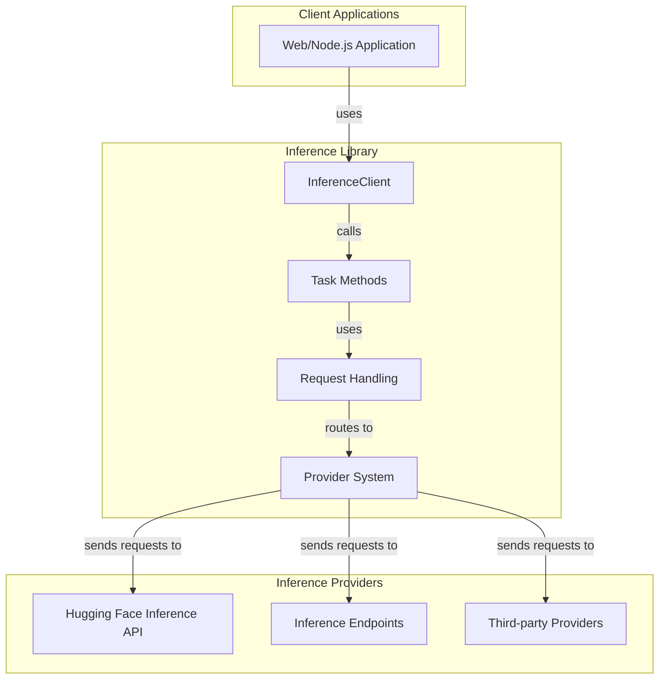
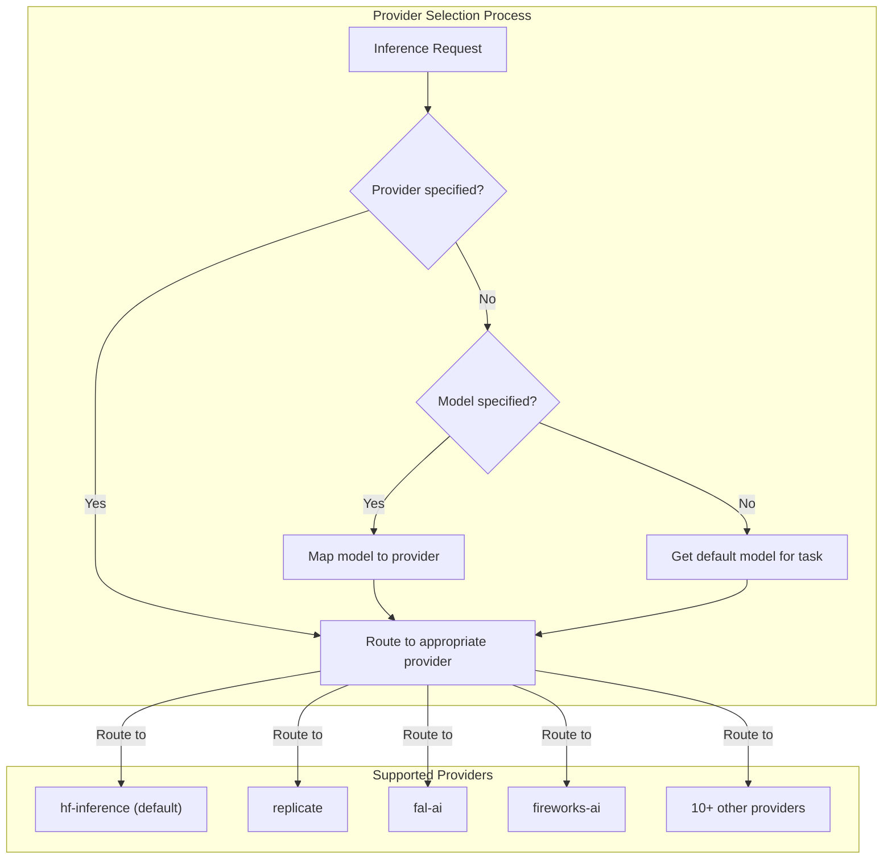
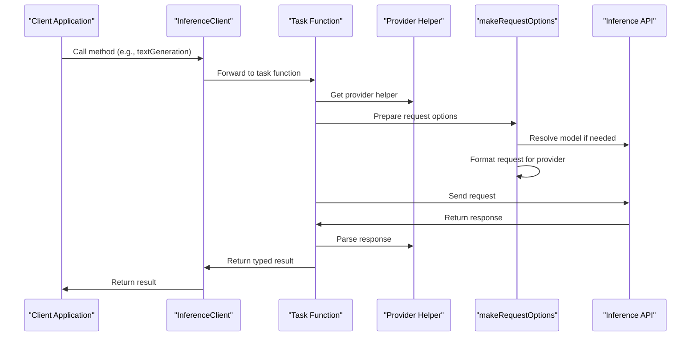
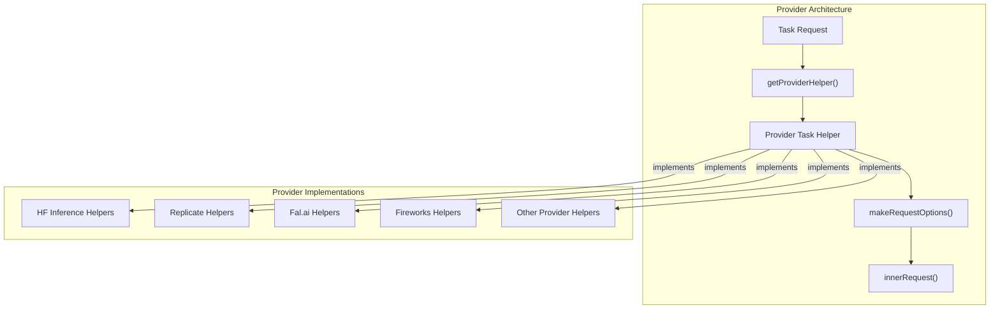

<!-- source: DeepWiki mcp.deepwiki.com · repo huggingface/huggingface.js · page 2.1 Inference Library · fetched 2026-10-26 -->

# Inference Library

<details>
<summary>Relevant source files</summary>

The following files were used as context for generating this wiki page:

- [.github/workflows/lint.yml](.github/workflows/lint.yml)
- [.github/workflows/test.yml](.github/workflows/test.yml)
- [README.md](README.md)
- [package.json](package.json)
- [packages/doc-internal/fix-cdn-versions.ts](packages/doc-internal/fix-cdn-versions.ts)
- [packages/doc-internal/package.json](packages/doc-internal/package.json)
- [packages/doc-internal/pnpm-lock.yaml](packages/doc-internal/pnpm-lock.yaml)
- [packages/hub/package.json](packages/hub/package.json)
- [packages/hub/pnpm-lock.yaml](packages/hub/pnpm-lock.yaml)
- [packages/inference/README.md](packages/inference/README.md)
- [packages/inference/package.json](packages/inference/package.json)
- [packages/inference/pnpm-lock.yaml](packages/inference/pnpm-lock.yaml)
- [packages/inference/src/config.ts](packages/inference/src/config.ts)
- [packages/inference/src/lib/getProviderHelper.ts](packages/inference/src/lib/getProviderHelper.ts)
- [packages/inference/src/lib/makeRequestOptions.ts](packages/inference/src/lib/makeRequestOptions.ts)
- [packages/inference/src/package.ts](packages/inference/src/package.ts)
- [packages/inference/src/providers/consts.ts](packages/inference/src/providers/consts.ts)
- [packages/inference/src/providers/wavespeed.ts](packages/inference/src/providers/wavespeed.ts)
- [packages/inference/src/providers/zai-org.ts](packages/inference/src/providers/zai-org.ts)
- [packages/inference/src/types.ts](packages/inference/src/types.ts)
- [packages/inference/test/InferenceClient.spec.ts](packages/inference/test/InferenceClient.spec.ts)
- [packages/inference/test/global.d.ts](packages/inference/test/global.d.ts)
- [pnpm-lock.yaml](pnpm-lock.yaml)

</details>


The Hugging Face Inference Library (`@huggingface/inference`) provides a unified JavaScript/TypeScript interface for accessing machine learning models through various inference providers. It simplifies working with AI models by offering a consistent API for tasks like text generation, image classification, and more. This library serves as a client for the Hugging Face Inference API, Inference Endpoints, and numerous third-party providers.

## Overview



The library supports more than 30 different AI tasks across various domains (NLP, Computer Vision, Audio, Multimodal) and can route requests to over a dozen different inference providers.

Sources:
- [packages/inference/README.md:1-33]()
- [packages/inference/src/types.ts:40-56]()

## Core Components

### InferenceClient

The primary way to interact with the library is through the `InferenceClient` class, which provides methods for all supported AI tasks:

```typescript
import { InferenceClient } from '@huggingface/inference';

const hf = new InferenceClient('your_access_token');
const result = await hf.textGeneration({
  model: 'gpt2',
  inputs: 'The answer to the universe is'
});
```

Each task method takes appropriate arguments (model, inputs, parameters) and returns typed results.

Sources:
- [packages/inference/README.md:33-46]()
- [packages/inference/README.md:108-132]()

### Provider System

One of the library's key features is its ability to route requests to different inference providers:



Each provider has specialized implementations for handling different tasks, formatting requests appropriately, and parsing responses into consistent formats.

Sources:
- [packages/inference/src/types.ts:40-56]()
- [packages/inference/README.md:45-93]()
- [packages/inference/src/lib/getProviderHelper.ts:1-48]()

### Request Flow

When making a request through the library, several key components work together:



The request flow handles model resolution, provider selection, request formatting, and response parsing to provide a consistent experience regardless of the underlying provider.

Sources:
- [packages/inference/src/lib/makeRequestOptions.ts:1-96]()
- [packages/inference/src/tasks/nlp/textGeneration.ts:1-24]()

## Supported Tasks

The library organizes ML tasks into several categories:

### Natural Language Processing

```
- Text Generation
- Fill Mask
- Summarization
- Question Answering
- Table Question Answering
- Text Classification
- Token Classification
- Translation
- Zero-Shot Classification
- Conversational
- Sentence Similarity
- Feature Extraction
```

Sources:
- [packages/inference/README.md:111-334]()
- [packages/inference/src/tasks/nlp/sentenceSimilarity.ts:1-22]()

### Computer Vision

```
- Image Classification
- Object Detection
- Image Segmentation
- Image To Text
- Text To Image
- Image To Image
- Zero Shot Image Classification
```

Sources:
- [packages/inference/README.md:388-470]()
- [packages/inference/src/tasks/cv/textToImage.ts:1-36]()

### Audio

```
- Automatic Speech Recognition
- Audio Classification
- Text To Speech
- Audio To Audio
```

Sources:
- [packages/inference/README.md:336-386]()

### Multimodal

```
- Feature Extraction
- Visual Question Answering
- Document Question Answering
```

Sources:
- [packages/inference/README.md:482-526]()
- [packages/inference/src/tasks/nlp/featureExtraction.ts:1-32]()

### Tabular

```
- Tabular Regression
- Tabular Classification
```

Sources:
- [packages/inference/README.md:528-572]()

## Working with Providers

The library supports multiple inference providers, each with their own specialized implementations:



To specify a provider, add the `provider` parameter when calling a task:

```typescript
await client.textToImage({
  provider: "replicate",
  model: "black-forest-labs/Flux.1-dev",
  inputs: "A black forest cake"
})
```

The library currently supports the following providers:
- Hugging Face Inference API (default)
- Fal.ai
- Fireworks AI
- Hyperbolic
- Nebius
- Novita
- Replicate
- Sambanova
- Together
- Blackforestlabs
- Cohere
- Cerebras
- OpenAI

Sources:
- [packages/inference/README.md:62-86]()
- [packages/inference/src/providers/fal-ai.ts:17-269]()
- [packages/inference/src/providers/replicate.ts:17-140]()
- [packages/inference/src/providers/hf-inference.ts:13-116]()

## Making Requests

### Basic Usage

```typescript
// Initialize client
const hf = new InferenceClient('your_access_token');

// Text generation
const textResult = await hf.textGeneration({
  model: 'gpt2',
  inputs: 'The answer to the universe is'
});

// Image classification
const imageResult = await hf.imageClassification({
  model: 'google/vit-base-patch16-224',
  data: readFileSync('image.jpg')
});
```

Sources:
- [packages/inference/README.md:114-132]()
- [packages/inference/README.md:394-400]()

### Tree-shaking

For optimized bundle sizes, you can import individual functions directly:

```typescript
import { textGeneration } from "@huggingface/inference";

await textGeneration({
  accessToken: "hf_...",
  model: "gpt2",
  inputs: "The answer to the universe is"
});
```

Sources:
- [packages/inference/README.md:94-109]()

### Streaming Support

For certain tasks like text generation, the library supports streaming responses:

```typescript
// Streaming text generation
for await (const output of hf.textGenerationStream({
  model: "google/flan-t5-xxl",
  inputs: "Explain the theory of relativity in simple terms",
  parameters: { max_new_tokens: 250 }
})) {
  console.log(output.token.text);
}
```

Sources:
- [packages/inference/README.md:125-132]()
- [packages/inference/src/tasks/nlp/textGenerationStream.ts:1-98]()

### Chat Completion API

The library offers a ChatGPT-like interface for conversational models:

```typescript
// Non-streaming chat
const response = await hf.chatCompletion({
  model: "meta-llama/Llama-3.1-8B-Instruct",
  messages: [{ role: "user", content: "Hello, nice to meet you!" }],
  max_tokens: 512,
  temperature: 0.1,
});

// Streaming chat
for await (const chunk of hf.chatCompletionStream({
  model: "meta-llama/Llama-3.1-8B-Instruct",
  messages: [{ role: "user", content: "Can you help me solve an equation?" }],
  max_tokens: 512,
  temperature: 0.1,
})) {
  if (chunk.choices && chunk.choices.length > 0) {
    console.log(chunk.choices[0].delta.content);
  }
}
```

Sources:
- [packages/inference/README.md:134-188]()
- [packages/inference/src/tasks/nlp/chatCompletion.ts:1-20]()
- [packages/inference/src/tasks/nlp/chatCompletionStream.ts:1-19]()

## Custom Inference Endpoints

You can use your own inference endpoints by using the `.endpoint()` method:

```typescript
const customEndpoint = hf.endpoint('https://xyz.eu-west-1.aws.endpoints.huggingface.cloud/gpt2');
const { generated_text } = await customEndpoint.textGeneration({inputs: 'The answer to the universe is'});
```

Sources:
- [packages/inference/README.md:595-636]()

## Internal Architecture

The library's internal architecture revolves around several key components that work together:

### Request Preparation

The `makeRequestOptions` function is responsible for preparing request options:
1. Determines the correct model (user-provided or default)
2. Resolves provider mappings for third-party providers
3. Formats the request according to the provider's requirements
4. Sets appropriate authentication headers

Sources:
- [packages/inference/src/lib/makeRequestOptions.ts:19-95]()

### Provider Mapping

When using third-party providers, the library needs to map Hugging Face model IDs to provider-specific model IDs. This is done through:
1. Hardcoded mappings for testing or local development
2. Inference provider mappings fetched from the Hugging Face API

Sources:
- [packages/inference/src/lib/getInferenceProviderMapping.ts:23-96]()
- [packages/inference/src/providers/consts.ts:12-35]()

### Provider Helpers

Each provider has specialized implementations for different tasks:

```typescript
export class FalAITextToImageTask extends FalAITask implements TextToImageTaskHelper {
  // Provider-specific implementations for text-to-image tasks
}

export class ReplicateTextToVideoTask extends ReplicateTask implements TextToVideoTaskHelper {
  // Provider-specific implementations for text-to-video tasks
}
```

These helpers know how to:
1. Format requests for the specific provider
2. Parse responses from the provider
3. Handle provider-specific authentication

Sources:
- [packages/inference/src/providers/fal-ai.ts:82-134]()
- [packages/inference/src/providers/replicate.ts:125-140]()
- [packages/inference/src/providers/hf-inference.ts:119-156]()

### Task Implementation

Each task in the library follows a similar pattern:

```typescript
export async function sentenceSimilarity(
  args: SentenceSimilarityArgs,
  options?: Options
): Promise<SentenceSimilarityOutput> {
  const providerHelper = getProviderHelper(args.provider ?? "hf-inference", "sentence-similarity");
  const { data: res } = await innerRequest<SentenceSimilarityOutput>(args, providerHelper, {
    ...options,
    task: "sentence-similarity",
  });
  return providerHelper.getResponse(res);
}
```

This consistent pattern allows the library to handle all tasks in a uniform way while accommodating task-specific requirements.

Sources:
- [packages/inference/src/tasks/nlp/sentenceSimilarity.ts:11-21]()
- [packages/inference/src/tasks/nlp/textGeneration.ts:12-24]()
- [packages/inference/src/tasks/cv/textToImage.ts:25-35]()

## Testing and Development

The library includes comprehensive tests that validate:
1. Basic functionality with each provider
2. Task-specific functionality
3. Error handling
4. Response parsing

A VCR (recording) system is used for testing that records actual API responses and plays them back during tests, allowing for consistent testing without making real API calls.

Sources:
- [packages/inference/test/vcr.ts:19-216]()
- [packages/inference/test/InferenceClient.spec.ts:26-216]()
- [.github/workflows/test.yml:1-145]()

## Conclusion

The Hugging Face Inference Library provides a powerful, flexible interface for interacting with AI models through various providers. Its consistent API, provider-agnostic design, and comprehensive task support make it an excellent choice for JavaScript and TypeScript developers looking to incorporate AI capabilities into their applications.

For information about the Hub Library, which provides utilities for interacting with the Hugging Face Hub API, please see [Hub Library](#2.2).

---

