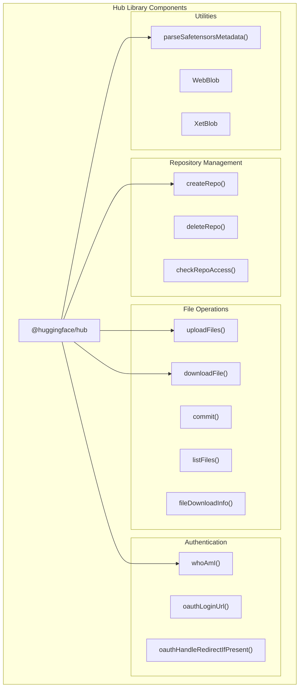
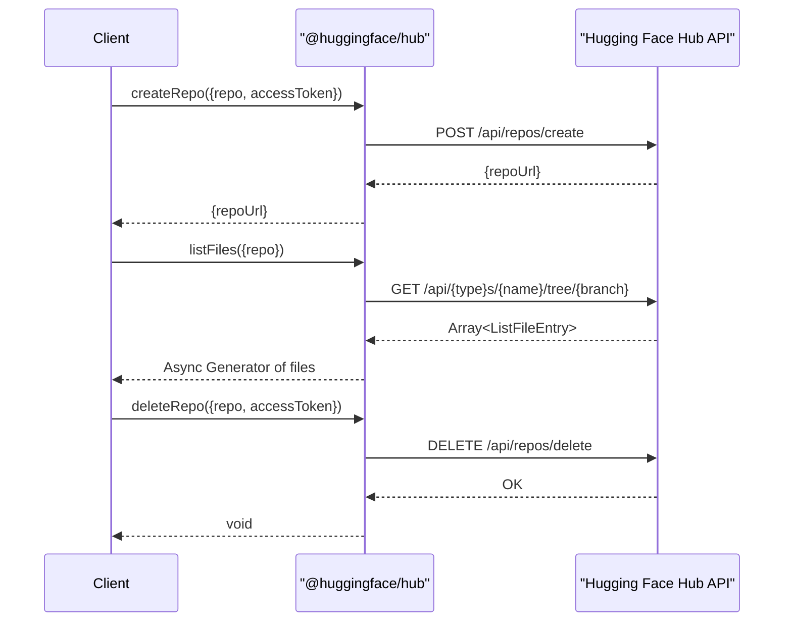
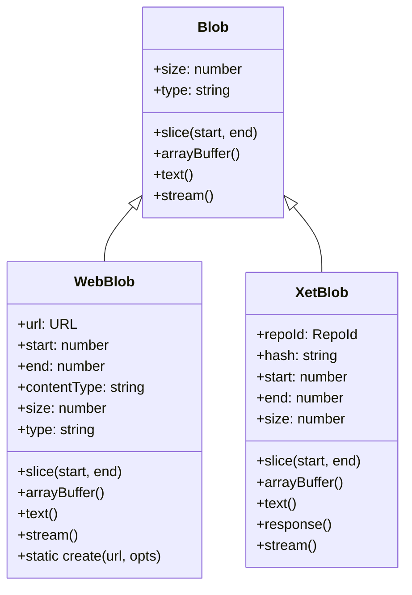

<!-- source: DeepWiki mcp.deepwiki.com · repo huggingface/huggingface.js · page 2.2 Hub Library · fetched 2026-10-26 -->

# Hub Library

<details>
<summary>Relevant source files</summary>

The following files were used as context for generating this wiki page:

- [README.md](README.md)
- [package.json](package.json)
- [packages/doc-internal/fix-cdn-versions.ts](packages/doc-internal/fix-cdn-versions.ts)
- [packages/doc-internal/package.json](packages/doc-internal/package.json)
- [packages/doc-internal/pnpm-lock.yaml](packages/doc-internal/pnpm-lock.yaml)
- [packages/hub/README.md](packages/hub/README.md)
- [packages/hub/package.json](packages/hub/package.json)
- [packages/hub/pnpm-lock.yaml](packages/hub/pnpm-lock.yaml)
- [packages/hub/src/lib/file-exists.spec.ts](packages/hub/src/lib/file-exists.spec.ts)
- [packages/hub/src/lib/file-exists.ts](packages/hub/src/lib/file-exists.ts)
- [packages/hub/src/lib/index.ts](packages/hub/src/lib/index.ts)
- [packages/hub/src/lib/paths-info.spec.ts](packages/hub/src/lib/paths-info.spec.ts)
- [packages/hub/src/lib/paths-info.ts](packages/hub/src/lib/paths-info.ts)
- [packages/inference/package.json](packages/inference/package.json)
- [packages/inference/pnpm-lock.yaml](packages/inference/pnpm-lock.yaml)
- [packages/inference/src/package.ts](packages/inference/src/package.ts)
- [packages/inference/test/global.d.ts](packages/inference/test/global.d.ts)
- [pnpm-lock.yaml](pnpm-lock.yaml)

</details>


The Hub Library (`@huggingface/hub`) provides a comprehensive set of utilities for interacting with the Hugging Face Hub API. This library enables JavaScript applications to manage repositories, handle files, and access Hugging Face Hub resources programmatically.

## Overview

The Hub Library is a core component of the Hugging Face JavaScript ecosystem, providing the foundation for accessing and manipulating content on the Hugging Face Hub. It allows developers to perform operations such as creating repositories, uploading files, downloading models, and parsing model metadata.



Sources:
- [packages/hub/README.md:1-116]()
- [packages/hub/src/lib/index.ts:1-30]()
- [packages/hub/src/index.ts:1-26]()

## Installation and Setup

The Hub Library can be installed via npm, yarn, or pnpm:

```bash
# npm
npm add @huggingface/hub

# yarn
yarn add @huggingface/hub

# pnpm
pnpm add @huggingface/hub
```

For Deno users, the library can be imported directly:

```ts
// esm.sh
import { uploadFiles, listModels } from "https://esm.sh/@huggingface/hub"
// or npm:
import { uploadFiles, listModels } from "npm:@huggingface/hub"
```

Sources:
- [packages/hub/README.md:5-22]()

## Authentication

Most Hub API operations require authentication with a Hugging Face access token.

### Access Token Authentication

To use functions that require authentication, you'll need to obtain an access token from the [Hugging Face settings page](https://huggingface.co/settings/tokens).

```ts
import * as hub from "@huggingface/hub";

// Check who you're authenticated as
const {name: username} = await hub.whoAmI({accessToken: "hf_..."});

// Check if you have access to a repository
await hub.checkRepoAccess({repo, accessToken: "hf_..."});
```

### OAuth Authentication

For client-side applications, you can use OAuth authentication ("Sign in with HF"):

```ts
import { oauthLoginUrl, oauthHandleRedirectIfPresent } from "@huggingface/hub";

const oauthResult = await oauthHandleRedirectIfPresent();

if (!oauthResult) {
  // If the user is not logged in, redirect to the login page
  window.location.href = await oauthLoginUrl();
}

// You can use oauthResult.accessToken, oauthResult.accessTokenExpiresAt and oauthResult.userInfo
console.log(oauthResult);
```

Sources:
- [packages/hub/README.md:28-114]()

## Repository Management

The Hub Library provides functions to create, access, and delete repositories.



### Creating a Repository

```ts
import { createRepo } from "@huggingface/hub";

const { repoUrl } = await createRepo({
  repo: { type: "model", name: "myname/some-model" },
  accessToken: "hf_...",
  license: "mit"
});
```

The `createRepo` function allows you to specify:
- Repository type (model, dataset, space)
- Repository name (in the format "namespace/reponame")
- Access settings (public or private)
- License
- Initial files

### Listing Files

```ts
import { listFiles } from "@huggingface/hub";

// List all files in a repository
for await (const fileInfo of listFiles({
  repo: "bert-base-uncased",
  recursive: true // to list all files including those in subdirectories
})) {
  console.log(fileInfo);
}
```

The `listFiles` function returns an async generator that yields file entries, including:
- Path
- Size
- Type (file or directory)
- Git object ID
- LFS information (for LFS-tracked files)

### Deleting a Repository

```ts
import { deleteRepo } from "@huggingface/hub";

await deleteRepo({
  repo: { type: "model", name: "myname/some-model" },
  accessToken: "hf_..."
});
```

Sources:
- [packages/hub/src/lib/create-repo.ts:1-78]()
- [packages/hub/src/lib/delete-repo.ts:1-38]()
- [packages/hub/src/lib/list-files.ts:1-94]()
- [packages/hub/src/lib/create-repo.spec.ts:1-103]()

## File Operations

The Hub Library provides several functions for working with files on the Hugging Face Hub.

### Uploading Files

The library offers multiple ways to upload files:

```ts
import { uploadFiles } from "@huggingface/hub";

await uploadFiles({
  repo: { type: "model", name: "myname/some-model" },
  accessToken: "hf_...",
  files: [
    // path + blob content
    {
      path: "file.txt",
      content: new Blob(["Hello World"]),
    },
    // Local file URL (Node.js)
    pathToFileURL("./pytorch-model.bin"),
    // Web URL
    new URL("https://huggingface.co/xlm-roberta-base/resolve/main/tokenizer.json"),
    // Path + Web URL
    {
      path: "myfile.bin",
      content: new URL("https://huggingface.co/bert-base-uncased/resolve/main/pytorch_model.bin")
    }
    // Can also work with native File in browsers
  ],
});
```

For tracking upload progress, you can use `uploadFilesWithProgress`:

```ts
for await (const progressEvent of await uploadFilesWithProgress({
  repo,
  accessToken: "hf_...",
  files: [/* ... */],
})) {
  console.log(progressEvent);
}
```

### Downloading Files

```ts
import { downloadFile } from "@huggingface/hub";

const response = await downloadFile({
  repo: "bert-base-uncased",
  path: "config.json"
});

if (response) {
  const text = await response.text();
  console.log(text);
}
```

The `downloadFile` function returns a standard Response object, or null if the file doesn't exist.

### File Information

To get information about a file without downloading it:

```ts
import { fileDownloadInfo } from "@huggingface/hub";

const info = await fileDownloadInfo({
  repo: "bert-base-uncased",
  path: "pytorch_model.bin"
});

console.log(info.size); // File size in bytes
console.log(info.etag); // ETag for caching
console.log(info.downloadLink); // Direct download link (for LFS files)
```

### Committing Changes

For more complex operations, the `commit` function provides granular control over repository changes:

```ts
import { commit } from "@huggingface/hub";

await commit({
  repo: { type: "model", name: "myname/some-model" },
  accessToken: "hf_...",
  title: "Add model files",
  operations: [
    {
      operation: "addOrUpdate",
      path: "model.bin",
      content: new Blob([/* binary data */]),
    },
    {
      operation: "delete",
      path: "old-file.txt",
    },
  ]
});
```

The `commit` function handles:
- Computing file hashes
- Detecting LFS files
- Uploading large files in chunks
- Creating commit metadata

Sources:
- [packages/hub/src/lib/commit.ts:1-597]()
- [packages/hub/src/lib/download-file.ts:1-66]()
- [packages/hub/src/lib/file-download-info.ts:1-92]()
- [packages/hub/README.md:32-92]()
- [packages/hub/src/lib/commit.spec.ts:1-275]()
- [packages/hub/src/lib/upload-file.spec.ts:1-98]()

## Advanced Features

### Safetensors Metadata Parsing

The Hub Library provides utilities for parsing metadata from safetensors files, which are a format used to store ML model weights efficiently.

```ts
import { parseSafetensorsMetadata } from "@huggingface/hub";

const metadata = await parseSafetensorsMetadata({
  repo: "bert-base-uncased",
  computeParametersCount: true,
});

// For single-file models
if (!metadata.sharded) {
  console.log(metadata.header.__metadata__);
  console.log(metadata.parameterCount); // Number of parameters by dtype
}

// For sharded models
if (metadata.sharded) {
  console.log(metadata.index);
  console.log(metadata.headers);
  console.log(metadata.parameterCount);
}
```

This function uses smart range requests to extract metadata without downloading the entire model file, making it efficient for exploring model structure.

Sources:
- [packages/hub/src/lib/parse-safetensors-metadata.ts:1-285]()
- [packages/hub/src/lib/parse-safetensors-metadata.spec.ts:1-122]()

### Cache Management

The library provides functions to work with the Hugging Face cache system:

```ts
import { scanCacheDir, downloadFileToCacheDir, snapshotDownload } from "@huggingface/hub";

// Get information about cached repositories
const cacheInfo = await scanCacheDir();

// Download a file to the cache directory
const file = await downloadFileToCacheDir({
  repo: 'bert-base-uncased',
  path: 'config.json'
});

// Download an entire repository to the cache
const directory = await snapshotDownload({
  repo: 'bert-base-uncased',
});
```

Note: Cache management functions are not available in browser environments.

Sources:
- [packages/hub/README.md:116-165]()

## Blob Handling and Performance

The Hub Library includes special classes for efficient handling of large files and remote resources.



### WebBlob

`WebBlob` is a Blob implementation for web resources that supports range requests, allowing efficient streaming of large files:

```ts
import { WebBlob } from "@huggingface/hub";

// Create a WebBlob for a remote resource
const blob = await WebBlob.create(
  new URL("https://huggingface.co/bert-base-uncased/resolve/main/pytorch_model.bin"),
  { cacheBelow: 10_000_000 } // Cache files below 10MB in memory
);

// Access only a portion of the blob
const slice = blob.slice(1000, 2000);
const textContent = await slice.text();
```

### XetBlob

`XetBlob` is used for accessing files stored using the Xet protocol, which is a newer alternative to Git LFS for large files:

```ts
import { XetBlob } from "@huggingface/hub";

const blob = new XetBlob({
  repo: "bert-base-uncased",
  hash: "2d8408d3a894d02517d04956e2f7546ff08362594072f3527ce144b5212a3296",
  size: 440473133,
});

// Use it like a regular Blob
const content = await blob.text();
```

### Performance Considerations

When working with large files, the library makes several optimizations:

1. **Lazy Loading**: Remote resources are loaded in chunks to reduce RAM usage
2. **Web Workers**: SHA256 computations can be offloaded to web workers
3. **Range Requests**: Only the required portions of files are downloaded
4. **Caching**: JWT tokens are cached to reduce authentication overhead

Sources:
- [packages/hub/src/utils/WebBlob.ts:1-112]()
- [packages/hub/src/utils/WebBlob.spec.ts:1-95]()
- [packages/hub/src/utils/XetBlob.ts:1-667]()
- [packages/hub/README.md:166-172]()
- [packages/hub/src/utils/sha256.ts:1-167]()
- [packages/hub/src/utils/RangeList.ts:1-180]()

## Error Handling

The library provides custom error types for handling API errors:

```ts
import { HubApiError, InvalidApiResponseFormatError } from "@huggingface/hub";

try {
  await downloadFile({ repo: "non-existent-repo", path: "file.txt" });
} catch (error) {
  if (error instanceof HubApiError) {
    console.error(`API Error: ${error.message}`);
    console.error(`Status: ${error.statusCode}`);
    console.error(`Request ID: ${error.requestId}`);
  } else if (error instanceof InvalidApiResponseFormatError) {
    console.error(`Invalid response format: ${error.message}`);
  }
}
```

The `HubApiError` class provides detailed information about API errors, including:
- HTTP status code
- Request ID (for support inquiries)
- Error message from the API
- Additional error data

Sources:
- [packages/hub/src/error.ts:1-49]()
- [packages/hub/src/index.ts:20-21]()

## Example: Complete Workflow

Here's a complete example demonstrating repository creation, file uploads, and listing:

```ts
import * as hub from "@huggingface/hub";

async function createModelRepo() {
  // Create a new model repository
  const { repoUrl } = await hub.createRepo({
    repo: { type: "model", name: "myname/my-new-model" },
    accessToken: "hf_...",
    license: "mit"
  });
  
  console.log(`Created repository at ${repoUrl}`);
  
  // Upload files to the repository
  await hub.uploadFiles({
    repo: { type: "model", name: "myname/my-new-model" },
    accessToken: "hf_...",
    files: [
      {
        path: "config.json",
        content: new Blob([JSON.stringify({
          model_type: "bert",
          vocab_size: 30522,
          hidden_size: 768,
          num_hidden_layers: 12,
          num_attention_heads: 12
        }, null, 2)]),
      },
      {
        path: "README.md",
        content: new Blob(["# My Custom Model\n\nThis is a fine-tuned version of BERT."]),
      }
    ],
  });
  
  // List files in the repository
  console.log("Files in repository:");
  for await (const file of hub.listFiles({
    repo: { type: "model", name: "myname/my-new-model" }
  })) {
    console.log(`- ${file.path} (${file.size} bytes)`);
  }
}
```

Sources:
- [packages/hub/README.md:32-92]()

## Conclusion

The Hub Library provides a comprehensive set of tools for interacting with the Hugging Face Hub API from JavaScript applications. It handles complex operations like file uploads, LFS file management, authentication, and model metadata parsing. With support for both Node.js and browser environments, it enables developers to build applications that leverage the full power of the Hugging Face ecosystem.

For more information about other core libraries in the Hugging Face JavaScript ecosystem, see the [Inference Library](2.1) and [Agents Library](2.3).

---

