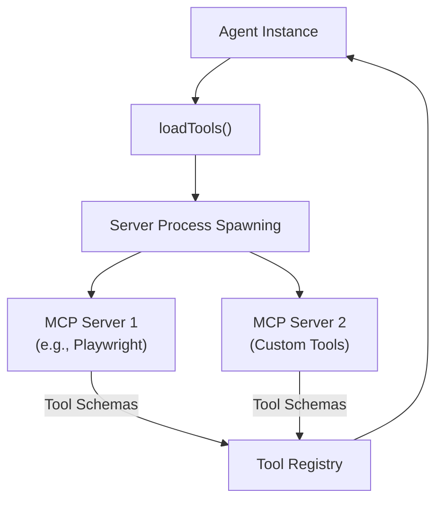
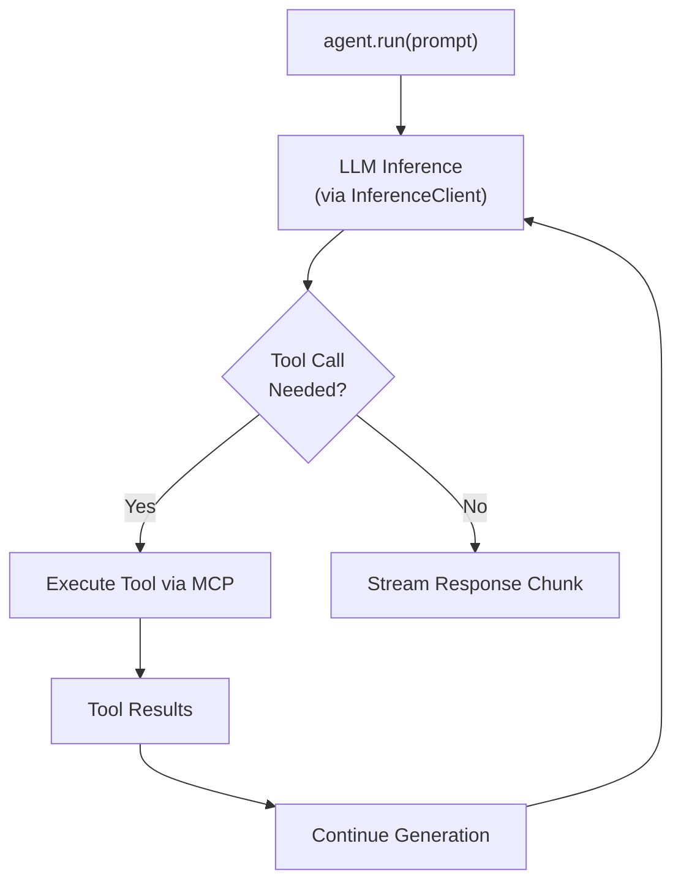
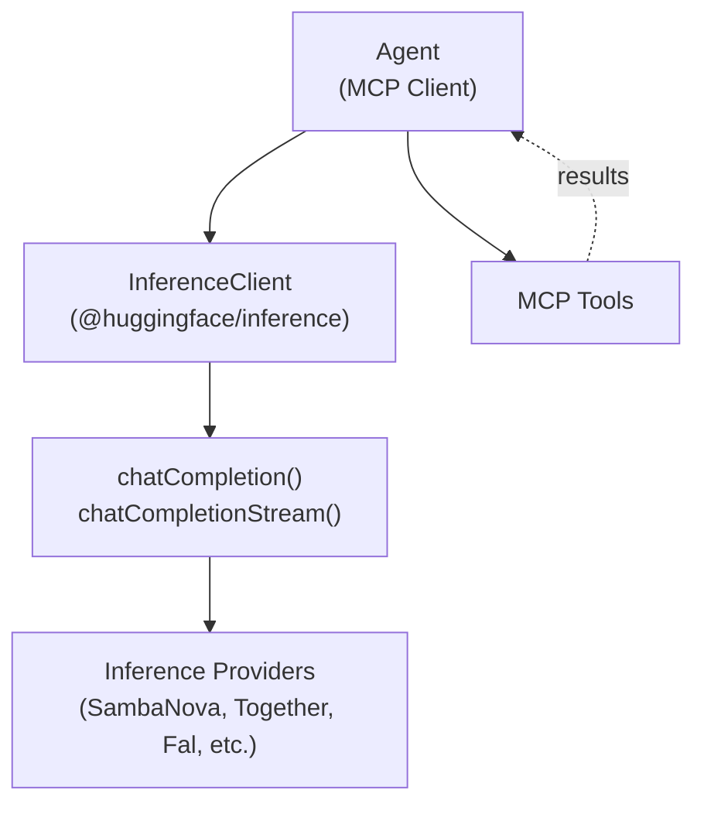
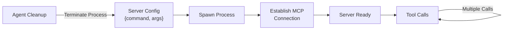
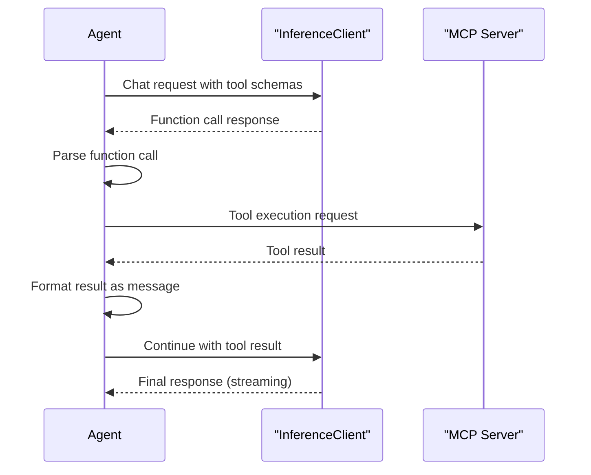
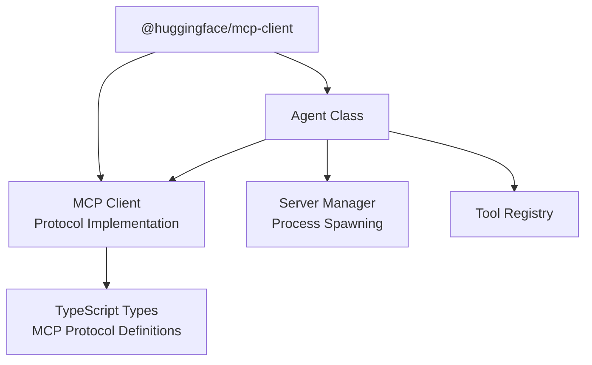

<!-- source: DeepWiki mcp.deepwiki.com · repo huggingface/huggingface.js · page 2.3 Agents and MCP Library · fetched 2026-10-26 -->

# Agents and MCP Library

<details>
<summary>Relevant source files</summary>

The following files were used as context for generating this wiki page:

- [README.md](README.md)
- [package.json](package.json)
- [packages/doc-internal/fix-cdn-versions.ts](packages/doc-internal/fix-cdn-versions.ts)
- [packages/doc-internal/package.json](packages/doc-internal/package.json)
- [packages/doc-internal/pnpm-lock.yaml](packages/doc-internal/pnpm-lock.yaml)
- [packages/hub/package.json](packages/hub/package.json)
- [packages/hub/pnpm-lock.yaml](packages/hub/pnpm-lock.yaml)
- [packages/inference/package.json](packages/inference/package.json)
- [packages/inference/pnpm-lock.yaml](packages/inference/pnpm-lock.yaml)
- [packages/inference/src/package.ts](packages/inference/src/package.ts)
- [packages/inference/test/global.d.ts](packages/inference/test/global.d.ts)
- [pnpm-lock.yaml](pnpm-lock.yaml)

</details>


The `@huggingface/mcp-client` package provides an implementation of the Model Context Protocol (MCP) client for building AI agents with tool-calling capabilities. It is built on top of `@huggingface/inference` and enables agents to interact with external tools and services via standardized MCP servers.

**Scope**: This document covers the MCP client implementation, the `Agent` class, MCP server integration, and tool execution workflows. For general inference capabilities without agents, see [Inference Library](#2.1). For the tiny-agents alternative implementation, see the package overview in the repository.

---

## Model Context Protocol (MCP)

The Model Context Protocol is a standardized interface for connecting AI agents to external tools and data sources. MCP servers expose tools as callable functions that agents can invoke during their execution.

### Key Concepts

| Concept | Description |
|---------|-------------|
| **MCP Server** | A process that exposes tools via the MCP protocol (e.g., `@playwright/mcp` for browser automation) |
| **Tool** | A callable function with defined parameters that the agent can use |
| **Agent** | The AI model that can reason about when and how to use available tools |
| **Provider** | The inference backend (HuggingFace, SambaNova, Together, etc.) |

MCP enables separation of concerns: tool implementations run in separate processes while the agent coordinates their usage through a standardized protocol.

Sources: [README.md:225-255]()

---

## Agent Class

The `Agent` class is the primary interface for creating and running AI agents with tool support.

### Initialization Configuration

```typescript
const agent = new Agent({
  provider: "auto",
  model: "Qwen/Qwen2.5-72B-Instruct",
  apiKey: HF_TOKEN,
  servers: [
    {
      command: "npx",
      args: ["@playwright/mcp@latest"],
    },
  ],
});
```

**Configuration Parameters**:

| Parameter | Type | Description |
|-----------|------|-------------|
| `provider` | `string` | Inference provider identifier (e.g., "auto", "sambanova", "together") |
| `model` | `string` | Model identifier from Hugging Face Hub |
| `apiKey` | `string` | Authentication token for the inference provider |
| `servers` | `Array<ServerConfig>` | MCP server configurations with command and arguments |

The `servers` array defines which MCP servers to spawn and connect to. Each server runs as a separate process, exposing its tools to the agent.

Sources: [README.md:227-243]()

---

## Tool Loading and Management

### Loading Tools from MCP Servers

The `loadTools()` method initializes connections to configured MCP servers and retrieves their available tools:

```typescript
await agent.loadTools();
```

This method:
1. Spawns each configured MCP server as a child process
2. Establishes communication channels with each server
3. Queries servers for their available tools and schemas
4. Registers tools with the agent for use during execution

After loading, the agent has knowledge of all available tools and can decide when to invoke them based on the task requirements.

### MCP Server Communication Flow



Sources: [README.md:245]()

---

## Agent Execution

### Running the Agent

The `run()` method executes the agent with a given prompt and streams the results:

```typescript
for await (const chunk of agent.run("What are the top 5 trending models on Hugging Face?")) {
    if ("choices" in chunk) {
        const delta = chunk.choices[0]?.delta;
        if (delta.content) {
            console.log(delta.content);
        }
    }
}
```

**Execution Flow**:



The agent operates in a loop:
1. Sends the current context to the LLM via `InferenceClient`
2. If the LLM generates a tool call, executes it via the appropriate MCP server
3. Appends tool results to the context
4. Continues generation with updated context
5. Streams text content chunks to the caller

Sources: [README.md:247-254]()

---

## Integration with InferenceClient

The `@huggingface/mcp-client` package is built on top of `@huggingface/inference`, leveraging its provider abstraction and chat completion capabilities.

### Dependency Architecture



**Integration Points**:

| Component | Role |
|-----------|------|
| `InferenceClient.chatCompletion()` | Sends messages with tool schemas to LLM |
| Provider System | Routes requests to appropriate inference backend |
| Tool Schemas | Passed as function definitions in chat API calls |
| Tool Results | Converted to messages and appended to conversation |

The agent uses the chat completion API with function calling support. Tool definitions from MCP servers are formatted as OpenAI-style function schemas and included in the request. When the model generates a function call, the agent invokes the corresponding MCP tool and returns results for continued generation.

Sources: [README.md:60](), [packages/inference/package.json:61-63]()

---

## MCP Server Configuration

### Server Definition Format

Each MCP server is configured with a command and arguments:

```typescript
{
  command: "npx",
  args: ["@playwright/mcp@latest"]
}
```

**Common MCP Servers**:

| Server Package | Description | Typical Command |
|---------------|-------------|-----------------|
| `@playwright/mcp` | Browser automation tools | `npx @playwright/mcp@latest` |
| `@modelcontextprotocol/server-filesystem` | File system operations | `npx @modelcontextprotocol/server-filesystem` |
| `@modelcontextprotocol/server-sqlite` | SQLite database access | `npx @modelcontextprotocol/server-sqlite` |
| Custom MCP server | User-defined tools | Path to custom server executable |

### Server Lifecycle



The agent manages server lifecycles automatically:
- Spawns servers on `loadTools()`
- Maintains persistent connections during agent lifetime
- Terminates servers when agent is disposed

Sources: [README.md:236-242]()

---

## Tool Execution Pipeline

### Request-Response Flow

When the agent determines a tool call is necessary:



**Pipeline Stages**:

1. **Tool Schema Registration**: Tools from MCP servers are formatted as function definitions
2. **LLM Decision**: Model decides which tool to call (if any) based on context
3. **Call Parsing**: Agent extracts function name and arguments from LLM response
4. **MCP Invocation**: Agent sends tool request to appropriate MCP server
5. **Result Integration**: Tool output is converted to a message and added to context
6. **Continued Generation**: Agent resumes LLM inference with enriched context

### Error Handling

If a tool call fails, the error is typically:
- Caught by the agent
- Formatted as an error message
- Sent back to the LLM for recovery
- May trigger retry logic or alternative approaches

Sources: [README.md:247-254]()

---

## Package Structure

The `@huggingface/mcp-client` package is organized as a TypeScript library with ESM/CJS dual export support:



**Key Module Responsibilities**:

| Module | Responsibility |
|--------|---------------|
| Agent | High-level API for creating and running agents |
| MCP Client | Low-level protocol implementation for server communication |
| Server Manager | Process lifecycle management for MCP servers |
| Tool Registry | Storage and lookup of available tools and their schemas |

The package depends on:
- `@huggingface/inference` for LLM communication
- Standard Node.js `child_process` for server spawning
- MCP protocol implementation for tool schema exchange

Sources: [README.md:60](), [README.md:84](), [packages/inference/package.json:61-63]()

---

## Usage Patterns

### Basic Agent with Single MCP Server

```typescript
import { Agent } from '@huggingface/mcp-client';

const agent = new Agent({
  provider: "sambanova",
  model: "meta-llama/Llama-3.1-8B-Instruct",
  apiKey: process.env.HF_TOKEN,
  servers: [
    {
      command: "npx",
      args: ["@playwright/mcp@latest"],
    },
  ],
});

await agent.loadTools();

for await (const chunk of agent.run("Navigate to huggingface.co and tell me the featured models")) {
  if ("choices" in chunk) {
    const delta = chunk.choices[0]?.delta;
    if (delta.content) {
      process.stdout.write(delta.content);
    }
  }
}
```

### Multiple MCP Servers

Agents can connect to multiple MCP servers simultaneously, combining their tools:

```typescript
const agent = new Agent({
  provider: "auto",
  model: "Qwen/Qwen2.5-72B-Instruct",
  apiKey: HF_TOKEN,
  servers: [
    { command: "npx", args: ["@playwright/mcp@latest"] },
    { command: "npx", args: ["@modelcontextprotocol/server-filesystem"] },
    { command: "./custom-tools", args: ["--config", "config.json"] },
  ],
});
```

All tools from all servers become available to the agent, which can reason about using them together to accomplish complex tasks.

Sources: [README.md:225-255]()

---

## Installation and Environment

The package is available via npm:

```bash
npm install @huggingface/mcp-client
```

**Requirements**:
- Node.js >= 18
- Valid access token for inference provider
- MCP servers must be available in the environment (installable or executable)

**Runtime Compatibility**:
- Node.js: ✓ (primary target)
- Browser: ✗ (requires `child_process` for server spawning)
- Deno: Potentially with Node compatibility layer

Sources: [README.md:80-84](), [package.json:32]()

---

