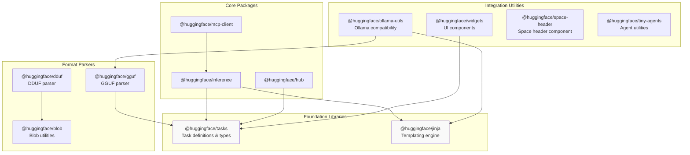
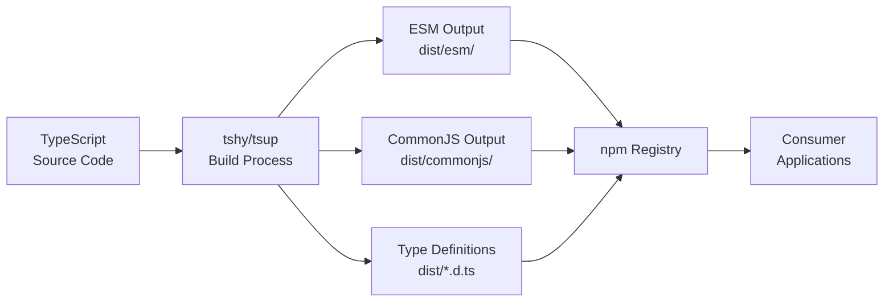

<!-- source: DeepWiki mcp.deepwiki.com · repo huggingface/huggingface.js · page 3 Supporting Libraries · fetched 2026-10-26 -->

# Supporting Libraries

<details>
<summary>Relevant source files</summary>

The following files were used as context for generating this wiki page:

- [README.md](README.md)
- [package.json](package.json)
- [packages/doc-internal/fix-cdn-versions.ts](packages/doc-internal/fix-cdn-versions.ts)
- [packages/doc-internal/package.json](packages/doc-internal/package.json)
- [packages/doc-internal/pnpm-lock.yaml](packages/doc-internal/pnpm-lock.yaml)
- [packages/hub/package.json](packages/hub/package.json)
- [packages/hub/pnpm-lock.yaml](packages/hub/pnpm-lock.yaml)
- [packages/inference/package.json](packages/inference/package.json)
- [packages/inference/pnpm-lock.yaml](packages/inference/pnpm-lock.yaml)
- [packages/inference/src/package.ts](packages/inference/src/package.ts)
- [packages/inference/test/global.d.ts](packages/inference/test/global.d.ts)
- [pnpm-lock.yaml](pnpm-lock.yaml)

</details>


The Hugging Face.js monorepo includes several supporting libraries that provide specialized infrastructure for the core user-facing packages. These libraries handle task metadata definitions, model format parsing, templating, and compatibility with external tools. They serve as shared dependencies that enable consistency and code reuse across the ecosystem.

This page provides an overview of the supporting libraries. For detailed information about the core user-facing APIs, see [Core Libraries](#2). For information about the development and build processes, see [Development and Release Process](#4).

## Overview of Supporting Libraries

The supporting libraries fall into four primary categories:

1. **Foundation Libraries**: [@huggingface/tasks](#3.1) provides the single source of truth for ML task definitions, pipeline types, and model library metadata
2. **Model Format Parsers**: [@huggingface/gguf](#3.2) and [@huggingface/dduf](#3.5) enable parsing of quantized and diffusion model formats
3. **Templating Engine**: [@huggingface/jinja](#3.3) implements the Jinja templating language for ML chat templates
4. **Integration Utilities**: [@huggingface/ollama-utils](#3.4), [@huggingface/widgets](#3.5), and others facilitate ecosystem integration

### Package Dependency Structure



**Diagram: Supporting Library Dependency Graph**

Sources: [README.md:54-68](), [packages/inference/package.json:61-63](), [packages/hub/package.json:64-65]()

### Dependency Declarations in Code

The package.json files declare these dependencies explicitly:

| Core Package | Dependencies on Supporting Libraries |
|--------------|--------------------------------------|
| `@huggingface/inference` | `@huggingface/tasks`, `@huggingface/jinja` |
| `@huggingface/hub` | `@huggingface/tasks` |
| `@huggingface/gguf` | `@huggingface/tasks` |
| `@huggingface/ollama-utils` | `@huggingface/gguf`, `@huggingface/jinja` |
| `@huggingface/widgets` | `@huggingface/tasks` |

Sources: [packages/inference/package.json:61-63](), [packages/hub/package.json:64-65](), [packages/inference/pnpm-lock.yaml:10-16](), [packages/hub/pnpm-lock.yaml:10-13]()

## Library Categories

### Foundation Libraries

**@huggingface/tasks** serves as the canonical source of truth for the entire ecosystem. It defines:

- 60+ machine learning pipeline types organized by modality (NLP, computer vision, audio, multimodal, tabular, reinforcement learning)
- TypeScript type definitions for inference inputs and outputs
- Model library compatibility mappings
- Code snippet templates for Python, JavaScript, and cURL
- Dataset and model examples for documentation

The Tasks library enables type safety and consistency across all packages. Both `@huggingface/inference` and `@huggingface/hub` import types and metadata from this package to ensure they work with the same task taxonomy.

Detailed documentation: [Tasks Library](#3.1)

**@huggingface/jinja** provides a JavaScript implementation of the Jinja2 templating language. This is essential for:

- Processing chat templates in language models
- Enabling Ollama compatibility through template conversion
- Supporting custom model configurations that use Jinja syntax

The inference library uses Jinja templates to format chat messages according to model-specific requirements.

Detailed documentation: [Jinja Library](#3.3)

Sources: [README.md:63-64](), [packages/inference/package.json:61-63]()

### Model Format Support

**@huggingface/gguf** parses GGUF (GPT-Generated Unified Format) files, which are used for quantized language models. The parser:

- Streams metadata from remote files without downloading the entire model
- Uses HTTP range requests to read specific byte ranges
- Extracts key-value pairs and tensor information
- Supports both browser and Node.js environments

Detailed documentation: [GGUF Library](#3.2)

**@huggingface/dduf** provides similar functionality for DDUF (DDUF Diffusers Unified Format) files used by diffusion models. It depends on `@huggingface/blob` for efficient blob handling.

**@huggingface/blob** offers low-level utilities for working with binary data across different JavaScript environments (browser, Node.js, Deno).

Detailed documentation: [Additional Libraries](#3.5)

Sources: [README.md:61-62]()

### Integration and Compatibility

**@huggingface/ollama-utils** maintains compatibility between Hugging Face Hub models and the Ollama runtime. Key features:

- Automatic conversion from Jinja chat templates to Go templates
- Weekly automated updates of template mappings
- Runtime template translation for seamless integration

Detailed documentation: [Ollama Utils Library](#3.4)

**@huggingface/widgets** provides Svelte components for rendering interactive model widgets. These components use task definitions from `@huggingface/tasks` to display appropriate inputs and outputs for different model types.

**@huggingface/space-header** enables embedding the Hugging Face Space header component in external applications.

**@huggingface/tiny-agents** offers lightweight utilities for building AI agents with tool support, complementing the higher-level `@huggingface/mcp-client`.

Detailed documentation: [Additional Libraries](#3.5)

Sources: [README.md:66-67]()

## Build and Distribution

All supporting libraries follow the monorepo's standard build process:



**Diagram: Supporting Library Build Pipeline**

The build configuration uses `tshy` (for most packages) or `tsup` to generate dual ESM and CommonJS outputs. Each package includes TypeScript type definitions for full IntelliSense support.

Example package structure:
- Source: `packages/<package>/src/` or `packages/<package>/index.ts`
- Output: `packages/<package>/dist/esm/`, `packages/<package>/dist/commonjs/`
- Types: `packages/<package>/dist/*.d.ts`

Sources: [packages/inference/package.json:47](), [packages/hub/package.json:55](), [README.md:270-276]()

## Publishing and Versioning

Each supporting library has an independent version number and can be published separately. The publishing workflow ensures:

1. Dependencies are published before dependent packages (e.g., `@huggingface/tasks` before `@huggingface/inference`)
2. Version numbers are automatically updated in CDN links in documentation
3. All packages are published to both npm and GitHub Packages

The `@huggingface/doc-internal` package contains scripts that maintain documentation consistency:

```typescript
// fix-cdn-versions.ts updates version numbers in README files
const hubPackage = JSON.parse(readFileSync("../hub/package.json").toString());
const inferencePackage = JSON.parse(readFileSync("../inference/package.json").toString());
```

Sources: [packages/doc-internal/fix-cdn-versions.ts:3-16](), [packages/doc-internal/package.json:9]()

## Usage Patterns

### Importing from Supporting Libraries

Core packages import supporting libraries using workspace references:

```typescript
// In @huggingface/inference
import { Template } from "@huggingface/jinja";
import type { PipelineType } from "@huggingface/tasks";

// In @huggingface/hub  
import type { ModelLibrary } from "@huggingface/tasks";
```

These imports resolve to the local workspace packages during development and to published npm packages in production.

### Type-Only Imports

Many supporting libraries are imported only for their TypeScript types, not runtime code:

```typescript
// Type-only import example
import type { RepoId } from "@huggingface/hub";
```

This pattern enables type safety without increasing bundle size for packages that only need type information.

Sources: [README.md:86-93]()

## Environment Compatibility

All supporting libraries target modern JavaScript environments:

- **Browser**: Native ES modules, no polyfills required
- **Node.js**: Version 18 or higher
- **Deno**: Native support via npm: or esm.sh imports
- **Bun**: Native support

Some features are platform-specific. For example, `@huggingface/hub` includes Node.js-only functionality for local caching that is excluded from browser builds via package.json browser field mappings.

Sources: [README.md:70](), [packages/hub/package.json:28-36]()

## Next Steps

The following sub-pages provide detailed documentation for each supporting library:

- [Tasks Library](#3.1) - Task definitions, type system, and metadata
- [GGUF Library](#3.2) - GGUF file parsing architecture
- [Jinja Library](#3.3) - Template engine implementation
- [Ollama Utils Library](#3.4) - Ollama compatibility layer
- [Additional Libraries](#3.5) - DDUF, widgets, space-header, tiny-agents, blob

For information about how these libraries are used by core packages, see:
- [Inference Library](#2.1) - Uses @huggingface/tasks and @huggingface/jinja
- [Hub Library](#2.2) - Uses @huggingface/tasks

---

