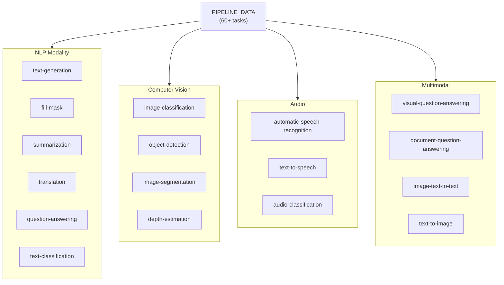
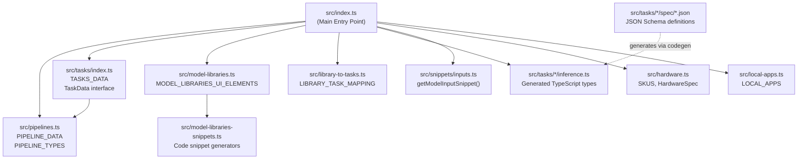
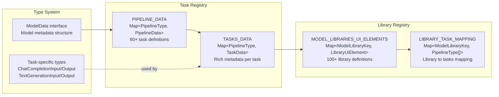
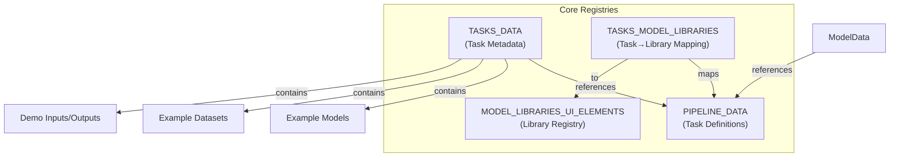
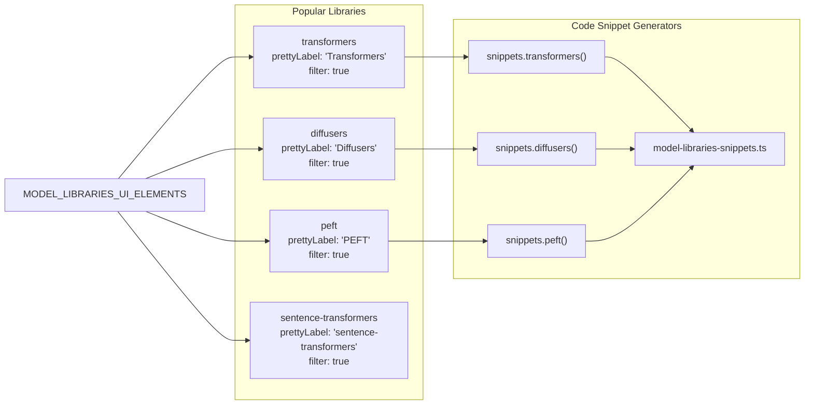
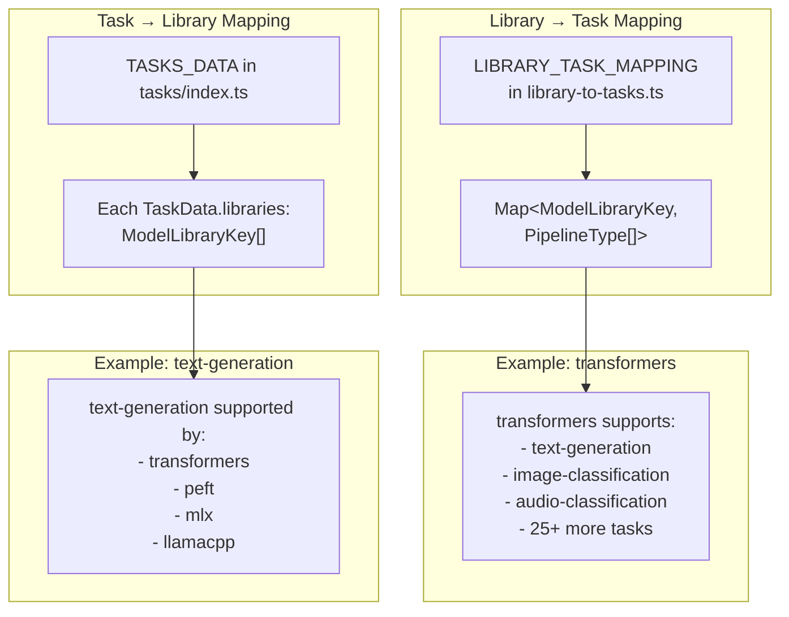
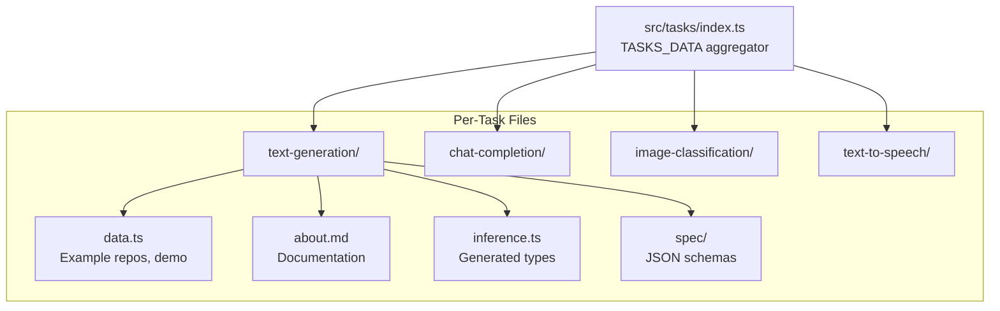
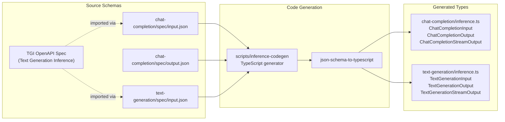
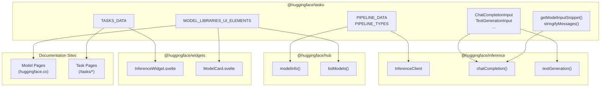
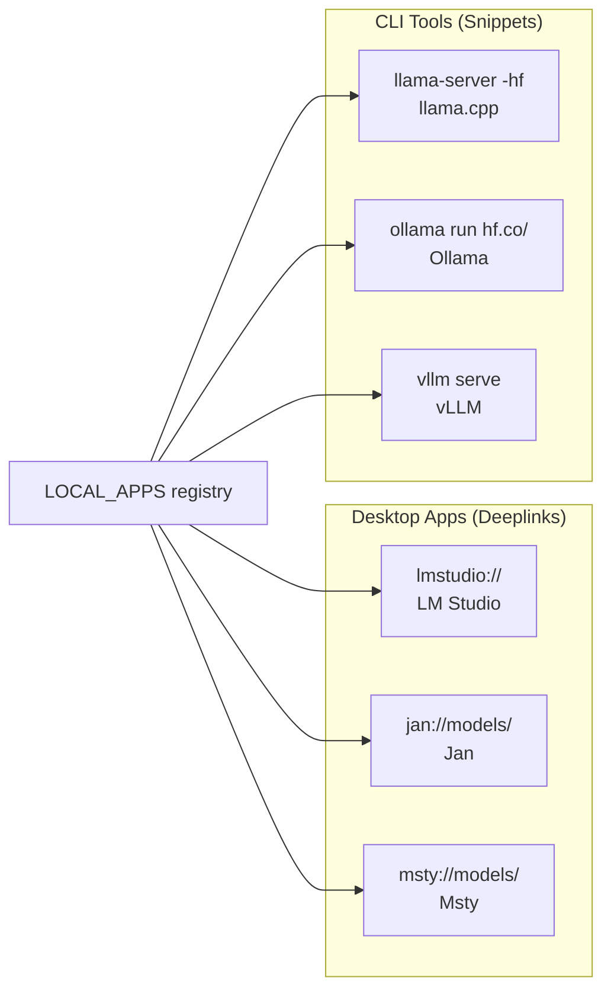

<!-- source: DeepWiki mcp.deepwiki.com · repo huggingface/huggingface.js · page 3.1 Tasks Library · fetched 2026-10-26 -->

# Tasks Library

<details>
<summary>Relevant source files</summary>

The following files were used as context for generating this wiki page:

- [packages/tasks/.gitignore](packages/tasks/.gitignore)
- [packages/tasks/package.json](packages/tasks/package.json)
- [packages/tasks/pnpm-lock.yaml](packages/tasks/pnpm-lock.yaml)
- [packages/tasks/src/default-widget-inputs.ts](packages/tasks/src/default-widget-inputs.ts)
- [packages/tasks/src/hardware.ts](packages/tasks/src/hardware.ts)
- [packages/tasks/src/index.ts](packages/tasks/src/index.ts)
- [packages/tasks/src/library-to-tasks.ts](packages/tasks/src/library-to-tasks.ts)
- [packages/tasks/src/local-apps.spec.ts](packages/tasks/src/local-apps.spec.ts)
- [packages/tasks/src/local-apps.ts](packages/tasks/src/local-apps.ts)
- [packages/tasks/src/model-data.ts](packages/tasks/src/model-data.ts)
- [packages/tasks/src/model-libraries-downloads.ts](packages/tasks/src/model-libraries-downloads.ts)
- [packages/tasks/src/model-libraries-snippets.spec.ts](packages/tasks/src/model-libraries-snippets.spec.ts)
- [packages/tasks/src/model-libraries-snippets.ts](packages/tasks/src/model-libraries-snippets.ts)
- [packages/tasks/src/model-libraries.ts](packages/tasks/src/model-libraries.ts)
- [packages/tasks/src/tasks/any-to-any/about.md](packages/tasks/src/tasks/any-to-any/about.md)
- [packages/tasks/src/tasks/any-to-any/data.ts](packages/tasks/src/tasks/any-to-any/data.ts)
- [packages/tasks/src/tasks/chat-completion/inference.ts](packages/tasks/src/tasks/chat-completion/inference.ts)
- [packages/tasks/src/tasks/chat-completion/spec/input.json](packages/tasks/src/tasks/chat-completion/spec/input.json)
- [packages/tasks/src/tasks/chat-completion/spec/output.json](packages/tasks/src/tasks/chat-completion/spec/output.json)
- [packages/tasks/src/tasks/chat-completion/spec/stream_output.json](packages/tasks/src/tasks/chat-completion/spec/stream_output.json)
- [packages/tasks/src/tasks/text-generation/inference.ts](packages/tasks/src/tasks/text-generation/inference.ts)
- [packages/tasks/src/tasks/text-generation/spec/input.json](packages/tasks/src/tasks/text-generation/spec/input.json)
- [packages/tasks/src/tasks/text-generation/spec/output.json](packages/tasks/src/tasks/text-generation/spec/output.json)
- [packages/tasks/src/tasks/text-generation/spec/stream_output.json](packages/tasks/src/tasks/text-generation/spec/stream_output.json)
- [packages/tasks/src/widget-example.ts](packages/tasks/src/widget-example.ts)

</details>


The `@huggingface/tasks` package serves as the **single source of truth** for machine learning task metadata across the Hugging Face JavaScript ecosystem. It provides:

1. **Task Taxonomy**: A comprehensive registry of 60+ ML pipeline types organized by modality
2. **Type Definitions**: TypeScript interfaces auto-generated from JSON schemas for type-safe inference APIs
3. **Library Mappings**: Bidirectional mappings between tasks and the 100+ model libraries that support them
4. **Code Snippets**: Generators that produce usage examples in Python, JavaScript, and CLI formats
5. **Example Data**: Default inputs and demo configurations for UI widgets and testing

This centralized design ensures consistency across `@huggingface/inference`, `@huggingface/hub`, `@huggingface/widgets`, and documentation sites.

For information about using inference with these tasks, see the [Inference Library](#2.1).

Sources: [packages/tasks/package.json:1-60](), [packages/tasks/src/index.ts:1-69]()
</old_str>

<old_str>
## Pipeline Types and Task Taxonomy

The `PIPELINE_DATA` registry in [packages/tasks/src/pipelines.ts]() defines 60+ pipeline types organized by modality. Each `PipelineType` is a string literal type, and `PIPELINE_DATA` maps it to a `PipelineData` structure:

```typescript
interface PipelineData {
  name: string;           // Display name
  type: string;           // Category identifier  
  modality: Modality;     // "nlp" | "audio" | "cv" | "multimodal" | "tabular" | "rl"
  subtask?: PipelineType; // Optional parent task
}
```

**Modality Organization**


**Example Task Definitions**

| Pipeline Type | Display Name | Modality | Supporting Libraries |
|--------------|-------------|----------|---------------------|
| `text-generation` | Text Generation | nlp | transformers, peft, mlx |
| `image-classification` | Image Classification | cv | timm, transformers, keras |
| `text-to-speech` | Text-to-Speech | audio | espnet, speechbrain, transformers |
| `image-text-to-text` | Image Text to Text | multimodal | transformers |
| `chat-completion` | Chat Completion | nlp | transformers (via TGI) |

The `PIPELINE_TYPES` constant exports a readonly array of all valid pipeline type strings, while `PIPELINE_TYPES_SET` provides an efficient Set for membership checks.

Sources: [packages/tasks/src/pipelines.ts:1-20](), [packages/tasks/src/index.ts:6-16]()
</old_str>
<new_str>
## Package Structure and Core Exports

The package is organized around several key data structures and type definitions:

**Package Structure: Key Files and Exports**


Sources: [packages/tasks/src/index.ts:1-69](), [packages/tasks/package.json:1-60]()

**Core Data Registries**


Sources: [packages/tasks/src/index.ts:1-69](), [packages/tasks/src/pipelines.ts:1-20](), [packages/tasks/src/model-libraries.ts:1-60](), [packages/tasks/src/library-to-tasks.ts:1-76]()

## Core Concepts

The Tasks Library maintains several key registries that define the ML task taxonomy and library ecosystem:



Sources: [packages/tasks/src/index.ts:1-68](), [packages/tasks/src/pipelines.ts:1-672](), [packages/tasks/src/tasks/index.ts:1-321]()

## Model Libraries Registry

The `MODEL_LIBRARIES_UI_ELEMENTS` object in [packages/tasks/src/model-libraries.ts:60-1500]() defines metadata for 100+ model libraries. Each library is identified by a `ModelLibraryKey` and mapped to a `LibraryUiElement`:

```typescript
interface LibraryUiElement {
  prettyLabel: string;                                    // Display name
  repoName: string;                                       // Repository name
  repoUrl: string;                                        // GitHub/GitLab URL
  docsUrl?: string;                                       // Documentation URL
  snippets?: (model: ModelData) => string[];              // Code generator
  countDownloads?: ElasticSearchQuery;                    // Download tracking query
  filter?: boolean;                                       // Show in Hub filters
}
```

**Library Registry Structure**


**Key Library Examples**

| Library Key | Pretty Label | Repository | Has Snippets | Filter Enabled |
|------------|-------------|-----------|--------------|----------------|
| `transformers` | Transformers | huggingface/transformers | ✓ | ✓ |
| `diffusers` | Diffusers | huggingface/diffusers | ✓ | ✓ |
| `peft` | PEFT | huggingface/peft | ✓ | ✓ |
| `mlx` | MLX | ml-explore/mlx-examples | ✓ | ✓ |
| `sentence-transformers` | sentence-transformers | UKPLab/sentence-transformers | ✓ | ✓ |
| `keras` | Keras | keras-team/keras | ✓ | ✓ |

The snippet generators in [packages/tasks/src/model-libraries-snippets.ts:1-2800]() produce library-specific code examples. Each generator is a function that takes a `ModelData` object and returns code strings or arrays of code strings.

Sources: [packages/tasks/src/model-libraries.ts:8-43](), [packages/tasks/src/model-libraries.ts:60-1500](), [packages/tasks/src/model-libraries-snippets.ts:1-100]()

## Task-Library Relationships

The package maintains bidirectional mappings between tasks and libraries through two data structures:

**Bidirectional Mapping Architecture**


### LIBRARY_TASK_MAPPING

The `LIBRARY_TASK_MAPPING` constant in [packages/tasks/src/library-to-tasks.ts:11-76]() defines which tasks each library supports. This mapping controls when the Hugging Face Inference API (serverless) should be enabled for specific (library, task) pairs.

```typescript
// Example mappings
const LIBRARY_TASK_MAPPING: Partial<Record<ModelLibraryKey, PipelineType[]>> = {
  transformers: [
    "text-generation",
    "text-classification", 
    "image-classification",
    "automatic-speech-recognition",
    // ... 25+ more tasks
  ],
  diffusers: ["text-to-image", "image-to-image"],
  "sentence-transformers": ["feature-extraction", "sentence-similarity"],
  peft: ["text-generation"],
}
```

### TASKS_DATA Library Lists

Each `TaskData` entry in [packages/tasks/src/tasks/index.ts:117-181]() includes a `libraries` array listing compatible libraries for that task:

```typescript
// Example from text-generation task data
{
  id: "text-generation",
  libraries: ["transformers", "peft", "mlx", "llamacpp", ...],
  // ... other metadata
}
```

These mappings enable:
- **Inference routing**: Determining valid provider/library combinations
- **Model filtering**: Showing only compatible models in UI dropdowns
- **Code generation**: Selecting appropriate snippet generators
- **Documentation**: Auto-generating compatibility matrices

Sources: [packages/tasks/src/library-to-tasks.ts:1-76](), [packages/tasks/src/tasks/index.ts:117-181]()

## Task Metadata System

### TASKS_DATA Structure

The `TASKS_DATA` object in [packages/tasks/src/tasks/index.ts:117-181]() aggregates rich metadata for each task. Each entry follows the `TaskData` interface:

```typescript
interface TaskData {
  id: PipelineType;                    // Task identifier (e.g., "text-generation")
  label: string;                       // Display name (e.g., "Text Generation")
  libraries: ModelLibraryKey[];        // Supporting libraries
  summary: string;                     // Brief description for documentation
  models: ExampleRepo[];               // Example model repos
  datasets: ExampleRepo[];             // Example dataset repos  
  spaces: ExampleRepo[];               // Example Space repos
  demo: TaskDemo;                      // Demo inputs/outputs for widgets
  widgetModels: string[];              // Default models for UI widgets
  metrics: { description: string; id: string }[]; // Evaluation metrics
  youtubeId?: string;                  // Tutorial video ID
}
```

### Task Data Organization

Each task has its metadata split across multiple files:

**Task Data File Structure**


### Example: Text Generation Task Data

[packages/tasks/src/tasks/text-generation/data.ts:1-126]() provides:

```typescript
const taskData: TaskData = {
  id: "text-generation",
  label: "Text Generation",
  libraries: ["transformers", "peft", "mlx", ...],
  summary: "Generating text is the task of...",
  models: [
    { id: "meta-llama/Llama-3.2-1B", description: "..." },
    { id: "microsoft/Phi-3-mini-4k-instruct", description: "..." }
  ],
  datasets: [
    { id: "wikitext", description: "..." }
  ],
  demo: {
    inputs: [{ text: "Once upon a time" }],
    outputs: [{ text: "... there was a..." }]
  },
  widgetModels: ["gpt2"],
  metrics: [
    { id: "perplexity", description: "..." }
  ]
}
```

This structure enables:
- **Documentation generation**: `about.md` provides task descriptions
- **UI rendering**: `demo` provides example inputs for widgets
- **Model discovery**: `models` array lists notable examples
- **Type safety**: `inference.ts` provides strongly-typed interfaces

Sources: [packages/tasks/src/tasks/index.ts:1-321](), [packages/tasks/src/tasks/text-generation/data.ts:1-126](), [packages/tasks/src/tasks/any-to-any/data.ts:1-66]()

## Type Generation from JSON Schemas

A critical feature of the Tasks Library is **automatic TypeScript type generation** from JSON schemas. This ensures type safety and API consistency across the ecosystem.

### Type Generation Pipeline

**Schema to TypeScript Flow**


### JSON Schema Structure

JSON schemas in `spec/` directories follow a standard format. Example from [packages/tasks/src/tasks/chat-completion/spec/input.json:1-450]():

```json
{
  "$schema": "http://json-schema.org/draft-06/schema#",
  "title": "ChatCompletionInput",
  "description": "Auto-generated from TGI specs",
  "type": "object",
  "required": ["messages"],
  "properties": {
    "messages": {
      "type": "array",
      "items": { "$ref": "#/$defs/ChatCompletionInputMessage" }
    },
    "max_tokens": { "type": "integer", "nullable": true },
    "temperature": { "type": "number", "nullable": true }
  },
  "$defs": {
    "ChatCompletionInputMessage": { ... }
  }
}
```

### Generated TypeScript Interfaces

The `inference-codegen` script transforms these schemas into TypeScript. Example output in [packages/tasks/src/tasks/chat-completion/inference.ts:1-330]():

```typescript
/**
 * Auto-generated from TGI specs.
 * Using src/scripts/inference-codegen
 */
export interface ChatCompletionInput {
  messages: ChatCompletionInputMessage[];
  max_tokens?: number;
  temperature?: number;
  stream?: boolean;
  // ... additional properties
}

export interface ChatCompletionInputMessage {
  role: string;
  content?: ChatCompletionInputMessageContent;
  tool_calls?: ChatCompletionInputToolCall[];
}

export type ChatCompletionInputMessageContent = 
  | string 
  | ChatCompletionInputMessageChunk[];
```

### Usage in Inference Client

These generated types are imported by `@huggingface/inference` to provide type-safe APIs:

```typescript
// In @huggingface/inference
import type { 
  ChatCompletionInput, 
  ChatCompletionOutput 
} from "@huggingface/tasks";

async function chatCompletion(
  args: ChatCompletionInput
): Promise<ChatCompletionOutput> {
  // Implementation...
}
```

This approach ensures:
- **Single source of truth**: Schemas define both validation and types
- **Consistency**: Types match server APIs exactly
- **Maintainability**: Changes to TGI specs propagate automatically
- **Type safety**: Compile-time checking prevents invalid requests

Sources: [packages/tasks/src/tasks/chat-completion/inference.ts:1-330](), [packages/tasks/src/tasks/chat-completion/spec/input.json:1-450](), [packages/tasks/src/tasks/text-generation/inference.ts:1-180](), [packages/tasks/src/tasks/text-generation/spec/input.json:1-248]()

### Model Library Registry

The library registry is defined in:

1. **Library UI Elements** (`model-libraries.ts`):
   - `MODEL_LIBRARIES_UI_ELEMENTS` contains metadata for each library
   - Defines display information, documentation links, and code generators
   - Provides filtering and discovery capabilities

2. **Library Snippets** (`model-libraries-snippets.ts`):
   - Contains code snippet generators for each library
   - Functions that take a model and return code examples

Example of a library definition:

```typescript
// Example from MODEL_LIBRARIES_UI_ELEMENTS
transformers: {
  prettyLabel: "Transformers",
  repoName: "🤗/transformers",
  repoUrl: "https://github.com/huggingface/transformers",
  docsUrl: "https://huggingface.co/docs/hub/transformers",
  snippets: snippets.transformers,
  filter: true,
}
```

Sources: [packages/tasks/src/model-libraries.ts:60-1020](), [packages/tasks/src/model-libraries-snippets.ts:19-996]()

### Example Input Generators

The library provides standardized example inputs for different task types:

1. **Input Snippets** (`snippets/inputs.ts`):
   - Maps task types to appropriate example inputs
   - Generates sample inputs for different models
   - Handles special cases like conversational models

```typescript
// Example input generation logic
const inputsTextGeneration = (model: ModelDataMinimal) => {
  if (model.tags.includes("conversational")) {
    return [{ role: "user", content: "What is the capital of France?" }];
  }
  return `"Can you please let us know more details about your "`;
};
```

Sources: [packages/tasks/src/snippets/inputs.ts:44-67](), [packages/tasks/src/snippets/inputs.ts:117-149]()

## Integration with Ecosystem

The Tasks Library serves as the foundation for several Hugging Face packages:

**Package Dependencies and Data Flow**


### Usage by @huggingface/inference

The Inference library imports types for all task endpoints:

```typescript
// In @huggingface/inference
import type {
  ChatCompletionInput,
  ChatCompletionOutput,
  TextGenerationInput,
  TextGenerationOutput,
} from "@huggingface/tasks";

// Type-safe method signatures
class InferenceClient {
  async chatCompletion(
    args: ChatCompletionInput
  ): Promise<ChatCompletionOutput> { ... }
  
  async textGeneration(
    args: TextGenerationInput
  ): Promise<TextGenerationOutput> { ... }
}
```

### Usage by @huggingface/hub

The Hub library uses task and library data for model organization:

```typescript
// Categorizing models by pipeline_tag
import { PIPELINE_DATA, MODEL_LIBRARIES_UI_ELEMENTS } from "@huggingface/tasks";

function getTaskName(pipelineTag: string): string {
  return PIPELINE_DATA[pipelineTag]?.name ?? "Unknown";
}

function getLibraryInfo(libraryName: string) {
  return MODEL_LIBRARIES_UI_ELEMENTS[libraryName];
}
```

### Usage by @huggingface/widgets

Widgets use `TASKS_DATA` for rendering inference UIs:

```typescript
// Rendering task-specific widgets
import { TASKS_DATA } from "@huggingface/tasks";

const taskData = TASKS_DATA["text-generation"];
// Use taskData.demo for example inputs
// Use taskData.widgetModels for default model selection
```

This centralized design ensures:
- **Type consistency**: All packages use the same type definitions
- **Single source of truth**: Task metadata defined once, used everywhere
- **Easy updates**: Changes to task definitions propagate automatically
- **Reduced duplication**: No need to maintain parallel registries

Sources: [packages/tasks/src/index.ts:1-69]()

## Additional Registries

### Local Applications Registry

The `LOCAL_APPS` object in [packages/tasks/src/local-apps.ts:418-591]() defines local applications that can run models (e.g., llama.cpp, Ollama, LM Studio). Each entry specifies:

```typescript
interface LocalApp {
  prettyLabel: string;                                      // Display name
  docsUrl: string;                                          // Documentation URL
  mainTask: PipelineType;                                   // Primary task
  displayOnModelPage: (model: ModelData) => boolean;        // Visibility logic
  
  // Either deeplink OR snippet (not both)
  deeplink?: (model: ModelData, filepath?: string) => URL;  // App URL protocol
  snippet?: (model: ModelData, filepath?: string) => LocalAppSnippet[]; // CLI commands
}
```

**Local App Integration**


Example entries:

| App Key | Pretty Label | Type | Supported Tasks |
|---------|-------------|------|----------------|
| `llama.cpp` | llama.cpp | CLI snippet | text-generation (GGUF) |
| `ollama` | Ollama | CLI snippet | text-generation (GGUF) |
| `lmstudio` | LM Studio | Deeplink | text-generation (GGUF/MLX) |
| `vllm` | vLLM | CLI snippet | text-generation (AWQ/GPTQ) |
| `drawthings` | Draw Things | Deeplink | text-to-image (Diffusers) |

The `displayOnModelPage` function determines whether an app should appear for a specific model based on tags, library, and file formats.

### Hardware Specifications

The `SKUS` object in [packages/tasks/src/hardware.ts:38-778]() catalogs hardware specifications for GPUs, CPUs, and accelerators:

```typescript
interface HardwareSpec {
  tflops: number;        // FP16 TFLOPS (approximate)
  memory?: number[];     // Available memory configurations (GB)
}

const SKUS = {
  GPU: {
    NVIDIA: {
      "H100": { tflops: 267.6, memory: [80] },
      "A100": { tflops: 77.97, memory: [40, 80] },
      "RTX 4090": { tflops: 82.58, memory: [24] }
    },
    AMD: {
      "MI300": { tflops: 383.0, memory: [192] }
    }
  },
  CPU: { ... },
  "Apple Silicon": { ... }
}
```

This data is used for:
- Hardware compatibility recommendations
- Performance estimates for model inference
- Regulatory compliance (e.g., White House AI EO thresholds)

Sources: [packages/tasks/src/local-apps.ts:8-64](), [packages/tasks/src/local-apps.ts:418-591](), [packages/tasks/src/hardware.ts:15-778]()

## Usage Examples

### Importing and Using Core Exports

```typescript
import { 
  PIPELINE_DATA,
  PIPELINE_TYPES,
  TASKS_DATA,
  MODEL_LIBRARIES_UI_ELEMENTS,
  LIBRARY_TASK_MAPPING,
  type PipelineType,
  type TaskData,
  type ModelLibraryKey
} from "@huggingface/tasks";

// Access pipeline metadata
const textGenPipeline = PIPELINE_DATA["text-generation"];
console.log(textGenPipeline.name);      // "Text Generation"
console.log(textGenPipeline.modality);  // "nlp"

// Iterate over all pipeline types
PIPELINE_TYPES.forEach(type => {
  console.log(`Task: ${PIPELINE_DATA[type].name}`);
});

// Get full task data with examples
const textGenTask = TASKS_DATA["text-generation"];
console.log(textGenTask.summary);
console.log(textGenTask.libraries);     // ["transformers", "peft", ...]
console.log(textGenTask.models[0]);     // { id: "meta-llama/...", description: "..." }
```

### Working with Library Mappings

```typescript
import { LIBRARY_TASK_MAPPING, MODEL_LIBRARIES_UI_ELEMENTS } from "@huggingface/tasks";

// Find all tasks supported by transformers
const transformersTasks = LIBRARY_TASK_MAPPING["transformers"];
// => ["text-generation", "text-classification", "image-classification", ...]

// Get library metadata
const transformersInfo = MODEL_LIBRARIES_UI_ELEMENTS["transformers"];
console.log(transformersInfo.prettyLabel);  // "Transformers"
console.log(transformersInfo.repoUrl);      // "https://github.com/huggingface/transformers"
console.log(transformersInfo.docsUrl);      // "https://huggingface.co/docs/hub/transformers"

// Check if a library is shown in filters
if (transformersInfo.filter) {
  console.log("Show in model filter UI");
}
```

### Generating Code Snippets

```typescript
import { MODEL_LIBRARIES_UI_ELEMENTS } from "@huggingface/tasks";
import type { ModelData } from "@huggingface/tasks";

// Model with metadata
const model: ModelData = {
  id: "bartowski/Llama-3.2-3B-Instruct-GGUF",
  pipeline_tag: "text-generation",
  tags: ["conversational", "gguf"],
  library_name: "llamacpp",
  inference: "enabled"
};

// Generate library-specific snippet
const snippetFn = MODEL_LIBRARIES_UI_ELEMENTS["llamacpp"]?.snippets;
if (snippetFn) {
  const codeSnippets = snippetFn(model);
  console.log(codeSnippets[0]);  // Python code for llama-cpp-python
}
```

### Using Generated Types

```typescript
import type { 
  ChatCompletionInput,
  ChatCompletionOutput,
  TextGenerationInput,
  TextGenerationOutput
} from "@huggingface/tasks";

// Type-safe chat completion request
const chatRequest: ChatCompletionInput = {
  messages: [
    { role: "user", content: "What is deep learning?" }
  ],
  max_tokens: 512,
  temperature: 0.7
};

// Type-safe text generation request
const textGenRequest: TextGenerationInput = {
  inputs: "Once upon a time",
  parameters: {
    max_new_tokens: 100,
    temperature: 0.8,
    top_p: 0.95
  }
};
```

### Getting Example Inputs

```typescript
import { getModelInputSnippet } from "@huggingface/tasks";
import type { ModelData } from "@huggingface/tasks";

// Conversational model
const chatModel: Partial<ModelData> = {
  id: "meta-llama/Llama-3.2-3B-Instruct",
  pipeline_tag: "text-generation",
  tags: ["conversational"]
};

const chatInputs = getModelInputSnippet(chatModel);
// Returns: [{ role: "user", content: "What is the capital of France?" }]

// Vision-language model
const vlmModel: Partial<ModelData> = {
  id: "llava-hf/llava-1.5-7b-hf",
  pipeline_tag: "image-text-to-text",
  tags: []
};

const vlmInputs = getModelInputSnippet(vlmModel);
// Returns: { text: "...", image_url: "..." }
```

### Working with Local Apps

```typescript
import { LOCAL_APPS } from "@huggingface/tasks";
import type { ModelData } from "@huggingface/tasks";

const ggufModel: Partial<ModelData> = {
  id: "TheBloke/Llama-2-7B-GGUF",
  tags: ["gguf"],
  gguf: { context_length: 4096 }
};

// Check if llama.cpp should be shown
const llamaCppApp = LOCAL_APPS["llama.cpp"];
if (llamaCppApp.displayOnModelPage(ggufModel as ModelData)) {
  // Generate CLI snippets
  const snippets = llamaCppApp.snippet?.(ggufModel as ModelData);
  console.log(snippets);  // Array of LocalAppSnippet objects
}

// Get deeplink for LM Studio
const lmStudioApp = LOCAL_APPS["lmstudio"];
const deeplink = lmStudioApp.deeplink?.(ggufModel as ModelData);
console.log(deeplink.href);  // "lmstudio://open_from_hf?model=..."
```

Sources: [packages/tasks/src/index.ts:1-69](), [packages/tasks/src/snippets/inputs.ts:153-170](), [packages/tasks/src/local-apps.ts:418-591]()

## Conclusion

The Tasks Library serves as the foundation for the Hugging Face JavaScript ecosystem by providing:

1. A comprehensive taxonomy of ML tasks with rich metadata
2. A registry of model libraries with code generation capabilities
3. Mappings between tasks and their supporting libraries
4. Standardized example inputs for different task types
5. Support for local applications and hardware compatibility

This central registry ensures consistency across the ecosystem, enabling type-safe APIs, accurate model categorization, and rich UI experiences.

Sources: [packages/tasks/src/index.ts:1-68](), [packages/tasks/src/pipelines.ts:1-672](), [packages/tasks/src/tasks/index.ts:1-321]()

---

