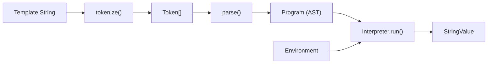
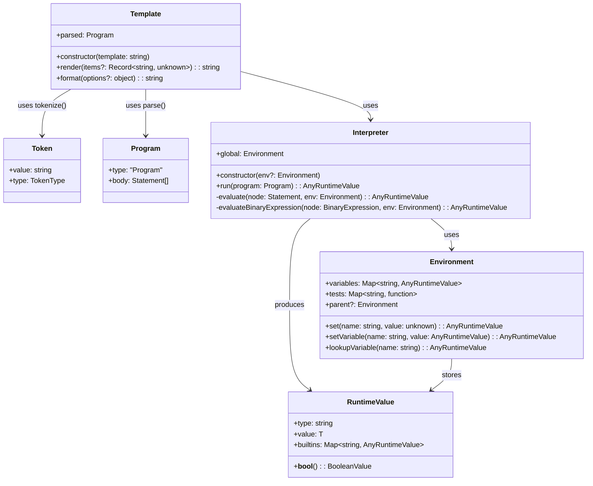
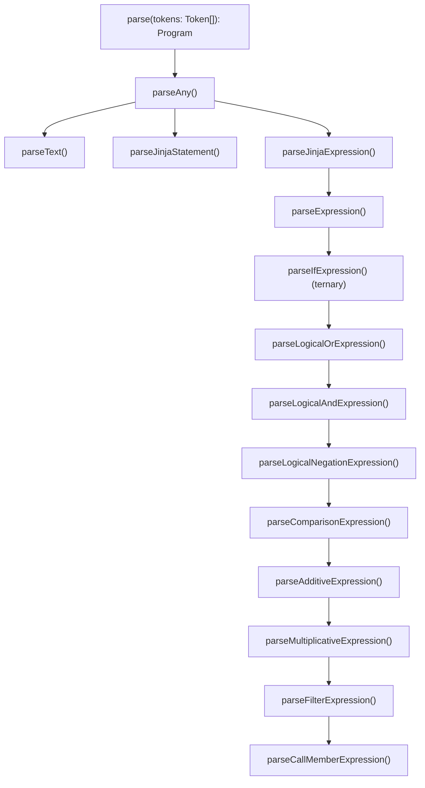
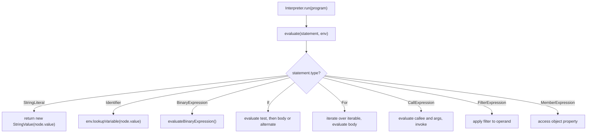
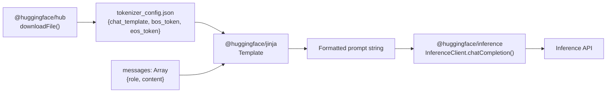

<!-- source: DeepWiki mcp.deepwiki.com · repo huggingface/huggingface.js · page 3.3 Jinja Library · fetched 2026-10-26 -->

# Jinja Library

<details>
<summary>Relevant source files</summary>

The following files were used as context for generating this wiki page:

- [packages/jinja/src/ast.ts](packages/jinja/src/ast.ts)
- [packages/jinja/src/format.ts](packages/jinja/src/format.ts)
- [packages/jinja/src/index.ts](packages/jinja/src/index.ts)
- [packages/jinja/src/lexer.ts](packages/jinja/src/lexer.ts)
- [packages/jinja/src/parser.ts](packages/jinja/src/parser.ts)
- [packages/jinja/src/runtime.ts](packages/jinja/src/runtime.ts)
- [packages/jinja/src/utils.ts](packages/jinja/src/utils.ts)
- [packages/jinja/test/e2e.test.js](packages/jinja/test/e2e.test.js)
- [packages/jinja/test/format.test.js](packages/jinja/test/format.test.js)
- [packages/jinja/test/interpreter.test.js](packages/jinja/test/interpreter.test.js)
- [packages/jinja/test/templates.test.js](packages/jinja/test/templates.test.js)
- [packages/jinja/test/utils.test.js](packages/jinja/test/utils.test.js)

</details>


The @huggingface/jinja package is a minimalistic JavaScript implementation of the Jinja templating engine, specifically designed for parsing and rendering ML chat templates. It provides a lightweight templating system that is particularly important for formatting chat conversations for language models in a format they can understand.

This library forms a critical component in the Hugging Face JavaScript ecosystem by enabling proper formatting of chat messages for various language models, each of which may require different template structures.

## Purpose and Scope

This document covers:
- The architecture and components of the Jinja library
- How templates are processed from text to rendered output
- The supported Jinja syntax features
- Integration with the Hugging Face ecosystem

## Architecture Overview

The @huggingface/jinja library implements a three-phase compilation and execution pipeline: lexical analysis (tokenization), syntactic analysis (parsing to AST), and interpretation (evaluation).

### Template Processing Flow



**Key Functions and Classes:**
- `tokenize(source: string, options?: PreprocessOptions): Token[]` - Lexical analysis [packages/jinja/src/lexer.ts:149-394]()
- `parse(tokens: Token[]): Program` - Syntactic analysis [packages/jinja/src/parser.ts:39-600]()
- `Interpreter.run(program: Program): AnyRuntimeValue` - Evaluation [packages/jinja/src/runtime.ts:805-807]()
- `Environment` - Scope management for variables and functions [packages/jinja/src/runtime.ts:549-678]()

Sources: [packages/jinja/src/index.ts:20-58](), [packages/jinja/src/lexer.ts:149-394](), [packages/jinja/src/parser.ts:39-600](), [packages/jinja/src/runtime.ts:795-807]()

### Core Component Interactions



**Runtime Value Hierarchy:**
- `StringValue` - Represents strings, has built-ins like `upper()`, `split()`, `replace()` [packages/jinja/src/runtime.ts:102-266]()
- `IntegerValue` / `FloatValue` - Numeric types [packages/jinja/src/runtime.ts:84-97]()
- `BooleanValue` - Boolean values [packages/jinja/src/runtime.ts:271-273]()
- `ArrayValue` / `TupleValue` - Sequences [packages/jinja/src/runtime.ts:497-523]()
- `ObjectValue` - Dictionaries with methods like `items()`, `keys()`, `values()`, `get()` [packages/jinja/src/runtime.ts:388-485]()
- `FunctionValue` - Callable functions [packages/jinja/src/runtime.ts:528-530]()
- `NullValue` / `UndefinedValue` - Null and undefined [packages/jinja/src/runtime.ts:535-544]()

Sources: [packages/jinja/src/index.ts:20-58](), [packages/jinja/src/runtime.ts:32-544](), [packages/jinja/src/ast.ts:1-321]()

## Core Components

### 1. Template Class

The `Template` class serves as the main entry point for using the library. It encapsulates the entire template processing pipeline.

```javascript
// Create a template instance
const template = new Template('Hello {{ name }}!');

// Render the template with context variables
const result = template.render({ name: 'World' });  // "Hello World!"
```

The constructor takes a template string and parses it into an AST that can be efficiently rendered multiple times with different context variables.

Sources: [packages/jinja/src/index.ts:20-58]()

### 2. Lexer (Tokenization)

The `tokenize()` function converts template strings into a sequence of `Token` objects. It handles Jinja's delimiters (`{{`, `{%`, `{#`) and performs whitespace control processing.

**Token Types:**
The lexer recognizes 25 token types defined in `TOKEN_TYPES` [packages/jinja/src/lexer.ts:4-32]():

| Category | Token Types |
|----------|-------------|
| **Delimiters** | `OpenStatement` (``), `OpenExpression` (`{{`), `CloseExpression` (`}}`) |
| **Literals** | `Text`, `NumericLiteral`, `StringLiteral` |
| **Identifiers** | `Identifier` (variables, keywords like `if`, `for`, `and`, `or`, `not`) |
| **Operators** | `AdditiveBinaryOperator` (`+`, `-`, `~`), `MultiplicativeBinaryOperator` (`*`, `/`, `%`), `ComparisonBinaryOperator` (`==`, `!=`, `<`, `>`, `<=`, `>=`) |
| **Syntax** | `OpenParen` (`(`), `CloseParen` (`)`), `OpenSquareBracket` (`[`), `CloseSquareBracket` (`]`), `Comma`, `Dot`, `Pipe` (`\|`), `Colon` |
| **Other** | `Comment` |

**Whitespace Control:**
The lexer supports Jinja's whitespace control directives (``, `{{-`, `-}}`) which strip leading/trailing whitespace [packages/jinja/src/lexer.ts:269-303]().

**Preprocessing Options:**
- `trim_blocks`: Removes first newline after template tags [packages/jinja/src/lexer.ts:135-139]()
- `lstrip_blocks`: Strips leading whitespace before block tags [packages/jinja/src/lexer.ts:128-133]()

**Tokenization Example:**
```
Input: "Hello {{ name }}!"
Output:
  Token { value: "Hello ", type: "Text" }
  Token { value: "{{", type: "OpenExpression" }
  Token { value: "name", type: "Identifier" }
  Token { value: "}}", type: "CloseExpression" }
  Token { value: "!", type: "Text" }
```

Sources: [packages/jinja/src/lexer.ts:1-395](), [packages/jinja/src/lexer.ts:39-49](), [packages/jinja/src/lexer.ts:149-394]()

### 3. Parser (AST Construction)

The `parse()` function converts tokens into a `Program` AST node through recursive descent parsing with operator precedence handling.

**Parser Architecture:**
The parser uses a recursive descent approach with precedence climbing for expressions:



**Statement Parsing Functions:**
- `parseSetStatement()` - Handles `` and block sets [packages/jinja/src/parser.ts:210-228]()
- `parseIfStatement()` - Parses if/elif/else chains [packages/jinja/src/parser.ts:230-263]()
- `parseForStatement()` - Handles for loops with optional else blocks [packages/jinja/src/parser.ts:298-335]()
- `parseMacroStatement()` - Parses macro definitions [packages/jinja/src/parser.ts:265-282]()

**Expression Precedence (lowest to highest):**
1. Ternary (`if`/`else`) - `parseIfExpression()` [packages/jinja/src/parser.ts:342-360]()
2. Logical OR (`or`) - `parseLogicalOrExpression()` [packages/jinja/src/parser.ts:362-371]()
3. Logical AND (`and`) - `parseLogicalAndExpression()` [packages/jinja/src/parser.ts:373-382]()
4. Logical NOT (`not`) - `parseLogicalNegationExpression()` [packages/jinja/src/parser.ts:384-397]()
5. Comparison (`==`, `!=`, `<`, `>`, `in`, `not in`) - `parseComparisonExpression()` [packages/jinja/src/parser.ts:399-419]()
6. Additive (`+`, `-`, `~`) - `parseAdditiveExpression()` [packages/jinja/src/parser.ts:420-429]()
7. Multiplicative (`*`, `/`, `%`) - `parseMultiplicativeExpression()` [packages/jinja/src/parser.ts:535-544]()
8. Filter (`|`) - `parseFilterExpression()` [packages/jinja/src/parser.ts:546-560]()
9. Test (`is`) - `parseTestExpression()` [packages/jinja/src/parser.ts:562-580]()
10. Member/Call - `parseCallMemberExpression()` [packages/jinja/src/parser.ts:431-454]()

Sources: [packages/jinja/src/parser.ts:1-600](), [packages/jinja/src/parser.ts:39-340]()

### 4. AST (Abstract Syntax Tree)

The AST consists of `Statement` and `Expression` node types defined in [packages/jinja/src/ast.ts:1-321](). All nodes inherit from `Statement`, and expressions are a subtype.

**Statement Node Types:**

| Node Type | Properties | Description |
|-----------|------------|-------------|
| `Program` | `body: Statement[]` | Root node containing all statements [packages/jinja/src/ast.ts:13-19]() |
| `If` | `test: Expression, body: Statement[], alternate: Statement[]` | Conditional branching [packages/jinja/src/ast.ts:21-31]() |
| `For` | `loopvar: Identifier\|TupleLiteral, iterable: Expression, body: Statement[], defaultBlock: Statement[]` | Loop iteration [packages/jinja/src/ast.ts:37-48]() |
| `SetStatement` | `assignee: Expression, value: Expression\|null, body: Statement[]` | Variable assignment [packages/jinja/src/ast.ts:57-66]() |
| `Macro` | `name: Identifier, args: Expression[], body: Statement[]` | Function definition [packages/jinja/src/ast.ts:68-78]() |
| `Break` / `Continue` | - | Loop control flow [packages/jinja/src/ast.ts:50-55]() |
| `Comment` | `value: string` | Template comment [packages/jinja/src/ast.ts:80-85]() |

**Expression Node Types:**

| Node Type | Properties | Description |
|-----------|------------|-------------|
| `Identifier` | `value: string` | Variable reference [packages/jinja/src/ast.ts:120-129]() |
| `StringLiteral` | `value: string` | String constant [packages/jinja/src/ast.ts:154-156]() |
| `IntegerLiteral` / `FloatLiteral` | `value: number` | Numeric literals [packages/jinja/src/ast.ts:143-149]() |
| `ArrayLiteral` | `value: Expression[]` | List literal `[1, 2, 3]` [packages/jinja/src/ast.ts:161-163]() |
| `TupleLiteral` | `value: Expression[]` | Tuple literal `(1, 2)` [packages/jinja/src/ast.ts:168-170]() |
| `ObjectLiteral` | `value: Map<Expression, Expression>` | Dict literal `{"key": "value"}` [packages/jinja/src/ast.ts:175-177]() |
| `BinaryExpression` | `operator: Token, left: Expression, right: Expression` | Binary operations [packages/jinja/src/ast.ts:184-194]() |
| `UnaryExpression` | `operator: Token, argument: Expression` | Unary operations like `not` [packages/jinja/src/ast.ts:257-266]() |
| `MemberExpression` | `object: Expression, property: Expression, computed: boolean` | Property access `obj.prop` or `obj["prop"]` [packages/jinja/src/ast.ts:94-104]() |
| `CallExpression` | `callee: Expression, args: Expression[]` | Function call `func(arg1, arg2)` [packages/jinja/src/ast.ts:106-115]() |
| `FilterExpression` | `operand: Expression, filter: Identifier\|CallExpression` | Pipe filter `value \| upper` [packages/jinja/src/ast.ts:200-209]() |
| `TestExpression` | `operand: Expression, negate: boolean, test: Identifier` | Test operator `x is defined` [packages/jinja/src/ast.ts:242-252]() |
| `SliceExpression` | `start?: Expression, stop?: Expression, step?: Expression` | Array/string slicing `arr[1:5:2]` [packages/jinja/src/ast.ts:268-278]() |
| `Ternary` | `condition: Expression, trueExpr: Expression, falseExpr: Expression` | Ternary operator `a if cond else b` [packages/jinja/src/ast.ts:311-320]() |

Sources: [packages/jinja/src/ast.ts:1-321]()

### 5. Runtime/Interpreter

The `Interpreter` class evaluates the AST through a visitor pattern, maintaining an `Environment` for variable scoping.

**Interpreter Architecture:**



**Key Interpreter Methods:**

| Method | Purpose |
|--------|---------|
| `run(program: Program)` | Entry point, evaluates program in global environment [packages/jinja/src/runtime.ts:805-807]() |
| `evaluate(node: Statement, env: Environment)` | Main evaluation dispatcher [packages/jinja/src/runtime.ts:809-1115]() |
| `evaluateBinaryExpression()` | Handles `+`, `-`, `*`, `/`, `==`, `and`, `or`, etc. [packages/jinja/src/runtime.ts:812-910]() |
| `evaluateCallExpression()` | Function/macro invocation [packages/jinja/src/runtime.ts:1085-1115]() |
| `evaluateFilterExpression()` | Applies filters like `upper`, `length`, `tojson` [packages/jinja/src/runtime.ts:1117-1349]() |

**Environment Scoping:**

The `Environment` class manages variable scopes with parent chain for nested scopes [packages/jinja/src/runtime.ts:549-678]():

```
Global Environment
├─ variables: Map<string, AnyRuntimeValue>
│  ├─ "true" -> BooleanValue(true)
│  ├─ "false" -> BooleanValue(false)
│  ├─ "none" -> NullValue()
│  └─ user-provided variables
├─ tests: Map<string, function>
│  ├─ "defined", "undefined"
│  ├─ "odd", "even"
│  ├─ "boolean", "number", "string"
│  └─ more test functions
└─ parent: undefined (for global scope)
```

**Built-in Functions and Filters:**

Filters are implemented as methods in `evaluateFilterExpression()` [packages/jinja/src/runtime.ts:1117-1349]():
- String filters: `upper`, `lower`, `title`, `capitalize`, `trim`, `strip`
- List filters: `length`, `join`, `sort`, `unique`, `selectattr`, `rejectattr`
- Conversion filters: `tojson`, `int`, `float`, `string`
- Object filters: `items`, `keys`, `values`, `dictsort`

Tests are registered in `Environment.tests` [packages/jinja/src/runtime.ts:571-619]():
- Type tests: `boolean`, `number`, `string`, `iterable`, `mapping`, `callable`
- Value tests: `defined`, `undefined`, `none`, `true`, `false`
- Numeric tests: `odd`, `even`
- String tests: `lower`, `upper`
- Comparison tests: `equalto`, `eq`

Sources: [packages/jinja/src/runtime.ts:795-1426](), [packages/jinja/src/runtime.ts:549-678]()

## Supported Jinja Features

The library implements a focused subset of Jinja2 tailored for chat template processing:

### Control Flow Statements

| Statement | Syntax | Implementation |
|-----------|--------|----------------|
| **If/Elif/Else** | `.........` | [packages/jinja/src/runtime.ts:920-943]() |
| **For Loop** | `...` | [packages/jinja/src/runtime.ts:945-1019]() |
| **For-Else** | `......` | Executes else block if no iteration [packages/jinja/src/runtime.ts:1012-1016]() |
| **For with Filter** | `` | Inline filtering [packages/jinja/src/parser.ts:298-335]() |
| **Break/Continue** | ``, `` | [packages/jinja/src/runtime.ts:1021-1029]() |
| **Set** | `` | [packages/jinja/src/runtime.ts:912-918]() |
| **Set Block** | `...` | Multi-line assignment [packages/jinja/src/parser.ts:210-228]() |
| **Macro** | `...` | Function definition [packages/jinja/src/runtime.ts:1031-1051]() |
| **Call** | `...` | Macro with caller block [packages/jinja/src/runtime.ts:1053-1083]() |

### Operators and Expressions

**Binary Operators:**
- Arithmetic: `+`, `-`, `*`, `/`, `%` [packages/jinja/src/runtime.ts:848-876]()
- String concatenation: `~` [packages/jinja/src/runtime.ts:842-843]()
- Comparison: `==`, `!=`, `<`, `>`, `<=`, `>=` [packages/jinja/src/runtime.ts:827-831]()
- Logical: `and`, `or` (with short-circuit evaluation) [packages/jinja/src/runtime.ts:818-821]()
- Membership: `in`, `not in` [packages/jinja/src/runtime.ts:884-906]()

**Unary Operators:**
- Logical negation: `not` [packages/jinja/src/runtime.ts:1351-1355]()
- Numeric negation: `-` (handled in lexer) [packages/jinja/src/lexer.ts:309-337]()

**Ternary Operator:**
- `value if condition else other_value` [packages/jinja/src/runtime.ts:1357-1364]()

### Filters

**String Filters:**
- `upper`, `lower`, `title`, `capitalize` - Case conversion [packages/jinja/src/runtime.ts:107-135]()
- `strip`, `trim`, `lstrip`, `rstrip` - Whitespace removal [packages/jinja/src/runtime.ts:119-147]()
- `replace(old, new, count)` - String replacement [packages/jinja/src/runtime.ts:238-264]()
- `split(sep, maxsplit)` - String splitting [packages/jinja/src/runtime.ts:196-236]()
- `startswith(prefix)`, `endswith(suffix)` - String testing [packages/jinja/src/runtime.ts:150-194]()

**List Filters:**
- `length` - Get size [packages/jinja/src/runtime.ts:1188-1195]()
- `join(separator)` - Join elements [packages/jinja/src/runtime.ts:1197-1211]()
- `sort(reverse, case_sensitive, attribute)` - Sort list [packages/jinja/src/runtime.ts:1262-1316]()
- `unique` - Remove duplicates [packages/jinja/src/runtime.ts:1318-1327]()
- `selectattr(attr, test, value)` - Filter by attribute [packages/jinja/src/runtime.ts:1213-1236]()
- `rejectattr(attr, test, value)` - Inverse of selectattr [packages/jinja/src/runtime.ts:1238-1260]()
- `map(attribute)` - Extract attribute from all items [packages/jinja/src/runtime.ts:1329-1340]()
- `list` - Convert to array [packages/jinja/src/runtime.ts:1342-1349]()

**Conversion Filters:**
- `tojson(indent, ensure_ascii, separators, sort_keys)` - JSON serialization [packages/jinja/src/runtime.ts:311-383]()
- `int(default)` - Convert to integer [packages/jinja/src/runtime.ts:1169-1177]()
- `float(default)` - Convert to float [packages/jinja/src/runtime.ts:1179-1186]()
- `string` - Convert to string [packages/jinja/src/runtime.ts:1162-1167]()
- `default(value, boolean)` - Provide default for undefined [packages/jinja/src/runtime.ts:1151-1160]()

**Object Filters:**
- `items()`, `keys()`, `values()` - Dictionary iteration [packages/jinja/src/runtime.ts:471-481]()
- `dictsort(case_sensitive, by, reverse)` - Sort dictionary [packages/jinja/src/runtime.ts:417-468]()

### Tests

Available via `is` operator (e.g., `x is defined`):
- Type tests: `boolean`, `number`, `integer`, `string`, `iterable`, `mapping`, `callable` [packages/jinja/src/runtime.ts:572-599]()
- Value tests: `defined`, `undefined`, `none`, `true`, `false` [packages/jinja/src/runtime.ts:592-617]()
- Numeric tests: `odd`, `even` [packages/jinja/src/runtime.ts:575-591]()
- String tests: `lower`, `upper` [packages/jinja/src/runtime.ts:601-613]()
- Comparison: `equalto(value)`, `eq(value)` [packages/jinja/src/runtime.ts:617-619]()

### Global Functions

Registered in `setupGlobals()` [packages/jinja/src/runtime.ts:680-698]():
- `range(start, stop, step)` - Generate number sequence [packages/jinja/src/utils.ts:8-19]()
- `namespace(**kwargs)` - Create mutable namespace object [packages/jinja/src/runtime.ts:555-565]()
- `strftime_now(format)` - Format current date/time [packages/jinja/src/utils.ts:56-92]()

### Advanced Features

**Variable Unpacking:**
```jinja


```
Implementation: [packages/jinja/src/runtime.ts:912-918]()

**Keyword Arguments:**
```jinja
{{ func(x=1, y=2) }}
{{ "test" | replace("t", "T", count=1) }}
```
Implementation: [packages/jinja/src/ast.ts:280-289]()

**Spread Operator:**
```jinja
{{ func(*args) }}
```
Implementation: [packages/jinja/src/ast.ts:291-297]()

**Whitespace Control:**
```jinja
   {# Strip surrounding whitespace #}
{{- value -}}     {# Strip surrounding whitespace #}
```
Implementation: [packages/jinja/src/lexer.ts:269-303]()

Sources: [packages/jinja/src/runtime.ts:680-1426](), [packages/jinja/test/templates.test.js:1-2587]()

## Usage Examples

### Basic Template Rendering

The `Template` class is the main entry point. Call `render()` with a context object:

```javascript
import { Template } from "@huggingface/jinja";

const template = new Template("Hello {{ name }}!");
const result = template.render({ name: "World" });
// result = "Hello World!"
```

### Chat Template Example

A typical chat template iterates over messages and formats them according to the model's requirements:

```javascript
import { Template } from "@huggingface/jinja";

const chatTemplate = `

User: {{ message['content'] }}

Assistant: {{ message['content'] }}

`;

const template = new Template(chatTemplate);
const result = template.render({
  messages: [
    { role: "user", content: "Hello, how are you?" },
    { role: "assistant", content: "I'm doing great. How can I help you today?" },
  ]
});
```

### Loading Model Chat Templates from Hub

Models on Hugging Face Hub store their chat templates in `tokenizer_config.json`. Use `downloadFile()` from `@huggingface/hub` to retrieve them:

```javascript
import { Template } from "@huggingface/jinja";
import { downloadFile } from "@huggingface/hub";

// Download tokenizer config
const config = await (
  await downloadFile({
    repo: "mistralai/Mistral-7B-Instruct-v0.1",
    path: "tokenizer_config.json",
  })
).json();

// Create template from config
const template = new Template(config.chat_template);

// Render with messages and special tokens
const result = template.render({
  messages: [
    { role: "user", content: "Hello, how are you?" },
    { role: "assistant", content: "I'm doing great. How can I help you today?" },
    { role: "user", content: "I'd like to show off how chat templating works!" },
  ],
  bos_token: config.bos_token,
  eos_token: config.eos_token,
  add_generation_prompt: false,
});
```

### Working with Filters and Tests

Jinja filters transform values, and tests check conditions:

```javascript
import { Template } from "@huggingface/jinja";

// Using filters
const template1 = new Template("{{ name | upper }}");
template1.render({ name: "hello" }); // "HELLO"

const template2 = new Template("{{ items | join(', ') }}");
template2.render({ items: ["a", "b", "c"] }); // "a, b, c"

// Using tests
const template3 = new Template("{{ x }}");
template3.render({ x: 5 }); // "5"
template3.render({}); // ""

// Combining filters with tests
const template4 = new Template(`

{{ msg.content }}

`);
```

### Advanced: Template Formatting

The `format()` method reformats templates according to a consistent style:

```javascript
import { Template } from "@huggingface/jinja";

const messy = "{{x+y|upper}}hello";
const template = new Template(messy);
const formatted = template.format({ indent: 4 });
// formatted = "{{- x + y | upper -}}\n\n    hello\n"
```

This uses the formatter in [packages/jinja/src/format.ts:1-319]() to produce readable, consistently-styled templates.

Sources: [packages/jinja/README.md:1-78](), [packages/jinja/test/e2e.test.js:7-468](), [packages/jinja/src/index.ts:20-58]()

## Integration with Hugging Face Ecosystem

The @huggingface/jinja library is primarily used by @huggingface/inference for chat template processing in the `InferenceClient`:



**Integration Points:**

1. **Chat Template Loading**: The `downloadFile()` function from @huggingface/hub retrieves `tokenizer_config.json` which contains the `chat_template` string [packages/jinja/test/e2e.test.js:1-10]().

2. **Template Rendering**: The @huggingface/inference library uses Template internally when `apply_chat_template` is enabled (implementation details in the inference package).

3. **Model-Specific Formatting**: Each model may use different template structures. Common patterns tested in [packages/jinja/test/e2e.test.js:180-468]():
   - **Llama-style**: `<s>[INST] <<SYS>>\n{system}\n<</SYS>>\n\n{user} [/INST] {assistant} </s>`
   - **Mistral-style**: `<s>[INST] {user} [/INST]{assistant}</s>`
   - **ChatML-style**: `<|im_start|>system\n{system}<|im_end|>\n<|im_start|>user\n{user}<|im_end|>\n`

4. **Function Calling Support**: Templates handle tool/function specifications for models that support function calling [packages/jinja/test/e2e.test.js:21-175]().

**Common Template Variables:**
- `messages`: Array of `{role: string, content: string}` objects
- `bos_token`: Beginning of sequence token (e.g., `"<s>"`)
- `eos_token`: End of sequence token (e.g., `"</s>"`)
- `add_generation_prompt`: Boolean to add assistant prefix for generation
- `tools`: Array of tool/function definitions (for function calling)

**Template Processing Example from Real Models:**

The library is tested against actual model templates from Hugging Face Hub. Example from Mistral-7B-Instruct [packages/jinja/test/e2e.test.js:292-309]():

```jinja
{{ bos_token }}

  {%- if (message['role'] == 'user') != (loop.index0 % 2 == 0) %}
    {{ raise_exception('Conversation roles must alternate user/assistant/user/assistant/...') }}
  
  
    {{ '[INST] ' + message['content'] + ' [/INST]' }}
  
    {{ message['content'] + eos_token + ' ' }}
  
    {{ raise_exception('Only user and assistant roles are supported!') }}
  

```

Sources: [packages/jinja/test/e2e.test.js:1-468](), [packages/jinja/README.md:1-78]()

## Architecture Details

### Template Class Implementation

The `Template` class encapsulates the full compilation pipeline [packages/jinja/src/index.ts:20-58]():

```javascript
class Template {
  parsed: Program;
  
  constructor(template: string) {
    // Tokenize with default options
    const tokens = tokenize(template, {
      lstrip_blocks: true,
      trim_blocks: true,
    });
    // Parse tokens to AST
    this.parsed = parse(tokens);
  }
  
  render(items?: Record<string, unknown>): string {
    // Create fresh environment
    const env = new Environment();
    setupGlobals(env);  // Add true, false, none, range, etc.
    
    // Add user variables
    if (items) {
      for (const [key, value] of Object.entries(items)) {
        env.set(key, value);
      }
    }
    
    // Interpret
    const interpreter = new Interpreter(env);
    const result = interpreter.run(this.parsed);
    return result.value;
  }
  
  format(options?: { indent: string | number }): string {
    return format(this.parsed, options?.indent || "\t");
  }
}
```

### Value Conversion and Builtins

The `convertToRuntimeValues()` function converts JavaScript values to RuntimeValue instances [packages/jinja/src/runtime.ts:1428-1468]():

```
JavaScript → RuntimeValue
--------------------------
string    → StringValue
number    → IntegerValue or FloatValue  
boolean   → BooleanValue
null      → NullValue
undefined → UndefinedValue
Array     → ArrayValue (recursively convert elements)
Object    → ObjectValue (convert entries to Map)
Function  → FunctionValue
```

**Built-in Methods on RuntimeValues:**

Each `RuntimeValue` subclass has a `builtins` Map containing methods specific to that type:

- `StringValue.builtins`: `upper`, `lower`, `strip`, `title`, `capitalize`, `split`, `replace`, `startswith`, `endswith`, `length` [packages/jinja/src/runtime.ts:105-266]()
- `ObjectValue.builtins`: `get`, `items`, `keys`, `values`, `dictsort` [packages/jinja/src/runtime.ts:403-469]()
- `ArrayValue.builtins`: `length` [packages/jinja/src/runtime.ts:499]()

These are accessed via member expressions like `message.content.upper()`.

### Scope Chain and Variable Resolution

The `Environment` class implements lexical scoping with parent chain traversal [packages/jinja/src/runtime.ts:549-678]():

```javascript
class Environment {
  variables: Map<string, AnyRuntimeValue>;
  tests: Map<string, function>;
  parent?: Environment;
  
  // Resolve variable by traversing scope chain
  private resolve(name: string): Environment {
    if (this.variables.has(name)) {
      return this;
    }
    if (this.parent) {
      return this.parent.resolve(name);
    }
    throw new Error(`Unknown variable: ${name}`);
  }
  
  lookupVariable(name: string): AnyRuntimeValue {
    try {
      return this.resolve(name).variables.get(name) ?? new UndefinedValue();
    } catch {
      return new UndefinedValue();
    }
  }
}
```

**Scope Creation:**
- Global scope: Created by `new Environment()` with no parent
- For loop scope: Creates child `Environment(parent)` for loop variables [packages/jinja/src/runtime.ts:954-956]()
- Macro scope: Creates child environment for macro parameters [packages/jinja/src/runtime.ts:1039-1040]()

### Error Handling

**Loop Control Flow:**
The interpreter uses JavaScript exceptions for `break` and `continue` [packages/jinja/src/runtime.ts:44-45]():

```javascript
class BreakControl extends Error {}
class ContinueControl extends Error {}
```

These are caught in the for loop evaluator [packages/jinja/src/runtime.ts:1001-1011]():

```javascript
try {
  result = this.evaluate(statement, scope);
} catch (e) {
  if (e instanceof BreakControl) {
    break;  // Exit loop
  } else if (e instanceof ContinueControl) {
    continue;  // Next iteration
  }
  throw e;
}
```

**Undefined Handling:**
Unlike Python Jinja2 which raises exceptions for undefined variables, this implementation returns `UndefinedValue` which evaluates to false in boolean contexts but allows templates to proceed [packages/jinja/src/runtime.ts:671-677]().

Sources: [packages/jinja/src/index.ts:20-58](), [packages/jinja/src/runtime.ts:549-678](), [packages/jinja/src/runtime.ts:1428-1468]()

## Comparison with Python Jinja

While @huggingface/jinja implements many features from Python's Jinja2, it's specifically focused on chat templates rather than being a complete Jinja2 implementation:

| Feature | Python Jinja2 | @huggingface/jinja |
|---------|---------------|-------------------|
| **Full Template Inheritance** | ✅ | ❌ |
| **Includes** | ✅ | ❌ |
| **Custom Extensions** | ✅ | ❌ |
| **Macros** | ✅ | ✅ (Limited) |
| **Filters** | Many built-in + custom | Limited set |
| **Tests** | Many built-in + custom | Limited set |
| **Whitespace Control** | ✅ | ✅ |
| **Control Structures** | Full set | Limited set |
| **Chat Template Support** | ✅ | ✅ (Optimized for this) |

The library prioritizes compatibility with chat templates used by Hugging Face models while maintaining a small footprint.

Sources: [packages/jinja/src/runtime.ts:551-773](), [packages/jinja/src/runtime.ts:779-792](), [packages/jinja/test/templates.test.js:7-166]()

---

