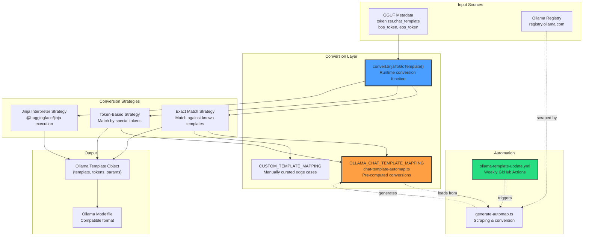
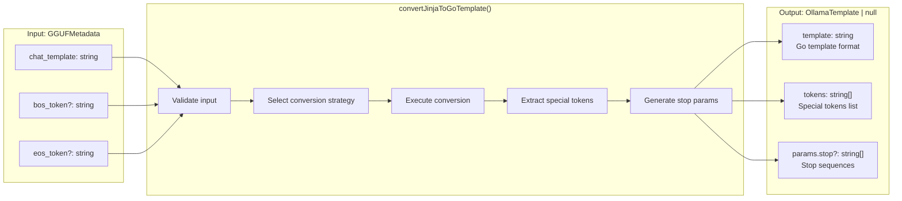
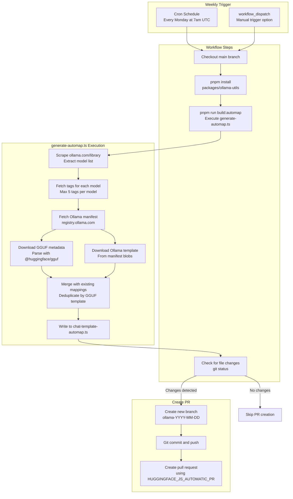
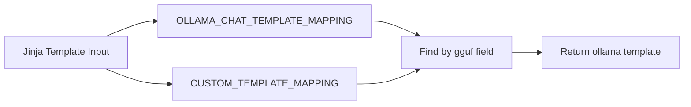
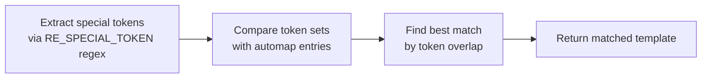
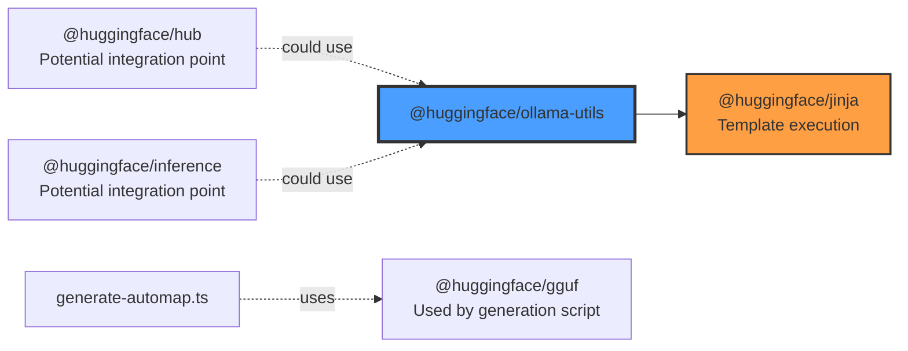

<!-- source: DeepWiki mcp.deepwiki.com · repo huggingface/huggingface.js · page 3.4 Ollama Utils Library · fetched 2026-10-26 -->

# Ollama Utils Library

<details>
<summary>Relevant source files</summary>

The following files were used as context for generating this wiki page:

- [.github/workflows/ollama-template-update.yml](.github/workflows/ollama-template-update.yml)
- [CODEOWNERS](CODEOWNERS)
- [packages/inference/src/providers/cerebras.ts](packages/inference/src/providers/cerebras.ts)
- [packages/inference/src/providers/cohere.ts](packages/inference/src/providers/cohere.ts)
- [packages/ollama-utils/.eslintignore](packages/ollama-utils/.eslintignore)
- [packages/ollama-utils/.prettierignore](packages/ollama-utils/.prettierignore)
- [packages/ollama-utils/README.md](packages/ollama-utils/README.md)
- [packages/ollama-utils/package.json](packages/ollama-utils/package.json)
- [packages/ollama-utils/pnpm-lock.yaml](packages/ollama-utils/pnpm-lock.yaml)
- [packages/ollama-utils/scripts/generate-automap.ts](packages/ollama-utils/scripts/generate-automap.ts)
- [packages/ollama-utils/src/chat-template-automap.ts](packages/ollama-utils/src/chat-template-automap.ts)
- [packages/ollama-utils/src/chat-template.spec.ts](packages/ollama-utils/src/chat-template.spec.ts)

</details>


## Purpose and Scope

The `@huggingface/ollama-utils` package provides utilities for maintaining compatibility between Hugging Face Hub GGUF models and Ollama. The primary functionality is converting Jinja chat templates (used by models on Hugging Face Hub) to Go templates (used by Ollama's runtime). This enables users to run GGUF models from the Hub with Ollama by providing correctly formatted templates and metadata.

This library is distinct from the Jinja templating engine itself (see [Jinja Library](#3.3)) and from GGUF parsing (see [GGUF Library](#3.2)). It specifically bridges the gap between these two template formats through conversion utilities and an auto-maintained mapping of known templates.

Sources: [packages/ollama-utils/README.md:1-56](), [packages/ollama-utils/package.json:1-58]()

## Architecture Overview

The library operates through a three-tier conversion strategy: pre-computed mappings, runtime conversion, and fallback handling.



**Diagram 1: Ollama Utils Conversion Pipeline**

The conversion process attempts multiple strategies in sequence. First, it checks the `OLLAMA_CHAT_TEMPLATE_MAPPING` array for exact Jinja template matches. If found, the corresponding Ollama template is returned immediately. Second, if no exact match exists, it attempts token-based matching by extracting special tokens from the Jinja template and finding templates with similar token patterns. Finally, if both fail, it uses the `@huggingface/jinja` interpreter to execute the template with sample messages and infer the Go template structure from the output.

Sources: [packages/ollama-utils/README.md:8-40](), [packages/ollama-utils/src/chat-template.spec.ts:11-156]()

## Chat Template Conversion Function

The primary API is the `convertJinjaToGoTemplate()` function (also aliased as `convertGGUFTemplateToOllama()`), which accepts GGUF metadata and returns an Ollama-compatible template object.



**Diagram 2: convertJinjaToGoTemplate() Function Flow**

The function signature accepts a metadata object with `chat_template` (required) and optional `bos_token`/`eos_token` fields. The return type is either an object containing `{ollama: {template, tokens, params}}` or `null` if conversion fails. The `template` field contains the Go template string, `tokens` lists extracted special tokens, and `params.stop` contains recommended stop sequences for inference.

| Input Field | Type | Required | Description |
|------------|------|----------|-------------|
| `chat_template` | `string` | Yes | Jinja2 template from GGUF metadata |
| `bos_token` | `string` | No | Beginning-of-sequence token |
| `eos_token` | `string` | No | End-of-sequence token |

| Output Field | Type | Description |
|-------------|------|-------------|
| `ollama.template` | `string` | Converted Go template |
| `ollama.tokens` | `string[]` | List of special tokens |
| `ollama.params.stop` | `string[]?` | Stop sequences for generation |

Sources: [packages/ollama-utils/README.md:8-40](), [packages/ollama-utils/src/chat-template.spec.ts:12-24]()

## Auto-Generated Template Mapping

The `OLLAMA_CHAT_TEMPLATE_MAPPING` array in [packages/ollama-utils/src/chat-template-automap.ts]() contains pre-converted template pairs. This file is auto-generated and should not be manually edited.

```typescript
// Structure of each mapping entry
interface OllamaChatTemplateMapEntry {
  model: string;           // e.g., "library/llama3.2:3b"
  gguf: string;            // Jinja template from GGUF
  ollama: {
    template: string;      // Converted Go template
    tokens: string[];      // Special tokens array
    params?: {             // Optional parameters
      stop?: string[];     // Stop sequences
      repeat_penalty?: number;
    };
  };
}
```

The mapping array is structured with each entry containing three key components:

1. **Model identifier**: The Ollama model name in format `library/<name>:<tag>`
2. **GGUF template**: The original Jinja template extracted from the model's GGUF metadata
3. **Ollama template object**: The converted Go template with associated metadata

Example mapping entry structure from [packages/ollama-utils/src/chat-template-automap.ts:46-82]():

```typescript
{
  model: "library/aya:35b",
  gguf: "{{ bos_token }}...",
  ollama: {
    template: "{{ if .System }}<|START_OF_TURN_TOKEN|>...",
    tokens: [
      "<|START_OF_TURN_TOKEN|>",
      "<|SYSTEM_TOKEN|>",
      "<|END_OF_TURN_TOKEN|>",
      "<|USER_TOKEN|>",
      "<|CHATBOT_TOKEN|>"
    ],
    params: {
      stop: ["<|START_OF_TURN_TOKEN|>", "<|END_OF_TURN_TOKEN|>"]
    }
  }
}
```

The mapping includes skipped models (documented in comments at the top of the file) that failed conversion due to incompatibilities or errors during the automated scraping process.

Sources: [packages/ollama-utils/src/chat-template-automap.ts:1-130]()

## Automated Update Workflow

The template mapping is automatically updated weekly through a GitHub Actions workflow defined in [.github/workflows/ollama-template-update.yml]().



**Diagram 3: Automated Template Update Pipeline**

The workflow executes the following steps:

1. **Model Discovery** [packages/ollama-utils/scripts/generate-automap.ts:53-62](): Scrapes `https://ollama.com/library` to find all available models
2. **Tag Extraction** [packages/ollama-utils/scripts/generate-automap.ts:69-87](): For each model, fetches up to 5 tags (versions) by parsing the model page
3. **Parallel Processing** [packages/ollama-utils/scripts/generate-automap.ts:88-92](): Uses 16 concurrent workers (`N_WORKERS = 16`) to process models
4. **Template Fetching** [packages/ollama-utils/scripts/generate-automap.ts:113-196]():
   - Downloads Ollama manifest from `registry.ollama.com/v2/{model}/manifests/{tag}`
   - Locates model blob by mediaType `*.model`
   - Parses GGUF metadata using `gguf()` function from `@huggingface/gguf`
   - Extracts Ollama template from manifest blob with mediaType `*.template`
5. **Deduplication** [packages/ollama-utils/scripts/generate-automap.ts:97-104](): Merges with existing mappings, skipping duplicates based on GGUF template hash
6. **File Generation** [packages/ollama-utils/scripts/generate-automap.ts:213-228](): Writes sorted array to `chat-template-automap.ts`

The workflow creates a pull request with title format `[ollama-utils] 🤖 Auto-update chat templates (YYYY-MM-DD)` for manual review.

Sources: [.github/workflows/ollama-template-update.yml:1-109](), [packages/ollama-utils/scripts/generate-automap.ts:1-230]()

## Conversion Strategies

The library employs three strategies in priority order:

### Strategy 1: Exact Template Matching



Searches both `OLLAMA_CHAT_TEMPLATE_MAPPING` and `CUSTOM_TEMPLATE_MAPPING` arrays for an entry where the `gguf` field exactly matches the input Jinja template string. This is the fastest strategy with 100% accuracy for known templates.

### Strategy 2: Token-Based Matching



Uses the regular expression `RE_SPECIAL_TOKEN = /<[|_A-Za-z0-9]+>|\[[A-Z]+\]|<\uFF5C[\u2581A-Za-z]+\uFF5C>/g` [packages/ollama-utils/scripts/generate-automap.ts:12]() to extract special tokens from the Jinja template. Compares the extracted token set against pre-computed token arrays in the mapping. For example, if a template contains `<|im_start|>` and `<|im_end|>`, it likely uses the ChatML format.

### Strategy 3: Jinja Interpreter Execution

When exact and token-based matching fail, the library executes the Jinja template with synthetic test messages using `@huggingface/jinja`:

```typescript
// Pseudo-code of interpreter strategy
const messages = [
  { role: "system", content: "SYSTEM_CONTENT" },
  { role: "user", content: "USER_CONTENT" },
  { role: "assistant", content: "ASSISTANT_CONTENT" }
];

// Execute Jinja template
const output = jinjaExecute(chat_template, { messages, add_generation_prompt: true });

// Infer Go template structure from output
const goTemplate = inferGoTemplate(output);
```

This strategy analyzes the structure of the rendered output to identify:
- Position and format of system messages
- User/assistant turn delimiters
- Generation prompt placement
- Stop token requirements

Test cases in [packages/ollama-utils/src/chat-template.spec.ts:67-153]() demonstrate various edge cases handled by this strategy, including templates with baked-in system messages, non-incremental formats, and complex role handling.

Sources: [packages/ollama-utils/src/chat-template.spec.ts:11-156](), [packages/ollama-utils/scripts/generate-automap.ts:42-46]()

## Template Format Comparison

The conversion transforms between two fundamentally different template languages:

| Aspect | Jinja (Hugging Face) | Go Template (Ollama) |
|--------|---------------------|---------------------|
| Variable access | `{{ message['role'] }}` | `{{ .Role }}` |
| Conditionals | `...` | `{{ if condition }}...{{ end }}` |
| Loops | `...` | `{{ range .Items }}...{{ end }}` |
| String concat | `{{ 'a' + 'b' }}` | Direct concatenation |
| System message | Via messages array | `.System` variable |
| User prompt | Via messages array | `.Prompt` variable |
| Assistant response | Via messages array | `.Response` variable |

Example conversion:

**Input (Jinja)**:
```jinja

  {{'<|im_start|>' + message['role'] + '\n' + message['content'] + '<|im_end|>' + '\n'}}


  {{ '<|im_start|>assistant\n' }}

```

**Output (Go Template)**:
```go
{{ if .System }}<|im_start|>system
{{ .System }}<|im_end|>
{{ end }}{{ if .Prompt }}<|im_start|>user
{{ .Prompt }}<|im_end|>
{{ end }}<|im_start|>assistant
{{ .Response }}<|im_end|>
```

The Go template format uses structured variables (`.System`, `.Prompt`, `.Response`) instead of iterating over a messages array, which requires semantic understanding during conversion.

Sources: [packages/ollama-utils/src/chat-template.spec.ts:12-24](), [packages/ollama-utils/src/chat-template.spec.ts:49-65]()

## Usage Example

Basic usage pattern:

```typescript
import { convertJinjaToGoTemplate } from "@huggingface/ollama-utils";

// Fetch GGUF metadata from Hub
const MODEL_INFO_URL = "https://huggingface.co/api/models/bartowski/Llama-3.2-3B-Instruct-GGUF?expand[]=gguf";
const modelInfo = await (await fetch(MODEL_INFO_URL)).json();

// Convert template
const result = convertJinjaToGoTemplate(modelInfo.gguf);

if (result) {
  console.log("Go Template:", result.ollama.template);
  console.log("Special Tokens:", result.ollama.tokens);
  console.log("Stop Sequences:", result.ollama.params?.stop);
  
  // Use in Ollama Modelfile
  const modelfile = `
FROM ${modelPath}
TEMPLATE """${result.ollama.template}"""
PARAMETER stop "${result.ollama.params?.stop?.[0]}"
  `;
} else {
  console.error("Conversion failed");
}
```

The returned template can be directly embedded into an Ollama Modelfile for use with the `ollama create` command.

Sources: [packages/ollama-utils/README.md:8-40]()

## Custom Template Handling

For templates that cannot be automatically converted, developers can add entries to `CUSTOM_TEMPLATE_MAPPING` in the source code. This is necessary when:

1. The Jinja template is incompatible with `@huggingface/jinja` parser
2. The template uses non-linear logic (e.g., modifying previous messages)
3. The conversion produces incorrect results
4. The template has conditional EOS token placement

Example custom template entry from test cases [packages/ollama-utils/src/chat-template.spec.ts:38-47]():

```typescript
{
  jinjaTemplate: "<|{{ item['role'] }}|>something<|begin_of_image|>",
  ollamaTemplate: "{{ if .System }}<|system|>\n{{ .System }}{{ end }}" +
                  "{{ if .Prompt }}<|user|>\n{{ .Prompt }}{{ end }}" +
                  "<|assistant|>\n{{ .Response }}"
}
```

The test suite [packages/ollama-utils/src/chat-template.spec.ts:67-153]() includes multiple edge cases:
- Templates with baked-in system messages
- Non-incremental format templates (that add EOS token conditionally)
- Templates using special Unicode tokens
- Templates with complex role handling

Adding a custom template requires:
1. Editing `CUSTOM_TEMPLATE_MAPPING` in source
2. Adding test case in `chat-template.spec.ts`
3. Submitting a pull request

Sources: [packages/ollama-utils/README.md:42-56](), [packages/ollama-utils/src/chat-template.spec.ts:67-153]()

## Dependencies and Integration

The package has a minimal dependency footprint:



**Runtime Dependencies**:
- `@huggingface/jinja` (workspace dependency) - for Jinja template interpretation

**Development Dependencies**:
- `@huggingface/gguf` - used by `generate-automap.ts` script for parsing GGUF metadata
- `@types/node` - TypeScript definitions

The package exports ES modules and CommonJS formats with dual Node.js/browser support [packages/ollama-utils/package.json:19-33](), though browser support excludes Node.js-specific file operations.

Sources: [packages/ollama-utils/package.json:48-53](), [packages/ollama-utils/pnpm-lock.yaml:1-34]()

## Build and Distribution

The build process uses `tsup` for bundling and TypeScript compiler for declaration files:

```bash
# Build command
tsup src/index.ts --format cjs,esm --clean && tsc --emitDeclarationOnly --declaration

# Generate automap
tsx scripts/generate-automap.ts && oxfmt ./src/chat-template-automap.ts
```

Build outputs [packages/ollama-utils/package.json:43-46]():
- `dist/index.js` - CommonJS bundle
- `dist/index.mjs` - ES module bundle
- `dist/index.d.ts` - TypeScript declarations
- `dist/browser/` - Browser-specific builds (excludes FileBlob)

The package is published to npm with public access and requires Node.js >= 20 [packages/ollama-utils/package.json:54-56]().

Sources: [packages/ollama-utils/package.json:19-46]()

---

