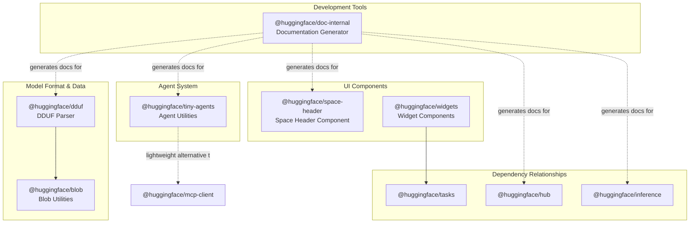
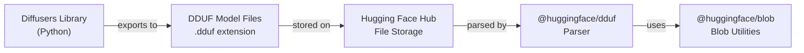
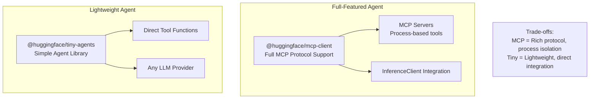
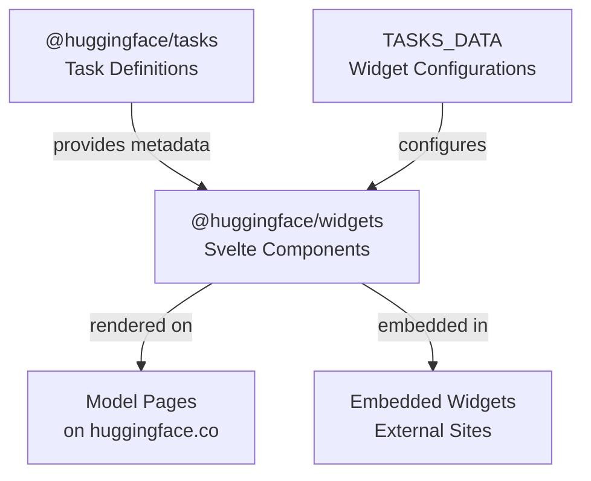
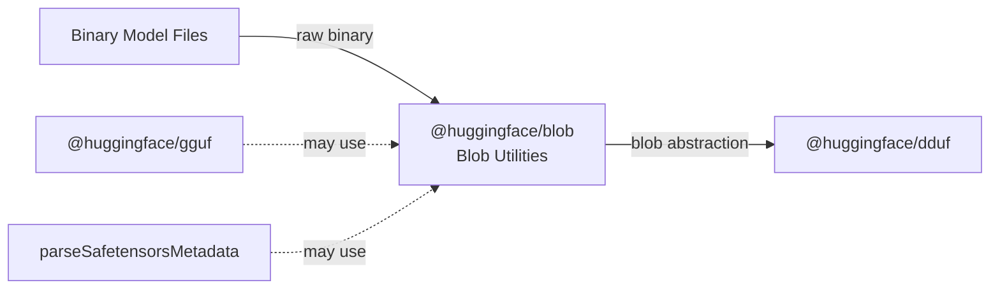
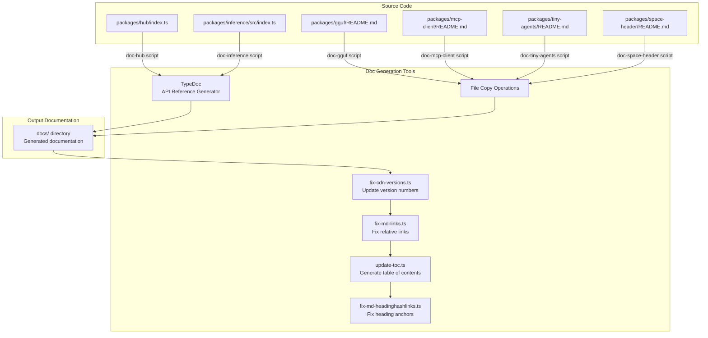
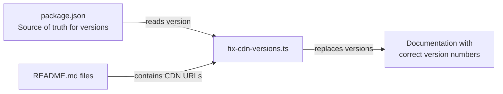

<!-- source: DeepWiki mcp.deepwiki.com · repo huggingface/huggingface.js · page 3.5 Additional Libraries · fetched 2026-10-26 -->

# Additional Libraries

<details>
<summary>Relevant source files</summary>

The following files were used as context for generating this wiki page:

- [README.md](README.md)
- [package.json](package.json)
- [packages/doc-internal/fix-cdn-versions.ts](packages/doc-internal/fix-cdn-versions.ts)
- [packages/doc-internal/package.json](packages/doc-internal/package.json)
- [packages/doc-internal/pnpm-lock.yaml](packages/doc-internal/pnpm-lock.yaml)
- [packages/hub/package.json](packages/hub/package.json)
- [packages/hub/pnpm-lock.yaml](packages/hub/pnpm-lock.yaml)
- [packages/inference/package.json](packages/inference/package.json)
- [packages/inference/pnpm-lock.yaml](packages/inference/pnpm-lock.yaml)
- [packages/inference/src/package.ts](packages/inference/src/package.ts)
- [packages/inference/test/global.d.ts](packages/inference/test/global.d.ts)
- [packages/tasks/src/tokenizer-data.ts](packages/tasks/src/tokenizer-data.ts)
- [pnpm-lock.yaml](pnpm-lock.yaml)

</details>


This document covers the remaining supporting libraries in the Hugging Face.js monorepo that provide specialized functionality for specific use cases. These libraries complement the core packages documented in [Core Libraries](#2) and the primary supporting libraries covered in sections [3.1](#3.1) through [3.4](#3.4).

The libraries covered here include:
- **@huggingface/dduf**: Parser for the DDUF (Diffusers Unified Format) model serialization format
- **@huggingface/space-header**: UI component for embedding Hugging Face Space headers
- **@huggingface/tiny-agents**: Lightweight agent library for building tool-using AI agents
- **@huggingface/widgets**: Svelte-based widget components for rendering model interfaces
- **@huggingface/blob**: Utilities for working with binary large objects
- **@huggingface/doc-internal**: Internal tooling for generating package documentation

## Package Overview



**Sources:** [README.md:54-68](), [packages/doc-internal/package.json:1-35]()

## @huggingface/dduf

The `@huggingface/dduf` package provides parsing capabilities for the DDUF (DDUF Diffusers Unified Format), which is a serialization format specifically designed for diffusion models. This format complements GGUF ([documented in section 3.2](#3.2)) by providing a standardized way to store diffusion model architectures.

### DDUF Format Characteristics

DDUF is designed to package diffusion models (commonly used for image generation tasks) with their configuration and weights in a unified format. The parser in this package enables:

- **Metadata extraction** without downloading entire model files
- **Streaming access** to model components
- **Integration with @huggingface/blob** for binary data handling

### Integration with Model Ecosystem



**Sources:** [README.md:62]()

## @huggingface/space-header

The `@huggingface/space-header` package provides a reusable UI component that renders the header interface used in Hugging Face Spaces. This allows developers to embed the familiar Space header experience in external applications.

### Purpose

Spaces on Hugging Face include a standardized header with navigation, user information, and metadata display. This package enables developers to:

- **Embed the Space header** in applications outside of huggingface.co
- **Maintain consistent UX** with the Hugging Face ecosystem
- **Access Space metadata** through the component interface

### Use Cases

| Use Case | Description |
|----------|-------------|
| **Embedded Spaces** | Display Space headers when embedding Spaces in external sites |
| **Space Mirrors** | Maintain branding when mirroring Space functionality |
| **Custom Interfaces** | Build custom UIs that integrate with Hugging Face Spaces |

**Sources:** [README.md:65](), [packages/doc-internal/package.json:19]()

## @huggingface/tiny-agents

The `@huggingface/tiny-agents` package provides a lightweight, model-agnostic library for building AI agents with tool-calling capabilities. This serves as an alternative to the fuller-featured `@huggingface/mcp-client` (documented in [section 2.3](#2.3)) for simpler use cases.

### Architecture Comparison



### Key Characteristics

The `@huggingface/tiny-agents` library is designed for:

- **Minimal dependencies**: Avoids heavy protocol implementations
- **Model agnosticism**: Works with any LLM provider or API
- **Direct tool integration**: Tools are simple JavaScript functions
- **Lightweight overhead**: Suitable for browser and edge deployments

### Relationship to MCP Client

While `@huggingface/mcp-client` implements the full Model Context Protocol with server-client architecture, `@huggingface/tiny-agents` provides a simpler abstraction for applications that:

- Don't need process-based tool isolation
- Want to minimize bundle size
- Prefer direct function calls over protocol messages
- Need to integrate with non-standard LLM providers

**Sources:** [README.md:67](), [packages/doc-internal/package.json:18]()

## @huggingface/widgets

The `@huggingface/widgets` package provides Svelte-based UI components for rendering interactive widgets that demonstrate model capabilities. These widgets are used throughout the Hugging Face ecosystem to provide consistent, task-specific interfaces.

### Widget System Integration



### Widget Components

The package provides task-specific widget implementations that:

- **Render input interfaces** appropriate for each task type
- **Display model outputs** with proper formatting
- **Handle file uploads** for multimodal tasks (images, audio)
- **Integrate with inference APIs** via `@huggingface/inference`

### Configuration from @huggingface/tasks

Widget configurations are defined in the `@huggingface/tasks` package (see [section 3.1](#3.1)) through the `TASKS_DATA` structure. This ensures:

| Aspect | Implementation |
|--------|----------------|
| **Consistency** | All widgets for a task type share the same structure |
| **Type Safety** | TypeScript definitions from tasks package |
| **Maintenance** | Central configuration updates all widgets |
| **Examples** | Example inputs defined alongside task metadata |

**Sources:** Based on architectural diagrams and package relationships

## @huggingface/blob

The `@huggingface/blob` package provides utilities for working with binary large objects (BLOBs) in both browser and Node.js environments. This package serves as a foundation for other format parsers like `@huggingface/dduf`.

### Blob Handling Capabilities

The package likely provides:

- **Cross-platform blob abstraction**: Unified interface for browser `Blob` and Node.js `Buffer`
- **Streaming operations**: Process large files without loading entirely into memory
- **Type detection**: Identify blob content types
- **Conversion utilities**: Transform between different binary representations

### Usage in Format Parsers



**Sources:** Based on architectural diagrams showing DDUF dependency on blob package

## @huggingface/doc-internal

The `@huggingface/doc-internal` package is an internal development tool that orchestrates documentation generation for all packages in the monorepo. This package is marked as `private` and is not published to npm.

### Documentation Build System



### Documentation Scripts

The package provides a coordinated build process through npm scripts defined in [packages/doc-internal/package.json:8-23]():

| Script | Purpose |
|--------|---------|
| `doc-hub` | Generate API docs for @huggingface/hub using TypeDoc |
| `doc-inference` | Generate API docs for @huggingface/inference using TypeDoc |
| `doc-gguf` | Copy README for @huggingface/gguf |
| `doc-mcp-client` | Copy README for @huggingface/mcp-client |
| `doc-tiny-agents` | Copy README for @huggingface/tiny-agents |
| `doc-space-header` | Copy README for @huggingface/space-header |
| `fix-cdn-versions` | Update CDN version numbers in documentation |
| `fix-md-links` | Convert relative links to documentation-friendly format |
| `update-toc` | Generate table of contents for documentation |
| `fix-md-headinghashlinks` | Fix heading anchor links |

### TypeDoc Configuration

For packages with extensive APIs (hub, inference), TypeDoc generates complete API reference documentation with these settings:

```
--githubPages false           # Not for GitHub Pages
--plugin typedoc-plugin-markdown  # Markdown output
--hideBreadcrumbs            # Clean navigation
--hideInPageTOC              # No redundant TOC
--sourceLinkTemplate         # Link to GitHub source
```

**Sources:** [packages/doc-internal/package.json:1-35]()

### Version Management

The `fix-cdn-versions.ts` script ensures CDN URLs in documentation stay synchronized with published package versions:



The script operates on [packages/doc-internal/fix-cdn-versions.ts:3-16]():
- Reads current versions from `package.json` files
- Updates CDN URLs in README files to match
- Processes both package-specific READMEs and root README

**Sources:** [packages/doc-internal/fix-cdn-versions.ts:1-17]()

### Documentation Workflow

The complete documentation build follows this sequence:

1. **Generate/Copy Base Docs**: Run TypeDoc for code packages, copy READMEs for others
2. **Fix CDN Versions**: Update version numbers in CDN URLs using package versions
3. **Fix Markdown Links**: Convert links to work in documentation context
4. **Update TOC**: Generate consistent table of contents
5. **Fix Hash Links**: Ensure heading anchors work correctly

This automated workflow ensures documentation consistency across all packages while allowing each package to define its docs in the most appropriate format (TypeDoc for complex APIs, simple README for smaller packages).

**Sources:** [packages/doc-internal/package.json:9]()

## Package Dependencies

The additional libraries have minimal external dependencies but integrate with core monorepo packages:

| Package | Key Dependencies | Purpose |
|---------|------------------|---------|
| @huggingface/dduf | @huggingface/blob | Blob utilities for binary parsing |
| @huggingface/widgets | @huggingface/tasks | Task metadata and type definitions |
| @huggingface/tiny-agents | None (model-agnostic) | Lightweight by design |
| @huggingface/space-header | None specified | Standalone UI component |
| @huggingface/doc-internal | typedoc, yaml, glob | Documentation tooling |

**Sources:** [packages/doc-internal/package.json:25-32](), architectural diagrams

## Publishing and Distribution

Most of these packages follow the standard monorepo publishing workflow documented in [section 4.2](#4.2):

- **Semantic versioning** for package releases
- **Dual ESM/CJS output** for broad compatibility
- **Published to npm** with public access
- **Independent versioning** per package

The exception is `@huggingface/doc-internal`, which is marked as `private: true` in [packages/doc-internal/package.json:4]() and is never published externally.

**Sources:** [packages/doc-internal/package.json:1-35]()

---

