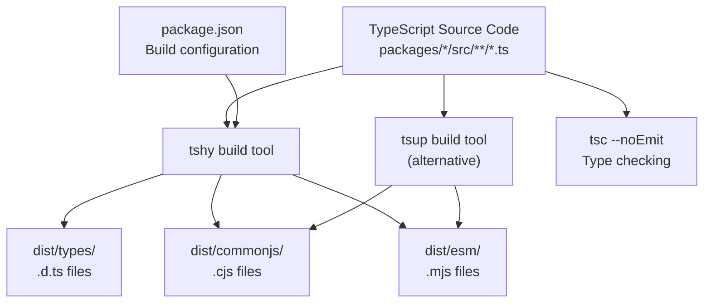
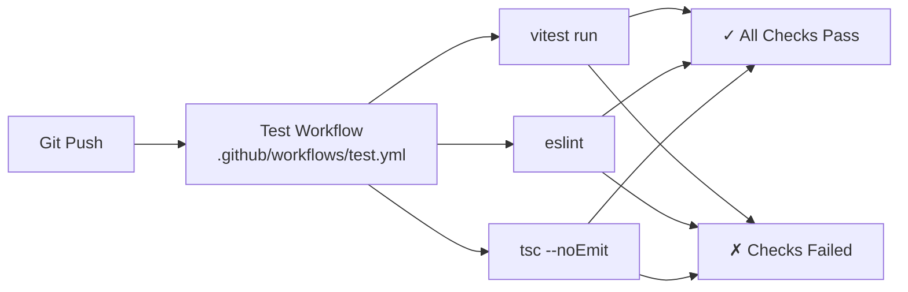
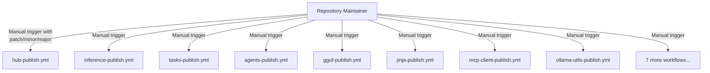
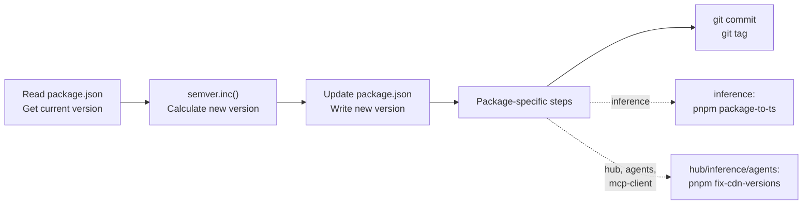
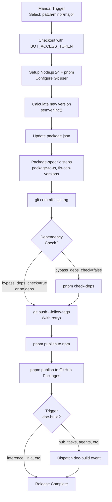
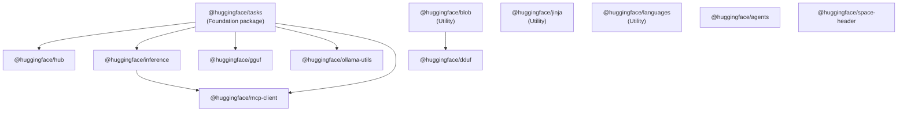

<!-- source: DeepWiki mcp.deepwiki.com · repo huggingface/huggingface.js · page 4 Development and Release Process · fetched 2026-10-26 -->

# Development and Release Process

<details>
<summary>Relevant source files</summary>

The following files were used as context for generating this wiki page:

- [.github/workflows/agents-publish.yml](.github/workflows/agents-publish.yml)
- [.github/workflows/blob-publish.yml](.github/workflows/blob-publish.yml)
- [.github/workflows/dduf-publish.yml](.github/workflows/dduf-publish.yml)
- [.github/workflows/gguf-publish.yml](.github/workflows/gguf-publish.yml)
- [.github/workflows/hub-publish.yml](.github/workflows/hub-publish.yml)
- [.github/workflows/inference-publish.yml](.github/workflows/inference-publish.yml)
- [.github/workflows/jinja-publish.yml](.github/workflows/jinja-publish.yml)
- [.github/workflows/languages-publish.yml](.github/workflows/languages-publish.yml)
- [.github/workflows/mcp-client-publish.yml](.github/workflows/mcp-client-publish.yml)
- [.github/workflows/ollama-utils-publish.yml](.github/workflows/ollama-utils-publish.yml)
- [.github/workflows/space-header-publish.yml](.github/workflows/space-header-publish.yml)
- [.github/workflows/tasks-publish.yml](.github/workflows/tasks-publish.yml)
- [packages/tasks/LICENSE](packages/tasks/LICENSE)

</details>


## Purpose and Scope

This document describes the development workflow, build pipeline, testing infrastructure, and automated release process for the Hugging Face.js monorepo. It covers the technical details of how the 12 packages are built, tested, and published to npm. For information about the architectural patterns used across packages, see [Architecture and Design Patterns](#5). For details about specific build configurations within individual packages, refer to the package-specific documentation in [Core Libraries](#2) and [Supporting Libraries](#3).

## Monorepo Organization

The Hugging Face.js repository is organized as a pnpm monorepo containing 12 independently versioned packages under the `packages/` directory. Each package has its own dedicated GitHub Actions workflow for versioning and publishing, enabling independent release cycles while maintaining dependency relationships.

### Package Structure

| Package | Purpose | Has Publish Workflow |
|---------|---------|---------------------|
| @huggingface/inference | ML inference client | Yes |
| @huggingface/hub | Hub API client | Yes |
| @huggingface/mcp-client | Agent framework | Yes |
| @huggingface/tasks | Task definitions & types | Yes |
| @huggingface/gguf | GGUF parser | Yes |
| @huggingface/jinja | Template engine | Yes |
| @huggingface/ollama-utils | Ollama compatibility | Yes |
| @huggingface/agents | Agent utilities | Yes |
| @huggingface/space-header | UI component | Yes |
| @huggingface/dduf | DDUF parser | Yes |
| @huggingface/blob | Blob utilities | Yes |
| @huggingface/languages | Language utilities | Yes |

The monorepo uses pnpm workspaces for dependency management and shared tooling configurations. Each package maintains its own `package.json`, `tsconfig.json`, and build configuration, while sharing linting and testing infrastructure at the root level.

**Sources:** [.github/workflows/hub-publish.yml:1-85](), [.github/workflows/inference-publish.yml:1-80](), [.github/workflows/tasks-publish.yml:1-73]()

## Build and Testing Infrastructure

### Build System

The monorepo employs **tshy** as the primary build tool to generate dual-format output (ESM and CommonJS) with TypeScript type definitions. Some packages use **tsup** as an alternative bundler. This dual-format approach ensures maximum compatibility across Node.js and browser environments.

#### Build Output Structure

Each package produces three output formats in its `dist/` directory:
- **ESM modules** (`.mjs` files) for modern JavaScript environments
- **CommonJS modules** (`.cjs` files) for legacy Node.js support
- **TypeScript definitions** (`.d.ts` files) for type safety

The build process is configured through each package's `package.json` with package-specific scripts. The `tshy` tool reads configuration from the `tshy` field in `package.json` to determine build parameters.

**Diagram: Build Pipeline Flow**



**Sources:** [.github/workflows/hub-publish.yml:42-50](), [.github/workflows/inference-publish.yml:42-50]()

### Testing Infrastructure

The monorepo uses **Vitest** as its testing framework for unit and integration tests. Tests are located alongside source files or in dedicated test directories within each package.

#### Test Execution

Tests run automatically via GitHub Actions on every push to the repository. The test workflow executes:
- `vitest run` for unit tests
- `eslint` for code quality checks
- `tsc --noEmit` for type checking

#### Quality Gates

The continuous integration pipeline enforces multiple quality gates before allowing merges to the main branch:
- All unit tests must pass
- No linting errors
- No TypeScript type errors
- Code coverage thresholds (package-specific)

**Diagram: Testing and Quality Pipeline**



**Sources:** [.github/workflows/hub-publish.yml:19-21](), [.github/workflows/inference-publish.yml:19-21]()

## Publishing Workflow Architecture

Each of the 12 packages has its own dedicated GitHub Actions workflow file named `<package>-publish.yml` in the `.github/workflows/` directory. These workflows enable manual, on-demand publishing with semantic versioning control.

### Workflow Trigger Mechanism

All publish workflows use `workflow_dispatch` with two input parameters:

| Input | Type | Options | Default | Purpose |
|-------|------|---------|---------|---------|
| `newversion` | choice | patch, minor, major | patch | Semantic version bump type |
| `bypass_deps_check` | boolean | true, false | false | Skip dependency validation (select packages) |

The workflows are manually triggered from the GitHub Actions UI, allowing maintainers to control the timing and scope of releases.

**Diagram: Publish Workflow Entry Points**



**Sources:** [.github/workflows/hub-publish.yml:3-17](), [.github/workflows/inference-publish.yml:3-17](), [.github/workflows/tasks-publish.yml:3-13]()

### Concurrency Control

All publish workflows use the same concurrency group named `"push-to-main"` to ensure only one release executes at a time across all packages. This prevents race conditions when multiple packages are released in close succession.

```yaml
concurrency:
  group: "push-to-main"
```

When a publish workflow is triggered while another is running, GitHub Actions automatically cancels the previous job to allow the new one to proceed. This ensures sequential, ordered releases.

**Sources:** [.github/workflows/hub-publish.yml:19-20](), [.github/workflows/inference-publish.yml:19-20](), [.github/workflows/tasks-publish.yml:15-16]()

## Detailed Publishing Process

The publishing process follows a multi-step pipeline that handles version bumping, Git operations, dependency validation, and dual registry publishing.

### Step 1: Repository Checkout and Setup

The workflow begins by checking out the repository using a special `BOT_ACCESS_TOKEN` secret instead of the default `GITHUB_TOKEN`. This elevated permission is required to bypass branch protection rules on the `main` branch, which normally require pull requests and status checks.

```yaml
- uses: actions/checkout@v5
  with:
    token: ${{ secrets.BOT_ACCESS_TOKEN }}
```

The workflow then installs Node.js 24 with pnpm caching and configures Git with the machine user identity:

```bash
git config --global user.name machineuser
git config --global user.email infra+machineuser@huggingface.co
```

**Sources:** [.github/workflows/hub-publish.yml:35-52](), [.github/workflows/inference-publish.yml:35-52]()

### Step 2: Semantic Version Bump

The workflow calculates the new version using the `semver` npm package based on the user's selection (patch, minor, or major):

```bash
PACKAGE_VERSION=$(node -p "require('./package.json').version")
BUMPED_VERSION=$(node -p "require('semver').inc('$PACKAGE_VERSION', '${{ github.event.inputs.newversion }}')")
```

It then updates the `package.json` file programmatically:

```bash
node -e "const fs = require('fs'); const package = JSON.parse(fs.readFileSync('./package.json')); package.version = '$BUMPED_VERSION'; fs.writeFileSync('./package.json', JSON.stringify(package, null, '\t') + '\n');"
```

**Diagram: Version Bump Process**



**Sources:** [.github/workflows/hub-publish.yml:53-62](), [.github/workflows/inference-publish.yml:53-62]()

### Step 3: Package-Specific Pre-Publish Steps

Some packages require additional steps before committing the version bump:

- **@huggingface/inference**: Runs `pnpm --filter inference package-to-ts` to regenerate TypeScript types from JSON schemas
- **@huggingface/hub, @huggingface/agents, @huggingface/mcp-client, @huggingface/space-header, @huggingface/dduf, @huggingface/blob**: Run `pnpm --filter doc-internal run fix-cdn-versions` to update CDN URLs in documentation

These steps ensure that generated files and documentation references are updated to match the new version.

**Sources:** [.github/workflows/inference-publish.yml:58](), [.github/workflows/hub-publish.yml:58](), [.github/workflows/agents-publish.yml:54]()

### Step 4: Git Commit and Tag

After updating version-related files, the workflow commits all changes and creates a Git tag:

```bash
git add ../..
git commit -m "🔖 @huggingface/hub $BUMPED_VERSION"
git tag "hub-v$BUMPED_VERSION"
```

The tag format follows the pattern `<package-name>-v<version>`, enabling easy identification of releases in the Git history.

**Sources:** [.github/workflows/hub-publish.yml:59-61](), [.github/workflows/inference-publish.yml:60-62]()

### Step 5: Dependency Validation

Several packages have dependencies on other packages within the monorepo. Before publishing, workflows verify that dependent packages are already published to npm to prevent broken installations.

**Dependency Checking Script**

Workflows use a custom `check-deps` script defined at the workspace root:

```bash
pnpm -w check-deps tasks
```

This script verifies that the specified package (e.g., `tasks`) is available on npm with a version matching or exceeding the version specified in the dependent package's `package.json`.

**Package Dependency Map**

| Package | Checks Dependency | Can Bypass |
|---------|------------------|------------|
| @huggingface/hub | @huggingface/tasks | Yes |
| @huggingface/inference | @huggingface/tasks | Yes |
| @huggingface/gguf | @huggingface/tasks | Yes |
| @huggingface/mcp-client | @huggingface/inference, @huggingface/tasks | Yes |
| @huggingface/ollama-utils | @huggingface/tasks | No |
| @huggingface/dduf | @huggingface/blob | No |

The `bypass_deps_check` input parameter allows maintainers to skip this validation when necessary (e.g., when publishing a coordinated release of dependent packages).

**Sources:** [.github/workflows/hub-publish.yml:63-65](), [.github/workflows/inference-publish.yml:64-66](), [.github/workflows/mcp-client-publish.yml:60-62]()

### Step 6: Push to Main Branch

The workflow pushes the commit and tags to the `main` branch with a retry mechanism to handle concurrent updates:

```bash
(git pull --rebase && git push --follow-tags) || (git pull --rebase && git push --follow-tags)
```

This double-try pattern handles race conditions where another release might have pushed between the version bump and push steps.

**Sources:** [.github/workflows/hub-publish.yml:67](), [.github/workflows/inference-publish.yml:68]()

### Step 7: Dual Registry Publishing

Each package is published to two registries:

1. **npm public registry** (default)
2. **GitHub Packages** (npm.pkg.github.com)

**NPM Public Registry**

The first publish uses the default npm registry:

```bash
pnpm publish --no-git-checks .
```

The `--no-git-checks` flag skips pnpm's built-in Git validation since we've already performed the necessary version bump and commit operations.

**GitHub Packages Registry**

The workflow reconfigures the npm registry URL and publishes again:

```yaml
- uses: actions/setup-node@v4
  with:
    node-version: "24"
    registry-url: "https://npm.pkg.github.com"

- run: pnpm publish --no-git-checks .
  env:
    NODE_AUTH_TOKEN: ${{ secrets.GITHUB_TOKEN }}
```

This dual publishing strategy provides redundancy and allows users to choose their preferred registry.

**Sources:** [.github/workflows/hub-publish.yml:69-79](), [.github/workflows/inference-publish.yml:70-79]()

### Step 8: Documentation Update Trigger

Packages that maintain API documentation trigger a documentation rebuild after successful publishing:

```yaml
- name: "Update Doc"
  uses: peter-evans/repository-dispatch@v2
  with:
    event-type: doc-build
    token: ${{ secrets.BOT_ACCESS_TOKEN }}
```

This dispatches a `doc-build` event that triggers a separate documentation generation workflow (not shown in provided files). The following packages trigger documentation updates:

- @huggingface/hub
- @huggingface/tasks
- @huggingface/agents
- @huggingface/space-header
- @huggingface/mcp-client
- @huggingface/dduf
- @huggingface/blob

**Sources:** [.github/workflows/hub-publish.yml:80-84](), [.github/workflows/tasks-publish.yml:68-72](), [.github/workflows/agents-publish.yml:71-75]()

## Complete Publishing Workflow Diagram



**Sources:** [.github/workflows/hub-publish.yml:1-85](), [.github/workflows/inference-publish.yml:1-80](), [.github/workflows/tasks-publish.yml:1-73]()

## Release Ordering and Dependencies

The dependency relationships between packages dictate the order in which they must be released. Packages with no dependencies can be released at any time, while dependent packages must wait for their dependencies to be published first.

### Dependency Graph



### Release Strategy

When releasing changes that affect multiple packages:

1. **Release foundation packages first**: @huggingface/tasks, @huggingface/blob, @huggingface/jinja, @huggingface/languages
2. **Release dependent packages**: @huggingface/hub, @huggingface/inference, @huggingface/gguf, @huggingface/ollama-utils, @huggingface/dduf, @huggingface/agents
3. **Release top-level packages**: @huggingface/mcp-client, @huggingface/space-header

The `check-deps` script enforces this ordering by preventing publication of dependent packages until their dependencies are available on npm. The `bypass_deps_check` input can override this for coordinated releases, but should be used with caution.

**Sources:** [.github/workflows/hub-publish.yml:64-65](), [.github/workflows/mcp-client-publish.yml:60-62](), [.github/workflows/ollama-utils-publish.yml:56-57](), [.github/workflows/dduf-publish.yml:56-57]()

## Permissions and Authentication

The publish workflows require specific GitHub repository permissions:

```yaml
permissions:
  contents: write     # Push commits and tags
  id-token: write     # OIDC token for npm provenance
  packages: write     # Publish to GitHub Packages
```

Two authentication tokens are used:

| Token | Purpose | Scope |
|-------|---------|-------|
| `secrets.BOT_ACCESS_TOKEN` | Bypass branch protection, dispatch events | Repository-wide access |
| `secrets.GITHUB_TOKEN` | Publish to GitHub Packages | Workflow-scoped |

The `BOT_ACCESS_TOKEN` is associated with the `machineuser` account (infra+machineuser@huggingface.co) and has elevated permissions to push directly to the protected `main` branch without requiring pull request reviews or status checks.

**Sources:** [.github/workflows/hub-publish.yml:26-29](), [.github/workflows/hub-publish.yml:41](), [.github/workflows/hub-publish.yml:79]()

## Workflow File Locations

All publish workflows are located in `.github/workflows/` with the naming pattern `<package-name>-publish.yml`:

- `.github/workflows/hub-publish.yml`
- `.github/workflows/inference-publish.yml`
- `.github/workflows/tasks-publish.yml`
- `.github/workflows/agents-publish.yml`
- `.github/workflows/languages-publish.yml`
- `.github/workflows/gguf-publish.yml`
- `.github/workflows/jinja-publish.yml`
- `.github/workflows/space-header-publish.yml`
- `.github/workflows/mcp-client-publish.yml`
- `.github/workflows/ollama-utils-publish.yml`
- `.github/workflows/dduf-publish.yml`
- `.github/workflows/blob-publish.yml`

Each workflow's `defaults.run.working-directory` is set to the corresponding package directory (e.g., `packages/hub` for hub-publish.yml), ensuring all commands execute in the correct context.

**Sources:** [.github/workflows/hub-publish.yml:22-24](), [.github/workflows/inference-publish.yml:22-24](), [.github/workflows/tasks-publish.yml:18-20]()

---

