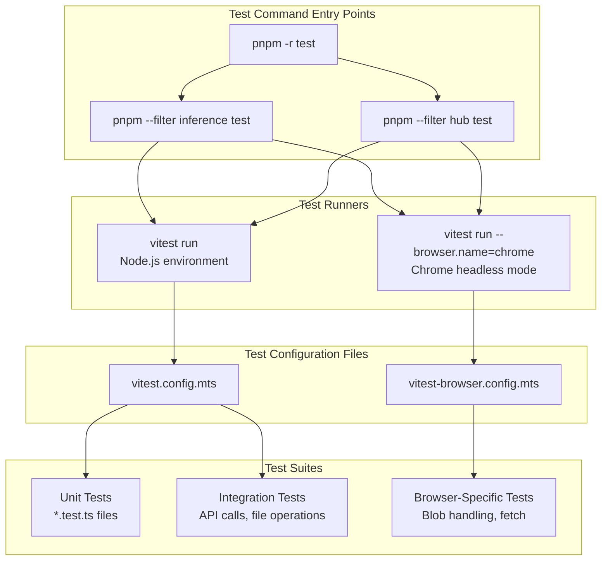
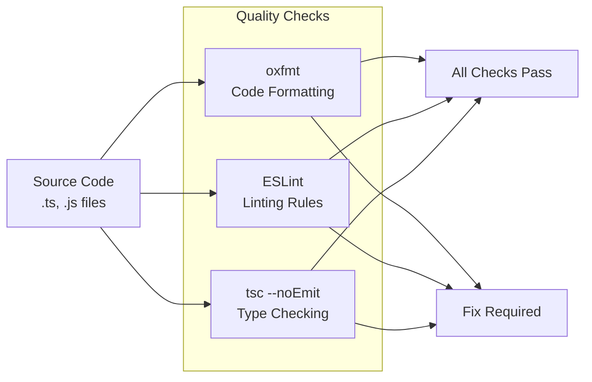

<!-- source: DeepWiki mcp.deepwiki.com · repo huggingface/huggingface.js · page 4.1 Build and Testing · fetched 2026-10-26 -->

# Build and Testing

<details>
<summary>Relevant source files</summary>

The following files were used as context for generating this wiki page:

- [.github/workflows/agents-publish.yml](.github/workflows/agents-publish.yml)
- [.github/workflows/blob-publish.yml](.github/workflows/blob-publish.yml)
- [.github/workflows/dduf-publish.yml](.github/workflows/dduf-publish.yml)
- [.github/workflows/gguf-publish.yml](.github/workflows/gguf-publish.yml)
- [.github/workflows/hub-publish.yml](.github/workflows/hub-publish.yml)
- [.github/workflows/inference-publish.yml](.github/workflows/inference-publish.yml)
- [.github/workflows/jinja-publish.yml](.github/workflows/jinja-publish.yml)
- [.github/workflows/languages-publish.yml](.github/workflows/languages-publish.yml)
- [.github/workflows/mcp-client-publish.yml](.github/workflows/mcp-client-publish.yml)
- [.github/workflows/ollama-utils-publish.yml](.github/workflows/ollama-utils-publish.yml)
- [.github/workflows/space-header-publish.yml](.github/workflows/space-header-publish.yml)
- [.github/workflows/tasks-publish.yml](.github/workflows/tasks-publish.yml)
- [README.md](README.md)
- [package.json](package.json)
- [packages/doc-internal/fix-cdn-versions.ts](packages/doc-internal/fix-cdn-versions.ts)
- [packages/doc-internal/package.json](packages/doc-internal/package.json)
- [packages/doc-internal/pnpm-lock.yaml](packages/doc-internal/pnpm-lock.yaml)
- [packages/hub/package.json](packages/hub/package.json)
- [packages/hub/pnpm-lock.yaml](packages/hub/pnpm-lock.yaml)
- [packages/inference/package.json](packages/inference/package.json)
- [packages/inference/pnpm-lock.yaml](packages/inference/pnpm-lock.yaml)
- [packages/inference/src/package.ts](packages/inference/src/package.ts)
- [packages/inference/test/global.d.ts](packages/inference/test/global.d.ts)
- [packages/tasks/LICENSE](packages/tasks/LICENSE)
- [pnpm-lock.yaml](pnpm-lock.yaml)

</details>


This page documents the build system, testing infrastructure, and code quality tools used throughout the Hugging Face.js monorepo. It covers the dual module format build pipeline, test execution with Vitest, linting with ESLint, and type checking processes. For information about the publishing workflow and release automation, see [Publishing Workflow](#4.2).

## Overview

The monorepo uses modern JavaScript tooling to ensure compatibility across multiple environments (Node.js, browsers, Deno, Bun) while maintaining code quality through automated testing and linting. Each package can be built, tested, and validated independently, with shared tooling configured at the root level.

## Build System Architecture

### Dual Module Format Output

The build system produces both ESM (ECMAScript Modules) and CommonJS outputs to ensure maximum compatibility across different JavaScript environments. Two primary build tools are used depending on the package requirements:

**Build Tool Comparison**

| Package | Build Tool | Output Location | Additional Steps |
|---------|-----------|-----------------|------------------|
| @huggingface/inference | tshy | `dist/esm/` and `dist/commonjs/` | Template export, package.json to TS conversion |
| @huggingface/hub | tsup | `dist/` | Separate type declaration generation with `tsc` |
| @huggingface/tasks | tshy | `dist/esm/` and `dist/commonjs/` | None |
| @huggingface/jinja | tshy | `dist/esm/` and `dist/commonjs/` | None |
| @huggingface/gguf | tshy | `dist/esm/` and `dist/commonjs/` | None |

**Build Pipeline Flow**

```mermaid
graph TB
    subgraph "Inference Package Build"
        INF_SRC["TypeScript Source<br/>packages/inference/src/"]
        EXPORT_TEMPLATES["export-templates script<br/>scripts/export-templates.ts"]
        PKG_TO_TS["package-to-ts script<br/>scripts/package-json-to-ts.ts"]
        TSHY_INF["tshy build tool"]
        INF_DIST["dist/esm/ and dist/commonjs/<br/>+ type definitions"]
        
        INF_SRC --> EXPORT_TEMPLATES
        EXPORT_TEMPLATES --> PKG_TO_TS
        PKG_TO_TS --> TSHY_INF
        TSHY_INF --> INF_DIST
    end
    
    subgraph "Hub Package Build"
        HUB_SRC["TypeScript Source<br/>packages/hub/"]
        TSUP["tsup bundler"]
        TSC["tsc --emitDeclarationOnly"]
        HUB_DIST_JS["dist/index.js<br/>dist/index.mjs<br/>dist/browser/"]
        HUB_DIST_TYPES["dist/index.d.ts"]
        
        HUB_SRC --> TSUP
        TSUP --> HUB_DIST_JS
        HUB_SRC --> TSC
        TSC --> HUB_DIST_TYPES
    end
    
    subgraph "Other Packages Build"
        OTHER_SRC["TypeScript Source"]
        TSHY_OTHER["tshy build tool"]
        OTHER_DIST["dist/esm/ and dist/commonjs/"]
        
        OTHER_SRC --> TSHY_OTHER
        TSHY_OTHER --> OTHER_DIST
    end
```



Sources: [packages/inference/package.json:47](), [packages/hub/package.json:55]()

### Package-Specific Build Configuration

#### Inference Package Build Process

The `@huggingface/inference` package has a multi-step build process defined in [packages/inference/package.json:47]():

```
pnpm run export-templates && pnpm run package-to-ts && tshy
```

1. **Template Export** (`export-templates`): Converts Jinja templates to TypeScript format via [packages/inference/package.json:58]()
2. **Package Metadata Generation** (`package-to-ts`): Generates [packages/inference/src/package.ts]() from package.json metadata via [packages/inference/package.json:59]()
3. **tshy Compilation**: Produces dual ESM/CJS output with TypeScript declarations

The tshy configuration is specified in [packages/inference/package.json:69-73]():

```json
"tshy": {
  "exports": {
    ".": "./src/index.ts",
    "./package.json": "./package.json"
  }
}
```

#### Hub Package Build Process

The `@huggingface/hub` package uses a different approach combining `tsup` for JavaScript bundling and `tsc` for type generation [packages/hub/package.json:55]():

```
tsup && tsc --emitDeclarationOnly --declaration
```

This package also includes browser-specific builds configured via the `browser` field in [packages/hub/package.json:28-36](), which excludes Node.js-specific modules like file system operations and cache management.

#### Generated Package Version File

The inference package generates a version file at runtime during the build. The generated file [packages/inference/src/package.ts:1-3]() contains:

```typescript
export const PACKAGE_VERSION = "4.13.11";
export const PACKAGE_NAME = "@huggingface/inference";
```

This allows version information to be imported and used within the codebase without JSON module imports, which can cause compatibility issues across module systems.

Sources: [packages/inference/package.json:46-59](), [packages/hub/package.json:49-63](), [packages/inference/src/package.ts:1-3]()

## Testing Infrastructure

### Vitest Test Framework

All packages use Vitest as the primary test framework, configured with separate commands for Node.js and browser environments.

**Test Execution Architecture**



### Test Commands

Root-level test commands [README.md:259-268]():

```bash
pnpm -r test              # Run tests for all packages
pnpm -r format:check      # Check code formatting
pnpm -r lint:check        # Run linting checks
```

Package-level test commands for inference [packages/inference/package.json:54-56]():

```bash
pnpm test                 # Run Node.js tests
pnpm test:browser         # Run browser tests in Chrome headless
pnpm check                # TypeScript type checking
```

Package-level test commands for hub [packages/hub/package.json:57-59]():

```bash
pnpm test                 # Run Node.js tests
pnpm test:browser         # Run browser tests in Chrome headless
pnpm check                # TypeScript type checking
```

### Test Environment Configuration

The inference package uses separate Vitest configurations:
- [packages/inference/package.json:54](): Standard Node.js environment via `vitest.config.mts`
- [packages/inference/package.json:55](): Browser environment with Chrome headless

The hub package similarly uses:
- [packages/hub/package.json:57](): Node.js tests
- [packages/hub/package.json:58](): Browser tests with a dedicated `vitest-browser.config.mts`

Global test type definitions are provided in [packages/inference/test/global.d.ts:1-5]():

```typescript
declare global {
  const __TEST_FILES__: Record<string, string>;
}
```

Sources: [README.md:259-268](), [packages/inference/package.json:54-56](), [packages/hub/package.json:57-59](), [packages/inference/test/global.d.ts:1-5]()

## Code Quality Tools

### ESLint Configuration

ESLint is configured at the root level with TypeScript support and applies to all packages in the monorepo.

**Root ESLint Scripts** [package.json:6-7]():

```json
"lint": "eslint --quiet --fix --ext .cjs,.ts .eslintrc.cjs",
"lint:check": "eslint --ext .cjs,.ts .eslintrc.cjs"
```

**Package-Level ESLint Scripts** follow the same pattern. For example, in the inference package [packages/inference/package.json:48-49]():

```json
"lint": "eslint --quiet --fix --ext .cjs,.ts .",
"lint:check": "eslint --ext .cjs,.ts ."
```

**ESLint Dependencies** [package.json:14-20]():

| Package | Version | Purpose |
|---------|---------|---------|
| `@typescript-eslint/eslint-plugin` | ^7.2.0 | TypeScript-specific linting rules |
| `@typescript-eslint/parser` | ^7.2.0 | Parses TypeScript for ESLint |
| `eslint` | ^8.57.0 | Core linting engine |
| `eslint-config-prettier` | ^9.0.0 | Disables ESLint rules that conflict with Prettier |
| `eslint-plugin-prettier` | ^4.2.1 | Runs Prettier as an ESLint rule |
| `eslint-plugin-svelte` | ^2.30.0 | Svelte component linting (for widgets package) |

### Code Formatting with oxfmt

The repository uses `oxfmt` as the primary code formatter [package.json:22]().

**Root Formatting Scripts** [package.json:8-9]():

```json
"format": "oxfmt package.json .vscode .eslintrc.cjs e2e .github *.md .devcontainer .oxfmtrc.json",
"format:check": "oxfmt --check package.json .vscode .eslintrc.cjs .github *.md .devcontainer .oxfmtrc.json"
```

**Package-Level Formatting** [packages/inference/package.json:50-51]():

```json
"format": "oxfmt .",
"format:check": "oxfmt --check ."
```

The `oxfmt` tool is distributed as platform-specific binaries, with dependencies listed in [package.json:38-40]() including versions for:
- macOS (darwin-arm64, darwin-x64)
- Linux (linux-arm64-gnu, linux-arm64-musl, linux-x64-gnu, linux-x64-musl)
- Windows (win32-arm64, win32-x64)

### TypeScript Type Checking

Type checking is performed independently of the build process using `tsc --noEmit` or the `check` script:

```bash
pnpm --filter inference check    # Type check inference package
pnpm --filter hub check          # Type check hub package
```

Package configurations reference [packages/inference/package.json:56]() and [packages/hub/package.json:59]().

**Code Quality Pipeline**



Sources: [package.json:6-9](), [package.json:14-20](), [packages/inference/package.json:48-51](), [packages/inference/package.json:56]()

## Documentation Generation

The `@huggingface/doc-internal` package provides scripts for generating API documentation from TypeScript source code.

**Documentation Scripts** [packages/doc-internal/package.json:8-23]():

```json
"start": "pnpm run fix-cdn-versions && pnpm run doc-hub && ...",
"doc-hub": "typedoc --tsconfig ../hub/tsconfig.json ...",
"doc-inference": "typedoc --tsconfig ../inference/tsconfig.json ...",
"update-toc": "tsx update-toc.ts",
"fix-cdn-versions": "tsx fix-cdn-versions.ts",
"fix-md-links": "tsx fix-md-links.ts"
```

The documentation generation process:

1. **TypeDoc Generation**: Converts TypeScript source and comments into Markdown via TypeDoc plugin [packages/doc-internal/package.json:14-15]()
2. **Version Fixing**: Updates CDN URLs in README files to reference the latest published versions [packages/doc-internal/fix-cdn-versions.ts:1-16]()
3. **Link Correction**: Fixes relative links in generated Markdown files
4. **TOC Updates**: Regenerates table of contents

The version fixing script [packages/doc-internal/fix-cdn-versions.ts:3-14]() reads package versions and updates references like `@huggingface/inference@4.13.11` across documentation files.

Sources: [packages/doc-internal/package.json:8-23](), [packages/doc-internal/fix-cdn-versions.ts:1-16]()

## Monorepo Commands

### Global Build and Test Commands

The root [README.md:259-276]() documents the primary commands for working with the entire monorepo:

**Quality Checks**:
```bash
sudo corepack enable
pnpm install

pnpm -r format:check    # Check formatting across all packages
pnpm -r lint:check      # Lint all packages
pnpm -r test            # Run all tests
```

**Building**:
```bash
pnpm -r build          # Build all packages
```

The `-r` flag runs the command recursively across all workspace packages. The build output produces ESM and CJS JavaScript files in `packages/*/dist/` [README.md:276]().

### Package Manager Configuration

The monorepo requires `pnpm` version 10.10.0 as specified in [package.json:32]():

```json
"packageManager": "pnpm@10.10.0"
```

Corepack must be enabled to ensure the correct pnpm version is used:

```bash
sudo corepack enable
```

Sources: [README.md:259-276](), [package.json:32]()

## Pre-Build Script Dependencies

### Template Export Script

The inference package includes a script to export Jinja templates [packages/inference/package.json:58]():

```
"export-templates": "tsx scripts/export-templates.ts"
```

This script processes template files and makes them importable as TypeScript modules, avoiding runtime template loading issues across different module systems.

### Package Metadata Script

The package-to-ts script [packages/inference/package.json:59]() converts package.json metadata into a TypeScript file:

```
"package-to-ts": "tsx scripts/package-json-to-ts.ts"
```

This generates [packages/inference/src/package.ts:1-3]() which exports version and name constants that can be reliably imported in both ESM and CommonJS environments without JSON import complications.

Sources: [packages/inference/package.json:58-59](), [packages/inference/src/package.ts:1-3]()

## Development Dependencies

The root package maintains all shared development tooling [package.json:12-31]():

| Tool | Version | Purpose |
|------|---------|---------|
| `typescript` | ^5.8.3 | TypeScript compiler |
| `vitest` | ^0.34.6 | Test framework |
| `@vitest/browser` | ^0.34.6 | Browser test utilities |
| `tshy` | ^3.0.2 | Dual ESM/CJS build tool |
| `tsup` | ^6.7.0 | Fast TypeScript bundler |
| `tsx` | ^4.7.0 | TypeScript execution for scripts |
| `eslint` | ^8.57.0 | Linting engine |
| `oxfmt` | ^0.26.0 | Code formatter |
| `vite` | ^5.0.2 | Build tool and dev server |
| `webdriverio` | ^8.6.7 | Browser automation for tests |

Package-specific dependencies are minimal, typically only including @types packages. For example, the inference package only adds [packages/inference/package.json:65-67]():

```json
"devDependencies": {
  "@types/node": "18.13.0"
}
```

The hub package similarly includes type definitions [packages/hub/pnpm-lock.yaml:14-17]():

```yaml
devDependencies:
  '@types/cli-progress':
    specifier: ^3.11.6
    version: 3.11.6
```

Sources: [package.json:12-31](), [packages/inference/package.json:65-67](), [packages/hub/pnpm-lock.yaml:14-17]()

---

