<!-- source: DeepWiki mcp.deepwiki.com · repo huggingface/huggingface.js · page 4.2 Publishing Workflow · fetched 2026-10-26 -->

# Publishing Workflow

<details>
<summary>Relevant source files</summary>

The following files were used as context for generating this wiki page:

- [.github/workflows/agents-publish.yml](.github/workflows/agents-publish.yml)
- [.github/workflows/blob-publish.yml](.github/workflows/blob-publish.yml)
- [.github/workflows/dduf-publish.yml](.github/workflows/dduf-publish.yml)
- [.github/workflows/gguf-publish.yml](.github/workflows/gguf-publish.yml)
- [.github/workflows/hub-publish.yml](.github/workflows/hub-publish.yml)
- [.github/workflows/inference-publish.yml](.github/workflows/inference-publish.yml)
- [.github/workflows/jinja-publish.yml](.github/workflows/jinja-publish.yml)
- [.github/workflows/languages-publish.yml](.github/workflows/languages-publish.yml)
- [.github/workflows/mcp-client-publish.yml](.github/workflows/mcp-client-publish.yml)
- [.github/workflows/ollama-utils-publish.yml](.github/workflows/ollama-utils-publish.yml)
- [.github/workflows/space-header-publish.yml](.github/workflows/space-header-publish.yml)
- [.github/workflows/tasks-publish.yml](.github/workflows/tasks-publish.yml)
- [packages/tasks/LICENSE](packages/tasks/LICENSE)

</details>


This document describes the automated publishing system for the Hugging Face.js monorepo, covering how packages are versioned, built, and released to npm and GitHub Packages. Each of the 12 packages has a dedicated GitHub Actions workflow that handles the complete release lifecycle, from version bumping to documentation updates.

For information about the build and testing process that precedes publishing, see [Build and Testing](#4.1). For general development practices and architecture patterns, see [Architecture and Design Patterns](#5).

## Publishing System Overview

The monorepo employs a decentralized publishing architecture where each package is released independently through a manually-triggered GitHub Actions workflow. This design allows packages to be versioned and released at different cadences based on their development needs, while ensuring dependency consistency through automated checks.

All publish workflows share a common structure but include package-specific customizations for:
- Pre-publish build steps (e.g., `package-to-ts` for inference)
- Dependency validation requirements
- Documentation triggering for user-facing packages

The system uses semantic versioning (`patch`, `minor`, `major`) and includes retry logic to handle concurrent pushes gracefully.

**Sources:** [.github/workflows/hub-publish.yml:1-85](), [.github/workflows/inference-publish.yml:1-80](), [.github/workflows/tasks-publish.yml:1-73]()

## Publish Workflow Architecture

The following diagram shows the complete landscape of publish workflows and their relationships to packages and external systems:

```mermaid
graph TB
    subgraph "GitHub Actions Workflows"
        HUB_WF["hub-publish.yml"]
        INF_WF["inference-publish.yml"]
        TASKS_WF["tasks-publish.yml"]
        AGENTS_WF["agents-publish.yml"]
        MCP_WF["mcp-client-publish.yml"]
        GGUF_WF["gguf-publish.yml"]
        JINJA_WF["jinja-publish.yml"]
        OLLAMA_WF["ollama-utils-publish.yml"]
        LANG_WF["languages-publish.yml"]
        SPACE_WF["space-header-publish.yml"]
        DDUF_WF["dduf-publish.yml"]
        BLOB_WF["blob-publish.yml"]
    end
    
    subgraph "Packages in packages/*"
        HUB["@huggingface/hub"]
        INF["@huggingface/inference"]
        TASKS["@huggingface/tasks"]
        AGENTS["@huggingface/agents"]
        MCP["@huggingface/mcp-client"]
        GGUF["@huggingface/gguf"]
        JINJA["@huggingface/jinja"]
        OLLAMA["@huggingface/ollama-utils"]
        LANG["@huggingface/languages"]
        SPACE["@huggingface/space-header"]
        DDUF["@huggingface/dduf"]
        BLOB["@huggingface/blob"]
    end
    
    subgraph "External Systems"
        NPM["npm Registry<br/>registry.npmjs.org"]
        GH_PKG["GitHub Packages<br/>npm.pkg.github.com"]
        DOC_SYS["Documentation System<br/>repository_dispatch: doc-build"]
    end
    
    subgraph "Shared Infrastructure"
        BOT_TOKEN["BOT_ACCESS_TOKEN<br/>secrets"]
        CONCURRENCY["Concurrency Control<br/>group: push-to-main"]
        CHECK_DEPS["check-deps script<br/>workspace command"]
    end
    
    HUB_WF --> HUB
    INF_WF --> INF
    TASKS_WF --> TASKS
    AGENTS_WF --> AGENTS
    MCP_WF --> MCP
    GGUF_WF --> GGUF
    JINJA_WF --> JINJA
    OLLAMA_WF --> OLLAMA
    LANG_WF --> LANG
    SPACE_WF --> SPACE
    DDUF_WF --> DDUF
    BLOB_WF --> BLOB
    
    HUB_WF --> CONCURRENCY
    INF_WF --> CONCURRENCY
    TASKS_WF --> CONCURRENCY
    AGENTS_WF --> CONCURRENCY
    MCP_WF --> CONCURRENCY
    GGUF_WF --> CONCURRENCY
    JINJA_WF --> CONCURRENCY
    OLLAMA_WF --> CONCURRENCY
    LANG_WF --> CONCURRENCY
    SPACE_WF --> CONCURRENCY
    DDUF_WF --> CONCURRENCY
    BLOB_WF --> CONCURRENCY
    
    HUB_WF --> BOT_TOKEN
    INF_WF --> BOT_TOKEN
    TASKS_WF --> BOT_TOKEN
    AGENTS_WF --> BOT_TOKEN
    MCP_WF --> BOT_TOKEN
    
    HUB --> NPM
    INF --> NPM
    TASKS --> NPM
    AGENTS --> NPM
    
    HUB --> GH_PKG
    INF --> GH_PKG
    TASKS --> GH_PKG
    AGENTS --> GH_PKG
    
    HUB_WF --> DOC_SYS
    TASKS_WF --> DOC_SYS
    AGENTS_WF --> DOC_SYS
    SPACE_WF --> DOC_SYS
    DDUF_WF --> DOC_SYS
    BLOB_WF --> DOC_SYS
    
    HUB_WF -.checks.-> CHECK_DEPS
    INF_WF -.checks.-> CHECK_DEPS
    GGUF_WF -.checks.-> CHECK_DEPS
    OLLAMA_WF -.checks.-> CHECK_DEPS
    DDUF_WF -.checks.-> CHECK_DEPS
    MCP_WF -.checks.-> CHECK_DEPS
```



**Sources:** [.github/workflows/hub-publish.yml:1-85](), [.github/workflows/inference-publish.yml:1-80](), [.github/workflows/tasks-publish.yml:1-73](), [.github/workflows/agents-publish.yml:1-76](), [.github/workflows/mcp-client-publish.yml:1-81]()

## Workflow Lifecycle

Each publish workflow follows a standardized sequence of steps. The following diagram maps the execution flow from manual trigger to final publication:

```mermaid
graph TD
    TRIGGER["Manual Workflow Dispatch<br/>inputs: newversion, bypass_deps_check"]
    CHECKOUT["actions/checkout@v5<br/>with: token=BOT_ACCESS_TOKEN"]
    SETUP["Setup Environment<br/>corepack, Node 24, pnpm"]
    GIT_CONFIG["Git Configuration<br/>user: machineuser<br/>email: infra+machineuser@huggingface.co"]
    
    VERSION_BUMP["Version Bumping<br/>1. Read package.json version<br/>2. semver.inc(version, newversion)<br/>3. Write to package.json"]
    
    PKG_SPECIFIC["Package-Specific Steps<br/>inference: package-to-ts<br/>agents: build all deps"]
    
    FIX_CDN["fix-cdn-versions<br/>Update doc-internal CDN URLs"]
    
    GIT_COMMIT["Git Commit & Tag<br/>git add ../..<br/>git commit -m '🔖 @scope/pkg $VERSION'<br/>git tag 'pkg-v$VERSION'"]
    
    CHECK_DEPS_COND{"bypass_deps_check?"}
    CHECK_DEPS["Dependency Check<br/>pnpm -w check-deps <dep-pkg>"]
    
    GIT_PUSH["Git Push with Retry<br/>(git pull --rebase && git push --follow-tags)<br/>|| (git pull --rebase && git push --follow-tags)"]
    
    NPM_PUB["Publish to npm<br/>pnpm publish --no-git-checks ."]
    
    SETUP_GH["Reconfigure Node Registry<br/>registry-url: npm.pkg.github.com"]
    
    GH_PUB["Publish to GitHub Packages<br/>pnpm publish --no-git-checks .<br/>NODE_AUTH_TOKEN=GITHUB_TOKEN"]
    
    DOC_TRIGGER["Trigger Documentation Build<br/>peter-evans/repository-dispatch@v2<br/>event-type: doc-build"]
    
    TRIGGER --> CHECKOUT
    CHECKOUT --> SETUP
    SETUP --> GIT_CONFIG
    GIT_CONFIG --> VERSION_BUMP
    VERSION_BUMP --> PKG_SPECIFIC
    PKG_SPECIFIC --> FIX_CDN
    FIX_CDN --> GIT_COMMIT
    GIT_COMMIT --> CHECK_DEPS_COND
    CHECK_DEPS_COND -->|No| CHECK_DEPS
    CHECK_DEPS_COND -->|Yes| GIT_PUSH
    CHECK_DEPS --> GIT_PUSH
    GIT_PUSH --> NPM_PUB
    NPM_PUB --> SETUP_GH
    SETUP_GH --> GH_PUB
    GH_PUB --> DOC_TRIGGER
```



**Sources:** [.github/workflows/hub-publish.yml:32-85](), [.github/workflows/inference-publish.yml:32-80](), [.github/workflows/tasks-publish.yml:27-73]()

## Workflow Trigger Configuration

All publish workflows use `workflow_dispatch` for manual triggering with the following input parameters:

| Parameter | Type | Options | Default | Description |
|-----------|------|---------|---------|-------------|
| `newversion` | `choice` | `patch`, `minor`, `major` | `patch` | Semantic version bump type following semver conventions |
| `bypass_deps_check` | `boolean` | `true`, `false` | `false` | Skip dependency validation (only available in hub, inference, gguf, mcp-client workflows) |

The trigger is configured in workflow YAML as:

[.github/workflows/hub-publish.yml:3-17]()

**Sources:** [.github/workflows/hub-publish.yml:3-17](), [.github/workflows/inference-publish.yml:3-17](), [.github/workflows/tasks-publish.yml:3-13]()

## Concurrency Control

All 12 publish workflows share a single concurrency group named `"push-to-main"`, ensuring only one package release can execute at a time across the entire monorepo. This prevents race conditions when multiple workflows attempt to push commits and tags to the main branch simultaneously.

The concurrency configuration:

[.github/workflows/hub-publish.yml:19-20]()

This design is critical because:
1. All workflows commit directly to the `main` branch (bypassing PR requirements via `BOT_ACCESS_TOKEN`)
2. Multiple concurrent commits would cause rebase conflicts during the push step
3. The retry logic `(git pull --rebase && git push) || (git pull --rebase && git push)` handles transient conflicts but assumes low concurrency

**Sources:** [.github/workflows/hub-publish.yml:19-20](), [.github/workflows/inference-publish.yml:19-20]()

## Semantic Versioning and Version Bumping

Version bumping is performed using inline Node.js scripts and the `semver` npm package:

[.github/workflows/hub-publish.yml:53-61]()

The process:
1. **Read Current Version**: `node -p "require('./package.json').version"` extracts the current version
2. **Calculate New Version**: `semver.inc()` increments the version according to the `newversion` input
3. **Update package.json**: A Node.js one-liner reads, modifies, and writes `package.json` with the new version
4. **Additional Updates**: Some packages run supplementary scripts:
   - `inference`: Runs `package-to-ts` to regenerate TypeScript types from package metadata
   - All packages with doc generation: Run `fix-cdn-versions` to update CDN URLs in documentation
5. **Stage Changes**: `git add ../..` stages the entire monorepo to capture cross-package updates
6. **Commit**: Creates a commit with message format `🔖 @huggingface/<package> $BUMPED_VERSION`
7. **Tag**: Creates an annotated tag `<package>-v$BUMPED_VERSION`

**Sources:** [.github/workflows/hub-publish.yml:53-61](), [.github/workflows/inference-publish.yml:53-62]()

## Dependency Checking System

Workflows for packages with internal dependencies implement a validation step to ensure dependencies are published to npm before the dependent package is released. This prevents runtime errors when users install a package that references an unpublished dependency version.

The dependency checking mechanism:

[.github/workflows/hub-publish.yml:63-65]()

The `check-deps` workspace command validates that the specified dependency package exists on npm at the version declared in the package's `package.json`. 

### Dependency Relationships

| Package | Dependencies Checked | Can Bypass |
|---------|---------------------|------------|
| `@huggingface/hub` | `tasks` | Yes |
| `@huggingface/inference` | `tasks` | Yes |
| `@huggingface/gguf` | `tasks` | Yes |
| `@huggingface/ollama-utils` | `tasks` | No |
| `@huggingface/dduf` | `blob` | No |
| `@huggingface/mcp-client` | `inference`, `tasks` | Yes |

The `bypass_deps_check` input allows bypassing this validation in specific workflows when:
- Republishing after a failed publish attempt
- The dependency is already confirmed to be available
- Emergency hotfix scenarios

**Sources:** [.github/workflows/hub-publish.yml:63-65](), [.github/workflows/mcp-client-publish.yml:60-62](), [.github/workflows/dduf-publish.yml:56-57]()

## Git Operations and Branch Protection Bypass

### Authentication and Permissions

Workflows require elevated permissions to push directly to the protected `main` branch:

[.github/workflows/hub-publish.yml:26-29]()

The `BOT_ACCESS_TOKEN` secret is a GitHub Personal Access Token with repository write permissions that bypasses branch protection rules. Without this token, the workflow would fail with:

```
remote: error: GH006: Protected branch update failed for refs/heads/main.
remote: error: Changes must be made through a pull request.
```

### Git Configuration

The workflow configures Git with a machine user identity:

[.github/workflows/hub-publish.yml:51-52]()

### Push with Retry Logic

To handle race conditions with other potential pushes, the workflow implements double-retry logic:

[.github/workflows/hub-publish.yml:67]()

This pattern:
1. Attempts `git pull --rebase` to fetch any changes made by concurrent processes
2. Executes `git push --follow-tags` to push both the commit and the version tag
3. If the first attempt fails (exit code ≠ 0), repeats the same sequence once more
4. The `--follow-tags` flag ensures the version tag is pushed atomically with the commit

**Sources:** [.github/workflows/hub-publish.yml:35-41](), [.github/workflows/hub-publish.yml:51-52](), [.github/workflows/hub-publish.yml:67]()

## Dual Publishing to npm and GitHub Packages

Each package is published to two registries: the public npm registry and GitHub Packages. This provides redundancy and allows GitHub-authenticated users to access packages directly.

### npm Registry Publishing

The primary publication step:

[.github/workflows/hub-publish.yml:69]()

The `--no-git-checks` flag bypasses pnpm's default behavior of validating that the working directory is clean, which is necessary because the workflow has already committed and tagged the release.

### GitHub Packages Publishing

After npm publication, the workflow reconfigures the Node.js registry to point to GitHub Packages:

[.github/workflows/hub-publish.yml:72-79]()

Key aspects:
1. **Registry Reconfiguration**: The `actions/setup-node@v4` action is reused solely to set `registry-url` to `https://npm.pkg.github.com`
2. **Authentication**: The `NODE_AUTH_TOKEN` environment variable uses the workflow's built-in `GITHUB_TOKEN`, which has write access to GitHub Packages
3. **Identical Command**: The same `pnpm publish --no-git-checks .` command is executed against the new registry

**Sources:** [.github/workflows/hub-publish.yml:69-79](), [.github/workflows/inference-publish.yml:70-79]()

## Documentation Triggering

Selected packages trigger downstream documentation builds after successful publication using GitHub's repository dispatch mechanism:

[.github/workflows/hub-publish.yml:80-84]()

### Packages with Documentation Triggering

The following packages trigger `doc-build` events:
- `@huggingface/hub`
- `@huggingface/tasks`
- `@huggingface/agents`
- `@huggingface/space-header`
- `@huggingface/dduf`
- `@huggingface/blob`
- `@huggingface/mcp-client`

Notably, `@huggingface/inference` does **not** trigger documentation builds, likely because its documentation is updated through a different process.

The `peter-evans/repository-dispatch@v2` action:
- Dispatches a custom `doc-build` event within the repository
- Requires `BOT_ACCESS_TOKEN` with sufficient permissions
- Can be consumed by other workflows listening for `repository_dispatch` events with type `doc-build`

**Sources:** [.github/workflows/hub-publish.yml:80-84](), [.github/workflows/tasks-publish.yml:68-72](), [.github/workflows/mcp-client-publish.yml:76-80]()

## Package-Specific Variations

While all workflows follow the core publishing pattern, several packages include unique steps:

### @huggingface/inference

Regenerates TypeScript types from package metadata:

[.github/workflows/inference-publish.yml:58]()

This ensures that exported type definitions in the published package reflect any metadata changes.

### @huggingface/agents

Builds all workspace dependencies before publishing:

[.github/workflows/agents-publish.yml:61]()

The `pnpm --filter agents... build` command:
- Uses pnpm's filter syntax with ellipsis (`...`) to select the package and all its dependencies
- Ensures all transitive dependencies are built before the agents package itself is published
- Prevents runtime errors from outdated build artifacts

### @huggingface/hub, @huggingface/agents, @huggingface/mcp-client

These packages update CDN version references in documentation:

[.github/workflows/hub-publish.yml:58]()

The `fix-cdn-versions` script (in the `doc-internal` package) updates hardcoded CDN URLs in documentation to reference the new version being published.

### @huggingface/tasks

The tasks package **does not** include:
- Dependency checking (it has no monorepo dependencies)
- The `bypass_deps_check` input option
- CDN version fixing

This reflects its role as a foundational package that other packages depend on.

**Sources:** [.github/workflows/inference-publish.yml:58](), [.github/workflows/agents-publish.yml:61](), [.github/workflows/hub-publish.yml:58](), [.github/workflows/tasks-publish.yml:1-73]()

## Workflow Permissions Model

All publish workflows declare identical permission requirements:

[.github/workflows/hub-publish.yml:26-29]()

| Permission | Scope | Purpose |
|------------|-------|---------|
| `contents: write` | Repository | Required to push commits and tags to the main branch |
| `id-token: write` | Workflow | Enables OIDC token generation for secure publishing |
| `packages: write` | GitHub Packages | Required to publish packages to GitHub Packages registry |

The combination of these permissions with `BOT_ACCESS_TOKEN` creates a highly privileged execution context necessary for automated releases that bypass standard PR workflows.

**Sources:** [.github/workflows/hub-publish.yml:26-29](), [.github/workflows/inference-publish.yml:26-29]()

---

