<!-- source: DeepWiki mcp.deepwiki.com · repo huggingface/huggingface.js · page 5 Architecture and Design Patterns · fetched 2026-10-26 -->

# Architecture and Design Patterns

<details>
<summary>Relevant source files</summary>

The following files were used as context for generating this wiki page:

- [packages/hub/.gitignore](packages/hub/.gitignore)
- [packages/hub/scripts/bench.ts](packages/hub/scripts/bench.ts)
- [packages/hub/scripts/debug-xet.ts](packages/hub/scripts/debug-xet.ts)
- [packages/hub/src/lib/commit.ts](packages/hub/src/lib/commit.ts)
- [packages/hub/src/lib/upload-files-with-progress.spec.ts](packages/hub/src/lib/upload-files-with-progress.spec.ts)
- [packages/hub/src/utils/ChunkCache.spec.ts](packages/hub/src/utils/ChunkCache.spec.ts)
- [packages/hub/src/utils/ChunkCache.ts](packages/hub/src/utils/ChunkCache.ts)
- [packages/hub/src/utils/createXorb.spec.ts](packages/hub/src/utils/createXorb.spec.ts)
- [packages/hub/src/utils/createXorbs.ts](packages/hub/src/utils/createXorbs.ts)
- [packages/hub/src/utils/uploadShards.ts](packages/hub/src/utils/uploadShards.ts)
- [packages/hub/src/utils/xetWriteToken.ts](packages/hub/src/utils/xetWriteToken.ts)
- [packages/inference/src/providers/fal-ai.ts](packages/inference/src/providers/fal-ai.ts)
- [packages/inference/src/providers/hf-inference.ts](packages/inference/src/providers/hf-inference.ts)
- [packages/inference/src/providers/hyperbolic.ts](packages/inference/src/providers/hyperbolic.ts)
- [packages/inference/src/providers/nebius.ts](packages/inference/src/providers/nebius.ts)
- [packages/inference/src/providers/nscale.ts](packages/inference/src/providers/nscale.ts)
- [packages/inference/src/providers/providerHelper.ts](packages/inference/src/providers/providerHelper.ts)
- [packages/inference/src/providers/replicate.ts](packages/inference/src/providers/replicate.ts)
- [packages/inference/src/providers/sambanova.ts](packages/inference/src/providers/sambanova.ts)
- [packages/inference/src/providers/together.ts](packages/inference/src/providers/together.ts)
- [packages/inference/src/tasks/cv/textToImage.ts](packages/inference/src/tasks/cv/textToImage.ts)
- [packages/tasks/.gitignore](packages/tasks/.gitignore)
- [packages/tasks/package.json](packages/tasks/package.json)
- [packages/tasks/pnpm-lock.yaml](packages/tasks/pnpm-lock.yaml)
- [packages/tasks/src/tasks/chat-completion/inference.ts](packages/tasks/src/tasks/chat-completion/inference.ts)
- [packages/tasks/src/tasks/chat-completion/spec/input.json](packages/tasks/src/tasks/chat-completion/spec/input.json)
- [packages/tasks/src/tasks/chat-completion/spec/output.json](packages/tasks/src/tasks/chat-completion/spec/output.json)
- [packages/tasks/src/tasks/chat-completion/spec/stream_output.json](packages/tasks/src/tasks/chat-completion/spec/stream_output.json)
- [packages/tasks/src/tasks/text-generation/inference.ts](packages/tasks/src/tasks/text-generation/inference.ts)
- [packages/tasks/src/tasks/text-generation/spec/input.json](packages/tasks/src/tasks/text-generation/spec/input.json)
- [packages/tasks/src/tasks/text-generation/spec/output.json](packages/tasks/src/tasks/text-generation/spec/output.json)
- [packages/tasks/src/tasks/text-generation/spec/stream_output.json](packages/tasks/src/tasks/text-generation/spec/stream_output.json)

</details>


This document outlines the architecture and key design patterns used across the Hugging Face JavaScript libraries. It explains how the various packages are structured, how they interact with each other, and the core design principles that guide the implementation.

## Overview of System Architecture

The Hugging Face JavaScript ecosystem consists of several interconnected packages that work together to provide access to machine learning models, the Hugging Face Hub, and various AI providers. The system is designed to be modular, allowing users to import only the specific functionality they need.

### High-Level Package Dependencies

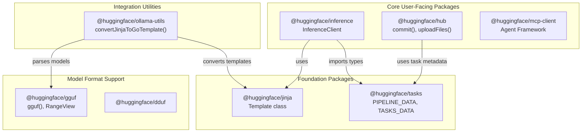

The architecture follows a layered approach where core packages depend on foundation packages that provide shared type definitions and utilities. This enables consistent APIs across different parts of the ecosystem.

Sources: [packages/tasks/package.json:1-60](), [packages/inference/src/providers/providerHelper.ts:1-145](), [packages/hub/src/lib/commit.ts:1-30]()

## Core Design Principles

The Hugging Face JavaScript libraries are built around these key design principles:

1. **Modular Architecture** - Each package has a specific purpose and can be used independently
2. **Type Safety** - Extensive use of TypeScript to provide type safety and improve developer experience
3. **Universal JavaScript** - Support for both Node.js and browser environments
4. **Minimal Dependencies** - Few external dependencies to keep packages lightweight
5. **Consistent APIs** - Similar patterns across packages for predictable developer experience

Sources: [README.md:68-69](), [package.json:1-35]()

## Package Structure and Organization

Each package in the monorepo follows a similar structure:

- `src/` - Source code
- `dist/` - Compiled output (JavaScript files for ESM and CJS)
- `README.md` - Documentation for the specific package
- `package.json` - Package metadata and dependencies

The packages are built and published using a common toolchain, including TypeScript, TSUp, and Vitest for testing.

Sources: [package.json:6-12](), [packages/hub/package.json:10-32](), [packages/inference/package.json:32-41]()

## The Inference Package

The Inference package (`@huggingface/inference`) is the primary client for making inference requests to ML models. It uses a provider-based architecture to support multiple AI backends.

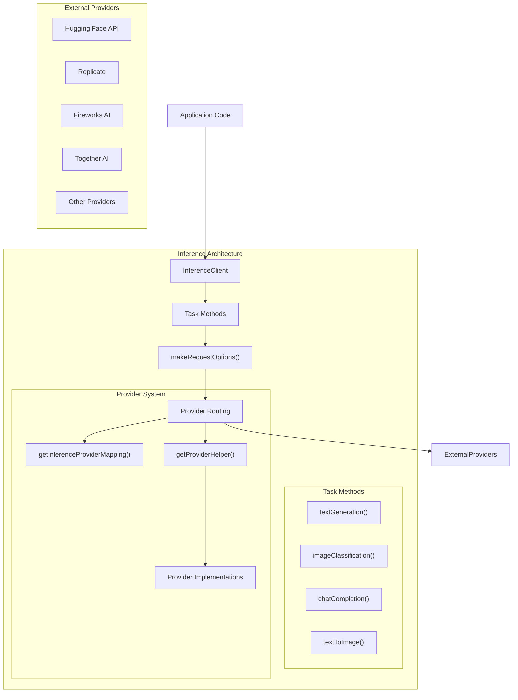

### Key Components of the Inference Package

1. **InferenceClient** - The main class that users interact with
2. **Task Methods** - Specific methods for different ML tasks
3. **Provider Routing** - System for directing requests to different AI providers
4. **Request/Response Handling** - Manages HTTP requests and parsing responses

### Provider Abstraction

The inference package implements a provider abstraction pattern that allows the same client to work with multiple AI providers:

- The default provider is the Hugging Face Inference API
- Additional providers (like Replicate, Together, etc.) can be selected via the `provider` parameter
- Each provider has specific implementation details for authentication, URL construction, and response parsing

Sources: [packages/inference/src/lib/makeRequestOptions.ts:1-218](), [packages/inference/src/providers/consts.ts:1-35](), [packages/inference/src/types.ts:40-56](), [packages/inference/README.md:45-93]()

## The Hub Package

The Hub package (`@huggingface/hub`) provides utilities for interacting with the Hugging Face Hub, including repository and file operations.

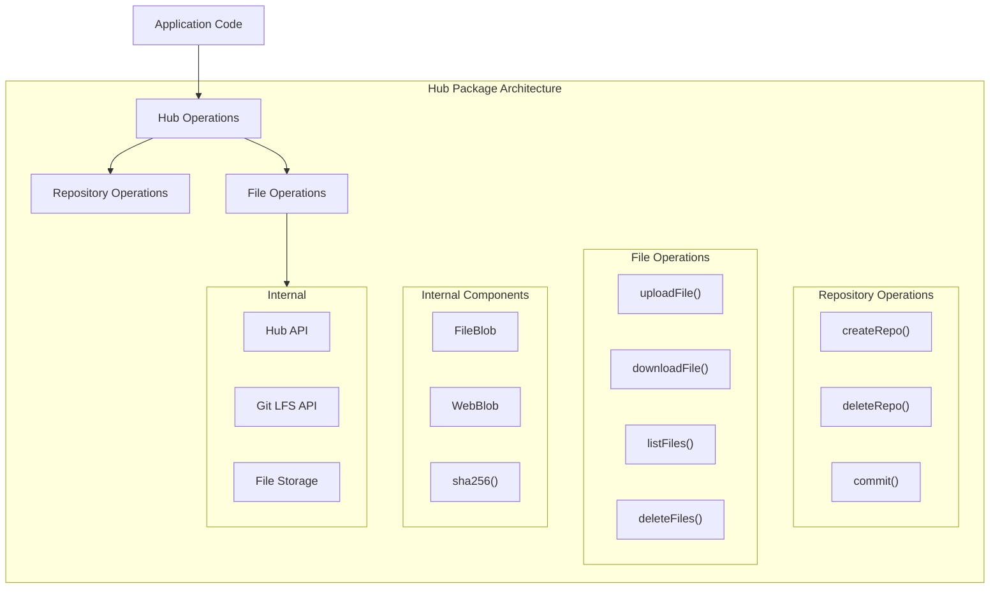

### Key Components of the Hub Package

1. **Repository Operations** - Functions for creating, deleting, and managing repositories
2. **File Operations** - Functions for uploading, downloading, and managing files
3. **Blob Handling** - Classes for handling file data in different environments
4. **Commit System** - Functionality for committing changes to repositories

### Git LFS Integration

The Hub package supports Git Large File Storage (LFS) for efficiently handling large files:

- Files are automatically detected as LFS objects based on size and content
- LFS objects are uploaded directly to cloud storage
- Metadata is tracked in Git

Sources: [packages/hub/src/lib/commit.ts:1-218](), [packages/hub/src/lib/create-repo.ts:1-9](), [packages/hub/src/lib/download-file.ts:1-4](), [packages/hub/src/utils/sha256.ts:1-7]()

## The Tasks Package

The Tasks package (`@huggingface/tasks`) serves as a central registry for machine learning tasks, models, and libraries, providing metadata and utility functions.

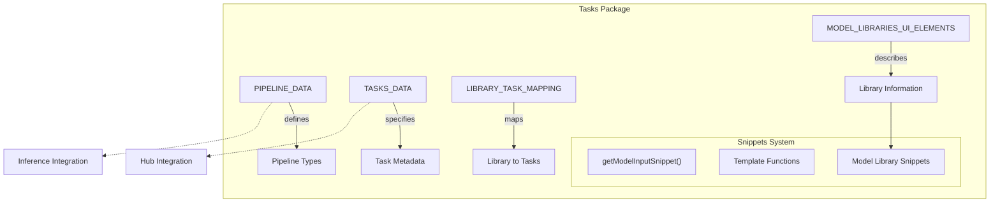

### Key Components of the Tasks Package

1. **Pipeline Data** - Definitions of all supported ML pipeline types
2. **Tasks Data** - Detailed information about each task type
3. **Model Libraries** - Information about ML frameworks (like PyTorch, TensorFlow, etc.)
4. **Code Snippets** - Templates for generating code examples

### Library-Task Mapping

The Tasks package maintains a mapping between model libraries and the tasks they support, which is used to determine compatibility and generate appropriate code snippets:

```javascript
// Example of library-task mapping structure
{
  "diffusers": ["image-to-image", "text-to-image"],
  "transformers": ["text-classification", "token-classification", "..."],
  "...": ["..."]
}
```

Sources: [packages/tasks/src/model-libraries.ts:1-1021](), [packages/tasks/src/model-libraries-snippets.ts:1-1006](), [packages/tasks/src/library-to-tasks.ts:1-12](), [packages/tasks/src/model-data.ts:1-135]()

## Supporting Libraries

Several smaller libraries provide specific functionality to the core packages:

1. **GGUF Library** - Utilities for parsing GGUF model files
2. **Jinja Library** - A lightweight implementation of Jinja templates for ML
3. **Ollama Utils** - Tools for Ollama compatibility

These libraries are designed to be minimal and focused on their specific purposes.

Sources: [README.md:61-66]()

## Cross-Cutting Design Patterns

The architecture employs several key design patterns that enable flexibility, maintainability, and extensibility across the codebase. The following sections detail the three most important patterns: provider abstraction, type generation, and efficient file operations.

## 1. Provider Abstraction Pattern

The provider abstraction pattern is the cornerstone of the inference system, enabling support for 20+ AI providers through a unified interface. This pattern decouples task execution from provider-specific implementation details.

### TaskProviderHelper Base Class

The [TaskProviderHelper](packages/inference/src/providers/providerHelper.ts:74-145) abstract class defines the contract that all provider implementations must follow:

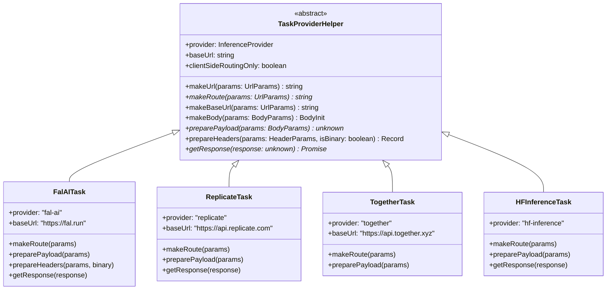

Key methods that each provider must implement:
- `makeRoute()` - Constructs the API endpoint path
- `preparePayload()` - Transforms generic task parameters into provider-specific request format
- `getResponse()` - Parses provider-specific responses into standardized output types

Sources: [packages/inference/src/providers/providerHelper.ts:74-145]()

### Task-Specific Provider Interfaces

For each task type, providers implement specialized interfaces that define input/output contracts. For example, `TextToImageTaskHelper`:

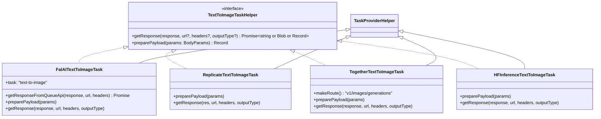

Sources: [packages/inference/src/providers/providerHelper.ts:150-158](), [packages/inference/src/providers/fal-ai.ts:176-239](), [packages/inference/src/providers/replicate.ts:75-134](), [packages/inference/src/providers/together.ts:99-149]()

### Async Polling Pattern for Queue-Based Providers

Some providers (notably Fal.ai) use asynchronous job queues that require polling. The [FalAiQueueTask](packages/inference/src/providers/fal-ai.ts:97-170) implements this pattern:

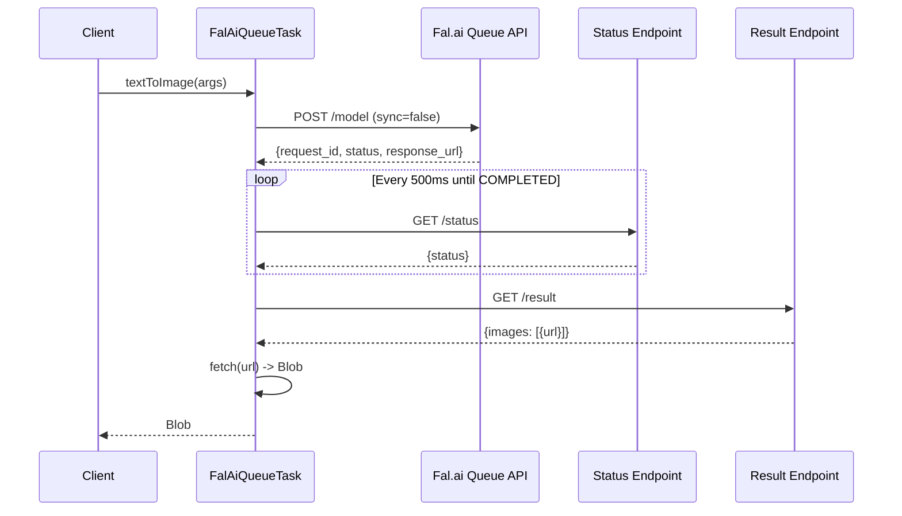

The `getResponseFromQueueApi()` method encapsulates this polling logic at [packages/inference/src/providers/fal-ai.ts:106-169](), using a 500ms delay between status checks.

Sources: [packages/inference/src/providers/fal-ai.ts:97-170]()

### Provider Resolution and Request Pipeline

The inference system uses a multi-stage pipeline to route requests:

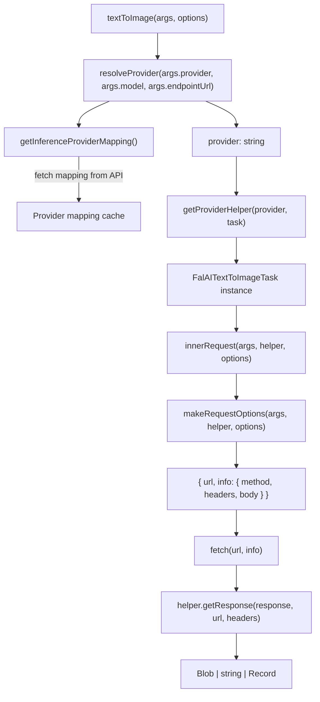

Key functions in this pipeline:
- [resolveProvider()](packages/inference/src/tasks/cv/textToImage.ts:38) - Determines which provider to use
- [getProviderHelper()](packages/inference/src/tasks/cv/textToImage.ts:39) - Instantiates the appropriate provider helper
- [makeRequestOptions()](packages/inference/src/tasks/cv/textToImage.ts:45) - Constructs HTTP request parameters
- [innerRequest()](packages/inference/src/tasks/cv/textToImage.ts:40-43) - Executes the HTTP request

Sources: [packages/inference/src/tasks/cv/textToImage.ts:1-48](), [packages/inference/src/providers/providerHelper.ts:106-144]()

### Provider-Specific Payload Transformations

Each provider has unique API requirements. The `preparePayload()` method handles these transformations. Examples:

**Fal.ai**: Restructures parameters and adds LoRA weights
```typescript
// packages/inference/src/providers/fal-ai.ts:184-204
preparePayload(params: BodyParams): Record<string, unknown> {
    const payload: Record<string, unknown> = {
        ...omit(params.args, ["inputs", "parameters"]),
        ...(params.args.parameters as Record<string, unknown>),
        prompt: params.args.inputs,
    };
    
    if (params.mapping?.adapter === "lora" && params.mapping.adapterWeightsPath) {
        payload.loras = [{
            path: buildLoraPath(params.mapping.hfModelId, params.mapping.adapterWeightsPath),
            scale: 1,
        }];
    }
    
    return payload;
}
```

**Together.ai**: Adds response format based on output type
```typescript
// packages/inference/src/providers/together.ts:108-116
preparePayload(params: BodyParams): Record<string, unknown> {
    return {
        ...omit(params.args, ["inputs", "parameters"]),
        ...(params.args.parameters as Record<string, unknown>),
        prompt: params.args.inputs,
        response_format: params.outputType === "url" ? "url" : "base64",
        model: params.model,
    };
}
```

Sources: [packages/inference/src/providers/fal-ai.ts:184-204](), [packages/inference/src/providers/together.ts:108-116](), [packages/inference/src/providers/replicate.ts:76-89]()

### Base Implementation Classes

To reduce code duplication, the system provides base implementations for common patterns:

**BaseConversationalTask**: Implements OpenAI-compatible chat completion
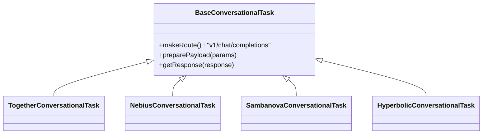

Providers that follow the OpenAI chat completion API can simply extend this base class at [packages/inference/src/providers/providerHelper.ts:331-365]() and override only provider-specific behavior.

Sources: [packages/inference/src/providers/providerHelper.ts:331-365](), [packages/inference/src/providers/together.ts:48-68](), [packages/inference/src/providers/nebius.ts:51-66](), [packages/inference/src/providers/sambanova.ts:24-41](), [packages/inference/src/providers/hyperbolic.ts:39-43]()

### Async Payload Preparation

Some providers require asynchronous processing of inputs (e.g., converting Blobs to base64). The `preparePayloadAsync()` method handles this:

```mermaid
sequenceDiagram
    participant Task as textToImage()
    participant Helper as FalAIImageToImageTask
    participant Converter
    
    Task->>Helper: preparePayloadAsync(args)
    Note over Helper: args.inputs is Blob
    Helper->>Converter: args.inputs.arrayBuffer()
    Converter-->>Helper: ArrayBuffer
    Helper->>Converter: base64FromBytes(buffer)
    Converter-->>Helper: base64 string
    Helper->>Helper: Create data URL
    Helper-->>Task: {image_url: "data:image/png;base64,..."}
```

Example from [packages/inference/src/providers/fal-ai.ts:261-274]():
```typescript
async preparePayloadAsync(args: ImageToImageArgs): Promise<RequestArgs> {
    const mimeType = args.inputs instanceof Blob ? args.inputs.type : "image/png";
    const imageDataUrl = `data:${mimeType};base64,${base64FromBytes(
        new Uint8Array(args.inputs instanceof ArrayBuffer ? args.inputs : await (args.inputs as Blob).arrayBuffer())
    )}`;
    return {
        ...omit(args, ["inputs", "parameters"]),
        image_url: imageDataUrl,
        ...args.parameters,
    };
}
```

Sources: [packages/inference/src/providers/fal-ai.ts:261-274](), [packages/inference/src/providers/replicate.ts:265-277](), [packages/inference/src/providers/hf-inference.ts:384-399]()

## 2. Type Generation and Code Generation

The `@huggingface/tasks` package implements an automated type generation pipeline that converts JSON Schema specifications into TypeScript interfaces, ensuring type safety and API consistency across the ecosystem.

### JSON Schema as Source of Truth

Task input/output types are defined using JSON Schema specifications stored in `spec/` directories:

| Task | Schema Files | Generated TypeScript |
|------|-------------|---------------------|
| Chat Completion | [input.json](packages/tasks/src/tasks/chat-completion/spec/input.json:1-433), [output.json](packages/tasks/src/tasks/chat-completion/spec/output.json:1-135), [stream_output.json](packages/tasks/src/tasks/chat-completion/spec/stream_output.json:1-135) | [inference.ts](packages/tasks/src/tasks/chat-completion/inference.ts:1-330) |
| Text Generation | [input.json](packages/tasks/src/tasks/text-generation/spec/input.json:1-240), [output.json](packages/tasks/src/tasks/text-generation/spec/output.json:1-135), [stream_output.json](packages/tasks/src/tasks/text-generation/spec/stream_output.json:1-87) | [inference.ts](packages/tasks/src/tasks/text-generation/inference.ts:1-200) |

### Code Generation Pipeline

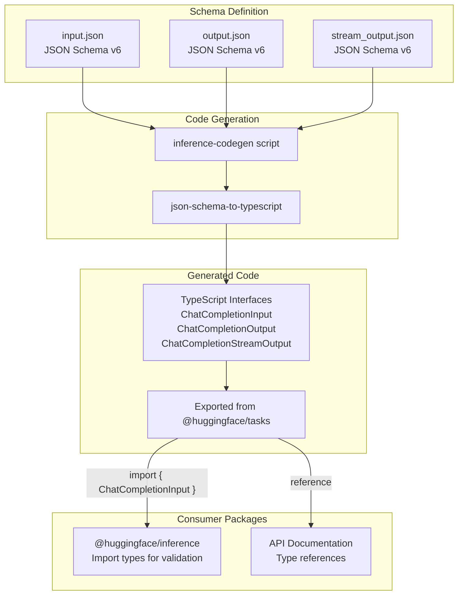

The code generation is triggered during the build process at [packages/tasks/package.json:44]():
```json
"prepublishOnly": "pnpm --filter tasks-gen inference-codegen && git diff --name-only --exit-code src && pnpm run build"
```

Sources: [packages/tasks/package.json:44](), [packages/tasks/src/tasks/chat-completion/spec/input.json:1-10](), [packages/tasks/src/tasks/chat-completion/inference.ts:1-12]()

### Schema Structure and Type Definitions

JSON schemas define the complete structure of API requests and responses. Example from [ChatCompletionInput](packages/tasks/src/tasks/chat-completion/spec/input.json:1-151):

```json
{
  "$schema": "http://json-schema.org/draft-06/schema#",
  "title": "ChatCompletionInput",
  "type": "object",
  "required": ["messages"],
  "properties": {
    "messages": {
      "type": "array",
      "items": { "$ref": "#/$defs/ChatCompletionInputMessage" }
    },
    "max_tokens": {
      "type": "integer",
      "format": "int32",
      "nullable": true,
      "minimum": 0
    },
    "temperature": {
      "type": "number",
      "format": "float",
      "nullable": true,
      "exclusiveMinimum": 0
    }
  }
}
```

This generates TypeScript interfaces at [packages/tasks/src/tasks/chat-completion/inference.ts:13-106]():

```typescript
export interface ChatCompletionInput {
    messages: ChatCompletionInputMessage[];
    max_tokens?: number;
    temperature?: number;
    frequency_penalty?: number;
    // ... additional fields
    [property: string]: unknown;
}

export interface ChatCompletionInputMessage {
    content?: ChatCompletionInputMessageContent;
    role: string;
    tool_calls?: ChatCompletionInputToolCall[];
    [property: string]: unknown;
}
```

Sources: [packages/tasks/src/tasks/chat-completion/spec/input.json:1-151](), [packages/tasks/src/tasks/chat-completion/inference.ts:13-106]()

### Complex Type Definitions with Discriminated Unions

Schemas support advanced TypeScript patterns like discriminated unions. Example from [ChatCompletionInputMessageChunk](packages/tasks/src/tasks/chat-completion/spec/input.json:216-248):

```json
{
  "oneOf": [
    {
      "type": "object",
      "required": ["text", "type"],
      "properties": {
        "text": { "type": "string" },
        "type": { "type": "string", "enum": ["text"] }
      }
    },
    {
      "type": "object",
      "required": ["image_url", "type"],
      "properties": {
        "image_url": { "$ref": "#/$defs/ChatCompletionInputUrl" },
        "type": { "type": "string", "enum": ["image_url"] }
      }
    }
  ],
  "discriminator": { "propertyName": "type" }
}
```

This generates a discriminated union type at [packages/tasks/src/tasks/chat-completion/inference.ts:115-125]():

```typescript
export type ChatCompletionInputMessageChunkType = "text" | "image_url";

export interface ChatCompletionInputMessageChunk {
    image_url?: ChatCompletionInputURL;
    text?: string;
    type: ChatCompletionInputMessageChunkType;
    [property: string]: unknown;
}
```

Sources: [packages/tasks/src/tasks/chat-completion/spec/input.json:216-248](), [packages/tasks/src/tasks/chat-completion/inference.ts:115-125]()

### Type Usage in Inference Package

Generated types are imported and used throughout the inference package to ensure type safety:

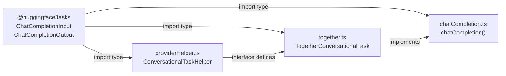

Example type usage at [packages/inference/src/providers/together.ts:53-67]():
```typescript
override preparePayload(params: BodyParams<ChatCompletionInput>): Record<string, unknown> {
    const payload = super.preparePayload(params);
    const response_format = payload.response_format as
        | { type: "json_schema"; json_schema: { schema: unknown } }
        | undefined;

    if (response_format?.type === "json_schema" && response_format?.json_schema?.schema) {
        payload.response_format = {
            type: "json_schema",
            schema: response_format.json_schema.schema,
        };
    }

    return payload;
}
```

Sources: [packages/inference/src/providers/together.ts:53-67](), [packages/inference/src/providers/nebius.ts:56-65](), [packages/inference/src/providers/sambanova.ts:29-40]()

### Benefits of Schema-Driven Development

This approach provides several key advantages:

1. **Single Source of Truth**: API contracts are defined once in JSON Schema
2. **Automatic Type Generation**: TypeScript types are generated, not manually written
3. **Validation**: Schemas can be used for runtime validation
4. **Documentation**: Schemas serve as machine-readable API documentation
5. **Cross-Language Support**: Same schemas can generate types for other languages

The generated types ensure that provider implementations remain compatible with the standardized task interfaces, catching type errors at compile time rather than runtime.

Sources: [packages/tasks/src/tasks/chat-completion/inference.ts:1-12](), [packages/tasks/src/tasks/text-generation/inference.ts:1-12]()

## 3. Efficient File Operations

The Hub package implements sophisticated algorithms for efficient large file uploads, centered around the Xet protocol for content-defined chunking and deduplication.

### The Xet Upload Protocol

The Xet protocol is designed to minimize bandwidth usage when uploading large ML model files by deduplicating chunks both locally and remotely:

```mermaid
flowchart TB
    File["Large Model File<br/>(e.g., 5GB safetensors)"]
    
    subgraph "Content-Defined Chunking"
        Chunker["Chunker.add_data()<br/>Target: 64KB chunks"]
        ChunkBoundaries["Boundary detection<br/>using Rabin fingerprinting"]
    end
    
    subgraph "Chunk Processing"
        Compression["LZ4 Compression<br/>+ Byte Grouping optimization"]
        Xorb["Xorb Creation<br/>64MB containers"]
    end
    
    subgraph "Deduplication"
        LocalCache["ChunkCache<br/>Local dedup via hash map"]
        RemoteCheck["Remote Dedup<br/>CAS lookup every 4MB"]
        DedupServer["CAS Backend<br/>/v1/chunks/default/{hash}"]
    end
    
    subgraph "Upload"
        Shard["Shard Creation<br/>Package xorbs + metadata"]
        Upload["HTTP Upload<br/>to Hub storage"]
    end
    
    File --> Chunker
    Chunker --> ChunkBoundaries
    ChunkBoundaries -->|"Array of chunks"| Compression
    
    Compression --> Xorb
    
    Xorb --> LocalCache
    LocalCache -->|"not in cache"| RemoteCheck
    RemoteCheck -->|"GET"| DedupServer
    DedupServer -->|"200 OK: already exists"| Skip["Skip chunk<br/>Deduped!"]
    DedupServer -->|"404: need to upload"| Shard
    
    Xorb --> Shard
    Shard --> Upload
```

Key components:
- **Chunker**: WebAssembly module for content-defined chunking at [packages/hub/src/utils/createXorbs.ts:166]()
- **ChunkCache**: In-memory hash map tracking chunk locations at [packages/hub/src/utils/ChunkCache.ts:5-99]()
- **Xorb**: 64MB container for compressed chunks at [packages/hub/src/utils/createXorbs.ts:12]()
- **Shard**: Final package with metadata and xorbs at [packages/hub/src/utils/uploadShards.ts:7-14]()

Sources: [packages/hub/src/utils/createXorbs.ts:1-758](), [packages/hub/src/utils/uploadShards.ts:1-350](), [packages/hub/src/utils/ChunkCache.ts:1-99]()

### Content-Defined Chunking

Unlike fixed-size chunking, content-defined chunking creates boundaries based on file content, enabling deduplication even when data is shifted:

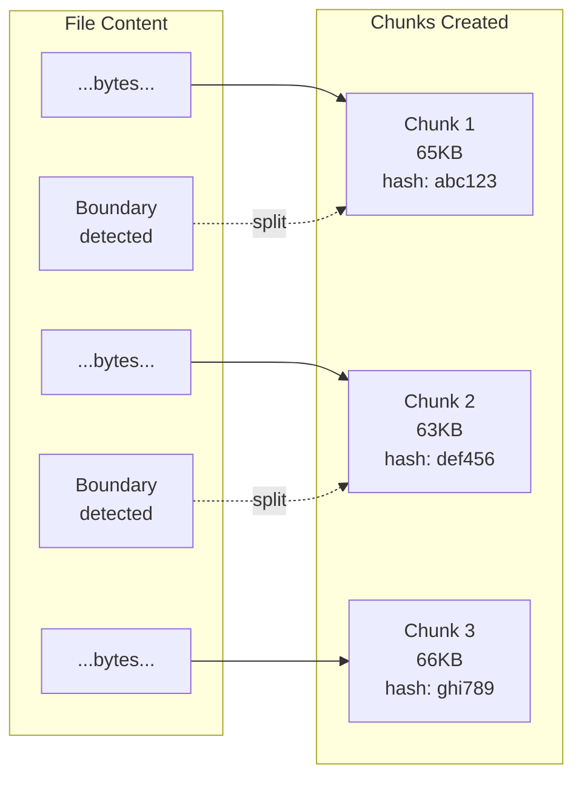

The chunker uses Rabin fingerprinting (via WebAssembly) to detect natural boundaries in the data at [packages/hub/src/utils/createXorbs.ts:166]():

```typescript
const chunker = new chunkModule.Chunker(TARGET_CHUNK_SIZE);
// TARGET_CHUNK_SIZE = 64 * 1024 (64KB)

// Process file in streaming fashion
const reader = fileSource.content.stream().getReader();
while (true) {
    const { done, value } = await reader.read();
    if (done) {
        yield* addChunks(chunker.finish());
        break;
    }
    yield* addChunks(chunker.add_data(value));
}
```

Sources: [packages/hub/src/utils/createXorbs.ts:9-339]()

### Chunk Compression and Xorb Structure

Each chunk undergoes multi-strategy compression before storage:

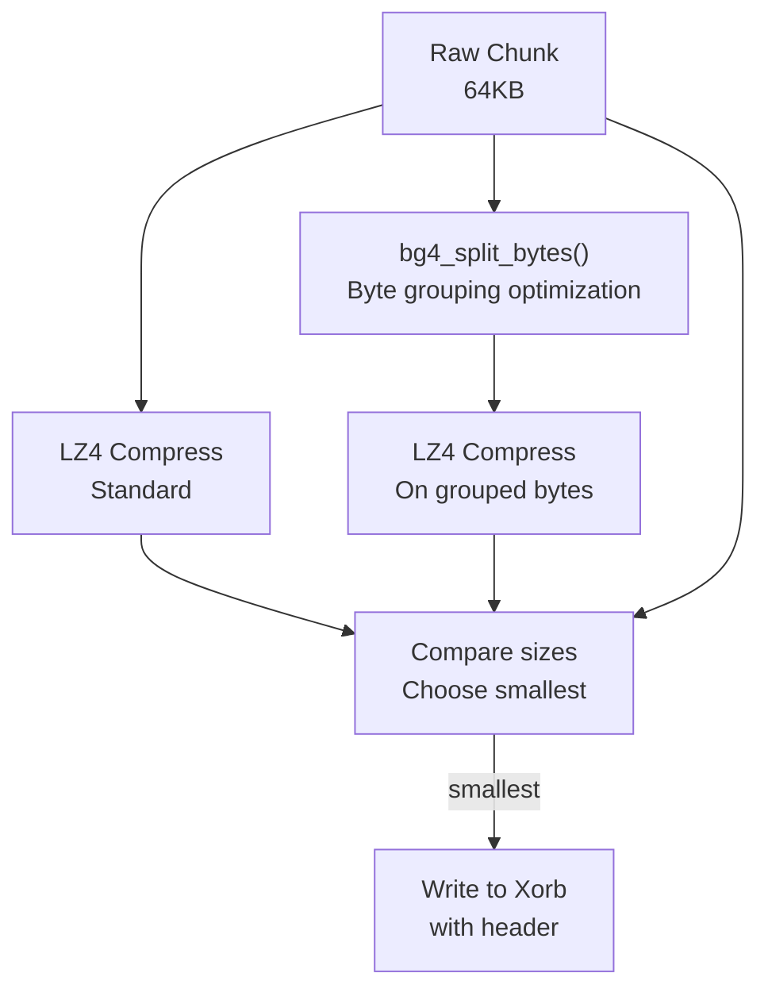

Implementation at [packages/hub/src/utils/createXorbs.ts:529-559]():

```typescript
function writeChunk(xorb: CurrentXorbInfo, chunk: Uint8Array, hash: string): boolean {
    const regularCompressedChunk = lz4_compress(chunk);
    const bgCompressedChunk = lz4_compress(bg4_split_bytes(chunk));
    const compressedChunk = 
        bgCompressedChunk.length < regularCompressedChunk.length 
        ? bgCompressedChunk 
        : regularCompressedChunk;
    const chunkToWrite = compressedChunk.length < chunk.length ? compressedChunk : chunk;
    
    if (xorb.offset + XET_CHUNK_HEADER_BYTES + chunkToWrite.length > XORB_SIZE) {
        return false; // Xorb full
    }
    
    // Write 8-byte header: [reserved, length(3 bytes), compression_type, unpacked_length(3 bytes)]
    xorb.data[xorb.offset] = 0;
    xorb.data[xorb.offset + 1] = chunkToWrite.length & 0xff;
    xorb.data[xorb.offset + 2] = (chunkToWrite.length >> 8) & 0xff;
    xorb.data[xorb.offset + 3] = (chunkToWrite.length >> 16) & 0xff;
    xorb.data[xorb.offset + 4] = /* compression scheme */;
    xorb.data[xorb.offset + 5] = chunk.length & 0xff;
    xorb.data[xorb.offset + 6] = (chunk.length >> 8) & 0xff;
    xorb.data[xorb.offset + 7] = (chunk.length >> 16) & 0xff;
    
    xorb.data.set(chunkToWrite, xorb.offset + XET_CHUNK_HEADER_BYTES);
    xorb.offset += XET_CHUNK_HEADER_BYTES + chunkToWrite.length;
    
    return true;
}
```

Sources: [packages/hub/src/utils/createXorbs.ts:529-559]()

### Local and Remote Deduplication

The system implements two-tier deduplication:

**1. Local Deduplication** via [ChunkCache](packages/hub/src/utils/ChunkCache.ts:5-99):

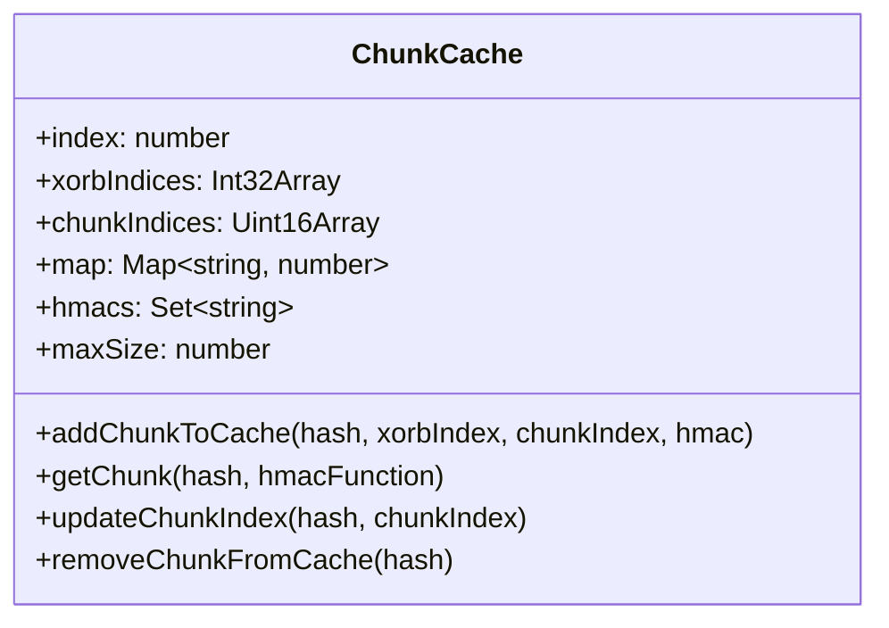

The cache uses typed arrays for efficiency:
- `xorbIndices`: Int32Array mapping cache index → xorb ID (positive = local, negative = remote)
- `chunkIndices`: Uint16Array mapping cache index → chunk index within xorb
- `map`: Hash → cache index lookup
- Circular buffer with `CHUNK_CACHE_MAX_SIZE = 1,000,000` entries

**2. Remote Deduplication** at [packages/hub/src/utils/createXorbs.ts:216-239]:

```typescript
// Check remote CAS every 4MB of processed data
const INTERVAL_BETWEEN_REMOTE_DEDUP = 4_000_000;

if (chunk.dedup && bytesSinceRemoteDedup >= INTERVAL_BETWEEN_REMOTE_DEDUP) {
    const token = await xetWriteToken(params);
    bytesSinceRemoteDedup = 0;
    
    const shardResp = await fetch(token.casUrl + "/v1/chunks/default/" + chunk.hash, {
        headers: { Authorization: `Bearer ${token.accessToken}` }
    });
    
    if (shardResp.ok) {
        // Chunk already exists on server
        const shard = await shardResp.blob();
        const shardData = await parseShardData(shard);
        
        // Load remote xorb metadata into local cache
        for (const xorb of shardData.xorbs) {
            const remoteXorbId = -remoteXorbHashes.length;
            remoteXorbHashes.push(xorb.hash);
            for (const chunk of xorb.chunks) {
                chunkCache.addChunkToCache(chunk.hash, remoteXorbId, i++, shardData.hmacKey);
            }
        }
    }
}
```

Sources: [packages/hub/src/utils/ChunkCache.ts:5-99](), [packages/hub/src/utils/createXorbs.ts:216-257]()

### Backtracking Deduplication

When remote deduplication info is received, the system can "backtrack" to deduplicate already-processed chunks in the current xorb:

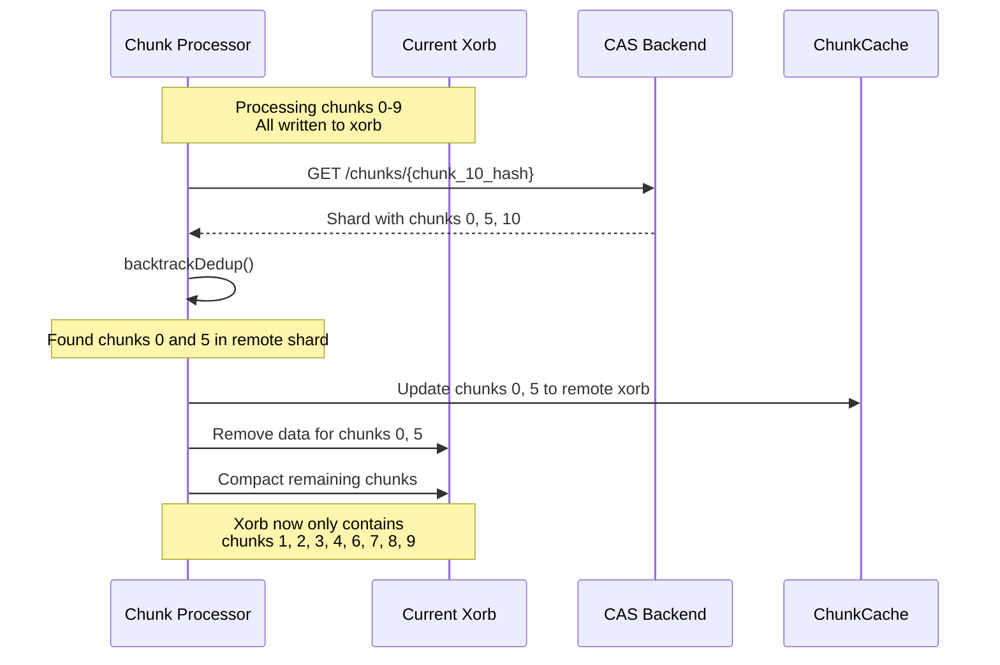

Implementation at [packages/hub/src/utils/createXorbs.ts:380-486]():

```typescript
export function backtrackDedup(
    xorb: CurrentXorbInfo,
    computeHmac: (hash: string, key: string) => string,
    shardData: ShardData,
    chunkCache: ChunkCache,
    chunkMetadata: { xorbId: number | string; chunkIndex: number; length: number }[],
    dedupedBytes: number,
): number {
    // Find chunks in current xorb that exist in remote shard
    const chunkIndexesToBacktrackFor = new Map<number, { xorbId: number; chunkIndex: number }>();
    
    for (let i = xorb.immutableData?.chunkIndex ?? 0; i < xorb.chunks.length; i++) {
        const chunk = xorb.chunks[i];
        const hmacHash = computeHmac(chunk.hash, shardData.hmacKey);
        const cacheData = chunkCache.getChunk(hmacHash, null);
        if (cacheData !== undefined) {
            chunkIndexesToBacktrackFor.set(i, {
                xorbId: cacheData.xorbIndex,
                chunkIndex: cacheData.chunkIndex,
            });
            chunkCache.removeChunkFromCache(chunk.hash);
        }
    }
    
    // Update chunk metadata to point to remote xorb
    // Remove backtracked chunks from xorb data
    // Compact xorb by copying remaining chunks forward
    // Update cache with new chunk indices
    
    return dedupedBytes;
}
```

This optimization is particularly effective when uploading similar models (e.g., fine-tuned versions) where many chunks are identical.

Sources: [packages/hub/src/utils/createXorbs.ts:380-486]()

### Shard Structure and Upload

Multiple xorbs are packaged into shards with metadata for efficient upload:

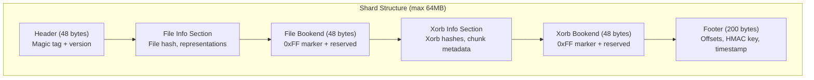

Shard creation at [packages/hub/src/utils/uploadShards.ts:231-276]():

```typescript
function createShard(): Uint8Array {
    const shard = new Uint8Array(
        SHARD_HEADER_SIZE + SHARD_FOOTER_SIZE + 
        xorbViewOffset + XORB_FOOTER_LENGTH + 
        fileViewOffset + FILE_FOOTER_LENGTH
    );
    
    const shardView = new DataView(shard.buffer);
    let shardOffset = 0;
    
    // Write header
    shard.set(SHARD_MAGIC_TAG, shardOffset);
    shardOffset += SHARD_MAGIC_TAG.length;
    shardView.setBigUint64(shardOffset, SHARD_HEADER_VERSION, true);
    // ...
    
    // Write file info section
    shard.set(fileInfoSection.slice(0, fileViewOffset), shardOffset);
    // Write file bookend
    // Write xorb info section
    // Write xorb bookend
    // Write footer
    
    return shard;
}
```

Sources: [packages/hub/src/utils/uploadShards.ts:19-52](), [packages/hub/src/utils/uploadShards.ts:231-349]()

### Progress Reporting

The upload system provides detailed progress information through async generators:

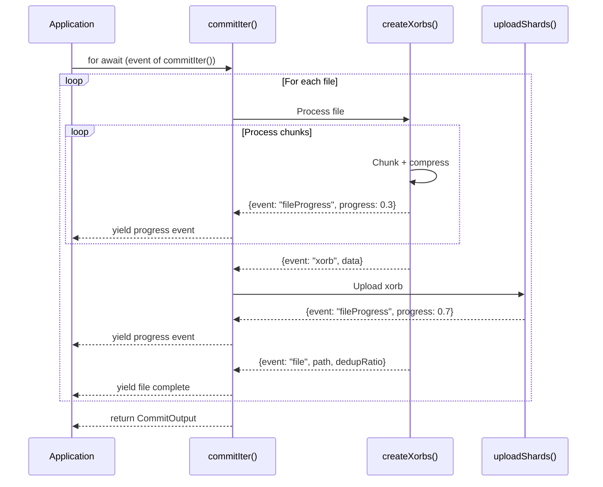

Progress is weighted between processing (10%) and uploading (90%) at [packages/hub/src/utils/createXorbs.ts:17-21]():

```typescript
const PROCESSING_PROGRESS_RATIO = 0.1;
const UPLOADING_PROGRESS_RATIO = 1 - PROCESSING_PROGRESS_RATIO;

params.yieldCallback?.({
    event: "fileProgress",
    path: fileSource.path,
    progress: (uploadedBytes + (processedBytes - uploadedBytes) * PROCESSING_PROGRESS_RATIO) / totalSize
});
```

Sources: [packages/hub/src/lib/commit.ts:152-163](), [packages/hub/src/utils/createXorbs.ts:17-314](), [packages/hub/src/utils/uploadShards.ts:76-161]()

### Performance Characteristics

The Xet protocol achieves significant efficiency gains:

| Scenario | Dedup Ratio | Bandwidth Saved |
|----------|-------------|-----------------|
| Re-uploading same file | ~100% | All data |
| Fine-tuned model (similar base) | 70-90% | Most layers |
| Different quantization | 30-50% | Shared embeddings |
| Completely different model | 0-5% | Minimal |

Benchmarking script at [packages/hub/scripts/bench.ts:1-200]() demonstrates dedup on OpenAI GPT-2 model files.

Sources: [packages/hub/scripts/bench.ts:1-200](), [packages/hub/src/utils/createXorbs.ts:1-758]()

## Environment Compatibility

The libraries are designed to work in multiple JavaScript environments:

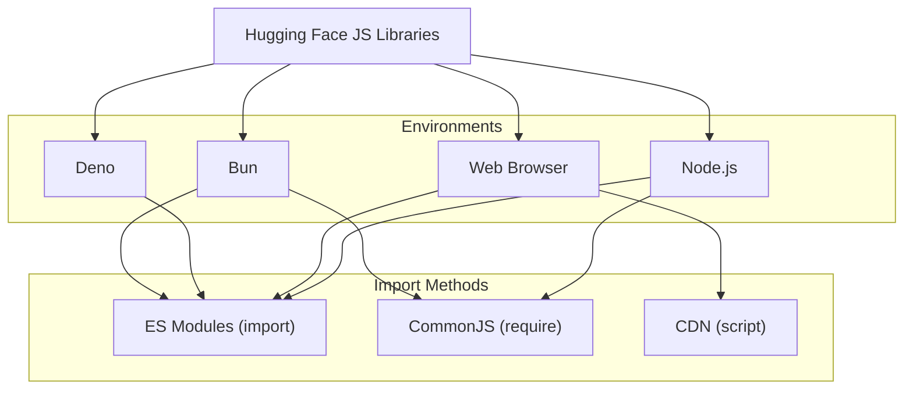

To achieve this compatibility, the libraries:
- Use dual ESM/CJS builds
- Provide browser-specific entry points
- Use environment detection

Sources: [README.md:73-118](), [packages/hub/package.json:20-28](), [packages/inference/package.json:34-40]()

## Module System and Environment Compatibility

The libraries are designed to work across multiple JavaScript runtimes and import systems through careful build configuration.

### Dual Module Format

Each package exports both ESM and CommonJS formats, configured via `tshy` at [packages/tasks/package.json:53-58]():

```json
{
  "tshy": {
    "exports": {
      ".": "./src/index.ts",
      "./package.json": "./package.json"
    }
  }
}
```

This generates the following package.json exports at [packages/tasks/package.json:23-35]():

```json
{
  "exports": {
    ".": {
      "import": {
        "types": "./dist/esm/index.d.ts",
        "default": "./dist/esm/index.js"
      },
      "require": {
        "types": "./dist/commonjs/index.d.ts",
        "default": "./dist/commonjs/index.js"
      }
    },
    "./package.json": "./package.json"
  }
}
```

### Environment Detection

Code uses runtime feature detection to adapt behavior:

```mermaid
flowchart TB
    Code["Library Code"]
    
    Code --> CheckEnv{Check Environment}
    
    CheckEnv -->|"typeof window !== 'undefined'"| Browser["Browser APIs"]
    CheckEnv -->|"typeof process !== 'undefined'"| Node["Node.js APIs"]
    
    Browser --> WebBlob["WebBlob class<br/>Uses Blob API"]
    Browser --> NoFS["No filesystem access"]
    
    Node --> FileBlob["FileBlob class<br/>Uses fs.readFile"]
    Node --> LocalCache["Local cache directory"]
```

Example at [packages/hub/src/utils/isFrontend.ts]():
```typescript
export const isFrontend = typeof window !== "undefined" && typeof document !== "undefined";
```

Sources: [packages/tasks/package.json:20-35](), [packages/tasks/package.json:53-58](), [packages/hub/src/utils/isFrontend.ts]()

## Conclusion

The Hugging Face JavaScript libraries are designed with modularity, compatibility, and developer experience in mind. They provide a flexible and powerful way to interact with machine learning models and the Hugging Face ecosystem from JavaScript applications.

The architecture follows consistent patterns across packages, leveraging TypeScript for type safety while ensuring compatibility with different JavaScript environments. The provider-based design of the Inference package allows for seamless integration with multiple AI providers, while the Hub package provides robust capabilities for interacting with repositories and files.

---

