<!-- source: DeepWiki mcp.deepwiki.com · repo huggingface/huggingface.js · page 5.1 Provider Abstraction Pattern · fetched 2026-10-26 -->

# Provider Abstraction Pattern

<details>
<summary>Relevant source files</summary>

The following files were used as context for generating this wiki page:

- [packages/inference/src/providers/fal-ai.ts](packages/inference/src/providers/fal-ai.ts)
- [packages/inference/src/providers/hf-inference.ts](packages/inference/src/providers/hf-inference.ts)
- [packages/inference/src/providers/hyperbolic.ts](packages/inference/src/providers/hyperbolic.ts)
- [packages/inference/src/providers/nebius.ts](packages/inference/src/providers/nebius.ts)
- [packages/inference/src/providers/nscale.ts](packages/inference/src/providers/nscale.ts)
- [packages/inference/src/providers/providerHelper.ts](packages/inference/src/providers/providerHelper.ts)
- [packages/inference/src/providers/replicate.ts](packages/inference/src/providers/replicate.ts)
- [packages/inference/src/providers/sambanova.ts](packages/inference/src/providers/sambanova.ts)
- [packages/inference/src/providers/together.ts](packages/inference/src/providers/together.ts)
- [packages/inference/src/tasks/cv/textToImage.ts](packages/inference/src/tasks/cv/textToImage.ts)

</details>


## Purpose and Scope

This document explains the provider abstraction architecture used in the `@huggingface/inference` package to enable unified access to 20+ inference providers (Fal.ai, Replicate, Together, Cohere, Sambanova, Nebius, Hyperbolic, and others). The pattern decouples task execution from provider-specific implementation details through a layered abstraction system based on the `TaskProviderHelper` class and task-specific interfaces.

For information about the overall inference system architecture and how providers are selected, see [Provider System](#2.1.2). For type definitions and task functions, see [Task Functions and Types](#2.1.3).

## Architecture Overview

The provider abstraction system operates through three distinct layers: the base helper class, task-specific interfaces, and concrete provider implementations.

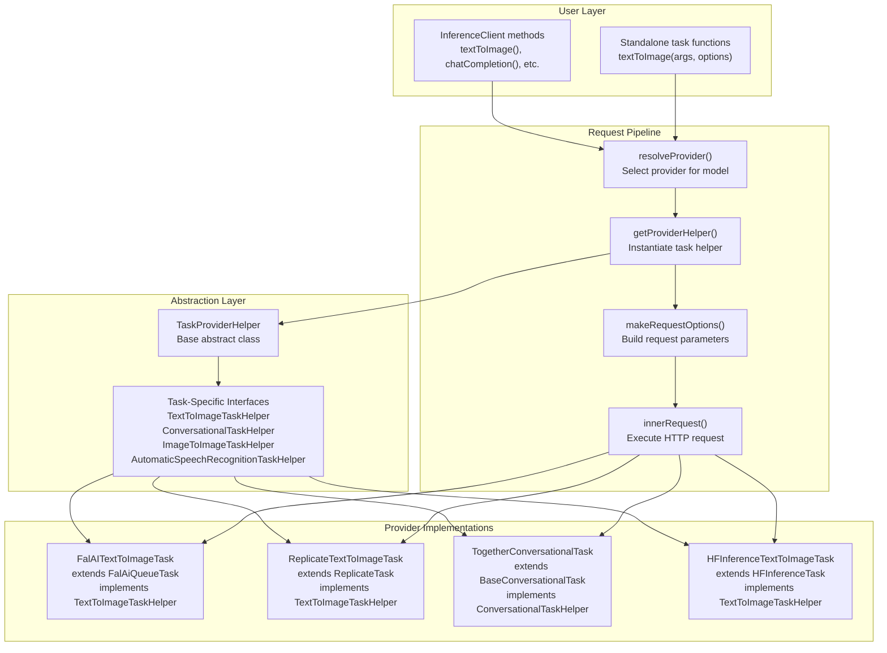

**Sources:** [packages/inference/src/providers/providerHelper.ts:1-145](), [packages/inference/src/tasks/cv/textToImage.ts:1-48]()

## TaskProviderHelper Base Class

The `TaskProviderHelper` abstract class defines the core contract that all provider implementations must fulfill. It establishes a standardized interface for request preparation, URL construction, and response handling.

### Core Abstract Methods

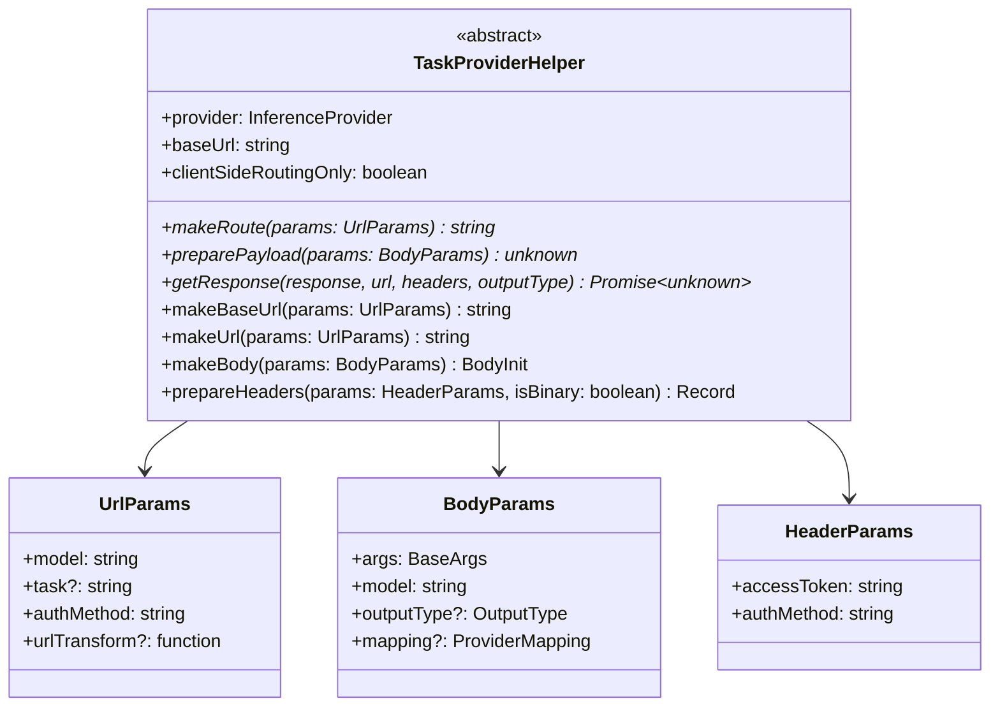

The three abstract methods that subclasses must implement are:

- **`makeRoute(params: UrlParams): string`** - Constructs the API endpoint path for the provider
- **`preparePayload(params: BodyParams): unknown`** - Transforms generic task arguments into provider-specific request payloads
- **`getResponse(response, url, headers, outputType): Promise<unknown>`** - Processes provider responses into standardized output formats

The base class provides default implementations for supporting methods like `makeUrl()`, `makeBody()`, and `prepareHeaders()` that handle routing decisions, request body construction, and authentication headers.

**Sources:** [packages/inference/src/providers/providerHelper.ts:74-145]()

### Request URL Construction Flow

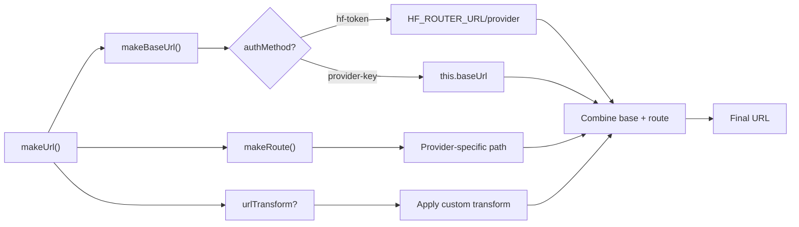

The `makeBaseUrl()` method implements intelligent routing: when using a Hugging Face token (`authMethod !== "provider-key"`), requests are routed through `HF_ROUTER_URL` which handles provider mapping and billing. When using a direct provider API key, requests go directly to the provider's base URL.

**Sources:** [packages/inference/src/providers/providerHelper.ts:106-130]()

## Provider Implementation Patterns

Provider implementations follow three primary architectural patterns based on their API characteristics.

### Simple Synchronous Providers

Providers with straightforward request-response APIs extend `TaskProviderHelper` directly or use base task classes like `BaseConversationalTask`.

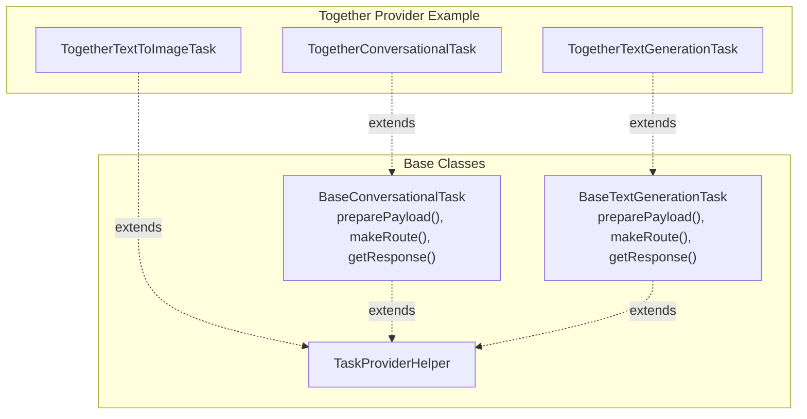

**Together.ai Example:**
- `TogetherConversationalTask` extends `BaseConversationalTask` and only overrides `preparePayload()` to handle JSON schema format differences [packages/inference/src/providers/together.ts:48-68]()
- `TogetherTextToImageTask` implements route `v1/images/generations` and handles both URL and base64 response formats [packages/inference/src/providers/together.ts:99-149]()

**Hyperbolic Example:**
- `HyperbolicTextGenerationTask` uses the chat completions endpoint for text generation, converting prompts into message format [packages/inference/src/providers/hyperbolic.ts:45-83]()

**Sources:** [packages/inference/src/providers/together.ts:1-150](), [packages/inference/src/providers/hyperbolic.ts:1-134](), [packages/inference/src/providers/providerHelper.ts:331-398]()

### Queue-Based Async Providers

Providers that use asynchronous job processing (like Fal.ai and Replicate) implement polling mechanisms within their `getResponse()` method.

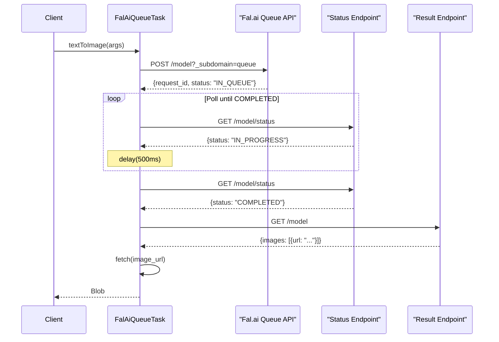

**Fal.ai Implementation:**

The `FalAiQueueTask` class implements the queue polling pattern:
- Extends `FalAITask` which handles authentication and payload preparation
- Overrides `makeRoute()` to append `?_subdomain=queue` when using HF tokens [packages/inference/src/providers/fal-ai.ts:100-105]()
- Implements `getResponseFromQueueApi()` which polls status endpoints every 500ms until completion [packages/inference/src/providers/fal-ai.ts:106-169]()

**Key Implementation Details:**
```typescript
// Fal.ai queue polling logic
while (status !== "COMPLETED") {
    await delay(500);
    const statusResponse = await fetch(statusUrl, { headers });
    status = (await statusResponse.json()).status;
}
```

**Replicate Pattern:**
Replicate uses a simpler approach with the `Prefer: wait` header, causing the API to block until the job completes [packages/inference/src/providers/replicate.ts:59]().

**Sources:** [packages/inference/src/providers/fal-ai.ts:97-169](), [packages/inference/src/providers/replicate.ts:37-73]()

### OpenAI-Compatible Providers

Multiple providers (Together, Nebius, Sambanova, Nscale) implement OpenAI-compatible chat and embeddings endpoints, allowing them to share base implementations.

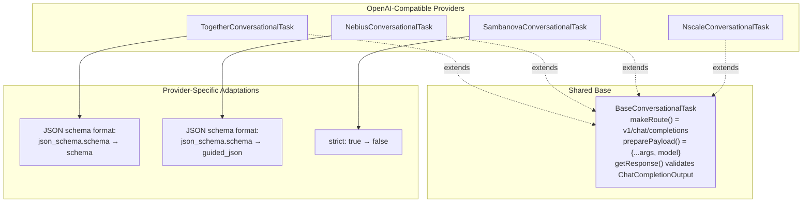

**BaseConversationalTask Implementation:**

The base class provides standard OpenAI v1/chat/completions behavior:
- Route: `v1/chat/completions` [packages/inference/src/providers/providerHelper.ts:337]()
- Payload: Includes `model` parameter alongside all input arguments [packages/inference/src/providers/providerHelper.ts:340-345]()
- Response validation: Checks for required fields (choices, created, id, model, usage) [packages/inference/src/providers/providerHelper.ts:347-364]()

**Provider-Specific Overrides:**

| Provider | Override | Purpose |
|----------|----------|---------|
| Together | `preparePayload()` | Transforms `response_format.json_schema.schema` to `response_format.schema` [packages/inference/src/providers/together.ts:53-67]() |
| Nebius | `preparePayload()` | Transforms `response_format.json_schema.schema` to `guided_json` parameter [packages/inference/src/providers/nebius.ts:56-65]() |
| Sambanova | `preparePayload()` | Sets `strict: false` for JSON schema validation [packages/inference/src/providers/sambanova.ts:29-40]() |
| Nscale | None | Uses base implementation directly [packages/inference/src/providers/nscale.ts:31-35]() |

**Sources:** [packages/inference/src/providers/providerHelper.ts:331-365](), [packages/inference/src/providers/together.ts:48-68](), [packages/inference/src/providers/nebius.ts:51-66](), [packages/inference/src/providers/sambanova.ts:24-41]()

## Task-Specific Interfaces

Task-specific interfaces define method signatures that providers must implement for each ML task type, ensuring consistent behavior across providers.

### Interface Hierarchy

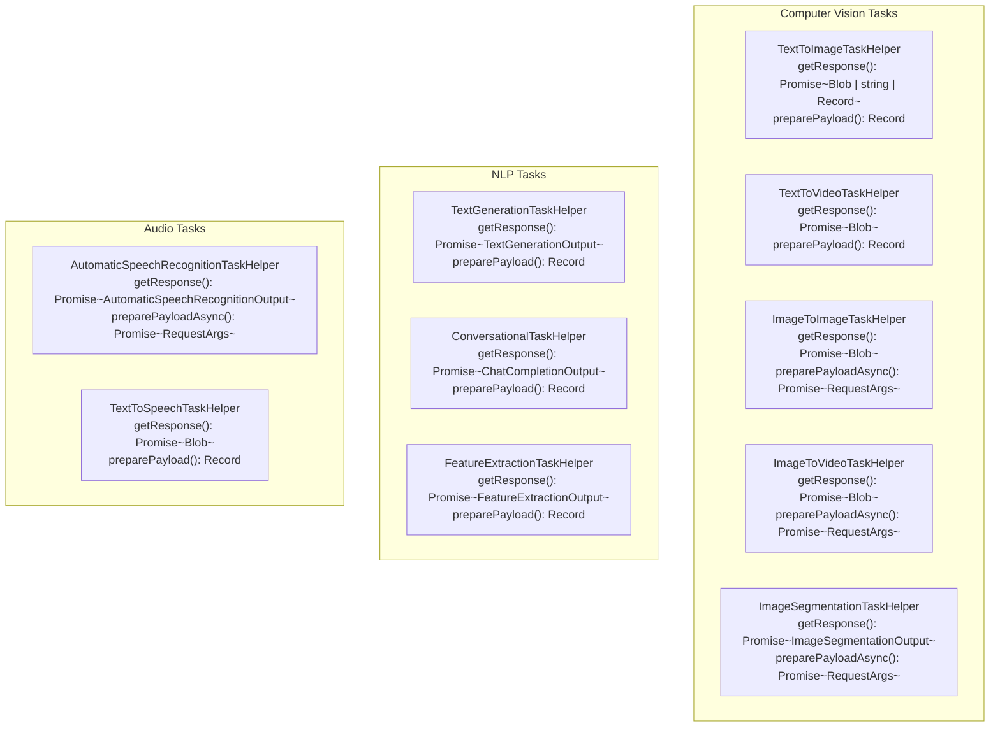

**Sources:** [packages/inference/src/providers/providerHelper.ts:147-327]()

### Synchronous vs Asynchronous Payload Preparation

Some tasks require asynchronous payload preparation when handling binary data (images, audio) that needs conversion to base64 or data URLs.

**Synchronous Preparation Pattern:**


Used for text-based tasks where arguments can be directly serialized [packages/inference/src/providers/hf-inference.ts:103-105]().

**Asynchronous Preparation Pattern:**


Used for tasks with binary inputs:
- `ImageToImageTaskHelper.preparePayloadAsync()` converts image Blobs to base64 [packages/inference/src/providers/fal-ai.ts:261-274]()
- `AutomaticSpeechRecognitionTaskHelper.preparePayloadAsync()` encodes audio data [packages/inference/src/providers/fal-ai.ts:478-498]()
- `ImageSegmentationTaskHelper.preparePayloadAsync()` encodes image masks [packages/inference/src/providers/fal-ai.ts:561-574]()

**Sources:** [packages/inference/src/providers/providerHelper.ts:165-193](), [packages/inference/src/providers/fal-ai.ts:261-274]()

### Output Type Handling

The `TextToImageTaskHelper` interface supports multiple output formats through the `OutputType` parameter:

| OutputType | Return Type | Use Case |
|------------|-------------|----------|
| `"blob"` (default) | `Blob` | Direct binary image data |
| `"url"` | `string` | URL to hosted image (when provider supports) |
| `"dataUrl"` | `string` | Base64 data URL for immediate display |
| `"json"` | `Record<string, unknown>` | Raw provider response |

**Provider Support Matrix:**

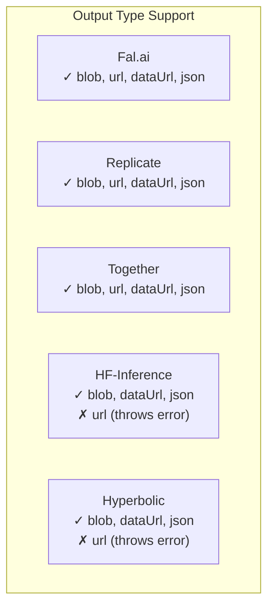

Providers that don't support URL output throw `InferenceClientInputError` when `outputType: "url"` is requested [packages/inference/src/providers/hf-inference.ts:129-131]().

**Sources:** [packages/inference/src/providers/providerHelper.ts:150-158](), [packages/inference/src/providers/fal-ai.ts:206-238](), [packages/inference/src/types.ts:1-50]()

## Request Pipeline Integration

The provider abstraction integrates with the request pipeline through a series of helper functions that coordinate provider selection, request construction, and execution.

### Request Flow

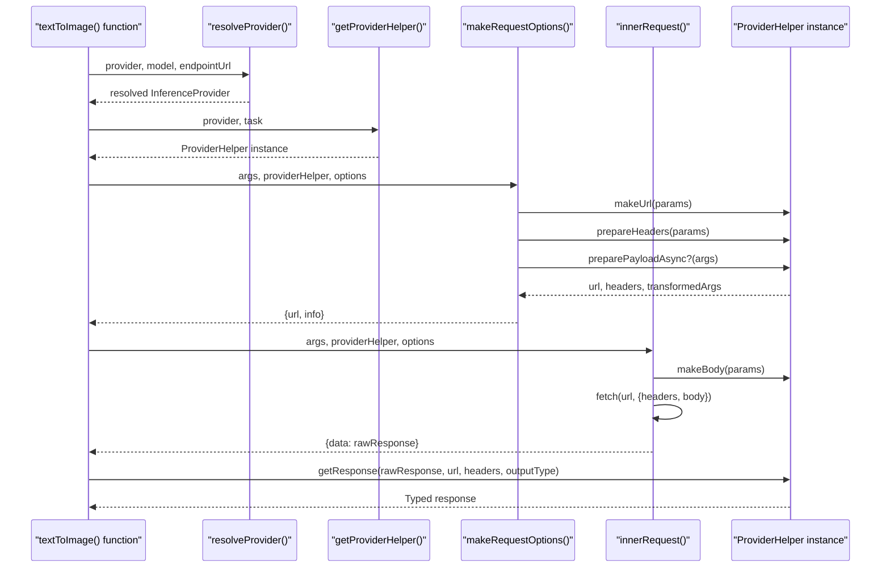

**Key Pipeline Functions:**

1. **`resolveProvider()`** - Determines which provider to use based on model availability and user preferences
2. **`getProviderHelper()`** - Instantiates the appropriate provider helper class for the task
3. **`makeRequestOptions()`** - Calls provider helper methods to construct URL, headers, and transformed arguments
4. **`innerRequest()`** - Executes the HTTP request using provider-specific body construction
5. **Provider's `getResponse()`** - Transforms the raw response into the expected output type

**Sources:** [packages/inference/src/tasks/cv/textToImage.ts:38-46]()

### Payload Transformation Pipeline

The system handles both synchronous and asynchronous payload transformations:

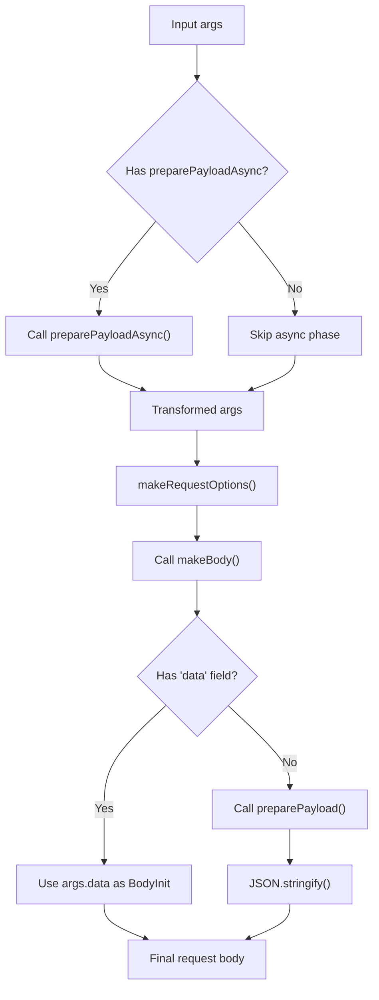

This allows providers to handle binary inputs asynchronously while maintaining a simple synchronous API for text-based tasks.

**Sources:** [packages/inference/src/providers/providerHelper.ts:113-118](), [packages/inference/src/lib/makeRequestOptions.ts:1-100]()

## Provider-Specific Optimizations

Provider implementations include optimizations tailored to their specific API characteristics.

### HF-Inference Direct Endpoint Support

The HF-Inference provider supports both Hub model IDs and direct endpoint URLs:

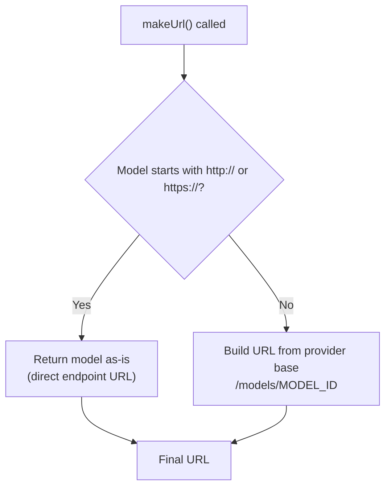

This enables users to call dedicated inference endpoints directly without additional configuration [packages/inference/src/providers/hf-inference.ts:106-111]().

**Sources:** [packages/inference/src/providers/hf-inference.ts:99-124]()

### Fal.ai LoRA Adapter Support

Fal.ai's text-to-image implementation includes automatic LoRA adapter handling when model mappings specify adapter weights:

```typescript
// From FalAITextToImageTask.preparePayload()
if (params.mapping?.adapter === "lora" && params.mapping.adapterWeightsPath) {
    payload.loras = [{
        path: buildLoraPath(params.mapping.hfModelId, params.mapping.adapterWeightsPath),
        scale: 1,
    }];
}
```

This constructs Hub URLs for adapter weights and injects them into the Fal.ai request [packages/inference/src/providers/fal-ai.ts:191-201]().

**Sources:** [packages/inference/src/providers/fal-ai.ts:176-204]()

### Replicate Multiple Input Field Mapping

Replicate's image-to-image implementation handles provider-side inconsistencies by sending the image in multiple field names:

```typescript
// From ReplicateImageToImageTask.preparePayload()
input: {
    image: imageInput,
    images: [imageInput],
    input_image: imageInput,
    input_images: [imageInput],
    // ... other parameters
}
```

Different Replicate models expect images in different fields, so the implementation sends all variations [packages/inference/src/providers/replicate.ts:248-260]().

**Sources:** [packages/inference/src/providers/replicate.ts:244-263]()

### Base Class Inheritance Patterns

Providers leverage inheritance to share common functionality:

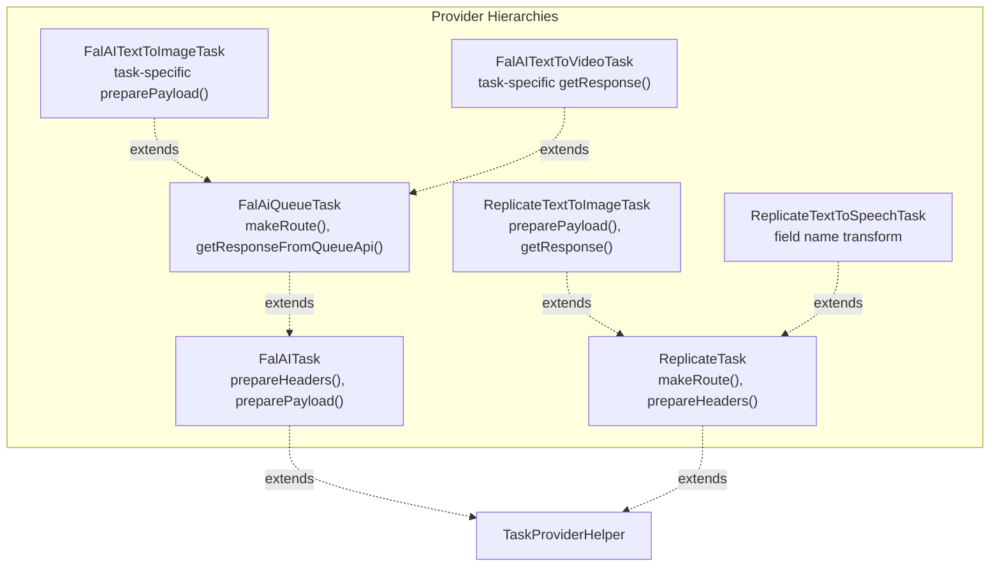

**Fal.ai Hierarchy:**
- `FalAITask` provides authentication handling for both HF tokens and provider keys [packages/inference/src/providers/fal-ai.ts:85-94]()
- `FalAiQueueTask` adds queue polling logic [packages/inference/src/providers/fal-ai.ts:97-170]()
- Task-specific classes (e.g., `FalAITextToImageTask`) customize payload/response handling

**Replicate Hierarchy:**
- `ReplicateTask` handles model version parsing from `model:version` format [packages/inference/src/providers/replicate.ts:42-56]()
- Task-specific classes implement custom payload structures and response parsing

**Sources:** [packages/inference/src/providers/fal-ai.ts:74-95](), [packages/inference/src/providers/replicate.ts:37-73]()

### Response Validation and Error Handling

Provider helpers implement rigorous response validation using TypeScript type guards:

```typescript
// Example from HFInferenceFeatureExtractionTask
const isNumArrayRec = (arr: unknown[], maxDepth: number, curDepth = 0): boolean => {
    if (curDepth > maxDepth) return false;
    if (arr.every((x) => Array.isArray(x))) {
        return arr.every((x) => isNumArrayRec(x as unknown[], maxDepth, curDepth + 1));
    } else {
        return arr.every((x) => typeof x === "number");
    }
};
```

This recursive validator ensures feature extraction outputs are properly nested number arrays [packages/inference/src/providers/hf-inference.ts:316-323](). When validation fails, providers throw `InferenceClientProviderOutputError` with descriptive messages about the expected format.

**Sources:** [packages/inference/src/providers/hf-inference.ts:314-330](), [packages/inference/src/errors.ts:1-100]()

---

