<!-- source: DeepWiki mcp.deepwiki.com · repo huggingface/huggingface.js · page 5.2 Type Generation and Code Generation · fetched 2026-10-26 -->

# Type Generation and Code Generation

<details>
<summary>Relevant source files</summary>

The following files were used as context for generating this wiki page:

- [packages/tasks/.gitignore](packages/tasks/.gitignore)
- [packages/tasks/package.json](packages/tasks/package.json)
- [packages/tasks/pnpm-lock.yaml](packages/tasks/pnpm-lock.yaml)
- [packages/tasks/src/tasks/chat-completion/inference.ts](packages/tasks/src/tasks/chat-completion/inference.ts)
- [packages/tasks/src/tasks/chat-completion/spec/input.json](packages/tasks/src/tasks/chat-completion/spec/input.json)
- [packages/tasks/src/tasks/chat-completion/spec/output.json](packages/tasks/src/tasks/chat-completion/spec/output.json)
- [packages/tasks/src/tasks/chat-completion/spec/stream_output.json](packages/tasks/src/tasks/chat-completion/spec/stream_output.json)
- [packages/tasks/src/tasks/text-generation/inference.ts](packages/tasks/src/tasks/text-generation/inference.ts)
- [packages/tasks/src/tasks/text-generation/spec/input.json](packages/tasks/src/tasks/text-generation/spec/input.json)
- [packages/tasks/src/tasks/text-generation/spec/output.json](packages/tasks/src/tasks/text-generation/spec/output.json)
- [packages/tasks/src/tasks/text-generation/spec/stream_output.json](packages/tasks/src/tasks/text-generation/spec/stream_output.json)

</details>


## Purpose and Scope

This page documents the type generation and code generation strategy used in the `@huggingface/tasks` package to automatically produce TypeScript type definitions from JSON Schema specifications. This system ensures type safety and API consistency across the Hugging Face.js ecosystem by treating JSON schemas as the single source of truth for inference API contracts.

For information about how these types are consumed by the inference system, see [Task Functions and Types](#2.1.3). For the broader task metadata system, see [Task Definitions and Type System](#3.1.1).

## Architecture Overview

The type generation system follows a three-stage pipeline where JSON Schema specifications derived from Text Generation Inference (TGI) server APIs are automatically converted into TypeScript type definitions that are distributed via the `@huggingface/tasks` package.

```mermaid
graph LR
    TGI["TGI Server APIs<br/>(Rust/Python)"]
    SCHEMA["JSON Schema Specs<br/>packages/tasks/src/tasks/*/spec/*.json"]
    CODEGEN["inference-codegen<br/>Script"]
    TS["TypeScript Interfaces<br/>packages/tasks/src/tasks/*/inference.ts"]
    INFERENCE["@huggingface/inference<br/>Consumer Package"]
    
    TGI -->|"Import via<br/>inference-tgi-import.ts"| SCHEMA
    SCHEMA -->|"Parse & Transform"| CODEGEN
    CODEGEN -->|"Generate"| TS
    TS -->|"Import Types"| INFERENCE
```

**Sources:** [packages/tasks/src/tasks/chat-completion/inference.ts:1-5](), [packages/tasks/src/tasks/text-generation/inference.ts:1-5](), [packages/tasks/package.json:44]()

## JSON Schema as Source of Truth

All inference type definitions originate from JSON Schema specifications stored in task-specific `spec/` directories. Each task type (e.g., `chat-completion`, `text-generation`) maintains separate schema files for inputs, outputs, and streaming outputs.

### Schema File Organization

| Task Type | Input Schema | Output Schema | Stream Output Schema |
|-----------|-------------|---------------|---------------------|
| `chat-completion` | `spec/input.json` | `spec/output.json` | `spec/stream_output.json` |
| `text-generation` | `spec/input.json` | `spec/output.json` | `spec/stream_output.json` |

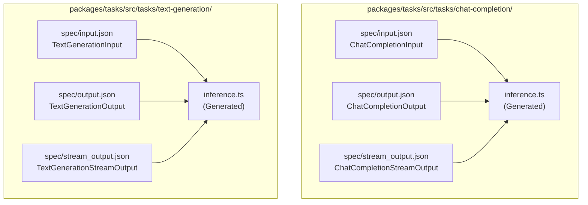

**Sources:** [packages/tasks/src/tasks/chat-completion/spec/input.json:1-5](), [packages/tasks/src/tasks/chat-completion/spec/output.json:1-5](), [packages/tasks/src/tasks/text-generation/spec/input.json:1-5]()

### Schema Metadata

Every JSON schema file includes metadata that identifies its origin and purpose:

```json
{
  "$id": "/inference/schemas/chat-completion/input.json",
  "$schema": "http://json-schema.org/draft-06/schema#",
  "description": "Chat Completion Input.\n\nAuto-generated from TGI specs.\nFor more details, check out https://github.com/huggingface/huggingface.js/blob/main/packages/tasks/scripts/inference-tgi-import.ts.",
  "title": "ChatCompletionInput"
}
```

The `description` field explicitly states that schemas are "Auto-generated from TGI specs", indicating they are derived from the Text Generation Inference server's API definitions via the `inference-tgi-import.ts` script.

**Sources:** [packages/tasks/src/tasks/chat-completion/spec/input.json:1-6](), [packages/tasks/src/tasks/text-generation/spec/input.json:1-6]()

## JSON Schema Structure

The schemas use JSON Schema Draft 06 and leverage advanced features including nested object definitions, discriminated unions, and type references via `$defs`.

### Core Schema Features

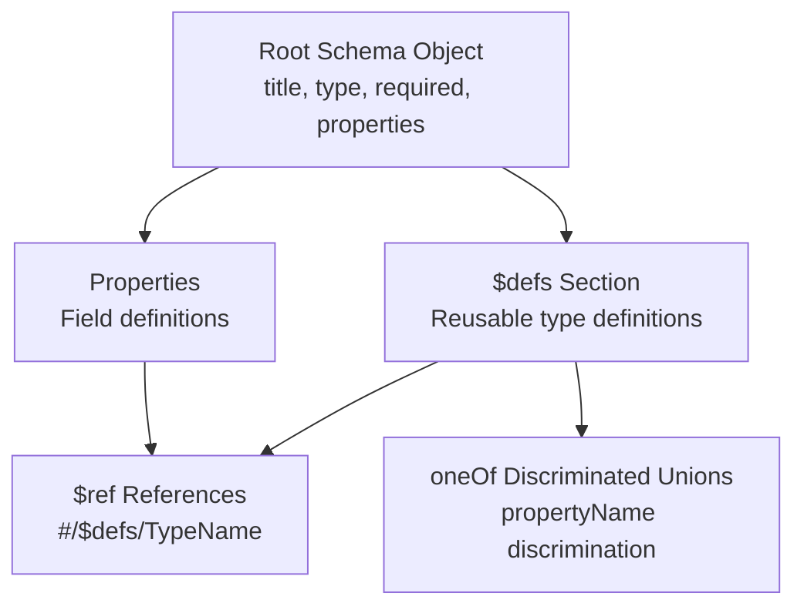

**Sources:** [packages/tasks/src/tasks/chat-completion/spec/input.json:152-432]()

### Example: Chat Completion Input Schema

The `ChatCompletionInput` schema demonstrates the hierarchical structure with required fields, optional parameters, and nested type definitions:

| Property | Type | Required | Description |
|----------|------|----------|-------------|
| `messages` | `ChatCompletionInputMessage[]` | Yes | Conversation history |
| `max_tokens` | `integer` | No | Token generation limit |
| `temperature` | `number` | No | Sampling temperature (0-2) |
| `stream` | `boolean` | No | Enable streaming |
| `tools` | `ChatCompletionInputTool[]` | No | Function calling tools |

**Sources:** [packages/tasks/src/tasks/chat-completion/spec/input.json:8-151]()

### Type Definitions with $defs

Complex types are defined in the `$defs` section and referenced throughout the schema using JSON Pointer syntax (`$ref: "#/$defs/TypeName"`):


The `ChatCompletionInputMessage` type is defined as an `allOf` composition that combines a base message structure with role information:

**Sources:** [packages/tasks/src/tasks/chat-completion/spec/input.json:153-258]()

### Discriminated Unions

Schemas use `oneOf` with `discriminator` to represent polymorphic types:

```json
{
  "ChatCompletionInputMessageContent": {
    "oneOf": [
      { "type": "string" },
      { 
        "type": "array",
        "items": { "$ref": "#/$defs/ChatCompletionInputMessageChunk" }
      }
    ]
  }
}
```

The `discriminator.propertyName` field specifies which property determines the variant:

**Sources:** [packages/tasks/src/tasks/chat-completion/spec/input.json:202-214](), [packages/tasks/src/tasks/chat-completion/spec/input.json:244-248]()

## Code Generation Process

The `inference-codegen` script transforms JSON Schema files into TypeScript interfaces. This process runs automatically during the package's prepublish phase to ensure generated types are always synchronized with schema definitions.

### Build Integration

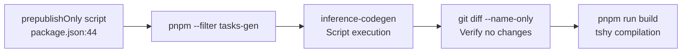

The prepublish script enforces that:
1. Code generation runs before publishing
2. No uncommitted changes exist in `src/` (ensuring schemas and generated code are in sync)
3. TypeScript compilation succeeds

**Sources:** [packages/tasks/package.json:44]()

### Generation Process Flow

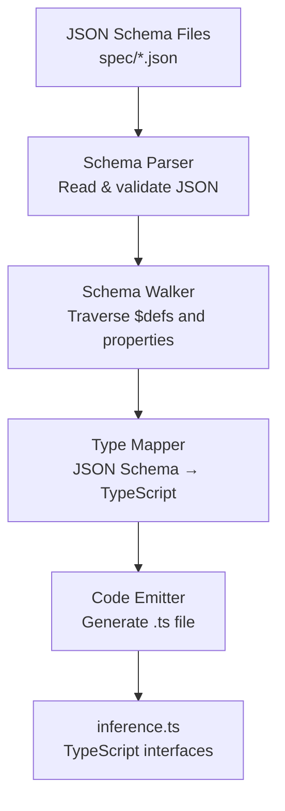

**Sources:** [packages/tasks/src/tasks/chat-completion/inference.ts:1-5]()

### Type Mapping Rules

The code generator applies systematic transformations from JSON Schema types to TypeScript:

| JSON Schema Type | TypeScript Type | Notes |
|-----------------|-----------------|-------|
| `string` | `string` | Direct mapping |
| `integer`, `number` | `number` | Both map to number |
| `boolean` | `boolean` | Direct mapping |
| `array` with `items` | `Type[]` | Array of item type |
| `object` with `properties` | `interface` | Named interface |
| `oneOf` | Union type `A \| B` | Discriminated unions |
| `allOf` | Intersection type | Merged interfaces |
| `$ref` | Reference to interface | Type references |
| `nullable: true` | `Type \| undefined` | Optional chaining |

**Sources:** [packages/tasks/src/tasks/chat-completion/inference.ts:13-330]()

## Generated TypeScript Interfaces

The code generator produces TypeScript interface definitions with documentation comments, proper type hierarchies, and index signatures for extensibility.

### File Header and Metadata

Every generated file includes a header identifying it as generated code:

```typescript
/**
 * Inference code generated from the JSON schema spec in ./spec
 *
 * Using src/scripts/inference-codegen
 */
```

This header appears at the top of all `inference.ts` files to indicate they should not be manually edited.

**Sources:** [packages/tasks/src/tasks/chat-completion/inference.ts:1-5](), [packages/tasks/src/tasks/text-generation/inference.ts:1-5]()

### Interface Generation Pattern

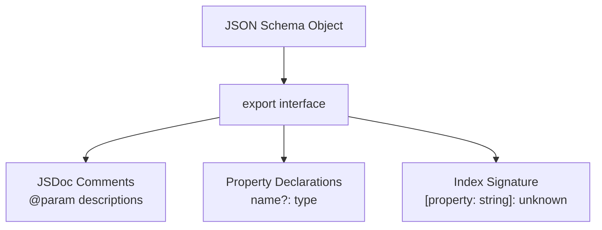

**Sources:** [packages/tasks/src/tasks/chat-completion/inference.ts:13-106]()

### Example: ChatCompletionInput Interface

The generated `ChatCompletionInput` interface demonstrates the complete transformation:

```typescript
export interface ChatCompletionInput {
	/**
	 * Number between -2.0 and 2.0. Positive values penalize new tokens based on their existing
	 * frequency in the text so far,
	 * decreasing the model's likelihood to repeat the same line verbatim.
	 */
	frequency_penalty?: number;
	/**
	 * The maximum number of tokens that can be generated in the chat completion.
	 */
	max_tokens?: number;
	/**
	 * A list of messages comprising the conversation so far.
	 */
	messages: ChatCompletionInputMessage[];
	// ... additional properties
	[property: string]: unknown;
}
```

**Sources:** [packages/tasks/src/tasks/chat-completion/inference.ts:13-106]()

### Nested Type Generation

Complex nested structures are generated as separate exported interfaces:

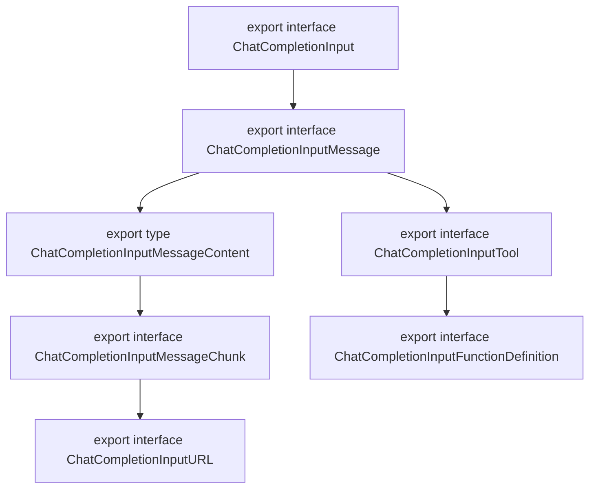

Each interface is exported individually, allowing consumers to reference specific types:

**Sources:** [packages/tasks/src/tasks/chat-completion/inference.ts:107-203]()

### Union Types from oneOf

The `oneOf` schema construct generates TypeScript union types:

```typescript
export type ChatCompletionInputMessageContent = 
    ChatCompletionInputMessageChunk[] | string;

export type ChatCompletionInputMessageChunkType = "text" | "image_url";

export type ChatCompletionInputToolChoice = 
    ChatCompletionInputToolChoiceEnum | ChatCompletionInputToolChoiceObject;
```

**Sources:** [packages/tasks/src/tasks/chat-completion/inference.ts:114](), [packages/tasks/src/tasks/chat-completion/inference.ts:125](), [packages/tasks/src/tasks/chat-completion/inference.ts:182]()

### Index Signatures for Extensibility

All generated interfaces include an index signature to allow additional properties:

```typescript
export interface ChatCompletionInput {
    // ... defined properties
    [property: string]: unknown;
}
```

This pattern enables forward compatibility when inference servers add new parameters without requiring immediate type updates.

**Sources:** [packages/tasks/src/tasks/chat-completion/inference.ts:105](), [packages/tasks/src/tasks/text-generation/inference.ts:17]()

## Type Coverage by Task

The generation system produces comprehensive type definitions for multiple inference tasks:

### Chat Completion Types

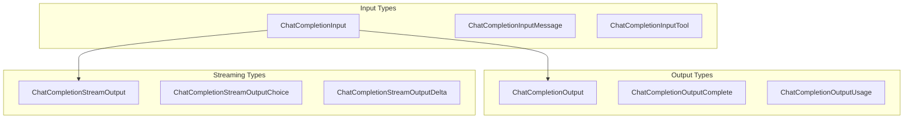

| Category | Interface Count | Key Types |
|----------|----------------|-----------|
| Input | 15 | `ChatCompletionInput`, `ChatCompletionInputMessage`, `ChatCompletionInputTool` |
| Output | 8 | `ChatCompletionOutput`, `ChatCompletionOutputMessage`, `ChatCompletionOutputUsage` |
| Streaming | 9 | `ChatCompletionStreamOutput`, `ChatCompletionStreamOutputDelta` |

**Sources:** [packages/tasks/src/tasks/chat-completion/inference.ts:13-329]()

### Text Generation Types

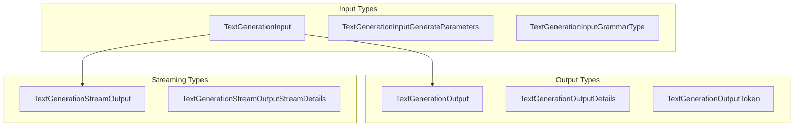

| Category | Interface Count | Key Types |
|----------|----------------|-----------|
| Input | 3 | `TextGenerationInput`, `TextGenerationInputGenerateParameters` |
| Output | 5 | `TextGenerationOutput`, `TextGenerationOutputDetails`, `TextGenerationOutputToken` |
| Streaming | 3 | `TextGenerationStreamOutput`, `TextGenerationStreamOutputStreamDetails` |

**Sources:** [packages/tasks/src/tasks/text-generation/inference.ts:13-187]()

## Integration with Inference Package

The generated types are consumed by the `@huggingface/inference` package to provide type safety for all inference operations.

### Type Import Pattern

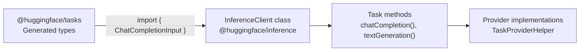

The inference package imports generated types and uses them as method signatures:

```typescript
// In @huggingface/inference
import type { 
  ChatCompletionInput, 
  ChatCompletionOutput 
} from '@huggingface/tasks';

class InferenceClient {
  async chatCompletion(
    params: ChatCompletionInput
  ): Promise<ChatCompletionOutput> {
    // implementation
  }
}
```

**Sources:** [packages/tasks/src/tasks/chat-completion/inference.ts:13-106](), [packages/tasks/src/tasks/chat-completion/inference.ts:211-266]()

### Type-Safe Request Construction

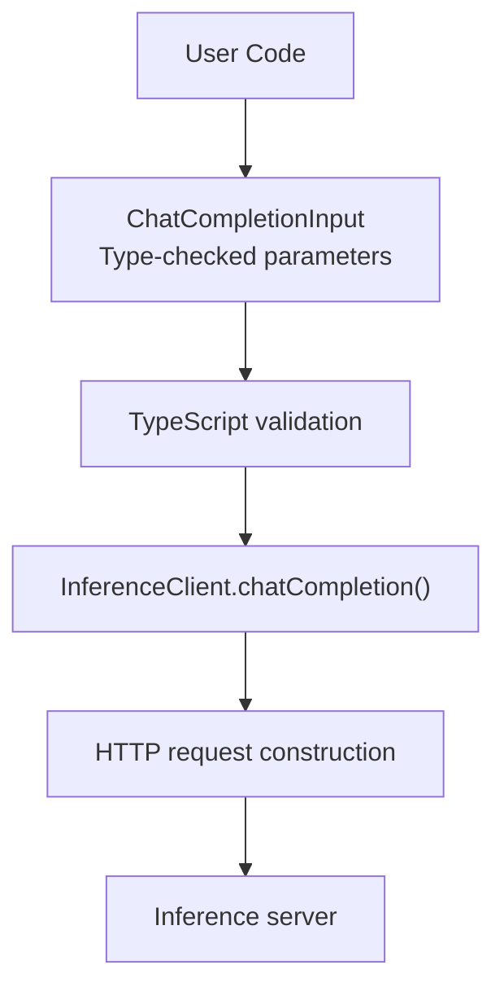

The type system ensures that:
1. Required fields (e.g., `messages`) are provided
2. Optional fields match expected types
3. Invalid properties are caught at compile time
4. Documentation is available via IDE autocomplete

**Sources:** [packages/tasks/src/tasks/chat-completion/inference.ts:13-106]()

## Type Safety Guarantees

The code generation approach provides multiple layers of type safety across the development and runtime lifecycle.

### Compile-Time Type Safety

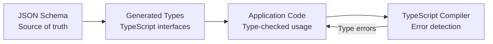

TypeScript's type checker validates:
- Required vs optional properties
- Type correctness (string vs number vs array)
- Nested object structure
- Union type discrimination

**Sources:** [packages/tasks/package.json:50]()

### Schema Validation Benefits

| Benefit | Description | Implementation |
|---------|-------------|----------------|
| Single Source of Truth | JSON schemas define the API contract | `spec/*.json` files |
| Consistency | All packages use identical type definitions | Shared `@huggingface/tasks` package |
| Documentation | JSDoc comments extracted from schema descriptions | Auto-generated in interfaces |
| Version Control | Schema changes tracked in Git | Diff checking in prepublish |
| Breaking Change Detection | Type incompatibilities caught at build time | `git diff --exit-code` |

**Sources:** [packages/tasks/package.json:44]()

### Build-Time Verification

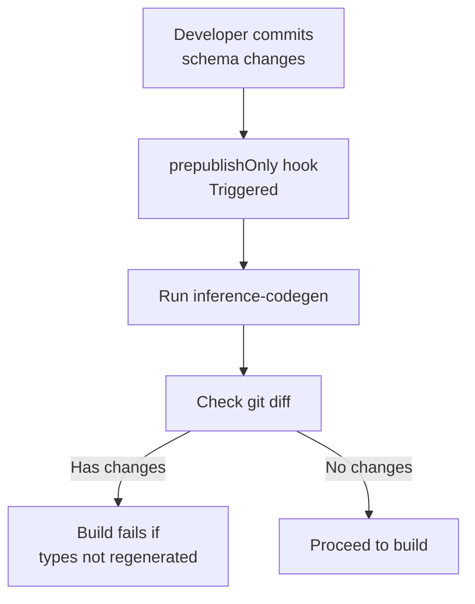

The build process enforces that generated types stay synchronized with schemas through the `git diff --name-only --exit-code src` check, which fails if regeneration produces uncommitted changes.

**Sources:** [packages/tasks/package.json:44]()

## Extension Points

The type generation system is designed for extensibility to accommodate new inference tasks and evolving API specifications.

### Adding New Task Types

To add a new inference task type:

1. Create directory: `packages/tasks/src/tasks/{task-name}/`
2. Add schemas: `spec/input.json`, `spec/output.json`, `spec/stream_output.json`
3. Run: `pnpm --filter tasks-gen inference-codegen`
4. Export types from `packages/tasks/src/index.ts`

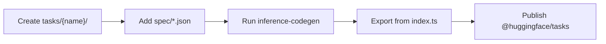

**Sources:** [packages/tasks/package.json:44]()

### Schema Evolution Strategy

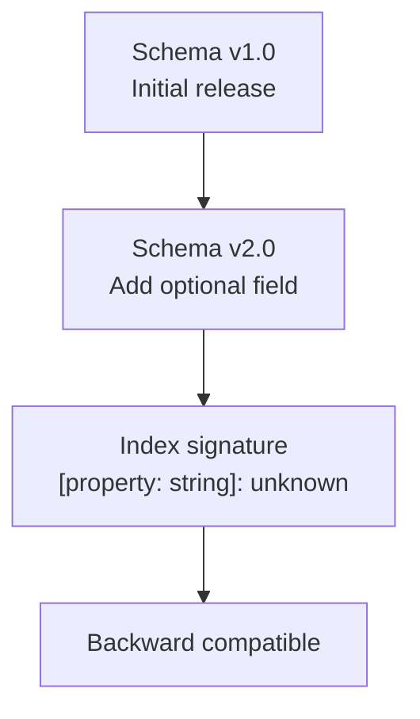

The index signature pattern (`[property: string]: unknown`) allows schemas to evolve by adding optional fields without breaking existing code that uses older versions of the types.

**Sources:** [packages/tasks/src/tasks/chat-completion/inference.ts:105](), [packages/tasks/src/tasks/text-generation/inference.ts:17]()

---

