<!-- source: DeepWiki mcp.deepwiki.com · repo huggingface/huggingface.js · page 5.3 Efficient File Operations · fetched 2026-10-26 -->

# Efficient File Operations

<details>
<summary>Relevant source files</summary>

The following files were used as context for generating this wiki page:

- [packages/gguf/README.md](packages/gguf/README.md)
- [packages/gguf/package.json](packages/gguf/package.json)
- [packages/gguf/pnpm-lock.yaml](packages/gguf/pnpm-lock.yaml)
- [packages/gguf/scripts/generate-llm.ts](packages/gguf/scripts/generate-llm.ts)
- [packages/gguf/src/cli.ts](packages/gguf/src/cli.ts)
- [packages/gguf/src/gguf.spec.ts](packages/gguf/src/gguf.spec.ts)
- [packages/gguf/src/gguf.ts](packages/gguf/src/gguf.ts)
- [packages/gguf/src/quant-descriptions.ts](packages/gguf/src/quant-descriptions.ts)
- [packages/gguf/src/transformer-llm.ts](packages/gguf/src/transformer-llm.ts)
- [packages/gguf/src/types.spec.ts](packages/gguf/src/types.spec.ts)
- [packages/gguf/src/types.ts](packages/gguf/src/types.ts)
- [packages/gguf/src/utils/FileBlob.ts](packages/gguf/src/utils/FileBlob.ts)
- [packages/gguf/src/utils/isBackend.ts](packages/gguf/src/utils/isBackend.ts)
- [packages/hub/.gitignore](packages/hub/.gitignore)
- [packages/hub/scripts/bench.ts](packages/hub/scripts/bench.ts)
- [packages/hub/scripts/debug-xet.ts](packages/hub/scripts/debug-xet.ts)
- [packages/hub/src/lib/commit.ts](packages/hub/src/lib/commit.ts)
- [packages/hub/src/lib/parse-safetensors-metadata.spec.ts](packages/hub/src/lib/parse-safetensors-metadata.spec.ts)
- [packages/hub/src/lib/parse-safetensors-metadata.ts](packages/hub/src/lib/parse-safetensors-metadata.ts)
- [packages/hub/src/lib/upload-files-with-progress.spec.ts](packages/hub/src/lib/upload-files-with-progress.spec.ts)
- [packages/hub/src/utils/ChunkCache.spec.ts](packages/hub/src/utils/ChunkCache.spec.ts)
- [packages/hub/src/utils/ChunkCache.ts](packages/hub/src/utils/ChunkCache.ts)
- [packages/hub/src/utils/createXorb.spec.ts](packages/hub/src/utils/createXorb.spec.ts)
- [packages/hub/src/utils/createXorbs.ts](packages/hub/src/utils/createXorbs.ts)
- [packages/hub/src/utils/uploadShards.ts](packages/hub/src/utils/uploadShards.ts)
- [packages/hub/src/utils/xetWriteToken.ts](packages/hub/src/utils/xetWriteToken.ts)
- [packages/tasks/src/gguf.ts](packages/tasks/src/gguf.ts)

</details>


This document covers architectural patterns and implementation strategies for efficient file handling across the Hugging Face.js ecosystem. The focus is on minimizing bandwidth usage, memory consumption, and processing time when working with large model files (often multi-GB GGUF, Safetensors, or arbitrary files).

Topics covered include streaming file access via HTTP range requests, content-defined chunking for deduplication, local and remote chunk caching, and the Xet protocol for efficient uploads. For information about the overall Hub file operations API, see [Repository and File Operations](#2.2.1). For details on the Xet upload protocol's high-level design, see [Xet Upload Protocol](#2.2.2).

## Streaming File Access with RangeView

The codebase implements efficient streaming access to both remote and local files through the `RangeView` pattern, which enables reading large files in manageable chunks without loading entire files into memory.

### RangeView Architecture

The `RangeView` class provides stateful chunk-based access to files, fetching data on-demand as parsing progresses. This is critical for parsing large GGUF files (often 50GB+) where only metadata (typically <50MB) needs to be extracted.

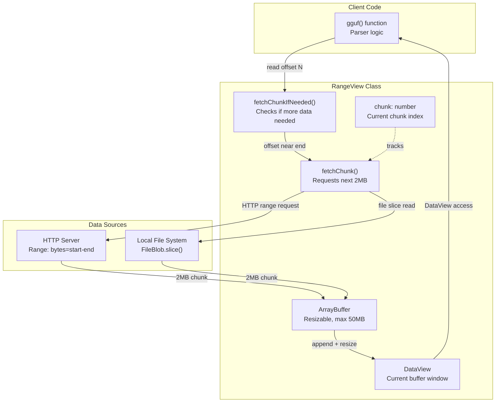

**RangeView Streaming Architecture**

The `RangeView` implementation uses these key constants:

- `HTTP_CHUNK_SIZE`: 2MB - Size of each range request
- `HTTP_DATA_LEEWAY`: 500KB - Triggers next fetch when this much data remains
- `HTTP_TOTAL_MAX_SIZE`: 50MB - Maximum total buffer size

Sources: [packages/gguf/src/gguf.ts:63-148]()

### HTTP Range Request Strategy

For remote files, `RangeView` issues HTTP range requests to fetch only the needed portions:

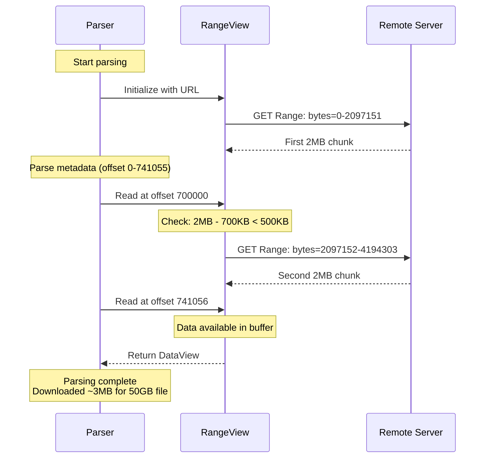

**HTTP Range Request Sequence**

The range request headers follow this format:

```
Range: bytes=<chunk_index * 2097152>-<(chunk_index + 1) * 2097152 - 1>
```

When parsing a GGUF file, this allows extracting just the header and metadata section without downloading tensor weights, resulting in bandwidth savings of 99%+ for large models.

Sources: [packages/gguf/src/gguf.ts:99-113]()

### Local File Chunking

For Node.js environments, `RangeViewLocalFile` extends `RangeView` to provide the same interface for local files:

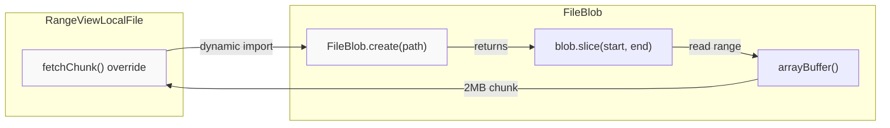

**Local File Chunk Reading**

The `FileBlob` class provides lazy file reading to avoid loading entire files into memory. It creates a `Blob`-compatible interface over Node.js file handles.

Sources: [packages/gguf/src/gguf.ts:154-166](), [packages/gguf/src/utils/FileBlob.ts:1-108]()

### Buffer Management

`RangeView` uses a resizable `ArrayBuffer` to accumulate chunks while maintaining a fixed maximum size:

```typescript
// ArrayBuffer with maxByteLength for efficient resizing
this.buffer = new ArrayBuffer(0, { maxByteLength: HTTP_TOTAL_MAX_SIZE });
```

When new data arrives, the buffer grows:

```typescript
// Modern browsers: ArrayBuffer.resize()
this.buffer.resize((this.chunk + 1) * HTTP_CHUNK_SIZE);
new Uint8Array(this.buffer).set(buf, this.chunk * HTTP_CHUNK_SIZE);

// Fallback: allocate new buffer and copy
const newBuffer = new ArrayBuffer((this.chunk + 1) * HTTP_CHUNK_SIZE, 
                                  { maxByteLength: HTTP_TOTAL_MAX_SIZE });
const arrView = new Uint8Array(newBuffer);
arrView.set(new Uint8Array(this.buffer));
arrView.set(buf, this.chunk * HTTP_CHUNK_SIZE);
```

This approach minimizes memory allocations while keeping memory usage bounded.

Sources: [packages/gguf/src/gguf.ts:117-138]()

## Content-Defined Chunking

The Xet protocol uses content-defined chunking (CDC) to identify natural boundaries in file content, enabling efficient deduplication across file versions and similar files.

### Chunking Algorithm

Content-defined chunking operates on a sliding window to find chunk boundaries based on content patterns rather than fixed byte positions:

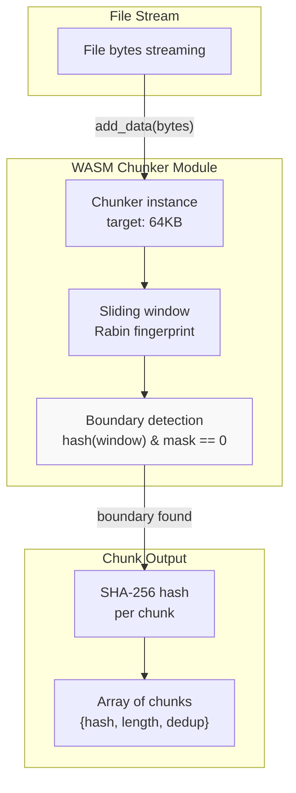

**Content-Defined Chunking Flow**

The chunker is initialized with a target chunk size (64KB) but produces variable-length chunks based on content:

```typescript
const TARGET_CHUNK_SIZE = 64 * 1024;
const MAX_CHUNK_SIZE = 2 * TARGET_CHUNK_SIZE;

const chunker = new chunkModule.Chunker(TARGET_CHUNK_SIZE);

// Process file stream
const { done, value } = await reader.read();
const chunks = chunker.add_data(value); // Returns array of completed chunks

// Finalize remaining data
const finalChunks = chunker.finish();
```

Sources: [packages/hub/src/utils/createXorbs.ts:9-12](), [packages/hub/src/utils/createXorbs.ts:166-339]()

### CDC Benefits for Deduplication

Content-defined chunking provides superior deduplication compared to fixed-size chunking:

| Operation | Fixed 64KB Chunks | Content-Defined Chunks |
|-----------|-------------------|------------------------|
| Insert 1KB at file start | All chunks different | Only first chunk different |
| Append data | Last chunk different | Last chunk different |
| Modify middle | One chunk different | One chunk different |
| Reorder sections | Many chunks different | Only boundary chunks different |

By finding natural boundaries, CDC ensures that local modifications don't cascade into misaligned chunks throughout the rest of the file.

### Chunk Processing Pipeline

As file data streams in, chunks are processed through multiple stages:

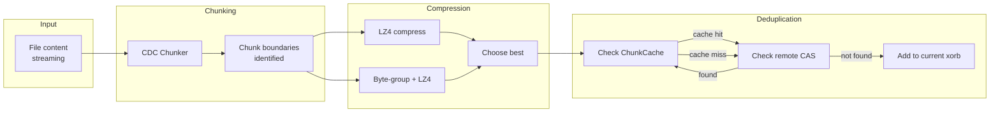

**Chunk Processing Pipeline**

Each chunk goes through compression, deduplication checks, and finally xorb packing if it's new content.

Sources: [packages/hub/src/utils/createXorbs.ts:203-329]()

## Deduplication Strategies

The system implements a two-tier deduplication strategy: local deduplication using an in-memory cache, and remote deduplication by querying the content-addressable storage (CAS) backend.

### Local Deduplication with ChunkCache

The `ChunkCache` class maintains a fast lookup table of chunk hashes to their xorb locations:

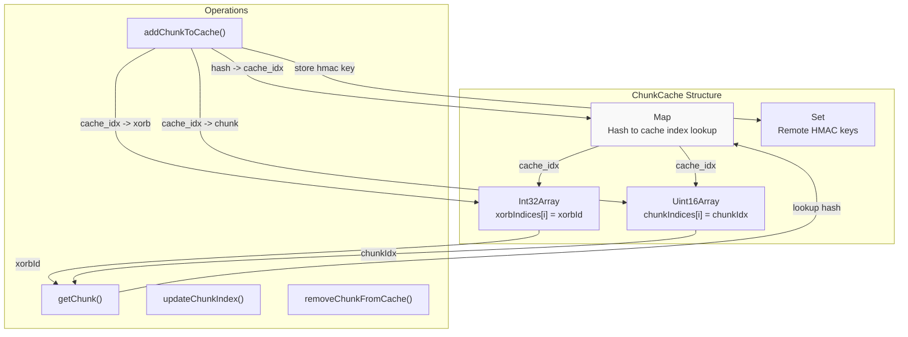

**ChunkCache Data Structure**

The cache uses typed arrays for memory efficiency:

- `Map<string, number>`: Hash to cache index (allows O(1) lookup)
- `Int32Array`: Xorb indices (negative for remote xorbs, positive for local)
- `Uint16Array`: Chunk indices within xorbs (max 8K chunks per xorb)
- `Set<string>`: HMAC keys for remote deduplication

This design keeps memory overhead minimal - approximately 42 bytes per cached chunk (20 bytes for Map entry + 4 bytes xorb index + 2 bytes chunk index + ~16 bytes Set overhead for HMAC).

Sources: [packages/hub/src/utils/ChunkCache.ts:1-99]()

### Cache Growth Strategy

The cache grows dynamically to accommodate more chunks:

```typescript
const CHUNK_CACHE_INITIAL_SIZE = 10_000;
const CHUNK_CACHE_GROW_FACTOR = 1.5;
const CHUNK_CACHE_MAX_SIZE = 1_000_000;

if (this.index >= this.xorbIndices.length) {
    const newSize = Math.min(
        this.xorbIndices.length * CHUNK_CACHE_GROW_FACTOR, 
        this.maxSize
    );
    // Reallocate and copy old data
    this.xorbIndices = new Int32Array(newSize);
    this.chunkIndices = new Uint16Array(newSize);
    // ... copy old data
}
```

The cache operates as a circular buffer, overwriting oldest entries when the limit is reached.

Sources: [packages/hub/src/utils/ChunkCache.ts:1-56]()

### Remote Deduplication

Remote deduplication queries the backend CAS to find chunks that already exist in storage:

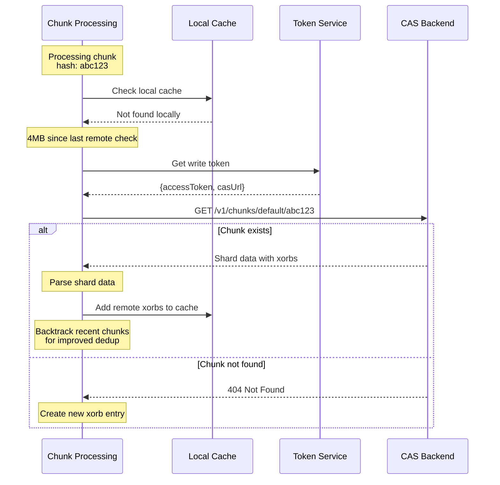

**Remote Deduplication Flow**

Remote deduplication happens at intervals to avoid excessive network requests:

```typescript
const INTERVAL_BETWEEN_REMOTE_DEDUP = 4_000_000; // 4MB

let bytesSinceRemoteDedup = Infinity;

// After processing some chunks...
if (chunk.dedup && bytesSinceRemoteDedup >= INTERVAL_BETWEEN_REMOTE_DEDUP) {
    const token = await xetWriteToken(params);
    bytesSinceRemoteDedup = 0;
    
    const shardResp = await fetch(
        `${token.casUrl}/v1/chunks/default/${chunk.hash}`,
        { headers: { Authorization: `Bearer ${token.accessToken}` }}
    );
    
    if (shardResp.ok) {
        const shardData = await parseShardData(await shardResp.blob());
        // Add remote chunks to cache...
    }
}
```

Sources: [packages/hub/src/utils/createXorbs.ts:14](), [packages/hub/src/utils/createXorbs.ts:216-256]()

### Backtracking for Improved Deduplication

When new remote deduplication information arrives, the system backtracks through recent chunks to see if they match newly discovered remote xorbs:

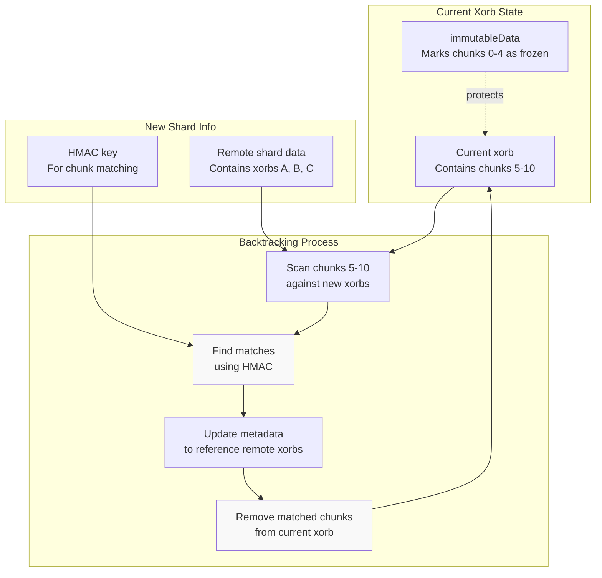

**Backtracking Deduplication Process**

The backtracking algorithm:

1. Receives new shard data with remote xorb information
2. Computes HMAC hashes for recent chunks (after `immutableData` boundary)
3. Checks if any recent chunks match remote chunks via HMAC
4. Updates chunk metadata to reference remote xorbs instead of local xorb
5. Removes deduplicated chunks from current xorb buffer
6. Updates chunk indices for remaining chunks

This can improve deduplication ratios by 5-15% by finding matches after the fact.

Sources: [packages/hub/src/utils/createXorbs.ts:380-486]()

### Deduplication Ratio Tracking

The system tracks how much data was deduplicated for reporting:

```typescript
let dedupedBytes = 0;

// When chunk is found in cache
if (cacheData !== undefined) {
    dedupedBytes += chunk.length;
    xorb.fileUploadedBytes[fileSource.path] += chunk.length;
}

// When backtracking finds matches
dedupedBytes = backtrackDedup(
    xorb, computeHmac, shardData, chunkCache, 
    chunkMetadata, dedupedBytes
);

// Final dedup ratio
const dedupRatio = fileSource.content.size > 0 
    ? dedupedBytes / fileSource.content.size 
    : 0;
```

This ratio is reported in the output events to provide visibility into efficiency gains.

Sources: [packages/hub/src/utils/createXorbs.ts:191](), [packages/hub/src/utils/createXorbs.ts:284-286](), [packages/hub/src/utils/createXorbs.ts:351]()

## Xorb Creation and Compression

Xorbs (extensible binary objects) are the fundamental storage unit in the Xet protocol, packing compressed chunks with metadata for efficient storage and retrieval.

### Xorb Structure

Each xorb is a binary container with a header for each chunk followed by compressed data:

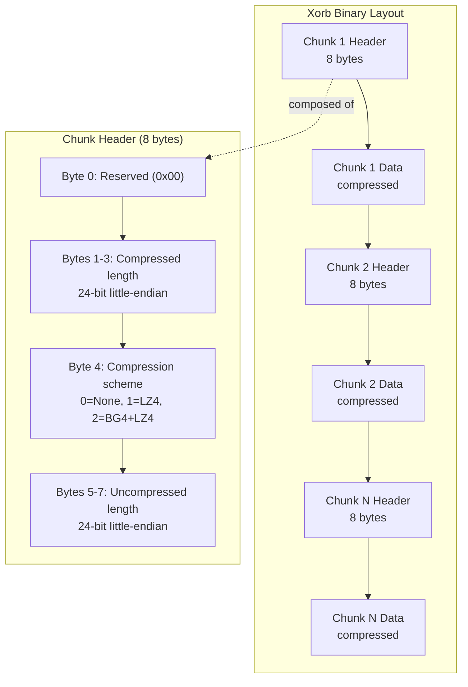

**Xorb Binary Structure**

Constants defining xorb constraints:

```typescript
const XORB_SIZE = 64 * 1024 * 1024;  // 64MB max xorb size
const MAX_XORB_CHUNKS = 8 * 1024;     // 8K max chunks per xorb
const XET_CHUNK_HEADER_BYTES = 8;     // Header size per chunk
```

Sources: [packages/hub/src/utils/createXorbs.ts:12-13](), [packages/hub/src/utils/XetBlob.ts:1-10]()

### Compression Strategy

Each chunk undergoes two compression attempts to find the best encoding:

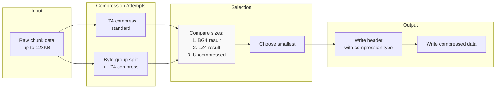

**Chunk Compression Selection**

The byte-grouping optimization (`bg4_split_bytes`) reorganizes data for better LZ4 compression:

```typescript
// Try both compression methods
const regularCompressedChunk = lz4_compress(chunk);
const bgCompressedChunk = lz4_compress(bg4_split_bytes(chunk));

// Select best result
const compressedChunk = 
    bgCompressedChunk.length < regularCompressedChunk.length 
        ? bgCompressedChunk 
        : regularCompressedChunk;

// Only use compression if it helps
const chunkToWrite = 
    compressedChunk.length < chunk.length 
        ? compressedChunk 
        : chunk;
```

The byte-grouping technique separates bytes by their position in multi-byte values, improving compression for structured data like model weights.

Sources: [packages/hub/src/utils/createXorbs.ts:529-559]()

### Writing Chunks to Xorbs

The `writeChunk` function packs compressed chunks into the current xorb buffer:

```typescript
function writeChunk(xorb: CurrentXorbInfo, chunk: Uint8Array, hash: string): boolean {
    // Compress chunk...
    
    // Check if xorb has space
    if (xorb.offset + XET_CHUNK_HEADER_BYTES + chunkToWrite.length > XORB_SIZE) {
        return false; // Xorb full, need new one
    }
    
    // Write header (8 bytes)
    xorb.data[xorb.offset] = 0; // Reserved
    xorb.data[xorb.offset + 1] = chunkToWrite.length & 0xff;
    xorb.data[xorb.offset + 2] = (chunkToWrite.length >> 8) & 0xff;
    xorb.data[xorb.offset + 3] = (chunkToWrite.length >> 16) & 0xff;
    xorb.data[xorb.offset + 4] = compressionScheme; // 0, 1, or 2
    xorb.data[xorb.offset + 5] = chunk.length & 0xff;
    xorb.data[xorb.offset + 6] = (chunk.length >> 8) & 0xff;
    xorb.data[xorb.offset + 7] = (chunk.length >> 16) & 0xff;
    
    // Write compressed data
    xorb.data.set(chunkToWrite, xorb.offset + XET_CHUNK_HEADER_BYTES);
    
    // Update metadata
    xorb.chunks.push({ hash, length: chunk.length, offset: xorb.offset });
    xorb.offset += XET_CHUNK_HEADER_BYTES + chunkToWrite.length;
    
    return true;
}
```

When an xorb fills up (reaches 64MB) or hits the chunk limit (8K chunks), a new xorb is started.

Sources: [packages/hub/src/utils/createXorbs.ts:529-559]()

### Xorb Finalization

When an xorb is complete, it's prepared for upload:

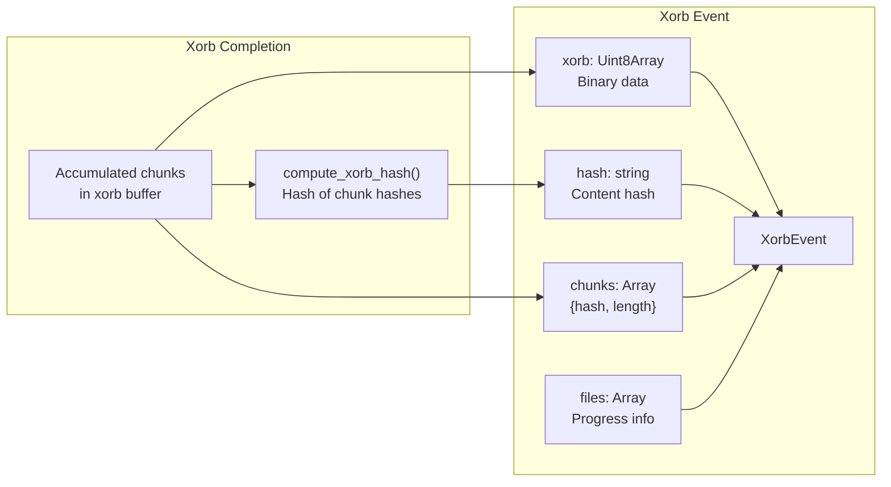

**Xorb Finalization Flow**

The xorb hash is computed from the hashes of its constituent chunks (not the raw xorb data), enabling content-addressable storage:

```typescript
event(computeXorbHash: (chunks: { hash: string; length: number }[]) => string): XorbEvent {
    const xorbChunksCleaned = this.chunks.map((chunk) => ({
        hash: chunk.hash,
        length: chunk.length,
    }));
    
    return {
        event: "xorb" as const,
        xorb: this.data.subarray(0, this.offset),
        hash: computeXorbHash(xorbChunksCleaned),
        chunks: xorbChunksCleaned,
        id: this.id,
        files: /* ... */
    };
}
```

Sources: [packages/hub/src/utils/createXorbs.ts:36-83]()

## Efficient Metadata Extraction

The codebase implements efficient metadata extraction for model files, enabling inspection without downloading full model weights.

### Safetensors Header Parsing

Safetensors files store a JSON header at the beginning with tensor metadata:

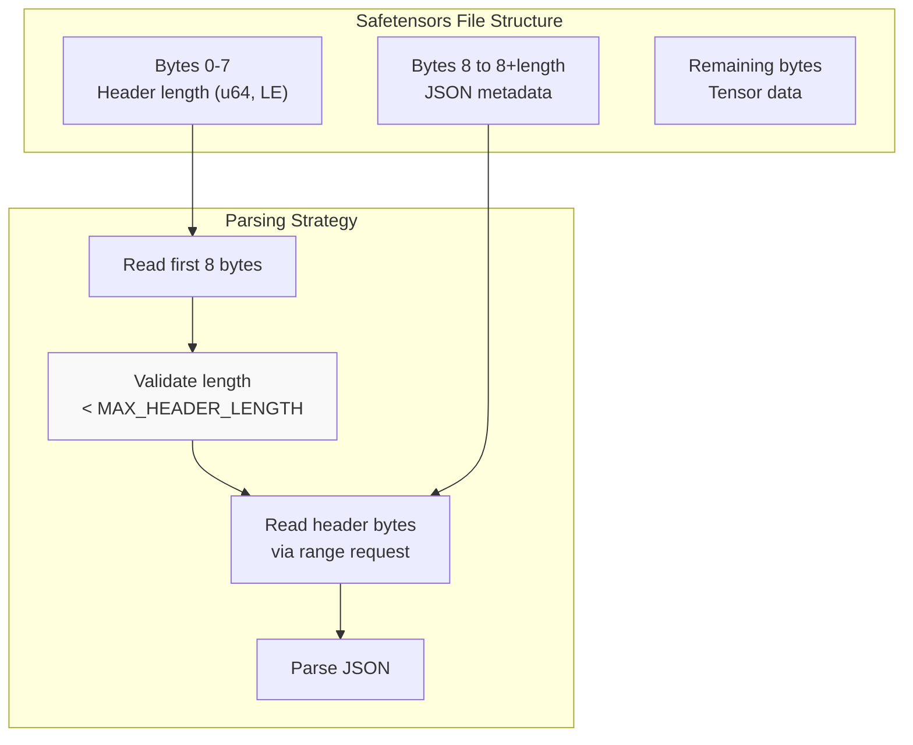

**Safetensors Header Parsing Strategy**

Implementation details:

```typescript
const MAX_HEADER_LENGTH = 25_000_000; // 25MB max header

const blob = await downloadFile({ ...params, path });

// Read first 8 bytes for header length
const bufLengthOfHeaderLE = await blob.slice(0, 8).arrayBuffer();
const lengthOfHeader = new DataView(bufLengthOfHeaderLE).getBigUint64(0, true);

// Validate
if (lengthOfHeader > MAX_HEADER_LENGTH) {
    throw new SafetensorParseError(
        `Header too big. Maximum supported size is ${MAX_HEADER_LENGTH} bytes.`
    );
}

// Read header JSON
const header: SafetensorsFileHeader = JSON.parse(
    await blob.slice(8, 8 + Number(lengthOfHeader)).text()
);
```

This extracts complete model metadata using only 8 bytes + header length (typically <1MB for a 50GB model).

Sources: [packages/hub/src/lib/parse-safetensors-metadata.ts:131-168]()

### Sharded Safetensors

For large models split across multiple shards, the system:

1. Downloads `model.safetensors.index.json` (typically <20MB)
2. Identifies unique shard files from the weight map
3. Downloads headers from each shard in parallel
4. Aggregates tensor information across all shards

```typescript
const PARALLEL_DOWNLOADS = 20;

// Parse index file
const index = await parseShardedIndex(path, params);

// Get unique shard filenames
const filenames = [...new Set(Object.values(index.weight_map))];

// Fetch all headers in parallel
const shardedMap: SafetensorsShardedHeaders = Object.fromEntries(
    await promisesQueue(
        filenames.map(
            (filename) => async () => 
                [filename, await parseSingleFile(pathPrefix + filename, params)]
        ),
        PARALLEL_DOWNLOADS
    )
);
```

This parallelization reduces latency for models with dozens of shard files.

Sources: [packages/hub/src/lib/parse-safetensors-metadata.ts:37](), [packages/hub/src/lib/parse-safetensors-metadata.ts:200-225]()

### GGUF Metadata Parsing

GGUF files similarly place metadata at the beginning, enabling efficient extraction:

```
Offset 0-3:    Magic number "GGUF" (0x47 0x47 0x55 0x46)
Offset 4-7:    Version (u32)
Offset 8+:     Tensor count (u32/u64 depending on version)
Offset N:      KV count (u32/u64)
Offset M:      Key-value pairs (metadata)
Offset P:      Tensor information
Offset Q:      (Aligned) Tensor data
```

The parser uses `RangeView` to read through metadata and tensor info, stopping before reaching actual tensor data:

```typescript
const { metadata, tensorInfos, tensorDataOffset } = await gguf(URL_LLAMA);

// tensorDataOffset indicates where weights start
// Total downloaded: ~741KB for 7B parameter model
// Avoided downloading: ~2.8GB of quantized weights
```

The `tensorInfoByteRange` field marks the exact byte range containing tensor information, useful for file editing operations.

Sources: [packages/gguf/src/gguf.ts:244-506](), [packages/gguf/README.md:19-59]()

### Parameter Count Computation

Both parsers can compute total parameter counts without downloading weights:

**Safetensors**: Multiply tensor shapes

```typescript
const elements = tensorInfo.shape.reduce((a, b) => a * b);
counter[tensorInfo.dtype] = (counter[tensorInfo.dtype] ?? 0) + elements;
```

**GGUF**: Sum products of tensor dimensions

```typescript
const parameterCount = tensorInfos
    .map(({ shape }) => shape.reduce((acc, val) => acc * Number(val), 1))
    .reduce((acc, val) => acc + val, 0);
```

This enables model cards and Hub pages to display accurate model sizes without transferring gigabytes of data.

Sources: [packages/hub/src/lib/parse-safetensors-metadata.ts:436-472](), [packages/gguf/src/gguf.ts:461-479]()