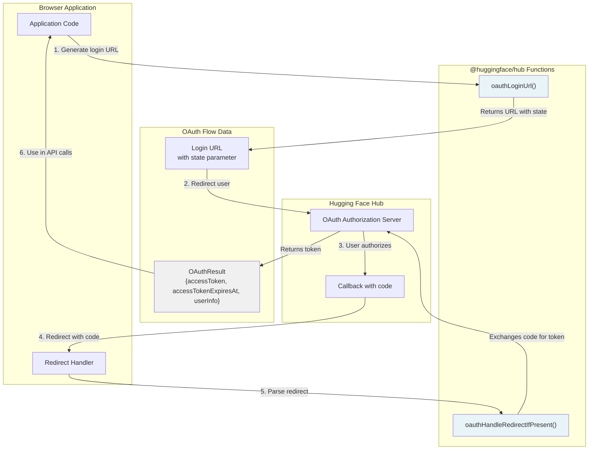
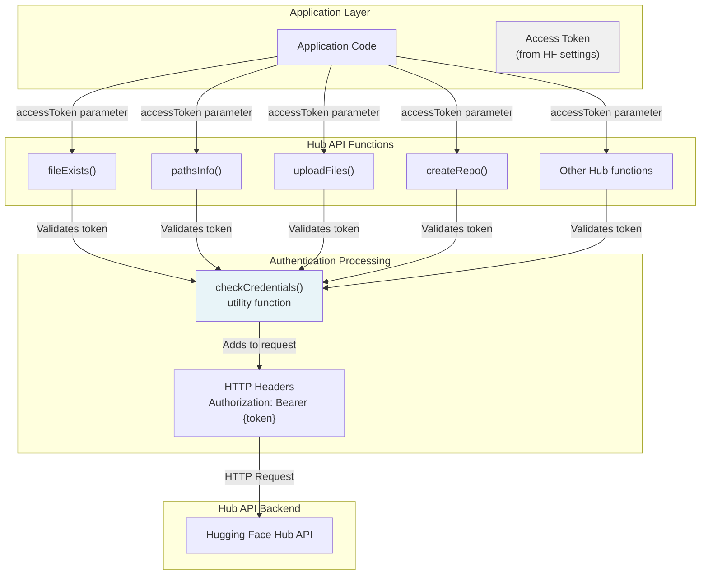
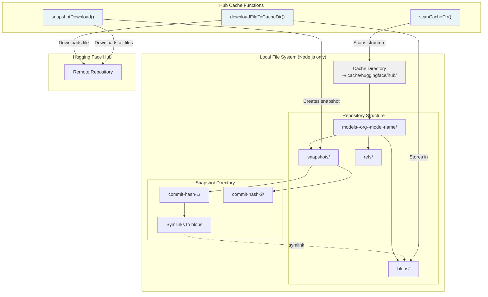
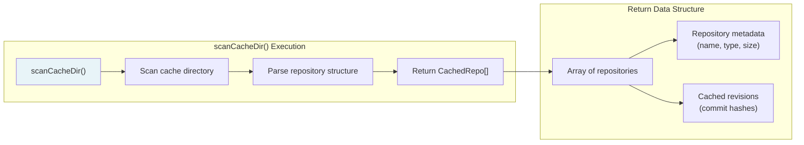
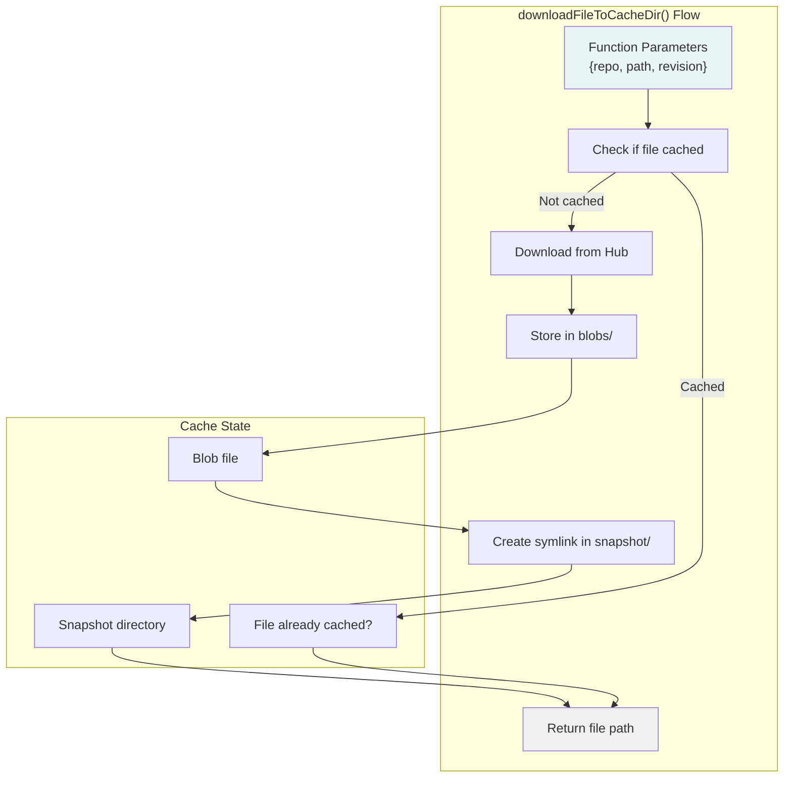
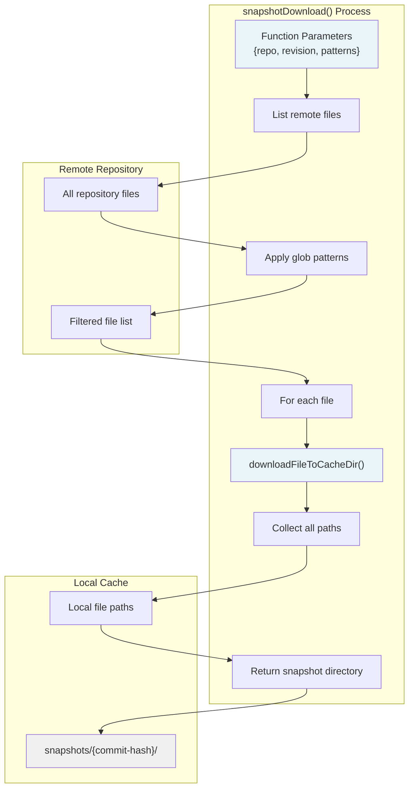

<!-- source: DeepWiki mcp.deepwiki.com · repo huggingface/huggingface.js · extra page Authentication and Caching · fetched 2026-10-26 -->

# Authentication and Caching

<details>
<summary>Relevant source files</summary>

The following files were used as context for generating this wiki page:

- [packages/hub/README.md](packages/hub/README.md)
- [packages/hub/src/lib/file-exists.spec.ts](packages/hub/src/lib/file-exists.spec.ts)
- [packages/hub/src/lib/file-exists.ts](packages/hub/src/lib/file-exists.ts)
- [packages/hub/src/lib/index.ts](packages/hub/src/lib/index.ts)
- [packages/hub/src/lib/paths-info.spec.ts](packages/hub/src/lib/paths-info.spec.ts)
- [packages/hub/src/lib/paths-info.ts](packages/hub/src/lib/paths-info.ts)

</details>


This document covers authentication mechanisms and local caching capabilities provided by the `@huggingface/hub` package. Authentication enables access to private repositories and write operations, while the caching system provides efficient local storage of downloaded models and files. For general Hub API operations, see [Repository and File Operations](#2.2.1).

## Authentication

The `@huggingface/hub` package supports two authentication patterns: OAuth-based "Sign in with HF" for browser applications and direct access token authentication for both browser and Node.js environments.

### OAuth Authentication Flow



**OAuth Flow Implementation**

The OAuth flow is initiated by calling `oauthLoginUrl()` which generates an authorization URL with a randomly generated state parameter for CSRF protection. After the user authorizes the application on huggingface.co, they are redirected back with an authorization code. The `oauthHandleRedirectIfPresent()` function detects this redirect, validates the state parameter, and exchanges the code for an access token.

Sources: [packages/hub/README.md:146-166]()

**OAuthResult Structure**

```typescript
interface OAuthResult {
  accessToken: string;
  accessTokenExpiresAt: Date;
  userInfo: {
    id: string;
    name: string;
    // additional user fields
  };
}
```

The returned `OAuthResult` contains the access token string, its expiration timestamp, and user information retrieved from the Hub. Applications should store the `accessToken` and pass it to subsequent Hub API calls.

Sources: [packages/hub/README.md:155-163]()

### Direct Token Authentication



**Token Parameter Pattern**

All Hub API functions accept an optional `accessToken` parameter as part of their `CredentialsParams`. The token can be obtained from the [Hugging Face settings page](https://huggingface.co/settings/tokens) and should have appropriate scopes for the operations being performed (read, write, or manage).

Sources: [packages/hub/README.md:28-48](), [packages/hub/src/lib/file-exists.ts:7-18]()

**Credential Validation Flow**

The `checkCredentials()` utility function, used internally by all authenticated operations, validates the provided credentials and returns the access token string. This token is then included in HTTP request headers as `Authorization: Bearer {token}`.

```typescript
// Example from fileExists implementation
const accessToken = checkCredentials(params);
const resp = await fetch(url, {
  method: "HEAD",
  headers: accessToken ? { Authorization: `Bearer ${accessToken}` } : {},
});
```

Sources: [packages/hub/src/lib/file-exists.ts:19-30](), [packages/hub/src/lib/paths-info.ts:77-94]()

### Authentication Usage Patterns

| Function Category | Requires Auth | Optional Auth | Notes |
|------------------|---------------|---------------|-------|
| Read public data | No | Yes | `modelInfo`, `listModels`, `downloadFile` work without token |
| Read private data | Yes | - | Requires token with read scope |
| Write operations | Yes | - | `uploadFiles`, `createRepo`, `deleteFile` require token |
| User-specific operations | Yes | - | `whoAmI` requires valid token |

Sources: [packages/hub/README.md:28-113]()

## Local Cache System

The local cache system provides Node.js-only functionality for managing downloaded model files, mirroring the cache architecture used by the Python `huggingface_hub` library. These functions do not work in browser environments.

### Cache Directory Architecture



**Cache Storage Strategy**

The cache uses a content-addressable storage system where actual file contents are stored in the `blobs/` directory, while `snapshots/` contains directories for each Git commit hash with symlinks to the corresponding blobs. This allows multiple snapshots to share identical files without duplication.

Sources: [packages/hub/README.md:168-216]()

### scanCacheDir Function



**Cache Scanning Implementation**

The `scanCacheDir()` function inspects the local cache directory and returns information about all cached repositories, including their names, types (model/dataset/space), total disk size, and available cached revisions.

```typescript
import { scanCacheDir } from "@huggingface/hub";

const result = await scanCacheDir();
// Returns array of cached repository information
console.log(result);
```

Sources: [packages/hub/README.md:172-183](), [packages/hub/src/lib/index.ts:1]()

### downloadFileToCacheDir Function



**Individual File Download**

The `downloadFileToCacheDir()` function downloads a single file from a repository to the local cache directory. It returns the local file path, creating the necessary directory structure and symlinks. If the file is already cached, it returns the existing path without re-downloading.

```typescript
import { downloadFileToCacheDir } from "@huggingface/hub";

const file = await downloadFileToCacheDir({
  repo: 'foo/bar',
  path: 'README.md'
});
// Returns local file system path
console.log(file);
```

Sources: [packages/hub/README.md:185-199](), [packages/hub/src/lib/index.ts:15]()

### snapshotDownload Function



**Full Repository Download**

The `snapshotDownload()` function downloads an entire repository (or filtered subset) at a specific revision to the local cache. It internally uses `downloadFileToCacheDir()` for each file and returns the snapshot directory path containing all downloaded files.

```typescript
import { snapshotDownload } from "@huggingface/hub";

const directory = await snapshotDownload({
  repo: 'foo/bar',
});
// Returns path to snapshot directory with all files
console.log(directory);
```

Sources: [packages/hub/README.md:201-216](), [packages/hub/src/lib/index.ts:31]()

### Browser Environment Limitations

All cache management functions (`scanCacheDir`, `downloadFileToCacheDir`, `snapshotDownload`) are Node.js-only and will not function in browser environments. Browser applications should use the standard `downloadFile()` function which returns file contents as `Response` objects without local caching.

| Function | Node.js | Browser | Returns |
|----------|---------|---------|---------|
| `scanCacheDir` | ✓ | ✗ | Repository metadata array |
| `downloadFileToCacheDir` | ✓ | ✗ | Local file path (string) |
| `snapshotDownload` | ✓ | ✗ | Snapshot directory path (string) |
| `downloadFile` | ✓ | ✓ | Response object |

Sources: [packages/hub/README.md:183, 199, 216]()

---

