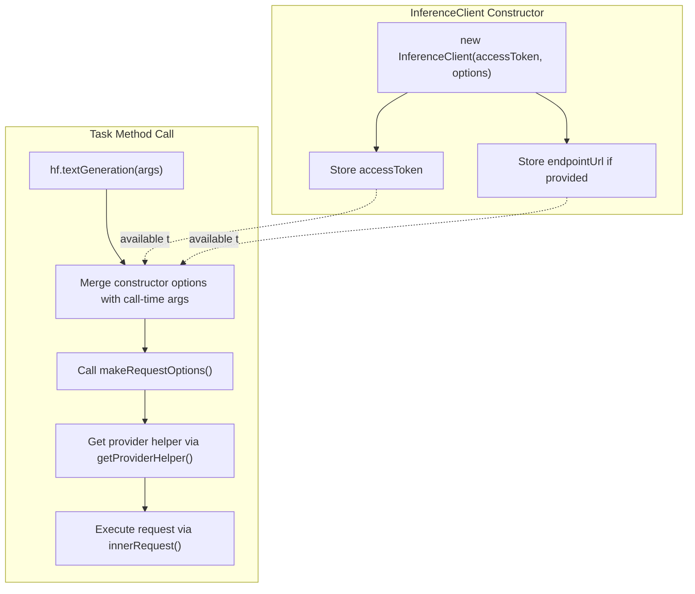
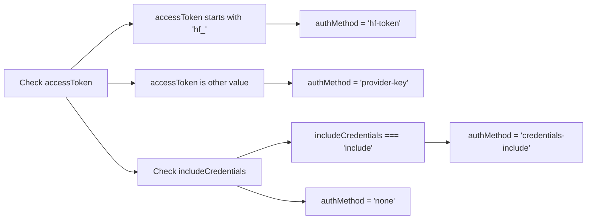
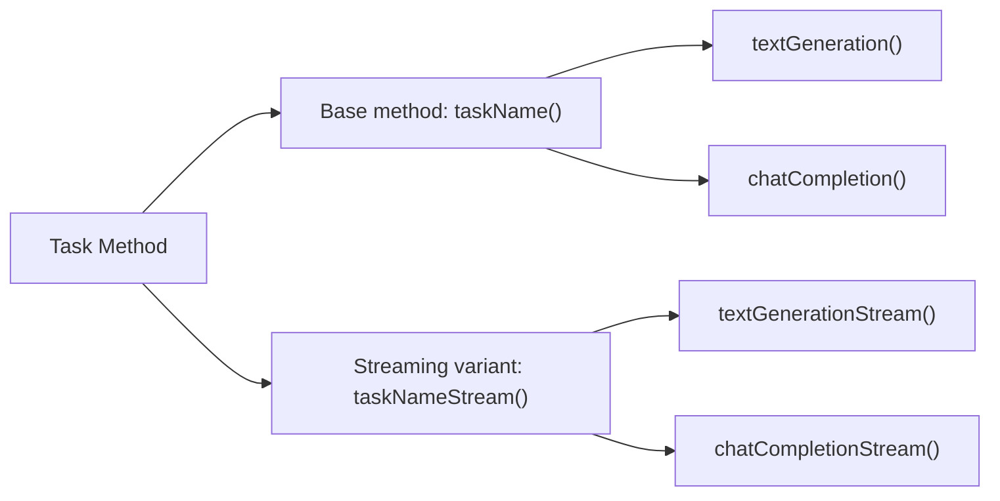
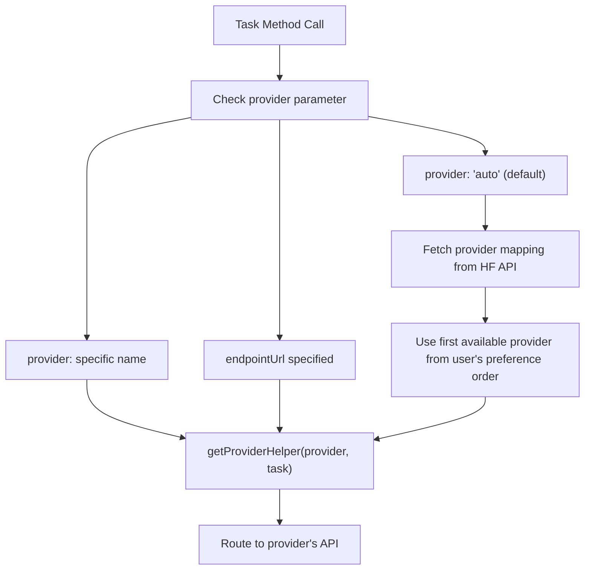
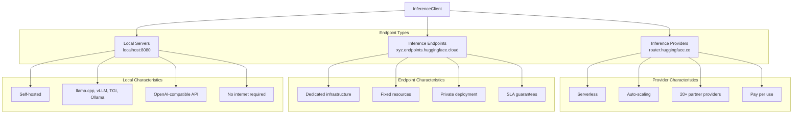
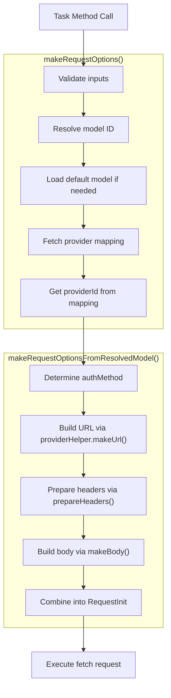
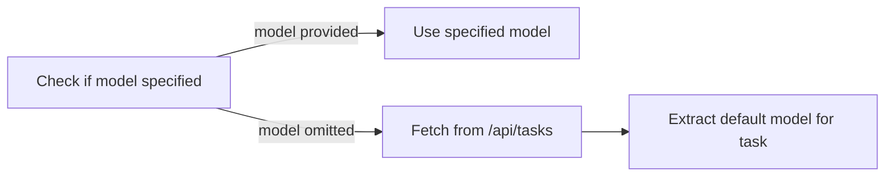
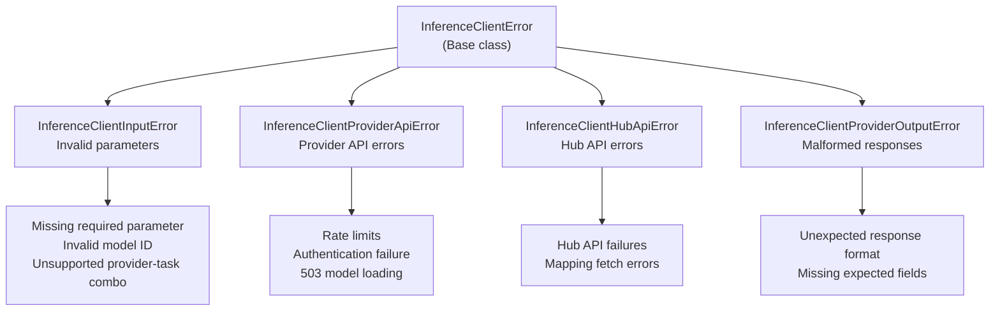

<!-- source: DeepWiki mcp.deepwiki.com · repo huggingface/huggingface.js · extra page InferenceClient API · fetched 2026-10-26 -->

# InferenceClient API

<details>
<summary>Relevant source files</summary>

The following files were used as context for generating this wiki page:

- [.github/workflows/lint.yml](.github/workflows/lint.yml)
- [.github/workflows/test.yml](.github/workflows/test.yml)
- [packages/inference/README.md](packages/inference/README.md)
- [packages/inference/src/config.ts](packages/inference/src/config.ts)
- [packages/inference/src/lib/getProviderHelper.ts](packages/inference/src/lib/getProviderHelper.ts)
- [packages/inference/src/lib/makeRequestOptions.ts](packages/inference/src/lib/makeRequestOptions.ts)
- [packages/inference/src/providers/consts.ts](packages/inference/src/providers/consts.ts)
- [packages/inference/src/providers/wavespeed.ts](packages/inference/src/providers/wavespeed.ts)
- [packages/inference/src/providers/zai-org.ts](packages/inference/src/providers/zai-org.ts)
- [packages/inference/src/types.ts](packages/inference/src/types.ts)
- [packages/inference/test/InferenceClient.spec.ts](packages/inference/test/InferenceClient.spec.ts)

</details>


## Purpose and Scope

This document provides comprehensive documentation for the `InferenceClient` class, the primary interface for running machine learning inference across the Hugging Face ecosystem. The `InferenceClient` provides a unified API for accessing models through Inference Providers, Inference Endpoints, and local servers.

For information about the provider abstraction system that powers routing, see [Provider System](#2.1.2). For details about task-specific types and standalone functions, see [Task Functions and Types](#2.1.3).

Sources: [packages/inference/README.md:1-767]()

## Class Overview and Initialization

The `InferenceClient` class serves as the main entry point for performing inference operations. It handles authentication, request routing, provider selection, and error management.

### Constructor Signature

```typescript
new InferenceClient(accessToken?: string, options?: {
  endpointUrl?: string;
})
```

**Parameters:**
- `accessToken` (optional): Either a Hugging Face access token (starting with `hf_`) or a third-party provider API key
- `options.endpointUrl` (optional): URL of a specific endpoint to target (Inference Endpoint or local server)

**Usage Examples:**

```typescript
// Basic initialization with HF token
const hf = new InferenceClient('hf_...');

// Using with Inference Endpoint
const hf = new InferenceClient('hf_...', {
  endpointUrl: 'https://xyz.endpoints.huggingface.cloud/v1/'
});

// Using with local endpoint
const hf = new InferenceClient(undefined, {
  endpointUrl: 'http://localhost:8080'
});

// Using with third-party provider key
const hf = new InferenceClient('sk-...');
```

Sources: [packages/inference/README.md:35-44](), [packages/inference/README.md:686-748]()

### Initialization Flow



Sources: [packages/inference/src/lib/makeRequestOptions.ts:19-99]()

## Authentication Methods

The `InferenceClient` supports four authentication modes, determined automatically based on the provided credentials and options.

### Authentication Mode Resolution

| `accessToken` Value | `includeCredentials` | Auth Method | Use Case |
|---------------------|---------------------|-------------|----------|
| `hf_...` | any | `hf-token` | Hugging Face API with user token |
| Other value | any | `provider-key` | Third-party provider direct auth |
| undefined | `"include"` | `credentials-include` | Browser cookie-based auth |
| undefined | undefined | `none` | Public models (rate-limited) |



Sources: [packages/inference/src/lib/makeRequestOptions.ts:125-140](), [packages/inference/src/types.ts:169-174]()

### Authentication Configuration

**Hugging Face Token Authentication:**
```typescript
const hf = new InferenceClient('hf_...');
```
Token is sent in the `Authorization: Bearer` header and routes through `router.huggingface.co`.

**Third-Party Provider Authentication:**
```typescript
const hf = new InferenceClient('sk-...');
await hf.chatCompletion({
  model: 'provider/model-name',
  provider: 'replicate',
  messages: [...]
});
```
API key is sent directly to the provider's endpoint.

**Browser Credential-Based Authentication:**
```typescript
const hf = new InferenceClient(undefined, { includeCredentials: 'include' });
```
Uses browser cookies for authentication (OAuth flow).

Sources: [packages/inference/README.md:41-44](), [packages/inference/src/types.ts:31-42]()

## Configuration Options

### Options Interface

The `Options` interface is accepted by all task methods to control request behavior.

```typescript
interface Options {
  retry_on_error?: boolean;      // Default: true
  fetch?: typeof fetch;          // Custom fetch implementation
  signal?: AbortSignal;          // For request cancellation
  includeCredentials?: string | boolean;  // Credential handling
  billTo?: string;              // Organization billing account
}
```

**Key Options:**

| Option | Type | Default | Description |
|--------|------|---------|-------------|
| `retry_on_error` | `boolean` | `true` | Retry on 503 errors (model loading) |
| `fetch` | `function` | native `fetch` | Custom fetch for proxies/middleware |
| `signal` | `AbortSignal` | undefined | Abort controller for cancellation |
| `includeCredentials` | `string \| boolean` | `"same-origin"` | Credential policy or boolean flag |
| `billTo` | `string` | undefined | Organization name for billing |

Sources: [packages/inference/src/types.ts:16-43]()

### BaseArgs Interface

Every task method accepts arguments that extend `BaseArgs`:

```typescript
interface BaseArgs {
  accessToken?: string;          // Override client token
  model?: string;                // HF model ID
  endpointUrl?: string;          // Override client endpoint
  provider?: InferenceProviderOrPolicy;  // Provider selection
}
```

These parameters can be specified at the client level (constructor) or per-method call, with method-level arguments taking precedence.

Sources: [packages/inference/src/types.ts:121-154]()

### Usage Examples

```typescript
// Retry configuration
await hf.textGeneration({
  model: 'meta-llama/Llama-3.2-3B',
  inputs: 'Hello',
}, {
  retry_on_error: false  // Don't wait for model loading
});

// Request cancellation
const controller = new AbortController();
setTimeout(() => controller.abort(), 5000);

await hf.chatCompletionStream({
  model: 'mistralai/Mistral-7B-Instruct-v0.2',
  messages: [{ role: 'user', content: 'Write an essay' }]
}, {
  signal: controller.signal
});

// Organization billing
await hf.textToImage({
  model: 'black-forest-labs/FLUX.1-dev',
  inputs: 'A landscape'
}, {
  billTo: 'my-org-name'
});
```

Sources: [packages/inference/README.md:706-726](), [packages/inference/src/types.ts:16-43]()

## Task Methods by Category

The `InferenceClient` exposes 25+ task-specific methods organized by modality. Each method follows a consistent pattern with optional streaming variants.

### Method Naming Convention



### Natural Language Processing Tasks

```typescript
// Text Generation
await hf.textGeneration({
  model: 'mistralai/Mixtral-8x7B-v0.1',
  inputs: 'The answer to the universe is',
  parameters: { max_new_tokens: 100 }
});

// Text Generation (Streaming)
for await (const chunk of hf.textGenerationStream({
  model: 'meta-llama/Llama-3.2-3B',
  inputs: 'Write a story',
  parameters: { max_new_tokens: 250 }
})) {
  console.log(chunk.token.text);
}

// Chat Completion
await hf.chatCompletion({
  model: 'Qwen/Qwen3-32B',
  provider: 'cerebras',
  messages: [
    { role: 'user', content: 'Hello!' }
  ],
  max_tokens: 512
});

// Chat Completion (Streaming)
for await (const chunk of hf.chatCompletionStream({
  model: 'Qwen/Qwen3-32B',
  messages: [{ role: 'user', content: 'Help me' }]
})) {
  console.log(chunk.choices[0].delta.content);
}
```

**Complete NLP Method List:**
- `textGeneration()` / `textGenerationStream()` - Generate text continuations
- `chatCompletion()` / `chatCompletionStream()` - OpenAI-compatible chat API
- `featureExtraction()` - Extract embeddings from text
- `fillMask()` - Fill masked tokens in text
- `summarization()` - Summarize long documents
- `questionAnswering()` - Answer questions given context
- `tableQuestionAnswering()` - Answer questions about tabular data
- `textClassification()` - Classify text into categories
- `tokenClassification()` - Named entity recognition
- `translation()` - Translate between languages
- `zeroShotClassification()` - Classify without training
- `sentenceSimilarity()` - Calculate semantic similarity

Sources: [packages/inference/README.md:238-429](), [packages/inference/test/InferenceClient.spec.ts:254-566]()

### Computer Vision Tasks

```typescript
// Text to Image
await hf.textToImage({
  model: 'black-forest-labs/FLUX.1-dev',
  inputs: 'A picture of a green bird',
  parameters: {
    width: 512,
    height: 512,
    num_inference_steps: 25
  }
});

// Image Classification
await hf.imageClassification({
  model: 'google/vit-base-patch16-224',
  data: imageBlob
});

// Object Detection
await hf.objectDetection({
  model: 'facebook/detr-resnet-50',
  data: imageBlob
});

// Image to Image
await hf.imageToImage({
  model: 'lllyasviel/sd-controlnet-depth',
  inputs: depthMapBlob,
  parameters: {
    prompt: "elmo's lecture"
  }
});
```

**Complete CV Method List:**
- `textToImage()` - Generate images from text prompts
- `imageToImage()` - Transform images based on prompts
- `imageClassification()` - Classify image content
- `imageSegmentation()` - Detect segments within images
- `imageToText()` - Generate captions or OCR
- `objectDetection()` - Detect objects with bounding boxes
- `zeroShotImageClassification()` - Classify images without training

Sources: [packages/inference/README.md:484-576](), [packages/inference/test/InferenceClient.spec.ts:681-825]()

### Audio Tasks

```typescript
// Automatic Speech Recognition
await hf.automaticSpeechRecognition({
  model: 'facebook/wav2vec2-large-960h-lv60-self',
  data: audioBlob
});

// Audio Classification
await hf.audioClassification({
  model: 'superb/hubert-large-superb-er',
  data: audioBlob
});

// Text to Speech
await hf.textToSpeech({
  model: 'espnet/kan-bayashi_ljspeech_vits',
  inputs: 'Hello world!'
});

// Audio to Audio
await hf.audioToAudio({
  model: 'speechbrain/sepformer-wham',
  data: audioBlob
});
```

**Complete Audio Method List:**
- `automaticSpeechRecognition()` - Transcribe speech to text
- `audioClassification()` - Classify audio content
- `textToSpeech()` - Generate speech from text
- `audioToAudio()` - Audio enhancement/separation

Sources: [packages/inference/README.md:432-481](), [packages/inference/test/InferenceClient.spec.ts:629-679]()

### Multimodal Tasks

```typescript
// Visual Question Answering
await hf.visualQuestionAnswering({
  model: 'dandelin/vilt-b32-finetuned-vqa',
  inputs: {
    question: 'How many cats are lying down?',
    image: imageBlob
  }
});

// Document Question Answering
await hf.documentQuestionAnswering({
  model: 'impira/layoutlm-document-qa',
  inputs: {
    question: 'Invoice number?',
    image: documentImageBlob
  }
});
```

**Complete Multimodal Method List:**
- `visualQuestionAnswering()` - Answer questions about images
- `documentQuestionAnswering()` - Extract information from documents

Sources: [packages/inference/README.md:579-611](), [packages/inference/test/InferenceClient.spec.ts:376-389]()

### Tabular Tasks

```typescript
// Tabular Regression
await hf.tabularRegression({
  model: 'scikit-learn/Fish-Weight',
  inputs: {
    data: {
      'Height': ['11.52', '12.48'],
      'Length1': ['23.2', '24'],
      'Species': ['Bream', 'Bream']
    }
  }
});

// Tabular Classification
await hf.tabularClassification({
  model: 'vvmnnnkv/wine-quality',
  inputs: {
    data: {
      'fixed_acidity': ['7.4', '7.8'],
      'volatile_acidity': ['0.7', '0.88']
    }
  }
});
```

**Complete Tabular Method List:**
- `tabularRegression()` - Predict numerical values
- `tabularClassification()` - Classify tabular data

Sources: [packages/inference/README.md:614-658](), [packages/inference/test/InferenceClient.spec.ts:842-882]()

## Provider Selection and Routing

The `InferenceClient` supports routing to 20+ inference providers through a unified API.

### Supported Providers

```typescript
const INFERENCE_PROVIDERS = [
  "baseten", "black-forest-labs", "cerebras", "clarifai", "cohere",
  "fal-ai", "featherless-ai", "fireworks-ai", "groq", "hf-inference",
  "hyperbolic", "nebius", "novita", "nscale", "openai", "ovhcloud",
  "publicai", "replicate", "sambanova", "scaleway", "together",
  "wavespeed", "zai-org"
] as const;
```

Sources: [packages/inference/src/types.ts:47-71]()

### Provider Selection Mechanisms



Sources: [packages/inference/src/lib/makeRequestOptions.ts:64-84](), [packages/inference/src/lib/getProviderHelper.ts:198-354]()

### Provider Usage Examples

**Automatic Provider Selection:**
```typescript
// Uses first available provider from user's preference order
await hf.textToImage({
  model: 'black-forest-labs/FLUX.1-dev',
  inputs: 'A black forest cake'
  // provider: 'auto' is implicit
});
```

**Explicit Provider Selection:**
```typescript
// Route directly to Replicate
await hf.textToImage({
  model: 'black-forest-labs/FLUX.1-dev',
  provider: 'replicate',
  inputs: 'A black forest cake'
});

// Route to Cerebras for chat
await hf.chatCompletion({
  model: 'Qwen/Qwen3-32B',
  provider: 'cerebras',
  messages: [{ role: 'user', content: 'Hello!' }]
});
```

Sources: [packages/inference/README.md:45-114]()

### Provider Capabilities by Task

Different providers support different tasks. The client automatically validates provider-task compatibility.

| Provider | Conversational | Text-to-Image | Text-to-Video | ASR | Feature Extraction |
|----------|---------------|---------------|---------------|-----|-------------------|
| hf-inference | ✓ | ✓ | - | ✓ | ✓ |
| together | ✓ | ✓ | - | - | - |
| replicate | - | ✓ | ✓ | ✓ | - |
| cerebras | ✓ | - | - | - | - |
| fal-ai | - | ✓ | ✓ | ✓ | - |
| sambanova | ✓ | - | - | - | ✓ |
| wavespeed | - | ✓ | ✓ | - | - |

Sources: [packages/inference/src/lib/getProviderHelper.ts:62-193]()

## Endpoint Configuration

The `InferenceClient` can target three types of endpoints: Inference Providers (default), Inference Endpoints (dedicated), and local inference servers.

### Endpoint Types



Sources: [packages/inference/README.md:3-7](), [packages/inference/README.md:681-754]()

### Using Inference Providers (Default)

```typescript
const hf = new InferenceClient('hf_...');

// Automatically routes through router.huggingface.co
await hf.textGeneration({
  model: 'meta-llama/Llama-3.2-3B',
  inputs: 'Hello'
});
```

When no `endpointUrl` is specified, requests go to `https://router.huggingface.co` which routes to available providers based on model and user preferences.

Sources: [packages/inference/src/config.ts:1-5]()

### Using Inference Endpoints

```typescript
const hf = new InferenceClient('hf_...', {
  endpointUrl: 'https://xyz.us-east-1.aws.endpoints.huggingface.cloud/v1/'
});

await hf.chatCompletion({
  messages: [
    { role: 'user', content: 'What is the capital of France?' }
  ]
});
```

**Scaling to Zero Handling:**
```typescript
// By default, waits for model to load (may take time with scale-to-0)
await hf.chatCompletion({ messages: [...] });

// Disable waiting, handle 500 errors manually
await hf.chatCompletion(
  { messages: [...] },
  { retry_on_error: false }
);
```

Sources: [packages/inference/README.md:682-726]()

### Using Local Endpoints

```typescript
// llama.cpp server
const hf = new InferenceClient(undefined, {
  endpointUrl: 'http://localhost:8080'
});

// vLLM server
const hf = new InferenceClient(undefined, {
  endpointUrl: 'http://localhost:8000'
});

// Ollama server
const hf = new InferenceClient(undefined, {
  endpointUrl: 'http://localhost:11434'
});

await hf.chatCompletion({
  messages: [{ role: 'user', content: 'Hello' }]
});
```

Local servers must implement OpenAI-compatible chat completion API.

Sources: [packages/inference/README.md:727-754]()

## Request Lifecycle and Model Resolution

Understanding how the client prepares and executes requests is essential for debugging and optimization.

### Request Preparation Flow



Sources: [packages/inference/src/lib/makeRequestOptions.ts:19-197]()

### Model Resolution Logic

**When model is specified:**
```typescript
await hf.textGeneration({
  model: 'gpt2',  // User specifies model
  inputs: 'Hello'
});
```
Client uses the specified model directly.

**When model is omitted:**
```typescript
await hf.fillMask({
  inputs: '[MASK] world'
  // No model specified
});
```
Client fetches default model for the task from `https://huggingface.co/api/tasks` API endpoint.



Sources: [packages/inference/src/lib/makeRequestOptions.ts:199-224]()

### Provider Mapping Resolution

For non-endpoint URLs, the client fetches provider mapping to determine the correct provider ID:

```typescript
// User specifies: model = "black-forest-labs/FLUX.1-dev", provider = "replicate"
// Client fetches from: https://huggingface.co/api/partners/replicate/models
// Mapping returns: providerId = "black-forest-labs/flux-dev"
// Client routes to: replicate.com/api with providerId
```

**Mapping Structure:**
```typescript
interface InferenceProviderMappingEntry {
  adapter?: string;                // e.g., "lora"
  adapterWeightsPath?: string;
  hfModelId: string;               // HF Hub model ID
  provider: string;                // Provider name
  providerId: string;              // Provider's internal model ID
  status: "live" | "staging";
  task: WidgetType;                // Pipeline task type
  type?: "single-model" | "tag-filter";
}
```

Sources: [packages/inference/src/types.ts:110-119](), [packages/inference/src/lib/makeRequestOptions.ts:64-84]()

## Error Handling

The `InferenceClient` provides structured error types for different failure scenarios.

### Error Hierarchy



Sources: [packages/inference/README.md:136-234]()

### Error Properties

**InferenceClientProviderApiError:**
```typescript
{
  message: string;
  request: {
    url: string;
    method: string;
    headers?: Record<string, string>;
  };
  response: {
    requestId: string;
    status: number;
    body: string;
  };
}
```

**InferenceClientHubApiError:**
```typescript
{
  message: string;
  request: {
    url: string;
    method: string;
  };
  response: {
    requestId: string;
    status: number;
    body: string;
  };
}
```

Sources: [packages/inference/README.md:207-225]()

### Error Handling Examples

**Catch all inference errors:**
```typescript
try {
  const result = await hf.textGeneration({
    model: 'gpt2',
    inputs: 'Hello'
  });
} catch (error) {
  if (error instanceof InferenceClientError) {
    console.error('Inference error:', error.message);
  } else {
    console.error('Unexpected error:', error);
  }
}
```

**Handle specific error types:**
```typescript
try {
  const result = await hf.chatCompletion({
    model: 'Qwen/Qwen3-32B',
    provider: 'cerebras',
    messages: [{ role: 'user', content: 'Hello' }]
  });
} catch (error) {
  if (error instanceof InferenceClientProviderApiError) {
    console.error('Provider API error:', error.message);
    console.error('Status:', error.response.status);
    console.error('Request ID:', error.response.requestId);
  } else if (error instanceof InferenceClientHubApiError) {
    console.error('Hub API error:', error.message);
    console.error('Failed URL:', error.request.url);
  } else if (error instanceof InferenceClientProviderOutputError) {
    console.error('Malformed response:', error.message);
  } else if (error instanceof InferenceClientInputError) {
    console.error('Invalid input:', error.message);
  }
}
```

Sources: [packages/inference/README.md:150-204]()

## Tree-Shaking and Standalone Functions

While the `InferenceClient` class provides a convenient API, the package also exports standalone task functions for better tree-shaking in bundled applications.

### Standalone Function Pattern

```typescript
import { textGeneration, chatCompletion, textToImage } from '@huggingface/inference';

// Standalone functions accept all parameters as arguments
await textGeneration({
  accessToken: 'hf_...',
  model: 'gpt2',
  inputs: 'Hello world',
  parameters: { max_new_tokens: 100 }
});

await chatCompletion({
  accessToken: 'hf_...',
  model: 'Qwen/Qwen3-32B',
  messages: [{ role: 'user', content: 'Hello' }]
});

await textToImage({
  accessToken: 'hf_...',
  model: 'black-forest-labs/FLUX.1-dev',
  inputs: 'A landscape'
});
```

**Benefits:**
- Smaller bundle sizes (only import functions you use)
- Same type safety as class methods
- No instantiation overhead

**Class vs Standalone:**
```typescript
// Class approach (convenient, reuses token)
const hf = new InferenceClient('hf_...');
await hf.textGeneration({ model: 'gpt2', inputs: 'Hello' });

// Standalone approach (tree-shakeable)
import { textGeneration } from '@huggingface/inference';
await textGeneration({ accessToken: 'hf_...', model: 'gpt2', inputs: 'Hello' });
```

Sources: [packages/inference/README.md:117-133]()

## Backward Compatibility

The `InferenceClient` class was previously named `HfInference`. The old name is maintained for backward compatibility.

```typescript
import { HfInference } from '@huggingface/inference';

// Still works
const hf = new HfInference('hf_...');
```

Both names refer to the same class implementation.

Sources: [packages/inference/README.md:1](), [packages/inference/test/InferenceClient.spec.ts:29-33]()

---

