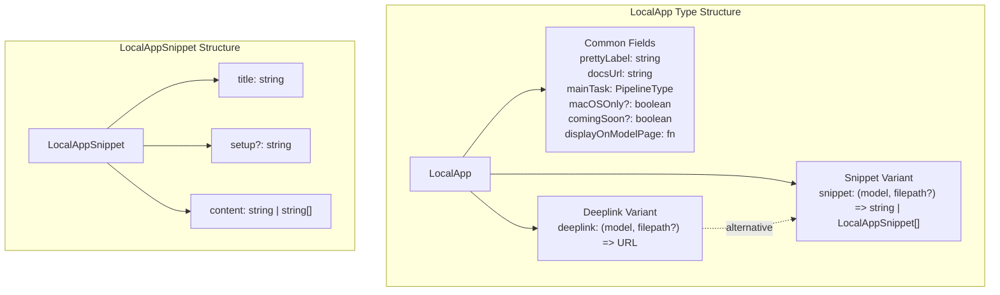
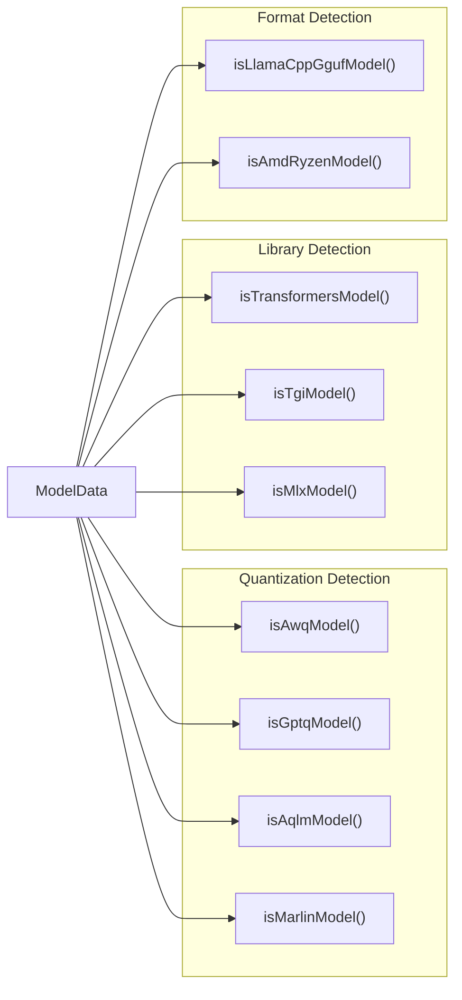
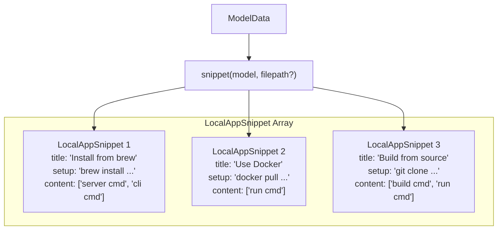
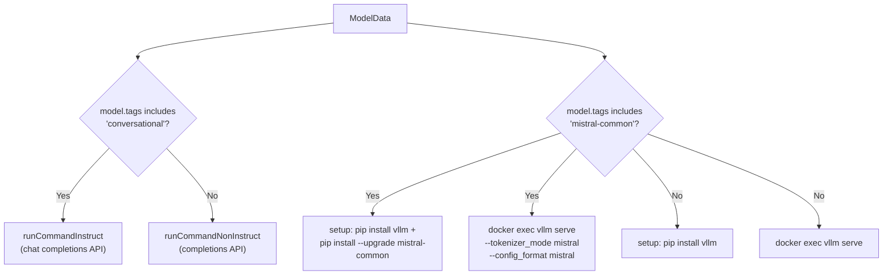
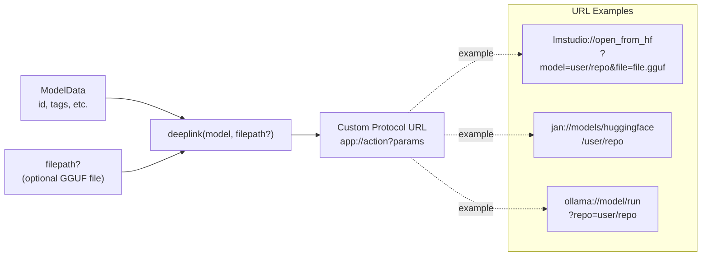
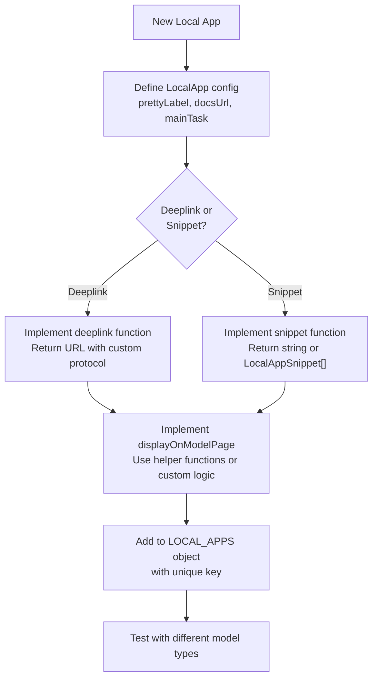

<!-- source: DeepWiki mcp.deepwiki.com · repo huggingface/huggingface.js · extra page Local Apps Integration · fetched 2026-10-26 -->

# Local Apps Integration

<details>
<summary>Relevant source files</summary>

The following files were used as context for generating this wiki page:

- [packages/tasks/src/default-widget-inputs.ts](packages/tasks/src/default-widget-inputs.ts)
- [packages/tasks/src/hardware.ts](packages/tasks/src/hardware.ts)
- [packages/tasks/src/index.ts](packages/tasks/src/index.ts)
- [packages/tasks/src/library-to-tasks.ts](packages/tasks/src/library-to-tasks.ts)
- [packages/tasks/src/local-apps.spec.ts](packages/tasks/src/local-apps.spec.ts)
- [packages/tasks/src/local-apps.ts](packages/tasks/src/local-apps.ts)
- [packages/tasks/src/model-data.ts](packages/tasks/src/model-data.ts)
- [packages/tasks/src/model-libraries-downloads.ts](packages/tasks/src/model-libraries-downloads.ts)
- [packages/tasks/src/model-libraries-snippets.spec.ts](packages/tasks/src/model-libraries-snippets.spec.ts)
- [packages/tasks/src/model-libraries-snippets.ts](packages/tasks/src/model-libraries-snippets.ts)
- [packages/tasks/src/model-libraries.ts](packages/tasks/src/model-libraries.ts)
- [packages/tasks/src/tasks/any-to-any/about.md](packages/tasks/src/tasks/any-to-any/about.md)
- [packages/tasks/src/tasks/any-to-any/data.ts](packages/tasks/src/tasks/any-to-any/data.ts)
- [packages/tasks/src/widget-example.ts](packages/tasks/src/widget-example.ts)

</details>


## Purpose and Scope

The Local Apps Integration system enables users to run Hugging Face Hub models locally using various inference tools and applications. This system is part of the @huggingface/tasks package and provides a unified registry (`LOCAL_APPS`) that defines how to integrate with tools like llama.cpp, Ollama, vLLM, LM Studio, and many others. The system determines which apps are compatible with specific models and generates appropriate setup instructions (CLI commands or deeplinks).

For information about model library code snippets displayed on the Hub, see [Model Libraries and Snippets](#3.1.2). For the overall task taxonomy system, see [Task Definitions and Type System](#3.1.1).

**Sources:** [packages/tasks/src/local-apps.ts:1-607]()

## LocalApp Type Definition

### Core Structure

The `LocalApp` type defines the configuration for each local inference application. Every app includes common metadata and either deeplink generation or snippet generation capabilities.



**Diagram: LocalApp type architecture showing the two variants and snippet structure**

The `displayOnModelPage` function is critical—it determines whether an app button appears on a model's page based on the model's characteristics (format, quantization, library, tags).

**Sources:** [packages/tasks/src/local-apps.ts:24-64](), [packages/tasks/src/local-apps.ts:8-21]()

### Placeholders System

Snippet generation functions can use special placeholders that are replaced at display time:

| Placeholder | Description | Behavior |
|------------|-------------|----------|
| `{{GGUF_FILE}}` | GGUF filename | Replaced with actual filename or list of available files |
| `{{QUANT_TAG}}` | Quantization tag | Replaced with parsed quant label (e.g., `:Q4_K_M`) or removed if N/A |

The `getQuantTag` helper function extracts quantization labels from GGUF filenames using `parseGGUFQuantLabel`.

**Sources:** [packages/tasks/src/local-apps.ts:102-111](), [packages/tasks/src/local-apps.ts:1]()

## Model Detection Logic

### Detection Helper Functions

The system uses specialized functions to identify model characteristics:



**Diagram: Model detection helper functions used by displayOnModelPage logic**

Each helper examines specific fields in `ModelData`:

- **Quantization detection** checks `model.config?.quantization_config?.quant_method`
- **Library detection** checks `model.tags` array for library identifiers
- **Format detection** checks `model.gguf?.context_length` or specific tag combinations

**Sources:** [packages/tasks/src/local-apps.ts:66-100]()

### Display Logic Examples

The `displayOnModelPage` function for each app combines these helpers with logical conditions:

```typescript
// Example: vLLM supports multiple formats for text/vision models
vllm: {
  displayOnModelPage: (model: ModelData) =>
    (isAwqModel(model) ||
     isGptqModel(model) ||
     isAqlmModel(model) ||
     isMarlinModel(model) ||
     isLlamaCppGgufModel(model) ||
     isTransformersModel(model)) &&
    (model.pipeline_tag === "text-generation" || 
     model.pipeline_tag === "image-text-to-text")
}

// Example: LM Studio supports GGUF or MLX models only
lmstudio: {
  displayOnModelPage: (model) => 
    isLlamaCppGgufModel(model) || isMlxModel(model)
}
```

**Sources:** [packages/tasks/src/local-apps.ts:437-445](), [packages/tasks/src/local-apps.ts:475-477]()

## Snippet Generation System

### Multi-Method Snippet Pattern

Many apps provide multiple installation/usage methods through arrays of `LocalAppSnippet` objects. Each snippet includes an optional setup section and one or more content blocks.



**Diagram: Snippet generation pattern for apps with multiple installation methods**

**Sources:** [packages/tasks/src/local-apps.ts:113-156]()

### Example: llama.cpp Snippet Generation

The `snippetLlamacpp` function demonstrates the comprehensive multi-method pattern:

```typescript
const snippetLlamacpp = (model: ModelData, filepath?: string): LocalAppSnippet[] => {
  const serverCommand = (binary: string) => {
    return [
      "# Start a local OpenAI-compatible server with a web UI:",
      `${binary} -hf ${model.id}${getQuantTag(filepath)}`
    ].join("\n");
  };
  
  return [
    {
      title: "Install from brew",
      setup: "brew install llama.cpp",
      content: [serverCommand("llama-server"), cliCommand("llama-cli")]
    },
    {
      title: "Install from WinGet (Windows)",
      setup: "winget install llama.cpp",
      content: [serverCommand("llama-server"), cliCommand("llama-cli")]
    },
    // ... more methods
  ];
};
```

**Sources:** [packages/tasks/src/local-apps.ts:113-156]()

### Example: vLLM with Context-Aware Generation

The `snippetVllm` function adapts its output based on model characteristics:



**Diagram: vLLM snippet generation logic showing conditional branching**

The function generates appropriate curl commands based on whether the model supports chat:

```typescript
const runCommandInstruct = `curl -X POST "http://localhost:8000/v1/chat/completions" ...`;
const runCommandNonInstruct = `curl -X POST "http://localhost:8000/v1/completions" ...`;
const runCommand = model.tags.includes("conversational") 
  ? runCommandInstruct 
  : runCommandNonInstruct;
```

**Sources:** [packages/tasks/src/local-apps.ts:199-261]()

### Input Generation for Snippets

Snippet functions use `getModelInputSnippet` to generate contextually appropriate example inputs:

```typescript
// Example from snippetVllm
const messages = getModelInputSnippet(model) as ChatCompletionInputMessage[];

// Example from snippetSglang
const messages = getModelInputSnippet(model) as ChatCompletionInputMessage[];

// Then formatted with stringifyMessages for shell embedding
stringifyMessages(messages, {
  indent: "\t\t",
  attributeKeyQuotes: true,
  customContentEscaper: (str) => str.replace(/'/g, "'\\''")
})
```

**Sources:** [packages/tasks/src/local-apps.ts:200](), [packages/tasks/src/local-apps.ts:263](), [packages/tasks/src/local-apps.ts:4-6]()

## Deeplink System

### Deeplink URL Construction

Apps supporting deeplinks generate custom protocol URLs that trigger the local application with model information:



**Diagram: Deeplink generation flow from model data to custom protocol URLs**

**Sources:** [packages/tasks/src/local-apps.ts:471-607]()

### Deeplink Examples

Different apps use varied URL schemes:

```typescript
// Simple model ID passing
jan: {
  deeplink: (model) => new URL(`jan://models/huggingface/${model.id}`)
}

// Model ID with optional file parameter
lmstudio: {
  deeplink: (model, filepath) =>
    new URL(`lmstudio://open_from_hf?model=${model.id}${filepath ? `&file=${filepath}` : ""}`)
}

// Conditional deeplinks based on model type
jellybox: {
  deeplink: (model) => {
    if (isLlamaCppGgufModel(model)) {
      return new URL(`jellybox://llm/models/huggingface/LLM/${model.id}`);
    } else if (model.tags.includes("lora")) {
      return new URL(`jellybox://image/models/huggingface/ImageLora/${model.id}`);
    } else {
      return new URL(`jellybox://image/models/huggingface/Image/${model.id}`);
    }
  }
}
```

**Sources:** [packages/tasks/src/local-apps.ts:491](), [packages/tasks/src/local-apps.ts:476-477](), [packages/tasks/src/local-apps.ts:517-524]()

## Registered Applications

### Application Categories

The `LOCAL_APPS` registry organizes apps by their primary use case:

```mermaid
graph TB
    LOCAL_APPS["LOCAL_APPS Registry"]
    
    subgraph "Text Generation Apps"
        LlamaCpp["llama.cpp<br/>snippet: CLI & server"]
        Ollama["ollama<br/>snippet: run command"]
        VLLM["vllm<br/>snippet: pip/docker"]
        SGLang["sglang<br/>snippet: pip/docker"]
        TGI["tgi<br/>snippet: docker"]
        MLX["mlx-lm<br/>snippet: CLI/server"]
        LMStudio["lmstudio<br/>deeplink"]
        Jan["jan<br/>deeplink"]
        LocalAI["localai<br/>snippet"]
    end
    
    subgraph "Image Generation Apps (macOS)"
        DrawThings["drawthings<br/>deeplink<br/>diffusers models"]
        DiffusionBee["diffusionbee<br/>deeplink<br/>text-to-image"]
        JoyFusion["joyfusion<br/>deeplink<br/>CoreML + joyfusion tag"]
    end
    
    subgraph "Multi-Modal Apps"
        Jellybox["jellybox<br/>deeplink<br/>GGUF & diffusers"]
    end
    
    subgraph "Other Apps"
        DockerModelRunner["docker-model-runner<br/>snippet"]
        Lemonade["lemonade<br/>snippet<br/>RyzenAI support"]
    end
    
    LOCAL_APPS --> LlamaCpp
    LOCAL_APPS --> Ollama
    LOCAL_APPS --> VLLM
    LOCAL_APPS --> SGLang
    LOCAL_APPS --> TGI
    LOCAL_APPS --> MLX
    LOCAL_APPS --> LMStudio
    LOCAL_APPS --> Jan
    LOCAL_APPS --> LocalAI
    LOCAL_APPS --> DrawThings
    LOCAL_APPS --> DiffusionBee
    LOCAL_APPS --> JoyFusion
    LOCAL_APPS --> Jellybox
    LOCAL_APPS --> DockerModelRunner
    LOCAL_APPS --> Lemonade
```



**Diagram: Complete registry of local applications organized by category**

**Sources:** [packages/tasks/src/local-apps.ts:418-607]()

### Application Matrix

| App | Type | Platform | Main Task | Display Condition |
|-----|------|----------|-----------|-------------------|
| llama.cpp | snippet | All | text-generation | `isLlamaCppGgufModel` |
| node-llama-cpp | snippet | All | text-generation | `isLlamaCppGgufModel` |
| vllm | snippet | All | text-generation | AWQ/GPTQ/AQLM/Marlin/GGUF/Transformers + text-gen/vision |
| sglang | snippet | All | text-generation | Transformers + conversational + text-gen/vision |
| mlx-lm | snippet | macOS | text-generation | MLX + text-generation |
| tgi | snippet | All | text-generation | `isTgiModel` |
| lmstudio | deeplink | All | text-generation | GGUF or MLX |
| localai | snippet | All | text-generation | `isLlamaCppGgufModel` |
| jan | deeplink | All | text-generation | `isLlamaCppGgufModel` |
| backyard | deeplink | All | text-generation | `isLlamaCppGgufModel` |
| sanctum | deeplink | All | text-generation | `isLlamaCppGgufModel` |
| jellybox | deeplink | All | multi-modal | GGUF or (diffusers + safetensors + text-to-image/lora) |
| msty | deeplink | All | text-generation | `isLlamaCppGgufModel` |
| recursechat | deeplink | macOS | text-generation | `isLlamaCppGgufModel` |
| drawthings | deeplink | macOS | text-to-image | diffusers + (text-to-image or lora) |
| diffusionbee | deeplink | macOS | text-to-image | diffusers + text-to-image |
| joyfusion | deeplink | macOS | text-to-image | coreml + joyfusion + text-to-image |
| ollama | snippet | All | text-generation | `isLlamaCppGgufModel` |
| docker-model-runner | snippet | All | text-generation | `isLlamaCppGgufModel` |
| lemonade | snippet | All | text-generation | GGUF or RyzenAI |

**Sources:** [packages/tasks/src/local-apps.ts:418-607]()

### Platform-Specific Apps

Three apps are marked as macOS-only with the `macOSOnly: true` flag:

```typescript
recursechat: {
  prettyLabel: "RecurseChat",
  macOSOnly: true,
  displayOnModelPage: isLlamaCppGgufModel,
  deeplink: (model) => new URL(`recursechat://new-hf-gguf-model?hf-model-id=${model.id}`)
}

drawthings: {
  prettyLabel: "Draw Things",
  macOSOnly: true,
  displayOnModelPage: (model) =>
    model.library_name === "diffusers" && 
    (model.pipeline_tag === "text-to-image" || model.tags.includes("lora"))
}

// ... diffusionbee, joyfusion
```

The `macOSOnly` flag affects UI display to show a "macOS-only" pill badge.

**Sources:** [packages/tasks/src/local-apps.ts:537-572]()

## Adding New Local Apps

### Registration Process

To add a new local app to the system:

1. **Define the app configuration** in `LOCAL_APPS` object
2. **Implement detection logic** via `displayOnModelPage` function
3. **Provide either deeplink or snippet generation**
4. **Test with various model types**



**Diagram: Process flow for adding a new local app to the registry**

**Sources:** [packages/tasks/src/local-apps.ts:407-417]()

### Example: Adding a Snippet-Based App

```typescript
// 1. Define snippet generation function
const snippetMyApp = (model: ModelData, filepath?: string): LocalAppSnippet[] => {
  return [
    {
      title: "Install and run",
      setup: "npm install -g my-app",
      content: `my-app run ${model.id}${getQuantTag(filepath)}`
    }
  ];
};

// 2. Add to LOCAL_APPS registry
export const LOCAL_APPS = {
  // ... existing apps
  "my-app": {
    prettyLabel: "MyApp",
    docsUrl: "https://myapp.example.com",
    mainTask: "text-generation",
    displayOnModelPage: (model) => isLlamaCppGgufModel(model),
    snippet: snippetMyApp
  }
};
```

### Example: Adding a Deeplink-Based App

```typescript
export const LOCAL_APPS = {
  // ... existing apps
  "my-deeplink-app": {
    prettyLabel: "MyDeeplinkApp",
    docsUrl: "https://myapp.example.com",
    mainTask: "text-generation",
    displayOnModelPage: (model) => 
      isLlamaCppGgufModel(model) || isMlxModel(model),
    deeplink: (model, filepath) => {
      const params = new URLSearchParams({ model: model.id });
      if (filepath) params.set("file", filepath);
      return new URL(`myapp://open?${params.toString()}`);
    }
  }
};
```

**Sources:** [packages/tasks/src/local-apps.ts:418-607]()

### Testing New Apps

The test suite validates snippet and deeplink generation:

```typescript
// Test snippet generation
it("my-app snippet generation", () => {
  const model: ModelData = {
    id: "user/repo-GGUF",
    tags: ["conversational"],
    inference: ""
  };
  const snippet = snippetMyApp(model);
  expect(snippet[0].content).toContain("my-app run user/repo-GGUF");
});

// Test displayOnModelPage logic
it("my-app display logic", () => {
  const ggufModel: ModelData = {
    id: "user/repo",
    gguf: { context_length: 4096, total: 1000 },
    inference: "",
    tags: []
  };
  expect(LOCAL_APPS["my-app"].displayOnModelPage(ggufModel)).toBe(true);
});
```

**Sources:** [packages/tasks/src/local-apps.spec.ts:1-136]()

### Export and Integration

The LOCAL_APPS registry and types are exported from the package index:

```typescript
export { LOCAL_APPS } from "./local-apps.js";
export type { LocalApp, LocalAppKey, LocalAppSnippet } from "./local-apps.js";
```

These exports enable integration with the Hugging Face Hub UI, where the system determines which local app buttons/snippets to display on each model page based on the `displayOnModelPage` logic.

**Sources:** [packages/tasks/src/index.ts:62-63]()

---

