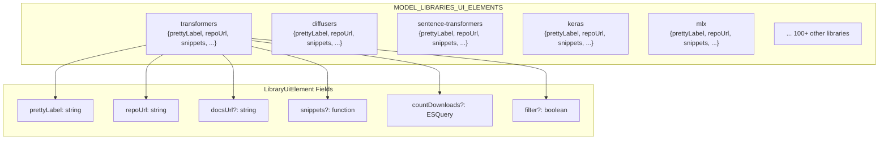
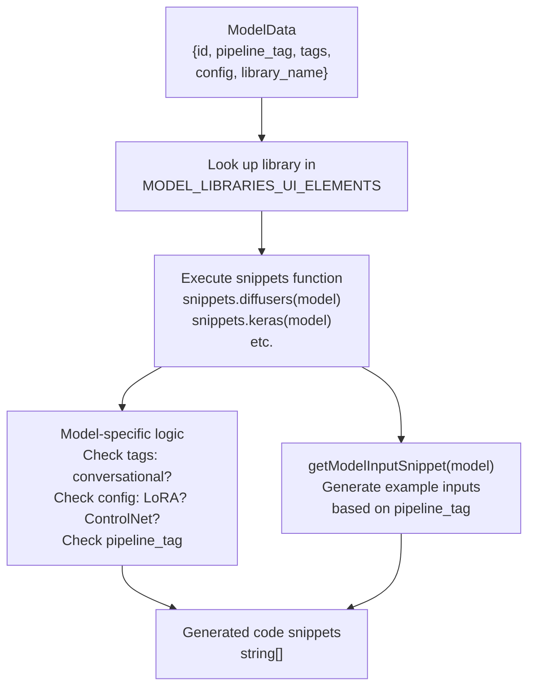
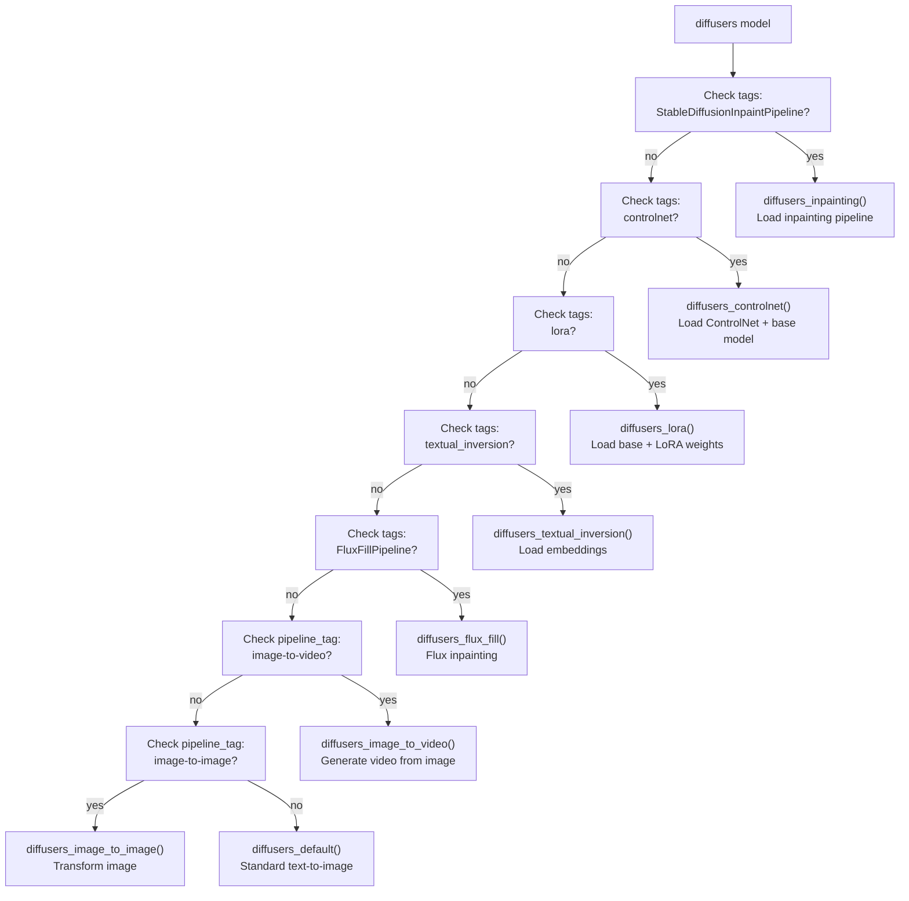
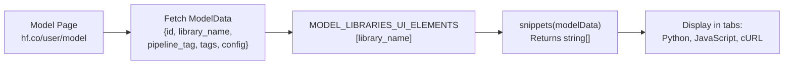

<!-- source: DeepWiki mcp.deepwiki.com · repo huggingface/huggingface.js · extra page Model Libraries and Snippets · fetched 2026-10-26 -->

# Model Libraries and Snippets

<details>
<summary>Relevant source files</summary>

The following files were used as context for generating this wiki page:

- [packages/tasks/src/default-widget-inputs.ts](packages/tasks/src/default-widget-inputs.ts)
- [packages/tasks/src/hardware.ts](packages/tasks/src/hardware.ts)
- [packages/tasks/src/index.ts](packages/tasks/src/index.ts)
- [packages/tasks/src/inference-providers.ts](packages/tasks/src/inference-providers.ts)
- [packages/tasks/src/library-to-tasks.ts](packages/tasks/src/library-to-tasks.ts)
- [packages/tasks/src/local-apps.spec.ts](packages/tasks/src/local-apps.spec.ts)
- [packages/tasks/src/local-apps.ts](packages/tasks/src/local-apps.ts)
- [packages/tasks/src/model-data.ts](packages/tasks/src/model-data.ts)
- [packages/tasks/src/model-libraries-downloads.ts](packages/tasks/src/model-libraries-downloads.ts)
- [packages/tasks/src/model-libraries-snippets.spec.ts](packages/tasks/src/model-libraries-snippets.spec.ts)
- [packages/tasks/src/model-libraries-snippets.ts](packages/tasks/src/model-libraries-snippets.ts)
- [packages/tasks/src/model-libraries.ts](packages/tasks/src/model-libraries.ts)
- [packages/tasks/src/snippets/common.ts](packages/tasks/src/snippets/common.ts)
- [packages/tasks/src/snippets/inputs.ts](packages/tasks/src/snippets/inputs.ts)
- [packages/tasks/src/snippets/types.ts](packages/tasks/src/snippets/types.ts)
- [packages/tasks/src/tasks/any-to-any/about.md](packages/tasks/src/tasks/any-to-any/about.md)
- [packages/tasks/src/tasks/any-to-any/data.ts](packages/tasks/src/tasks/any-to-any/data.ts)
- [packages/tasks/src/widget-example.ts](packages/tasks/src/widget-example.ts)

</details>


## Purpose and Scope

This document covers the model library registration and code snippet generation system within `@huggingface/tasks`. This system defines metadata for ML frameworks (transformers, diffusers, sentence-transformers, etc.) and automatically generates code examples that appear on model pages.

For information about the broader task taxonomy and type definitions, see [Task Definitions and Type System](#3.1.1). For local app integration (llama.cpp, Ollama, etc.), see [Local Apps Integration](#3.1.3).

## Library Registration System

The `MODEL_LIBRARIES_UI_ELEMENTS` constant at [packages/tasks/src/model-libraries.ts:60-2033]() defines metadata for all supported ML libraries. Each library is registered with a `LibraryUiElement` configuration that controls its display, documentation links, and code generation.

### LibraryUiElement Interface

The `LibraryUiElement` interface [packages/tasks/src/model-libraries.ts:8-43]() specifies:

| Field | Type | Purpose |
|-------|------|---------|
| `prettyLabel` | `string` | Display name (e.g., "🤗/diffusers", "Sentence Transformers") |
| `repoName` | `string` | Repository name for reference |
| `repoUrl` | `string` | Link to source code repository |
| `docsUrl?` | `string` | Optional documentation URL |
| `snippets?` | `(model: ModelData) => string[]` | Function to generate code examples |
| `countDownloads?` | `ElasticSearchQuery` | Query to count model downloads from specific files |
| `filter?` | `boolean` | Whether to display in hf.co/models filter (requires >100 models) |

**Library Registration Structure**



Sources: [packages/tasks/src/model-libraries.ts:8-43](), [packages/tasks/src/model-libraries.ts:60-2033]()

### Example Library Registrations

The diffusers library registration at [packages/tasks/src/model-libraries.ts:387-395]():

```typescript
diffusers: {
    prettyLabel: "Diffusers",
    repoName: "🤗/diffusers",
    repoUrl: "https://github.com/huggingface/diffusers",
    docsUrl: "https://huggingface.co/docs/hub/diffusers",
    snippets: snippets.diffusers,
    filter: true,
    /// diffusers has its own more complex "countDownloads" query
}
```

The sentence-transformers library at [packages/tasks/src/model-libraries.ts:1128-1135]():

```typescript
"sentence-transformers": {
    prettyLabel: "sentence-transformers",
    repoName: "sentence-transformers",
    repoUrl: "https://github.com/UKPLab/sentence-transformers",
    docsUrl: "https://huggingface.co/docs/hub/sentence-transformers",
    snippets: snippets.sentenceTransformers,
    filter: true,
}
```

Sources: [packages/tasks/src/model-libraries.ts:387-395](), [packages/tasks/src/model-libraries.ts:1128-1135]()

## Library-Task Mapping

The `LIBRARY_TASK_MAPPING` at [packages/tasks/src/library-to-tasks.ts:11-72]() defines which tasks each library supports. This mapping is used to enable/disable the HF Inference API (serverless) for specific (library, task) combinations.

**Purpose**: Only tasks listed in this mapping will have serverless inference enabled for that library. This prevents inference attempts on unsupported configurations.

### Task Support by Library

| Library | Supported Tasks |
|---------|----------------|
| `transformers` | audio-classification, automatic-speech-recognition, depth-estimation, document-question-answering, feature-extraction, fill-mask, image-classification, image-feature-extraction, image-segmentation, image-to-image, image-to-text, image-text-to-text, mask-generation, object-detection, question-answering, summarization, table-question-answering, text-classification, text-generation, text-to-audio, text-to-speech, token-classification, translation, video-classification, visual-question-answering, zero-shot-classification, zero-shot-image-classification, zero-shot-object-detection |
| `diffusers` | image-to-image, text-to-image |
| `sentence-transformers` | feature-extraction, sentence-similarity |
| `spacy` | token-classification, text-classification, sentence-similarity |
| `setfit` | text-classification |
| `peft` | text-generation |

The mapping is partially auto-generated for some libraries via the "python-api-export-tasks" GitHub Action, while transformers mappings are manually maintained.

Sources: [packages/tasks/src/library-to-tasks.ts:11-72]()

## Snippet Generation Architecture

Code snippets are generated dynamically based on the model's metadata. The system uses the `snippets` function from each library's registration combined with input generation to create complete, runnable examples.

**Snippet Generation Flow**



Sources: [packages/tasks/src/model-libraries.ts:30](), [packages/tasks/src/snippets/inputs.ts:168-191]()

### Input Generation System

The `getModelInputSnippet` function at [packages/tasks/src/snippets/inputs.ts:168-191]() generates appropriate example inputs for each pipeline type:

```typescript
modelInputSnippets: {
    "text-generation": inputsTextGeneration,
    "text-classification": inputsTextClassification,
    "image-classification": inputsImageClassification,
    "fill-mask": inputsFillMask,
    // ... 25+ more task types
}
```

For text-generation models, it returns either chat messages for conversational models or a simple text prompt:

```typescript
const inputsTextGeneration = (model: ModelDataMinimal): string | ChatCompletionInputMessage[] => {
    if (model.tags.includes("conversational")) {
        return model.pipeline_tag === "text-generation"
            ? [{ role: "user", content: "What is the capital of France?" }]
            : [/* multimodal chat with image */];
    }
    return `"Can you please let us know more details about your "`;
};
```

Sources: [packages/tasks/src/snippets/inputs.ts:44-67](), [packages/tasks/src/snippets/inputs.ts:130-164]()

## Library-Specific Snippet Implementations

Each library has a dedicated snippet generation function in [packages/tasks/src/model-libraries-snippets.ts]() that handles library-specific nuances.

### Diffusers: Multi-Type Snippet Generation

The `diffusers` function at [packages/tasks/src/model-libraries-snippets.ts:560-592]() generates different snippets based on model type:

**Diffusers Snippet Decision Tree**



Sources: [packages/tasks/src/model-libraries-snippets.ts:560-592]()

**Example: LoRA Snippet Generation**

For a LoRA model, the snippet at [packages/tasks/src/model-libraries-snippets.ts:441-451]() loads the base model first, then applies LoRA weights:

```python
import torch
from diffusers import DiffusionPipeline

pipe = DiffusionPipeline.from_pretrained("base-model-id", dtype=torch.bfloat16, device_map="cuda")
pipe.load_lora_weights("lora-model-id")

prompt = "Astronaut riding a horse"
image = pipe(prompt).images[0]
```

Sources: [packages/tasks/src/model-libraries-snippets.ts:441-451]()

### Keras Hub: Task-Based Snippet Selection

The `keras_hub` function at [packages/tasks/src/model-libraries-snippets.ts:875-920]() selects snippets based on the model's configured tasks:

```typescript
const tasks = model.config?.keras_hub?.tasks ?? [];

// Generate snippets for tasks with examples
for (const [task, snippet] of Object.entries(_keras_hub_tasks_with_example)) {
    if (tasks.includes(task)) {
        snippets.push(snippet(modelId));
    }
}
```

It provides specialized examples for `CausalLM`, `TextToImage`, `TextClassifier`, and `ImageClassifier` tasks.

Sources: [packages/tasks/src/model-libraries-snippets.ts:875-920]()

### ESP-net: Pipeline Tag-Based Routing

The `espnet` function at [packages/tasks/src/model-libraries-snippets.ts:714-721]() selects different ESPnet classes based on pipeline tag:

```typescript
export const espnet = (model: ModelData): string[] => {
    if (model.tags.includes("text-to-speech")) {
        return espnetTTS(model);  // Uses Text2Speech class
    } else if (model.tags.includes("automatic-speech-recognition")) {
        return espnetASR(model);  // Uses Speech2Text class
    }
    return espnetUnknown();
};
```

Sources: [packages/tasks/src/model-libraries-snippets.ts:714-721]()

### Local Model Snippets (GGUF)

For GGUF models, snippets support quantization tag placeholders. The `llama_cpp_python` function at [packages/tasks/src/model-libraries-snippets.ts:2080-2123]() includes:

```python
llm = Llama.from_pretrained(
    repo_id="model-id",
    filename="{{GGUF_FILE}}",  # Placeholder replaced with actual file
)
```

The `{{GGUF_FILE}}` placeholder is replaced with the actual quantized model filename when displayed.

Sources: [packages/tasks/src/model-libraries-snippets.ts:2080-2123]()

## Multi-Snippet Support

Many libraries return multiple snippet variations to show different use cases. The snippet functions return `string[]` where each element is a complete, independent code example.

**Example: AudioSeal with Multiple Snippets**

The `audioseal` function at [packages/tasks/src/model-libraries-snippets.ts:61-79]() returns two snippets:

1. **Watermark Generator**: Shows how to add watermarks to audio
2. **Watermark Detector**: Shows how to detect watermarks in audio

```typescript
export const audioseal = (model: ModelData): string[] => {
    const watermarkSnippet = `# Watermark Generator...`;
    const detectorSnippet = `# Watermark Detector...`;
    return [watermarkSnippet, detectorSnippet];
};
```

Sources: [packages/tasks/src/model-libraries-snippets.ts:61-79]()

## Integration with Model Pages

The snippet system integrates with model pages through the `ModelData` interface at [packages/tasks/src/model-data.ts:8-134](). When a model page loads:

1. The model's `library_name` field determines which library registration to use
2. The library's `snippets` function is called with the full `ModelData` object
3. Generated snippets appear in the "Use this model" section with language tabs

**Snippet Display Pipeline**



Sources: [packages/tasks/src/model-data.ts:8-134](), [packages/tasks/src/model-libraries.ts:30]()

## Download Counting System

The `countDownloads` field uses Elasticsearch query strings to identify library-specific files for download statistics. These queries are documented in the Hub documentation at https://huggingface.co/docs/hub/models-download-stats.

**Example Queries**:

| Library | Query | Purpose |
|---------|-------|---------|
| `adapter-transformers` | `path:"adapter_config.json"` | Count models with adapter configs |
| `sentence-transformers` | (default) | Uses default config files |
| `fasttext` | `path_extension:"bin"` | Count .bin files |
| `gguf` | Custom query | Complex GGUF-specific detection |

The query syntax supports:
- `path:"exact/file/path.ext"` - Match exact file path
- `path_extension:"ext"` - Match file extension
- `path_filename:"name"` - Match filename without extension
- Boolean operators: `OR`, `AND`

Sources: [packages/tasks/src/model-libraries.ts:37](), [packages/tasks/src/model-libraries-downloads.ts:1-19]()

## Adding New Libraries

To add a new library to the system:

1. **Add entry to MODEL_LIBRARIES_UI_ELEMENTS** at [packages/tasks/src/model-libraries.ts:60](). The key becomes the `library_name` tag.

2. **Create snippet function** in [packages/tasks/src/model-libraries-snippets.ts]():
   ```typescript
   export const myLibrary = (model: ModelData): string[] => [
       `from my_library import Model\n\nmodel = Model.load("${model.id}")`
   ];
   ```

3. **Add to LIBRARY_TASK_MAPPING** at [packages/tasks/src/library-to-tasks.ts:11]() if inference API support is needed:
   ```typescript
   "my-library": ["text-generation", "text-classification"],
   ```

4. **Export from index** at [packages/tasks/src/index.ts:20]() to make it available to consumers.

Sources: [packages/tasks/src/model-libraries.ts:45-58](), [packages/tasks/src/library-to-tasks.ts:4-10]()

---

