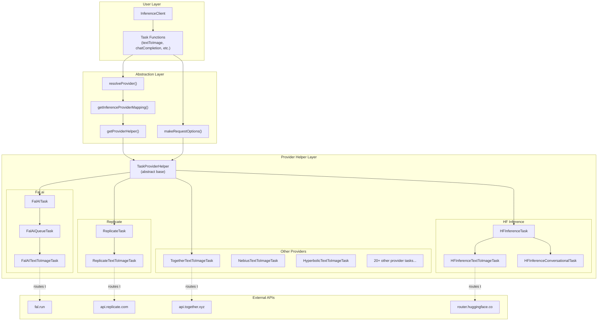
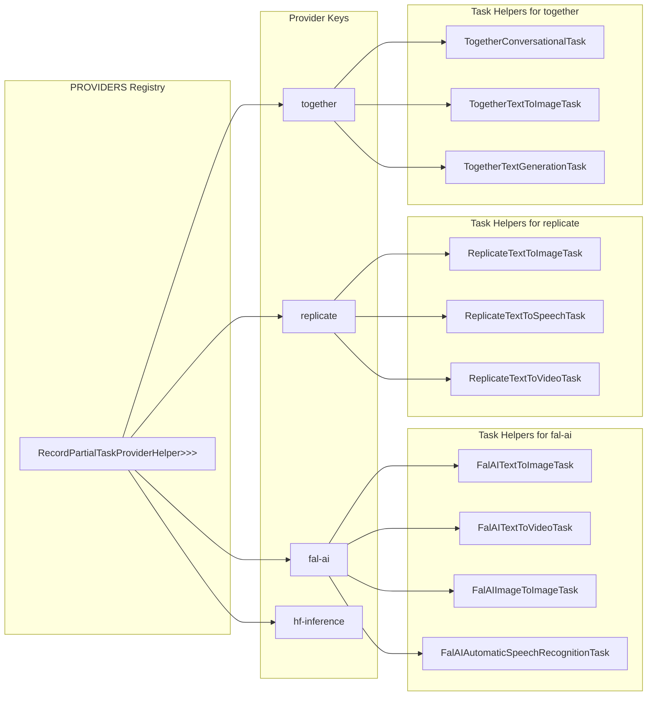
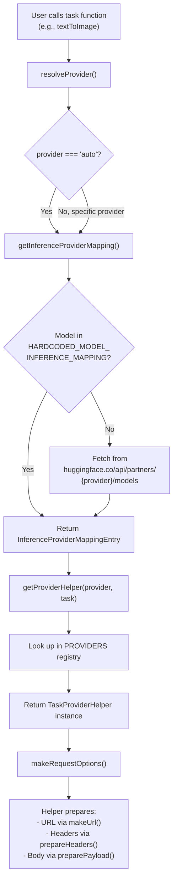
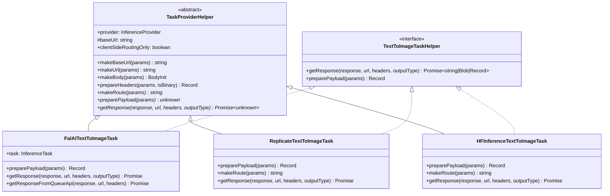
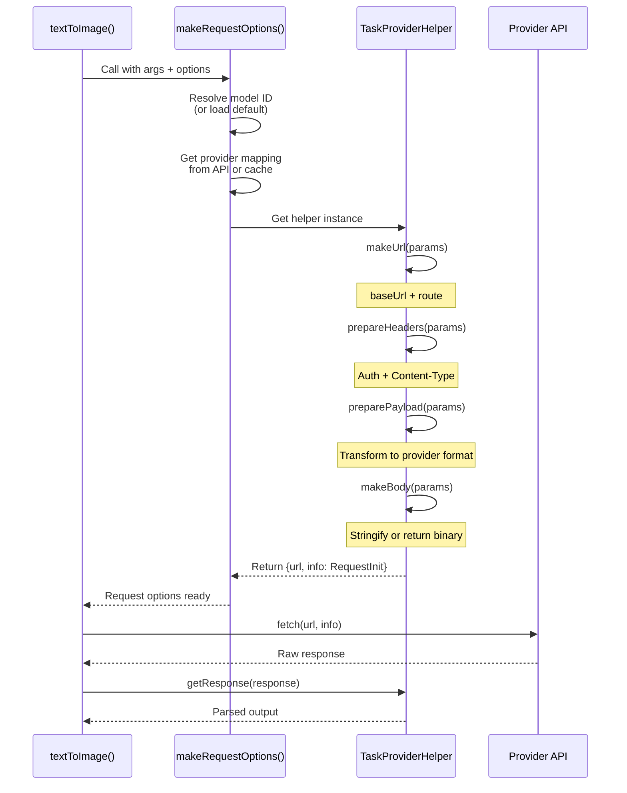
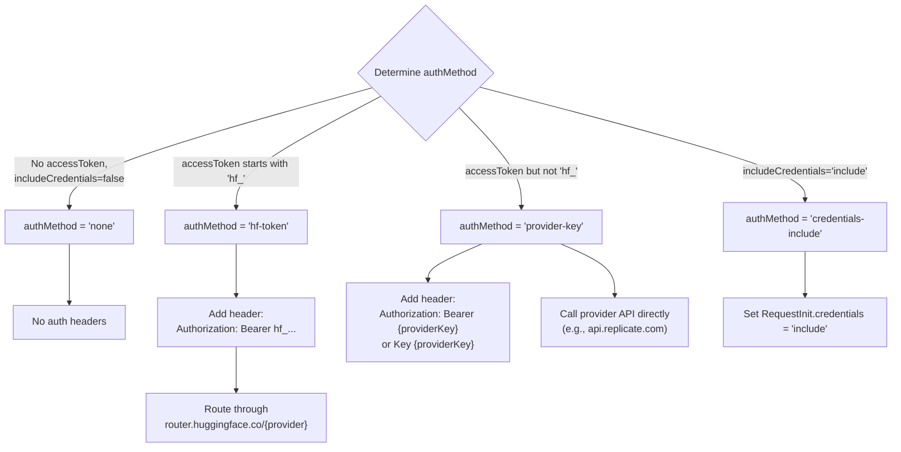
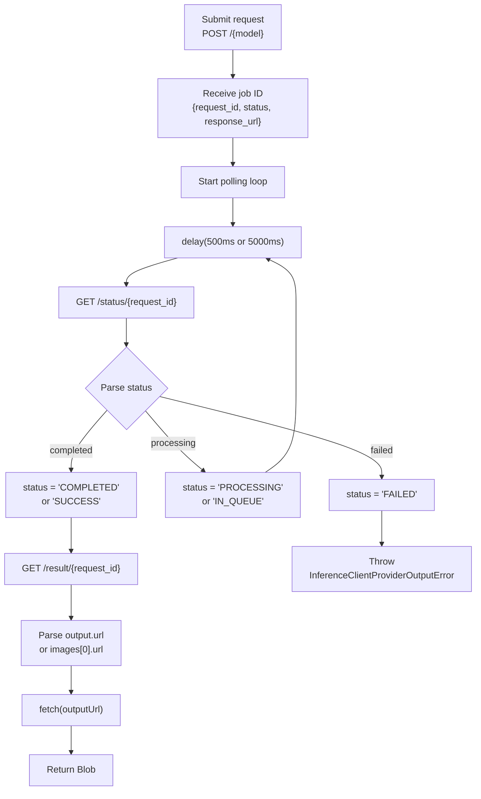
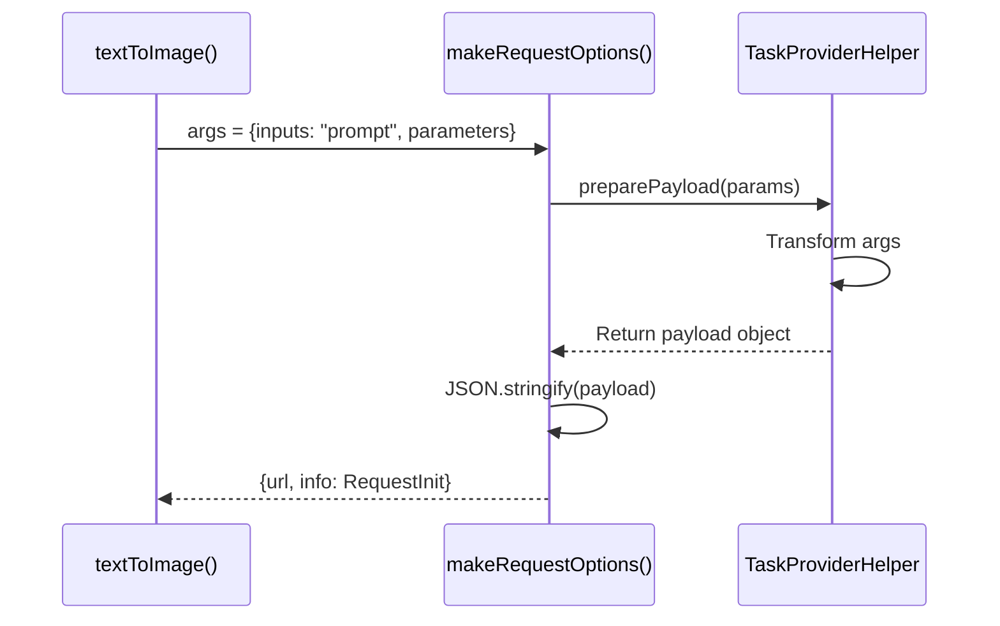
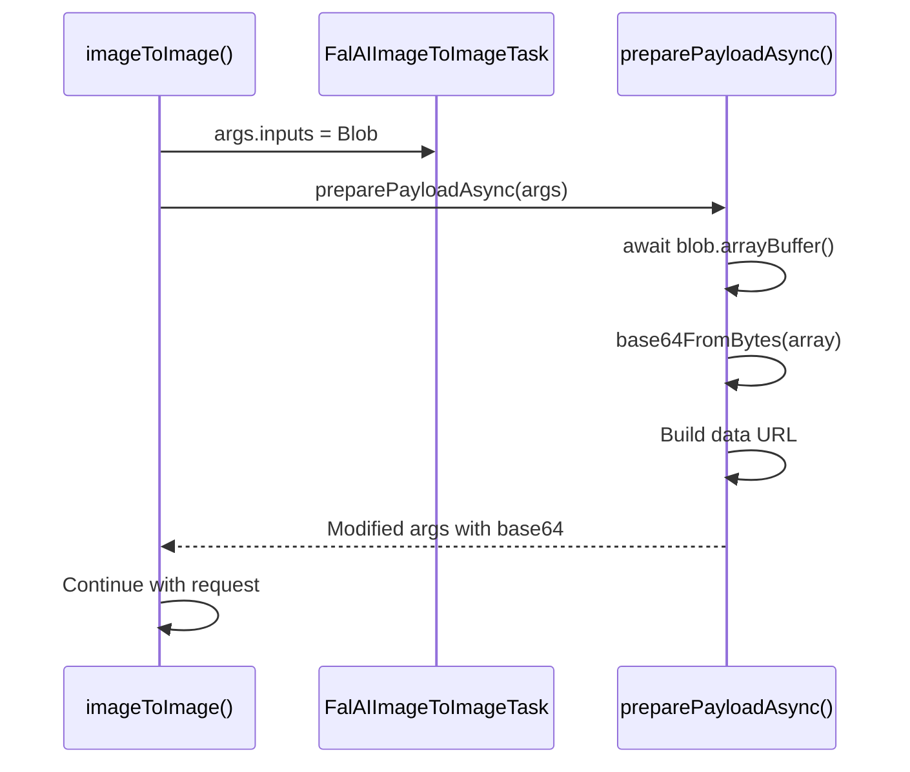

<!-- source: DeepWiki mcp.deepwiki.com · repo huggingface/huggingface.js · extra page Provider System · fetched 2026-10-26 -->

# Provider System

<details>
<summary>Relevant source files</summary>

The following files were used as context for generating this wiki page:

- [.github/workflows/lint.yml](.github/workflows/lint.yml)
- [.github/workflows/test.yml](.github/workflows/test.yml)
- [packages/inference/README.md](packages/inference/README.md)
- [packages/inference/src/config.ts](packages/inference/src/config.ts)
- [packages/inference/src/lib/getProviderHelper.ts](packages/inference/src/lib/getProviderHelper.ts)
- [packages/inference/src/lib/makeRequestOptions.ts](packages/inference/src/lib/makeRequestOptions.ts)
- [packages/inference/src/providers/consts.ts](packages/inference/src/providers/consts.ts)
- [packages/inference/src/providers/fal-ai.ts](packages/inference/src/providers/fal-ai.ts)
- [packages/inference/src/providers/hf-inference.ts](packages/inference/src/providers/hf-inference.ts)
- [packages/inference/src/providers/hyperbolic.ts](packages/inference/src/providers/hyperbolic.ts)
- [packages/inference/src/providers/nebius.ts](packages/inference/src/providers/nebius.ts)
- [packages/inference/src/providers/nscale.ts](packages/inference/src/providers/nscale.ts)
- [packages/inference/src/providers/providerHelper.ts](packages/inference/src/providers/providerHelper.ts)
- [packages/inference/src/providers/replicate.ts](packages/inference/src/providers/replicate.ts)
- [packages/inference/src/providers/sambanova.ts](packages/inference/src/providers/sambanova.ts)
- [packages/inference/src/providers/together.ts](packages/inference/src/providers/together.ts)
- [packages/inference/src/providers/wavespeed.ts](packages/inference/src/providers/wavespeed.ts)
- [packages/inference/src/providers/zai-org.ts](packages/inference/src/providers/zai-org.ts)
- [packages/inference/src/tasks/cv/textToImage.ts](packages/inference/src/tasks/cv/textToImage.ts)
- [packages/inference/src/types.ts](packages/inference/src/types.ts)
- [packages/inference/test/InferenceClient.spec.ts](packages/inference/test/InferenceClient.spec.ts)

</details>


This document describes the provider abstraction architecture in the `@huggingface/inference` package. The provider system enables routing inference requests to multiple third-party inference providers (Fal.ai, Replicate, Together, Cerebras, etc.) while maintaining a unified API surface through the `InferenceClient`. It handles provider-specific request formatting, authentication, response parsing, and async polling patterns.

For information about the task functions and types that sit above this provider system, see [Task Functions and Types](#2.1.3). For the overall InferenceClient API, see [InferenceClient API](#2.1.1).

---

## Architecture Overview

The provider system implements a three-layer architecture where task-specific provider helpers translate between the unified `InferenceClient` API and provider-specific APIs.



**Sources:** [packages/inference/src/lib/getProviderHelper.ts](), [packages/inference/src/providers/providerHelper.ts:1-145](), [packages/inference/src/lib/makeRequestOptions.ts:19-99]()

---

## Provider Registration

### Provider Constants

All supported providers are defined in the `INFERENCE_PROVIDERS` constant array:

```typescript
const INFERENCE_PROVIDERS = [
  "baseten", "black-forest-labs", "cerebras", "clarifai", "cohere",
  "fal-ai", "featherless-ai", "fireworks-ai", "groq", "hf-inference",
  "hyperbolic", "nebius", "novita", "nscale", "openai", "ovhcloud",
  "publicai", "replicate", "sambanova", "scaleway", "together",
  "wavespeed", "zai-org"
] as const;
```

### Provider-Task Matrix

The `PROVIDERS` registry maps each provider to its supported tasks using task-specific helper instances:



**Sources:** [packages/inference/src/types.ts:47-77](), [packages/inference/src/lib/getProviderHelper.ts:62-193]()

---

## Provider Selection and Routing

### Resolution Flow

The system uses a multi-step process to determine which provider should handle a request:



**Sources:** [packages/inference/src/lib/makeRequestOptions.ts:19-99](), [packages/inference/src/lib/getInferenceProviderMapping.ts](), [packages/inference/src/lib/getProviderHelper.ts:198-354]()

### Provider Mapping Structure

Each model-provider mapping contains metadata about how to route requests:

```typescript
interface InferenceProviderMappingEntry {
  adapter?: string;              // "lora" for LoRA adapters
  adapterWeightsPath?: string;   // Path to adapter weights
  hfModelId: ModelId;            // Hugging Face model ID
  provider: string;              // Provider name
  providerId: string;            // Provider's internal model ID
  status: "live" | "staging";    // Deployment status
  task: WidgetType;              // Task type
  type?: "single-model" | "tag-filter";
}
```

**Sources:** [packages/inference/src/types.ts:110-119]()

---

## TaskProviderHelper Pattern

### Base Class Structure

All provider implementations extend `TaskProviderHelper`, which defines the contract for request preparation and response handling:



**Sources:** [packages/inference/src/providers/providerHelper.ts:71-145](), [packages/inference/src/providers/providerHelper.ts:150-158]()

### Core Methods

Each `TaskProviderHelper` must implement three abstract methods:

| Method | Purpose | Returns |
|--------|---------|---------|
| `makeRoute(params)` | Constructs the API endpoint path | `string` (e.g., `"v1/chat/completions"`) |
| `preparePayload(params)` | Transforms generic args to provider format | Provider-specific payload object |
| `getResponse(response, ...)` | Parses provider response to standard format | Promise of task-specific output type |

**Sources:** [packages/inference/src/providers/providerHelper.ts:93-101]()

---

## Request Pipeline

### Request Preparation Flow

The `makeRequestOptions` function orchestrates the entire request preparation process:



**Sources:** [packages/inference/src/lib/makeRequestOptions.ts:19-99](), [packages/inference/src/providers/providerHelper.ts:106-144]()

### URL Construction

Different providers require different URL structures:

| Provider | Base URL | Route Pattern | Example |
|----------|----------|---------------|---------|
| `hf-inference` | `router.huggingface.co/hf-inference` | `models/{modelId}` | `models/stabilityai/stable-diffusion-2` |
| `fal-ai` | `queue.fal.run` | `/{modelId}?_subdomain=queue` | `/fal-ai/flux-pro/v1.1` |
| `replicate` | `api.replicate.com` | `v1/models/{owner}/{name}/predictions` | `v1/models/stability-ai/sdxl/predictions` |
| `together` | `api.together.xyz` | `v1/images/generations` | `v1/images/generations` |

**Sources:** [packages/inference/src/providers/hf-inference.ts:106-119](), [packages/inference/src/providers/fal-ai.ts:100-105](), [packages/inference/src/providers/replicate.ts:42-72](), [packages/inference/src/providers/together.ts:104-106]()

---

## Authentication Methods

The provider system supports four authentication methods via the `authMethod` field:



**Sources:** [packages/inference/src/lib/makeRequestOptions.ts:125-140](), [packages/inference/src/providers/providerHelper.ts:135-144]()

### Provider-Specific Authentication

Different providers customize the `prepareHeaders` method:

```typescript
// Fal.ai uses "Key" prefix for provider keys
class FalAITask extends TaskProviderHelper {
  override prepareHeaders(params: HeaderParams, binary: boolean) {
    const headers: Record<string, string> = {
      Authorization: params.authMethod !== "provider-key" 
        ? `Bearer ${params.accessToken}` 
        : `Key ${params.accessToken}`
    };
    return headers;
  }
}
```

**Sources:** [packages/inference/src/providers/fal-ai.ts:85-94](), [packages/inference/src/providers/replicate.ts:58-64]()

---

## Async Polling Pattern

### Queue-Based Providers

Several providers (Fal.ai, Replicate, WaveSpeed, ZAI) use asynchronous job queues that require polling:



**Sources:** [packages/inference/src/providers/fal-ai.ts:106-169](), [packages/inference/src/providers/replicate.ts:58-64](), [packages/inference/src/providers/wavespeed.ts:128-208](), [packages/inference/src/providers/zai-org.ts:96-191]()

### Fal.ai Queue Implementation

The `FalAiQueueTask` base class implements the polling logic:

```typescript
abstract class FalAiQueueTask extends FalAITask {
  abstract task: InferenceTask;
  
  override makeRoute(params: UrlParams): string {
    if (params.authMethod !== "provider-key") {
      return `/${params.model}?_subdomain=queue`;
    }
    return `/${params.model}`;
  }
  
  async getResponseFromQueueApi(
    response: FalAiQueueOutput,
    url?: string,
    headers?: Record<string, string>
  ): Promise<unknown> {
    const requestId = response.request_id;
    let status = response.status;
    
    const statusUrl = `${baseUrl}${modelId}/status${queryParams}`;
    const resultUrl = `${baseUrl}${modelId}${queryParams}`;
    
    while (status !== "COMPLETED") {
      await delay(500);
      const statusResponse = await fetch(statusUrl, { headers });
      status = (await statusResponse.json()).status;
    }
    
    const result = await fetch(resultUrl, { headers });
    return await result.json();
  }
}
```

**Sources:** [packages/inference/src/providers/fal-ai.ts:97-169]()

---

## Provider-Specific Implementations

### Example: Text-to-Image Variations

Each provider implements `TextToImageTaskHelper` differently based on their API format:

```mermaid
graph TB
    subgraph "HF Inference"
        HF_PREP["preparePayload:<br/>Pass args as-is"]
        HF_RESP["getResponse:<br/>Handle Blob or<br/>{data: [{b64_json}]}"]
    end
    
    subgraph "Fal.ai"
        FAL_PREP["preparePayload:<br/>{prompt, loras?}"]
        FAL_SUBMIT["Submit to queue"]
        FAL_POLL["Poll getResponseFromQueueApi"]
        FAL_RESP["Parse {images: [{url}]}"]
        FAL_FETCH["Fetch URL → Blob"]
    end
    
    subgraph "Replicate"
        REP_PREP["preparePayload:<br/>{input: {prompt, lora_weights?},<br/>version: {hash}}"]
        REP_WAIT["Use Prefer: wait header<br/>(synchronous)"]
        REP_RESP["Parse {output: string}<br/>or {output: [string]}"]
        REP_FETCH["Fetch URL → Blob"]
    end
    
    subgraph "Together"
        TOG_PREP["preparePayload:<br/>{prompt, model,<br/>response_format: 'b64' or 'url'}"]
        TOG_ROUTE["Route: v1/images/generations"]
        TOG_RESP["Parse {data: [{b64_json}]}<br/>or {data: [{url}]}"]
    end
    
    HF_PREP --> HF_RESP
    FAL_PREP --> FAL_SUBMIT --> FAL_POLL --> FAL_RESP --> FAL_FETCH
    REP_PREP --> REP_WAIT --> REP_RESP --> REP_FETCH
    TOG_PREP --> TOG_ROUTE --> TOG_RESP
```



**Sources:** [packages/inference/src/providers/hf-inference.ts:126-178](), [packages/inference/src/providers/fal-ai.ts:176-239](), [packages/inference/src/providers/replicate.ts:75-134](), [packages/inference/src/providers/together.ts:99-149]()

### LoRA Adapter Support

Some providers support LoRA adapters through the mapping's `adapter` field:

```typescript
// Fal.ai LoRA handling
class FalAITextToImageTask extends FalAiQueueTask {
  override preparePayload(params: BodyParams): Record<string, unknown> {
    const payload = { /* base payload */ };
    
    if (params.mapping?.adapter === "lora" && params.mapping.adapterWeightsPath) {
      payload.loras = [{
        path: `${HF_HUB_URL}/${params.mapping.hfModelId}/resolve/main/${params.mapping.adapterWeightsPath}`,
        scale: 1
      }];
    }
    
    return payload;
  }
}
```

**Sources:** [packages/inference/src/providers/fal-ai.ts:184-204](), [packages/inference/src/providers/replicate.ts:76-89](), [packages/inference/src/providers/wavespeed.ts:100-125]()

---

## Base Task Classes

### Reusable Conversational Implementation

Many providers use OpenAI-compatible chat completion APIs. The `BaseConversationalTask` provides a standard implementation:

```typescript
export class BaseConversationalTask extends TaskProviderHelper 
  implements ConversationalTaskHelper {
  
  makeRoute(): string {
    return "v1/chat/completions";
  }
  
  preparePayload(params: BodyParams): Record<string, unknown> {
    return {
      ...params.args,
      model: params.model
    };
  }
  
  async getResponse(response: ChatCompletionOutput): Promise<ChatCompletionOutput> {
    // Validates OpenAI-compatible response structure
    if (typeof response === "object" && 
        Array.isArray(response?.choices) &&
        typeof response?.created === "number" &&
        typeof response?.id === "string") {
      return response;
    }
    throw new InferenceClientProviderOutputError("Expected ChatCompletionOutput");
  }
}
```

Providers then extend and customize:

```typescript
export class TogetherConversationalTask extends BaseConversationalTask {
  constructor() {
    super("together", "https://api.together.xyz");
  }
  
  override preparePayload(params: BodyParams<ChatCompletionInput>) {
    const payload = super.preparePayload(params);
    // Custom handling for Together's json_schema format
    const response_format = payload.response_format;
    if (response_format?.type === "json_schema") {
      payload.response_format = {
        type: "json_schema",
        schema: response_format.json_schema.schema
      };
    }
    return payload;
  }
}
```

**Sources:** [packages/inference/src/providers/providerHelper.ts:331-365](), [packages/inference/src/providers/together.ts:48-68](), [packages/inference/src/providers/nebius.ts:51-66](), [packages/inference/src/providers/sambanova.ts:24-41]()

---

## Synchronous vs. Asynchronous Payload Preparation

### Standard Synchronous Flow

Most providers use synchronous payload preparation via `preparePayload`:



### Asynchronous with preparePayloadAsync

Some tasks require async preprocessing (e.g., converting Blob to base64):



Example implementations:

```typescript
// Replicate - Convert Blob to base64 for image-to-image
async preparePayloadAsync(args: ImageToImageArgs): Promise<RequestArgs> {
  const bytes = new Uint8Array(await args.inputs.arrayBuffer());
  const base64 = base64FromBytes(bytes);
  const imageInput = `data:${args.inputs.type || "image/jpeg"};base64,${base64}`;
  
  return {
    ...args,
    inputs: imageInput
  };
}

// Fal.ai - Handle automatic speech recognition
async preparePayloadAsync(args: AutomaticSpeechRecognitionArgs): Promise<RequestArgs> {
  const blob = "data" in args ? args.data : args.inputs;
  const base64audio = base64FromBytes(new Uint8Array(await blob.arrayBuffer()));
  
  return {
    ...omit(args, "data", "inputs"),
    audio_url: `data:${blob.type};base64,${base64audio}`
  };
}
```

**Sources:** [packages/inference/src/providers/replicate.ts:265-277](), [packages/inference/src/providers/fal-ai.ts:478-498](), [packages/inference/src/providers/wavespeed.ts:236-241]()

---

## Error Handling

The provider system uses typed errors for different failure scenarios:

| Error Type | When Thrown | Example |
|------------|-------------|---------|
| `InferenceClientInputError` | Invalid user input | Provider requires model ID, URL/headers missing |
| `InferenceClientProviderApiError` | HTTP error from provider | 401 Unauthorized, 503 Service Unavailable |
| `InferenceClientProviderOutputError` | Malformed provider response | Missing expected fields, wrong data types |
| `InferenceClientHubApiError` | HF Hub API error | Failed to fetch provider mapping |

```typescript
// Example from Fal.ai polling
if (!statusResponse.ok) {
  throw new InferenceClientProviderApiError(
    "Failed to fetch response status from fal-ai API",
    { url: statusUrl, method: "GET" },
    {
      requestId: statusResponse.headers.get("x-request-id") ?? "",
      status: statusResponse.status,
      body: await statusResponse.text()
    }
  );
}

// Example from response validation
if (!result.images?.[0]?.url || !isUrl(result.images[0].url)) {
  throw new InferenceClientProviderOutputError(
    `Received malformed response from Fal.ai text-to-image API: expected { images: Array<{ url: string }> } result format, got instead: ${JSON.stringify(result)}`
  );
}
```

**Sources:** [packages/inference/src/errors.ts](), [packages/inference/src/providers/fal-ai.ts:139-149](), [packages/inference/src/providers/fal-ai.ts:233-237]()

---

## Client-Side Routing

Some providers require client-side routing where the model mapping API is not used:

```typescript
abstract class TaskProviderHelper {
  constructor(
    readonly provider: InferenceProvider,
    protected baseUrl: string,
    readonly clientSideRoutingOnly: boolean = false
  ) {}
}

// OpenAI provider always uses client-side routing
export class OpenAIConversationalTask extends BaseConversationalTask {
  constructor() {
    super("openai", "https://api.openai.com", true);  // clientSideRoutingOnly = true
  }
}
```

When `clientSideRoutingOnly` is true:
1. The system skips the provider mapping API call
2. Requires user to pass model ID directly
3. Creates a synthetic mapping with `providerId = removeProviderPrefix(model, provider)`

**Sources:** [packages/inference/src/providers/providerHelper.ts:74-79](), [packages/inference/src/lib/makeRequestOptions.ts:60-74](), [packages/inference/src/providers/openai.ts]()

---

## Testing Infrastructure

### Hardcoded Mappings for Tests

Tests inject model mappings via `HARDCODED_MODEL_INFERENCE_MAPPING`:

```typescript
export const HARDCODED_MODEL_INFERENCE_MAPPING: Record<
  InferenceProvider,
  Record<ModelId, InferenceProviderMappingEntry>
> = {
  "fal-ai": {},
  "replicate": {},
  // ... all providers
};

// In tests:
HARDCODED_MODEL_INFERENCE_MAPPING["hf-inference"] = {
  "google-bert/bert-base-uncased": {
    provider: "hf-inference",
    providerId: "google-bert/bert-base-uncased",
    hfModelId: "google-bert/bert-base-uncased",
    task: "fill-mask",
    status: "live"
  }
};
```

**Sources:** [packages/inference/src/providers/consts.ts:11-44](), [packages/inference/test/InferenceClient.spec.ts:39-243]()

---

