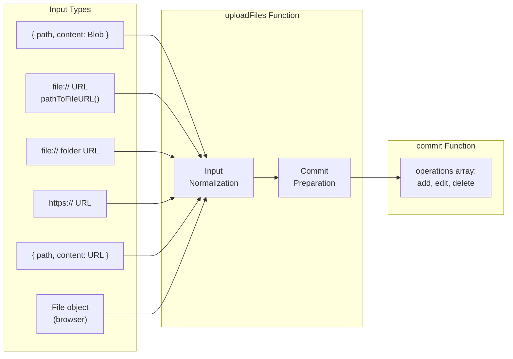
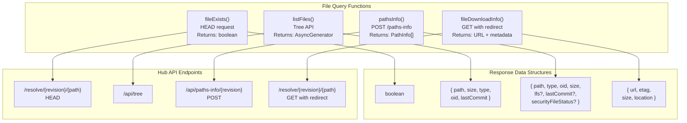

<!-- source: DeepWiki mcp.deepwiki.com · repo huggingface/huggingface.js · extra page Repository and File Operations · fetched 2026-10-26 -->

# Repository and File Operations

<details>
<summary>Relevant source files</summary>

The following files were used as context for generating this wiki page:

- [packages/hub/README.md](packages/hub/README.md)
- [packages/hub/src/lib/file-exists.spec.ts](packages/hub/src/lib/file-exists.spec.ts)
- [packages/hub/src/lib/file-exists.ts](packages/hub/src/lib/file-exists.ts)
- [packages/hub/src/lib/index.ts](packages/hub/src/lib/index.ts)
- [packages/hub/src/lib/paths-info.spec.ts](packages/hub/src/lib/paths-info.spec.ts)
- [packages/hub/src/lib/paths-info.ts](packages/hub/src/lib/paths-info.ts)

</details>


This document covers the core API functions in the `@huggingface/hub` package for managing repositories and files on the Hugging Face Hub. These operations provide CRUD (Create, Read, Update, Delete) capabilities for repositories of all types (models, datasets, spaces) and their contents.

For advanced upload mechanisms using content-defined chunking and deduplication, see [Xet Upload Protocol](#2.2.2). For authentication flows and local cache management, see [Authentication and Caching](#2.2.3).

## Repository Designation System

All repository operations use a `RepoDesignation` type to identify the target repository. This type specifies both the repository type and its fully qualified name.

```typescript
interface RepoDesignation {
  type: "model" | "dataset" | "space";
  name: string;  // format: "username/repo-name"
}
```

The `toRepoId` utility function [packages/hub/src/utils/toRepoId.ts]() normalizes various repository identifier formats into this canonical structure. Repository types map to different URL paths on the Hub:

| Repository Type | URL Path Pattern | Example |
|----------------|------------------|---------|
| `model` | `/{name}` | `/google-bert/bert-base-uncased` |
| `dataset` | `/datasets/{name}` | `/datasets/coyotte508/test-dataset` |
| `space` | `/spaces/{name}` | `/spaces/huggingfacejs/client-side-oauth` |

**Sources:** [packages/hub/README.md:34-36](), [packages/hub/src/lib/file-exists.ts:20-25](), [packages/hub/src/lib/paths-info.ts:78-84]()

## Repository Operations

### Repository Lifecycle Management

The Hub package provides functions to create, delete, and check repository access. These operations form the foundation of repository management.

```mermaid
graph TB
    subgraph "Repository Management Functions"
        createRepo["createRepo()<br/>Create new repository"]
        deleteRepo["deleteRepo()<br/>Remove repository"]
        checkRepoAccess["checkRepoAccess()<br/>Verify permissions"]
        repoExists["repoExists()<br/>Check existence"]
    end
    
    subgraph "Repository Information"
        modelInfo["modelInfo()<br/>Fetch model metadata"]
        datasetInfo["datasetInfo()<br/>Fetch dataset metadata"]
        spaceInfo["spaceInfo()<br/>Fetch space metadata"]
        listModels["listModels()<br/>Search models"]
        listDatasets["listDatasets()<br/>Search datasets"]
        listSpaces["listSpaces()<br/>Search spaces"]
    end
    
    subgraph "Branch Management"
        createBranch["createBranch()<br/>Create new branch"]
        deleteBranch["deleteBranch()<br/>Remove branch"]
        listCommits["listCommits()<br/>Browse history"]
        countCommits["countCommits()<br/>Count commits"]
    end
    
    subgraph "Hub Backend"
        HubAPI["Hub API<br/>/api/{type}s/{name}"]
    end
    
    createRepo --> HubAPI
    deleteRepo --> HubAPI
    checkRepoAccess --> HubAPI
    modelInfo --> HubAPI
    datasetInfo --> HubAPI
    spaceInfo --> HubAPI
    listModels --> HubAPI
    createBranch --> HubAPI
    deleteBranch --> HubAPI
```



**Diagram: Repository operation functions and their relationship to the Hub API**

**Sources:** [packages/hub/src/lib/index.ts:1-36](), [packages/hub/README.md:36-47]()

### Repository Creation

The `createRepo` function [packages/hub/src/lib/create-repo.ts]() initializes a new repository on the Hub. It accepts optional parameters for license, SDK tags, and visibility settings.

```typescript
// Example from README
await hub.createRepo({ 
  repo, 
  accessToken: "hf_...", 
  license: "mit" 
});
```

### Repository Information Retrieval

Three specialized functions retrieve repository metadata depending on the repository type:

- `modelInfo`: Returns model card metadata, task information, library tags, and file structure
- `datasetInfo`: Returns dataset card metadata, dataset viewer configuration, and splits information  
- `spaceInfo`: Returns space configuration, runtime information, and hardware allocation

```typescript
// Example from README
const specificModel = await hub.modelInfo({
  name: "openai-community/gpt2"
});
```

**Sources:** [packages/hub/README.md:44](), [packages/hub/src/lib/index.ts:8,25,32]()

## File Operations

### File Upload System

The Hub package provides three upload functions with different capabilities:

| Function | Progress Tracking | Return Type | Use Case |
|----------|------------------|-------------|----------|
| `uploadFile` | No | Promise | Single file upload |
| `uploadFiles` | No | Promise | Batch upload, simpler API |
| `uploadFilesWithProgress` | Yes | AsyncGenerator | Large uploads requiring feedback |

The `uploadFiles` function [packages/hub/src/lib/upload-files.ts]() accepts multiple input formats to maximize flexibility:



**Diagram: Upload input types flow through normalization to commit operations**

The underlying `commit` function [packages/hub/src/lib/commit.ts]() supports three operation types:

1. **add**: Upload new files or overwrite existing ones
2. **edit**: Modify existing files with prefix/suffix operations
3. **delete**: Remove files from the repository

**Sources:** [packages/hub/README.md:49-83](), [packages/hub/src/lib/index.ts:34-35](), [packages/hub/README.md:86-102]()

### File Download

The `downloadFile` function [packages/hub/src/lib/download-file.ts]() retrieves file contents from the Hub. It returns a `Response` object that can be consumed as text, JSON, blob, or stream.

```typescript
// Example from README
await (await hub.downloadFile({ 
  repo, 
  path: "README.md" 
})).text();
```

The download URL construction follows the pattern:
```
{hubUrl}/{type}s/{name}/resolve/{revision}/{path}
```

For model repositories, the type prefix is omitted, resulting in `{hubUrl}/{name}/resolve/{revision}/{path}`.

**Sources:** [packages/hub/README.md:106](), [packages/hub/src/lib/download-file.ts]()

### File Deletion

Two deletion functions are available:

- `deleteFile`: Removes a single file at the specified path
- `deleteFiles`: Batch deletion of multiple files in a single commit

```typescript
// Example from README  
await hub.deleteFile({
  repo, 
  accessToken: "hf_...", 
  path: "myfile.bin"
});
```

**Sources:** [packages/hub/README.md:104](), [packages/hub/src/lib/index.ts:10-11]()

### File Listing and Metadata

The Hub package provides multiple functions for file discovery and metadata retrieval:



**Diagram: File query functions with their endpoints and return types**

**Sources:** [packages/hub/src/lib/index.ts:16-17,29](), [packages/hub/src/lib/file-exists.ts:7-41]()

#### fileExists Function

The `fileExists` function [packages/hub/src/lib/file-exists.ts:7-41]() performs a HEAD request to check file presence without downloading content. It returns `true` if the file exists, `false` for 404 responses, and throws errors for other failure cases.

```typescript
// Implementation pattern from file-exists.ts
const url = `${hubUrl}/${repoId.type === "model" ? "" : `${repoId.type}s/`}${repoId.name}/raw/${encodeURIComponent(params.revision ?? "main")}/${params.path}`;

const resp = await fetch(url, {
  method: "HEAD",
  headers: accessToken ? { Authorization: `Bearer ${accessToken}` } : {}
});

if (resp.status === 404) return false;
if (!resp.ok) throw await createApiError(resp);
return true;
```

**Sources:** [packages/hub/src/lib/file-exists.ts:1-41](), [packages/hub/src/lib/file-exists.spec.ts:1-30]()

#### pathsInfo Function

The `pathsInfo` function [packages/hub/src/lib/paths-info.ts:64-124]() retrieves detailed metadata for multiple files in a single POST request. It provides comprehensive information including LFS pointer detection, last commit details, and security status.

The function has overloaded signatures to provide type safety based on the `expand` parameter:

```typescript
// When expand is true, lastCommit and securityFileStatus are guaranteed
pathsInfo(params: { ..., expand: true }): 
  Promise<(PathInfo & { lastCommit: CommitInfo; securityFileStatus: SecurityFileStatus })[]>

// When expand is false or undefined, these fields are optional
pathsInfo(params: { ..., expand?: boolean }): 
  Promise<PathInfo[]>
```

**PathInfo Structure:**

| Field | Type | Description | When Present |
|-------|------|-------------|--------------|
| `path` | `string` | File path in repository | Always |
| `type` | `string` | Object type (file/directory) | Always |
| `oid` | `string` | Git object ID | Always |
| `size` | `number` | File size in bytes | Always |
| `lfs` | `LfsPathInfo?` | LFS metadata | Only for LFS pointers |
| `lastCommit` | `CommitInfo?` | Last commit info | Only when `expand: true` |
| `securityFileStatus` | `SecurityFileStatus?` | Security scan status | Only when `expand: true` |

**LfsPathInfo Structure:**

| Field | Type | Description |
|-------|------|-------------|
| `oid` | `string` | SHA256 hash of file content |
| `size` | `number` | Actual file size |
| `pointerSize` | `number` | Size of LFS pointer file |

**Sources:** [packages/hub/src/lib/paths-info.ts:1-124](), [packages/hub/src/lib/paths-info.spec.ts:1-75]()

#### listFiles Function

The `listFiles` function [packages/hub/src/lib/list-files.ts]() returns an async generator that yields file information from the repository tree. This enables efficient iteration over large repositories without loading all file metadata into memory.

```typescript
// Example from README
for await (const fileInfo of hub.listFiles({repo})) {
  console.log(fileInfo);
}
```

**Sources:** [packages/hub/README.md:108-110](), [packages/hub/src/lib/index.ts:21]()

## Operation Patterns and URL Construction

All Hub operations follow consistent patterns for URL construction and error handling:

### URL Pattern Consistency

| Operation Type | URL Pattern | Method |
|---------------|-------------|--------|
| Repository Info | `/api/{type}s/{name}` | GET |
| File Download | `/{type}s/{name}/resolve/{revision}/{path}` | GET |
| File Metadata | `/{type}s/{name}/raw/{revision}/{path}` | HEAD |
| Batch Metadata | `/api/{type}s/{name}/paths-info/{revision}` | POST |
| Tree Listing | `/api/{type}s/{name}/tree/{revision}` | GET |

Note: Model repositories omit the `{type}s/` prefix, so model URLs use `/{name}/...` instead of `/models/{name}/...`.

### Authentication Pattern

All functions accept a `CredentialsParams` interface [packages/hub/src/types/public.ts]() for authentication:

```typescript
interface CredentialsParams {
  credentials?: {
    accessToken?: string;
    username?: string;
    password?: string;
  };
  accessToken?: string;  // Shorthand for credentials.accessToken
}
```

The `checkCredentials` utility function [packages/hub/src/utils/checkCredentials.ts]() extracts the access token from either format and includes it in the `Authorization: Bearer {token}` header.

### Custom Fetch Support

All HTTP operations accept an optional `fetch` parameter to override the default fetch implementation. This enables:

- Proxy configuration
- Custom header injection
- Request/response interception
- Testing with mock fetch implementations

```typescript
await fileExists({
  repo,
  path: "config.json",
  fetch: customFetchWithProxy
});
```

**Sources:** [packages/hub/src/lib/file-exists.ts:16](), [packages/hub/src/lib/paths-info.ts:47]()

## Error Handling

All Hub operations use the `createApiError` function [packages/hub/src/error.ts]() to construct detailed error objects from failed HTTP responses. This function parses error responses from the Hub API and creates JavaScript Error objects with:

- HTTP status code
- Error message from response body
- Full response object for debugging

```typescript
if (!resp.ok) {
  throw await createApiError(resp);
}
```

**Sources:** [packages/hub/src/lib/file-exists.ts:37-38](), [packages/hub/src/lib/paths-info.ts:101-103]()

## Cross-Environment Compatibility

The file operations system is designed to work across Node.js, Deno, and browser environments with platform-specific optimizations:

| Feature | Node.js | Browser | Deno |
|---------|---------|---------|------|
| File URL upload (`file://`) | ✅ | ❌ | ✅ |
| Native File objects | ❌ | ✅ | ⚠️ |
| Folder upload | ✅ | ❌ | ✅ |
| Streaming download | ✅ | ✅ | ✅ |
| Local cache | ✅ | ❌ | ✅ |

The package uses conditional exports and runtime checks to provide appropriate implementations for each environment while maintaining a unified API surface.

**Sources:** [packages/hub/README.md:15-22](), [packages/hub/README.md:222-225]()

---

