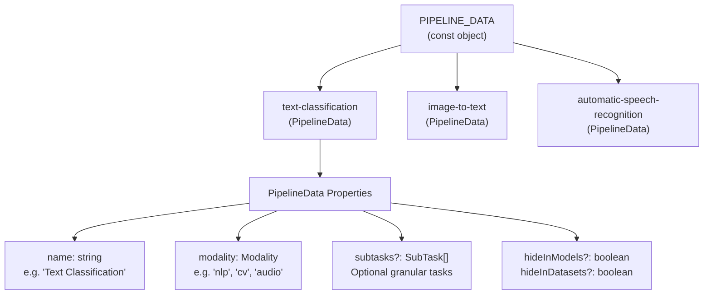
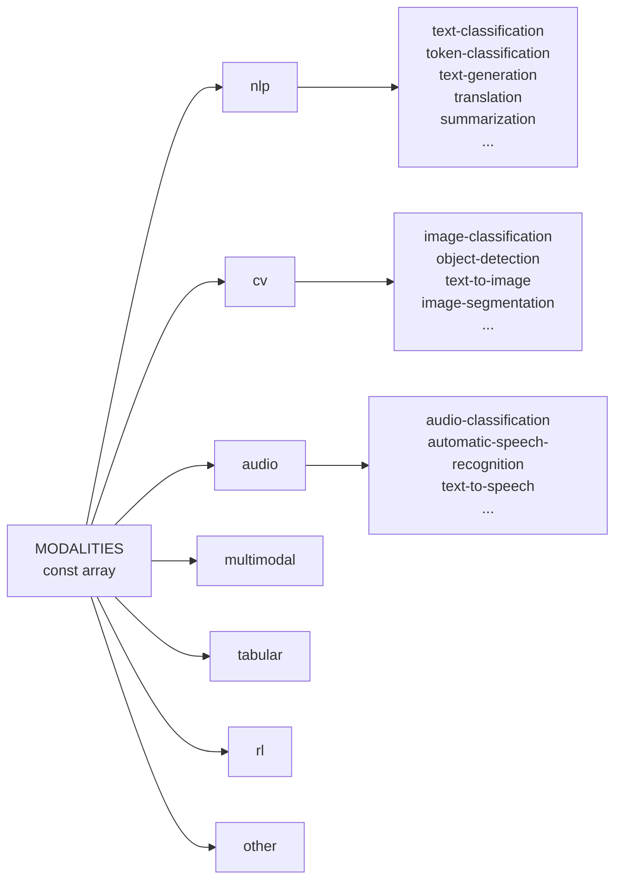
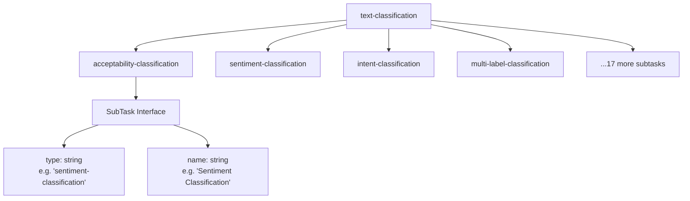
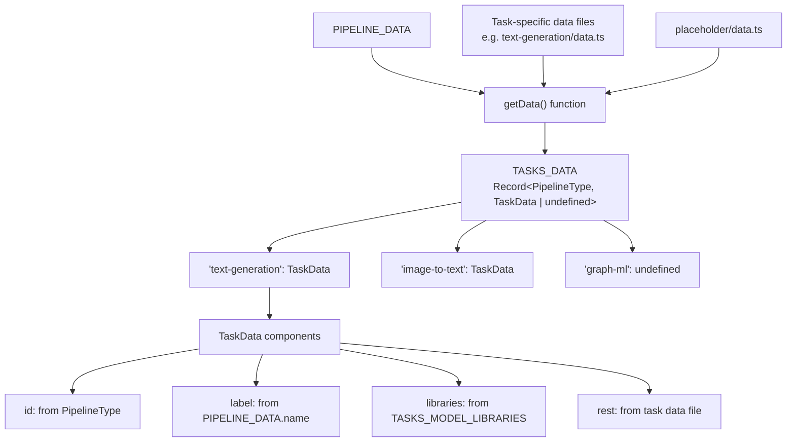
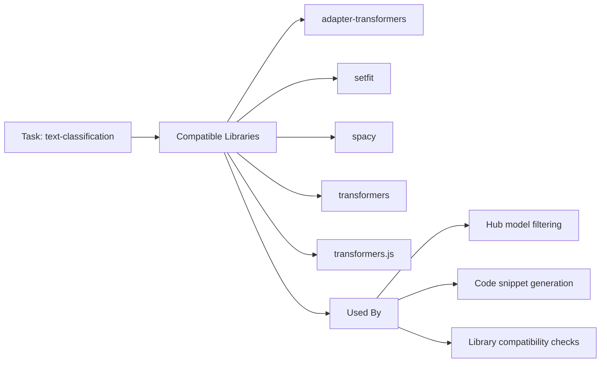
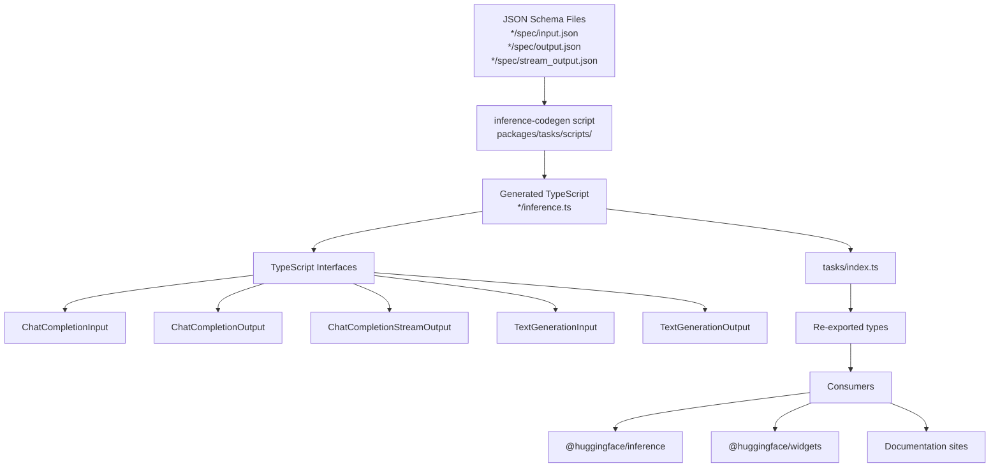
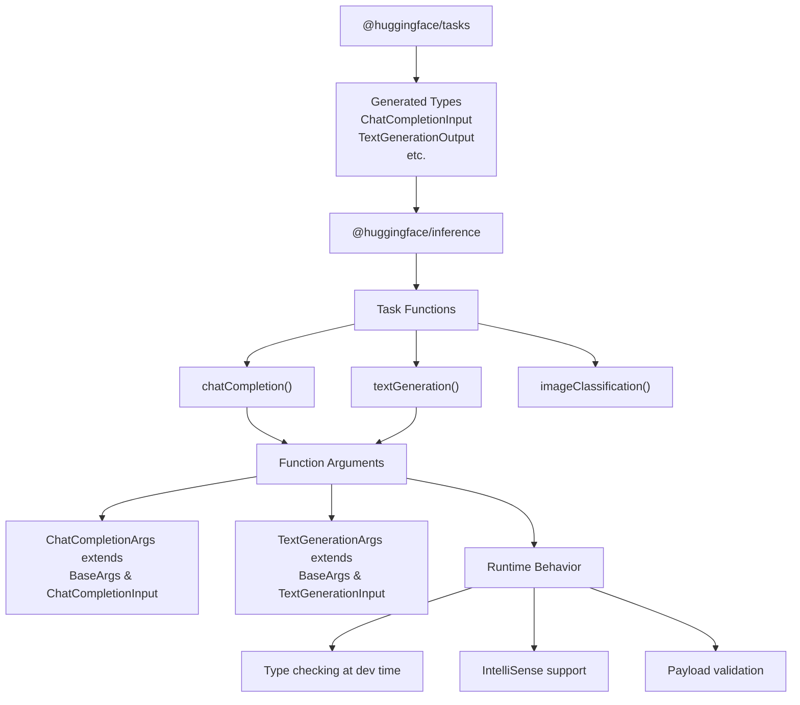
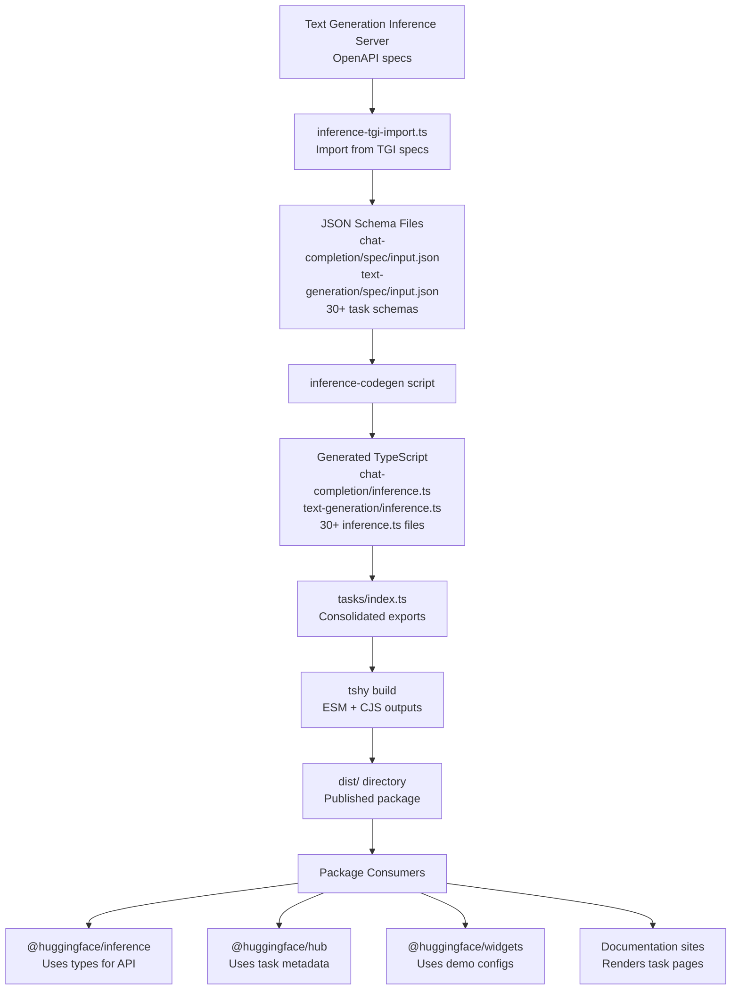

<!-- source: DeepWiki mcp.deepwiki.com · repo huggingface/huggingface.js · extra page Task Definitions and Type System · fetched 2026-10-26 -->

# Task Definitions and Type System

<details>
<summary>Relevant source files</summary>

The following files were used as context for generating this wiki page:

- [packages/inference/src/tasks/cv/imageTextToImage.ts](packages/inference/src/tasks/cv/imageTextToImage.ts)
- [packages/inference/src/tasks/cv/imageTextToVideo.ts](packages/inference/src/tasks/cv/imageTextToVideo.ts)
- [packages/inference/src/tasks/index.ts](packages/inference/src/tasks/index.ts)
- [packages/tasks/.gitignore](packages/tasks/.gitignore)
- [packages/tasks/package.json](packages/tasks/package.json)
- [packages/tasks/pnpm-lock.yaml](packages/tasks/pnpm-lock.yaml)
- [packages/tasks/src/pipelines.ts](packages/tasks/src/pipelines.ts)
- [packages/tasks/src/tasks/chat-completion/inference.ts](packages/tasks/src/tasks/chat-completion/inference.ts)
- [packages/tasks/src/tasks/chat-completion/spec/input.json](packages/tasks/src/tasks/chat-completion/spec/input.json)
- [packages/tasks/src/tasks/chat-completion/spec/output.json](packages/tasks/src/tasks/chat-completion/spec/output.json)
- [packages/tasks/src/tasks/chat-completion/spec/stream_output.json](packages/tasks/src/tasks/chat-completion/spec/stream_output.json)
- [packages/tasks/src/tasks/image-text-to-image/about.md](packages/tasks/src/tasks/image-text-to-image/about.md)
- [packages/tasks/src/tasks/image-text-to-image/data.ts](packages/tasks/src/tasks/image-text-to-image/data.ts)
- [packages/tasks/src/tasks/image-text-to-image/inference.ts](packages/tasks/src/tasks/image-text-to-image/inference.ts)
- [packages/tasks/src/tasks/index.ts](packages/tasks/src/tasks/index.ts)
- [packages/tasks/src/tasks/text-generation/inference.ts](packages/tasks/src/tasks/text-generation/inference.ts)
- [packages/tasks/src/tasks/text-generation/spec/input.json](packages/tasks/src/tasks/text-generation/spec/input.json)
- [packages/tasks/src/tasks/text-generation/spec/output.json](packages/tasks/src/tasks/text-generation/spec/output.json)
- [packages/tasks/src/tasks/text-generation/spec/stream_output.json](packages/tasks/src/tasks/text-generation/spec/stream_output.json)
- [packages/tasks/src/tasks/video-to-video/about.md](packages/tasks/src/tasks/video-to-video/about.md)
- [packages/tasks/src/tasks/video-to-video/data.ts](packages/tasks/src/tasks/video-to-video/data.ts)

</details>


This document covers the task taxonomy, data structures, and type generation system implemented in the `@huggingface/tasks` package. It explains how machine learning tasks are defined, organized by modality, and how TypeScript type definitions are automatically generated from JSON Schema specifications. For information about how these types are consumed by the inference library, see [Task Functions and Types](#2.1.3). For details on model library mappings and code snippets, see [Model Libraries and Snippets](#3.1.2).

## Overview of the Tasks Package

The `@huggingface/tasks` package serves as the canonical source of truth for ML task metadata across the Hugging Face ecosystem. It provides:

- **Task Taxonomy**: A hierarchical classification of 60+ ML tasks organized by modality
- **Type Definitions**: Auto-generated TypeScript interfaces for task inputs and outputs
- **Task Metadata**: Example models, datasets, metrics, and documentation for each task
- **Library Mappings**: Associations between tasks and compatible ML frameworks

The package exports this data as structured TypeScript types and constants that are imported by `@huggingface/inference`, `@huggingface/hub`, `@huggingface/widgets`, and documentation systems.

**Sources**: [packages/tasks/package.json:1-60](), [packages/tasks/src/tasks/index.ts:1-342]()

## Task Taxonomy and Pipeline Types

### PIPELINE_DATA Structure

The foundation of the task system is `PIPELINE_DATA`, a const object that defines all supported ML tasks. Each task has a standardized structure:



The `PipelineType` union type is derived from the keys of `PIPELINE_DATA`:

```typescript
export type PipelineType = keyof typeof PIPELINE_DATA;
// Results in: "text-classification" | "image-to-text" | "automatic-speech-recognition" | ...
```

**Sources**: [packages/tasks/src/pipelines.ts:15-652]()

### Modality Organization

Tasks are organized into seven primary modalities defined in the `MODALITIES` constant:

| Modality | Label | Example Tasks |
|----------|-------|---------------|
| `nlp` | Natural Language Processing | text-classification, text-generation, translation |
| `cv` | Computer Vision | image-classification, object-detection, text-to-image |
| `audio` | Audio | automatic-speech-recognition, text-to-speech |
| `multimodal` | Multimodal | visual-question-answering, document-question-answering |
| `tabular` | Tabular | tabular-classification, tabular-regression |
| `rl` | Reinforcement Learning | reinforcement-learning, robotics |
| `other` | Other | graph-ml, other |



**Sources**: [packages/tasks/src/pipelines.ts:1-13]()

### Subtask Hierarchy

Many pipeline types include optional subtasks for more granular classification:



The `SUBTASK_TYPES` array is derived from all subtasks across all pipeline types using:

```typescript
export const SUBTASK_TYPES = Object.values(PIPELINE_DATA)
  .flatMap((data) => ("subtasks" in data ? data.subtasks : []))
  .map((s) => s.type);
```

**Sources**: [packages/tasks/src/pipelines.ts:22-45](), [packages/tasks/src/pipelines.ts:660-662]()

## Task Data Structures

### TaskData Interface

Each task can have associated metadata defined by the `TaskData` interface:

```typescript
export interface TaskData {
  datasets: ExampleRepo[];       // Example datasets
  demo: TaskDemo;                // Widget demo configuration
  id: PipelineType;              // Task identifier
  canonicalId?: PipelineType;    // Canonical task if alias
  isPlaceholder?: boolean;       // If using placeholder data
  label: string;                 // Display name
  libraries: ModelLibraryKey[];  // Compatible ML frameworks
  metrics: ExampleRepo[];        // Evaluation metrics
  models: ExampleRepo[];         // Example models
  spaces: ExampleRepo[];         // Example Spaces
  summary: string;               // Task description
  widgetModels: string[];        // Models for widget
  youtubeId?: string;            // Tutorial video
}
```

The `TaskDemo` type specifies widget demonstration data with typed entries:

| Entry Type | Fields | Purpose |
|------------|--------|---------|
| `audio` | filename | Audio file reference |
| `chart` | data (label/score pairs) | Chart visualization |
| `img` | filename | Image file reference |
| `tabular` | table (string[][]) | Tabular data display |
| `text` | content, label | Text content |
| `text-with-tokens` | text, tokens (with positions) | Annotated text |

**Sources**: [packages/tasks/src/tasks/index.ts:280-342]()

### TASKS_DATA Assembly

The `TASKS_DATA` record combines pipeline definitions with task-specific data:



The `getData()` function at [packages/tasks/src/tasks/index.ts:207-214]() merges:

1. Task-specific data (datasets, models, summary, etc.)
2. Pipeline metadata (id, label from `PIPELINE_DATA`)
3. Library mappings (from `TASKS_MODEL_LIBRARIES`)

Tasks without specific data use placeholder values, while some tasks (like `graph-ml`, `multiple-choice`) are explicitly set to `undefined` to indicate no task page should be generated.

**Sources**: [packages/tasks/src/tasks/index.ts:207-278]()

## Model Library Mappings

### TASKS_MODEL_LIBRARIES Structure

The `TASKS_MODEL_LIBRARIES` record maps each `PipelineType` to an array of compatible ML library identifiers:

```typescript
export const TASKS_MODEL_LIBRARIES: Record<PipelineType, ModelLibraryKey[]> = {
  "text-classification": ["adapter-transformers", "setfit", "spacy", "transformers", "transformers.js"],
  "text-generation": ["transformers", "transformers.js"],
  "image-classification": ["keras", "timm", "transformers", "transformers.js"],
  "automatic-speech-recognition": ["espnet", "nemo", "speechbrain", "transformers", "transformers.js"],
  // ... 60+ more mappings
}
```

This mapping enables:
- Filtering models by library in the Hub UI
- Generating library-specific code snippets
- Validating model compatibility with tasks



**Sources**: [packages/tasks/src/tasks/index.ts:134-200]()

## Type Generation System

### JSON Schema Specifications

Input and output types for inference tasks are defined using JSON Schema in `spec/` directories within each task folder. For example, `chat-completion` has:

- `spec/input.json` - Defines `ChatCompletionInput` structure
- `spec/output.json` - Defines `ChatCompletionOutput` structure  
- `spec/stream_output.json` - Defines `ChatCompletionStreamOutput` structure

The schemas use JSON Schema draft-06 specification with features like:
- `$ref` for internal references
- `$defs` for reusable definitions
- `oneOf`, `allOf` for union/intersection types
- `nullable`, `required`, `format` for validation

Example schema structure from [packages/tasks/src/tasks/chat-completion/spec/input.json:1-50]():

```json
{
  "$id": "/inference/schemas/chat-completion/input.json",
  "$schema": "http://json-schema.org/draft-06/schema#",
  "title": "ChatCompletionInput",
  "type": "object",
  "required": ["messages"],
  "properties": {
    "messages": {
      "type": "array",
      "items": { "$ref": "#/$defs/ChatCompletionInputMessage" }
    },
    "temperature": { "type": "number", "format": "float" },
    // ... more properties
  },
  "$defs": {
    "ChatCompletionInputMessage": { /* definition */ }
  }
}
```

**Sources**: [packages/tasks/src/tasks/chat-completion/spec/input.json:1-433](), [packages/tasks/src/tasks/text-generation/spec/input.json:1-247]()

### Code Generation Pipeline

The `inference-codegen` script transforms JSON schemas into TypeScript interfaces:



The generation happens during the build process defined in [packages/tasks/package.json:44]():

```json
"prepublishOnly": "pnpm --filter tasks-gen inference-codegen && git diff --name-only --exit-code src && pnpm run build"
```

This ensures generated types are always in sync with schemas before publishing.

**Sources**: [packages/tasks/package.json:39-51](), [packages/tasks/src/tasks/chat-completion/inference.ts:1-11]()

### Generated TypeScript Interface Structure

The generated interfaces follow consistent patterns. Example from chat completion:

```typescript
// Generated header comment
/**
 * Inference code generated from the JSON schema spec in ./spec
 * Using src/scripts/inference-codegen
 */

// Input interface with all parameters
export interface ChatCompletionInput {
  frequency_penalty?: number;
  max_tokens?: number;
  messages: ChatCompletionInputMessage[];  // Required field
  temperature?: number;
  // ... 15+ more optional parameters
  [property: string]: unknown;  // Allow additional properties
}

// Nested type definitions
export interface ChatCompletionInputMessage {
  content?: ChatCompletionInputMessageContent;
  role: string;
  tool_calls?: ChatCompletionInputToolCall[];
  [property: string]: unknown;
}

// Union types for flexible inputs
export type ChatCompletionInputMessageContent = 
  | ChatCompletionInputMessageChunk[] 
  | string;

// Output interfaces
export interface ChatCompletionOutput {
  choices: ChatCompletionOutputComplete[];
  created: number;
  id: string;
  model: string;
  usage: ChatCompletionOutputUsage;
  [property: string]: unknown;
}
```

Key characteristics:
- All interfaces have `[property: string]: unknown` for extensibility
- Required vs optional fields match schema specifications
- Complex nested structures are broken into separate interfaces
- Union types use TypeScript `|` operator for `oneOf` schemas
- Documentation comments preserved from schema descriptions

**Sources**: [packages/tasks/src/tasks/chat-completion/inference.ts:13-329](), [packages/tasks/src/tasks/text-generation/inference.ts:13-187]()

### Type Export and Re-export Pattern

Generated types are consolidated and re-exported through [packages/tasks/src/tasks/index.ts:53-128]():

```typescript
export type * from "./audio-classification/inference.js";
export type * from "./automatic-speech-recognition/inference.js";
export type {
  ChatCompletionInput,
  ChatCompletionInputMessage,
  ChatCompletionOutput,
  ChatCompletionStreamOutput,
  // ... explicitly named exports for important types
} from "./chat-completion/inference.js";
export type {
  TextGenerationInput,
  TextGenerationOutput,
  TextGenerationStreamOutput,
  // ... explicitly named exports
} from "./text-generation/inference.js";
// ... 30+ more task type exports
```

This creates a single import point for consumers:

```typescript
import type { 
  ChatCompletionInput,
  TextGenerationOutput,
  ImageClassificationInput 
} from "@huggingface/tasks";
```

**Sources**: [packages/tasks/src/tasks/index.ts:53-128]()

## Integration with Inference Package

The generated types are consumed by `@huggingface/inference` to ensure type safety:



Example usage from the inference package:

```typescript
// From packages/inference/src/tasks/nlp/chatCompletion.ts
import type { ChatCompletionInput } from "@huggingface/tasks";

export type ChatCompletionArgs = BaseArgs & ChatCompletionInput;

export async function chatCompletion(
  args: ChatCompletionArgs, 
  options?: Options
): Promise<ChatCompletionOutput> {
  // Implementation uses typed args
}
```

This ensures that:
1. API consumers get full TypeScript autocomplete
2. Invalid parameters are caught at compile time
3. Types stay synchronized between schema specs and implementation
4. Breaking changes in schemas are caught by TypeScript compiler

**Sources**: [packages/inference/src/tasks/index.ts:1-47]()

## Complete Type System Flow



The complete flow ensures:
- **Source of Truth**: TGI server specs define API contracts
- **Type Safety**: JSON schemas generate TypeScript types automatically
- **Distribution**: Dual ESM/CJS builds support all environments
- **Consistency**: Single build step ensures all artifacts stay in sync
- **Validation**: Git diff check in prepublish prevents accidental manual edits

**Sources**: [packages/tasks/package.json:44](), [packages/tasks/src/tasks/chat-completion/inference.ts:1-11](), [packages/tasks/src/tasks/text-generation/inference.ts:1-11]()

---

