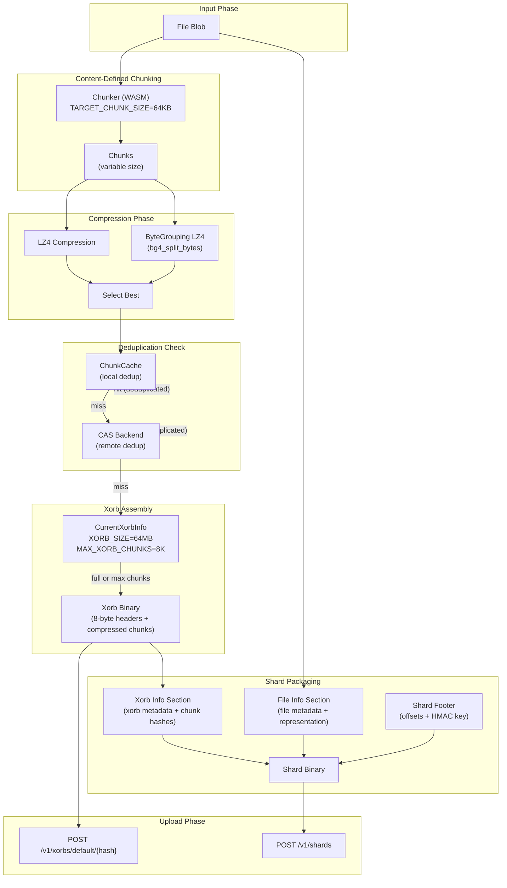
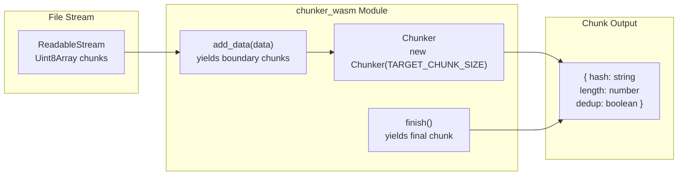
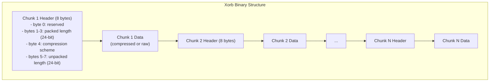
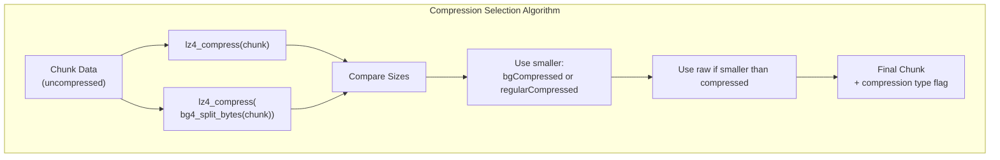
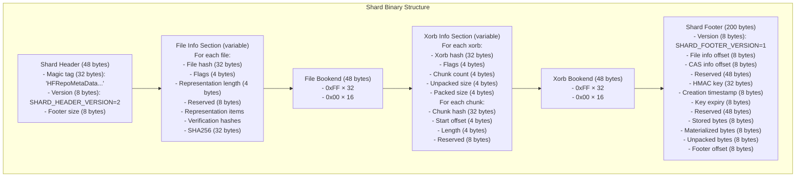
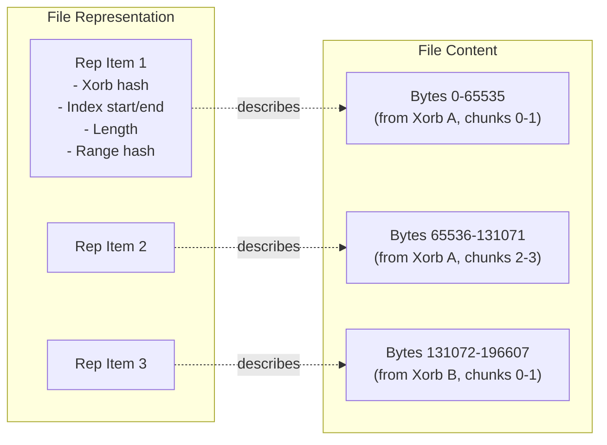
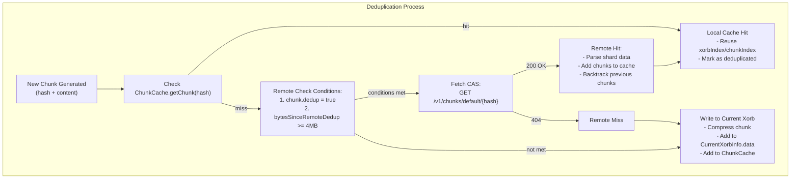
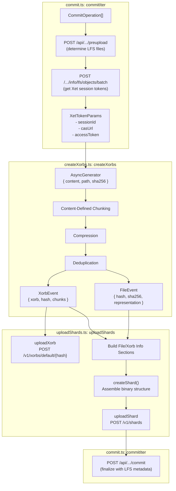
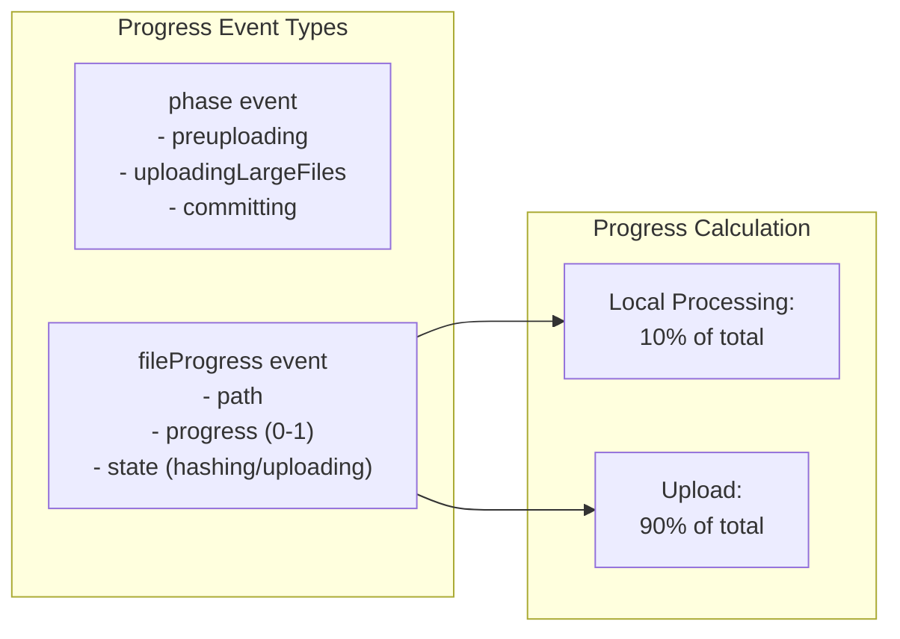
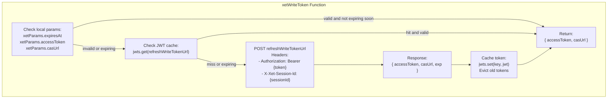

<!-- source: DeepWiki mcp.deepwiki.com · repo huggingface/huggingface.js · extra page Xet Upload Protocol · fetched 2026-10-26 -->

# Xet Upload Protocol

<details>
<summary>Relevant source files</summary>

The following files were used as context for generating this wiki page:

- [packages/hub/.gitignore](packages/hub/.gitignore)
- [packages/hub/scripts/bench.ts](packages/hub/scripts/bench.ts)
- [packages/hub/scripts/debug-xet.ts](packages/hub/scripts/debug-xet.ts)
- [packages/hub/src/lib/commit.ts](packages/hub/src/lib/commit.ts)
- [packages/hub/src/lib/upload-files-with-progress.spec.ts](packages/hub/src/lib/upload-files-with-progress.spec.ts)
- [packages/hub/src/utils/ChunkCache.spec.ts](packages/hub/src/utils/ChunkCache.spec.ts)
- [packages/hub/src/utils/ChunkCache.ts](packages/hub/src/utils/ChunkCache.ts)
- [packages/hub/src/utils/createXorb.spec.ts](packages/hub/src/utils/createXorb.spec.ts)
- [packages/hub/src/utils/createXorbs.ts](packages/hub/src/utils/createXorbs.ts)
- [packages/hub/src/utils/uploadShards.ts](packages/hub/src/utils/uploadShards.ts)
- [packages/hub/src/utils/xetWriteToken.ts](packages/hub/src/utils/xetWriteToken.ts)

</details>


## Purpose and Scope

This document describes the Xet upload protocol, an advanced file upload system used by the `@huggingface/hub` package for efficient large file handling. The Xet protocol uses content-defined chunking, compression, and deduplication to minimize bandwidth usage when uploading files to the Hugging Face Hub.

For general file operations including basic uploads, see [Repository and File Operations](#2.2.1). For authentication details, see [Authentication and Caching](#2.2.3).

The Xet protocol is automatically used for large files (LFS files) when `useXet: true` is set in commit operations. The protocol achieves significant bandwidth savings through:
- Content-defined chunking that enables deduplication across file versions
- LZ4 compression with byte-grouping optimization
- Local and remote chunk deduplication
- Efficient binary file format (xorbs and shards)

Sources: [packages/hub/src/lib/commit.ts:128-129](), [packages/hub/src/utils/createXorbs.ts:1-759](), [packages/hub/src/utils/uploadShards.ts:1-415]()

## Architecture Overview

The Xet protocol operates in three main phases: chunking, xorb creation, and shard packaging. Files are broken into content-defined chunks, chunks are compressed and assembled into xorbs, and xorbs are packaged with metadata into shards for upload.

**Xet Protocol Architecture**



Sources: [packages/hub/src/utils/createXorbs.ts:9-22](), [packages/hub/src/utils/uploadShards.ts:7-14]()

## Key Data Structures

The Xet protocol uses three primary binary structures:

| Structure | Size Limit | Purpose | Key Fields |
|-----------|-----------|---------|-----------|
| **Chunk** | ~64KB (variable) | Smallest unit of content | hash (32 bytes), length, compression type |
| **Xorb** | 64MB max, 8K chunks max | Container for compressed chunks | hash, chunk metadata, binary data |
| **Shard** | Variable | Metadata package linking files to xorbs | file info, xorb info, HMAC key, footer |

Sources: [packages/hub/src/utils/createXorbs.ts:9-14](), [packages/hub/src/utils/uploadShards.ts:7-14]()

## Content-Defined Chunking

Files are split into variable-size chunks using a content-defined chunking algorithm (implemented in WebAssembly). This approach ensures that identical content produces identical chunks, even if the content appears at different offsets in different files.

**Chunking Process**



The chunker operates on a stream of data and yields chunks when content boundaries are detected. The target chunk size is 64KB, but actual sizes vary based on content patterns.

**Chunk Characteristics:**
- **Target size**: 64KB (configurable via `TARGET_CHUNK_SIZE`)
- **Max size**: 128KB (2 × target, defined as `MAX_CHUNK_SIZE`)
- **Variable boundaries**: Determined by content, not fixed offsets
- **Hash**: Each chunk is identified by its content hash
- **Dedup flag**: Indicates whether to check remote deduplication

Sources: [packages/hub/src/utils/createXorbs.ts:9-11](), [packages/hub/src/utils/createXorbs.ts:166-340]()

## Xorb Structure and Creation

Xorbs (eXtended Object Repository Blocks) are containers that hold compressed chunks. Each xorb is a binary structure with chunk headers and data.

**Xorb Binary Layout**



**Xorb Constraints:**
- **Maximum size**: 64MB (`XORB_SIZE`)
- **Maximum chunks**: 8,192 (`MAX_XORB_CHUNKS`)
- **Chunk header**: 8 bytes (`XET_CHUNK_HEADER_BYTES`)

When either limit is reached, the current xorb is finalized and a new one begins.

**Compression Strategy**

The `writeChunk` function implements a two-pass compression approach:



**Compression Types:**
- `XetChunkCompressionScheme.None` (0): No compression
- `XetChunkCompressionScheme.LZ4`: Standard LZ4 compression
- `XetChunkCompressionScheme.ByteGroupingLZ4`: LZ4 with byte grouping optimization

The byte grouping optimization (`bg4_split_bytes`) is particularly effective for data with interleaved patterns (e.g., multi-channel image data).

Sources: [packages/hub/src/utils/createXorbs.ts:524-559](), [packages/hub/src/utils/XetBlob.ts]() (referenced)

## Shard Structure and Assembly

Shards are metadata packages that connect files to their xorb representations. Each shard contains file metadata, xorb metadata, and a footer with critical information for reconstruction.

**Shard Binary Layout**



**File Representation Format**

Each file in the shard is described by a representation that maps byte ranges to xorb chunks:



Each representation item specifies:
- **xorbId**: Which xorb contains the chunks (converted to hash in final shard)
- **indexStart/indexEnd**: Chunk index range within the xorb
- **length**: Total unpacked byte length of this range
- **rangeHash**: Verification hash computed from chunk hashes

Sources: [packages/hub/src/utils/uploadShards.ts:19-52](), [packages/hub/src/utils/uploadShards.ts:231-343](), [packages/hub/src/utils/createXorbs.ts:562-633]()

## Deduplication Strategy

The Xet protocol implements a two-tier deduplication system to minimize uploads: local cache deduplication and remote CAS deduplication.

**Deduplication Flow**



**ChunkCache Implementation**

The `ChunkCache` class maintains a circular buffer for efficient local deduplication:

| Component | Type | Purpose |
|-----------|------|---------|
| `map` | `Map<string, number>` | Maps chunk hash to cache index |
| `xorbIndices` | `Int32Array` | Stores xorb index for each cached chunk |
| `chunkIndices` | `Uint16Array` | Stores chunk index within xorb |
| `hmacs` | `Set<string>` | HMAC keys for remote chunk lookups |

**Cache Behavior:**
- **Initial size**: 10,000 entries
- **Growth factor**: 1.5×
- **Maximum size**: 1,000,000 entries (default)
- **Eviction**: FIFO (First In, First Out) when full
- **Negative indices**: Indicate remote xorbs (e.g., -1 = first remote xorb)

**Remote Deduplication Details:**

When a remote dedup check succeeds:
1. The CAS returns a shard containing matching chunk information
2. All chunks in the shard are added to the local cache with negative xorb IDs
3. The `backtrackDedup` function reviews recently added chunks in the current xorb
4. Chunks that match remote chunks are removed from the current xorb
5. File representations are updated to reference remote chunks

The backtracking optimization can significantly reduce xorb size by retroactively applying remote deduplication.

Sources: [packages/hub/src/utils/createXorbs.ts:216-257](), [packages/hub/src/utils/ChunkCache.ts:1-100](), [packages/hub/src/utils/createXorbs.ts:380-486]()

## Upload Flow

The complete Xet upload flow spans three main functions: `commitIter`, `createXorbs`, and `uploadShards`.

**Complete Upload Pipeline**



**Key Functions and Their Roles:**

| Function | File | Purpose | Key Operations |
|----------|------|---------|----------------|
| `commitIter` | commit.ts | Main entry point | Preupload check, LFS batch request, call uploadShards |
| `createXorbs` | createXorbs.ts | Chunking and xorb assembly | Content chunking, compression, deduplication, xorb creation |
| `uploadShards` | uploadShards.ts | Shard packaging and upload | Assemble file/xorb info, create shards, upload xorbs and shards |
| `xetWriteToken` | xetWriteToken.ts | Token management | Fetch and cache write tokens for CAS uploads |

**Progress Events:**

The upload flow yields progress events at multiple stages:



Progress is split between local processing (chunking, compression, deduplication) and network upload. The `PROCESSING_PROGRESS_RATIO` constant (0.1) controls this split, allocating 10% to processing and 90% to upload.

Sources: [packages/hub/src/lib/commit.ts:169-713](), [packages/hub/src/utils/createXorbs.ts:85-378](), [packages/hub/src/utils/uploadShards.ts:76-349]()

## Token Management

Xet uploads require authentication via write tokens obtained from the Hub backend. The `xetWriteToken` function manages token lifecycle.

**Token Flow**



**Token Caching Strategy:**
- **Safety period**: 60 seconds (`JWT_SAFETY_PERIOD`) - tokens expiring within this window are refreshed
- **Cache size**: 1,000 entries (`JWT_CACHE_SIZE`)
- **Deduplication**: Concurrent requests for the same token share a promise
- **Eviction**: Expired tokens are pruned, oldest tokens removed when cache is full

Sources: [packages/hub/src/utils/xetWriteToken.ts:1-99]()

## Key Classes and Functions

### Core Classes

**CurrentXorbInfo**

Manages state for the xorb being assembled:

```typescript
class CurrentXorbInfo {
    id: number;                              // Xorb identifier
    offset: number;                          // Current write position in data buffer
    chunks: Array<{                          // Chunks in this xorb
        hash: string;
        length: number;
        offset: number;
    }>;
    fileProcessedBytes: Record<string, number>;  // Per-file processing progress
    fileUploadedBytes: Record<string, number>;   // Per-file upload progress
    fileSize: Record<string, number>;            // Per-file total size
    data: Uint8Array;                            // Binary buffer (XORB_SIZE)
    immutableData: {                             // Checkpoint for backtracking
        chunkIndex: number;
        offset: number;
    } | null;
}
```

Sources: [packages/hub/src/utils/createXorbs.ts:36-83]()

**ChunkCache**

Maintains local deduplication state:

```typescript
class ChunkCache {
    index: number;                           // Current write position (circular)
    xorbIndices: Int32Array;                 // Xorb ID for each cached chunk
    chunkIndices: Uint16Array;               // Chunk index within xorb
    map: Map<string, number>;                // Hash to cache index
    hmacs: Set<string>;                      // HMAC keys for remote lookups
    maxSize: number;                         // Maximum cache entries
}
```

Sources: [packages/hub/src/utils/ChunkCache.ts:5-99]()

### Core Functions

**createXorbs**

Main generator function for chunking and xorb creation:

```typescript
async function* createXorbs(
    fileSources: AsyncGenerator<{ content: Blob; path: string; sha256: string }>,
    params: XetWriteTokenParams & { yieldCallback?: ... }
): AsyncGenerator<XorbEvent | FileEvent>
```

Key responsibilities:
- Initialize WASM chunker
- Stream file content through chunker
- Check local and remote deduplication
- Compress chunks with LZ4
- Assemble xorbs
- Build file representations
- Yield xorb and file events

Sources: [packages/hub/src/utils/createXorbs.ts:85-378]()

**uploadShards**

Generator function for shard assembly and upload:

```typescript
async function* uploadShards(
    source: AsyncGenerator<{ content: Blob; path: string; sha256: string }>,
    params: UploadShardsParams
): AsyncGenerator<FileEvent | FileProgressEvent>
```

Key responsibilities:
- Consume xorb events from createXorbs
- Build file info and xorb info sections
- Assemble shard binary format
- Upload xorbs to CAS
- Upload shards to Hub
- Yield file completion events

Sources: [packages/hub/src/utils/uploadShards.ts:76-349]()

**backtrackDedup**

Retroactively applies remote deduplication to current xorb:

```typescript
function backtrackDedup(
    xorb: CurrentXorbInfo,
    computeHmac: (hash: string, key: string) => string,
    shardData: ShardData,
    chunkCache: ChunkCache,
    chunkMetadata: Array<...>,
    dedupedBytes: number
): number
```

Key responsibilities:
- Find chunks in current xorb that match remote shard
- Remove matched chunks from xorb.data
- Update xorb.chunks array
- Update chunk metadata references
- Update ChunkCache indices
- Return updated deduplication byte count

Sources: [packages/hub/src/utils/createXorbs.ts:380-486]()

**writeChunk**

Writes a compressed chunk to the xorb buffer:

```typescript
function writeChunk(
    xorb: CurrentXorbInfo,
    chunk: Uint8Array,
    hash: string
): boolean
```

Key responsibilities:
- Compress chunk with standard LZ4
- Compress chunk with byte-grouping LZ4
- Select best compression (or raw)
- Write 8-byte chunk header
- Write chunk data
- Return false if xorb is full

Sources: [packages/hub/src/utils/createXorbs.ts:529-559]()

### Integration with Commit Flow

The Xet protocol integrates into the commit flow at the LFS upload stage:

**commit.ts integration points:**

```typescript
// Line 313: Request xet transfer protocol
transfers: ["basic", "multipart", ...(useXet ? ["xet" as const] : [])]

// Line 351-353: Detect if backend supports xet
if (useXet && json.transfer !== "xet") {
    useXet = false;
}

// Line 356-393: Extract xet parameters from response headers
xetParams = {
    sessionId: headers.get("X-Xet-Session-Id") ?? undefined,
    casUrl: headers.get("X-Xet-Cas-Url") ?? undefined,
    accessToken: headers.get("X-Xet-Access-Token") ?? undefined,
    expiresAt: ...,
    refreshWriteTokenUrl: obj.actions.upload.href,
}

// Line 404-439: Call uploadShards with xet parameters
for await (const event of uploadShards(source, { ...params, xetParams }))
```

Sources: [packages/hub/src/lib/commit.ts:313](), [packages/hub/src/lib/commit.ts:351-393](), [packages/hub/src/lib/commit.ts:404-439]()

## Performance Characteristics

The Xet protocol achieves significant bandwidth savings through its deduplication and compression strategy:

**Deduplication Effectiveness:**
- **Similar files**: 80-99% deduplication when uploading model checkpoints or file versions with small changes
- **Content-defined chunking**: Enables deduplication even when content is shifted (e.g., adding a header)
- **Remote deduplication**: Leverages existing Hub content, reducing uploads for popular models

**Compression Ratios:**
- **Byte-grouping LZ4**: Particularly effective for model weights (interleaved floating-point data)
- **Standard LZ4**: Better for text and structured data
- **Adaptive selection**: Automatically chooses best compression or raw based on size

**Overhead:**
- **Shard metadata**: ~200 bytes per file + ~48 bytes per xorb + ~48 bytes per chunk
- **Remote dedup checks**: One HTTP request per 4MB of processed data (configurable via `INTERVAL_BETWEEN_REMOTE_DEDUP`)
- **Local processing**: 10% of progress bar allocated to chunking and compression

Sources: [packages/hub/src/utils/createXorbs.ts:14](), [packages/hub/src/utils/createXorbs.ts:19-21](), [packages/hub/scripts/bench.ts:1-459]()

---

