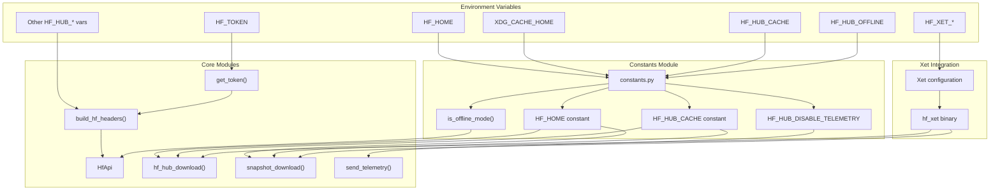
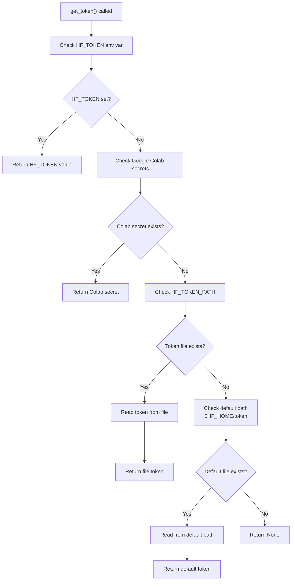
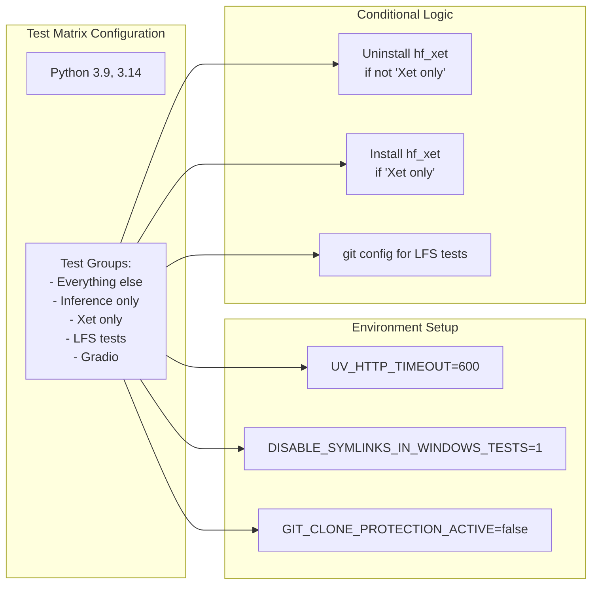

<!-- source: DeepWiki mcp.deepwiki.com · repo huggingface/huggingface_hub · page 10 Configuration and Environment Variables · fetched 2026-10-26 -->

# Configuration and Environment Variables

<details>
<summary>Relevant source files</summary>

The following files were used as context for generating this wiki page:

- [.github/workflows/python-quality.yml](.github/workflows/python-quality.yml)
- [.github/workflows/python-tests.yml](.github/workflows/python-tests.yml)
- [CONTRIBUTING.md](CONTRIBUTING.md)
- [Makefile](Makefile)
- [docs/source/en/guides/download.md](docs/source/en/guides/download.md)
- [docs/source/en/guides/manage-cache.md](docs/source/en/guides/manage-cache.md)
- [docs/source/en/guides/model-cards.md](docs/source/en/guides/model-cards.md)
- [docs/source/en/guides/upload.md](docs/source/en/guides/upload.md)
- [docs/source/en/package_reference/environment_variables.md](docs/source/en/package_reference/environment_variables.md)
- [docs/source/en/package_reference/file_download.md](docs/source/en/package_reference/file_download.md)
- [docs/source/en/package_reference/utilities.md](docs/source/en/package_reference/utilities.md)
- [setup.py](setup.py)
- [src/huggingface_hub/utils/_telemetry.py](src/huggingface_hub/utils/_telemetry.py)
- [tests/test_utils_telemetry.py](tests/test_utils_telemetry.py)

</details>


## Purpose and Scope

This document provides a complete reference for configuring the `huggingface_hub` library through environment variables and runtime settings. Environment variables control cache locations, authentication, network behavior, feature flags, and logging levels. Understanding these configuration options is essential for deploying the library in production environments, CI/CD pipelines, and specialized computing setups.

For authentication methods beyond environment variables, see [Authentication and Security](#8). For cache management operations, see [Cache Architecture](#2.5).

## Overview

The `huggingface_hub` library reads configuration from environment variables at import time. These variables control:

- **Path Configuration**: Where files are cached and stored locally
- **Authentication**: How tokens are loaded and used
- **Network Behavior**: Timeouts, endpoints, and offline modes
- **Feature Flags**: Enable/disable specific functionality
- **Xet Storage**: Chunk-based deduplication settings
- **Development**: Logging, debugging, and telemetry

Environment variables follow a consistent naming pattern: `HF_*` for Hugging Face-specific settings and `HF_HUB_*` for Hub-specific configuration.

Sources: [docs/source/en/package_reference/environment_variables.md:1-229]()

## Configuration Loading Architecture

The following diagram shows how environment variables are loaded into the system and where they are used:



Sources: [docs/source/en/package_reference/environment_variables.md:1-229](), [src/huggingface_hub/utils/_telemetry.py:20-74]()

## Path and Cache Configuration

### HF_HOME

The root directory for all Hugging Face data, including tokens and caches.

**Default**: `~/.cache/huggingface` (or `$XDG_CACHE_HOME/huggingface` if `XDG_CACHE_HOME` is set)

**Usage**:
```bash
export HF_HOME=/data/huggingface
```

**What it contains**:
- `hub/` - File-based cache for models, datasets, and spaces
- `xet/` - Xet chunk cache
- `assets/` - Downstream library assets
- `token` - Default token file location
- `stored_tokens` - Named tokens for multi-account scenarios

Sources: [docs/source/en/package_reference/environment_variables.md:25-30]()

### HF_HUB_CACHE

Location for caching repositories (models, datasets, spaces) from the Hub.

**Default**: `$HF_HOME/hub`

**Structure**:
```
HF_HUB_CACHE/
├── models--username--repo-name/
│   ├── refs/
│   │   └── main
│   ├── blobs/
│   │   └── <hash>
│   └── snapshots/
│       └── <commit-hash>/
│           └── file.bin -> ../../blobs/<hash>
├── datasets--username--dataset-name/
└── spaces--username--space-name/
```

Sources: [docs/source/en/package_reference/environment_variables.md:32-37](), [docs/source/en/guides/manage-cache.md:10-155]()

### HF_XET_CACHE

Location for Xet chunk cache, used for chunk-based deduplication during downloads and uploads.

**Default**: `$HF_HOME/xet`

**Structure**:
```
HF_XET_CACHE/
└── <environment_identifier>/
    ├── chunk_cache/
    ├── shard_cache/
    └── staging/
```

Sources: [docs/source/en/package_reference/environment_variables.md:39-43](), [docs/source/en/guides/manage-cache.md:175-298]()

### HF_ASSETS_CACHE

Location for assets created by downstream libraries (preprocessed data, logs, downloaded files from GitHub).

**Default**: `$HF_HOME/assets`

**Example**:
```python
from huggingface_hub import cached_assets_path

assets_path = cached_assets_path(library_name="datasets", namespace="SQuAD", subfolder="download")
# Returns: ~/.cache/huggingface/assets/datasets/SQuAD/download
```

Sources: [docs/source/en/package_reference/environment_variables.md:45-51](), [docs/source/en/guides/manage-cache.md:300-323]()

### HF_TOKEN_PATH

Location where the authentication token is stored after login.

**Default**: `$HF_HOME/token`

Sources: [docs/source/en/package_reference/environment_variables.md:60-62]()

## Authentication Configuration

### Token Resolution Flow

The following diagram shows how authentication tokens are resolved with priority order:



### HF_TOKEN

User Access Token for authenticating with the Hub. When set, this overrides any token stored on disk.

**Usage**:
```bash
export HF_TOKEN=hf_xxxxxxxxxxxxxxxxxxxxx
```

**Security Note**: Tokens are sensitive credentials. In production environments, use secure secret management systems rather than hardcoding tokens in scripts or committing them to version control.

Sources: [docs/source/en/package_reference/environment_variables.md:53-58]()

## Network and API Configuration

### HF_INFERENCE_ENDPOINT

The base URL for the Inference API.

**Default**: `https://api-inference.huggingface.co`

**Usage**: Configure this when your organization uses an API Gateway or custom inference endpoint:
```bash
export HF_INFERENCE_ENDPOINT=https://inference.company.internal
```

Sources: [docs/source/en/package_reference/environment_variables.md:18-23]()

### HF_HUB_ETAG_TIMEOUT

Timeout (in seconds) for fetching latest metadata before downloading a file. If the metadata request times out, the library falls back to cached files.

**Default**: `10` seconds

**Usage**:
```bash
export HF_HUB_ETAG_TIMEOUT=30  # Increase for slow connections
```

This is useful for machines with slow connections that already have cached files. Lower values speed up workflows by failing fast, while higher values ensure metadata calls succeed in poor network conditions.

Sources: [docs/source/en/package_reference/environment_variables.md:74-76]()

### HF_HUB_DOWNLOAD_TIMEOUT

Timeout (in seconds) for downloading files. If exceeded, a `TimeoutError` is raised.

**Default**: `10` seconds

**Usage**:
```bash
export HF_HUB_DOWNLOAD_TIMEOUT=300  # 5 minutes for large files
```

Sources: [docs/source/en/package_reference/environment_variables.md:78-80]()

## Logging and Debugging

### HF_HUB_VERBOSITY

Controls the verbosity level of the library's logger.

**Valid values**: `debug`, `info`, `warning`, `error`, `critical`

**Default**: `warning`

**Usage**:
```bash
export HF_HUB_VERBOSITY=debug
```

**Levels**:
- `error`: Only critical errors
- `warning`: Warnings and important information
- `info`: Verbose logging including internal operations
- `debug`: All logs including internal implementation details

Sources: [docs/source/en/package_reference/environment_variables.md:65-72](), [docs/source/en/package_reference/utilities.md:8-48]()

### HF_DEBUG

Enables debug mode with detailed logging and HTTP request logging.

**Type**: Boolean

**Default**: `False`

When enabled, this:
1. Sets the log level to `DEBUG` for `huggingface_hub`
2. Logs all HTTP requests as equivalent cURL commands for debugging and reproducibility

**Usage**:
```bash
export HF_DEBUG=1
```

Sources: [docs/source/en/package_reference/environment_variables.md:114-116]()

## Boolean Configuration Flags

Boolean environment variables accept `1`, `ON`, `YES`, or `TRUE` (case-insensitive) as true values. Any other value or undefined variable is considered false.

### Feature Control Flags

| Variable | Default | Purpose |
|----------|---------|---------|
| `HF_HUB_OFFLINE` | `False` | Disable all HTTP calls; use only cached files |
| `HF_HUB_DISABLE_IMPLICIT_TOKEN` | `False` | Only send token for write operations, not reads |
| `HF_HUB_DISABLE_PROGRESS_BARS` | `False` | Hide all progress bars |
| `HF_HUB_DISABLE_SYMLINKS_WARNING` | `False` | Suppress symlink warnings on Windows |
| `HF_HUB_DISABLE_EXPERIMENTAL_WARNING` | `False` | Suppress experimental feature warnings |
| `HF_HUB_DISABLE_TELEMETRY` | `False` | Disable usage telemetry collection |
| `HF_HUB_DISABLE_XET` | `False` | Disable Xet storage even if available |

Sources: [docs/source/en/package_reference/environment_variables.md:108-175]()

### HF_HUB_OFFLINE

Enables offline mode where no HTTP calls are made to the Hub.

**Behavior**:
- Only cached files are accessed
- If a file is not cached, an error is raised
- Calling any `HfApi` method raises `OfflineModeIsEnabled` exception
- Skips HTTP requests to check for newer file versions (speeds up loading)

**Usage**:
```bash
export HF_HUB_OFFLINE=1
python my_script.py
```

**Programmatic check**:
```python
from huggingface_hub import is_offline_mode

if is_offline_mode():
    # Use only cached data
    pass
```

Sources: [docs/source/en/package_reference/environment_variables.md:118-126](), [docs/source/en/package_reference/utilities.md:188-191]()

### HF_HUB_DISABLE_IMPLICIT_TOKEN

Disables automatic token sending for read operations. When enabled, tokens are only sent for write-access operations (e.g., creating commits).

**Use case**: Privacy-sensitive environments where you want explicit control over when authentication tokens are transmitted.

**Side effect**: Private and gated repositories won't be accessible in read operations unless you explicitly pass `token=True`.

**Example**:
```python
from huggingface_hub import list_models

# With HF_HUB_DISABLE_IMPLICIT_TOKEN=1, private models won't be listed
models = list_models()  # Only public models

# Explicitly pass token to include private models
models = list_models(token=True)  # Includes private models
```

Sources: [docs/source/en/package_reference/environment_variables.md:128-139]()

### HF_HUB_DISABLE_TELEMETRY

Disables telemetry data collection. Telemetry helps debug issues and prioritize features but respects user privacy.

**Implementation**: The telemetry system uses a background thread to send data asynchronously, minimizing performance impact.

**Alternative**: Set `DO_NOT_TRACK=1` to disable telemetry across all Hugging Face libraries.

Sources: [docs/source/en/package_reference/environment_variables.md:165-170](), [src/huggingface_hub/utils/_telemetry.py:20-74]()

## Xet Configuration

Xet is a chunk-based storage backend that enables efficient deduplication across files and repositories. These environment variables control Xet behavior.

### Xet Configuration Table

| Variable | Default | Purpose |
|----------|---------|---------|
| `HF_HUB_DISABLE_XET` | `False` | Disable Xet even if installed |
| `HF_XET_HIGH_PERFORMANCE` | `False` | Maximize network and CPU usage |
| `HF_XET_RECONSTRUCT_WRITE_SEQUENTIALLY` | `False` | Use sequential disk writes (for HDDs) |
| `HF_XET_CHUNK_CACHE_SIZE_BYTES` | `0` | Size of chunk cache in bytes (0 = disabled) |
| `HF_XET_SHARD_CACHE_SIZE_LIMIT` | `4000000000` | Shard cache size limit (4GB) |
| `HF_XET_NUM_CONCURRENT_RANGE_GETS` | `16` | Concurrent chunk downloads per file |

Sources: [docs/source/en/package_reference/environment_variables.md:82-106]()

### HF_HUB_DISABLE_XET

Explicitly disables Xet storage backend even if `hf_xet` is installed.

**When to use**: If experiencing issues with Xet or needing to test legacy LFS behavior.

**Note**: If you disable Xet, please [file an issue with diagnostics](https://github.com/huggingface/xet-core?tab=readme-ov-file#issues-diagnostics--debugging) to help improve Xet.

Sources: [docs/source/en/package_reference/environment_variables.md:172-174]()

### HF_XET_HIGH_PERFORMANCE

Enables high-performance mode that maximizes network bandwidth and CPU utilization.

**Behavior**:
- Saturates network bandwidth
- Uses all CPU cores for parallel operations
- Similar to the legacy `HF_HUB_ENABLE_HF_TRANSFER` behavior

**Usage**:
```bash
export HF_XET_HIGH_PERFORMANCE=1
```

**When to use**: Production environments with fast networks and multi-core machines where maximum throughput is needed.

Sources: [docs/source/en/package_reference/environment_variables.md:183-189](), [docs/source/en/guides/upload.md:158]()

### HF_XET_RECONSTRUCT_WRITE_SEQUENTIALLY

Switches disk writes from parallel (default) to sequential mode.

**When to use**: When using HDDs (spinning disks) instead of SSDs/NVMe. Sequential writes avoid disk seek overhead on mechanical drives.

**Default behavior**: Xet is optimized for SSDs using parallel writes with direct addressing.

Sources: [docs/source/en/package_reference/environment_variables.md:191-193]()

### HF_XET_CHUNK_CACHE_SIZE_BYTES

Controls the size of the chunk cache in bytes. The chunk cache stores byte ranges from files to enable deduplication.

**Default**: `0` (disabled)

**Recommended**: `10000000000` (10GB) or larger when generating new revisions of existing models/datasets.

**Trade-offs**:
- **Enabled**: Better deduplication across repos, beneficial when uploading similar content
- **Disabled**: Better download performance for new data (default behavior)

**Usage**:
```bash
export HF_XET_CHUNK_CACHE_SIZE_BYTES=10000000000  # 10GB
```

Sources: [docs/source/en/package_reference/environment_variables.md:90-94]()

### HF_XET_SHARD_CACHE_SIZE_LIMIT

Controls the size of the shard cache, which improves upload efficiency by avoiding re-uploading known chunks.

**Default**: `4000000000` (4GB)

**Note**: The default soft limit is sufficient for most workloads.

Sources: [docs/source/en/package_reference/environment_variables.md:96-100]()

### HF_XET_NUM_CONCURRENT_RANGE_GETS

Number of concurrent chunk downloads from S3 per file.

**Default**: `16`

**Tuning**: Increase this value if you have available network bandwidth and want faster downloads.

Sources: [docs/source/en/package_reference/environment_variables.md:102-106]()

### Xet Cache for Distributed Filesystems

When uploading from cluster or distributed filesystems (NFS, EBS, Lustre, FSx), Xet chunks files and writes blocks locally before uploading. For better performance:

**Set `HF_XET_CACHE` to a local disk**:
```bash
export HF_XET_CACHE=/local/nvme/xet_cache
```

This avoids writing temporary data to the distributed filesystem, which can be slow.

Sources: [docs/source/en/guides/upload.md:181-184]()

## External Environment Variables

These variables are not specific to `huggingface_hub` but are respected by the library.

### XDG_CACHE_HOME

Standard Linux environment variable for user-specific cache location.

**Behavior**: Only used when `HF_HOME` is not set.

**Default home becomes**: `$XDG_CACHE_HOME/huggingface` instead of `~/.cache/huggingface`

Sources: [docs/source/en/package_reference/environment_variables.md:220-228]()

### DO_NOT_TRACK

Global telemetry disable flag following the [Console Do Not Track](https://consoledonottrack.com/) standard.

**Behavior**: Equivalent to `HF_HUB_DISABLE_TELEMETRY=1` but applies across all Hugging Face Python libraries (transformers, diffusers, gradio, etc.).

Sources: [docs/source/en/package_reference/environment_variables.md:211-213]()

### NO_COLOR

Standard environment variable to disable ANSI color codes.

**Behavior**: When set, the `hf` CLI will not print ANSI color codes.

**Reference**: [no-color.org](https://no-color.org/)

Sources: [docs/source/en/package_reference/environment_variables.md:215-218]()

## Deprecated Variables

The following variables are deprecated but still functional for backward compatibility. They are overridden by their replacements:

| Deprecated | Replacement |
|------------|-------------|
| `HUGGINGFACE_HUB_CACHE` | `HF_HUB_CACHE` |
| `HUGGINGFACE_ASSETS_CACHE` | `HF_ASSETS_CACHE` |
| `HUGGING_FACE_HUB_TOKEN` | `HF_TOKEN` |
| `HUGGINGFACE_HUB_VERBOSITY` | `HF_HUB_VERBOSITY` |

**Migration**: Update your scripts and deployment configurations to use the new variable names.

Sources: [docs/source/en/package_reference/environment_variables.md:195-206]()

### HF_HUB_ENABLE_HF_TRANSFER (Deprecated)

This variable is deprecated and no longer functional. The Hugging Face Hub now uses Xet storage for all file transfers, which provides chunk-based deduplication automatically.

**For high performance**: Use `HF_XET_HIGH_PERFORMANCE=1` instead.

Sources: [docs/source/en/package_reference/environment_variables.md:176-181]()

## Setting Environment Variables

### Linux/macOS (bash/zsh)

**Temporary (session-only)**:
```bash
export HF_HOME=/data/huggingface
export HF_TOKEN=hf_xxxxx
```

**Persistent** (add to `~/.bashrc` or `~/.zshrc`):
```bash
echo 'export HF_HOME=/data/huggingface' >> ~/.bashrc
source ~/.bashrc
```

### Windows (Command Prompt)

**Temporary**:
```cmd
set HF_HOME=C:\data\huggingface
set HF_TOKEN=hf_xxxxx
```

**Persistent**:
```cmd
setx HF_HOME "C:\data\huggingface"
setx HF_TOKEN "hf_xxxxx"
```

### Windows (PowerShell)

**Temporary**:
```powershell
$env:HF_HOME = "C:\data\huggingface"
$env:HF_TOKEN = "hf_xxxxx"
```

**Persistent**:
```powershell
[System.Environment]::SetEnvironmentVariable('HF_HOME', 'C:\data\huggingface', 'User')
```

### Python Runtime

Set environment variables programmatically before importing `huggingface_hub`:

```python
import os
os.environ['HF_HOME'] = '/data/huggingface'
os.environ['HF_TOKEN'] = 'hf_xxxxx'

# Now import huggingface_hub
from huggingface_hub import hf_hub_download
```

### Docker

In `Dockerfile`:
```dockerfile
ENV HF_HOME=/data/huggingface
ENV HF_TOKEN=hf_xxxxx
```

Or with `docker run`:
```bash
docker run -e HF_HOME=/data/huggingface -e HF_TOKEN=hf_xxxxx myimage
```

### CI/CD Environments

Store sensitive variables like `HF_TOKEN` in secret management systems:

**GitHub Actions**:
```yaml
env:
  HF_HOME: /tmp/huggingface
  HF_TOKEN: ${{ secrets.HF_TOKEN }}
```

**GitLab CI**:
```yaml
variables:
  HF_HOME: /cache/huggingface
  HF_TOKEN: $HF_TOKEN  # Set in GitLab CI/CD settings
```

Sources: [.github/workflows/python-tests.yml:18-19, 143-145]()

## Environment Variable Priority and Precedence

### Cache Location Priority

The cache location is determined with the following priority (highest to lowest):

1. `cache_dir` parameter in function calls (e.g., `hf_hub_download(cache_dir=...`)
2. `HF_HUB_CACHE` environment variable
3. `HF_HOME` environment variable (used as `$HF_HOME/hub`)
4. `XDG_CACHE_HOME` environment variable (used as `$XDG_CACHE_HOME/huggingface/hub`)
5. Default: `~/.cache/huggingface/hub`

### Token Priority

Token resolution follows this priority:

1. `token` parameter in function calls
2. `HF_TOKEN` environment variable
3. Google Colab secrets (if running in Colab)
4. File at `$HF_TOKEN_PATH`
5. File at `$HF_HOME/token`
6. None

### Boolean Flag Evaluation

Boolean flags are evaluated as:
- **True**: `1`, `ON`, `YES`, `TRUE` (case-insensitive)
- **False**: Any other value, empty string, or undefined

Sources: [docs/source/en/package_reference/environment_variables.md:108-112]()

## Configuration in CI/CD

The test workflows demonstrate production configuration patterns:



**Key patterns**:

1. **Long timeouts for dependency installation**: `UV_HTTP_TIMEOUT=600` (10 minutes)
2. **Windows-specific**: `DISABLE_SYMLINKS_IN_WINDOWS_TESTS=1` for testing degraded cache mode
3. **LFS on Windows**: `GIT_CLONE_PROTECTION_ACTIVE=false` to work around Git LFS issues
4. **Selective Xet installation**: Install/uninstall based on test group to ensure proper coverage

Sources: [.github/workflows/python-tests.yml:18-130, 143-198]()

## Summary Table of All Variables

| Category | Variable | Type | Default |
|----------|----------|------|---------|
| **Paths** | `HF_HOME` | Path | `~/.cache/huggingface` |
| | `HF_HUB_CACHE` | Path | `$HF_HOME/hub` |
| | `HF_XET_CACHE` | Path | `$HF_HOME/xet` |
| | `HF_ASSETS_CACHE` | Path | `$HF_HOME/assets` |
| | `HF_TOKEN_PATH` | Path | `$HF_HOME/token` |
| **Auth** | `HF_TOKEN` | String | None |
| **Network** | `HF_INFERENCE_ENDPOINT` | URL | `https://api-inference.huggingface.co` |
| | `HF_HUB_ETAG_TIMEOUT` | Integer | `10` |
| | `HF_HUB_DOWNLOAD_TIMEOUT` | Integer | `10` |
| **Logging** | `HF_HUB_VERBOSITY` | Enum | `warning` |
| | `HF_DEBUG` | Boolean | `False` |
| **Features** | `HF_HUB_OFFLINE` | Boolean | `False` |
| | `HF_HUB_DISABLE_IMPLICIT_TOKEN` | Boolean | `False` |
| | `HF_HUB_DISABLE_PROGRESS_BARS` | Boolean | `False` |
| | `HF_HUB_DISABLE_SYMLINKS_WARNING` | Boolean | `False` |
| | `HF_HUB_DISABLE_EXPERIMENTAL_WARNING` | Boolean | `False` |
| | `HF_HUB_DISABLE_TELEMETRY` | Boolean | `False` |
| **Xet** | `HF_HUB_DISABLE_XET` | Boolean | `False` |
| | `HF_XET_HIGH_PERFORMANCE` | Boolean | `False` |
| | `HF_XET_RECONSTRUCT_WRITE_SEQUENTIALLY` | Boolean | `False` |
| | `HF_XET_CHUNK_CACHE_SIZE_BYTES` | Integer | `0` |
| | `HF_XET_SHARD_CACHE_SIZE_LIMIT` | Integer | `4000000000` |
| | `HF_XET_NUM_CONCURRENT_RANGE_GETS` | Integer | `16` |
| **External** | `XDG_CACHE_HOME` | Path | None |
| | `DO_NOT_TRACK` | Boolean | `False` |
| | `NO_COLOR` | Boolean | `False` |

Sources: [docs/source/en/package_reference/environment_variables.md:1-229]()

---

