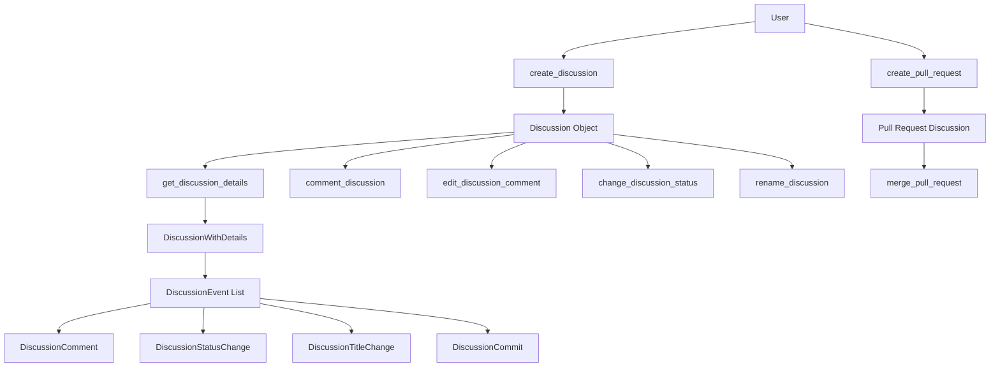
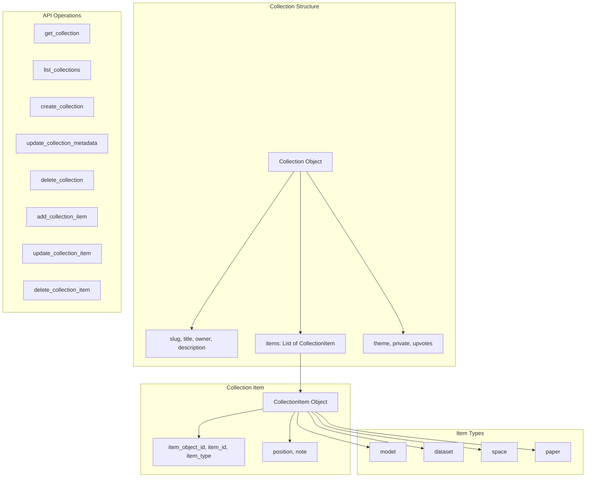
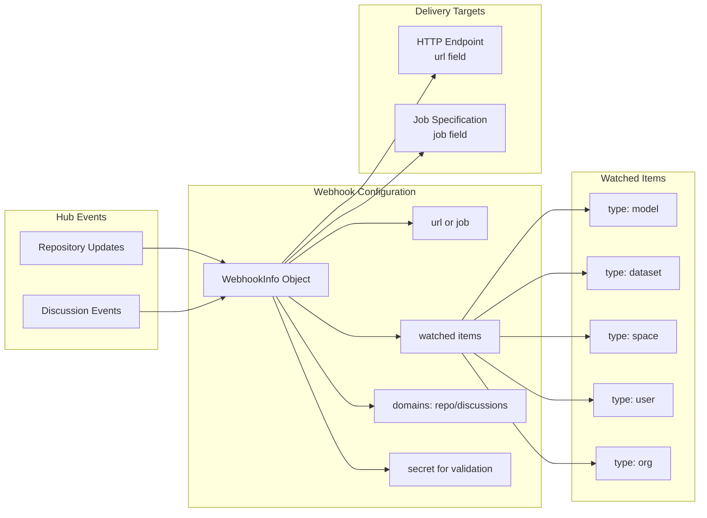
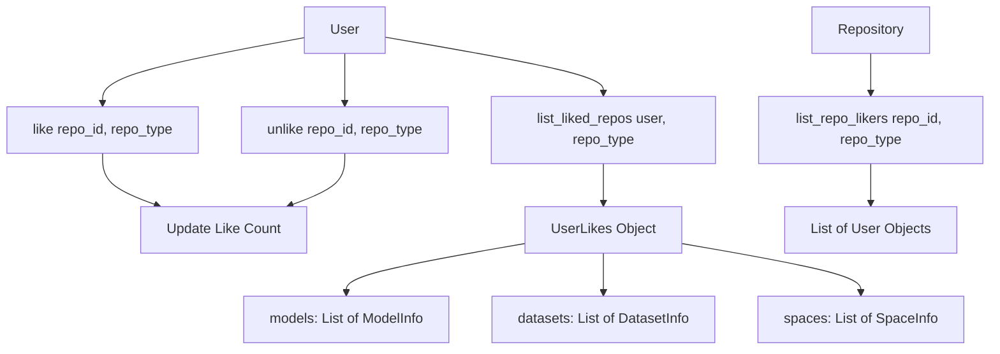

<!-- source: DeepWiki mcp.deepwiki.com · repo huggingface/huggingface_hub · page 11 Community Features · fetched 2026-10-26 -->

# Community Features

<details>
<summary>Relevant source files</summary>

The following files were used as context for generating this wiki page:

- [docs/source/ko/_toctree.yml](docs/source/ko/_toctree.yml)
- [docs/source/ko/guides/collections.md](docs/source/ko/guides/collections.md)
- [docs/source/ko/guides/integrations.md](docs/source/ko/guides/integrations.md)
- [docs/source/ko/guides/manage-cache.md](docs/source/ko/guides/manage-cache.md)
- [docs/source/ko/package_reference/cards.md](docs/source/ko/package_reference/cards.md)
- [docs/source/ko/package_reference/community.md](docs/source/ko/package_reference/community.md)
- [docs/source/ko/package_reference/hf_file_system.md](docs/source/ko/package_reference/hf_file_system.md)
- [docs/source/ko/package_reference/webhooks_server.md](docs/source/ko/package_reference/webhooks_server.md)
- [src/huggingface_hub/__init__.py](src/huggingface_hub/__init__.py)
- [src/huggingface_hub/_commit_api.py](src/huggingface_hub/_commit_api.py)
- [src/huggingface_hub/constants.py](src/huggingface_hub/constants.py)
- [src/huggingface_hub/file_download.py](src/huggingface_hub/file_download.py)
- [src/huggingface_hub/hf_api.py](src/huggingface_hub/hf_api.py)
- [src/huggingface_hub/utils/__init__.py](src/huggingface_hub/utils/__init__.py)
- [tests/test_file_download.py](tests/test_file_download.py)
- [tests/test_hf_api.py](tests/test_hf_api.py)
- [tests/testing_utils.py](tests/testing_utils.py)

</details>


This page documents the community interaction APIs provided by `huggingface_hub` for collaborative workflows on the Hugging Face Hub. These features enable programmatic management of discussions, pull requests, collections, and webhooks.

For repository management operations (creating repos, uploading files, etc.), see [Repository Operations](#2.1). For authentication and token management, see [Authentication and Security](#8).

## Overview

The Hub provides several community-oriented features accessible through the [`HfApi`](#2) class:

| Feature | Purpose | Key Methods |
|---------|---------|-------------|
| **Discussions** | Thread-based conversations on repositories | `get_repo_discussions`, `create_discussion`, `comment_discussion` |
| **Pull Requests** | Propose changes to repositories | `create_pull_request`, `merge_pull_request` |
| **Collections** | Curated lists of models, datasets, and spaces | `get_collection`, `create_collection`, `add_collection_item` |
| **Webhooks** | Receive notifications on repository events | `create_webhook`, `list_webhooks` |
| **Social Interactions** | Likes, followers, access requests | `like`, `unlike`, `grant_access`, `list_liked_repos` |

All community features are accessed through the `HfApi` client and return structured data classes for type-safe interaction.

Sources: [src/huggingface_hub/hf_api.py:89-96](), [src/huggingface_hub/__init__.py:134-142]()

## Discussions and Pull Requests

Discussions provide a commenting system for repositories, while Pull Requests are specialized discussions that propose file changes. Both share the same underlying data structures and API patterns.

### Discussion Workflow



**Diagram: Discussion and Pull Request Lifecycle**

Sources: [src/huggingface_hub/hf_api.py:89-96](), [src/huggingface_hub/community.py]()

### Data Structures

The discussion system uses several key data classes:

**`Discussion`**: Basic discussion metadata returned by `get_repo_discussions`. Contains `num`, `title`, `status`, `author`, `created_at`, `is_pull_request`.

**`DiscussionWithDetails`**: Extended discussion information returned by `get_discussion_details`. Includes all `Discussion` fields plus a list of `DiscussionEvent` objects representing the discussion timeline.

**`DiscussionEvent`**: Base class for timeline events. Subtypes include:
- `DiscussionComment`: Comment added by a user
- `DiscussionStatusChange`: Status changed (open/closed)
- `DiscussionTitleChange`: Title renamed
- `DiscussionCommit`: Commit pushed to a PR

Sources: [src/huggingface_hub/community.py](), [docs/source/ko/package_reference/community.md:19-34]()

### Key API Methods

**Listing Discussions**

```python
from huggingface_hub import HfApi

api = HfApi()
discussions = api.get_repo_discussions(repo_id="username/repo-name")
for discussion in discussions:
    print(f"#{discussion.num}: {discussion.title}")
```

The `get_repo_discussions` method supports filtering by `author`, `discussion_type` (all/discussion/pull_request), and `discussion_status` (all/open/closed).

**Creating Discussions**

```python
discussion = api.create_discussion(
    repo_id="username/repo-name",
    title="Reporting an issue",
    description="I found a bug in...",
    repo_type="model"
)
# Returns Discussion with discussion.num
```

**Managing Discussion Content**

```python
# Get full discussion details
details = api.get_discussion_details(
    repo_id="username/repo-name",
    discussion_num=1
)

# Add a comment
api.comment_discussion(
    repo_id="username/repo-name",
    discussion_num=1,
    comment="Thanks for reporting this!"
)

# Edit existing comment
api.edit_discussion_comment(
    repo_id="username/repo-name",
    discussion_num=1,
    comment_id="comment-id",
    new_content="Updated comment"
)

# Change status
api.change_discussion_status(
    repo_id="username/repo-name",
    discussion_num=1,
    new_status="closed",
    comment="Resolved in latest commit"
)
```

**Pull Request Operations**

Pull requests are created similarly to discussions but include commit operations:

```python
# Create a PR
pr = api.create_pull_request(
    repo_id="username/repo-name",
    title="Add new feature",
    description="This PR adds...",
)

# Merge a PR
api.merge_pull_request(
    repo_id="username/repo-name",
    discussion_num=pr.num,
    comment="LGTM, merging now"
)
```

Note that file changes in a PR are handled through the commit API (see [Commit API and Storage Backends](#2.4)), using `create_pr=True` when creating commits.

Sources: [src/huggingface_hub/hf_api.py](), [tests/test_hf_api.py](), [docs/source/ko/package_reference/community.md:6-17]()

## Collections

Collections group related items (models, datasets, spaces, papers) into curated lists. Each collection has a unique slug identifier and can be public or private.

### Collection Architecture



**Diagram: Collection Data Model and Operations**

Sources: [src/huggingface_hub/hf_api.py](), [docs/source/ko/guides/collections.md:10-58]()

### Working with Collections

**Fetching Collections**

```python
# Get a specific collection by slug
collection = api.get_collection("username/collection-name-123abc")

# Access collection metadata
print(collection.title)
print(collection.description)
print(f"Upvotes: {collection.upvotes}")

# Iterate over items
for item in collection.items:
    print(f"{item.item_type}: {item.item_id}")
    if item.note:
        print(f"  Note: {item.note}")
```

The slug format is `{owner}/{title-slug}-{unique-id}` and can be found in the collection's URL on the Hub.

**Listing Collections**

```python
# List collections by owner
collections = api.list_collections(owner="username")

# Filter and sort
collections = api.list_collections(
    owner="username",
    item="TheBloke/some-model-id",  # Collections containing this item
    sort="trending",  # or "lastModified", "upvotes"
    limit=10
)

# Iterate (returns a generator)
for collection in collections:
    print(f"{collection.title}: {collection.upvotes} upvotes")
```

Note: Listed collections only include up to 4 items. Use `get_collection` to retrieve all items.

**Creating and Managing Collections**

```python
# Create a new collection
collection = api.create_collection(
    title="My Awesome Models",
    description="A curated list of models for...",
    namespace="username",  # Optional: defaults to personal namespace
    private=False,
    theme="blue"
)

# Update metadata
api.update_collection_metadata(
    collection_slug=collection.slug,
    title="Updated Title",
    description="New description"
)

# Delete collection
api.delete_collection(collection_slug=collection.slug)
```

**Managing Collection Items**

```python
# Add items to collection
api.add_collection_item(
    collection_slug=collection.slug,
    item_id="username/model-name",
    item_type="model",
    note="Great for text generation"
)

# Update item (reorder or change note)
api.update_collection_item(
    collection_slug=collection.slug,
    item_object_id="item-object-id-123",
    position=0,  # Move to top
    note="Updated note"
)

# Remove item
api.delete_collection_item(
    collection_slug=collection.slug,
    item_object_id="item-object-id-123"
)
```

The `item_object_id` is a unique identifier for each item in the collection, found in the `CollectionItem.item_object_id` attribute.

Sources: [src/huggingface_hub/hf_api.py](), [docs/source/ko/guides/collections.md:10-141](), [tests/test_hf_api.py]()

## Webhooks

Webhooks enable real-time notifications when events occur in repositories. They can trigger HTTP endpoints or Jobs on the Hub infrastructure.

### Webhook System Overview



**Diagram: Webhook Configuration and Flow**

Sources: [src/huggingface_hub/hf_api.py:544-589](), [docs/source/ko/package_reference/webhooks_server.md:6-26]()

### Webhook Data Structures

**`WebhookInfo`**: Represents a configured webhook with the following key attributes:

- `id`: Unique webhook identifier
- `url`: Target HTTP endpoint (mutually exclusive with `job`)
- `job`: Job specification to trigger (mutually exclusive with `url`)
- `watched`: List of `WebhookWatchedItem` specifying what to monitor
- `domains`: List of event domains (`"repo"`, `"discussions"`)
- `secret`: Optional secret for payload validation
- `disabled`: Whether the webhook is currently active

**`WebhookWatchedItem`**: Specifies items to watch with `type` (model/dataset/space/user/org) and `name`.

Sources: [src/huggingface_hub/hf_api.py:544-589]()

### Managing Webhooks

**Creating Webhooks**

```python
from huggingface_hub import HfApi

api = HfApi()

# Create webhook targeting HTTP endpoint
webhook = api.create_webhook(
    repo_id="username/repo-name",
    url="https://my-server.com/webhook-handler",
    watched=[
        {"type": "model", "name": "username/specific-model"},
        {"type": "user", "name": "username"}  # All repos from user
    ],
    domains=["repo", "discussions"],
    secret="my-secret-token"
)

# Create webhook triggering a Job
webhook = api.create_webhook(
    repo_id="username/repo-name",
    job={
        "command": "python process_update.py",
        "hardware": "cpu-basic"
    },
    watched=[{"type": "dataset", "name": "username/dataset"}],
    domains=["repo"]
)
```

**Listing and Managing Webhooks**

```python
# List all webhooks for user
webhooks = api.list_webhooks()

# Get specific webhook
webhook = api.get_webhook(webhook_id="webhook-id")

# Update webhook configuration
api.update_webhook(
    webhook_id="webhook-id",
    url="https://new-endpoint.com/webhook",
    domains=["repo"]  # Only repo events
)

# Disable/enable without deleting
api.disable_webhook(webhook_id="webhook-id")
api.enable_webhook(webhook_id="webhook-id")

# Delete webhook
api.delete_webhook(webhook_id="webhook-id")
```

**Webhook Payloads**

When events occur, the Hub sends `WebhookPayload` objects to the configured endpoint. The payload structure includes:

- `event`: Event type and scope
- `repo`: Repository information
- `discussion`: Discussion details (for discussion events)
- `webhook`: Information about the webhook that triggered
- `movedTo`: New location (for repo moves)

See [Webhooks Server](#7) for information on implementing webhook receivers.

Sources: [src/huggingface_hub/hf_api.py](), [docs/source/ko/package_reference/webhooks_server.md:27-69]()

## Social Interactions

The Hub supports social features including likes, follows, and repository access management.

### Likes and Favorites



**Diagram: Like System Architecture**

**Managing Likes**

```python
# Like a repository
api.like(repo_id="username/model-name", repo_type="model")

# Unlike a repository
api.unlike(repo_id="username/model-name", repo_type="model")

# Check if liked (via repo_info)
info = api.model_info("username/model-name")
print(f"Likes: {info.likes}")

# List user's liked repos
likes = api.list_liked_repos(user="username")
for model in likes.models:
    print(f"Model: {model.id}")
for dataset in likes.datasets:
    print(f"Dataset: {dataset.id}")

# List users who liked a repo
likers = api.list_repo_likers(repo_id="username/model-name")
for user in likers:
    print(f"Liked by: {user.name}")
```

Sources: [src/huggingface_hub/hf_api.py](), [tests/test_hf_api.py]()

### Access Request Management

For gated repositories, owners can manage access requests programmatically:

```python
from huggingface_hub import AccessRequest

# List pending access requests
pending = api.list_pending_access_requests(repo_id="username/gated-model")
for request in pending:
    print(f"{request.username} ({request.email})")
    print(f"  Requested: {request.timestamp}")
    if request.fields:
        print(f"  Additional info: {request.fields}")

# Grant access
api.grant_access(
    repo_id="username/gated-model",
    user="requesting-user"
)

# Accept a specific request
api.accept_access_request(
    repo_id="username/gated-model",
    user="requesting-user"
)

# Reject a request
api.reject_access_request(
    repo_id="username/gated-model",
    user="requesting-user"
)

# Cancel own access request (as requester)
api.cancel_access_request(repo_id="username/gated-model")

# List accepted requests
accepted = api.list_accepted_access_requests(repo_id="username/gated-model")

# List rejected requests
rejected = api.list_rejected_access_requests(repo_id="username/gated-model")
```

The `AccessRequest` data class includes:
- `username`: Requesting user's username
- `fullname`: User's full name
- `email`: User's email (may be None for accepted list if granted manually)
- `timestamp`: Request timestamp
- `status`: "pending", "accepted", or "rejected"
- `fields`: Optional dict of additional form fields

Sources: [src/huggingface_hub/hf_api.py:515-542](), [tests/test_hf_api.py]()

### User and Organization Information

```python
# Get current user info
user_info = api.whoami()
print(f"Username: {user_info['name']}")
print(f"Organizations: {[org['name'] for org in user_info['orgs']]}")

# List organization members
members = api.list_organization_members(org="organization-name")
for member in members:
    print(f"{member.name}: {member.role}")

# List followers
followers = api.list_user_followers(user="username")
following = api.list_user_following(user="username")

# List organization followers
org_followers = api.list_organization_followers(org="organization-name")
```

Sources: [src/huggingface_hub/hf_api.py](), [tests/test_hf_api.py:171-191]()

## Integration Patterns

### Combining Community Features with Repository Operations

Community features are often used in conjunction with repository operations:

```python
# Create repo and collection together
repo_url = api.create_repo(repo_id="username/new-model")

# Add to a collection
api.add_collection_item(
    collection_slug="username/my-models-123abc",
    item_id=repo_url.repo_id,
    item_type="model"
)

# Create PR with discussion
commit = api.create_commit(
    repo_id="username/repo-name",
    operations=[...],
    commit_message="Add new feature",
    create_pr=True
)

# Comment on the PR
api.comment_discussion(
    repo_id="username/repo-name",
    discussion_num=commit.pr_num,
    comment="Please review this change"
)
```

### Webhook-Driven Workflows

Webhooks enable automated workflows:

```python
# Set up webhook for CI/CD
api.create_webhook(
    repo_id="username/model-repo",
    job={
        "command": "python run_tests.py",
        "hardware": "cpu-basic"
    },
    watched=[{"type": "model", "name": "username/model-repo"}],
    domains=["repo"]  # Trigger on commits
)

# Set up webhook for notifications
api.create_webhook(
    repo_id="username/model-repo",
    url="https://notifications.example.com/webhook",
    watched=[{"type": "model", "name": "username/model-repo"}],
    domains=["discussions"],  # Trigger on new discussions
    secret="webhook-secret"
)
```

Sources: [src/huggingface_hub/hf_api.py](), [tests/test_hf_api.py]()

## Error Handling

Community operations can raise specific exceptions:

- `RepositoryNotFoundError`: Repository doesn't exist or no access
- `GatedRepoError`: Repository is gated and user not authorized
- `HfHubHTTPError`: General HTTP errors (404, 403, etc.)
- `BadRequestError`: Invalid request parameters

Example error handling:

```python
from huggingface_hub import (
    HfApi, 
    RepositoryNotFoundError, 
    GatedRepoError
)

api = HfApi()

try:
    discussions = api.get_repo_discussions(repo_id="username/repo")
except RepositoryNotFoundError:
    print("Repository not found or private")
except GatedRepoError:
    print("Repository is gated")
```

Sources: [src/huggingface_hub/errors.py](), [tests/test_hf_api.py]()

---

