<!-- source: DeepWiki mcp.deepwiki.com · repo huggingface/huggingface_hub · page 2 Core API Client (HfApi) · fetched 2026-10-26 -->

# Core API Client (HfApi)

<details>
<summary>Relevant source files</summary>

The following files were used as context for generating this wiki page:

- [src/huggingface_hub/__init__.py](src/huggingface_hub/__init__.py)
- [src/huggingface_hub/_commit_api.py](src/huggingface_hub/_commit_api.py)
- [src/huggingface_hub/_login.py](src/huggingface_hub/_login.py)
- [src/huggingface_hub/constants.py](src/huggingface_hub/constants.py)
- [src/huggingface_hub/file_download.py](src/huggingface_hub/file_download.py)
- [src/huggingface_hub/hf_api.py](src/huggingface_hub/hf_api.py)
- [src/huggingface_hub/utils/__init__.py](src/huggingface_hub/utils/__init__.py)
- [src/huggingface_hub/utils/_headers.py](src/huggingface_hub/utils/_headers.py)
- [src/huggingface_hub/utils/_runtime.py](src/huggingface_hub/utils/_runtime.py)
- [src/huggingface_hub/utils/_xet.py](src/huggingface_hub/utils/_xet.py)
- [tests/test_file_download.py](tests/test_file_download.py)
- [tests/test_hf_api.py](tests/test_hf_api.py)
- [tests/test_utils_headers.py](tests/test_utils_headers.py)
- [tests/test_xet_utils.py](tests/test_xet_utils.py)
- [tests/testing_utils.py](tests/testing_utils.py)

</details>


The `HfApi` class is the primary HTTP-based client for programmatic interaction with the Hugging Face Hub. It provides methods for repository management, file operations, metadata queries, and administrative tasks. This page documents the class structure, initialization patterns, core methods, and design principles. 

For file download and caching mechanisms, see [File Download and Upload](#2.2). For commit operations and LFS integration, see [Commit API and LFS Integration](#2.3). For Git-based workflows, see [Repository Class (Git-based)](#4).

## HfApi Class Structure

The `HfApi` class serves as a stateful wrapper around Hub REST API endpoints, managing authentication tokens, endpoint URLs, and HTTP sessions across multiple operations.

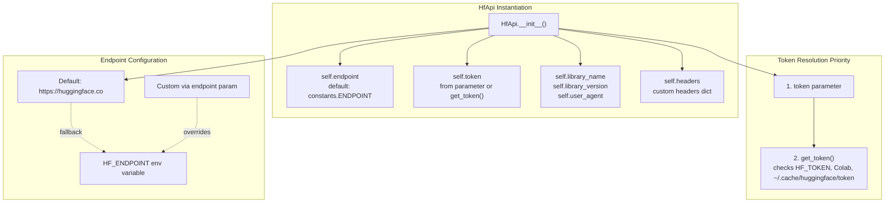

**HfApi Initialization and Configuration**

Sources: [src/huggingface_hub/hf_api.py:1896-1982]()

### Initialization Parameters

The `HfApi` constructor accepts optional configuration that applies to all subsequent method calls:

| Parameter | Type | Purpose | Default |
|-----------|------|---------|---------|
| `endpoint` | `str` | Hub API base URL | `constants.ENDPOINT` |
| `token` | `str \| bool` | Authentication token | `None` (auto-resolved) |
| `library_name` | `str` | Client library identifier for telemetry | `None` |
| `library_version` | `str` | Client library version | `None` |
| `user_agent` | `str \| dict` | Additional user agent info | `None` |
| `headers` | `dict` | Custom HTTP headers | `None` |

Token resolution follows a fallback chain: explicit parameter → `get_token()` helper → environment variable `HF_TOKEN` → Google Colab secrets → token file at `~/.cache/huggingface/token`. Setting `token=False` explicitly disables authentication.

Sources: [src/huggingface_hub/hf_api.py:1896-1982](), [src/huggingface_hub/utils/_headers.py:133-171]()

## Core Method Categories

The `HfApi` class organizes ~150 public methods into functional groups. Methods generally accept `repo_id`, `repo_type`, and `revision` parameters following consistent naming patterns.

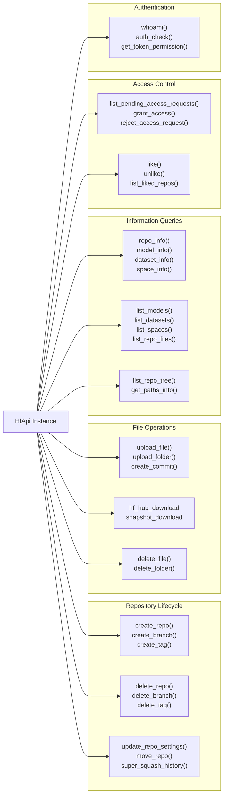

**Method Organization in HfApi**

Sources: [src/huggingface_hub/hf_api.py:1984-5500]()

### Repository Management Methods

| Method | Purpose | Returns |
|--------|---------|---------|
| `create_repo()` | Create new repository | `RepoUrl` |
| `delete_repo()` | Delete repository | `None` |
| `update_repo_settings()` | Modify visibility, gating, Xet settings | `None` |
| `move_repo()` | Rename/relocate repository | `None` |
| `repo_exists()` | Check repository existence | `bool` |
| `revision_exists()` | Check if revision exists | `bool` |
| `file_exists()` | Check if file exists at path | `bool` |

The `create_repo()` method returns a `RepoUrl` object that inherits from `str` but provides structured access to repository metadata:

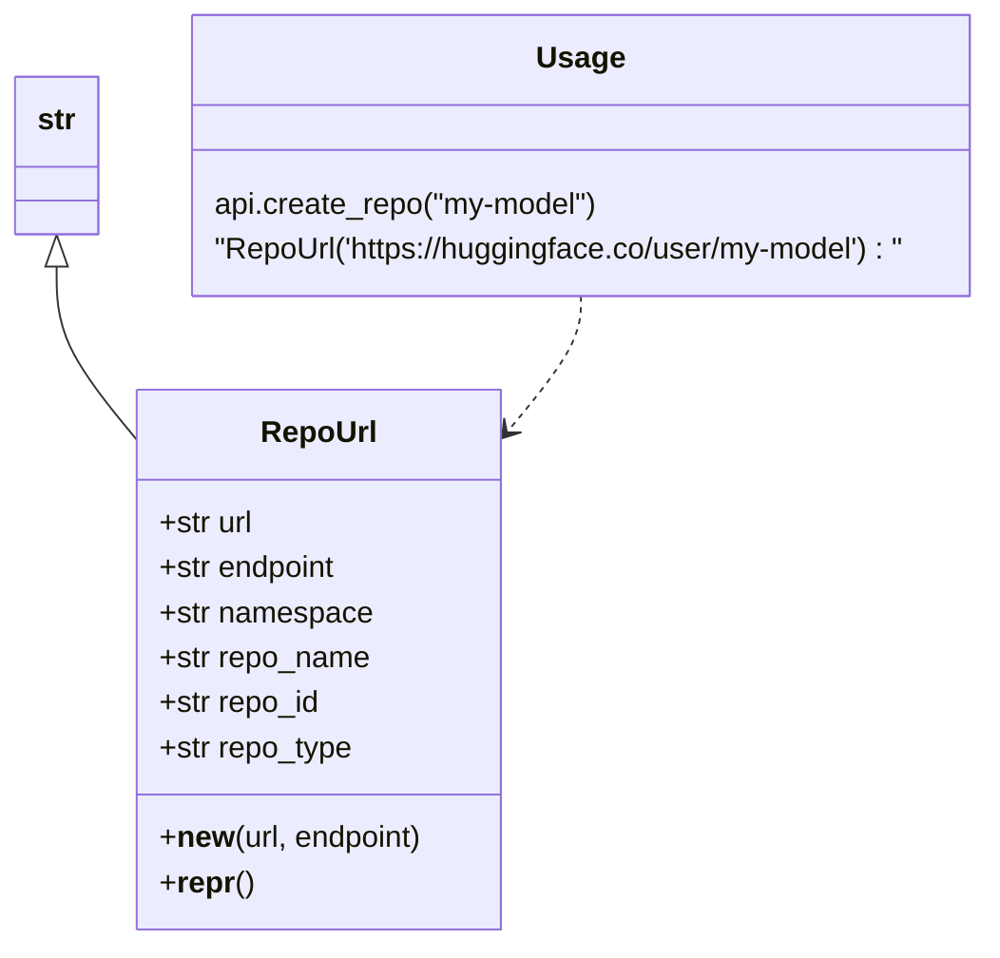

**RepoUrl Data Structure**

Sources: [src/huggingface_hub/hf_api.py:534-593](), [tests/test_hf_api.py:413-419]()

### Information Retrieval Methods

Information methods return rich dataclass objects with optional properties depending on query parameters:

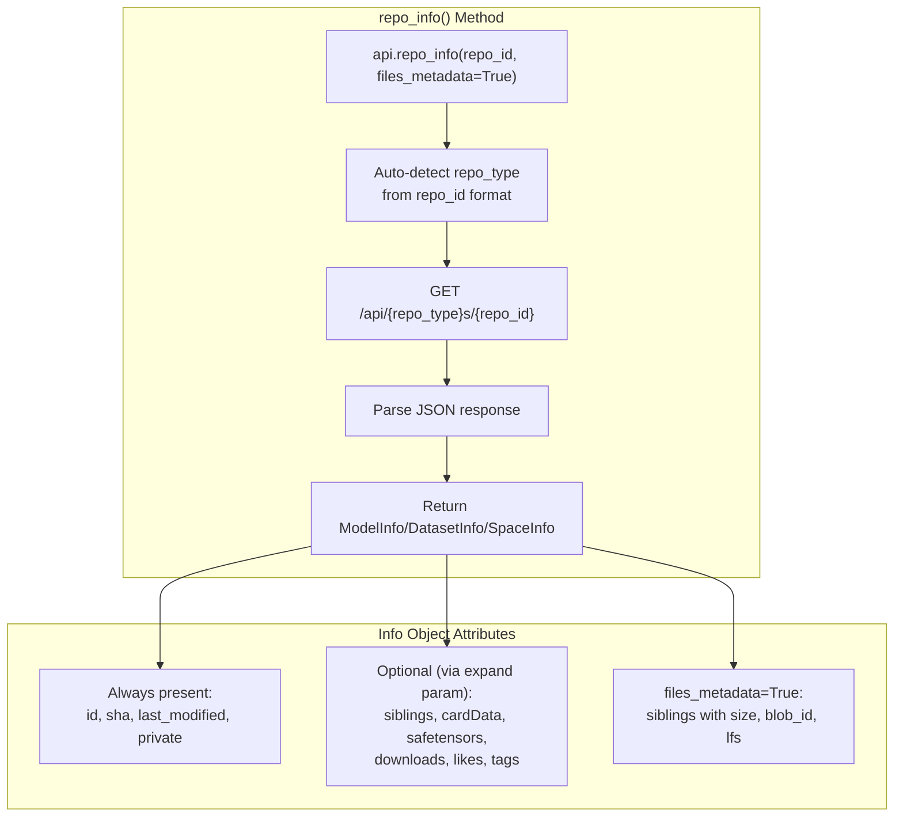

**repo_info() Method Flow**

The `files_metadata` parameter controls whether file details (size, blob_id, LFS metadata) are included in `siblings` list. Without this flag, `siblings` contains only filenames.

Sources: [src/huggingface_hub/hf_api.py:2619-2757]()

### List Methods with Pagination

List methods (`list_models()`, `list_datasets()`, `list_spaces()`) return iterators that automatically handle pagination via the `paginate()` utility:

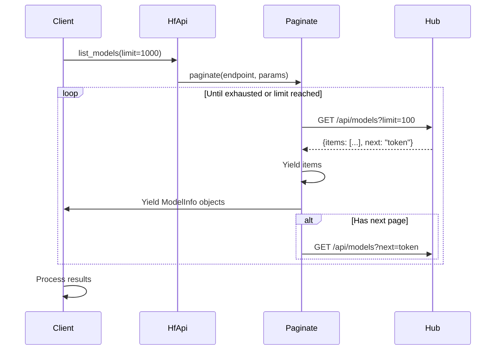

**Pagination in List Methods**

The `paginate()` helper uses response headers (`X-Next`, `Link`) to fetch subsequent pages transparently. The `limit` parameter controls total results, not per-page size.

Sources: [src/huggingface_hub/hf_api.py:2169-2299](), [src/huggingface_hub/utils/_pagination.py:1-100]()

## Data Structures and Return Types

`HfApi` methods return strongly-typed dataclasses that provide both attribute access and dictionary-like behavior for backward compatibility.

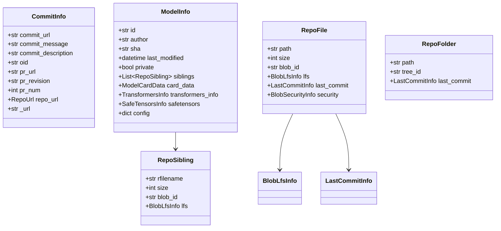

**Core Data Structures Returned by HfApi**

### CommitInfo Object

`CommitInfo` inherits from `str` for backward compatibility (returns commit URL as string) but provides structured fields:

| Attribute | Type | Description |
|-----------|------|-------------|
| `commit_url` | `str` | Full URL to commit on Hub |
| `commit_message` | `str` | First line of commit message |
| `commit_description` | `str` | Remaining lines of commit message |
| `oid` | `str` | 40-character commit hash |
| `pr_url` | `str` | URL to PR if `create_pr=True` |
| `pr_revision` | `str` | Git ref like `refs/pr/1` |
| `pr_num` | `int` | PR discussion number |
| `repo_url` | `RepoUrl` | Parsed repository URL |

Sources: [src/huggingface_hub/hf_api.py:378-455](), [tests/test_hf_api.py:594-607]()

### ModelInfo, DatasetInfo, SpaceInfo

These info objects share common fields but include type-specific attributes:

**Common Fields:**
- `id`, `author`, `sha`, `created_at`, `last_modified`
- `private`, `disabled`, `gated`, `downloads`, `likes`
- `siblings` (list of `RepoSibling` objects)
- `card_data` (typed CardData object)

**ModelInfo-Specific:**
- `transformers_info`: Auto-detection of model class, pipeline tag
- `safetensors`: Parameter counts and tensor info
- `inference_provider_mapping`: Available inference providers
- `library_name`: Detected ML framework

**SpaceInfo-Specific:**
- `runtime`: Current Space execution status
- `sdk`: Gradio, Streamlit, Docker, or Static
- `models`, `datasets`: Linked repositories

Sources: [src/huggingface_hub/hf_api.py:742-1074]()

## HTTP Communication and Error Handling

`HfApi` methods use a resilient HTTP layer with automatic retries, custom error types, and request ID tracking.

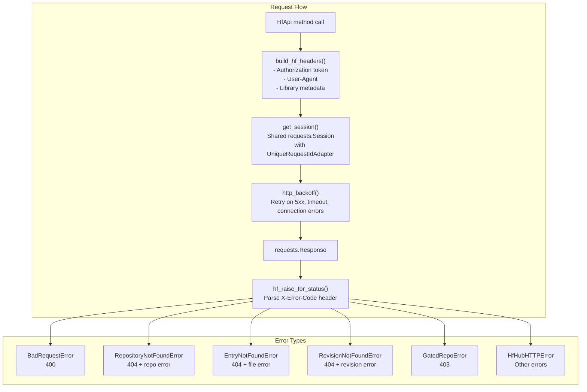

**HTTP Request Flow with Error Handling**

### Request ID Tracking

Every request includes a unique `X-Request-Id` header generated client-side. On error, the server's request ID (from response header) is included in exception messages for debugging.

Sources: [src/huggingface_hub/utils/_http.py:242-316](), [src/huggingface_hub/utils/_errors.py:1-400]()

### Retry Logic

The `http_backoff()` function implements exponential backoff with jitter for transient errors:

| Error Type | Retry? | Max Attempts | Backoff |
|------------|--------|--------------|---------|
| 5xx Server Error | Yes | 5 | Exponential + jitter |
| Connection Error | Yes | 5 | Exponential + jitter |
| Timeout | Yes | 5 | Exponential + jitter |
| 4xx Client Error | No | 0 | - |

File upload operations reset the file cursor on retry to enable re-reading from the beginning.

Sources: [src/huggingface_hub/utils/_http.py:95-162]()

### Specialized Error Types

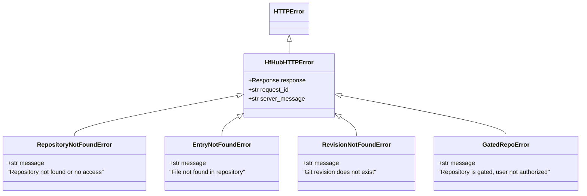

**Error Class Hierarchy**

The `hf_raise_for_status()` function examines the `X-Error-Code` response header to raise specific exception types. This allows client code to handle different failure modes with targeted exception handlers.

Sources: [src/huggingface_hub/utils/_errors.py:80-300](), [src/huggingface_hub/utils/_http.py:399-526]()

## Method Patterns and Conventions

`HfApi` methods follow consistent patterns for parameter naming, validation, and return types.

### Common Parameter Pattern

Most repository-scoped methods accept these parameters:

```python
def method_name(
    repo_id: str,                              # Required: "namespace/repo_name"
    *,
    repo_type: Optional[str] = None,           # "model" (default), "dataset", or "space"
    revision: Optional[str] = None,            # Branch, tag, or commit hash (default: "main")
    token: Optional[Union[str, bool]] = None,  # Auth token (default: instance token)
    headers: Optional[Dict[str, str]] = None,  # Additional HTTP headers
) -> ReturnType:
    ...
```

The `repo_id` parameter accepts multiple formats:
- `"username/repo_name"` (most common)
- `"repo_name"` (uses authenticated user's namespace)
- `"hf://repo_type/username/repo_name"` (explicit format)
- Full Hub URLs (parsed to extract components)

Sources: [src/huggingface_hub/hf_api.py:239-322]()

### Validation Decorator

The `@validate_hf_hub_args` decorator provides automatic parameter validation and normalization:

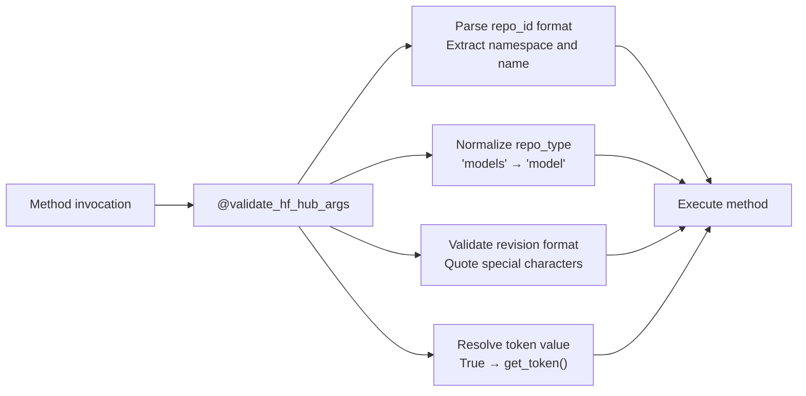

**Parameter Validation Flow**

Sources: [src/huggingface_hub/utils/_validators.py:1-200]()

### Deprecation Handling

Deprecated methods and parameters use the `@_deprecate_arguments` decorator to emit `FutureWarning`:

```python
@_deprecate_arguments(version="1.0", deprecated_args={"use_auth_token": "token"})
def some_method(self, token: Optional[str] = None, use_auth_token: Optional[str] = None):
    # Automatically handles migration and warning
    ...
```

The decorator updates docstrings and emits warnings while maintaining backward compatibility during the deprecation period.

Sources: [src/huggingface_hub/utils/_deprecation.py:1-200]()

## Integration with Other Components

`HfApi` serves as the foundation for higher-level abstractions in the library.

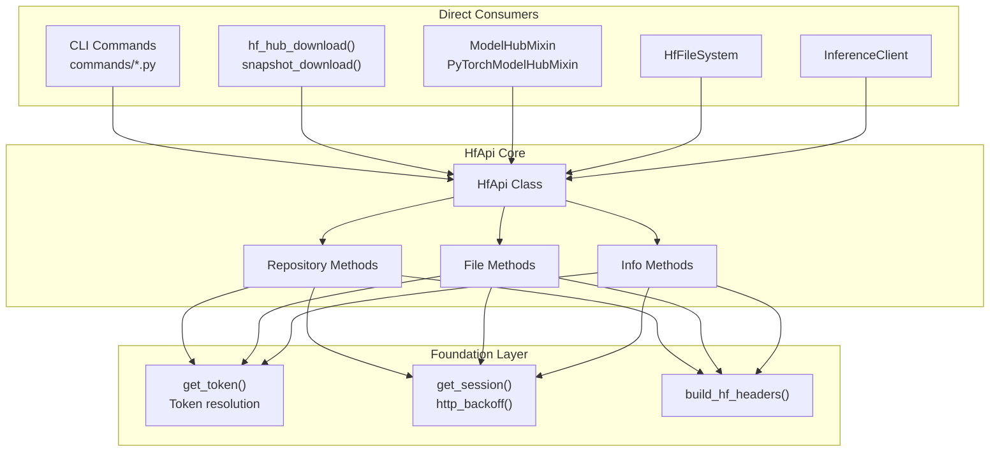

**HfApi in System Architecture**

### CLI Integration

Command classes instantiate `HfApi` with endpoint and token from command arguments:

```python
# In commands/user.py
class WhoamiCommand(BaseUserCommand):
    def run(self):
        token = get_token()
        info = self._api.whoami(token)
        print(info["name"])
```

Sources: [src/huggingface_hub/commands/user.py:188-208]()

### Mixin Integration

`ModelHubMixin` uses `HfApi` methods for `push_to_hub()` and `from_pretrained()`:

```python
def push_to_hub(self, repo_id: str, **kwargs):
    api = HfApi()
    api.create_repo(repo_id, exist_ok=True)
    api.upload_folder(folder_path=local_dir, repo_id=repo_id)
```

Sources: [src/huggingface_hub/hub_mixin.py:200-350]()

### HfFileSystem Integration

`HfFileSystem` delegates metadata operations to `HfApi`:

```python
class HfFileSystem:
    def __init__(self, *args, **kwargs):
        self._api = HfApi(...)
    
    def info(self, path: str):
        # Calls api.get_paths_info() internally
        return self._api.get_paths_info(...)
```

Sources: [src/huggingface_hub/hf_file_system.py:100-200]()

## Authentication and Token Management

`HfApi` supports multiple authentication patterns through its `token` parameter and the global token resolution system.

### Token Parameter Behavior

| `token` Value | Behavior |
|---------------|----------|
| `None` (default) | Use instance token or `get_token()` |
| `"hf_..."` string | Use provided token for this request |
| `True` | Explicitly call `get_token()` |
| `False` | Explicitly disable authentication |

The `token=False` pattern is useful for accessing public repositories without triggering token lookup logic.

Sources: [src/huggingface_hub/hf_api.py:1896-1982]()

### Token Storage Locations

The `get_token()` helper checks multiple sources in priority order:

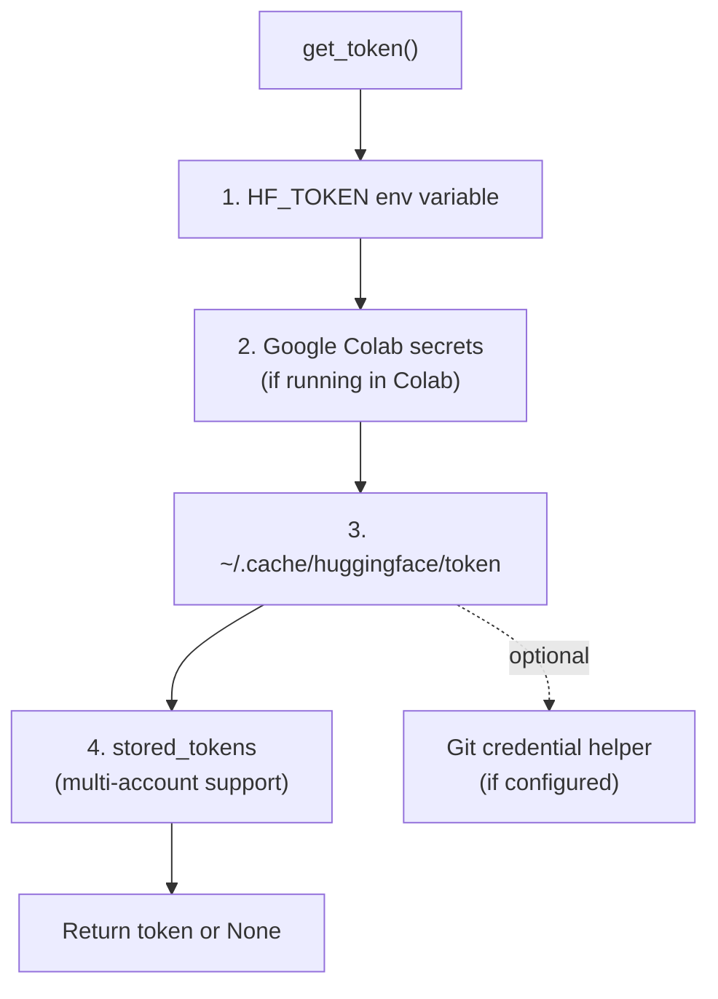

**Token Resolution Priority**

The stored tokens file (introduced in v0.20) allows managing multiple accounts with `auth_switch()` command.

Sources: [src/huggingface_hub/utils/_auth.py:1-200]()

### whoami() Method

The `whoami()` method returns account information for the authenticated user:

```python
{
    "type": "user",
    "name": "username",
    "fullname": "Full Name",
    "email": "user@example.com",
    "orgs": [
        {"name": "org1", "fullname": "Organization 1"},
        {"name": "org2", "fullname": "Organization 2"}
    ],
    "auth": {
        "type": "access_token",  # or "oauth"
        "accessToken": {"role": "write"}
    }
}
```

For OAuth tokens, the response includes expiration information in the `auth.expiresAt` field.

Sources: [src/huggingface_hub/hf_api.py:2051-2080](), [tests/test_hf_api.py:174-208]()

## Performance Considerations

### Session Reuse

`HfApi` uses `get_session()` which returns a singleton `requests.Session` with connection pooling. This reuses TCP connections across multiple API calls, significantly reducing latency for repeated operations.

Sources: [src/huggingface_hub/utils/_http.py:50-90]()

### Parallel Operations

Methods like `upload_folder()` use thread pools for parallel file uploads:

```python
# Internal implementation
with ThreadPoolExecutor(max_workers=num_threads) as executor:
    futures = [
        executor.submit(upload_file, file)
        for file in files
    ]
```

The default thread count is 5 but can be overridden with the `num_threads` parameter in applicable methods.

Sources: [src/huggingface_hub/hf_api.py:4200-4300]()

### Caching Strategy

`HfApi` itself does not implement caching—this is handled by `hf_hub_download()` and the cache system. However, methods like `repo_info()` can be called repeatedly as the overhead is a single HTTP request.

For scenarios requiring frequent metadata queries, consider:
1. Caching `repo_info()` results client-side with a TTL
2. Using `list_repo_tree()` once and filtering locally
3. Using `HfFileSystem` which implements its own caching

Sources: [src/huggingface_hub/hf_file_system.py:1-100]()

---

