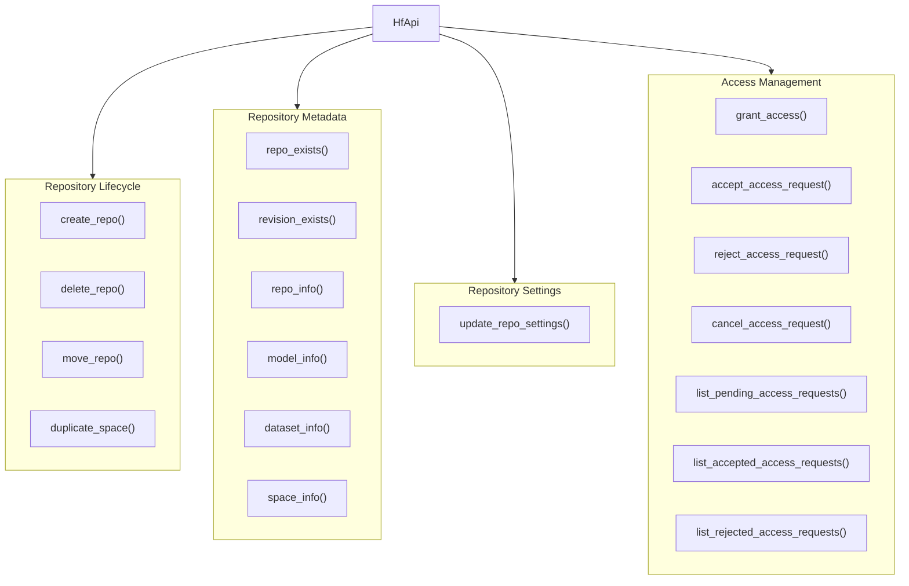
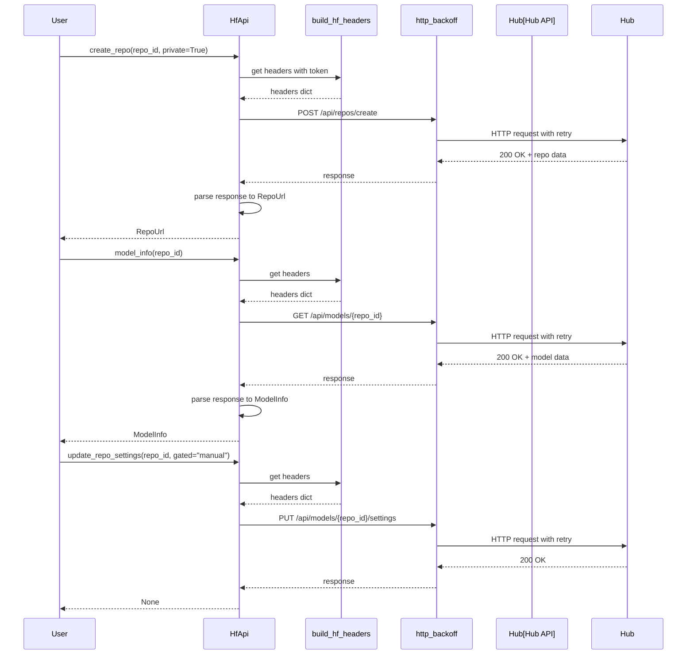
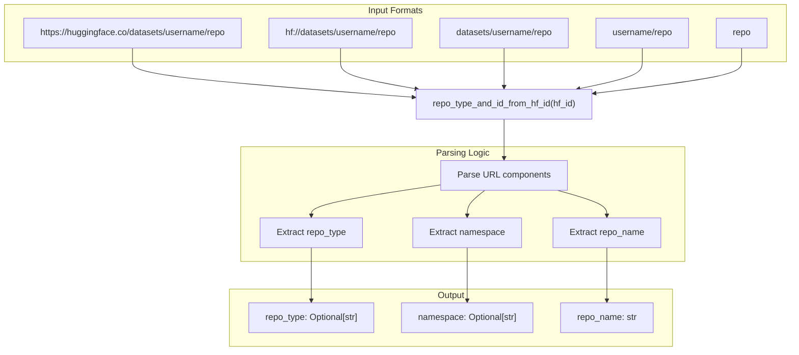

<!-- source: DeepWiki mcp.deepwiki.com · repo huggingface/huggingface_hub · page 2.1 Repository Operations · fetched 2026-10-26 -->

# Repository Operations

<details>
<summary>Relevant source files</summary>

The following files were used as context for generating this wiki page:

- [src/huggingface_hub/__init__.py](src/huggingface_hub/__init__.py)
- [src/huggingface_hub/_commit_api.py](src/huggingface_hub/_commit_api.py)
- [src/huggingface_hub/constants.py](src/huggingface_hub/constants.py)
- [src/huggingface_hub/file_download.py](src/huggingface_hub/file_download.py)
- [src/huggingface_hub/hf_api.py](src/huggingface_hub/hf_api.py)
- [src/huggingface_hub/utils/__init__.py](src/huggingface_hub/utils/__init__.py)
- [tests/test_file_download.py](tests/test_file_download.py)
- [tests/test_hf_api.py](tests/test_hf_api.py)
- [tests/testing_utils.py](tests/testing_utils.py)

</details>


This page documents repository lifecycle management: creating, deleting, moving, updating settings, checking existence, and managing access permissions. These operations are handled through the `HfApi` class and form the foundation for working with repositories on the Hugging Face Hub.

For file download operations, see section 2.2. For file upload operations, see section 2.3.

## Repository Operations Architecture

Repository operations are implemented as methods on the `HfApi` class. All operations communicate with the Hub via HTTP requests:

**HfApi Repository Operations Method Groups**



Sources:
- [src/huggingface_hub/hf_api.py:1587-2057]() - HfApi class definition
- [src/huggingface_hub/hf_api.py:4806-4877]() - create_repo
- [src/huggingface_hub/hf_api.py:4878-4948]() - delete_repo
- [src/huggingface_hub/hf_api.py:5036-5142]() - move_repo
- [src/huggingface_hub/hf_api.py:2058-2134]() - repo_info methods
- [src/huggingface_hub/hf_api.py:4949-5035]() - update_repo_settings

## Repository Creation

### Creating Repositories with create_repo

The `create_repo` method handles repository creation for all repository types:

```python
from huggingface_hub import HfApi

api = HfApi()

# Create a model repository (default type)
repo_url = api.create_repo(repo_id="my-awesome-model")

# Create a dataset repository
repo_url = api.create_repo(repo_id="my-dataset", repo_type="dataset")

# Create a space repository with specific SDK
repo_url = api.create_repo(
    repo_id="my-gradio-demo", 
    repo_type="space",
    space_sdk="gradio"
)

# Create a private repository
repo_url = api.create_repo(repo_id="my-private-model", private=True)

# Create with additional settings
repo_url = api.create_repo(
    repo_id="my-model",
    private=True,
    exist_ok=True,  # Don't fail if repo already exists
    license="apache-2.0"
)
```

### RepoUrl Return Object

The `create_repo` method returns a `RepoUrl` object (defined at [src/huggingface_hub/hf_api.py:591-650]()) with these properties:

| Property | Type | Description | Example |
|----------|------|-------------|---------|
| `endpoint` | `str` | Hub endpoint URL | `"https://huggingface.co"` |
| `namespace` | `Optional[str]` | User or organization name | `"username"` or `None` |
| `repo_name` | `str` | Repository name | `"my-model"` |
| `repo_id` | `str` | Full repository identifier | `"username/my-model"` |
| `repo_type` | `str` | Repository type | `"model"`, `"dataset"`, or `"space"` |
| `url` | `str` | Complete repository URL | `"https://huggingface.co/username/my-model"` |

Sources:
- [src/huggingface_hub/hf_api.py:591-650]() - RepoUrl class
- [src/huggingface_hub/hf_api.py:4806-4877]() - create_repo method
- [tests/test_hf_api.py:424-430]() - create_repo tests

## Repository Information and Metadata

### Checking Repository Existence

Use `repo_exists` to verify if a repository exists:

```python
# Check if repository exists
exists = api.repo_exists("username/my-model")

# Check specific repository type
exists = api.repo_exists("username/my-dataset", repo_type="dataset")

# Check with authentication for private repos
exists = api.repo_exists("username/private-model", token="your_token")
```

### Getting Repository Information

The `repo_info` method and its type-specific variants provide detailed repository metadata:

```python
# Generic repository info
info = api.repo_info("username/my-model")

# Type-specific info with rich metadata
model_info = api.model_info("username/my-model")
dataset_info = api.dataset_info("username/my-dataset") 
space_info = api.space_info("username/my-space")

# Get info for specific revision
info = api.model_info("username/my-model", revision="v1.0")

# Expand specific properties
info = api.model_info(
    "username/my-model", 
    expand=["siblings", "config", "cardData"]
)
```

### Information Objects

Repository information methods return dataclass objects with structured metadata:

| Method | Return Type | Key Properties |
|--------|------------|----------------|
| `model_info()` | `ModelInfo` | `id`, `author`, `sha`, `downloads`, `downloads_all_time`, `likes`, `tags`, `pipeline_tag`, `library_name`, `card_data`, `siblings` |
| `dataset_info()` | `DatasetInfo` | `id`, `author`, `sha`, `downloads`, `downloads_all_time`, `likes`, `tags`, `card_data`, `siblings` |
| `space_info()` | `SpaceInfo` | `id`, `author`, `sha`, `likes`, `sdk`, `stage`, `hardware`, `runtime` |

All info objects also include optional fields like `created_at`, `last_modified`, `private`, `gated`, and `disabled`.

Sources:
- [src/huggingface_hub/hf_api.py:803-999]() - ModelInfo dataclass
- [src/huggingface_hub/hf_api.py:1002-1134]() - DatasetInfo dataclass  
- [src/huggingface_hub/hf_api.py:1137-1283]() - SpaceInfo dataclass
- [src/huggingface_hub/hf_api.py:2058-2134]() - info methods implementation

## Repository Settings Management

### Updating Repository Settings

The `update_repo_settings` method allows modification of repository configuration:

```python
# Change repository visibility
api.update_repo_settings(repo_id="username/my-model", private=True)
api.update_repo_settings(repo_id="username/my-model", private=False)

# Configure repository gating
api.update_repo_settings(repo_id="username/my-model", gated="auto")
api.update_repo_settings(repo_id="username/my-model", gated="manual") 
api.update_repo_settings(repo_id="username/my-model", gated=False)

# Enable advanced storage features
api.update_repo_settings(repo_id="username/my-model", xet_enabled=True)

# Update multiple settings simultaneously
api.update_repo_settings(
    repo_id="username/my-model",
    private=True,
    gated="manual"
)
```

### Legacy update_repo_visibility

For backward compatibility, `update_repo_visibility` is available as an alias:

```python
# Legacy method (still supported)
api.update_repo_visibility(repo_id="username/my-model", private=True)
```

### Repository Settings Options

| Setting | Type | Options | Description |
|---------|------|---------|-------------|
| `private` | `bool` | `True`, `False` | Repository visibility |
| `gated` | `Union[bool, str]` | `False`, `"auto"`, `"manual"` | Access control level |
| `xet_enabled` | `bool` | `True`, `False` | Enable Xet storage backend |

Sources:
- [src/huggingface_hub/hf_api.py:4949-5035]()
- [src/huggingface_hub/hf_api.py:5143-5173]()
- [tests/test_hf_api.py:253-283]()

## Repository Lifecycle Operations

### Deleting Repositories

The `delete_repo` method permanently removes repositories from the Hub:

```python
# Delete a repository
api.delete_repo(repo_id="username/my-model")

# Delete specific repository type
api.delete_repo(repo_id="username/my-dataset", repo_type="dataset")

# Skip error if repository doesn't exist
api.delete_repo(repo_id="username/my-model", missing_ok=True)
```

Sources:
- [src/huggingface_hub/hf_api.py:4878-4948]() - delete_repo implementation
- [tests/test_hf_api.py:235-248]() - delete_repo tests

### Moving/Renaming Repositories

The `move_repo` method handles repository renaming and namespace changes:

```python
# Rename a repository
api.move_repo(from_id="username/old-name", to_id="username/new-name")

# Move to different namespace (organization transfer)
api.move_repo(from_id="username/my-model", to_id="org/my-model")

# Move different repository types
api.move_repo(
    from_id="username/my-dataset", 
    to_id="username/renamed-dataset",
    repo_type="dataset"
)
```

**Requirements for move_repo:**
- Both `from_id` and `to_id` must be in format `"namespace/repo_name"`
- Target repository must not already exist
- User must have write access to both source and destination namespaces

Sources:
- [src/huggingface_hub/hf_api.py:5036-5142]() - move_repo implementation
- [tests/test_hf_api.py:250-270]() - move_repo tests

## Access Management

### Repository Gating

Repositories can be gated to control access. The `update_repo_settings` method configures gating:

```python
# Automatic gating - users are automatically granted access
api.update_repo_settings(repo_id="username/my-model", gated="auto")

# Manual gating - users must request access and wait for approval
api.update_repo_settings(repo_id="username/my-model", gated="manual")

# Disable gating
api.update_repo_settings(repo_id="username/my-model", gated=False)
```

Sources:
- [src/huggingface_hub/hf_api.py:4949-5035]() - update_repo_settings
- [tests/test_hf_api.py:281-303]() - gating tests

### Managing Access Requests

For manually gated repositories, use these methods to manage access requests:

```python
# List pending access requests
pending = api.list_pending_access_requests(repo_id="username/my-model")

# Accept an access request
api.accept_access_request(repo_id="username/my-model", user="requesting-user")

# Reject an access request  
api.reject_access_request(repo_id="username/my-model", user="requesting-user")

# Grant access directly (without a request)
api.grant_access(repo_id="username/my-model", user="trusted-user")

# List accepted requests
accepted = api.list_accepted_access_requests(repo_id="username/my-model")

# List rejected requests
rejected = api.list_rejected_access_requests(repo_id="username/my-model")
```

All access request methods return `AccessRequest` objects (defined at [src/huggingface_hub/hf_api.py:515-542]()) with fields:
- `username`: Username of the user
- `fullname`: Full name of the user
- `email`: Email address (optional)
- `timestamp`: When the request was made
- `status`: `"pending"`, `"accepted"`, or `"rejected"`
- `fields`: Additional form fields (optional)

Sources:
- [src/huggingface_hub/hf_api.py:8059-8098]() - grant_access
- [src/huggingface_hub/hf_api.py:8099-8148]() - accept_access_request
- [src/huggingface_hub/hf_api.py:8149-8198]() - reject_access_request
- [src/huggingface_hub/hf_api.py:8199-8237]() - cancel_access_request
- [src/huggingface_hub/hf_api.py:8238-8278]() - list_pending_access_requests
- [src/huggingface_hub/hf_api.py:8279-8319]() - list_accepted_access_requests
- [src/huggingface_hub/hf_api.py:8320-8360]() - list_rejected_access_requests

## Repository Operations Request Flow

**Typical Repository Operation Sequence**



Sources:
- [src/huggingface_hub/hf_api.py:4806-4877]() - create_repo
- [src/huggingface_hub/hf_api.py:2058-2134]() - model_info  
- [src/huggingface_hub/hf_api.py:4949-5035]() - update_repo_settings
- [src/huggingface_hub/utils/_headers.py:119-159]() - build_hf_headers
- [src/huggingface_hub/utils/_http.py:418-489]() - http_backoff

## Repository Types and URL Structure

### Repository Type Constants

The Hub supports three main repository types defined in `constants.py`:

| Constant | Value | URL Prefix | Description |
|----------|-------|------------|-------------|
| `REPO_TYPE_MODEL` | `"model"` | None | Machine learning models (default) |
| `REPO_TYPE_DATASET` | `"dataset"` | `"datasets/"` | Training and evaluation datasets |
| `REPO_TYPE_SPACE` | `"space"` | `"spaces/"` | Interactive applications and demos |

### Repository ID Parsing

The `repo_type_and_id_from_hf_id` function parses repository identifiers:



### Repository URL Examples

| Repository ID | Parsed Components | Full URL |
|---------------|-------------------|----------|
| `"bert-base-uncased"` | `repo_type=None, namespace=None, repo_name="bert-base-uncased"` | https://huggingface.co/bert-base-uncased |
| `"username/my-model"` | `repo_type=None, namespace="username", repo_name="my-model"` | https://huggingface.co/username/my-model |
| `"datasets/username/data"` | `repo_type="dataset", namespace="username", repo_name="data"` | https://huggingface.co/datasets/username/data |
| `"spaces/username/demo"` | `repo_type="space", namespace="username", repo_name="demo"` | https://huggingface.co/spaces/username/demo |

Sources:
- [src/huggingface_hub/hf_api.py:239-322]()
- [src/huggingface_hub/constants.py:104-118]()
- [src/huggingface_hub/hf_api.py:529-587]()

## Deprecated: Git-based Repository Management

The `Repository` class provides a Git-based approach to repository management. However, it's deprecated and will be removed in version 1.0.

```python
from huggingface_hub import Repository

# Clone a repository
repo = Repository(
    local_dir="path/to/local/directory", 
    clone_from="username/repo-name"
)

# Track large files with Git LFS
repo.lfs_track(["*.bin", "*.pt"])

# Add files
repo.git_add()

# Commit files
repo.git_commit("Add model files")

# Push to Hub
repo.git_push()
```

If you're working with an existing codebase that uses the `Repository` class, consider migrating to the HTTP-based approach with `HfApi`.

Sources:
- [src/huggingface_hub/repository.py:426-1164]()

## Summary

Repository management on the Hugging Face Hub can be done using:

1. **HTTP-based approach** (recommended):
   - Use `HfApi` class for all repository operations
   - No need for Git installation
   - More straightforward and platform-independent
   - Provides methods like `create_repo`, `upload_file`, `upload_folder`, and `create_commit`

2. **Git-based approach** (deprecated):
   - Use `Repository` class which wraps Git commands
   - Requires Git and Git LFS to be installed
   - Will be removed in future versions

For most use cases, the HTTP-based approach is preferred for its simplicity and reliability across different environments.

---

