<!-- source: DeepWiki mcp.deepwiki.com · repo huggingface/huggingface_hub · page 2.2 File Download System · fetched 2026-10-26 -->

# File Download System

<details>
<summary>Relevant source files</summary>

The following files were used as context for generating this wiki page:

- [src/huggingface_hub/__init__.py](src/huggingface_hub/__init__.py)
- [src/huggingface_hub/_commit_api.py](src/huggingface_hub/_commit_api.py)
- [src/huggingface_hub/_snapshot_download.py](src/huggingface_hub/_snapshot_download.py)
- [src/huggingface_hub/constants.py](src/huggingface_hub/constants.py)
- [src/huggingface_hub/fastai_utils.py](src/huggingface_hub/fastai_utils.py)
- [src/huggingface_hub/file_download.py](src/huggingface_hub/file_download.py)
- [src/huggingface_hub/hf_api.py](src/huggingface_hub/hf_api.py)
- [src/huggingface_hub/utils/__init__.py](src/huggingface_hub/utils/__init__.py)
- [tests/test_cache_layout.py](tests/test_cache_layout.py)
- [tests/test_file_download.py](tests/test_file_download.py)
- [tests/test_hf_api.py](tests/test_hf_api.py)
- [tests/test_snapshot_download.py](tests/test_snapshot_download.py)
- [tests/testing_utils.py](tests/testing_utils.py)

</details>


## Purpose and Scope

This document describes the file download mechanisms in `huggingface_hub`, including single file downloads, repository snapshots, metadata fetching, and offline operation modes. For information about the cache structure where files are stored, see [Cache Architecture](#2.5). For upload mechanisms, see [File Upload System](#2.3). For details on LFS and Xet storage backends, see [Commit API and Storage Backends](#2.4).

## Overview

The file download system provides two primary interfaces:

| Interface | Purpose | Main Function |
|-----------|---------|---------------|
| Single File Download | Download a specific file from a repository | `hf_hub_download` |
| Repository Snapshot | Download all files from a repository revision | `snapshot_download` |

Both interfaces support:
- Automatic caching with content-addressable storage
- Offline mode operation
- Progress tracking
- Resumable downloads
- Multiple storage backends (HTTP, Xet)

**Sources:** [src/huggingface_hub/file_download.py:1-50](), [src/huggingface_hub/_snapshot_download.py:1-30]()

## System Architecture

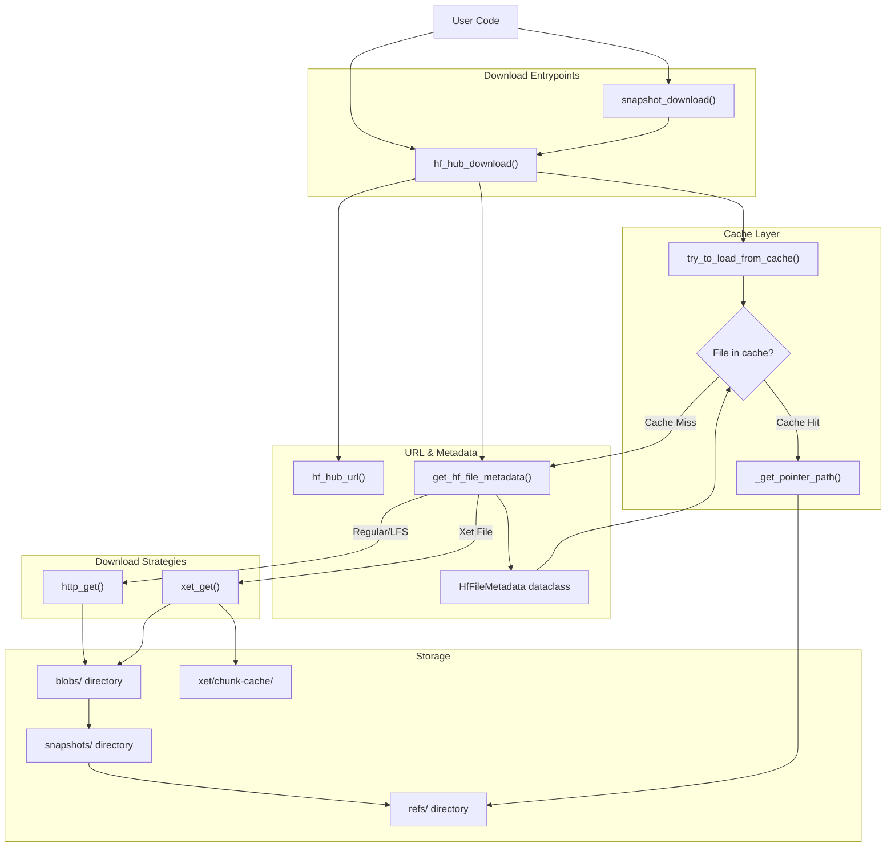

**Sources:** [src/huggingface_hub/file_download.py:189-273](), [src/huggingface_hub/file_download.py:544-745](), [src/huggingface_hub/_snapshot_download.py:104-250]()

## Single File Download

### URL Construction

The `hf_hub_url` function constructs URLs for downloading files from the Hub:

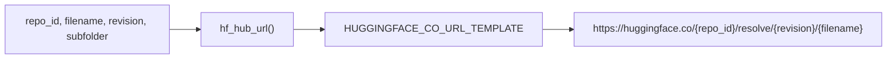

The URL follows the pattern:
- **Template:** `{endpoint}/{repo_id}/resolve/{revision}/{filename}`
- **Default revision:** `main`
- **URL encoding:** Both `revision` and `filename` are URL-encoded via `quote()`

**Sources:** [src/huggingface_hub/file_download.py:189-273](), [src/huggingface_hub/constants.py:58-73]()

### Metadata Fetching

Before downloading, `get_hf_file_metadata` performs an HTTP HEAD request to retrieve file information:

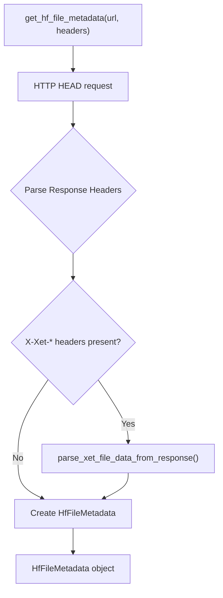

The `HfFileMetadata` dataclass contains:

| Field | Description | Source Header |
|-------|-------------|---------------|
| `commit_hash` | Git commit SHA | `X-Repo-Commit` |
| `etag` | Entity tag for caching | `ETag` or `X-Linked-Etag` |
| `location` | Download URL | Response URL |
| `size` | File size in bytes | `Content-Length` or `X-Linked-Size` |
| `xet_file_data` | Xet storage metadata (optional) | `X-Xet-*` headers |

**Sources:** [src/huggingface_hub/file_download.py:746-920](), [src/huggingface_hub/file_download.py:134-159]()

### Download Flow

The complete download flow for `hf_hub_download`:

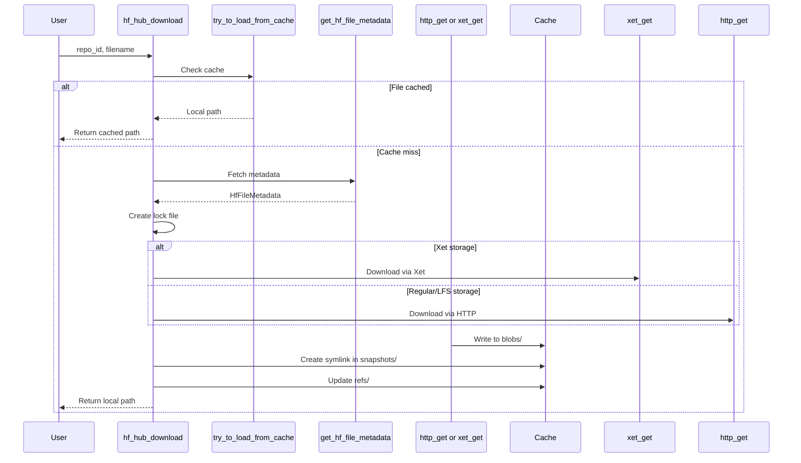

Key steps in the implementation:

1. **Cache lookup** ([src/huggingface_hub/file_download.py:944-982]()): Check `try_to_load_from_cache` for existing file
2. **Metadata fetch** ([src/huggingface_hub/file_download.py:1001-1031]()): Call `get_hf_file_metadata` to get file info
3. **File locking** ([src/huggingface_hub/file_download.py:1064-1071]()): Acquire `WeakFileLock` to prevent concurrent downloads
4. **Download** ([src/huggingface_hub/file_download.py:1084-1165]()): Download to temporary file, then move to cache
5. **Symlink creation** ([src/huggingface_hub/file_download.py:1167-1229]()): Create symlink from snapshot to blob
6. **Ref update** ([src/huggingface_hub/file_download.py:1231-1262]()): Update branch pointer in `refs/` directory

**Sources:** [src/huggingface_hub/file_download.py:544-1300]()

### HTTP Download Strategy

The `http_get` function handles traditional HTTP downloads:

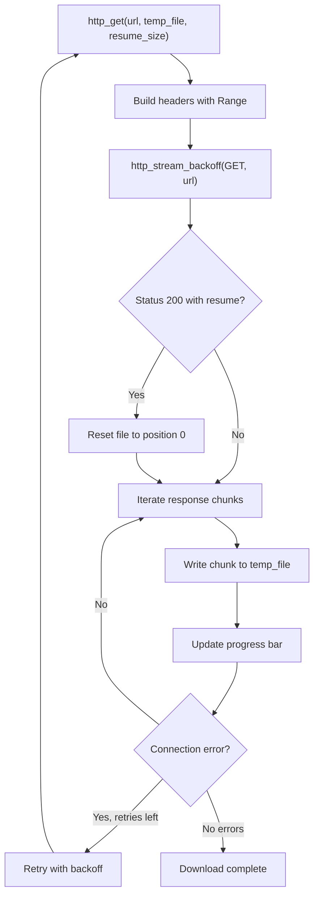

Features:
- **Resumable downloads**: Uses `Range` header to resume from `resume_size`
- **Progress tracking**: Updates `tqdm` progress bar with chunk size
- **Retry logic**: Handles `ConnectError` and `TimeoutException` with up to 5 retries
- **Chunk size**: Downloads in `DOWNLOAD_CHUNK_SIZE` (10MB) chunks

**Sources:** [src/huggingface_hub/file_download.py:310-445](), [src/huggingface_hub/constants.py:38]()

### Xet Download Strategy

The `xet_get` function handles chunk-based downloads for Xet-stored files:

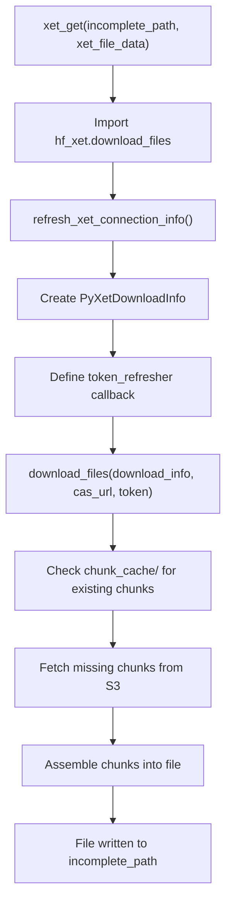

The Xet download process:
1. **Authentication** ([src/huggingface_hub/file_download.py:510-516]()): Refresh connection info and create token refresher
2. **Download info** ([src/huggingface_hub/file_download.py:518-522]()): Create `PyXetDownloadInfo` with file hash and size
3. **Chunk download** ([src/huggingface_hub/file_download.py:543-563]()): `hf_xet.download_files` handles chunk-based download with deduplication
4. **Cache storage**: Chunks stored in `HF_XET_CACHE/chunk-cache/` for reuse

**Sources:** [src/huggingface_hub/file_download.py:447-572](), [src/huggingface_hub/constants.py:273-283]()

## Repository Snapshot Download

### Overview

The `snapshot_download` function downloads all files from a repository at a specific revision:

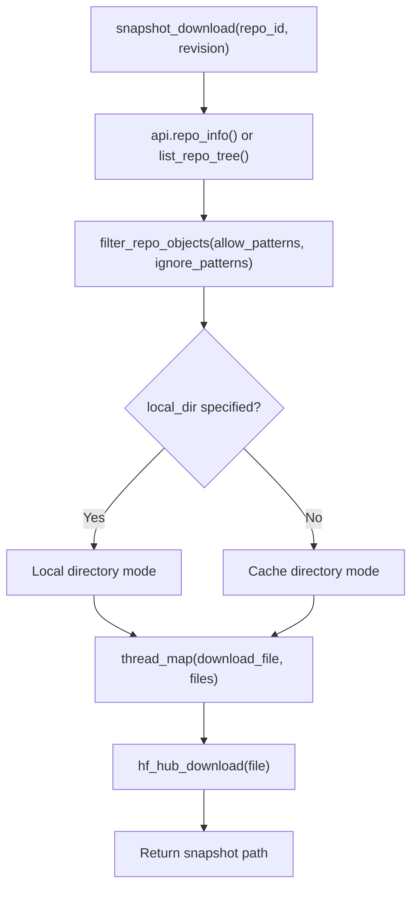

**Sources:** [src/huggingface_hub/_snapshot_download.py:104-400]()

### File Discovery

The function discovers files to download using two strategies:

| Strategy | When Used | Implementation |
|----------|-----------|----------------|
| `repo_info.siblings` | Small repos (<1000 files) | Uses cached file list from `repo_info()` |
| `list_repo_tree` | Large repos (≥1000 files) | Paginated API call for file listing |

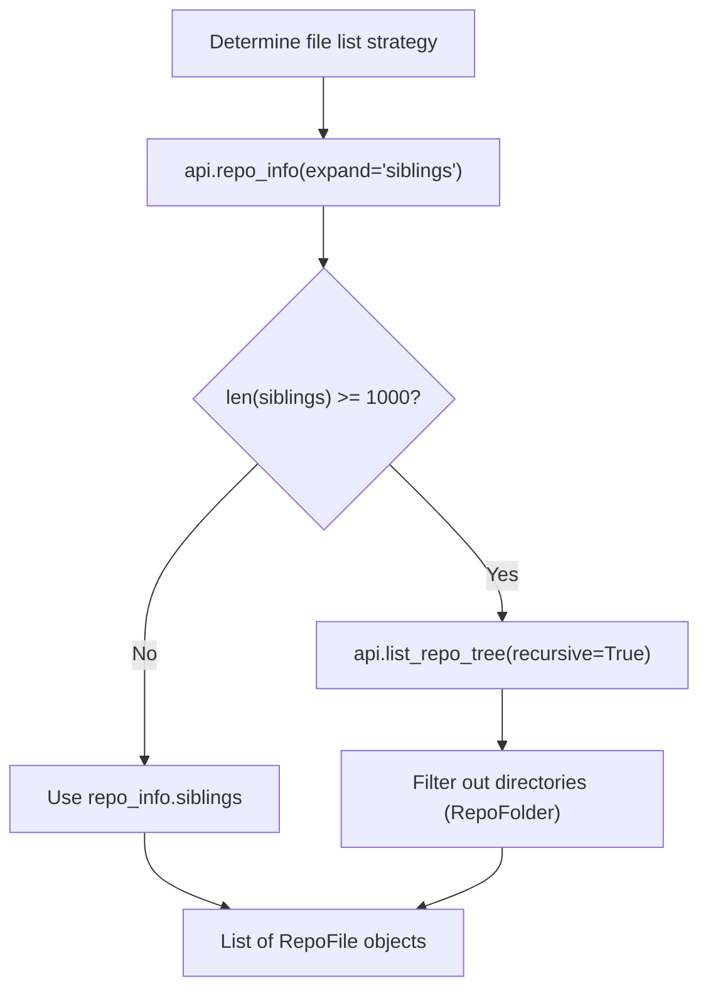

**Sources:** [src/huggingface_hub/_snapshot_download.py:238-287]()

### Pattern Filtering

Files can be filtered using `allow_patterns` and `ignore_patterns`:

```python
# Example patterns
allow_patterns = ["*.safetensors", "*.json"]
ignore_patterns = ["*.bin", "*.msgpack"]
```

The `filter_repo_objects` function applies these patterns:

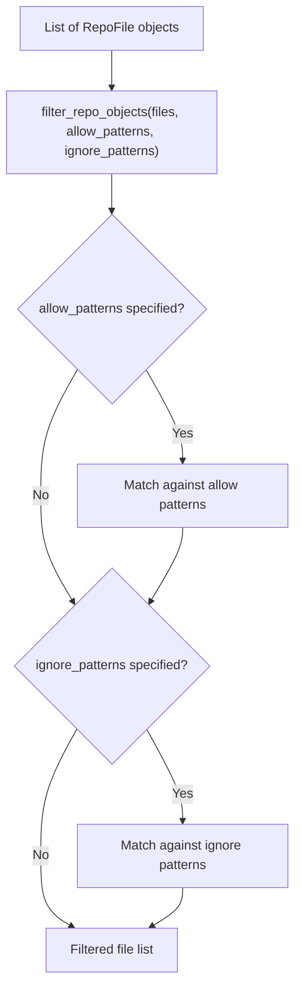

**Sources:** [src/huggingface_hub/_snapshot_download.py:295-308](), [src/huggingface_hub/utils/_paths.py:1-100]()

### Parallel Downloads

Files are downloaded in parallel using `thread_map`:

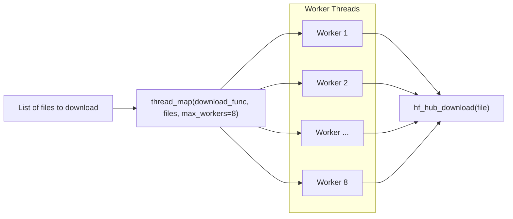

Key parameters:
- **max_workers** (default: 8): Number of concurrent download threads
- **tqdm_class**: Custom progress bar class
- **Progress tracking**: Overall progress bar shows file count, individual file progress handled by `hf_hub_download`

**Sources:** [src/huggingface_hub/_snapshot_download.py:328-366]()

### Dry Run Mode

The `dry_run` parameter allows checking what would be downloaded without actually downloading:

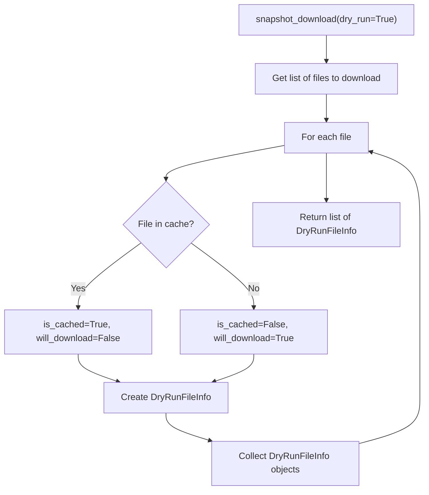

The `DryRunFileInfo` dataclass contains:

| Field | Type | Description |
|-------|------|-------------|
| `commit_hash` | str | Commit SHA of the file |
| `file_size` | int | Size in bytes |
| `filename` | str | File path in repo |
| `local_path` | str | Path where file would be stored |
| `is_cached` | bool | Whether file is already cached |
| `will_download` | bool | Whether file would be downloaded |

**Sources:** [src/huggingface_hub/_snapshot_download.py:372-400](), [src/huggingface_hub/file_download.py:161-187]()

## Offline Mode and Local Files

### Offline Mode Operation

The download system supports three offline scenarios:

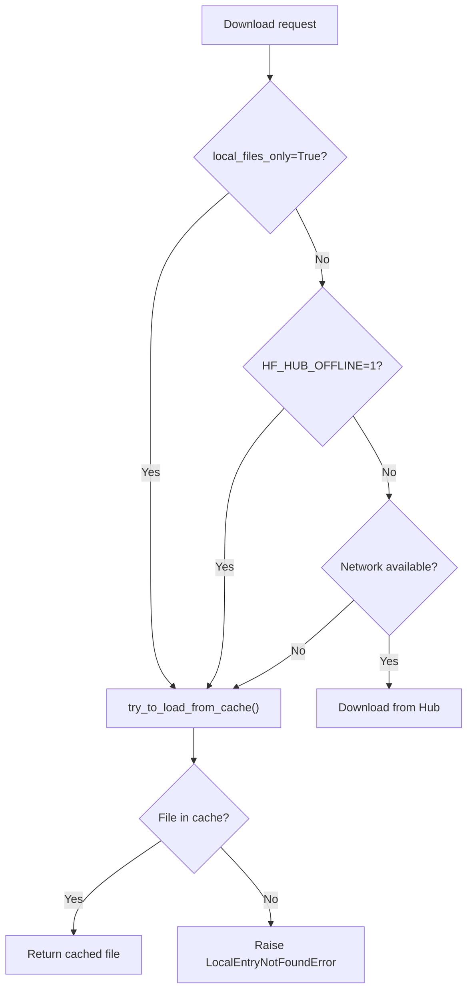

**Sources:** [src/huggingface_hub/file_download.py:944-1000](), [src/huggingface_hub/constants.py:166-186]()

### Cache Lookup

The `try_to_load_from_cache` function checks for cached files:

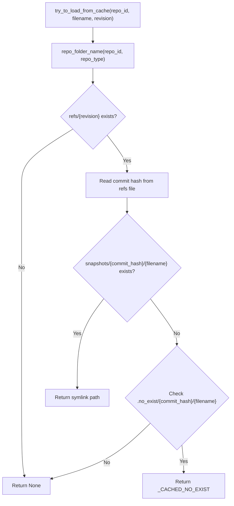

Return values:
- **File path (str)**: File exists in cache
- **`_CACHED_NO_EXIST`**: File is known not to exist on Hub
- **`None`**: No information available in cache

**Sources:** [src/huggingface_hub/file_download.py:1302-1420]()

### Local Directory Mode

When `local_dir` is specified, files are stored directly in that directory instead of the cache:

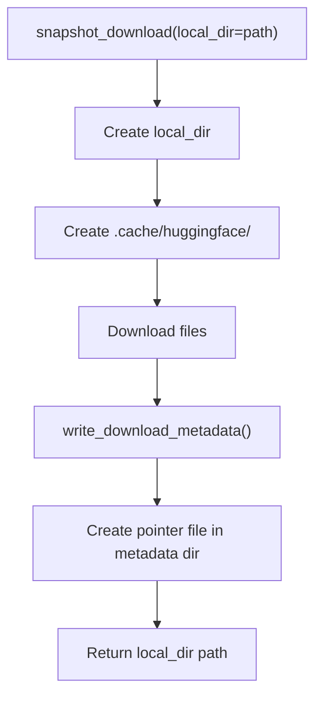

Metadata stored in `{local_dir}/.cache/huggingface/download/{sha256}.json`:

```json
{
  "url": "https://huggingface.co/...",
  "etag": "...",
  "commit_hash": "..."
}
```

**Sources:** [src/huggingface_hub/file_download.py:1073-1083](), [src/huggingface_hub/_local_folder.py:1-150]()

## Error Handling

The download system raises specific exceptions for different failure scenarios:

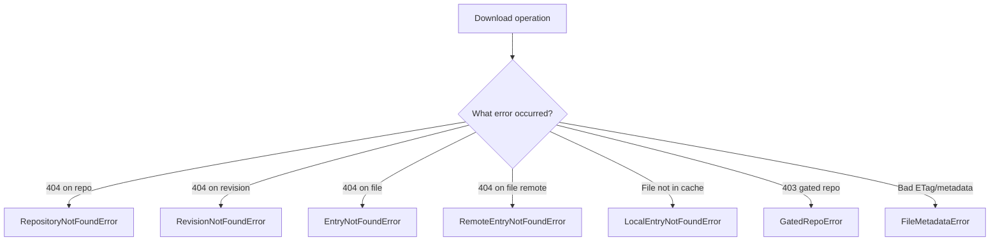

### Exception Hierarchy

| Exception | When Raised | HTTP Status |
|-----------|-------------|-------------|
| `RepositoryNotFoundError` | Repository doesn't exist or no access | 401, 403 |
| `GatedRepoError` | Repository requires access request | 403 with gated info |
| `RevisionNotFoundError` | Branch/tag/commit not found | 404 on revision |
| `EntryNotFoundError` | File doesn't exist in repository | 404 on file |
| `LocalEntryNotFoundError` | File not in cache (offline mode) | N/A |
| `FileMetadataError` | Invalid or missing metadata | N/A |

**Sources:** [src/huggingface_hub/file_download.py:746-920](), [src/huggingface_hub/errors.py:1-500]()

### Retry Logic

HTTP downloads implement automatic retry with exponential backoff:

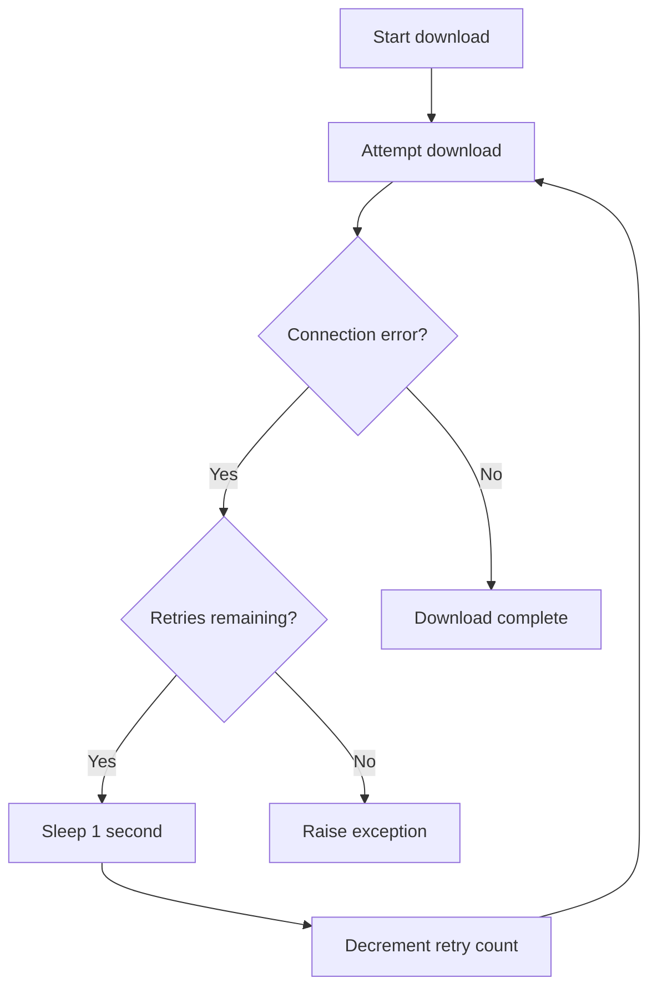

Retry parameters:
- **Default retries**: 5 attempts
- **Retry delay**: 1 second between attempts
- **Errors caught**: `httpx.ConnectError`, `httpx.TimeoutException`
- **Progress preservation**: Download resumes from last successful byte

**Sources:** [src/huggingface_hub/file_download.py:419-437]()

## Configuration

### Environment Variables

| Variable | Default | Description |
|----------|---------|-------------|
| `HF_HUB_CACHE` | `~/.cache/huggingface/hub` | Cache directory for downloaded files |
| `HF_XET_CACHE` | `~/.cache/huggingface/xet` | Cache directory for Xet chunks |
| `HF_HUB_OFFLINE` | `False` | Enable offline mode |
| `HF_HUB_DOWNLOAD_TIMEOUT` | `10` | Timeout for download requests (seconds) |
| `HF_HUB_ETAG_TIMEOUT` | `10` | Timeout for metadata requests (seconds) |
| `HF_HUB_DISABLE_XET` | `False` | Disable Xet downloads, use HTTP only |
| `HF_XET_HIGH_PERFORMANCE` | `False` | Enable high-performance Xet mode |

**Sources:** [src/huggingface_hub/constants.py:130-283]()

### Download Parameters

Common parameters across download functions:

| Parameter | Type | Default | Description |
|-----------|------|---------|-------------|
| `repo_id` | str | Required | Repository identifier |
| `filename` | str | Required | File to download (single file only) |
| `revision` | str | `"main"` | Branch, tag, or commit hash |
| `cache_dir` | str/Path | `HF_HUB_CACHE` | Cache directory |
| `local_dir` | str/Path | None | Download directly to directory |
| `force_download` | bool | False | Re-download even if cached |
| `resume_download` | bool | Deprecated | Resuming is always enabled |
| `token` | str/bool | None | Authentication token |
| `local_files_only` | bool | False | Do not make HTTP requests |
| `etag_timeout` | float | 10 | Timeout for metadata requests |

**Sources:** [src/huggingface_hub/file_download.py:544-650](), [src/huggingface_hub/_snapshot_download.py:104-200]()

---

