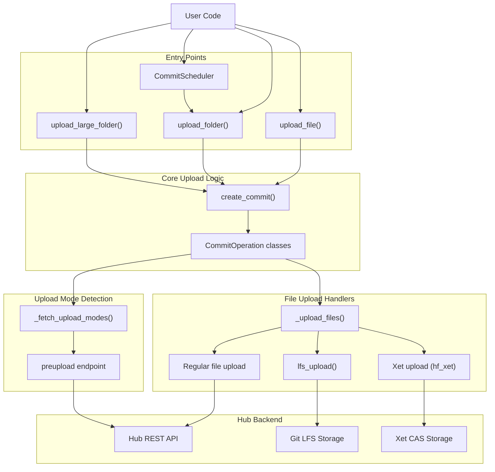
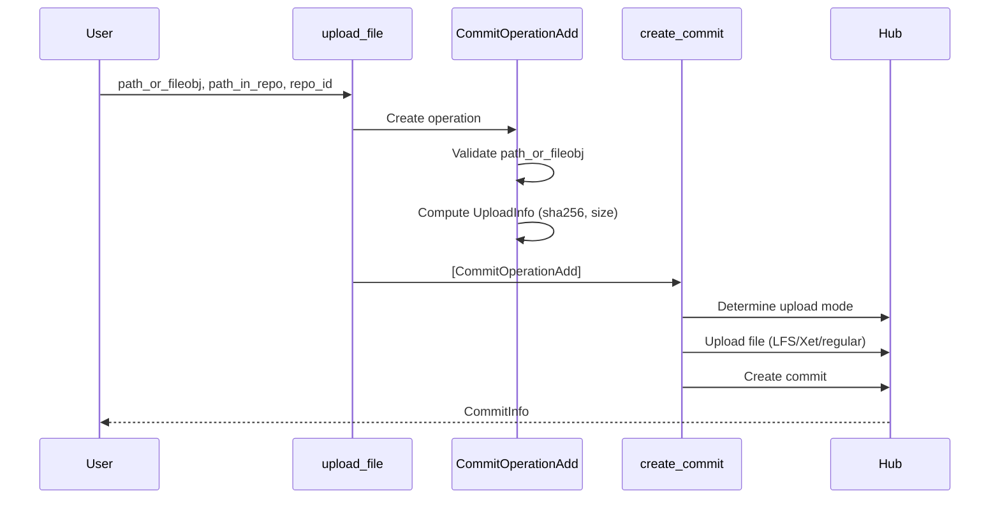
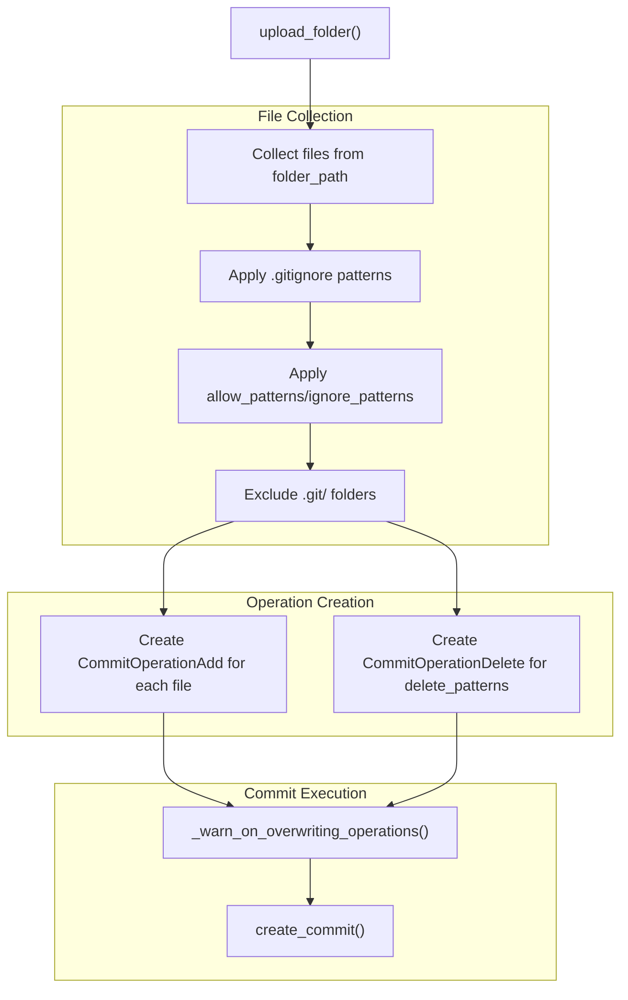
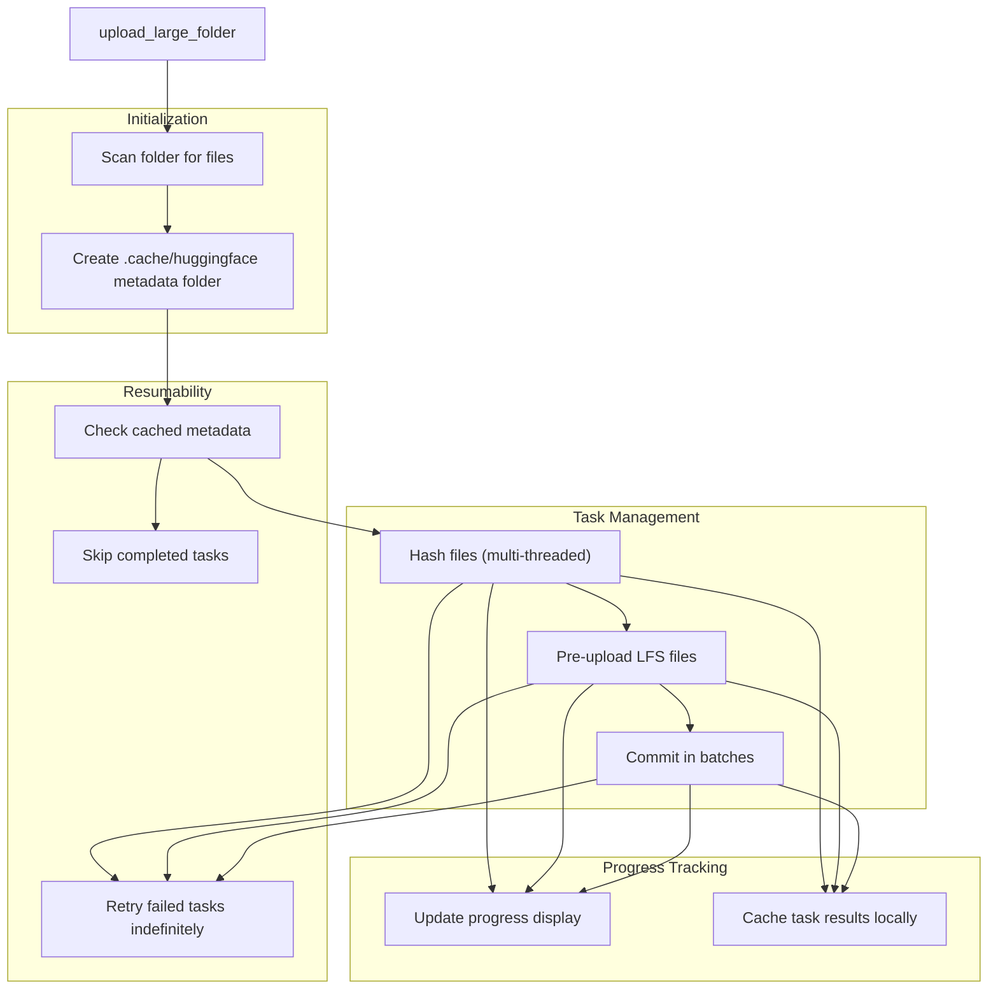
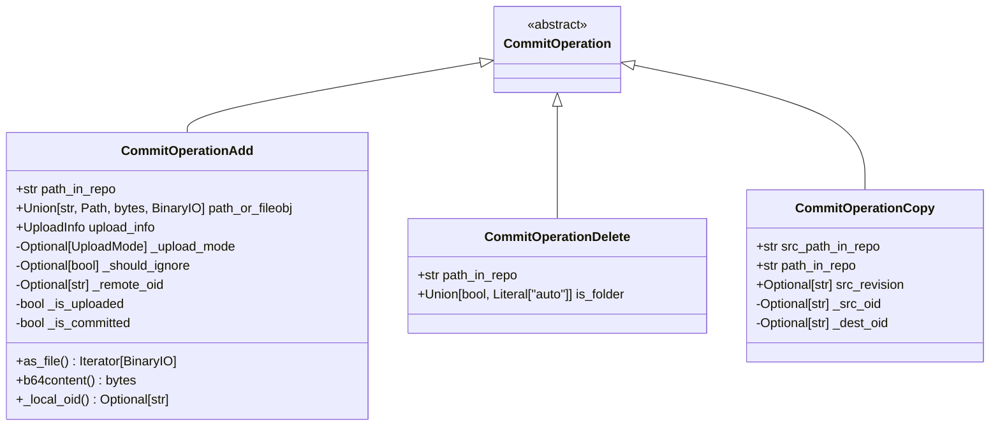
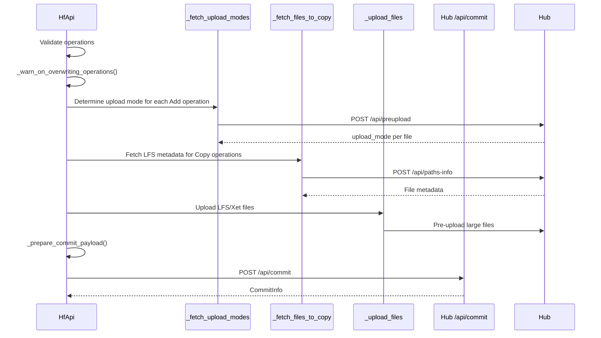
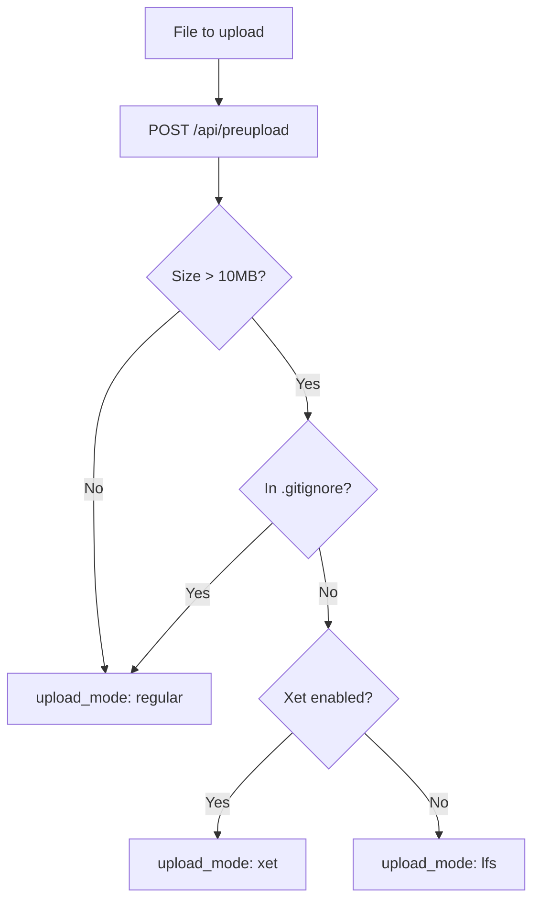
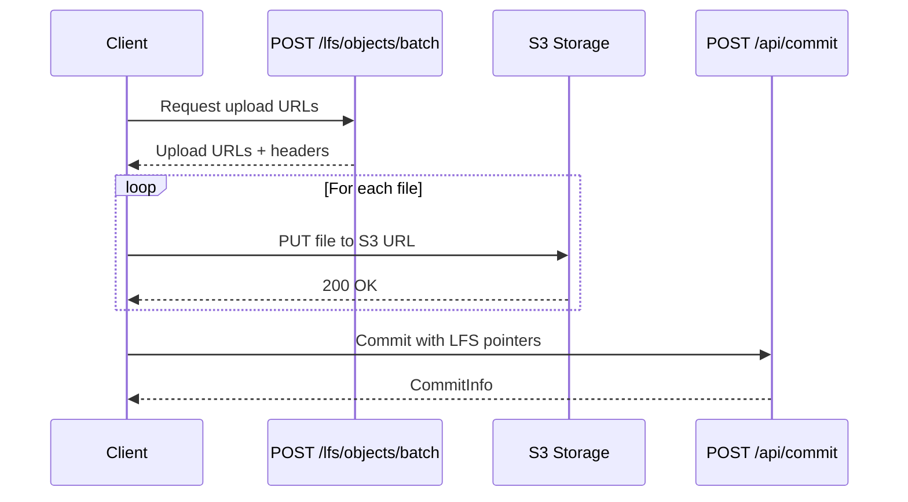
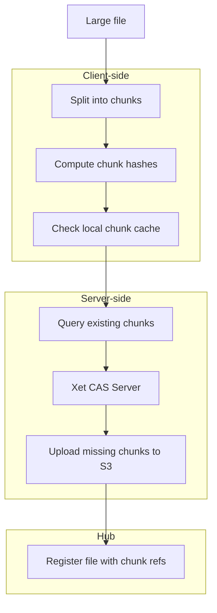
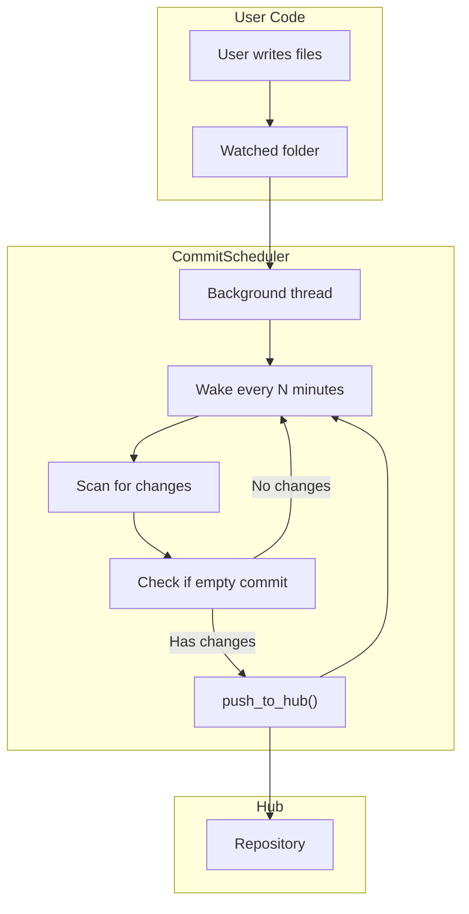

<!-- source: DeepWiki mcp.deepwiki.com · repo huggingface/huggingface_hub · page 2.3 File Upload System · fetched 2026-10-26 -->

# File Upload System

<details>
<summary>Relevant source files</summary>

The following files were used as context for generating this wiki page:

- [docs/source/en/guides/download.md](docs/source/en/guides/download.md)
- [docs/source/en/guides/manage-cache.md](docs/source/en/guides/manage-cache.md)
- [docs/source/en/guides/model-cards.md](docs/source/en/guides/model-cards.md)
- [docs/source/en/guides/upload.md](docs/source/en/guides/upload.md)
- [docs/source/en/package_reference/environment_variables.md](docs/source/en/package_reference/environment_variables.md)
- [docs/source/en/package_reference/file_download.md](docs/source/en/package_reference/file_download.md)
- [docs/source/en/package_reference/utilities.md](docs/source/en/package_reference/utilities.md)
- [docs/source/en/package_reference/webhooks_server.md](docs/source/en/package_reference/webhooks_server.md)
- [src/huggingface_hub/__init__.py](src/huggingface_hub/__init__.py)
- [src/huggingface_hub/_commit_api.py](src/huggingface_hub/_commit_api.py)
- [src/huggingface_hub/_commit_scheduler.py](src/huggingface_hub/_commit_scheduler.py)
- [src/huggingface_hub/_oauth.py](src/huggingface_hub/_oauth.py)
- [src/huggingface_hub/_tensorboard_logger.py](src/huggingface_hub/_tensorboard_logger.py)
- [src/huggingface_hub/constants.py](src/huggingface_hub/constants.py)
- [src/huggingface_hub/file_download.py](src/huggingface_hub/file_download.py)
- [src/huggingface_hub/hf_api.py](src/huggingface_hub/hf_api.py)
- [src/huggingface_hub/utils/__init__.py](src/huggingface_hub/utils/__init__.py)
- [src/huggingface_hub/utils/_telemetry.py](src/huggingface_hub/utils/_telemetry.py)
- [src/huggingface_hub/utils/endpoint_helpers.py](src/huggingface_hub/utils/endpoint_helpers.py)
- [src/huggingface_hub/utils/insecure_hashlib.py](src/huggingface_hub/utils/insecure_hashlib.py)
- [src/huggingface_hub/utils/sha.py](src/huggingface_hub/utils/sha.py)
- [tests/test_commit_scheduler.py](tests/test_commit_scheduler.py)
- [tests/test_endpoint_helpers.py](tests/test_endpoint_helpers.py)
- [tests/test_file_download.py](tests/test_file_download.py)
- [tests/test_hf_api.py](tests/test_hf_api.py)
- [tests/test_utils_sha.py](tests/test_utils_sha.py)
- [tests/test_utils_telemetry.py](tests/test_utils_telemetry.py)
- [tests/testing_utils.py](tests/testing_utils.py)

</details>


## Purpose and Scope

This document describes the file upload system in `huggingface_hub`, which provides mechanisms to upload files and folders to repositories on the Hugging Face Hub. The system handles multiple upload strategies based on file size and type, supports atomic multi-file commits, and provides scheduled upload capabilities.

For downloading files from the Hub, see [File Download System](#2.2). For the underlying commit API and storage backends that power uploads, see [Commit API and Storage Backends](#2.4).

## Upload Architecture Overview

The upload system provides three primary entry points with different use cases and performance characteristics:

| Function | Use Case | Commit Behavior | Resilience |
|----------|----------|-----------------|------------|
| `upload_file` | Single file upload | Single atomic commit | Standard retry |
| `upload_folder` | Standard folder upload | Single atomic commit | Standard retry |
| `upload_large_folder` | Large dataset/model upload | Multiple resumable commits | High resilience with local caching |
| `CommitScheduler` | Periodic background uploads | Commits at intervals | N/A |



**Sources:** [src/huggingface_hub/hf_api.py:1-7000](), [src/huggingface_hub/_commit_api.py:1-700]()

## Single File Upload

### upload_file Method

The `upload_file` method uploads a single file to a repository. It accepts either a file path, bytes, or a file-like object.



**Key Parameters:**
- `path_or_fileobj`: Can be a file path (`str`/`Path`), bytes buffer, or file object (`BinaryIO`)
- `path_in_repo`: Destination path within the repository
- `repo_id`: Repository identifier in format `"namespace/repo_name"`
- `repo_type`: One of `"model"`, `"dataset"`, or `"space"`

**Internal Flow:**
1. Creates a `CommitOperationAdd` object which validates the input and computes file metadata
2. Calls `create_commit` with the single operation
3. Returns a `CommitInfo` object containing the commit URL and metadata

**Sources:** [src/huggingface_hub/hf_api.py:3500-3600](), [src/huggingface_hub/_commit_api.py:126-207](), [tests/test_hf_api.py:321-396]()

### Input Types and Validation

The `CommitOperationAdd` class validates inputs in `__post_init__`:

| Input Type | Validation | Internal Representation |
|------------|------------|------------------------|
| `str` or `Path` | Must be existing file | File path stored as string |
| `bytes` | No validation needed | Bytes stored directly |
| `io.BufferedIOBase` | Must support `seek()` and `tell()` | File object stored directly |

**Sources:** [src/huggingface_hub/_commit_api.py:173-206]()

## Folder Upload

### upload_folder Method

The `upload_folder` method uploads an entire local directory to a repository in a single atomic commit.



**Key Features:**
- **Filtering:** Supports `.gitignore`, `allow_patterns`, and `ignore_patterns`
- **Deletion:** Can delete remote files using `delete_patterns` before uploading
- **Atomic:** All files committed in a single transaction
- **Automatic exclusion:** Always excludes `.git/` and `.cache/huggingface/` folders

**Example Pattern Usage:**
```python
api.upload_folder(
    folder_path="/path/to/local/folder",
    repo_id="username/my-model",
    allow_patterns="*.safetensors",  # Only upload safetensors files
    ignore_patterns="**/logs/*.txt",  # Ignore text logs in any logs/ folder
    delete_patterns="*.bin",          # Delete all .bin files before upload
)
```

**Sources:** [src/huggingface_hub/hf_api.py:3700-3900](), [docs/source/en/guides/upload.md:29-77](), [tests/test_hf_api.py:509-596]()

### Pattern Filtering System

The filtering system uses `filter_repo_objects` utility with standard wildcard (globbing) patterns:

| Parameter | Priority | Behavior |
|-----------|----------|----------|
| `.gitignore` | 1 (Lowest) | Checked at repo root, remote or local |
| `ignore_patterns` | 2 | Exclude matching files |
| `allow_patterns` | 3 (Highest) | Include only matching files |

**Pattern Syntax:** Standard wildcards (`*`, `**`, `?`, `[...]`) as per [glob patterns](https://tldp.org/LDP/GNU-Linux-Tools-Summary/html/x11655.htm)

**Sources:** [src/huggingface_hub/hf_api.py:3750-3850](), [src/huggingface_hub/utils/_paths.py:1-200]()

## Large Folder Upload

### upload_large_folder Method

The `upload_large_folder` method is designed for uploading large datasets or models with enhanced resilience and resumability.



**Key Characteristics:**

| Feature | Implementation | Benefit |
|---------|---------------|----------|
| **Resumability** | Metadata cached in `./cache/huggingface/` | Restart after interruption without re-work |
| **Multi-threading** | Parallel hashing and pre-upload | Faster processing on multi-core machines |
| **High resilience** | Indefinite retry on each task | Handles transient errors automatically |
| **Multiple commits** | Files committed in batches | Reduces likelihood of timeout |

**Trade-offs:**
- Creates multiple commits instead of one atomic commit
- Higher CPU usage due to multi-threading
- May retry indefinitely on permanent errors (e.g., permission denied)
- Not suitable for small uploads where `upload_folder` is more appropriate

**Batch Sizes:**
- `UPLOAD_BATCH_MAX_NUM_FILES = 256` files per commit
- Adjustable via internal constants

**Sources:** [src/huggingface_hub/_upload_large_folder.py:1-500](), [docs/source/en/guides/upload.md:101-128](), [src/huggingface_hub/hf_api.py:3900-4000]()

## Commit Operations System

### CommitOperation Classes

The upload system uses three operation types to describe changes:



**CommitOperationAdd Details:**

The `CommitOperationAdd` class computes an `UploadInfo` object during initialization:

```python
@dataclass
class UploadInfo:
    sha256: bytes      # SHA-256 hash of file content
    size: int          # File size in bytes
    sample: bytes      # First 512 bytes for LFS detection
```

**Internal State Tracking:**
- `_upload_mode`: Set to `"lfs"` or `"regular"` after mode detection
- `_should_ignore`: Set to `True` if `.gitignore` prevents LFS upload
- `_remote_oid`: OID of file on Hub (to detect if re-upload is needed)
- `_is_uploaded`: Tracks whether LFS file has been pre-uploaded
- `_is_committed`: Tracks whether operation has been committed

**Sources:** [src/huggingface_hub/_commit_api.py:59-289]()

### create_commit Workflow

The `create_commit` method orchestrates the multi-step upload process:



**Workflow Steps:**

1. **Validation:** Check operations are valid, warn on potential overwrites
2. **Upload Mode Detection:** Query Hub to determine `"lfs"` vs `"regular"` for each file
3. **Copy Metadata:** For `CommitOperationCopy`, fetch source file metadata
4. **Pre-upload:** Upload large files to LFS or Xet storage
5. **Commit Payload:** Build JSON payload with all operations
6. **Create Commit:** POST to `/api/commit` endpoint

**Sources:** [src/huggingface_hub/hf_api.py:3000-3400](), [src/huggingface_hub/_commit_api.py:400-700]()

## Upload Modes and Storage Backends

### Mode Detection

The Hub determines upload mode based on file size and repository configuration:



**Mode Characteristics:**

| Mode | File Size | Storage Backend | Upload Method |
|------|-----------|-----------------|---------------|
| `regular` | < 10 MB | Hub storage | Inline in commit payload (base64) |
| `lfs` | ≥ 10 MB | Git LFS (S3) | Pre-upload, then pointer in commit |
| `xet` | ≥ 10 MB | Xet CAS | Chunked upload with deduplication |

**Sources:** [src/huggingface_hub/_commit_api.py:470-550]()

### LFS Upload Flow

Large File Storage (LFS) uploads follow a two-phase process:



**LFS Upload Functions:**
- `post_lfs_batch_info()`: Request upload URLs from Hub [src/huggingface_hub/lfs.py:1-100]()
- `lfs_upload()`: Upload file to S3 with progress tracking [src/huggingface_hub/lfs.py:100-200]()

**LFS Pointer Format:**
```
version https://git-lfs.github.com/spec/v1
oid sha256:<file_sha256>
size <file_size>
```

**Sources:** [src/huggingface_hub/lfs.py:1-300](), [src/huggingface_hub/_commit_api.py:600-700]()

### Xet Upload Flow

Xet storage provides chunk-based deduplication for efficient uploads:



**Xet Upload Process:**
1. File is split into chunks (typically 4 MB each)
2. Chunks are hashed for deduplication
3. Only new chunks are uploaded to S3
4. File is registered as a collection of chunk references

**Xet Upload Function:**
- Uses `hf_xet` library's `upload_files()` function
- Requires `HF_XET_HIGH_PERFORMANCE=1` or explicit Xet installation
- Cache location: `$HF_XET_CACHE` (default: `~/.cache/huggingface/xet`)

**Benefits:**
- Deduplication across files and repositories
- Faster uploads when similar files exist
- Efficient for large models with incremental updates

**Sources:** [src/huggingface_hub/_commit_api.py:700-900](), [src/huggingface_hub/utils/_xet.py:1-200]()

## Scheduled Uploads

### CommitScheduler

The `CommitScheduler` class provides automatic periodic uploads of a watched folder:



**Initialization Parameters:**

| Parameter | Purpose | Default |
|-----------|---------|---------|
| `folder_path` | Local folder to watch | Required |
| `repo_id` | Destination repository | Required |
| `every` | Minutes between uploads | 5 |
| `path_in_repo` | Remote folder path | Root |
| `squash_history` | Squash commits to save space | `False` |
| `allow_patterns`/`ignore_patterns` | File filters | All files |

**Usage Patterns:**

**Context Manager (Recommended):**
```python
with CommitScheduler(repo_id="my-repo", folder_path="logs", every=10) as scheduler:
    # Scheduler runs in background
    Path("logs/data.csv").write_text("new data")
    # Auto-uploaded every 10 minutes
# Scheduler stopped, final commit made
```

**Manual Management:**
```python
scheduler = CommitScheduler(repo_id="my-repo", folder_path="logs", every=5)
# ... do work ...
scheduler.stop()  # Stop scheduler, make final commit
```

**Internal Implementation:**
- Runs `upload_folder()` in a background daemon thread
- Skips empty commits (no file changes detected)
- Thread-safe with file locks
- Exposes `last_future` attribute to check upload status

**Sources:** [src/huggingface_hub/_commit_scheduler.py:1-300](), [tests/test_commit_scheduler.py:1-200](), [docs/source/en/guides/upload.md:130-200]()

### PartialFileIO Helper

The `CommitScheduler` provides a special file wrapper for streaming log writes:

```python
class PartialFileIO:
    """File wrapper that uploads only new content since last commit."""
```

This allows appending to files without re-uploading the entire content each time. The scheduler tracks the file size at each commit and only uploads the delta.

**Sources:** [src/huggingface_hub/_commit_scheduler.py:200-300]()

## CLI Upload Commands

### hf upload Command

The CLI provides direct upload functionality:

```bash
# Upload single file
hf upload repo_id local_path path_in_repo

# Upload folder
hf upload repo_id local_folder remote_folder

# With filtering
hf upload repo_id ./models . --include="*.safetensors" --exclude="*.bin"
```

**Command Structure:**

| Argument | Description | Optional |
|----------|-------------|----------|
| `repo_id` | Repository identifier | No |
| `local_path` | Local file or folder | Yes (inferred from repo_id) |
| `path_in_repo` | Destination path | Yes (defaults to root) |

**Options:**
- `--repo-type`: Set to `dataset` or `space`
- `--revision`: Upload to specific branch
- `--private`: Create private repository if new
- `--include`/`--exclude`: Filter patterns
- `--delete`: Delete patterns
- `--commit-message`/`--commit-description`: Custom commit messages

**CLI Implementation:**
- Wraps `upload_file()` or `upload_folder()` based on input type
- Automatically infers repo_id from folder name if not specified
- Provides progress bars by default

**Sources:** [docs/source/en/guides/upload.md:79-99](), CLI implementation in [src/huggingface_hub/commands/upload.py]()

## Upload Error Handling

### Common Error Types

The upload system raises specific exceptions for different failure scenarios:

| Exception | Cause | HTTP Status | Recovery |
|-----------|-------|-------------|----------|
| `RepositoryNotFoundError` | Repository doesn't exist | 404 | Create repo first with `create_repo()` |
| `GatedRepoError` | No access to gated repo | 403 | Request access or use correct token |
| `HfHubHTTPError` | General API error | Various | Check error message and response |
| `EntryNotFoundError` | File not found for copy/delete | 404 | Verify file exists |
| `LocalTokenNotFoundError` | No authentication token | N/A | Run `huggingface-cli login` |

**Retry Behavior:**
- HTTP requests use exponential backoff for transient errors (429, 5xx)
- `upload_large_folder` has indefinite retry with high resilience
- Standard uploads fail after exhausting retries

**Sources:** [src/huggingface_hub/errors.py:1-300](), [src/huggingface_hub/utils/_http.py:1-200]()

### Upload Validation

The system validates several aspects before upload:

**Path Validation:**
- Rejects paths starting with `/` (treated as absolute)
- Rejects `.`, `..`, `../` paths
- Rejects updates to forbidden folders: `.cache/`, `.git/`

**File Validation:**
- For string paths: must point to existing file
- For file objects: must support `seek()` and `tell()`
- For bytes: no validation needed

**Warning on Data Files to Model Repos:**
When uploading `.parquet` or `.arrow` files to a model repository, a warning is raised suggesting `repo_type="dataset"` instead.

**Sources:** [src/huggingface_hub/_commit_api.py:291-305](), [tests/test_hf_api.py:397-423]()

## Performance Considerations

### Upload Optimization Strategies

| Strategy | Implementation | When to Use |
|----------|----------------|-------------|
| **Multi-threading** | `upload_large_folder` uses thread pool | Large folders (1000+ files) |
| **Chunk deduplication** | Xet storage enabled | Large models with versions |
| **Batch commits** | `upload_large_folder` splits into batches | Very large folders |
| **Skip unchanged files** | Compare local vs remote OID | Incremental updates |
| **Progress bars** | Disabled with `HF_HUB_DISABLE_PROGRESS_BARS=1` | Automated scripts |

### File Size Thresholds

```python
# From constants
DOWNLOAD_CHUNK_SIZE = 10 * 1024 * 1024  # 10 MB chunks
MAX_HTTP_DOWNLOAD_SIZE = 50 * 1000 * 1000 * 1000  # 50 GB max via HTTP

# Internal thresholds
LFS_THRESHOLD = 10 * 1024 * 1024  # 10 MB - files above use LFS
UPLOAD_BATCH_MAX_NUM_FILES = 256  # Max files per commit batch
```

**Recommendations:**
- Files < 10 MB: Use `upload_file()` or `upload_folder()` (regular mode)
- Files 10 MB - 1 GB: Use `upload_folder()` (automatic LFS)
- Files > 1 GB: Use `upload_large_folder()` or Xet for deduplication
- Folders > 10,000 files: Use `upload_large_folder()` for resilience

**Sources:** [src/huggingface_hub/constants.py:26-40](), [src/huggingface_hub/_commit_api.py:53-56]()

## Integration Points

### Framework Integration

ML frameworks can integrate upload functionality via the `ModelHubMixin` pattern (see [ModelHubMixin Pattern](#5.1)):

```python
class MyModel(ModelHubMixin):
    def _save_pretrained(self, save_directory: Path) -> None:
        # Save model files to local directory
        pass
    
    # Automatic upload via inherited push_to_hub() method
```

The `push_to_hub()` method internally calls `upload_folder()`.

### TensorBoard Integration

The `HFSummaryWriter` class combines TensorBoard logging with scheduled uploads:

```python
from huggingface_hub import HFSummaryWriter

writer = HFSummaryWriter(
    repo_id="my-training-logs",
    logdir="./runs",
    every=10  # Upload every 10 minutes
)

# Use like regular SummaryWriter
writer.add_scalar("loss", 0.5, step=1)
```

This wraps `CommitScheduler` to automatically upload TensorBoard event files.

**Sources:** [src/huggingface_hub/_tensorboard_logger.py:1-150](), [src/huggingface_hub/hub_mixin.py:1-300]()

---

