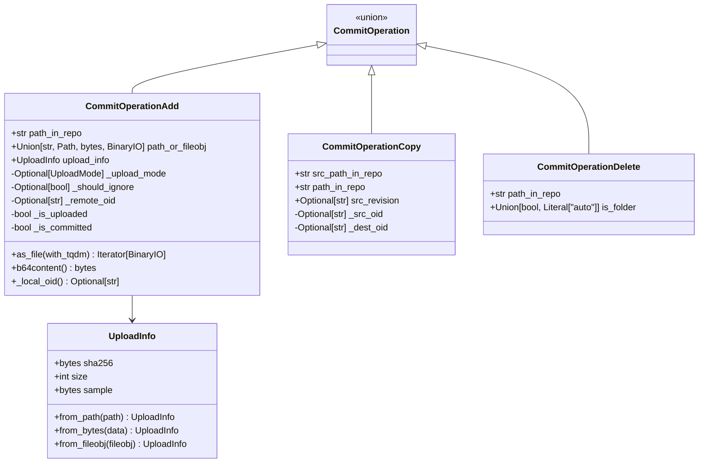
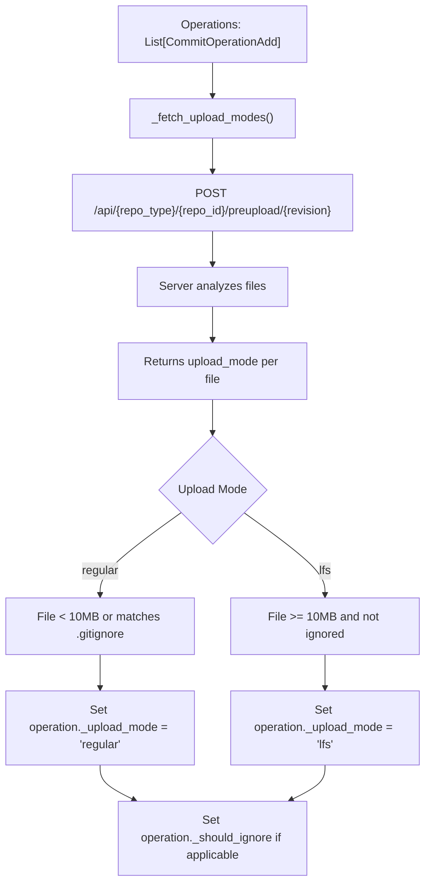
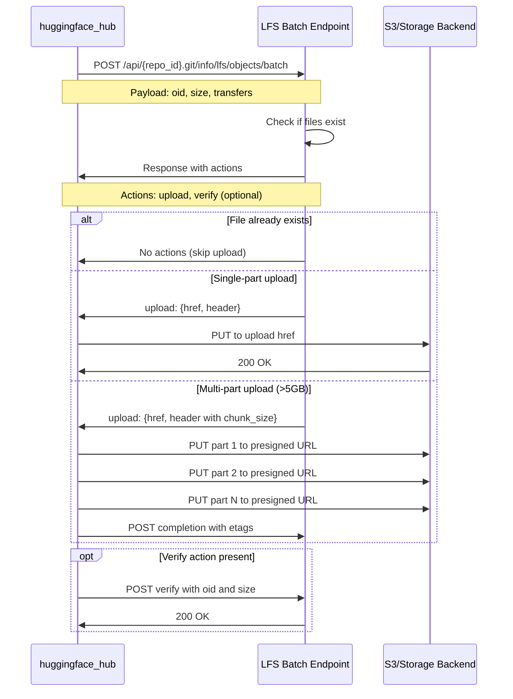
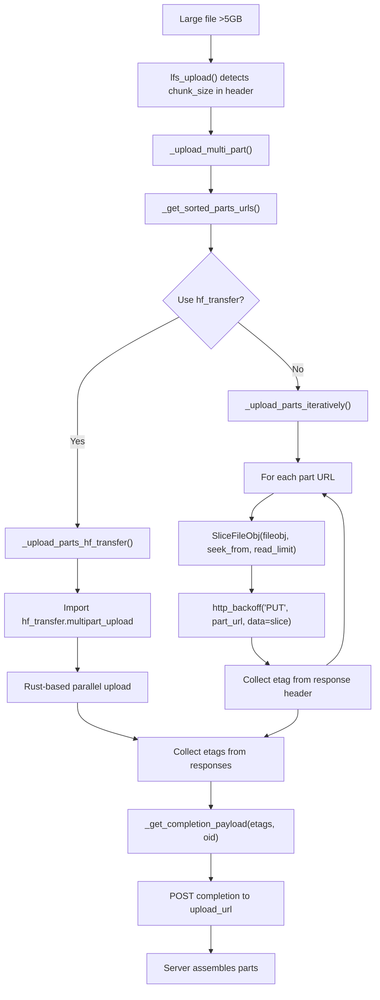
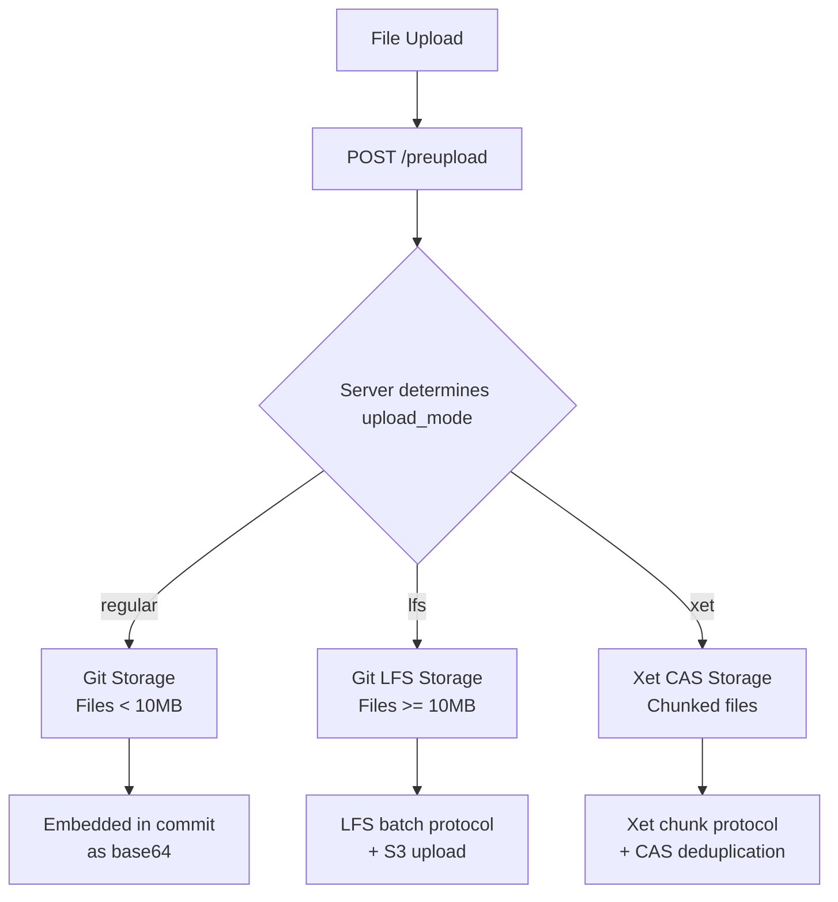
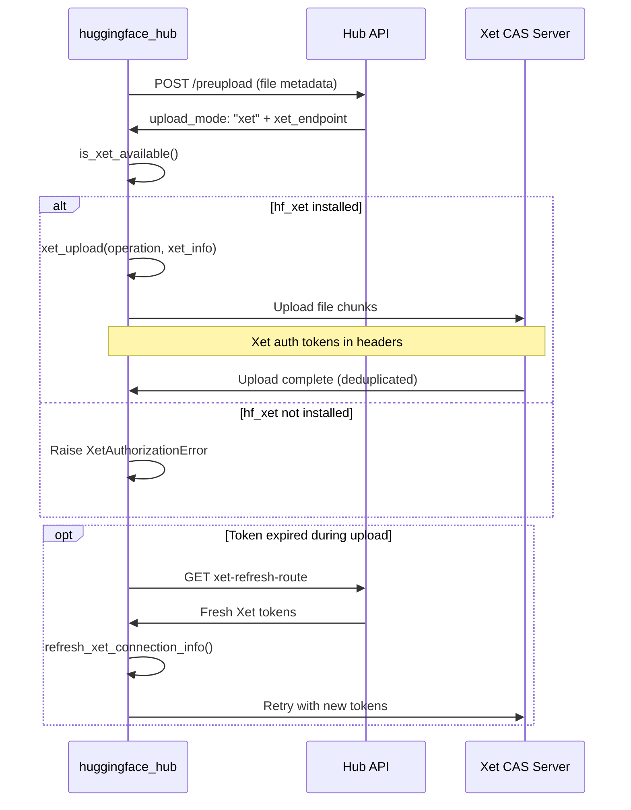
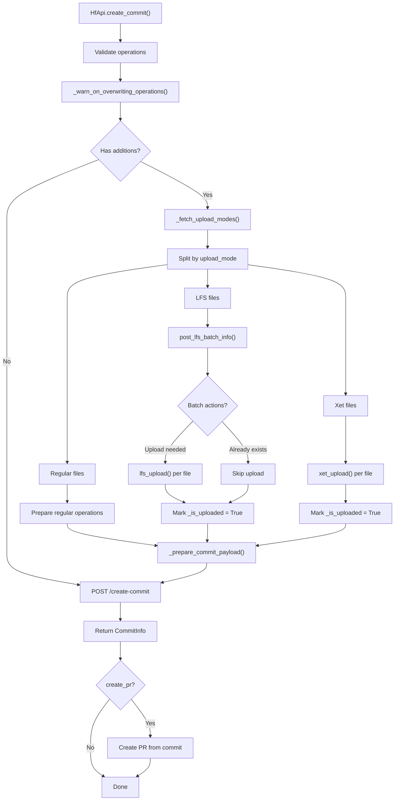
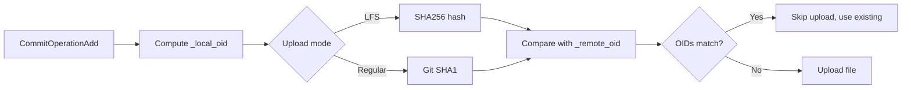

<!-- source: DeepWiki mcp.deepwiki.com · repo huggingface/huggingface_hub · page 2.4 Commit API and Storage Backends · fetched 2026-10-26 -->

# Commit API and Storage Backends

Relevant source files

The following files were used as context for generating this wiki page:

- [src/huggingface_hub/__init__.py](src/huggingface_hub/__init__.py)
- [src/huggingface_hub/_commit_api.py](src/huggingface_hub/_commit_api.py)
- [src/huggingface_hub/cli/_errors.py](src/huggingface_hub/cli/_errors.py)
- [src/huggingface_hub/constants.py](src/huggingface_hub/constants.py)
- [src/huggingface_hub/errors.py](src/huggingface_hub/errors.py)
- [src/huggingface_hub/file_download.py](src/huggingface_hub/file_download.py)
- [src/huggingface_hub/hf_api.py](src/huggingface_hub/hf_api.py)
- [src/huggingface_hub/lfs.py](src/huggingface_hub/lfs.py)
- [src/huggingface_hub/utils/__init__.py](src/huggingface_hub/utils/__init__.py)
- [src/huggingface_hub/utils/_http.py](src/huggingface_hub/utils/_http.py)
- [tests/test_cli_errors.py](tests/test_cli_errors.py)
- [tests/test_file_download.py](tests/test_file_download.py)
- [tests/test_hf_api.py](tests/test_hf_api.py)
- [tests/test_lfs.py](tests/test_lfs.py)
- [tests/test_utils_errors.py](tests/test_utils_errors.py)
- [tests/test_utils_http.py](tests/test_utils_http.py)
- [tests/testing_utils.py](tests/testing_utils.py)

The commit system provides atomic, multi-file operations for modifying Hub repositories through three operation types: `CommitOperationAdd` (upload files), `CommitOperationCopy` (server-side copy), and `CommitOperationDelete` (remove files). Files are routed to different storage backends based on size and type: regular Git storage for small files, Git LFS for large files, and Xet content-addressable storage for chunked models. Multi-part uploads handle files exceeding 5GB.

Higher-level upload methods (`upload_file`, `upload_folder`) are documented in page 2.3. Repository lifecycle management (`create_repo`, `delete_repo`) is covered in page 2.1.

Sources: [src/huggingface_hub/_commit_api.py:1-44](), [src/huggingface_hub/hf_api.py:3468-3764]()

## CommitOperation Classes

The commit system is built around three operation types that represent atomic changes to a repository.

**CommitOperationAdd** represents a file upload. It accepts file input as a local path (`str` or `Path`), raw bytes, or a binary file object. The `upload_info` attribute contains the file's SHA256 hash, size, and a 512-byte sample used for upload mode detection.

**CommitOperationCopy** enables server-side copying of LFS files within a repository. This is more efficient than downloading and re-uploading for file renaming or duplication. Only LFS files can be copied; regular files must be downloaded and re-uploaded.

**CommitOperationDelete** removes a file or folder from the repository. The `is_folder` parameter can be set to `"auto"` (default) to automatically detect whether the path ends with `/`.

Sources: [src/huggingface_hub/_commit_api.py:57-307]()

## Upload Mode Detection

Before uploading files, the system determines whether each file should use Git LFS (Large File Storage) or the regular Git protocol.

The `_fetch_upload_modes` function sends file metadata (OID, path, size, sample) to the `/preupload` endpoint, which returns the appropriate mode for each file. The server decides based on:

- **File size**: Files >= 10MB typically use LFS
- **`.gitignore` patterns**: Files matching repository `.gitignore` patterns use regular upload even if large
- **File content**: The 512-byte sample helps detect binary files

Files are batched in groups of 256 to avoid overwhelming the server with large commits.

Sources: [src/huggingface_hub/_commit_api.py:731-830]()

## LFS Batch Protocol

Files designated for LFS upload use the Git LFS Batch API to obtain upload instructions.

The `post_lfs_batch_info` function sends a batch request containing file OIDs and sizes. The server responds with:

- **No actions**: File already exists in LFS, skip upload
- **Upload action**: Instructions for uploading the file
  - `href`: URL to upload to
  - `header`: Additional headers (may include `chunk_size` for multi-part)
- **Verify action** (optional): Endpoint to confirm successful upload

The client can specify preferred transfer adapters via the `transfers` parameter (e.g., `["basic", "multipart", "xet"]`). The server selects one and returns it in the response.

Sources: [src/huggingface_hub/lfs.py:103-186]()

## File Upload Strategies

### Single-Part Upload

For files <= 5GB, the system uses a single HTTP PUT request to upload the entire file.

The `_upload_single_part` function wraps the file in a progress bar using `tqdm_stream_file` to provide upload feedback. The `http_backoff` wrapper automatically retries on transient S3 errors (5xx status codes).

Sources: [src/huggingface_hub/lfs.py:309-329]()

### Multi-Part Upload

Files exceeding 5GB use the multi-part upload protocol, splitting the file into chunks and uploading them in parallel.

The process:

1. **Get part URLs**: Extract numbered presigned URLs from the batch response header (e.g., `"1": "https://...", "2": "https://..."`)
2. **Upload parts**: Either use `hf_transfer` (Rust-based, faster) or Python iteration with `SliceFileObj`
3. **Collect ETags**: Each part upload returns an `etag` header that identifies the uploaded chunk
4. **Send completion**: POST the list of part numbers and etags to finalize the upload

The `SliceFileObj` class wraps a file object to read only a specific byte range, enabling sequential multi-part uploads from a single file handle.

When `HF_HUB_ENABLE_HF_TRANSFER=1`, the system delegates to the `hf_transfer` package for faster parallel uploads. This requires the file to be on disk (not bytes or file objects).

Sources: [src/huggingface_hub/lfs.py:331-467]()

## Storage Backend Selection and Xet Integration

The Hub routes files to three storage backends based on upload mode:

**Storage Backend Routing:**

Sources: [src/huggingface_hub/_commit_api.py:731-830]()

### Xet Content-Addressable Storage

Xet provides content-addressable storage (CAS) for models stored in chunked formats. Unlike traditional storage where each file version consumes full storage space, Xet deduplicates chunks across versions:

**Xet Upload Flow:**

The Xet upload process:

1. **Check availability**: `is_xet_available()` verifies `hf_xet` package is installed
2. **Upload chunks**: `xet_upload()` breaks file into content-addressed chunks and uploads only new chunks
3. **Token management**: Xet tokens expire after a limited time; `refresh_xet_connection_info()` fetches fresh tokens from the Hub if upload fails with `XetAuthorizationError` or `XetRefreshTokenError`

Xet storage is particularly efficient for model checkpoints where consecutive versions share most chunks, reducing storage costs and upload times.

Sources: [src/huggingface_hub/_commit_api.py:832-923](), [src/huggingface_hub/utils/_xet.py:1-150]()

## Complete Create Commit Flow

The following diagram shows the end-to-end process of creating a commit with file uploads.

The `create_commit` method orchestrates the entire process:

1. **Validation**: Check operations for conflicts (e.g., adding then deleting same file)
2. **Fetch upload modes**: Determine LFS/regular/Xet for each file
3. **Copy operations**: Fetch source file OIDs via `_fetch_files_to_copy()`
4. **Upload files**:
   - Regular: Embedded in commit payload as base64
   - LFS: Upload via batch protocol, reference by OID
   - Xet: Upload via Xet protocol, reference by OID
5. **Prepare payload**: Build JSON payload with file operations
6. **Create commit**: POST to `/create-commit` endpoint
7. **Optional PR**: If `create_pr=True`, create pull request from commit

The method returns a `CommitInfo` object containing the commit hash, URLs, and PR information (if applicable).

Sources: [src/huggingface_hub/hf_api.py:3468-3764]()

## Upload Optimization and Error Handling

### Deduplication

The system avoids redundant uploads by comparing local and remote file OIDs:

For LFS files, the local OID is the SHA256 hash of file content. For regular files, it's the Git SHA1. If the local OID matches the remote OID (fetched during `_fetch_upload_modes`), the upload is skipped.

### Retry Logic

All HTTP operations use `http_backoff`, which implements exponential backoff for transient errors:

- Retries on 5xx status codes (server errors)
- Retries on connection errors and timeouts
- Resets file cursor position before retry for uploads
- Maximum 5 retry attempts by default

### Progress Tracking

Progress bars are integrated at multiple levels:

- **File-level**: `tqdm_stream_file` wraps file objects for byte-level progress
- **Batch-level**: `thread_map` with tqdm shows progress across multiple file uploads
- **Part-level**: Multi-part uploads show progress per chunk (with `hf_transfer`) or overall (without)

Progress bars respect the `HF_HUB_DISABLE_PROGRESS_BARS` environment variable and can be controlled hierarchically using group names.

Sources: [src/huggingface_hub/_commit_api.py:356-730](), [src/huggingface_hub/lfs.py:201-269]()

## Key Configuration Constants

| Constant | Value | Purpose |
|----------|-------|---------|
| `FETCH_LFS_BATCH_SIZE` | 500 | Max files per LFS batch request |
| `UPLOAD_BATCH_MAX_NUM_FILES` | 256 | Max files per preupload request |
| `HF_HUB_ENABLE_HF_TRANSFER` | env var | Enable Rust-based fast uploads |
| `HF_HUB_DISABLE_XET` | env var | Disable Xet storage integration |
| `DOWNLOAD_CHUNK_SIZE` | 10MB | Chunk size for streaming operations |

Sources: [src/huggingface_hub/_commit_api.py:46-54](), [src/huggingface_hub/constants.py:37-39]()

---

