<!-- source: DeepWiki mcp.deepwiki.com · repo huggingface/huggingface_hub · page 2.5 Cache Architecture · fetched 2026-10-26 -->

# Cache Architecture

<details>
<summary>Relevant source files</summary>

The following files were used as context for generating this wiki page:

- [docs/source/en/guides/download.md](docs/source/en/guides/download.md)
- [docs/source/en/guides/manage-cache.md](docs/source/en/guides/manage-cache.md)
- [docs/source/en/guides/model-cards.md](docs/source/en/guides/model-cards.md)
- [docs/source/en/guides/upload.md](docs/source/en/guides/upload.md)
- [docs/source/en/package_reference/environment_variables.md](docs/source/en/package_reference/environment_variables.md)
- [docs/source/en/package_reference/file_download.md](docs/source/en/package_reference/file_download.md)
- [docs/source/en/package_reference/utilities.md](docs/source/en/package_reference/utilities.md)
- [src/huggingface_hub/__init__.py](src/huggingface_hub/__init__.py)
- [src/huggingface_hub/_commit_api.py](src/huggingface_hub/_commit_api.py)
- [src/huggingface_hub/_snapshot_download.py](src/huggingface_hub/_snapshot_download.py)
- [src/huggingface_hub/constants.py](src/huggingface_hub/constants.py)
- [src/huggingface_hub/fastai_utils.py](src/huggingface_hub/fastai_utils.py)
- [src/huggingface_hub/file_download.py](src/huggingface_hub/file_download.py)
- [src/huggingface_hub/hf_api.py](src/huggingface_hub/hf_api.py)
- [src/huggingface_hub/utils/__init__.py](src/huggingface_hub/utils/__init__.py)
- [src/huggingface_hub/utils/_telemetry.py](src/huggingface_hub/utils/_telemetry.py)
- [tests/test_cache_layout.py](tests/test_cache_layout.py)
- [tests/test_file_download.py](tests/test_file_download.py)
- [tests/test_hf_api.py](tests/test_hf_api.py)
- [tests/test_snapshot_download.py](tests/test_snapshot_download.py)
- [tests/test_utils_telemetry.py](tests/test_utils_telemetry.py)
- [tests/testing_utils.py](tests/testing_utils.py)

</details>


## Purpose and Scope

This document describes the caching architecture of `huggingface_hub`, which consists of two complementary systems: a **file-based cache** that stores downloaded files in a content-addressable layout, and a **Xet chunk cache** that enables efficient deduplication of file content across repositories. The file-based cache prevents re-downloading files when repository revisions change, while the Xet chunk cache reduces storage and bandwidth by sharing common data chunks across files.

For information about cache management operations (scanning, pruning, deleting cached data), see [Cache Management Commands](#7.2). For file download mechanisms that interact with the cache, see [File Download System](#2.2).

---

## Overview of Dual Cache System

The `huggingface_hub` library implements two distinct caching layers that work together to optimize storage and network usage:

| Cache Type | Purpose | Default Location | Key Features |
|------------|---------|------------------|--------------|
| **File-Based Cache** | Store complete files from Hub repositories | `~/.cache/huggingface/hub` | Content-addressable blobs, symlinked snapshots, revision tracking |
| **Xet Chunk Cache** | Store reusable byte-range chunks | `~/.cache/huggingface/xet` | Cross-file/repo deduplication, optional (disabled by default) |

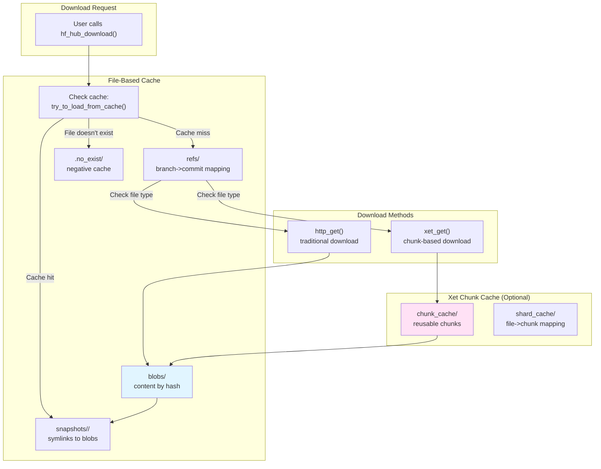

**Cache System Flow**: Downloads first check the file-based cache. On miss, files are downloaded either via standard HTTP (for regular/LFS files) or via Xet chunk-based downloads (for Xet-stored files), then stored in the cache for future use.

Sources: [src/huggingface_hub/file_download.py:1-1000](), [docs/source/en/guides/manage-cache.md:1-300]()

---

## File-Based Cache System

### Cache Directory Structure

The file-based cache organizes files in a hierarchical structure that separates metadata (refs), content (blobs), and version snapshots:

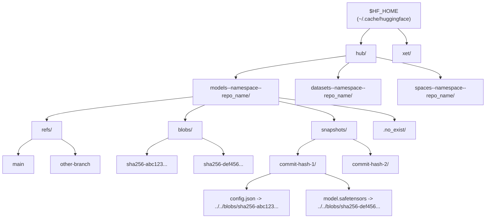

**File-Based Cache Layout**: Each repository type (models, datasets, spaces) has its own directory containing refs, blobs, snapshots, and negative cache folders. Files are stored as content-addressable blobs and accessed via symlinks in snapshot directories.

Sources: [src/huggingface_hub/file_download.py:543-586](), [docs/source/en/guides/manage-cache.md:17-70]()

### Cache Path Resolution

The cache directory is determined by the following priority order:

| Priority | Configuration Method | Code Reference |
|----------|---------------------|----------------|
| 1 | Function parameter `cache_dir` | [src/huggingface_hub/file_download.py:671]() |
| 2 | Environment variable `HF_HUB_CACHE` | [src/huggingface_hub/constants.py:149-156]() |
| 3 | Legacy `HUGGINGFACE_HUB_CACHE` | [src/huggingface_hub/constants.py:145]() |
| 4 | Default: `$HF_HOME/hub` | [src/huggingface_hub/constants.py:141]() |

The repository folder name is constructed using the pattern `{repo_type}--{namespace}--{repo_name}`:

```python
# Example: "models--lysandre--arxiv-nlp" for repo_id="lysandre/arxiv-nlp"
# Constructed in repo_folder_name() function
```

Sources: [src/huggingface_hub/constants.py:131-165](), [src/huggingface_hub/file_download.py:543-586]()

### Refs Folder: Revision Tracking

The `refs/` folder maps branch names and tags to specific commit hashes, enabling efficient cache lookups without network calls.

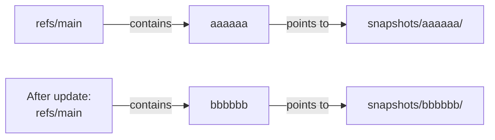

**Refs Update Flow**: When a branch advances, the ref file is updated with the new commit hash, and a new snapshot directory is created. Old snapshots remain cached for rollback.

**Implementation Details:**
- Each ref file contains a single line: the full commit hash (40 characters)
- Updated by [`_cache_commit_hash_for_specific_revision`]() during downloads
- Read by [`try_to_load_from_cache`]() to resolve branch names to commits
- Branch names can contain slashes (e.g., `refs/pr/1`), stored as-is in filenames

Sources: [src/huggingface_hub/file_download.py:820-851](), [docs/source/en/guides/manage-cache.md:58-67]()

### Blobs Folder: Content-Addressable Storage

The `blobs/` folder stores file content using content-addressable naming, ensuring that identical files are stored only once regardless of their location or repository.

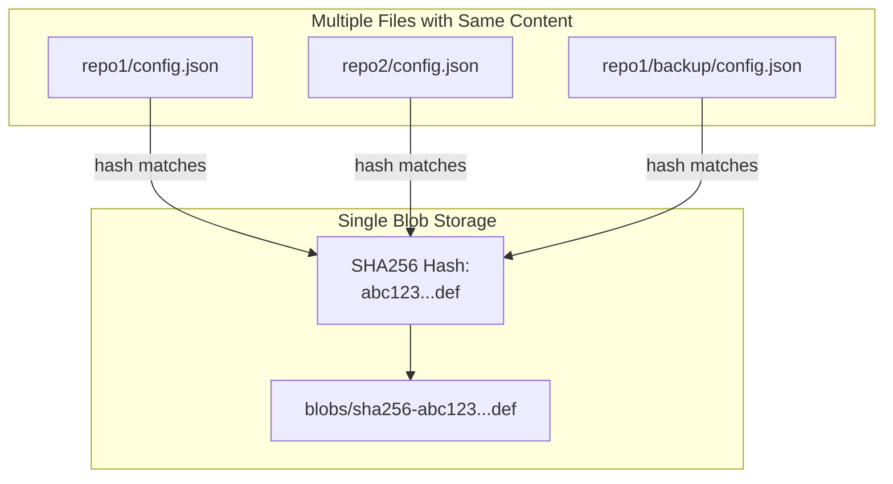

**Content Deduplication**: Multiple files with identical content share the same blob, reducing storage requirements.

**Blob Naming Convention:**
- Regular files: `sha256-{hex_hash}`
- LFS files: `sha256-{hex_hash}` (from LFS metadata)
- Computed by `UploadInfo` class during file operations

**Blob Lifecycle:**
1. File is downloaded to temporary location in `blobs/` directory
2. Hash is computed (SHA256 for LFS, SHA1 for regular files)
3. File is renamed to `blobs/sha256-{hash}` or moved if already exists
4. If blob already exists, download is skipped (deduplication)

Sources: [src/huggingface_hub/file_download.py:976-1055](), [src/huggingface_hub/lfs.py:29-78](), [docs/source/en/guides/manage-cache.md:69-86]()

### Snapshots Folder: Version-Aware File Access

The `snapshots/` folder contains directories named by commit hash, with symlinks to blobs representing the repository state at that commit.

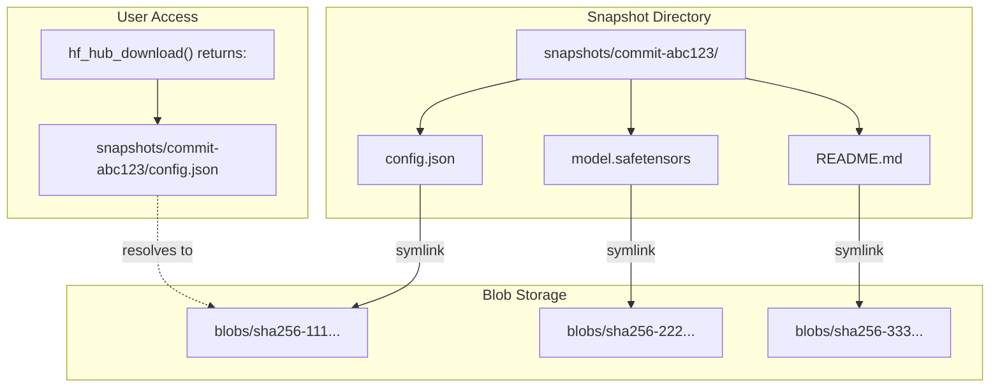

**Snapshot Symlink Structure**: Each snapshot directory recreates the repository file structure using symlinks to the content-addressable blobs. Users receive paths within snapshot directories.

**Symlink Handling:**
- Created by [`_create_symlink`]() function [src/huggingface_hub/file_download.py:132-170]()
- Uses relative paths: `../../blobs/sha256-{hash}`
- On Windows without symlink support, files are copied instead [src/huggingface_hub/file_download.py:75-131]()
- Symlink support checked per cache directory by [`are_symlinks_supported`]()

**Pointer Files (.json)**: When symlinks are not supported, the library creates `.json` pointer files that contain the blob location:

```json
{
  "blob_id": "sha256-abc123...",
  "pointer_path": "../../blobs/sha256-abc123..."
}
```

Sources: [src/huggingface_hub/file_download.py:75-170](), [docs/source/en/guides/manage-cache.md:88-139]()

### .no_exist Folder: Negative Caching

The `.no_exist/` folder stores markers for files that were confirmed not to exist on the Hub, preventing repeated failed requests.

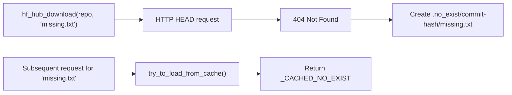

**Negative Cache Flow**: Failed file lookups create markers to avoid repeated network requests for non-existent files.

**Implementation:**
- Marker files are empty files at `.no_exist/{commit_hash}/{path_in_repo}`
- Created when [`EntryNotFoundError`] is caught during download
- Checked by [`try_to_load_from_cache`]() which returns `_CACHED_NO_EXIST`
- Prevents wasteful network calls in offline or rate-limited scenarios

Sources: [src/huggingface_hub/file_download.py:1442-1576](), [src/huggingface_hub/file_download.py:57-58]()

---

## Xet Chunk Cache System

### Purpose and Architecture

The Xet chunk cache system enables efficient storage and transfer of large files by breaking them into content-addressable chunks that can be deduplicated across files and repositories.

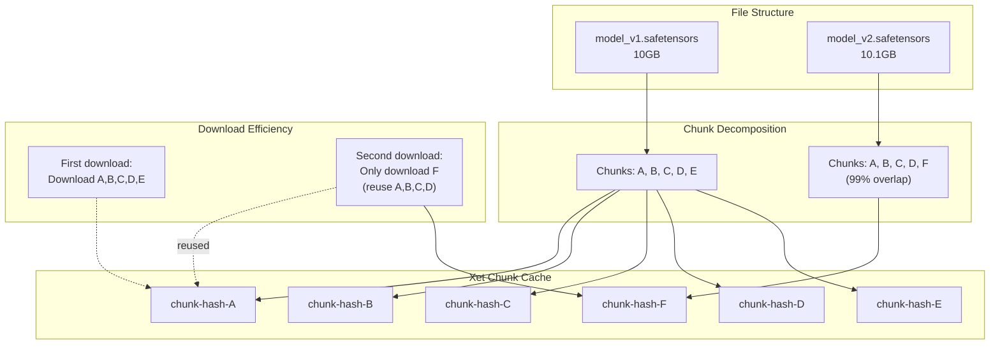

**Xet Deduplication Benefits**: When file versions share most of their content, only changed chunks need to be downloaded. This dramatically reduces bandwidth and storage for large model updates.

Sources: [src/huggingface_hub/file_download.py:447-556](), [docs/source/en/guides/manage-cache.md:1-10]()

### Xet Cache Components

The Xet cache consists of two main directories:

| Directory | Purpose | Environment Variable | Default Size Limit |
|-----------|---------|---------------------|-------------------|
| **chunk_cache/** | Stores reusable chunks (byte ranges) | `HF_XET_CHUNK_CACHE_SIZE_BYTES` | 0 (disabled by default) |
| **shard_cache/** | Stores file-to-chunk mappings | `HF_XET_SHARD_CACHE_SIZE_LIMIT` | 4GB |

**Chunk Cache:**
- Stores individual chunks identified by content hash
- Disabled by default (`HF_XET_CHUNK_CACHE_SIZE_BYTES=0`)
- Most useful for repeated uploads/downloads with high overlap
- Enable with: `export HF_XET_CHUNK_CACHE_SIZE_BYTES=10000000000` (10GB)

**Shard Cache:**
- Maps file hashes to their constituent chunks
- Improves upload efficiency by avoiding re-uploading cached chunks
- Default 4GB soft limit is sufficient for most workloads

Sources: [src/huggingface_hub/constants.py:281-283](), [docs/source/en/package_reference/environment_variables.md:90-100]()

### Xet Download Flow

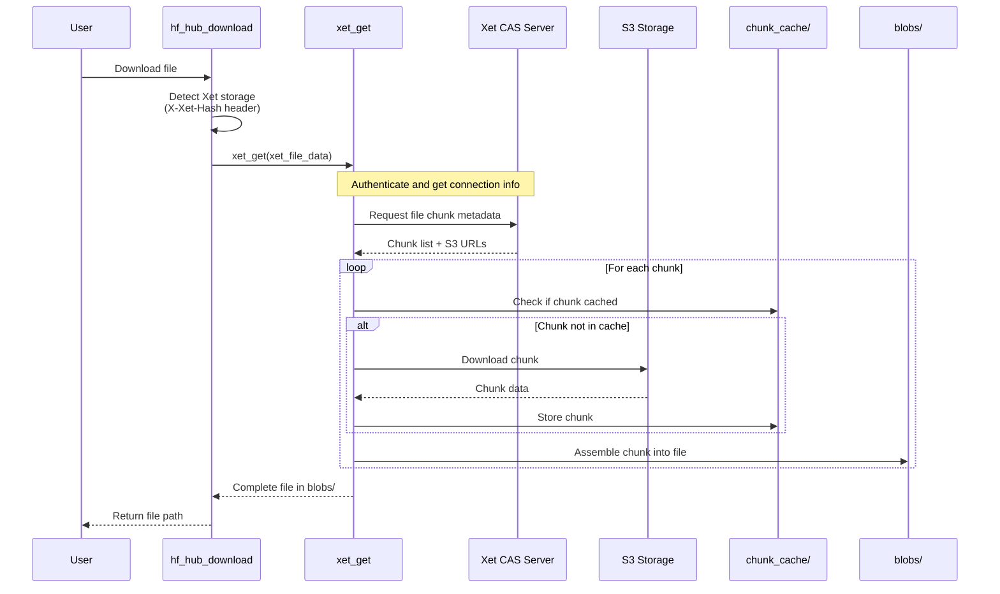

**Xet Download Process**: Files stored with Xet are downloaded chunk-by-chunk from S3, with each chunk cached for reuse. Chunks are then assembled in order to recreate the original file in the blobs folder.

**Key Functions:**
- [`xet_get`](): Main entry point for Xet-based downloads [src/huggingface_hub/file_download.py:447-556]()
- [`refresh_xet_connection_info`](): Obtains authentication tokens for Xet CAS [src/huggingface_hub/utils/_xet.py]()
- Requires `hf_xet` package: `pip install hf_xet`

Sources: [src/huggingface_hub/file_download.py:447-556](), [src/huggingface_hub/utils/_xet.py:1-200]()

---

## Cache Operations During Download

### Cache Lookup Flow

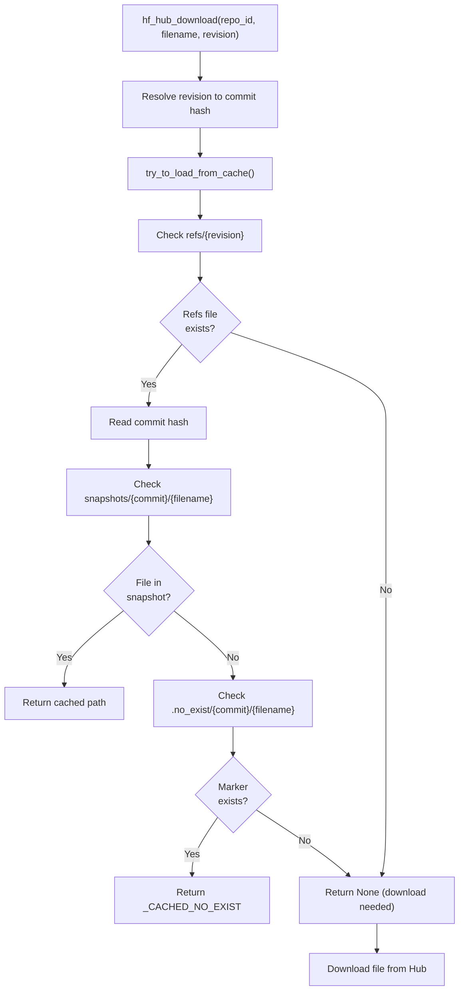

**Cache Lookup Decision Tree**: The cache lookup process checks refs, snapshots, and negative cache markers to determine whether a file needs to be downloaded.

**Local-Only Mode:**
- When `local_files_only=True`, downloads are prohibited
- [`try_to_load_from_cache`]() returns `None` if file not found
- Raises [`LocalEntryNotFoundError`] instead of downloading
- Useful for offline scenarios or CI/CD environments

Sources: [src/huggingface_hub/file_download.py:1442-1576](), [src/huggingface_hub/file_download.py:605-1085]()

### File Download and Cache Storage

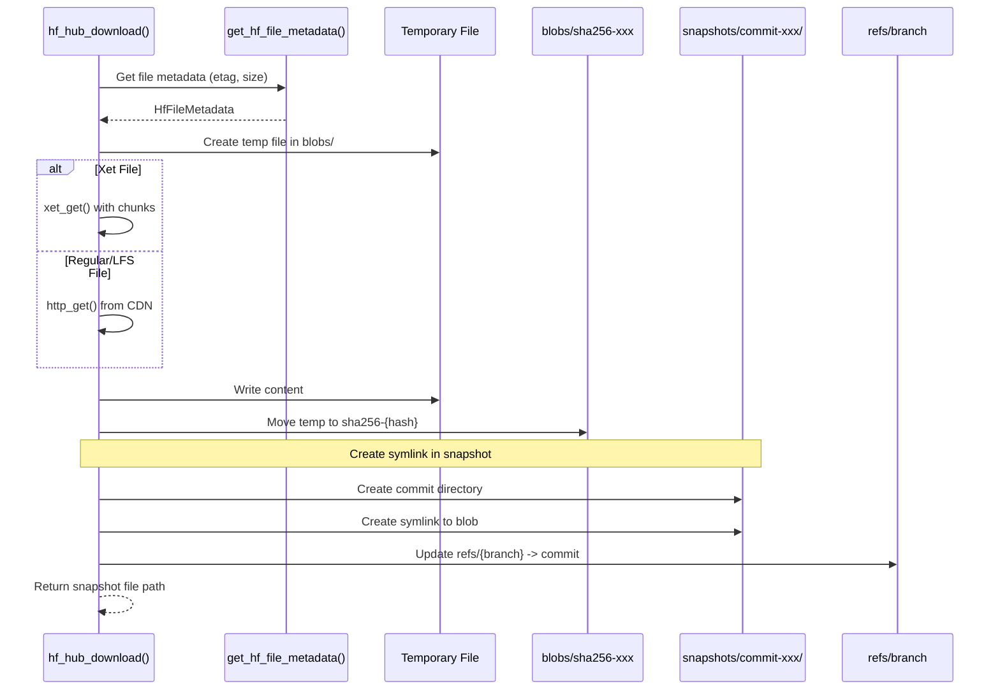

**Download and Storage Sequence**: Files are downloaded to temporary locations, validated, then moved to the blobs directory with symlinks created in the snapshot folder.

**Key Implementation Details:**

1. **Atomic Operations:**
   - Temp files created with suffix `.{uuid}.incomplete` [src/huggingface_hub/file_download.py:999]()
   - Renamed atomically after complete download
   - Prevents corrupted partial downloads

2. **Lock Files:**
   - File locks (`.lock`) prevent concurrent downloads of same file [src/huggingface_hub/file_download.py:1008-1015]()
   - Uses [`WeakFileLock`] for cross-process coordination

3. **Resume Support:**
   - Downloads support resuming from partial transfers [src/huggingface_hub/file_download.py:311-445]()
   - Uses `Range` headers to continue interrupted downloads

Sources: [src/huggingface_hub/file_download.py:605-1085](), [src/huggingface_hub/file_download.py:311-445]()

---

## Environment Variables and Configuration

### Cache Location Configuration

| Variable | Purpose | Default Value |
|----------|---------|---------------|
| `HF_HOME` | Base directory for all HF data | `~/.cache/huggingface` |
| `HF_HUB_CACHE` | File-based cache location | `$HF_HOME/hub` |
| `HF_XET_CACHE` | Xet chunk cache location | `$HF_HOME/xet` |
| `XDG_CACHE_HOME` | XDG base cache directory | `~/.cache` |

**Priority Order:**
1. Explicit `cache_dir` parameter in function calls
2. `HF_HUB_CACHE` environment variable
3. Legacy `HUGGINGFACE_HUB_CACHE`
4. `$HF_HOME/hub` derived from `HF_HOME`
5. Default: `~/.cache/huggingface/hub`

Sources: [src/huggingface_hub/constants.py:131-165](), [docs/source/en/package_reference/environment_variables.md:25-43]()

### Xet Cache Configuration

| Variable | Purpose | Default | Recommended |
|----------|---------|---------|-------------|
| `HF_XET_CHUNK_CACHE_SIZE_BYTES` | Chunk cache size limit | 0 (disabled) | 10GB for heavy use |
| `HF_XET_SHARD_CACHE_SIZE_LIMIT` | Shard cache size limit | 4GB | Keep default |
| `HF_XET_NUM_CONCURRENT_RANGE_GETS` | Parallel chunk downloads | 16 | Increase for fast networks |
| `HF_XET_HIGH_PERFORMANCE` | Enable optimized transfers | False | True for large files |
| `HF_HUB_DISABLE_XET` | Disable Xet entirely | False | True to force HTTP |

**Chunk Cache Recommendations:**
- **Disabled by default** for best general performance
- **Enable for development:** If frequently uploading new model revisions
- **Enable for large models:** If working with >50GB models with frequent updates
- **Disk space:** Chunk cache is in addition to regular cache

Sources: [docs/source/en/package_reference/environment_variables.md:82-106](), [src/huggingface_hub/constants.py:240-283]()

### Cache Behavior Flags

| Variable | Effect | Use Case |
|----------|--------|----------|
| `HF_HUB_OFFLINE` | Disable all network calls | Offline development, testing |
| `HF_HUB_DISABLE_SYMLINKS_WARNING` | Suppress symlink warnings | Windows environments |
| `HF_HUB_ETAG_TIMEOUT` | Metadata request timeout | Slow networks |
| `HF_HUB_DOWNLOAD_TIMEOUT` | File download timeout | Slow networks |

Sources: [src/huggingface_hub/constants.py:166-259](), [docs/source/en/package_reference/environment_variables.md:119-123]()

---

## Programmatic Cache Management

### Cache Inspection

The [`scan_cache_dir`]() function provides detailed information about cached repositories:

```python
from huggingface_hub import scan_cache_dir

# Scan the cache
cache_info = scan_cache_dir()

print(f"Total cache size: {cache_info.size_on_disk_str}")
print(f"Number of repos: {len(cache_info.repos)}")

for repo in cache_info.repos:
    print(f"\nRepo: {repo.repo_id}")
    print(f"  Type: {repo.repo_type}")
    print(f"  Size: {repo.size_on_disk_str}")
    print(f"  Revisions: {len(repo.revisions)}")
    
    for revision in repo.revisions:
        print(f"    {revision.commit_hash[:8]}: {revision.size_on_disk_str}")
```

**Returned Data Structures:**
- [`HFCacheInfo`]: Top-level cache information
- [`CachedRepoInfo`]: Per-repository information
- [`CachedRevisionInfo`]: Per-revision information  
- [`CachedFileInfo`]: Individual file information

Sources: [src/huggingface_hub/utils/_cache_manager.py:1-500](), [docs/source/en/guides/manage-cache.md:200-350]()

### Cache Cleanup

```python
from huggingface_hub import scan_cache_dir

# Scan and build deletion strategy
cache_info = scan_cache_dir()
delete_strategy = cache_info.delete_revisions(
    "models--lysandre--arxiv-nlp:f2c752cfc5c0ab6f4bdec59acea69eefbee381c2"
)

print(f"Will delete {delete_strategy.expected_freed_size_str}")

# Execute deletion
delete_strategy.execute()
```

**Delete Strategies:**
- Delete specific revisions while keeping others
- Delete entire repositories
- Returns [`DeleteCacheStrategy`] with preview of changes
- Safely handles symlink deduplication
- Never deletes currently-in-use files

Sources: [src/huggingface_hub/utils/_cache_manager.py:400-650](), [docs/source/en/guides/manage-cache.md:350-450]()

---

## Cache Integrity and Edge Cases

### Symlink Fallback Mechanisms

When symlinks are not supported (e.g., Windows without Developer Mode), the cache system uses fallback strategies:

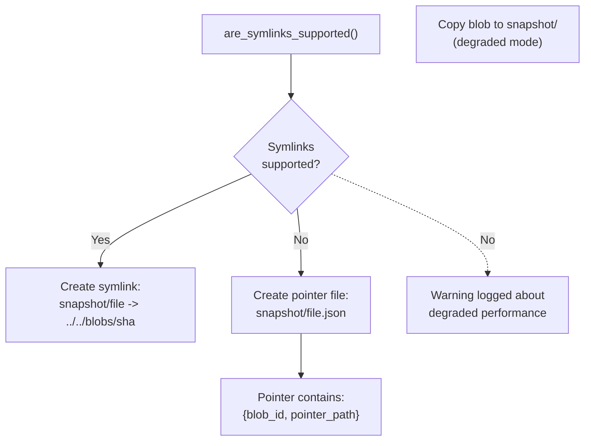

**Symlink Compatibility:**
- Checked once per cache directory and cached [src/huggingface_hub/file_download.py:75-131]()
- Creates `.json` pointer files when symlinks unavailable
- Warning displayed unless `HF_HUB_DISABLE_SYMLINKS_WARNING=1`
- Files may be duplicated, increasing disk usage

Sources: [src/huggingface_hub/file_download.py:75-170]()

### Concurrent Download Safety

Multiple processes/threads can safely download the same file simultaneously:

1. **Lock Files:** Each blob has a corresponding `.lock` file
2. **Atomic Renames:** Temp files renamed atomically after completion
3. **Check After Lock:** After acquiring lock, check if file already exists
4. **Early Exit:** If blob exists, skip download even if lock was acquired

This prevents duplicate downloads and ensures cache consistency in concurrent environments.

Sources: [src/huggingface_hub/file_download.py:1008-1015]()

### Cache Corruption Recovery

If cache becomes corrupted:

1. **File-level recovery:** Delete specific blob and re-download
2. **Revision-level recovery:** Delete snapshot directory for specific commit
3. **Repository-level recovery:** Delete entire repo cache directory
4. **Full reset:** Delete entire `$HF_HUB_CACHE` and re-download

**Automatic validation:**
- ETag validation on every download attempt [src/huggingface_hub/file_download.py:773-819]()
- Size validation after downloads
- SHA validation for integrity-critical operations

Sources: [src/huggingface_hub/file_download.py:773-1085]()

---

## Performance Characteristics

### File-Based Cache Benefits

| Scenario | Benefit | Mechanism |
|----------|---------|-----------|
| Same file across revisions | Single storage | Content-addressable blobs |
| Multiple repos with shared files | Deduplicated storage | Shared blobs across repos |
| Revision rollback | Instant | Snapshots retained |
| Offline usage | Full functionality | Complete metadata in refs/ |
| Branch switching | Fast | Snapshot directory switch |

### Xet Cache Benefits

| Scenario | Bandwidth Saved | Storage Saved |
|----------|-----------------|---------------|
| Model v2 with 95% overlap | ~95% | ~0% (disabled by default) |
| Re-uploading similar files | ~90-99% | Depends on cache size |
| Large dataset updates | Proportional to changes | N/A (upload-focused) |

**Xet Trade-offs:**
- **Pros:** Dramatic bandwidth savings for large files with high overlap
- **Cons:** Additional cache management complexity, extra disk space if enabled
- **Recommendation:** Keep chunk cache disabled for most users, enable for specific workflows

Sources: [docs/source/en/guides/manage-cache.md:1-300](), [docs/source/en/package_reference/environment_variables.md:82-106]()

---

