<!-- source: DeepWiki mcp.deepwiki.com · repo huggingface/huggingface_hub · page 3 Inference Client · fetched 2026-10-26 -->

# Inference Client

<details>
<summary>Relevant source files</summary>

The following files were used as context for generating this wiki page:

- [docs/source/en/guides/inference.md](docs/source/en/guides/inference.md)
- [docs/source/en/package_reference/inference_client.md](docs/source/en/package_reference/inference_client.md)
- [src/huggingface_hub/inference/_client.py](src/huggingface_hub/inference/_client.py)
- [src/huggingface_hub/inference/_common.py](src/huggingface_hub/inference/_common.py)
- [src/huggingface_hub/inference/_generated/_async_client.py](src/huggingface_hub/inference/_generated/_async_client.py)
- [src/huggingface_hub/inference/_providers/__init__.py](src/huggingface_hub/inference/_providers/__init__.py)
- [src/huggingface_hub/inference/_providers/_common.py](src/huggingface_hub/inference/_providers/_common.py)
- [src/huggingface_hub/inference/_providers/fal_ai.py](src/huggingface_hub/inference/_providers/fal_ai.py)
- [src/huggingface_hub/inference/_providers/hf_inference.py](src/huggingface_hub/inference/_providers/hf_inference.py)
- [src/huggingface_hub/inference/_providers/replicate.py](src/huggingface_hub/inference/_providers/replicate.py)
- [src/huggingface_hub/inference/_providers/sambanova.py](src/huggingface_hub/inference/_providers/sambanova.py)
- [src/huggingface_hub/inference/_providers/together.py](src/huggingface_hub/inference/_providers/together.py)
- [src/huggingface_hub/inference/_providers/zai_org.py](src/huggingface_hub/inference/_providers/zai_org.py)
- [tests/test_inference_async_client.py](tests/test_inference_async_client.py)
- [tests/test_inference_client.py](tests/test_inference_client.py)
- [tests/test_inference_providers.py](tests/test_inference_providers.py)
- [utils/generate_async_inference_client.py](utils/generate_async_inference_client.py)

</details>


The Inference Client provides a unified interface for running machine learning inference across multiple providers and deployment types. It supports the Hugging Face Inference API, third-party providers (OpenAI, Together, Replicate, etc.), Inference Endpoints, and local servers with a consistent API design.

For information about managing inference endpoints, see [Inference Endpoints](#3.3). For details about the underlying provider routing system, see [Inference Providers](#3.1).

## Architecture Overview

The Inference Client system is built around a provider-agnostic design that routes requests to different inference services while maintaining a consistent interface.

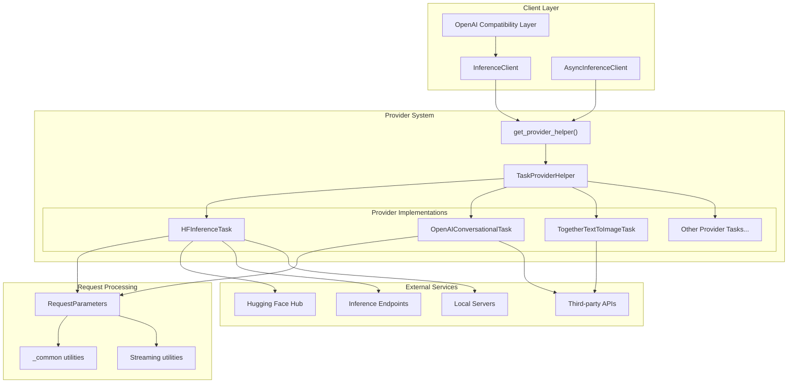

Sources: [src/huggingface_hub/inference/_client.py:120](), [src/huggingface_hub/inference/_generated/_async_client.py:108](), [src/huggingface_hub/inference/_providers/__init__.py:163](), [src/huggingface_hub/inference/_providers/_common.py:66]()

## Core Client Classes

### InferenceClient

The `InferenceClient` class is the primary synchronous interface for inference operations.

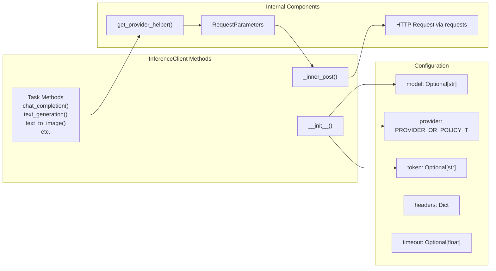

The client supports both model-specific initialization and per-call model specification:

```python
# Model-specific client
client = InferenceClient(model="meta-llama/Llama-3.1-8B", provider="together")

# Generic client with per-call model
client = InferenceClient(provider="together") 
response = client.chat_completion(messages, model="meta-llama/Llama-3.1-8B")
```

Sources: [src/huggingface_hub/inference/_client.py:120-236](), [src/huggingface_hub/inference/_client.py:162-234]()

### AsyncInferenceClient

The `AsyncInferenceClient` provides asynchronous inference capabilities with the same interface as the synchronous client.

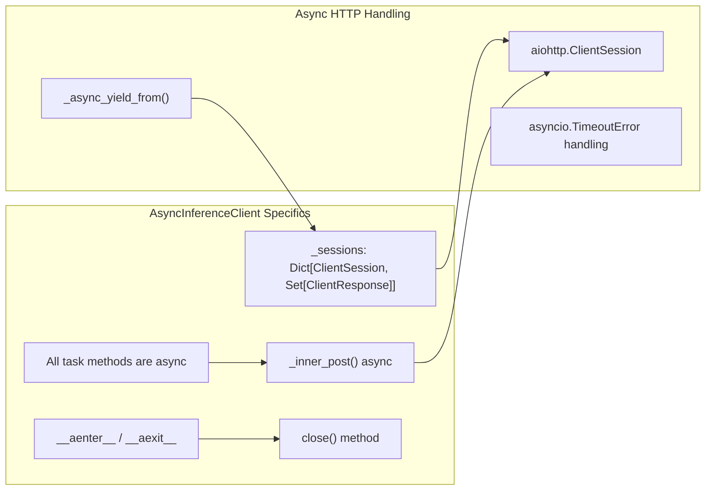

The async client automatically generates from the sync client via [utils/generate_async_inference_client.py]().

Sources: [src/huggingface_hub/inference/_generated/_async_client.py:108-317](), [utils/generate_async_inference_client.py:31-76]()

## Provider System

The provider system abstracts different inference services behind a common interface.

### Provider Registry

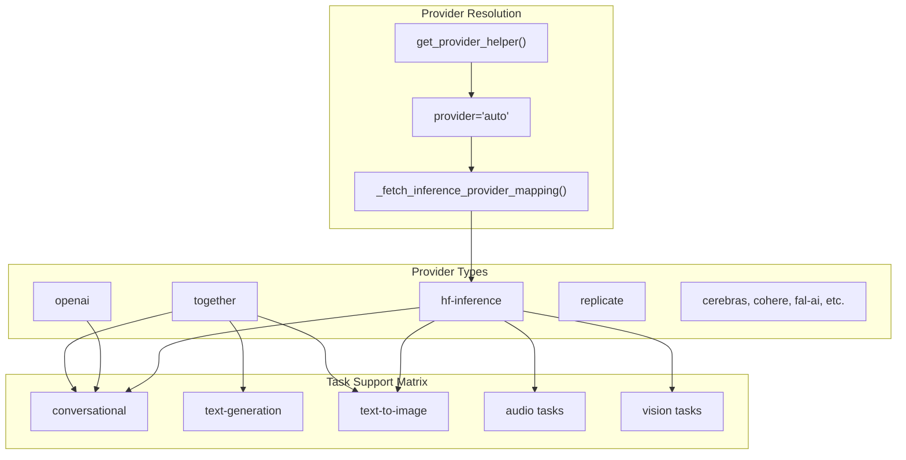

Provider selection follows this priority:
1. Explicit provider parameter
2. Auto-selection based on model and user preferences
3. Fallback to `hf-inference` for URLs or when no model specified

Sources: [src/huggingface_hub/inference/_providers/__init__.py:67-160](), [src/huggingface_hub/inference/_providers/__init__.py:163-208]()

### TaskProviderHelper Base Class

All provider implementations inherit from `TaskProviderHelper`:

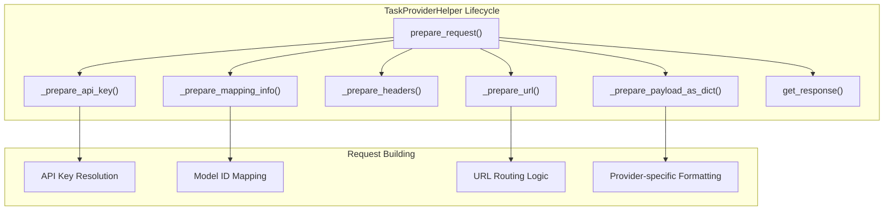

Sources: [src/huggingface_hub/inference/_providers/_common.py:66-235](), [src/huggingface_hub/inference/_providers/_common.py:74-117]()

## Task Methods

The client provides task-specific methods that map to different ML capabilities.

### Chat Completion

The primary conversational interface supporting OpenAI-compatible parameters:

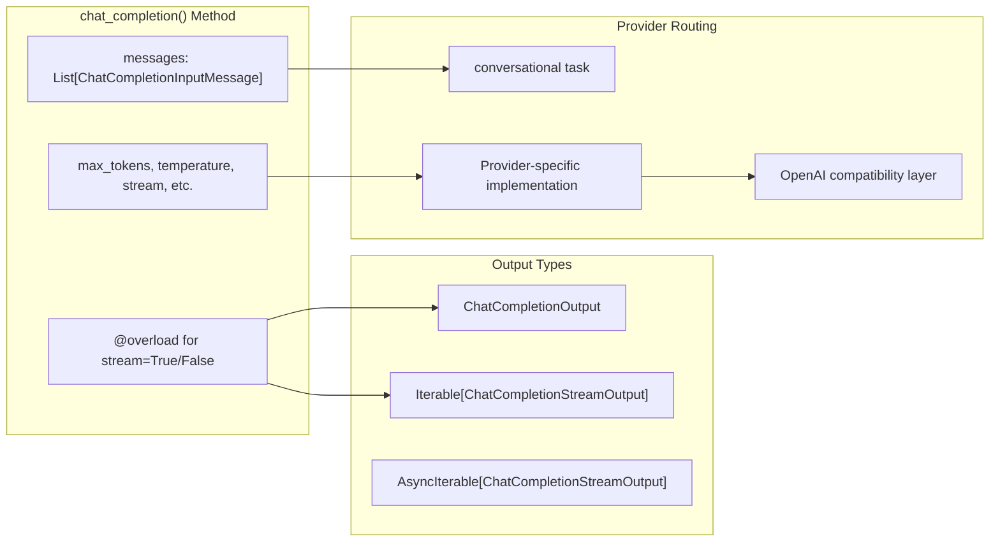

The method supports both streaming and non-streaming responses with proper type annotations.

Sources: [src/huggingface_hub/inference/_client.py:523-766](), [src/huggingface_hub/inference/_generated/_async_client.py:557-803]()

### Text Generation

Lower-level text completion interface:

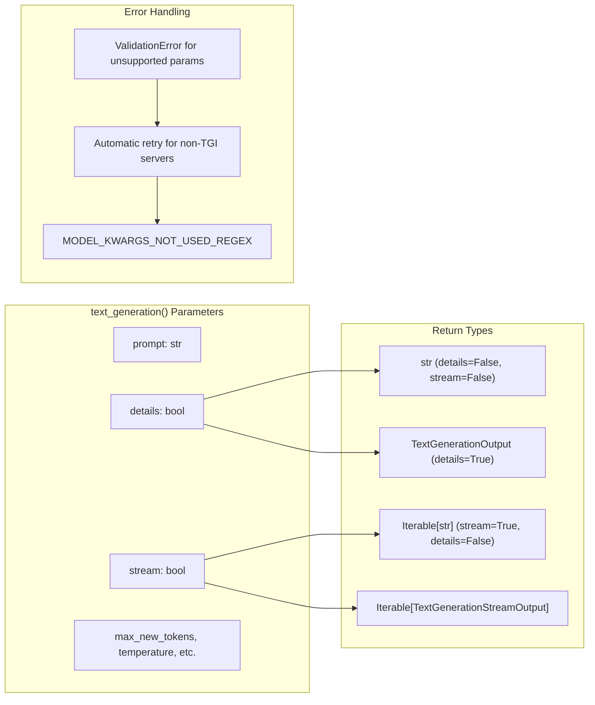

Sources: [src/huggingface_hub/inference/_client.py:1068-1336]()

### Task Method Pattern

All task methods follow a consistent pattern:

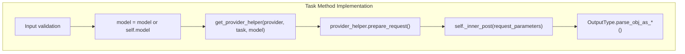

This pattern is implemented across all task methods like `text_to_image()`, `audio_classification()`, `image_segmentation()`, etc.

Sources: [src/huggingface_hub/inference/_client.py:288-343](), [src/huggingface_hub/inference/_client.py:1406-1449]()

## Authentication and Routing

### Authentication Modes

The client supports multiple authentication patterns:

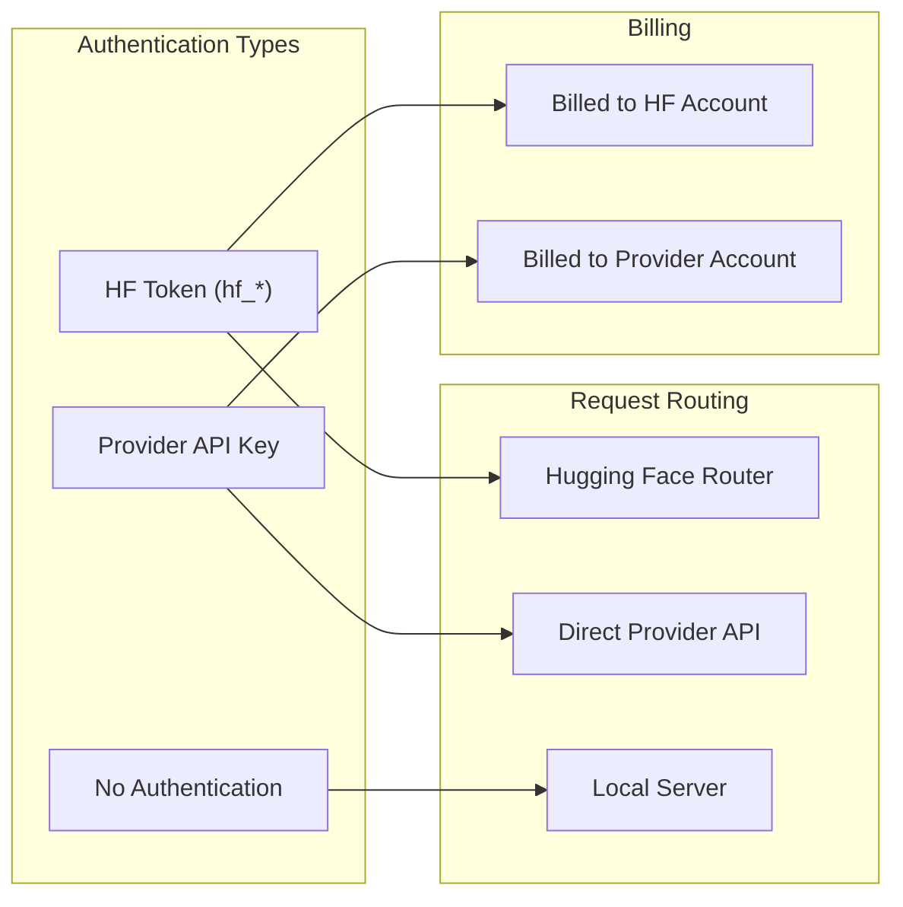

### API Key Resolution

API key resolution follows this hierarchy in `_prepare_api_key()`:

1. Explicit `api_key` parameter
2. Locally saved token via `get_token()`
3. Error if required but not found

Sources: [src/huggingface_hub/inference/_client.py:176-205](), [src/huggingface_hub/inference/_providers/_common.py:129-139]()

## Streaming Support

### Streaming Architecture

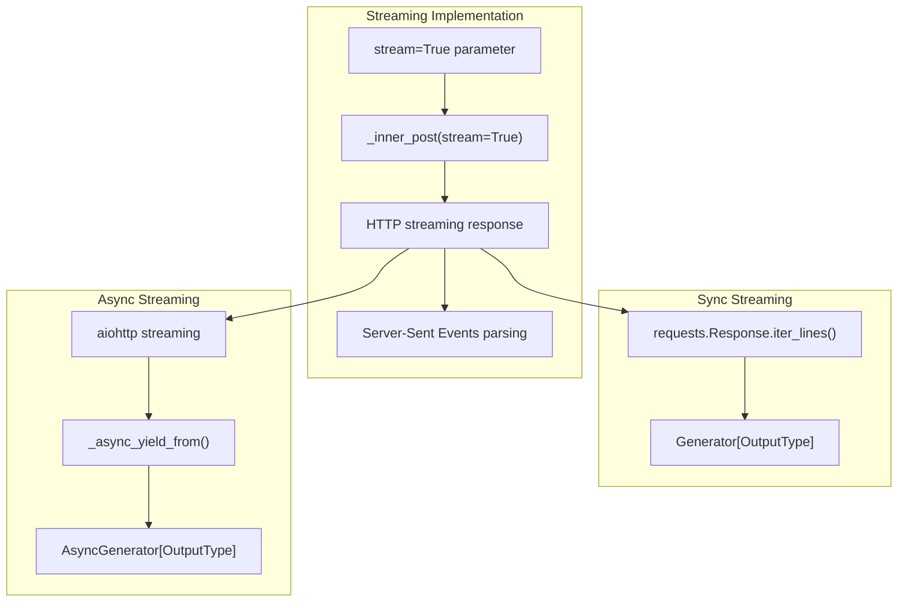

### Stream Response Parsing

Stream responses use Server-Sent Events format:

```
data: {"choices": [{"delta": {"content": "Hello"}}]}
data: {"choices": [{"delta": {"content": " world"}}]}
data: [DONE]
```

Parsing is handled by specialized functions like `_stream_chat_completion_response()` and `_format_text_generation_stream_output()`.

Sources: [src/huggingface_hub/inference/_common.py:330-391](), [src/huggingface_hub/inference/_common.py:393-448]()

## Error Handling

### Error Hierarchy

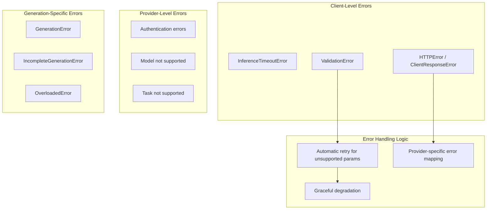

Error handling includes automatic retry logic for text generation when unsupported parameters are detected via regex matching on error messages.

Sources: [src/huggingface_hub/inference/_client.py:274-286](), [src/huggingface_hub/inference/_common.py:44-51](), [src/huggingface_hub/inference/_client.py:1271-1295]()

## OpenAI Compatibility

### Compatible Interface

The client provides OpenAI-compatible access patterns:

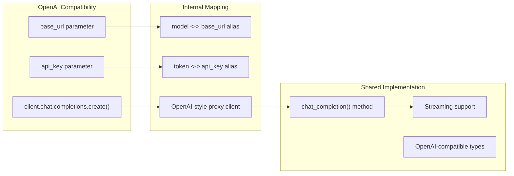

This allows drop-in replacement of OpenAI client code with minimal changes.

Sources: [src/huggingface_hub/inference/_client.py:168-183](), [docs/source/en/guides/inference.md:247-276]()

---

