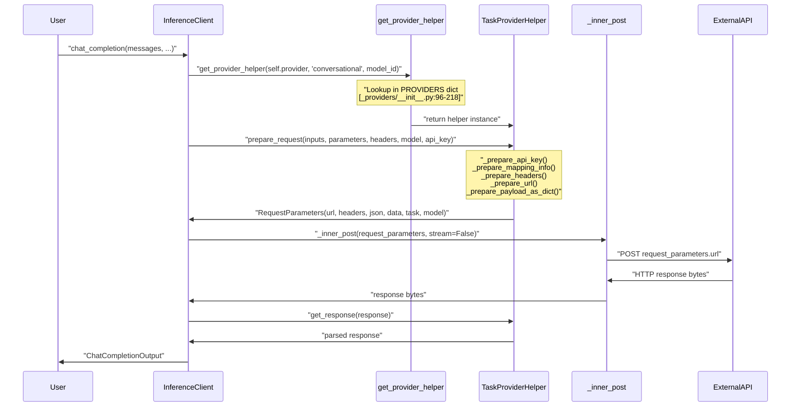
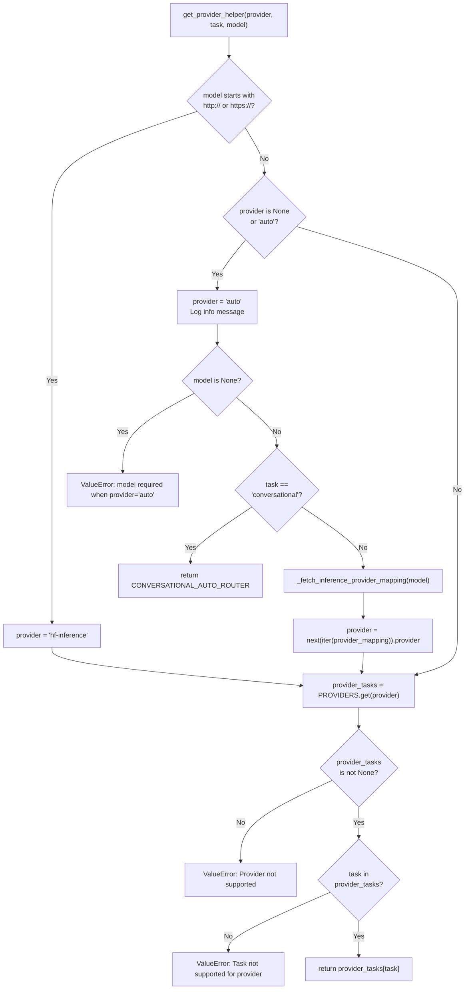
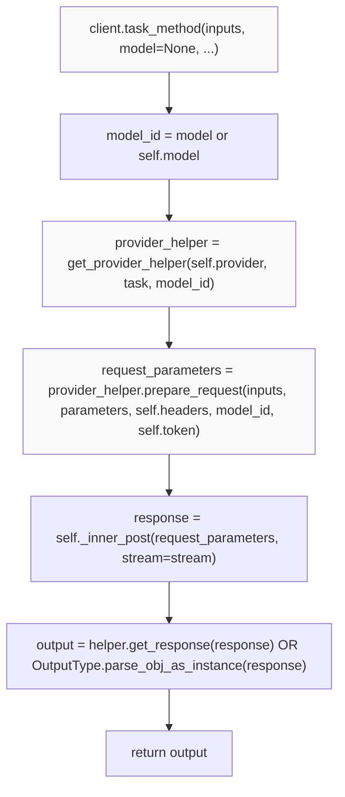
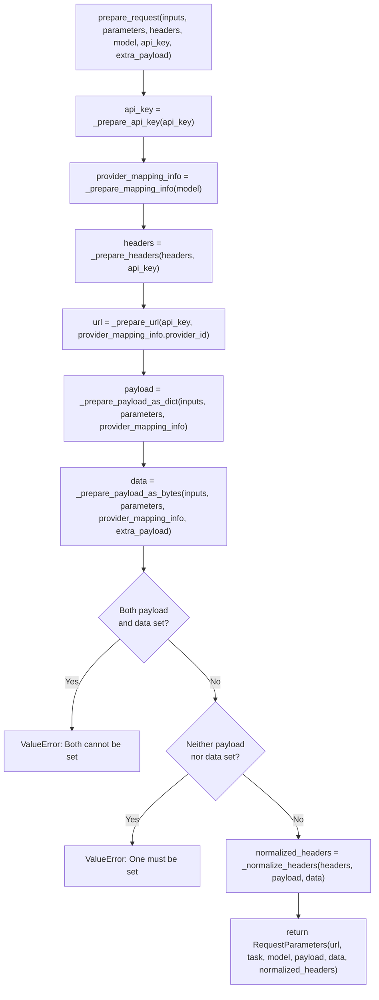
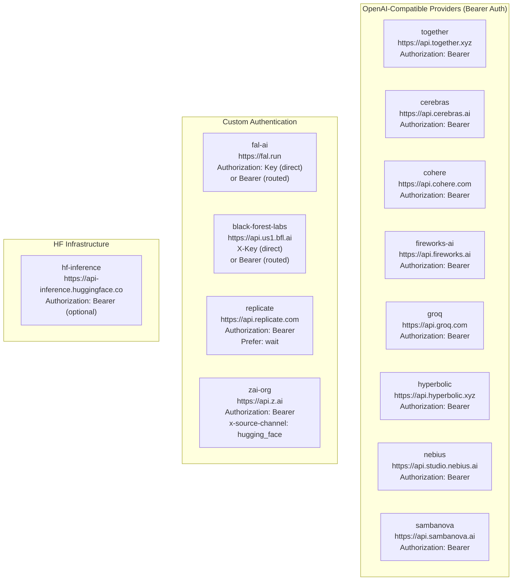
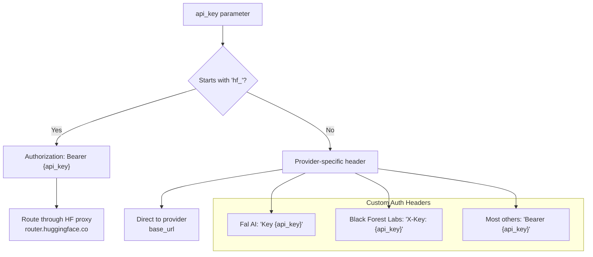
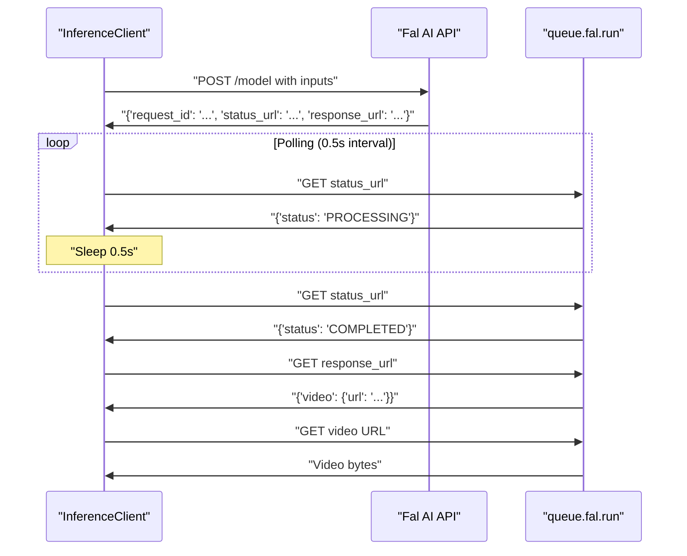
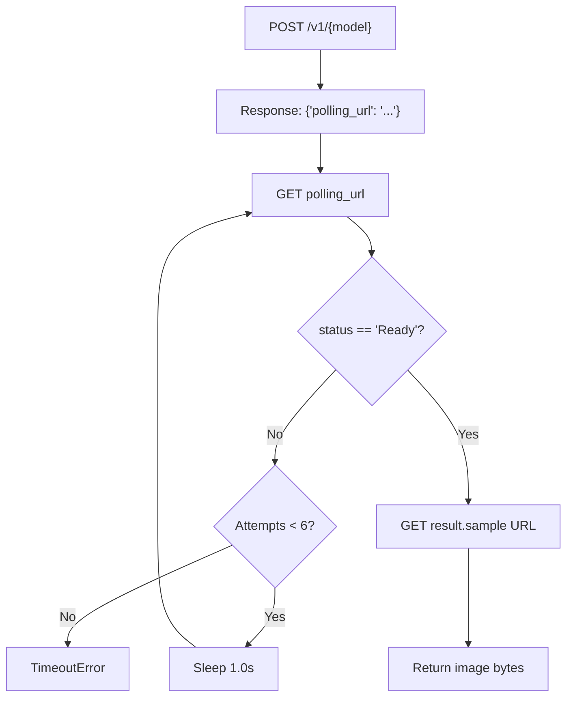

<!-- source: DeepWiki mcp.deepwiki.com · repo huggingface/huggingface_hub · page 3.1 Task Methods and Providers · fetched 2026-10-26 -->

# Task Methods and Providers

<details>
<summary>Relevant source files</summary>

The following files were used as context for generating this wiki page:

- [docs/source/en/guides/inference.md](docs/source/en/guides/inference.md)
- [docs/source/en/package_reference/inference_client.md](docs/source/en/package_reference/inference_client.md)
- [src/huggingface_hub/inference/_client.py](src/huggingface_hub/inference/_client.py)
- [src/huggingface_hub/inference/_common.py](src/huggingface_hub/inference/_common.py)
- [src/huggingface_hub/inference/_generated/_async_client.py](src/huggingface_hub/inference/_generated/_async_client.py)
- [src/huggingface_hub/inference/_providers/__init__.py](src/huggingface_hub/inference/_providers/__init__.py)
- [src/huggingface_hub/inference/_providers/_common.py](src/huggingface_hub/inference/_providers/_common.py)
- [src/huggingface_hub/inference/_providers/fal_ai.py](src/huggingface_hub/inference/_providers/fal_ai.py)
- [src/huggingface_hub/inference/_providers/hf_inference.py](src/huggingface_hub/inference/_providers/hf_inference.py)
- [src/huggingface_hub/inference/_providers/replicate.py](src/huggingface_hub/inference/_providers/replicate.py)
- [src/huggingface_hub/inference/_providers/sambanova.py](src/huggingface_hub/inference/_providers/sambanova.py)
- [src/huggingface_hub/inference/_providers/together.py](src/huggingface_hub/inference/_providers/together.py)
- [src/huggingface_hub/inference/_providers/zai_org.py](src/huggingface_hub/inference/_providers/zai_org.py)
- [tests/test_inference_async_client.py](tests/test_inference_async_client.py)
- [tests/test_inference_client.py](tests/test_inference_client.py)
- [tests/test_inference_providers.py](tests/test_inference_providers.py)
- [utils/generate_async_inference_client.py](utils/generate_async_inference_client.py)

</details>


This page documents the 35+ task-specific methods available in `InferenceClient` and `AsyncInferenceClient`, and the provider system that routes requests to different inference backends. Each task method (e.g., `text_generation`, `chat_completion`, `text_to_image`) provides a consistent interface while delegating to provider-specific implementations.

## Complete List of Task Methods

Both `InferenceClient` and `AsyncInferenceClient` expose the following task methods:

**Text Tasks**:
- `text_generation()` - Generate text from a prompt
- `chat_completion()` - Complete a conversation with message history
- `summarization()` - Summarize text
- `translation()` - Translate text
- `fill_mask()` - Fill masked tokens in text
- `text_classification()` - Classify text into categories
- `token_classification()` - Tag tokens in text (NER, POS)
- `question_answering()` - Answer questions given context
- `table_question_answering()` - Answer questions about tables
- `document_question_answering()` - Answer questions about documents
- `zero_shot_classification()` - Classify text without training examples

**Image Tasks**:
- `text_to_image()` - Generate images from text prompts
- `image_to_image()` - Transform images
- `image_to_text()` - Generate captions for images
- `image_classification()` - Classify images
- `image_segmentation()` - Segment images into regions
- `object_detection()` - Detect objects in images
- `zero_shot_image_classification()` - Classify images without training examples
- `visual_question_answering()` - Answer questions about images

**Audio Tasks**:
- `automatic_speech_recognition()` - Transcribe audio to text
- `audio_classification()` - Classify audio content
- `audio_to_audio()` - Transform audio (enhancement, separation)
- `text_to_speech()` - Generate speech from text

**Video Tasks**:
- `text_to_video()` - Generate videos from text prompts
- `image_to_video()` - Generate videos from images

**Embedding Tasks**:
- `feature_extraction()` - Extract embeddings/features
- `sentence_similarity()` - Compute similarity between sentences

**Tabular Tasks**:
- `tabular_classification()` - Classify tabular data
- `tabular_regression()` - Predict values from tabular data

Sources: [src/huggingface_hub/inference/_client.py:302-1855](), [src/huggingface_hub/inference/_generated/_async_client.py:319-2167]()

## Architecture Overview

The inference system has two key layers:

1. **Task Methods**: User-facing methods on `InferenceClient`/`AsyncInferenceClient` that provide consistent interfaces for each ML task.

2. **Provider Helpers**: Backend-specific implementations in `TaskProviderHelper` subclasses that handle API differences between providers.

When a task method is called:
1. The client determines which provider to use (via `provider` parameter or "auto" mode)
2. `get_provider_helper()` returns the appropriate `TaskProviderHelper` for that provider and task
3. The helper's `prepare_request()` method builds the HTTP request
4. The client executes the request via `_inner_post()` 
5. The helper's `get_response()` method parses the response

Sources: [src/huggingface_hub/inference/_client.py:123-250](), [src/huggingface_hub/inference/_providers/__init__.py:221-273]()

### Call Flow: From Task Method to Provider

Title: Task Method to Provider Call Flow



Sources: [src/huggingface_hub/inference/_client.py:538-758](), [src/huggingface_hub/inference/_providers/__init__.py:221-273](), [src/huggingface_hub/inference/_providers/_common.py:77-128]()

## Provider Selection

The `get_provider_helper()` function determines which provider to use for a given task and model.

### Provider Selection Logic

Title: get_provider_helper() Decision Flow



Sources: [src/huggingface_hub/inference/_providers/__init__.py:221-273]()

### Provider Registry

The `PROVIDERS` dictionary ([src/huggingface_hub/inference/_providers/__init__.py:96-218]()) maps provider names to task helper instances:

```python
PROVIDERS: dict[PROVIDER_T, dict[str, TaskProviderHelper]] = {
    "hf-inference": {
        "text-to-image": HFInferenceTask("text-to-image"),
        "conversational": HFInferenceConversational(),
        "text-generation": HFInferenceTask("text-generation"),
        # ... 23 more tasks
    },
    "together": {
        "text-to-image": TogetherTextToImageTask(),
        "conversational": TogetherConversationalTask(),
        "text-generation": TogetherTextGenerationTask(),
    },
    "replicate": {
        "automatic-speech-recognition": ReplicateAutomaticSpeechRecognitionTask(),
        "image-to-image": ReplicateImageToImageTask(),
        "text-to-image": ReplicateTextToImageTask(),
        "text-to-speech": ReplicateTextToSpeechTask(),
        "text-to-video": ReplicateTask("text-to-video"),
    },
    # ... 20 more providers
}
```

**Provider Coverage by Task**:

| Provider | Conversational | Text Gen | Text-to-Image | Feature Extraction | ASR | TTS | Text-to-Video | Image-to-Video |
|----------|----------------|----------|---------------|-------------------|-----|-----|---------------|----------------|
| `hf-inference` | ✓ | ✓ | ✓ | ✓ | ✓ | ✓ | - | - |
| `together` | ✓ | ✓ | ✓ | - | - | - | - | - |
| `replicate` | - | - | ✓ | - | ✓ | ✓ | ✓ | - |
| `fal-ai` | - | - | ✓ | - | ✓ | ✓ | ✓ | ✓ |
| `cerebras` | ✓ | - | - | - | - | - | - | - |
| `cohere` | ✓ | - | - | - | - | - | - | - |
| `sambanova` | ✓ | - | - | ✓ | - | - | - | - |
| `hyperbolic` | ✓ | ✓ | ✓ | - | - | - | - | - |
| `nebius` | ✓ | ✓ | ✓ | ✓ | - | - | - | - |

(Only showing subset of providers and tasks for brevity - see full table in [docs/source/en/guides/inference.md:191-224]())

Sources: [src/huggingface_hub/inference/_providers/__init__.py:96-218](), [docs/source/en/guides/inference.md:191-224]()

## Task Methods in InferenceClient

Each task method in `InferenceClient` follows the same pattern:

1. Determine the model ID (from instance or method parameter)
2. Call `get_provider_helper()` to get the appropriate helper
3. Call `helper.prepare_request()` to build the HTTP request
4. Execute the request via `self._inner_post()`
5. Parse the response using the helper's `get_response()` method

### Task Method Return Types

Each task method has a specific return type defined in [src/huggingface_hub/inference/_generated/types/]():

| Task Method | Return Type | File |
|-------------|-------------|------|
| `audio_classification()` | `list[AudioClassificationOutputElement]` | `AudioClassificationOutputElement` |
| `audio_to_audio()` | `list[AudioToAudioOutputElement]` | `AudioToAudioOutputElement` |
| `automatic_speech_recognition()` | `AutomaticSpeechRecognitionOutput` | `AutomaticSpeechRecognitionOutput` |
| `chat_completion()` | `ChatCompletionOutput` or `Iterable[ChatCompletionStreamOutput]` | `ChatCompletionOutput` |
| `document_question_answering()` | `list[DocumentQuestionAnsweringOutputElement]` | `DocumentQuestionAnsweringOutputElement` |
| `feature_extraction()` | `np.ndarray` | (numpy array) |
| `fill_mask()` | `list[FillMaskOutputElement]` | `FillMaskOutputElement` |
| `image_classification()` | `list[ImageClassificationOutputElement]` | `ImageClassificationOutputElement` |
| `image_segmentation()` | `list[ImageSegmentationOutputElement]` | `ImageSegmentationOutputElement` |
| `image_to_text()` | `ImageToTextOutput` | `ImageToTextOutput` |
| `image_to_image()` | `Image` | (PIL Image) |
| `image_to_video()` | `bytes` | (raw video bytes) |
| `object_detection()` | `list[ObjectDetectionOutputElement]` | `ObjectDetectionOutputElement` |
| `question_answering()` | `QuestionAnsweringOutputElement` | `QuestionAnsweringOutputElement` |
| `sentence_similarity()` | `list[float]` | (list of similarity scores) |
| `summarization()` | `SummarizationOutput` | `SummarizationOutput` |
| `table_question_answering()` | `TableQuestionAnsweringOutputElement` | `TableQuestionAnsweringOutputElement` |
| `text_classification()` | `list[TextClassificationOutputElement]` | `TextClassificationOutputElement` |
| `text_generation()` | `str` or `TextGenerationOutput` or `Iterable[TextGenerationStreamOutput]` | `TextGenerationOutput` |
| `text_to_image()` | `Image` | (PIL Image) |
| `text_to_speech()` | `bytes` | (raw audio bytes) |
| `text_to_video()` | `bytes` | (raw video bytes) |
| `token_classification()` | `list[TokenClassificationOutputElement]` | `TokenClassificationOutputElement` |
| `translation()` | `TranslationOutput` | `TranslationOutput` |
| `visual_question_answering()` | `list[VisualQuestionAnsweringOutputElement]` | `VisualQuestionAnsweringOutputElement` |
| `zero_shot_classification()` | `list[ZeroShotClassificationOutputElement]` | `ZeroShotClassificationOutputElement` |
| `zero_shot_image_classification()` | `list[ZeroShotImageClassificationOutputElement]` | `ZeroShotImageClassificationOutputElement` |

Sources: [src/huggingface_hub/inference/_generated/types/](), [src/huggingface_hub/inference/_client.py:302-1855]()

### Task Method Implementation Pattern

All task methods follow a consistent implementation pattern in `InferenceClient`:

Title: Standard Task Method Implementation Pattern



**Example: `InferenceClient.audio_classification()`** ([src/huggingface_hub/inference/_client.py:302-357]()):

```python
def audio_classification(
    self,
    audio: ContentT,
    *,
    model: Optional[str] = None,
    top_k: Optional[int] = None,
    function_to_apply: Optional["AudioClassificationOutputTransform"] = None,
) -> list[AudioClassificationOutputElement]:
    model_id = model or self.model
    provider_helper = get_provider_helper(self.provider, task="audio-classification", model=model_id)
    request_parameters = provider_helper.prepare_request(
        inputs=audio,
        parameters={"function_to_apply": function_to_apply, "top_k": top_k},
        headers=self.headers,
        model=model_id,
        api_key=self.token,
    )
    response = self._inner_post(request_parameters)
    return AudioClassificationOutputElement.parse_obj_as_list(response)
```

Sources: [src/huggingface_hub/inference/_client.py:302-357]()

## TaskProviderHelper Architecture

All providers implement the `TaskProviderHelper` base class, which provides the request preparation and response handling interface.

### TaskProviderHelper.prepare_request() Pipeline

The `TaskProviderHelper` class ([src/huggingface_hub/inference/_providers/_common.py:69-128]()) implements a multi-step request preparation pipeline:

Title: TaskProviderHelper.prepare_request() Execution Flow



Sources: [src/huggingface_hub/inference/_providers/_common.py:77-128]()

### Customization Points for Provider Implementations

When implementing a provider, subclasses override specific methods to customize behavior:

| Method | Base Implementation | When to Override | Example |
|--------|-------------------|------------------|---------|
| `_prepare_api_key()` | Returns `api_key` or `get_token()`, raises if None | When provider allows unauthenticated access | `HFInferenceTask` returns `api_key or get_token()` (optional) |
| `_prepare_mapping_info()` | Fetches model mapping from Hub API | When provider has custom model resolution | `HFInferenceTask` allows URL models, `AutoRouterConversationalTask` returns fake mapping |
| `_prepare_headers()` | Sets `Authorization: Bearer {api_key}` and user-agent | When provider uses different auth format | `FalAITask` uses `Key {api_key}`, `BlackForestLabsTextToImageTask` uses `X-Key` header |
| `_prepare_route()` | Must be implemented (abstract) | Always (required) | `TogetherTask` returns `/v1/chat/completions` for conversational |
| `_prepare_url()` | Calls `_prepare_base_url()` + `_prepare_route()` | When custom URL logic needed | `HFInferenceTask` handles Inference Endpoint URLs directly |
| `_prepare_payload_as_dict()` | Returns `None` (default) | For JSON payloads | Most providers transform inputs/parameters to provider-specific format |
| `_prepare_payload_as_bytes()` | Returns `None` (default) | For binary/multipart payloads | `HFInferenceBinaryInputTask` encodes audio/images as base64 |
| `get_response()` | Returns response unchanged | When provider returns non-standard format | `FalAITextToImageTask` fetches image from URL, `ReplicateTask` handles polling |

Sources: [src/huggingface_hub/inference/_providers/_common.py:141-262]()

### Specialized Base Classes

For common API patterns, there are specialized base classes that reduce boilerplate:

Title: TaskProviderHelper Class Hierarchy

```mermaid
graph TB
    TaskProviderHelper["TaskProviderHelper<br/>[_common.py:69]<br/>Base class for all providers"]
    
    BaseConversationalTask["BaseConversationalTask<br/>[_common.py:274]<br/>OpenAI chat format"]
    BaseTextGenerationTask["BaseTextGenerationTask<br/>[_common.py:297]<br/>OpenAI completions format"]
    AutoRouterConversationalTask["AutoRouterConversationalTask<br/>[_common.py:317]<br/>Auto provider selection"]
    
    HFInferenceTask["HFInferenceTask<br/>[hf_inference.py:20]<br/>HF Inference API tasks"]
    HFInferenceBinaryInputTask["HFInferenceBinaryInputTask<br/>[hf_inference.py:72]<br/>Audio/image tasks"]
    HFInferenceConversational["HFInferenceConversational<br/>[hf_inference.py:104]<br/>Chat with HF"]
    
    TogetherConversationalTask["TogetherConversationalTask<br/>[together.py:50]"]
    CohereConversationalTask["CohereConversationalTask<br/>[cohere.py:8]"]
    GroqConversationalTask["GroqConversationalTask<br/>[groq.py:5]"]
    
    TogetherTextGenerationTask["TogetherTextGenerationTask<br/>[together.py:35]"]
    FeatherlessTextGenerationTask["FeatherlessTextGenerationTask<br/>[featherless_ai.py:13]"]
    
    ReplicateTask["ReplicateTask<br/>[replicate.py:13]<br/>Replicate API base"]
    FalAITask["FalAITask<br/>[fal_ai.py:21]<br/>Fal AI base"]
    FalAIQueueTask["FalAIQueueTask<br/>[fal_ai.py:35]<br/>Async queue tasks"]
    
    TaskProviderHelper --> BaseConversationalTask
    TaskProviderHelper --> BaseTextGenerationTask
    TaskProviderHelper --> AutoRouterConversationalTask
    TaskProviderHelper --> HFInferenceTask
    TaskProviderHelper --> ReplicateTask
    TaskProviderHelper --> FalAITask
    
    HFInferenceTask --> HFInferenceBinaryInputTask
    HFInferenceTask --> HFInferenceConversational
    
    BaseConversationalTask --> TogetherConversationalTask
    BaseConversationalTask --> CohereConversationalTask
    BaseConversationalTask --> GroqConversationalTask
    
    BaseTextGenerationTask --> TogetherTextGenerationTask
    BaseTextGenerationTask --> FeatherlessTextGenerationTask
    
    FalAITask --> FalAIQueueTask
```



**BaseConversationalTask** ([src/huggingface_hub/inference/_providers/_common.py:274-295]()):
- Routes to `/v1/chat/completions`
- Payload format: `{"model": model, "messages": inputs, **parameters}`
- Used by 15+ providers (Together, Cohere, Groq, Fireworks, Hyperbolic, Nebius, etc.)

**BaseTextGenerationTask** ([src/huggingface_hub/inference/_providers/_common.py:297-314]()):
- Routes to `/v1/completions`
- Payload format: `{"model": model, "prompt": inputs, **parameters}`
- Used by 5 providers (Together, Hyperbolic, Nebius, Novita, Featherless)

**AutoRouterConversationalTask** ([src/huggingface_hub/inference/_providers/_common.py:317-348]()):
- Special case for `provider="auto"` with conversational task
- Routes to `https://router.huggingface.co/v1/chat/completions`
- No model mapping required - passes model ID directly

Sources: [src/huggingface_hub/inference/_providers/_common.py:274-348](), [src/huggingface_hub/inference/_providers/hf_inference.py:20-133]()

## Provider Implementations

### HF Inference Provider

The `hf-inference` provider ([src/huggingface_hub/inference/_providers/hf_inference.py]()) is special because it:
- Supports the most tasks (all HF Inference API tasks)
- Can handle URLs (Inference Endpoints, TGI deployments)
- Has recommended models for each task
- Doesn't require provider authentication (uses HF token)

**HFInferenceTask** ([src/huggingface_hub/inference/_providers/hf_inference.py:20-70]()):
- Base class for text-based tasks
- Routes to `{INFERENCE_PROXY}/models/{model_id}`

**HFInferenceBinaryInputTask** ([src/huggingface_hub/inference/_providers/hf_inference.py:72-101]()):
- Handles image/audio inputs
- Encodes binary data as base64 when parameters are present
- Used for: audio-classification, ASR, image-classification, image-segmentation, etc.

**HFInferenceConversational** ([src/huggingface_hub/inference/_providers/hf_inference.py:104-133]()):
- Special handling for chat completion
- Routes to `/v1/chat/completions` endpoint
- Supports URLs (Inference Endpoints)

Sources: [src/huggingface_hub/inference/_providers/hf_inference.py:20-229]()

### Provider Base URLs and Authentication Headers

Title: Provider Configuration Matrix



**Provider Configuration Details**:

| Provider | Base URL | Auth Header | Special Headers | File |
|----------|----------|-------------|-----------------|------|
| `together` | `api.together.xyz` | `Authorization: Bearer` | - | [together.py:15-16]() |
| `replicate` | `api.replicate.com` | `Authorization: Bearer` | `Prefer: wait` | [replicate.py:9-10]() |
| `fal-ai` | `fal.run` / `queue.fal.run` | `Authorization: Key` (direct) or `Bearer` (routed) | - | [fal_ai.py:21-49]() |
| `black-forest-labs` | `api.us1.bfl.ai` | `X-Key` (direct) or `Authorization: Bearer` (routed) | - | [black_forest_labs.py:19-26]() |
| `hf-inference` | `api-inference.huggingface.co` | `Authorization: Bearer` (optional) | - | [hf_inference.py:24-27]() |
| `zai-org` | `api.z.ai` | `Authorization: Bearer` | `x-source-channel`, `Accept-Language` | [zai_org.py:11-26]() |

Sources: [src/huggingface_hub/inference/_providers/together.py:15-23](), [src/huggingface_hub/inference/_providers/replicate.py:9-20](), [src/huggingface_hub/inference/_providers/fal_ai.py:21-49](), [src/huggingface_hub/inference/_providers/black_forest_labs.py:19-26](), [src/huggingface_hub/inference/_providers/hf_inference.py:20-33](), [src/huggingface_hub/inference/_providers/zai_org.py:11-36]()

### Provider-Specific Features

**Together AI** ([src/huggingface_hub/inference/_providers/together.py]()):
- Tasks: text-generation, conversational, text-to-image
- Text-to-image returns base64-encoded images
- Supports JSON schema via `response_format`

**Replicate** ([src/huggingface_hub/inference/_providers/replicate.py]()):
- Tasks: text-to-image, text-to-speech, image-to-image, text-to-video
- Uses `Prefer: wait` header for synchronous responses
- Supports model versions via `owner/name:version` format
- LoRA support via `lora_weights` parameter

**Fal AI** ([src/huggingface_hub/inference/_providers/fal_ai.py]()):
- Tasks: ASR, text-to-image, text-to-speech, text-to-video, image-to-video, image-to-image
- Uses queue-based system for async tasks (video generation)
- LoRA support via `loras` array parameter
- Polling interval: 0.5 seconds

**Black Forest Labs** ([src/huggingface_hub/inference/_providers/black_forest_labs.py]()):
- Task: text-to-image (FLUX models)
- Asynchronous with polling mechanism
- Custom `X-Key` authentication header
- Polling: up to 6 attempts with 1-second intervals

Sources: [src/huggingface_hub/inference/_providers/together.py:15-89](), [src/huggingface_hub/inference/_providers/replicate.py:1-91](), [src/huggingface_hub/inference/_providers/fal_ai.py:1-216](), [src/huggingface_hub/inference/_providers/black_forest_labs.py:1-70]()

## Task-Specific Behavior

### Conversational Tasks (chat_completion)

The `chat_completion` task is the most widely supported across providers. It follows the OpenAI Chat Completion API format with messages and optional tools.

**Providers supporting conversational**:
- HF Inference, Together, Cerebras, Cohere, Fireworks, Groq, Hyperbolic, Nebius, Novita, Sambanova, Scaleway, Featherless, Nscale, OpenAI, PublicAI, Zai Org

**Common endpoint**: `/v1/chat/completions`

**Input format**: List of messages with roles (`system`, `user`, `assistant`)

**Key parameters**:
- `max_tokens`: Maximum tokens to generate
- `temperature`: Sampling temperature
- `top_p`: Nucleus sampling parameter  
- `stream`: Enable token streaming
- `tools`: Function calling definitions
- `response_format`: JSON schema for structured output

Sources: [src/huggingface_hub/inference/_client.py:520-758](), [src/huggingface_hub/inference/_providers/_common.py:274-295]()

### Text Generation Tasks

Text generation uses the `/v1/completions` endpoint with a single prompt string (vs. message list).

**Providers**: HF Inference, Together, Hyperbolic, Nebius, Novita, Featherless

**Special handling for HF Inference**:
- Detects TGI vs non-TGI servers
- Retries with reduced parameters for non-TGI servers
- Caches unsupported parameters per model

Sources: [src/huggingface_hub/inference/_client.py:1293-1502](), [src/huggingface_hub/inference/_providers/_common.py:297-314]()

### Image Generation Tasks (text_to_image)

**Providers**: HF Inference, Together, Fal AI, Replicate, Nebius, Black Forest Labs, Hyperbolic, Nscale

**Parameter mapping**:
| Standard Parameter | Provider-Specific Mappings |
|--------------------|---------------------------|
| `num_inference_steps` | Together/BFL: `steps`, Hyperbolic: `steps` |
| `guidance_scale` | Together/BFL: `guidance`, Hyperbolic: `cfg_scale` |
| `width`/`height` | Fal AI: `image_size` dict, Hyperbolic: separate params |

**LoRA support**:
- Fal AI: `loras` array with path and scale
- Replicate: `lora_weights` parameter

**Response formats**:
- Most providers: Raw PNG/JPEG bytes
- Together: Base64 in JSON response
- Replicate/Fal AI: URL fetching with polling

Sources: [src/huggingface_hub/inference/_client.py:1504-1583](), [src/huggingface_hub/inference/_providers/fal_ai.py:118-145](), [src/huggingface_hub/inference/_providers/together.py:70-89](), [src/huggingface_hub/inference/_providers/replicate.py:50-61]()

### Audio Tasks

**Automatic Speech Recognition** (ASR):
- Providers: HF Inference, Fal AI
- Accepts audio URLs or binary data
- Fal AI encodes as base64 data URL

**Text-to-Speech**:
- Providers: HF Inference, Fal AI, Replicate
- Returns audio bytes (typically FLAC or MP3)
- Fal AI uses asynchronous processing

**Audio Classification**:
- Provider: HF Inference only
- Binary input with optional top_k parameter

Sources: [src/huggingface_hub/inference/_client.py:394-440](), [src/huggingface_hub/inference/_providers/fal_ai.py:89-116]()

### Video Generation Tasks

**Text-to-Video**:
- Providers: Fal AI, Replicate, Novita
- Asynchronous processing with polling
- Returns video bytes after completion

**Image-to-Video**:
- Provider: Fal AI
- Takes image input (URL or bytes) + prompt
- Queue-based processing

Sources: [src/huggingface_hub/inference/_client.py:1784-1828](), [src/huggingface_hub/inference/_providers/fal_ai.py:164-216]()

## Authentication and Routing

### Authentication Mechanisms

Title: Provider Authentication Patterns



Sources: [src/huggingface_hub/inference/_providers/_common.py:201-218](), [src/huggingface_hub/inference/_providers/fal_ai.py:25-29](), [src/huggingface_hub/inference/_providers/black_forest_labs.py:21-26]()

### HF Token vs Provider Token

When you pass an API key:

**HF Token (starts with `hf_`)**:
- Requests route through `router.huggingface.co/{provider}/{route}`
- Uses Hugging Face's infrastructure
- Billed to your HF account
- Example: `hf_abc123...`

**Provider Token**:
- Requests go directly to provider's `base_url`
- Uses your provider account
- Billed by the provider
- Example: Together AI token starts with provider-specific prefix

The routing decision is made in `_prepare_base_url()` ([src/huggingface_hub/inference/_providers/_common.py:219-228]()):

```python
def _prepare_base_url(self, api_key: str) -> str:
    if api_key.startswith("hf_"):
        return constants.INFERENCE_PROXY_TEMPLATE.format(provider=self.provider)
    return self.base_url
```

Sources: [src/huggingface_hub/inference/_providers/_common.py:208-228]()

## Asynchronous Processing Patterns

Some providers use asynchronous workflows for compute-intensive tasks. Instead of waiting for completion, they return a request ID and require polling.

### Fal AI Queue System

Fal AI's `FalAIQueueTask` ([src/huggingface_hub/inference/_providers/fal_ai.py:35-87]()) implements a queue-based system:

Title: Fal AI Asynchronous Processing Flow



**Used for**: text-to-video, image-to-video, image-to-image tasks

**Polling interval**: 0.5 seconds (defined in `_POLLING_INTERVAL`)

Sources: [src/huggingface_hub/inference/_providers/fal_ai.py:35-87]()

### Black Forest Labs Polling

Black Forest Labs uses a simpler polling mechanism ([src/huggingface_hub/inference/_providers/black_forest_labs.py:42-70]()):

- **Max attempts**: 6
- **Polling interval**: 1.0 second
- **Status check**: Polls `polling_url` for `status == "Ready"`
- **Result fetch**: Downloads image from `result.sample` URL

Title: Black Forest Labs Polling Pattern



Sources: [src/huggingface_hub/inference/_providers/black_forest_labs.py:42-70]()

### Replicate Synchronous Wait

Replicate uses a different approach with the `Prefer: wait` header ([src/huggingface_hub/inference/_providers/replicate.py:17-20]()):

- Adds `Prefer: wait` to headers
- API waits up to 60 seconds before returning
- If generation completes within 60s, returns result
- Otherwise, returns timeout error

Sources: [src/huggingface_hub/inference/_providers/replicate.py:17-48]()

## Provider-Specific Features

### LoRA Support

Fal AI and Replicate support LoRA (Low-Rank Adaptation) weights for fine-tuned models:

```python
# Fal AI LoRA integration
if provider_mapping_info.adapter_weights_path is not None:
    lora_path = constants.HUGGINGFACE_CO_URL_TEMPLATE.format(
        repo_id=provider_mapping_info.hf_model_id,
        revision="main", 
        filename=provider_mapping_info.adapter_weights_path,
    )
    payload["loras"] = [{"path": lora_path, "scale": 1}]
```

Sources: [src/huggingface_hub/inference/_providers/fal_ai.py:134-145](), [src/huggingface_hub/inference/_providers/replicate.py:58-60]()

### JSON Schema Support

Several providers support structured output through JSON schemas:

- **Together AI**: Converts OpenAI format to Together's schema format
- **Fireworks AI**: Similar schema conversion
- **Cohere**: Schema-based response formatting
- **SambaNova**: Modified strict mode handling

Sources: [src/huggingface_hub/inference/_providers/together.py:54-67](), [src/huggingface_hub/inference/_providers/fireworks_ai.py:15-27](), [src/huggingface_hub/inference/_providers/cohere.py:19-32](), [src/huggingface_hub/inference/_providers/sambanova.py:12-24]()

### Parameter Mapping

Providers often require parameter name transformations to match their API specifications:

| Standard Parameter | Provider Mappings |
|-------------------|-------------------|
| `num_inference_steps` | Together: `steps`, Black Forest Labs: `steps`, Hyperbolic: `steps` |
| `guidance_scale` | Together: `guidance`, Black Forest Labs: `guidance`, Hyperbolic: `cfg_scale` |
| `width`/`height` | Fal AI: `image_size` object, Hyperbolic: required parameters |

Sources: [src/huggingface_hub/inference/_providers/together.py:79-83](), [src/huggingface_hub/inference/_providers/black_forest_labs.py:35-39](), [src/huggingface_hub/inference/_providers/hyperbolic.py:21-30](), [src/huggingface_hub/inference/_providers/fal_ai.py:129-133]()

---

