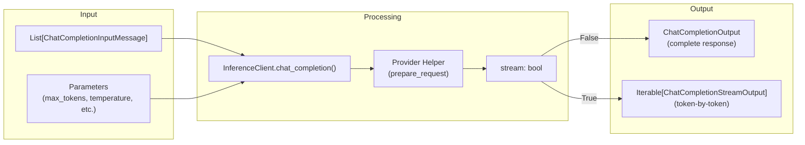
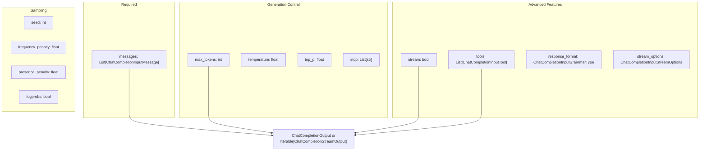
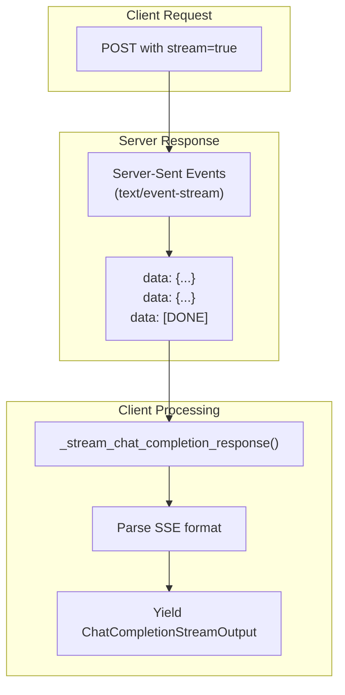
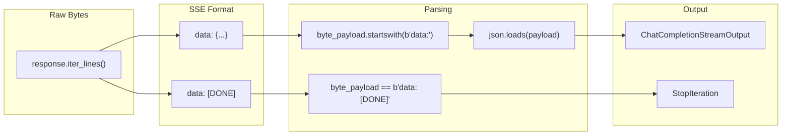
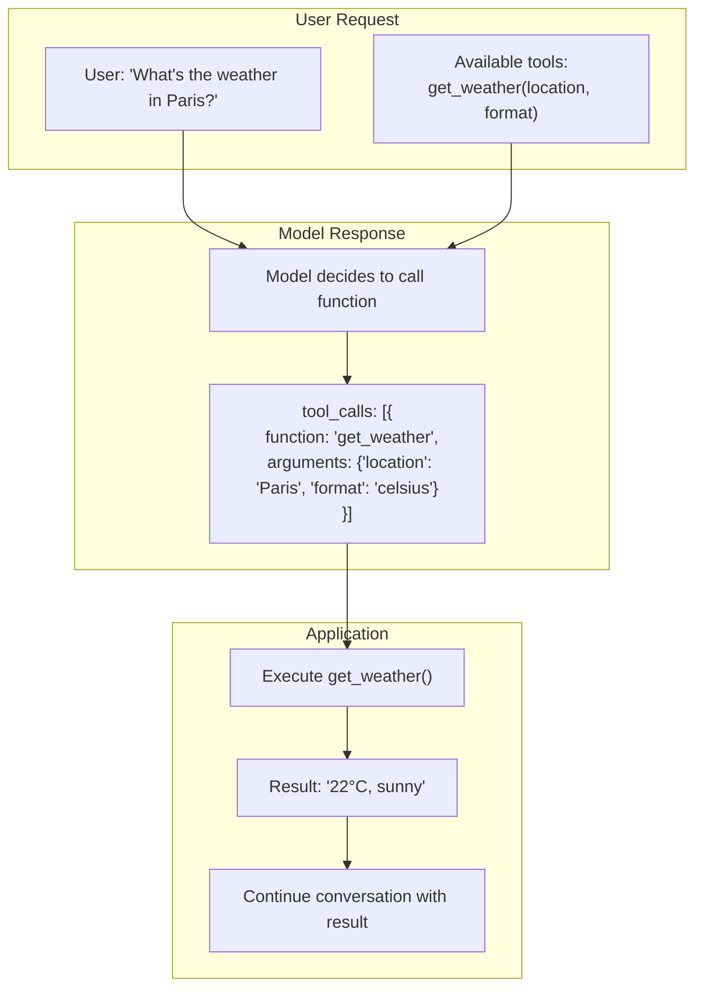
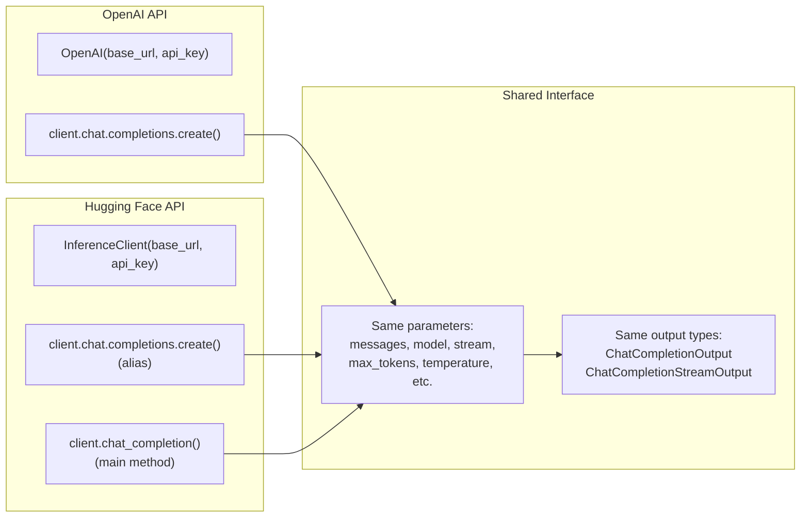
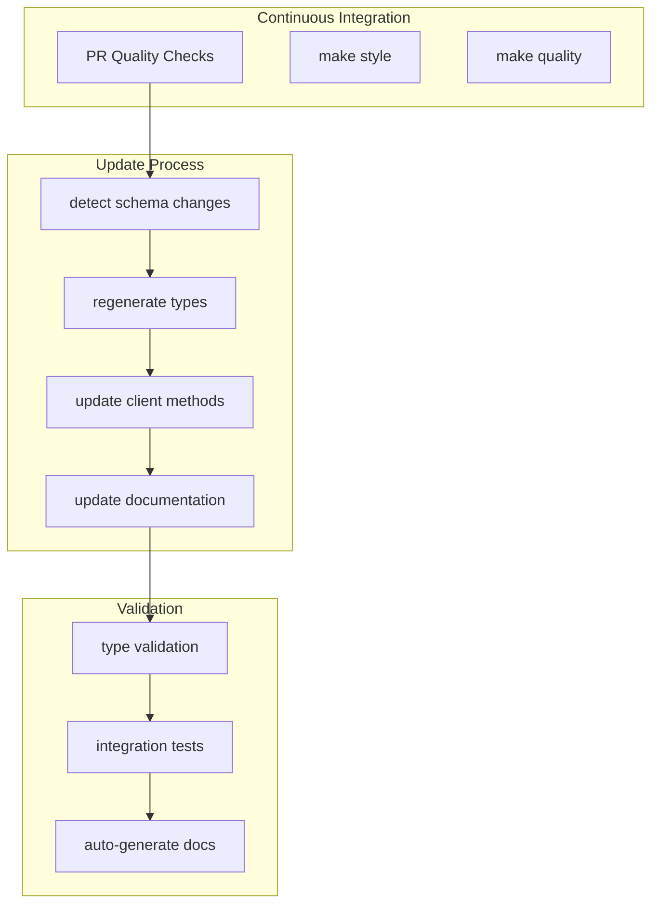

<!-- source: DeepWiki mcp.deepwiki.com · repo huggingface/huggingface_hub · page 3.2 Streaming and Chat Completions · fetched 2026-10-26 -->

# Streaming and Chat Completions

<details>
<summary>Relevant source files</summary>

The following files were used as context for generating this wiki page:

- [docs/source/en/guides/inference.md](docs/source/en/guides/inference.md)
- [docs/source/en/package_reference/inference_client.md](docs/source/en/package_reference/inference_client.md)
- [src/huggingface_hub/inference/_client.py](src/huggingface_hub/inference/_client.py)
- [src/huggingface_hub/inference/_common.py](src/huggingface_hub/inference/_common.py)
- [src/huggingface_hub/inference/_generated/_async_client.py](src/huggingface_hub/inference/_generated/_async_client.py)
- [src/huggingface_hub/inference/_providers/__init__.py](src/huggingface_hub/inference/_providers/__init__.py)
- [src/huggingface_hub/inference/_providers/_common.py](src/huggingface_hub/inference/_providers/_common.py)
- [src/huggingface_hub/inference/_providers/fal_ai.py](src/huggingface_hub/inference/_providers/fal_ai.py)
- [src/huggingface_hub/inference/_providers/hf_inference.py](src/huggingface_hub/inference/_providers/hf_inference.py)
- [src/huggingface_hub/inference/_providers/replicate.py](src/huggingface_hub/inference/_providers/replicate.py)
- [src/huggingface_hub/inference/_providers/sambanova.py](src/huggingface_hub/inference/_providers/sambanova.py)
- [src/huggingface_hub/inference/_providers/together.py](src/huggingface_hub/inference/_providers/together.py)
- [src/huggingface_hub/inference/_providers/zai_org.py](src/huggingface_hub/inference/_providers/zai_org.py)
- [tests/test_inference_async_client.py](tests/test_inference_async_client.py)
- [tests/test_inference_client.py](tests/test_inference_client.py)
- [tests/test_inference_providers.py](tests/test_inference_providers.py)
- [utils/generate_async_inference_client.py](utils/generate_async_inference_client.py)

</details>


This page documents the streaming capabilities and chat completion API of the InferenceClient. The chat completion API provides OpenAI-compatible interfaces for conversational AI, supporting both streaming and non-streaming responses, tool calling, structured outputs, and multi-modal inputs.

For general information about the InferenceClient, see [Inference Client](3). For details about provider selection and task-specific methods, see [Providers and Task Methods](3.1).

## Overview

The `InferenceClient` and `AsyncInferenceClient` provide two complementary methods for working with conversational models:

**Chat Completion Flow**


The API is designed to be OpenAI-compatible, allowing seamless migration from OpenAI's client by changing only two lines of code. Both synchronous and asynchronous clients are available.

Sources: [src/huggingface_hub/inference/_client.py:520-544](), [docs/source/en/guides/inference.md:234-263]()

## Chat Completion API

The chat completion API provides a unified interface for conversational models across all supported providers. The method signature follows OpenAI's pattern with additional provider-specific parameters.

### Method Signature and Parameters

**Core Parameters**


| Parameter Category | Key Parameters | Description |
|-------------------|----------------|-------------|
| Message Input | `messages` | List of conversation messages with roles (system, user, assistant) |
| Generation | `max_tokens`, `temperature`, `top_p` | Control output length and randomness |
| Streaming | `stream`, `stream_options` | Enable token-by-token streaming |
| Tool Calling | `tools`, `tool_choice`, `tool_prompt` | Function calling capabilities |
| Structured Output | `response_format` | JSON schema or regex constraints |
| Sampling | `seed`, `frequency_penalty`, `presence_penalty` | Reproducibility and diversity control |

Sources: [src/huggingface_hub/inference/_client.py:520-578](), [src/huggingface_hub/inference/_generated/types/chat_completion.py:125-204]()

### Message Format

Messages follow a role-based structure supporting text and multi-modal content:

```python
from huggingface_hub import InferenceClient

# Text-only messages
messages = [
    {"role": "system", "content": "You are a helpful assistant."},
    {"role": "user", "content": "What is the capital of France?"},
]

# Multi-modal messages (vision models)
messages = [
    {
        "role": "user",
        "content": [
            {"type": "image_url", "image_url": {"url": image_url}},
            {"type": "text", "text": "Describe this image."},
        ],
    },
]

client = InferenceClient(model="meta-llama/Llama-3.2-11B-Vision-Instruct")
response = client.chat_completion(messages, max_tokens=100)
```

**Message Roles**: The API supports three standard roles:
- `system`: Instructions for the model's behavior
- `user`: User input or questions
- `assistant`: Model responses (for multi-turn conversations)

Sources: [src/huggingface_hub/inference/_client.py:658-793](), [docs/source/en/guides/inference.md:760-793]()

## Streaming Responses

Streaming enables real-time token-by-token generation, providing a better user experience for conversational applications.

### Streaming vs Non-Streaming

**Non-Streaming Mode** (default):
```python
client = InferenceClient(model="meta-llama/Meta-Llama-3-8B-Instruct")
output = client.chat_completion(messages, max_tokens=100)
# Returns complete ChatCompletionOutput after generation finishes
print(output.choices[0].message.content)
```

**Streaming Mode**:
```python
client = InferenceClient(model="meta-llama/Meta-Llama-3-8B-Instruct")
for chunk in client.chat_completion(messages, max_tokens=100, stream=True):
    # Returns ChatCompletionStreamOutput for each token
    print(chunk.choices[0].delta.content, end="")
```

**Streaming Data Flow**


The streaming implementation parses Server-Sent Events (SSE) and yields `ChatCompletionStreamOutput` objects containing delta updates.

Sources: [src/huggingface_hub/inference/_client.py:658-705](), [src/huggingface_hub/inference/_common.py:331-355]()

### Async Streaming

The `AsyncInferenceClient` provides async streaming for better performance in async applications:

```python
import asyncio
from huggingface_hub import AsyncInferenceClient

async def stream_chat():
    client = AsyncInferenceClient(model="meta-llama/Meta-Llama-3-8B-Instruct")
    async for chunk in await client.chat_completion(messages, stream=True):
        print(chunk.choices[0].delta.content, end="")

asyncio.run(stream_chat())
```

The async implementation uses `aiohttp` for non-blocking HTTP requests and async iterators for streaming responses.

Sources: [src/huggingface_hub/inference/_generated/_async_client.py:554-731](), [src/huggingface_hub/inference/_common.py:344-355]()

### Stream Processing Details

**Parsing Server-Sent Events**:


The streaming parser handles:
- Empty lines (skipped)
- Data lines starting with `data:` prefix
- Special `[DONE]` signal indicating end of stream
- Error payloads embedded in the stream

Sources: [src/huggingface_hub/inference/_common.py:357-395]()

## Advanced Features

The chat completion API supports advanced features for building sophisticated AI applications.

### Tool Calling (Function Calling)

Tools enable models to call external functions with structured arguments:

```python
tools = [
    {
        "type": "function",
        "function": {
            "name": "get_weather",
            "description": "Get the current weather",
            "parameters": {
                "type": "object",
                "properties": {
                    "location": {"type": "string"},
                    "format": {"type": "string", "enum": ["celsius", "fahrenheit"]},
                },
                "required": ["location", "format"],
            },
        },
    },
]

response = client.chat_completion(
    messages=[{"role": "user", "content": "What's the weather in Paris?"}],
    tools=tools,
    tool_choice="auto",
)

# Check if model called a function
if response.choices[0].message.tool_calls:
    tool_call = response.choices[0].message.tool_calls[0]
    print(f"Function: {tool_call.function.name}")
    print(f"Arguments: {tool_call.function.arguments}")
```

**Tool Calling Flow**:


Tool choice options:
- `"auto"`: Model decides whether to call functions
- `"none"`: Model won't call any functions
- `{"type": "function", "function": {"name": "...}}`: Force specific function

Sources: [tests/test_inference_client.py:136-195](), [src/huggingface_hub/inference/_client.py:606-608]()

### Structured Output (Response Format)

Constrain model outputs to follow JSON schemas or regex patterns:

```python
# JSON Schema constraint
response_format = {
    "type": "json_object",
    "value": {
        "properties": {
            "location": {"type": "string"},
            "activity": {"type": "string"},
            "animals_seen": {"type": "integer"},
            "animals": {"type": "array", "items": {"type": "string"}},
        },
        "required": ["location", "activity", "animals_seen", "animals"],
    },
}

response = client.chat_completion(
    messages=[{
        "role": "user",
        "content": "I saw a puppy, cat, and raccoon during my bike ride in the park."
    }],
    response_format=response_format,
)

# Output is guaranteed to match the schema
output = json.loads(response.choices[0].message.content)
# {"location": "park", "activity": "biking", "animals_seen": 3, "animals": ["puppy", "cat", "raccoon"]}
```

Sources: [tests/test_inference_client.py:197-215](), [src/huggingface_hub/inference/_generated/types/chat_completion.py:40-87]()

### Multi-Modal Inputs

Vision-language models accept both text and images in messages:

```python
import base64

# Image as URL
image_url = "https://example.com/image.jpg"

# Or as base64
with open("image.jpg", "rb") as f:
    base64_image = base64.b64encode(f.read()).decode("utf-8")
    image_url = f"data:image/jpeg;base64,{base64_image}"

messages = [
    {
        "role": "user",
        "content": [
            {"type": "image_url", "image_url": {"url": image_url}},
            {"type": "text", "text": "What's in this image?"},
        ],
    },
]

client = InferenceClient(model="meta-llama/Llama-3.2-11B-Vision-Instruct")
response = client.chat_completion(messages)
```

Sources: [src/huggingface_hub/inference/_client.py:760-793]()

## OpenAI Compatibility

The chat completion API is designed to be compatible with OpenAI's Python client, allowing easy migration with minimal code changes.

### API Compatibility

**Migration from OpenAI**:
```python
# Before (OpenAI)
from openai import OpenAI
client = OpenAI(api_key="...", base_url="...")

# After (Hugging Face)
from huggingface_hub import InferenceClient
client = InferenceClient(api_key="...", base_url="...")

# Same code works for both
output = client.chat.completions.create(
    model="meta-llama/Meta-Llama-3-8B-Instruct",
    messages=[{"role": "user", "content": "Hello"}],
    stream=True,
    max_tokens=100,
)
```

**Compatibility Features**:


The client provides the `chat.completions.create` alias that behaves identically to the main `chat_completion` method, ensuring compatibility with code written for OpenAI.

Sources: [docs/source/en/guides/inference.md:234-263](), [src/huggingface_hub/inference/_client.py:549-552]()

### Parameter and Type Compatibility

All input parameters and output types match OpenAI's specification:

| Feature | OpenAI Equivalent | Hugging Face Implementation |
|---------|-------------------|----------------------------|
| Messages | `messages: List[Dict]` | Same format with role/content |
| Streaming | `stream=True` | Returns `Iterable[ChatCompletionStreamOutput]` |
| Tools | `tools`, `tool_choice` | Same schema for function definitions |
| Response Format | `response_format` | Supports `json_object` and `json_schema` |
| Token Control | `max_tokens`, `stop` | Same parameter names and behavior |
| Sampling | `temperature`, `top_p`, `seed` | Identical parameter semantics |

The only difference is the model selection: Hugging Face uses Hub model IDs while OpenAI uses their proprietary model names.

Sources: [src/huggingface_hub/inference/_client.py:557-611]()

## Maintenance and Evolution

The inference types system includes automated maintenance tools to keep the types current as the Hub's inference capabilities evolve.

### Automated Updates



The maintenance system automatically:
- Detects new or changed task schemas
- Regenerates Python types with proper inheritance and naming
- Updates InferenceClient method signatures to match new parameters
- Synchronizes parameter documentation across code and docs
- Validates type consistency across the entire inference pipeline

Sources: [utils/generate_inference_types.py:334-369](), [utils/check_task_parameters.py:701-756]()

### Development Status

The inference types system is actively developed with some tasks still being refined:

**Currently Supported**: Most major ML tasks including text generation, image processing, audio processing, and conversational AI.

**In Development**: Some tasks are temporarily excluded from automatic parameter synchronization while their schemas are stabilized:

- `chat_completion` and `text_generation` (due to complex parameter inheritance)
- `depth_estimation` and `feature_extraction` (missing parameter schemas)
- Audio tasks requiring specialized streaming support

Sources: [utils/check_task_parameters.py:63-73]()

---

