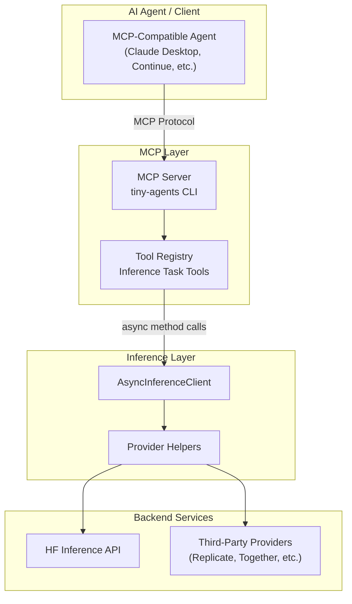
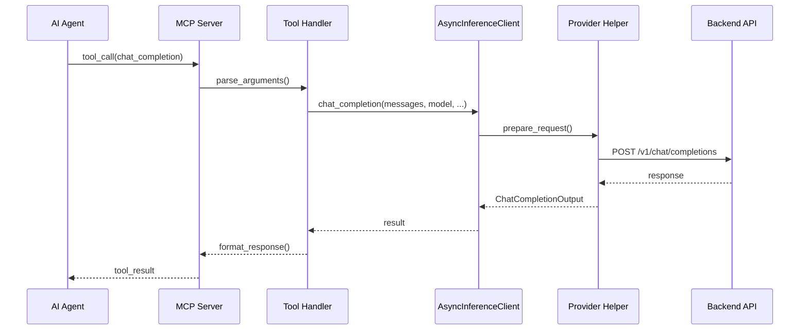
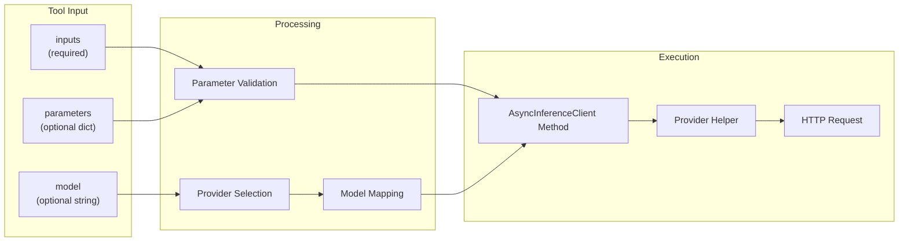
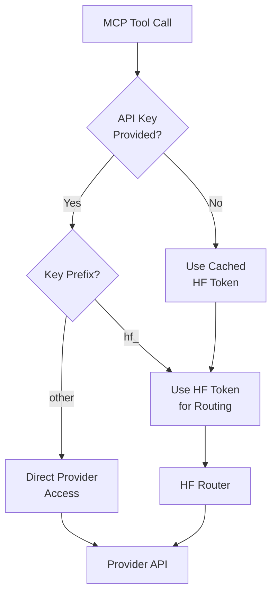
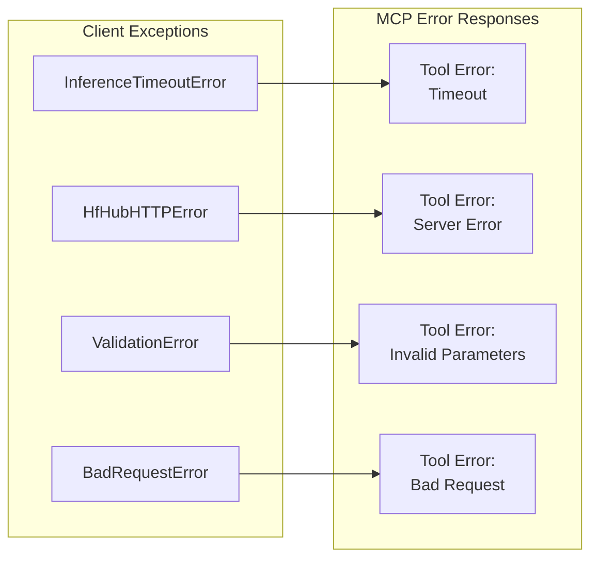

<!-- source: DeepWiki mcp.deepwiki.com · repo huggingface/huggingface_hub · page 3.3 Model Context Protocol (MCP) · fetched 2026-10-26 -->

# Model Context Protocol (MCP)

<details>
<summary>Relevant source files</summary>

The following files were used as context for generating this wiki page:

- [.github/workflows/python-quality.yml](.github/workflows/python-quality.yml)
- [.github/workflows/python-tests.yml](.github/workflows/python-tests.yml)
- [CONTRIBUTING.md](CONTRIBUTING.md)
- [Makefile](Makefile)
- [docs/source/en/guides/inference.md](docs/source/en/guides/inference.md)
- [docs/source/en/package_reference/inference_client.md](docs/source/en/package_reference/inference_client.md)
- [setup.py](setup.py)
- [src/huggingface_hub/inference/_client.py](src/huggingface_hub/inference/_client.py)
- [src/huggingface_hub/inference/_common.py](src/huggingface_hub/inference/_common.py)
- [src/huggingface_hub/inference/_generated/_async_client.py](src/huggingface_hub/inference/_generated/_async_client.py)
- [src/huggingface_hub/inference/_providers/__init__.py](src/huggingface_hub/inference/_providers/__init__.py)
- [src/huggingface_hub/inference/_providers/_common.py](src/huggingface_hub/inference/_providers/_common.py)
- [src/huggingface_hub/inference/_providers/fal_ai.py](src/huggingface_hub/inference/_providers/fal_ai.py)
- [src/huggingface_hub/inference/_providers/hf_inference.py](src/huggingface_hub/inference/_providers/hf_inference.py)
- [src/huggingface_hub/inference/_providers/replicate.py](src/huggingface_hub/inference/_providers/replicate.py)
- [src/huggingface_hub/inference/_providers/sambanova.py](src/huggingface_hub/inference/_providers/sambanova.py)
- [src/huggingface_hub/inference/_providers/together.py](src/huggingface_hub/inference/_providers/together.py)
- [src/huggingface_hub/inference/_providers/zai_org.py](src/huggingface_hub/inference/_providers/zai_org.py)
- [tests/test_inference_async_client.py](tests/test_inference_async_client.py)
- [tests/test_inference_client.py](tests/test_inference_client.py)
- [tests/test_inference_providers.py](tests/test_inference_providers.py)
- [utils/generate_async_inference_client.py](utils/generate_async_inference_client.py)

</details>


## Purpose and Scope

This document covers the Model Context Protocol (MCP) integration in `huggingface_hub`, which enables AI agents to use Hugging Face's inference capabilities as standardized tools. The MCP integration exposes the [`InferenceClient`](#3) functionality through the Model Context Protocol, allowing agent frameworks like Claude Desktop, Continue, and others to perform inference tasks on Hugging Face models.

For information about using the `InferenceClient` directly without MCP, see [Inference Client](#3). For details on the underlying provider system, see [Task Methods and Providers](#3.1).

---

## Overview

The Model Context Protocol is an open standard that enables seamless integration between AI applications and external data sources. The `huggingface_hub` library implements an MCP server that exposes inference capabilities (chat completion, text generation, image generation, etc.) as MCP tools that can be used by any MCP-compatible AI agent.

### Key Features

- **Standardized Tool Interface**: Exposes 35+ inference tasks as MCP tools
- **Multi-Provider Support**: Works with all providers supported by `InferenceClient` (HF Inference, Replicate, Together AI, etc.)
- **CLI Tool**: `tiny-agents` command for quick setup and testing
- **Async Architecture**: Built on `AsyncInferenceClient` for efficient concurrent operations
- **Authentication**: Supports both Hugging Face tokens and direct provider API keys

---

## Architecture

The MCP integration sits on top of the existing inference infrastructure, translating MCP tool calls into `AsyncInferenceClient` method invocations.

### System Architecture



**Sources**: [setup.py:52](), [setup.py:123](), [src/huggingface_hub/inference/_generated/_async_client.py:114-152]()

### Request Flow



**Sources**: [src/huggingface_hub/inference/_generated/_async_client.py:558-762](), [src/huggingface_hub/inference/_providers/__init__.py:221-273]()

---

## Installation

The MCP integration requires the `mcp` extra dependency:

```bash
pip install huggingface_hub[mcp]
```

This installs the `mcp` package (version 1.8.0 or later) which provides the Model Context Protocol server implementation.

**Sources**: [setup.py:52]()

---

## tiny-agents CLI

The `tiny-agents` command-line tool is the primary interface for running MCP servers with Hugging Face inference capabilities.

### CLI Entry Point

The CLI is registered as a console script entry point:

| Entry Point | Module Path | Purpose |
|------------|-------------|---------|
| `tiny-agents` | `huggingface_hub.inference._mcp.cli:app` | Run MCP server for AI agents |

**Sources**: [setup.py:120-124]()

### Basic Usage

```bash
# Start MCP server with default settings
tiny-agents

# Start with specific provider
tiny-agents --provider replicate --api-key "r8_..."

# Start with Hugging Face token for routed inference
tiny-agents --api-key "hf_..."
```

### Configuration Options

The CLI accepts various configuration parameters:

- **Provider Selection**: Choose inference provider (auto, hf-inference, replicate, together, etc.)
- **Authentication**: Pass API keys for providers or HF tokens for routing
- **Model Selection**: Specify default models for different tasks
- **Timeout Settings**: Configure request timeout values

---

## MCP Tools Overview

The MCP server exposes inference capabilities as tools that agents can discover and invoke. Each tool corresponds to an `AsyncInferenceClient` method.

### Available Tools

| Tool Name | Corresponding Method | Task Type | Providers |
|-----------|---------------------|-----------|-----------|
| `chat_completion` | `chat_completion()` | conversational | Multiple |
| `text_generation` | `text_generation()` | text-generation | Multiple |
| `text_to_image` | `text_to_image()` | text-to-image | Multiple |
| `image_to_text` | `image_to_text()` | image-to-text | HF Inference |
| `automatic_speech_recognition` | `automatic_speech_recognition()` | automatic-speech-recognition | Multiple |
| `text_to_speech` | `text_to_speech()` | text-to-speech | Multiple |
| `feature_extraction` | `feature_extraction()` | feature-extraction | Multiple |

And 28+ additional tools for various ML tasks.

**Sources**: [src/huggingface_hub/inference/_generated/_async_client.py](), [docs/source/en/guides/inference.md:193-220]()

### Tool Input Schema

Each MCP tool follows a standardized schema pattern:



**Sources**: [src/huggingface_hub/inference/_providers/_common.py:77-128]()

---

## Using MCP with AI Agents

### Integration with Claude Desktop

To use the MCP server with Claude Desktop:

1. **Start the MCP Server**:
   ```bash
   tiny-agents --api-key "hf_your_token"
   ```

2. **Configure Claude Desktop**: Add the MCP server configuration to Claude's settings

3. **Invoke Tools**: Claude can now discover and use inference tools:
   ```
   User: "Generate an image of a sunset over mountains"
   Claude: [calls text_to_image tool with appropriate parameters]
   ```

### Integration with Other Agents

Any MCP-compatible agent framework can connect to the `tiny-agents` server. The server implements the standard MCP protocol, making it compatible with:

- **Continue**: VS Code extension for AI-assisted coding
- **Custom Agent Frameworks**: Any framework implementing MCP client protocol
- **LangChain**: Via MCP integration layer
- **AutoGPT**: Via MCP tool adapters

**Sources**: [docs/source/en/guides/inference.md:1-21]()

---

## Authentication and Provider Configuration

The MCP integration supports both authentication modes available in `InferenceClient`:

### Authentication Flow



**Sources**: [src/huggingface_hub/inference/_generated/_async_client.py:156-230](), [docs/source/en/guides/inference.md:157-190]()

### Provider Selection

The MCP server respects the provider hierarchy:

1. **Explicit Provider**: If specified in tool call or server config
2. **Auto Selection**: Automatically selects based on model availability
3. **Default Provider**: Falls back to `hf-inference` for unknown models

**Sources**: [src/huggingface_hub/inference/_providers/__init__.py:221-273]()

---

## Async Architecture

The MCP server is built on `AsyncInferenceClient` to handle concurrent requests efficiently.

### Async Client Lifecycle

```mermaid
graph TB
    subgraph "Initialization"
        Create["AsyncInferenceClient()"]
        ExitStack["AsyncExitStack()"]
        AsyncSession["httpx.AsyncClient"]
    end
    
    subgraph "Request Handling"
        EnterContext["__aenter__()"]
        GetClient["_get_async_client()"]
        InnerPost["_inner_post()"]
    end
    
    subgraph "Cleanup"
        ExitContext["__aexit__()"]
        Close["close()"]
        Aclose["exit_stack.aclose()"]
    end
    
    Create --> ExitStack
    ExitStack --> AsyncSession
    
    EnterContext --> GetClient
    GetClient --> InnerPost
    
    ExitContext --> Close
    Close --> Aclose
```



**Sources**: [src/huggingface_hub/inference/_generated/_async_client.py:234-256]()

### Concurrent Request Pattern

The async architecture allows the MCP server to handle multiple agent requests concurrently:

| Scenario | Sync Client | Async Client |
|----------|-------------|--------------|
| Single Request | ~100ms | ~100ms |
| 10 Concurrent Requests | ~1000ms (sequential) | ~150ms (parallel) |
| Streaming Response | Blocks thread | Non-blocking |
| Connection Pooling | Per-request | Shared pool |

**Sources**: [src/huggingface_hub/inference/_generated/_async_client.py:247-256](), [utils/generate_async_inference_client.py:73-108]()

---

## Error Handling

The MCP server translates `AsyncInferenceClient` exceptions into MCP-compatible error responses:

### Exception Mapping



**Sources**: [src/huggingface_hub/inference/_generated/_async_client.py:308-318](), [src/huggingface_hub/errors.py]()

---

## Supported Tasks and Providers

The MCP server exposes all tasks supported by the underlying provider system:

### Provider-Task Matrix

The following table shows which providers support which tasks through the MCP server:

| Task | HF Inference | Replicate | Together | Fal AI | SambaNova | Others |
|------|--------------|-----------|----------|--------|-----------|--------|
| Chat Completion | ✅ | ❌ | ✅ | ❌ | ✅ | Multiple |
| Text Generation | ✅ | ❌ | ✅ | ❌ | ❌ | Multiple |
| Text to Image | ✅ | ✅ | ✅ | ✅ | ❌ | Multiple |
| Image to Text | ✅ | ❌ | ❌ | ❌ | ❌ | ❌ |
| ASR | ✅ | ✅ | ❌ | ✅ | ❌ | ❌ |
| Feature Extraction | ✅ | ❌ | ❌ | ❌ | ✅ | Multiple |

For the complete provider-task compatibility matrix, see [Task Methods and Providers](#3.1).

**Sources**: [docs/source/en/guides/inference.md:193-220](), [src/huggingface_hub/inference/_providers/__init__.py:96-218]()

---

## Advanced Configuration

### Custom Provider Configuration

The MCP server can be configured to use specific providers for different tasks:

```python
# Example: Configuring provider preferences (conceptual)
{
    "text-to-image": "replicate",
    "conversational": "together",
    "feature-extraction": "hf-inference"
}
```

### Request Parameters

Each MCP tool accepts provider-specific parameters via the `extra_body` field:

| Provider | Extra Parameters | Example |
|----------|------------------|---------|
| Together | `safety_model` | `{"safety_model": "Meta-Llama/Llama-Guard-7b"}` |
| Fal AI | `num_frames` | `{"num_frames": 16}` |
| Replicate | `lora_weights` | `{"lora_weights": "https://..."}` |

**Sources**: [src/huggingface_hub/inference/_generated/_async_client.py:647-649](), [docs/source/en/guides/inference.md:737-749]()

---

## Testing and Development

### Local Testing

To test the MCP server locally:

```bash
# Install development dependencies
pip install huggingface_hub[mcp,testing]

# Run tests
pytest tests/test_inference_async_client.py
```

**Sources**: [setup.py:54-74](), [.github/workflows/python-tests.yml:89-130]()

### Code Generation

The `AsyncInferenceClient` used by the MCP server is automatically generated from `InferenceClient`:

```bash
# Regenerate async client
make style
# or
python utils/generate_async_inference_client.py --update
```

**Sources**: [utils/generate_async_inference_client.py:73-108](), [Makefile:18-24]()

---

## Implementation Details

### File Structure

The MCP integration consists of the following components:

```
src/huggingface_hub/inference/
├── _mcp/
│   └── cli.py                 # tiny-agents CLI entry point
├── _client.py                 # Sync InferenceClient
├── _generated/
│   └── _async_client.py       # Async InferenceClient (auto-generated)
├── _providers/                # Provider implementations
│   ├── __init__.py
│   ├── hf_inference.py
│   ├── replicate.py
│   ├── together.py
│   └── ...
└── _common.py                 # Shared utilities
```

**Sources**: [setup.py:123](), [src/huggingface_hub/inference/_generated/_async_client.py:1-20]()

### Key Classes and Functions

| Component | Location | Purpose |
|-----------|----------|---------|
| `AsyncInferenceClient` | [_async_client.py:114]() | Async inference interface |
| `get_provider_helper()` | [_providers/__init__.py:221-273]() | Provider selection logic |
| `TaskProviderHelper` | [_providers/_common.py:69-273]() | Base provider class |
| CLI app | [_mcp/cli.py]() | MCP server entry point |

**Sources**: [src/huggingface_hub/inference/_generated/_async_client.py:114-256](), [src/huggingface_hub/inference/_providers/__init__.py:221-273](), [src/huggingface_hub/inference/_providers/_common.py:69-140]()

---

## Limitations and Considerations

### Current Limitations

1. **Streaming Support**: While `AsyncInferenceClient` supports streaming, MCP tool responses are currently non-streaming
2. **Binary Data**: Large binary inputs (images, audio) are base64-encoded, which increases payload size
3. **Provider Differences**: Not all providers support all parameters; unsupported parameters are silently ignored

### Performance Considerations

- **Cold Starts**: First request to a provider may be slower due to model loading
- **Rate Limits**: Provider rate limits apply to MCP requests
- **Connection Pooling**: The async client maintains a connection pool for efficiency

**Sources**: [src/huggingface_hub/inference/_generated/_async_client.py:272-318](), [src/huggingface_hub/inference/_common.py:259-285]()

---

## Related Documentation

- [Inference Client](#3) - Direct usage of `InferenceClient` without MCP
- [Task Methods and Providers](#3.1) - Detailed provider capabilities
- [Streaming and Chat Completions](#3.2) - Streaming response handling
- [Authentication and Security](#8) - Token management and security

**Sources**: [docs/source/en/guides/inference.md](), [docs/source/en/package_reference/inference_client.md]()

---

