<!-- source: DeepWiki mcp.deepwiki.com · repo huggingface/huggingface_hub · page 4 File System Interface (HfFileSystem) · fetched 2026-10-26 -->

# File System Interface (HfFileSystem)

<details>
<summary>Relevant source files</summary>

The following files were used as context for generating this wiki page:

- [src/huggingface_hub/_buckets.py](src/huggingface_hub/_buckets.py)
- [src/huggingface_hub/hf_file_system.py](src/huggingface_hub/hf_file_system.py)
- [tests/test_buckets_hf_file_system.py](tests/test_buckets_hf_file_system.py)
- [tests/test_hf_file_system.py](tests/test_hf_file_system.py)

</details>


## Purpose and Scope

The `HfFileSystem` class provides an `fsspec`-compatible file system interface for accessing Hugging Face Hub repositories and buckets. This allows you to interact with remote Hub content using familiar file system operations (open, read, write, list, etc.) and enables seamless integration with libraries that support `fsspec` backends (e.g., pandas, PyArrow).

> **Note**: While `HfFileSystem` provides convenience through `fsspec` compatibility, it introduces additional overhead. For better performance and reliability, use `HfApi` methods directly when possible. See [Core API Client (HfApi)](#2) for the primary programmatic interface.

For bucket operations specifically, see the bucket sync functionality which provides efficient bulk transfers.

**Sources**: [src/huggingface_hub/hf_file_system.py:147-212]()

## Architecture Overview

`HfFileSystem` extends `fsspec.AbstractFileSystem` and implements the file system abstraction layer for the Hugging Face Hub. The class manages three key concerns: path resolution, caching, and file I/O operations.

### Core Components

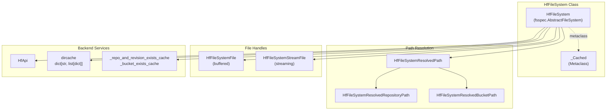

**Key Classes**:

| Class | Purpose | Location |
|-------|---------|----------|
| `HfFileSystem` | Main file system interface | [src/huggingface_hub/hf_file_system.py:147]() |
| `_Cached` | Metaclass for instance caching | [src/huggingface_hub/hf_file_system.py:97]() |
| `HfFileSystemResolvedRepositoryPath` | Resolved repository path | [src/huggingface_hub/hf_file_system.py:58]() |
| `HfFileSystemResolvedBucketPath` | Resolved bucket path | [src/huggingface_hub/hf_file_system.py:83]() |
| `HfFileSystemFile` | Buffered file handle | [src/huggingface_hub/hf_file_system.py:1068]() |
| `HfFileSystemStreamFile` | Streaming file handle | [src/huggingface_hub/hf_file_system.py:1173]() |

**Sources**: [src/huggingface_hub/hf_file_system.py:46-91](), [src/huggingface_hub/hf_file_system.py:147-243]()

## Path Resolution System

`HfFileSystem` supports multiple path formats for accessing repositories and buckets. The `resolve_path` method parses these paths into structured data objects.

### Supported Path Formats

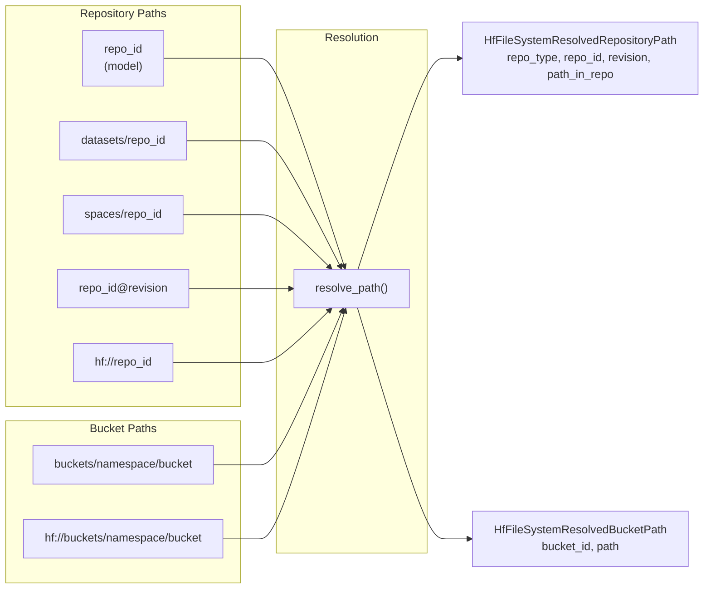

### Path Resolution Process

The resolution algorithm in `resolve_path` handles:

1. **Protocol stripping**: Removes `hf://` prefix if present
2. **Repository type detection**: Identifies models, datasets, or spaces based on prefix
3. **Revision parsing**: Extracts revision from `@revision` syntax, including special refs like `refs/pr/1` and `refs/convert/parquet`
4. **Namespace disambiguation**: Tries both with and without namespace for compatibility
5. **Existence validation**: Checks repository/bucket existence and caches results

**Example Path Resolution**:

| Input Path | Resolved To |
|------------|-------------|
| `gpt2` | `model`, `gpt2`, `main`, `""` |
| `datasets/squad@dev` | `dataset`, `squad`, `dev`, `""` |
| `username/model@refs/pr/2` | `model`, `username/model`, `refs/pr/2`, `""` |
| `datasets/squad/data.json` | `dataset`, `squad`, `main`, `data.json` |
| `buckets/user/bucket/file.txt` | `user/bucket`, `file.txt` |

**Special Handling**: The regex `SPECIAL_REFS_REVISION_REGEX` at [src/huggingface_hub/hf_file_system.py:36-43]() handles revisions containing forward slashes:
- `refs/convert/parquet` - for parquet conversion refs
- `refs/pr/N` - for pull request refs

**Sources**: [src/huggingface_hub/hf_file_system.py:285-389](), [src/huggingface_hub/hf_file_system.py:36-43]()

### Unresolving Paths

The `unresolve()` method reconstructs user-facing paths from resolved components, preserving the original revision format (quoted or unquoted) using the `_raw_revision` field:

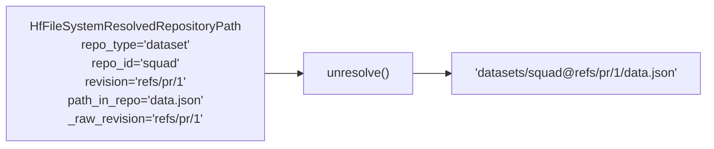

**Sources**: [src/huggingface_hub/hf_file_system.py:53-79]()

## Instance Caching and Thread Safety

`HfFileSystem` uses a custom metaclass `_Cached` to implement instance caching, ensuring that multiple calls with the same parameters return the same instance. This improves performance and cache hit rates.

### Caching Strategy

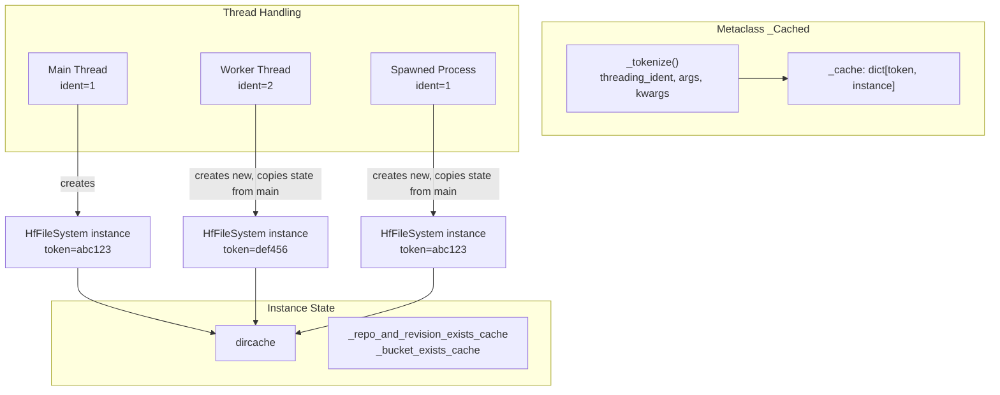

**Key Features**:

1. **Deterministic tokenization**: Cache keys based on endpoint and token, not process ID (unlike base fsspec implementation)
2. **Thread-specific instances**: Each thread gets its own instance for thread safety, but shares state from main thread
3. **State inheritance**: New instances copy `dircache` and existence caches from the main thread instance

**Token Generation** at [src/huggingface_hub/hf_file_system.py:244-254]():
```python
def _tokenize(cls, threading_ident: int, *args, **kwargs) -> str:
    kwargs["endpoint"] = kwargs.get("endpoint") or constants.ENDPOINT
    kwargs["token"] = kwargs.get("token")
    kwargs = {key: kwargs[key] for key in sorted(kwargs)}
    tokenize_args = (cls, threading_ident, args, kwargs)
    h = md5(str(tokenize_args).encode())
    return h.hexdigest()
```

**Sources**: [src/huggingface_hub/hf_file_system.py:97-145](), [src/huggingface_hub/hf_file_system.py:244-254]()

## File Operations

`HfFileSystem` supports reading, writing, and deleting files through both standard Python file operations and fsspec-specific methods.

### Reading Files

Two file handle types are available depending on the `block_size` parameter:

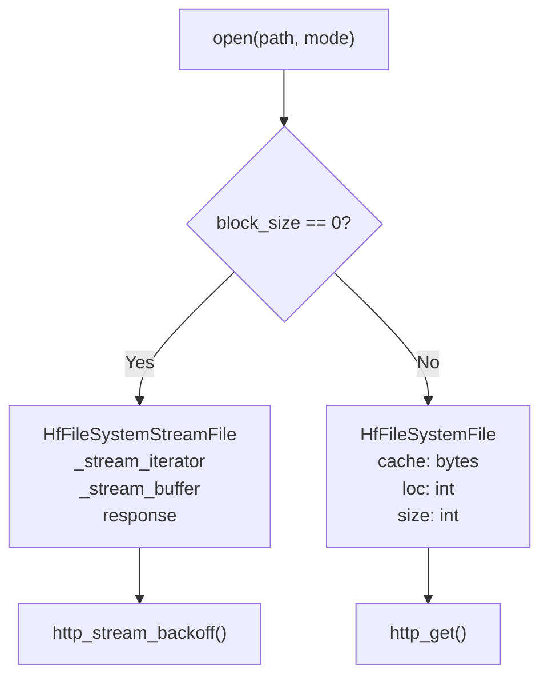

**Buffered Reading** (`HfFileSystemFile`):

- Downloads entire file or requested range
- Caches content in memory
- Efficient for random access and repeated reads
- Implementation at [src/huggingface_hub/hf_file_system.py:1068-1172]()

**Streaming Reading** (`HfFileSystemStreamFile`):

- Uses Server-Sent Events (SSE) style streaming
- Maintains internal buffer for partial chunk consumption
- Automatically retries on connection failure
- Implementation at [src/huggingface_hub/hf_file_system.py:1173-1298]()

**Stream Buffer Management**:

The streaming implementation maintains a `_stream_buffer` (bytearray) to handle cases where chunks are larger than requested reads:

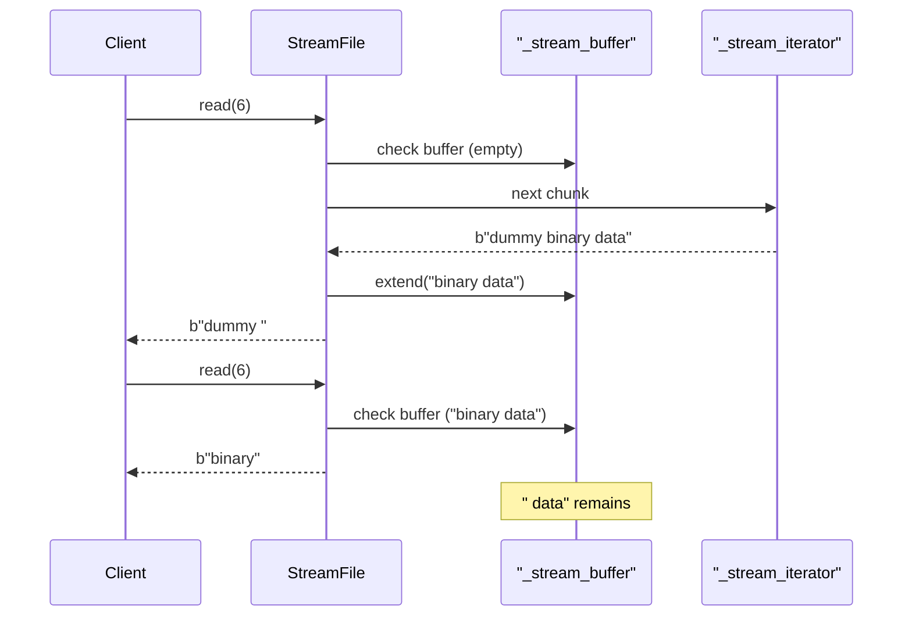

**Sources**: [src/huggingface_hub/hf_file_system.py:424-441](), [src/huggingface_hub/hf_file_system.py:1068-1298]()

### Writing Files

Writing creates commits through the underlying `HfApi` instance:

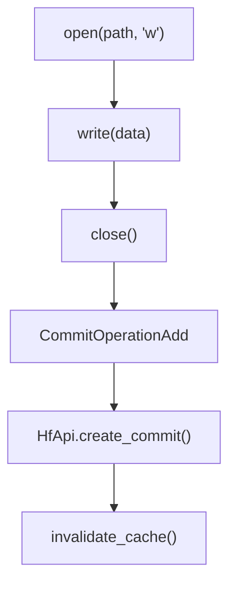

**Multi-chunk writes**: For large files, the implementation buffers data and creates a commit when the file is closed. Large files may be uploaded via LFS or Xet storage backend depending on Hub configuration.

**Sources**: [src/huggingface_hub/hf_file_system.py:1068-1172]()

### Deleting Files

Deletion operations support both single files (`rm_file`) and recursive directory deletion (`rm`):

| Method | Purpose | Implementation |
|--------|---------|----------------|
| `_rm(path)` | Delete single file | Single commit with `CommitOperationDelete` |
| `rm(path, recursive=True)` | Delete directory | Expands paths, creates batch commit |

For buckets, deletion uses `HfApi.batch_bucket_files()` with the `delete` parameter.

**Sources**: [src/huggingface_hub/hf_file_system.py:442-507]()

### Copying Files

The `cp_file` method handles both intra-repository and inter-repository copies:

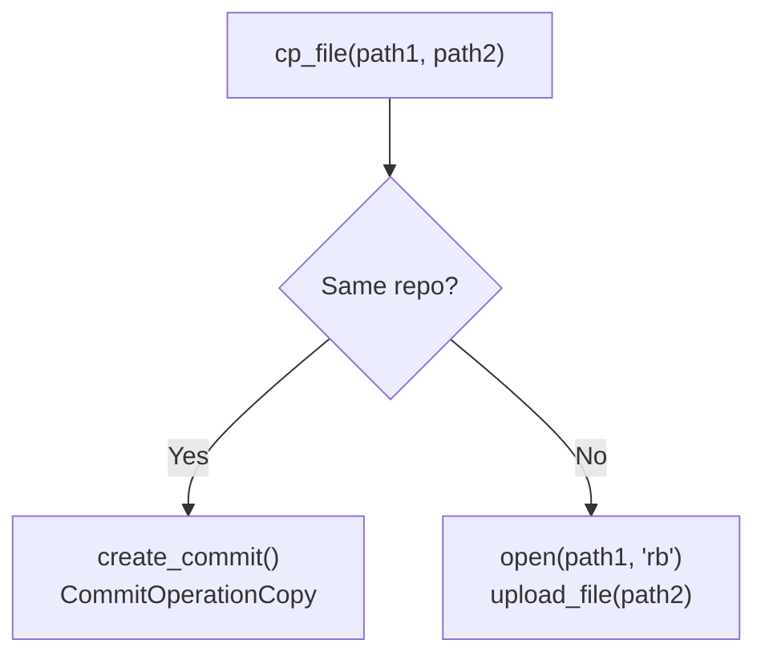

**Intra-repository copy**: Uses `CommitOperationCopy` to copy files efficiently on the server side without downloading/uploading.

**Inter-repository copy**: Downloads content from source and uploads to destination.

**Sources**: [src/huggingface_hub/hf_file_system.py:822-881]()

## Directory Operations

`HfFileSystem` provides multiple methods for traversing and querying directory contents, each optimized for different use cases.

### Listing Directory Contents

The `ls` method lists immediate children of a directory:

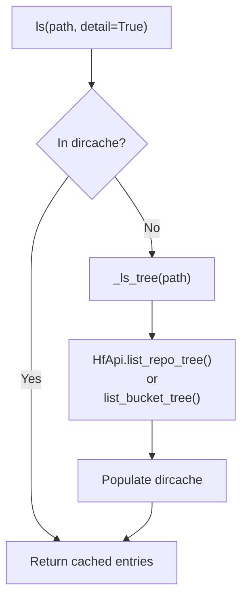

**Directory Cache Structure**:

The `dircache` is a dictionary mapping directory paths to lists of file/folder info dictionaries:

```python
dircache = {
    "datasets/squad": [
        {"name": "datasets/squad/README.md", "type": "file", "size": 1234, ...},
        {"name": "datasets/squad/data", "type": "directory", "size": 0, ...}
    ],
    "datasets/squad/data": [
        {"name": "datasets/squad/data/train.json", "type": "file", ...}
    ]
}
```

**Sources**: [src/huggingface_hub/hf_file_system.py:508-547](), [src/huggingface_hub/hf_file_system.py:548-688]()

### Recursive Listing

The `_ls_tree` method with `recursive=True` implements breadth-first traversal with cache optimization:

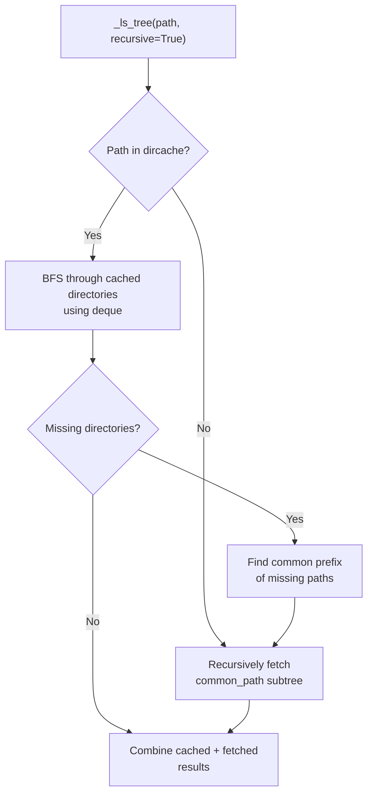

**Cache Miss Optimization**: When the cache is incomplete, the implementation finds the common prefix of missing directories and fetches that entire subtree in one API call, minimizing round trips.

**Sources**: [src/huggingface_hub/hf_file_system.py:548-688]()

### Finding and Globbing

| Method | Purpose | Pattern Support |
|--------|---------|-----------------|
| `find(path)` | Recursively list all files | None (lists everything) |
| `glob(path)` | Match files by pattern | Unix-style wildcards (`*`, `?`, `**`) |
| `walk(path)` | Yield (dirpath, dirnames, filenames) tuples | None |

**Glob Pattern Examples**:

```python
fs.glob("datasets/squad/*.json")        # All JSON files in root
fs.glob("datasets/squad/**/*.json")     # All JSON files recursively
fs.glob("datasets/squad/data/train.???") # 3-character extensions
```

**Sources**: [src/huggingface_hub/hf_file_system.py:729-760](), [src/huggingface_hub/hf_file_system.py:761-821]()

## Caching System

`HfFileSystem` maintains three levels of caching to minimize API calls:

### Cache Hierarchy

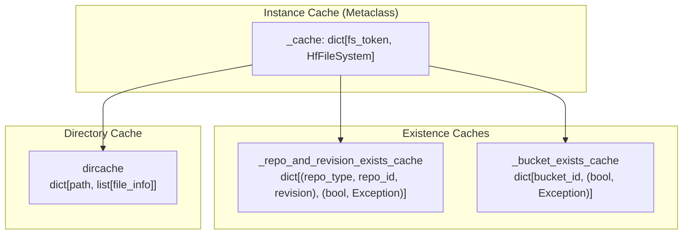

### Cache Invalidation

The `invalidate_cache` method provides granular cache clearing:

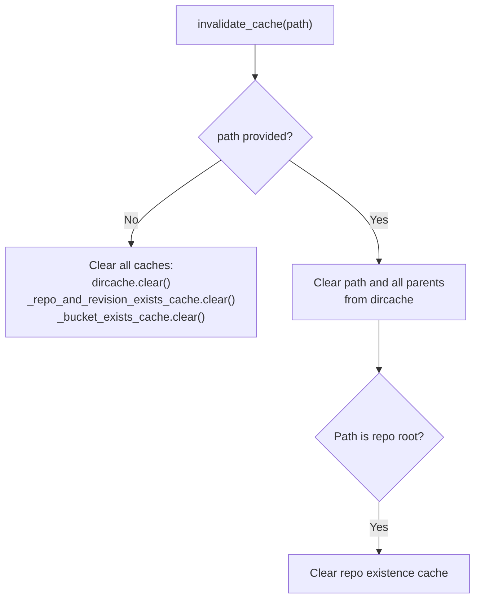

**Cache Invalidation Strategy**:

1. **Partial invalidation**: When a path is provided, clears that path and all parent directories from `dircache`
2. **Existence cache**: Only cleared when invalidating a repository root (empty `path_in_repo`)
3. **Automatic invalidation**: Write operations automatically invalidate affected paths

**Sources**: [src/huggingface_hub/hf_file_system.py:391-423](), [src/huggingface_hub/hf_file_system.py:232-242]()

## File Metadata and Information

The `info` method retrieves detailed metadata about files and directories:

### Information Structure

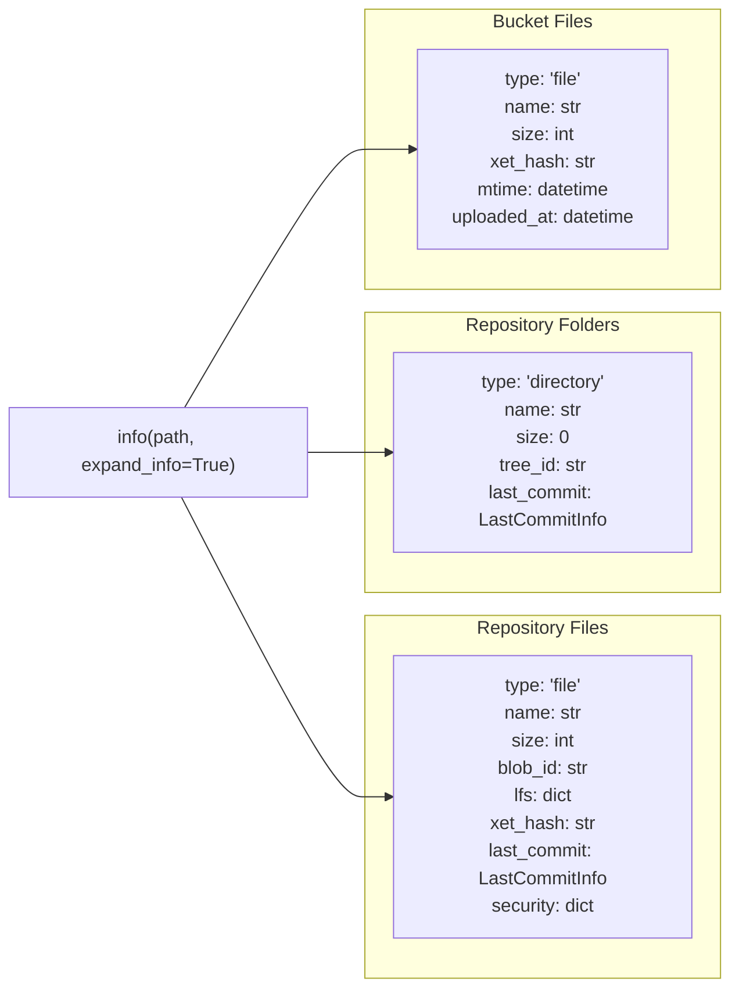

**Expanded vs Non-Expanded Info**:

- **Non-expanded** (`expand_info=False`): Basic info from directory cache (size, type, name)
- **Expanded** (`expand_info=True`): Includes last commit information via `HfApi.get_paths_info()` with `expand=True`

**Implementation Strategy**:

1. Check if parent directory is in `dircache`
2. If not cached or `expand_info=True` and not expanded, call `HfApi.get_paths_info()`
3. Store expanded info in cache for future lookups

**Sources**: [src/huggingface_hub/hf_file_system.py:907-1016]()

## Integration with fsspec and Data Libraries

`HfFileSystem` registers with the `fsspec` protocol registry, enabling seamless integration with data processing libraries.

### Registration and Usage

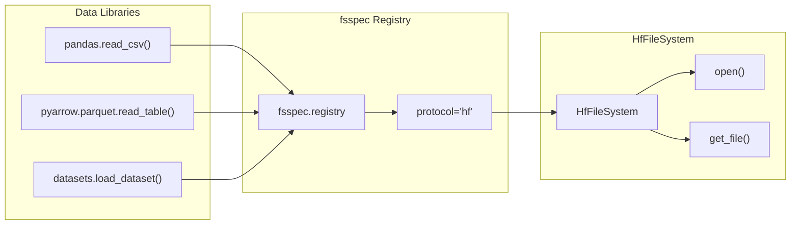

**Usage Patterns**:

```python
# Direct instantiation
fs = HfFileSystem(token="hf_...")
with fs.open("datasets/squad/data/train.json") as f:
    data = json.load(f)

# Via fsspec registry
import pandas as pd
df = pd.read_csv(
    "hf://datasets/squad/data.csv",
    storage_options={"token": "hf_..."}
)

# Via fsspec.get_fs_token_paths
import fsspec
fs, _, paths = fsspec.get_fs_token_paths(
    "hf://datasets/squad/data.csv",
    storage_options={"token": "hf_..."}
)
```

**Registration**: The protocol is registered in test setup at [tests/test_hf_file_system.py:44-46]() but should be automatically available when the library is imported.

**Sources**: [tests/test_hf_file_system.py:211-226]()

## Performance Considerations

While `HfFileSystem` provides convenience, it has performance trade-offs compared to direct `HfApi` usage.

### Overhead Analysis

| Operation | HfFileSystem | HfApi | Overhead |
|-----------|--------------|-------|----------|
| List directory | `ls(path)` | `list_repo_tree()` | Path resolution + cache checks |
| Download file | `open(path)` | `hf_hub_download()` | fsspec layer + path resolution |
| Upload file | `open(path, 'w')` | `upload_file()` | fsspec layer + commit creation |
| Get file info | `info(path)` | `get_paths_info()` | Cache lookup + path resolution |
| Batch operations | Multiple calls | `create_commit()` | Multiple commits vs single |

### When to Use HfFileSystem

**Good Use Cases**:
- Integration with libraries requiring fsspec (pandas, PyArrow, etc.)
- Exploratory work with familiar file system metaphors
- Prototyping and scripts where convenience matters more than performance

**Avoid For**:
- High-performance production systems
- Bulk operations (use `HfApi.create_commit()` for batching)
- When you need fine-grained control over uploads (LFS, Xet configuration)

**Warning in Documentation**: The class docstring explicitly warns about this at [src/huggingface_hub/hf_file_system.py:150-154]():

> `HfFileSystem` provides fsspec compatibility, which is useful for libraries that require it (e.g., reading Hugging Face datasets directly with `pandas`). However, it introduces additional overhead due to this compatibility layer. For better performance and reliability, it's recommended to use `HfApi` methods when possible.

**Sources**: [src/huggingface_hub/hf_file_system.py:147-212]()

## Bucket Support

`HfFileSystem` supports both repository-backed and bucket-backed storage through a unified interface.

### Path Formats and Resolution

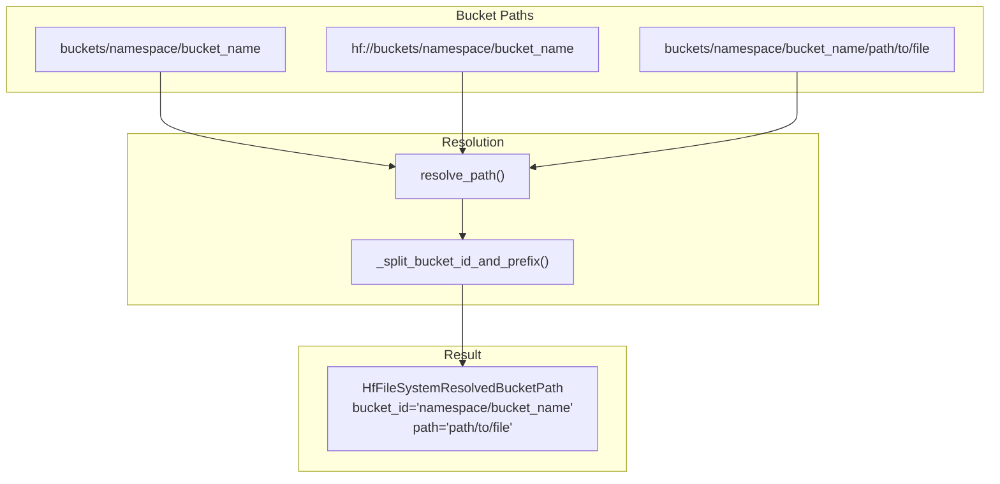

### Bucket-Specific Operations

**Differences from Repository Operations**:

| Aspect | Repository | Bucket |
|--------|-----------|--------|
| Revisions | Supported (via `@revision`) | Not supported (always current) |
| Metadata | `last_commit`, `blob_id`, `lfs` | `mtime`, `uploaded_at`, `xet_hash` |
| List operation | `list_repo_tree()` | `list_bucket_tree()` |
| Delete operation | `delete_file()` + commit | `batch_bucket_files(delete=...)` |
| Copy operation | Not supported between bucket/repo | Only within repositories |

**Bucket File Info Structure** at [src/huggingface_hub/_buckets.py:186-209]():
```python
{
    "name": "buckets/user/bucket/file.txt",
    "size": 1234,
    "type": "file",
    "xet_hash": "...",
    "mtime": datetime(...),
    "uploaded_at": datetime(...)
}
```

**Sources**: [src/huggingface_hub/hf_file_system.py:324-330](), [src/huggingface_hub/_buckets.py:186-232]()

## Error Handling

`HfFileSystem` provides specific error handling for common failure scenarios:

### Error Flow

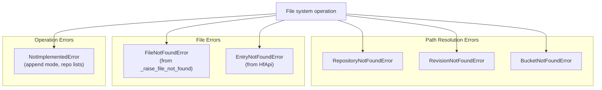

**Error Conversion**: The `_raise_file_not_found` helper at [src/huggingface_hub/hf_file_system.py:1301-1315]() converts various Hub-specific errors to standard `FileNotFoundError` for fsspec compatibility.

**Not Implemented Operations**:
- Listing root or repository type levels (e.g., `ls("")` or `ls("datasets")`)
- Append mode for files (`mode="a"`)
- Remote-to-remote copy between repository and bucket

**Sources**: [src/huggingface_hub/hf_file_system.py:1301-1315](), [src/huggingface_hub/hf_file_system.py:256-284]()

## Advanced Features

### Revision-Specific Operations

Operations can target specific revisions using either path syntax or the `revision` parameter:

```python
# Via path syntax
fs.ls("datasets/squad@dev")
fs.open("datasets/squad@refs/pr/1/data.json")

# Via parameter
fs.ls("datasets/squad", revision="dev")
fs.open("datasets/squad/data.json", revision="refs/pr/1")
```

**Special Revisions**: The system handles revisions with forward slashes (PR refs, conversion refs) through the `SPECIAL_REFS_REVISION_REGEX` pattern at [src/huggingface_hub/hf_file_system.py:36-43]().

### URL Generation

The `url` method generates direct Hub URLs for files and directories:

```python
fs.url("datasets/squad/data.json")
# Returns: "https://huggingface.co/datasets/squad/resolve/main/data.json"

fs.url("datasets/squad/data")
# Returns: "https://huggingface.co/datasets/squad/tree/main/data"
```

**Sources**: [src/huggingface_hub/hf_file_system.py:1317-1336]()

### Temporary File Optimization

The `get_file` method provides an optimization for downloading to temporary files or paths:

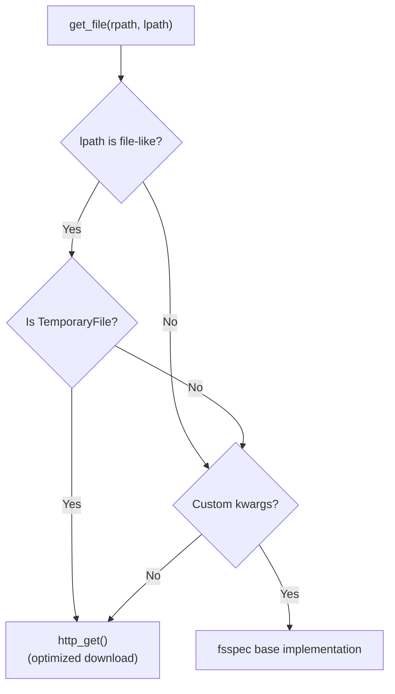

The optimization uses `http_get` directly when possible, avoiding the fsspec layer overhead.

**Sources**: [src/huggingface_hub/hf_file_system.py:1338-1381]()

## Thread Safety and Pickling

### Thread Safety

`HfFileSystem` instances are thread-safe through the caching metaclass:

1. Each thread gets its own instance (distinguished by `threading.get_ident()`)
2. New thread instances inherit state from the main thread
3. No shared mutable state between threads without proper synchronization

### Pickling Support

Instances can be pickled and unpickled, with automatic cache restoration:

```python
fs = HfFileSystem()
fs.ls("datasets/squad")  # Populate cache

pickled = pickle.dumps(fs)
HfFileSystem.clear_instance_cache()

fs_restored = pickle.loads(pickled)
# Cache is restored, can work offline
fs_restored.ls("datasets/squad")  # Uses cached data
```

**Implementation**: The `_get_instance_state()` and `_set_instance_state()` methods at [src/huggingface_hub/hf_file_system.py:1383-1411]() handle serialization of the cache state.

**Sources**: [src/huggingface_hub/hf_file_system.py:1383-1411](), [tests/test_hf_file_system.py:378-391]()

---

