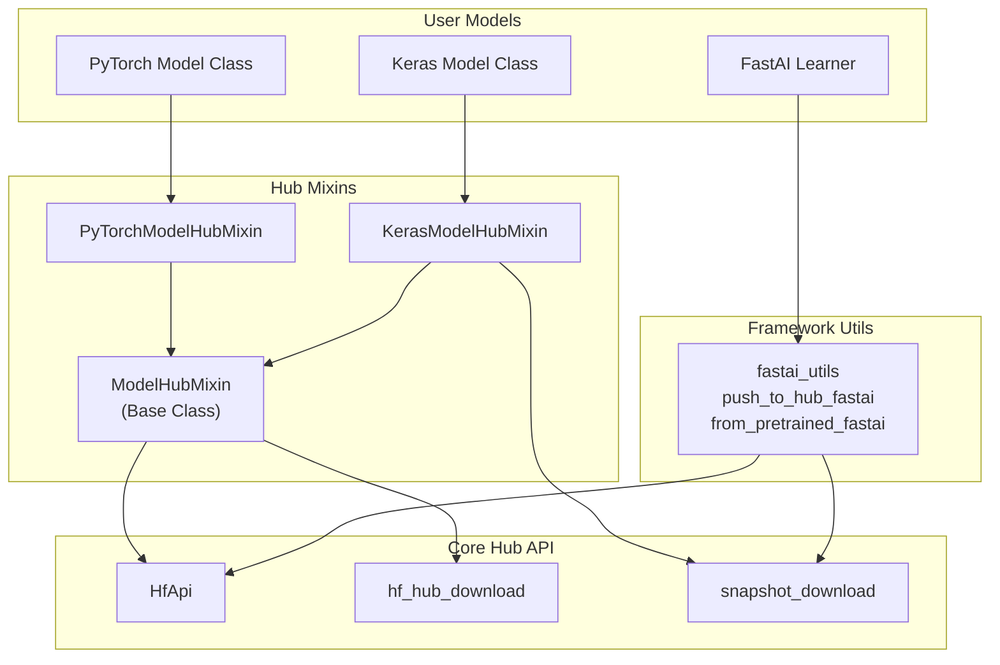
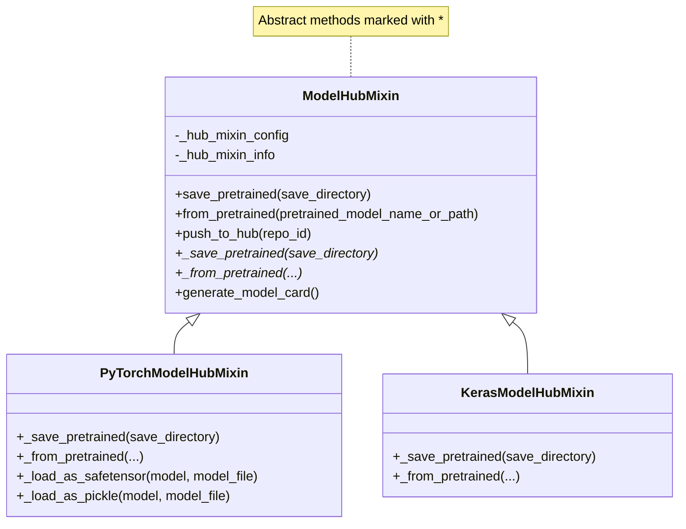
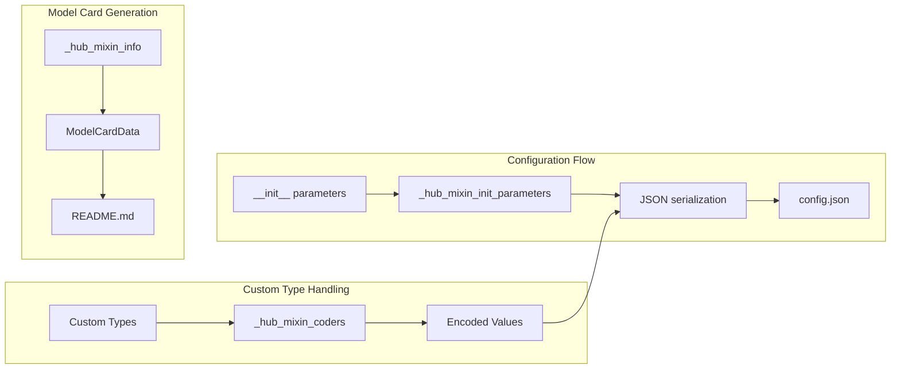
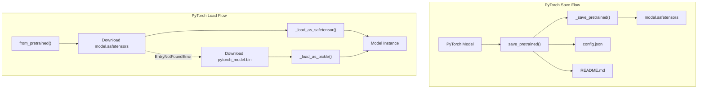
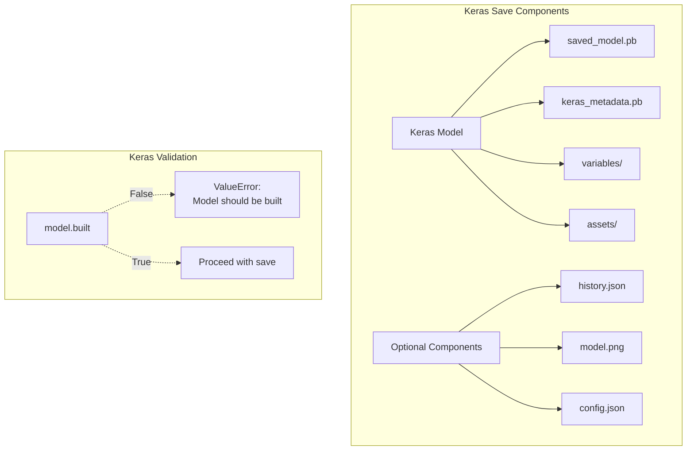
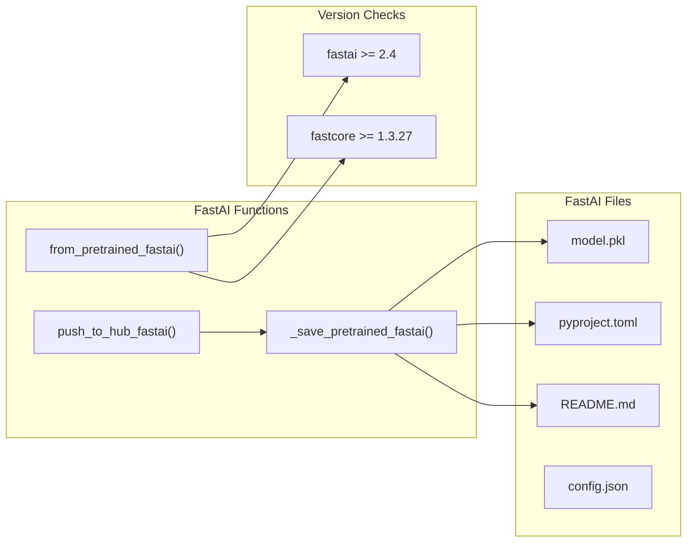
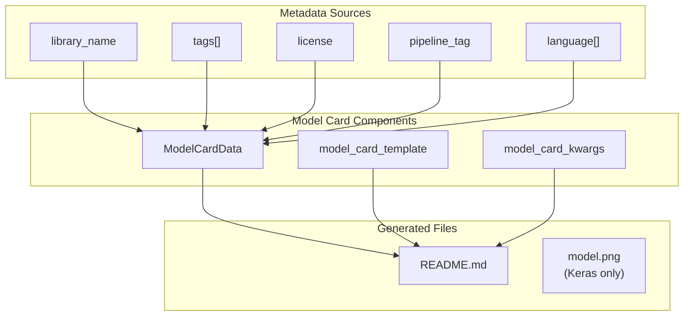

<!-- source: DeepWiki mcp.deepwiki.com · repo huggingface/huggingface_hub · page 5 ML Framework Integration · fetched 2026-10-26 -->

# ML Framework Integration

<details>
<summary>Relevant source files</summary>

The following files were used as context for generating this wiki page:

- [docs/source/de/guides/integrations.md](docs/source/de/guides/integrations.md)
- [docs/source/en/guides/integrations.md](docs/source/en/guides/integrations.md)
- [docs/source/en/guides/overview.md](docs/source/en/guides/overview.md)
- [docs/source/en/index.md](docs/source/en/index.md)
- [docs/source/en/quick-start.md](docs/source/en/quick-start.md)
- [src/huggingface_hub/_snapshot_download.py](src/huggingface_hub/_snapshot_download.py)
- [src/huggingface_hub/fastai_utils.py](src/huggingface_hub/fastai_utils.py)
- [src/huggingface_hub/hub_mixin.py](src/huggingface_hub/hub_mixin.py)
- [src/huggingface_hub/utils/_auth.py](src/huggingface_hub/utils/_auth.py)
- [tests/test_cache_layout.py](tests/test_cache_layout.py)
- [tests/test_hub_mixin.py](tests/test_hub_mixin.py)
- [tests/test_hub_mixin_pytorch.py](tests/test_hub_mixin_pytorch.py)
- [tests/test_snapshot_download.py](tests/test_snapshot_download.py)

</details>


This document covers the ML framework integration system in `huggingface_hub`, which provides a unified interface for saving, loading, and sharing models from various machine learning frameworks with the Hugging Face Hub. The system enables seamless integration through mixins and utilities that can be added to existing model classes.

For information about the core HTTP-based API client, see [Core API Client (HfApi)](#2). For details about repository cards and metadata, see [Repository Cards](#5).

## Overview

The ML framework integration system provides a standardized way for different ML frameworks to interact with the Hugging Face Hub. It supports PyTorch, TensorFlow/Keras, and FastAI, with extensible patterns for additional frameworks.



**Sources:** [src/huggingface_hub/hub_mixin.py:76-184](), [src/huggingface_hub/keras_mixin.py:420-454](), [src/huggingface_hub/fastai_utils.py:1-23]()

## Hub Mixin Architecture

### Core Mixin Pattern

The `ModelHubMixin` class provides the foundational interface that all framework integrations inherit from. It implements a generic pattern for saving, loading, and sharing models.



**Sources:** [src/huggingface_hub/hub_mixin.py:76-184](), [src/huggingface_hub/hub_mixin.py:715-759](), [src/huggingface_hub/keras_mixin.py:420-454]()

### Configuration and Metadata System

The mixin system includes sophisticated configuration handling with support for custom types and automatic model card generation.



**Sources:** [src/huggingface_hub/hub_mixin.py:186-196](), [src/huggingface_hub/hub_mixin.py:276-287](), [src/huggingface_hub/hub_mixin.py:703-712]()

## Framework-Specific Implementations

### PyTorch Integration

The `PyTorchModelHubMixin` provides PyTorch-specific functionality with support for both SafeTensors and pickle formats.

Key features:
- **SafeTensors Support**: Primary serialization format for model weights
- **Fallback to Pickle**: Legacy support for `pytorch_model.bin` files  
- **Device Mapping**: Support for loading models on specific devices
- **Strict Loading**: Optional strict mode for state dict loading



**Sources:** [src/huggingface_hub/hub_mixin.py:767-771](), [src/huggingface_hub/hub_mixin.py:794-820](), [src/huggingface_hub/hub_mixin.py:822-842]()

### Keras/TensorFlow Integration

The Keras integration provides specialized handling for TensorFlow SavedModel format and training history.

Key features:
- **SavedModel Format**: Uses TensorFlow's SavedModel for serialization
- **Training History**: Preserves `model.history` in `history.json`
- **Model Plotting**: Automatic model architecture visualization
- **Optimizer State**: Optional inclusion of optimizer state



**Sources:** [src/huggingface_hub/keras_mixin.py:156-238](), [src/huggingface_hub/keras_mixin.py:456-458](), [src/huggingface_hub/keras_mixin.py:459-500]()

### FastAI Integration

FastAI uses a functional approach rather than mixins, providing dedicated utility functions.

Key features:
- **Pickle Serialization**: Uses FastAI's native pickle format
- **Version Compatibility**: Checks FastAI and FastCore versions
- **PyProject Integration**: Generates `pyproject.toml` with dependencies



**Sources:** [src/huggingface_hub/fastai_utils.py:25-72](), [src/huggingface_hub/fastai_utils.py:211-283](), [src/huggingface_hub/fastai_utils.py:285-339]()

## Configuration System

### Configuration Serialization

The mixin system provides sophisticated configuration handling that automatically serializes model initialization parameters to JSON.

```mermaid
graph TB
    subgraph "Config Extraction Process"
        ModelInit["Model.__init__()"] --> InspectSignature["inspect.signature()"]
        InspectSignature --> ExtractParams["_hub_mixin_init_parameters"]
        ExtractParams --> FilterJsonable["Filter JSON-serializable"]
        FilterJsonable --> DefaultValues["_hub_mixin_jsonable_default_values"]
    end
    
    subgraph "Custom Type Handling"
        CustomType["Custom Type"] --> Encoder["Custom Encoder"]
        Encoder --> JSONValue["JSON Value"]
        JSONValue --> Decoder["Custom Decoder"]
        Decoder --> RestoredType["Restored Type"]
    end
    
    subgraph "Configuration Storage"
        ConfigDict["Config Dict"] --> ConfigJSON["config.json"]
        ConfigDict --> HubMixinConfig["_hub_mixin_config"]
    end
```



**Sources:** [src/huggingface_hub/hub_mixin.py:280-287](), [src/huggingface_hub/hub_mixin.py:343-379](), [src/huggingface_hub/hub_mixin.py:197-221]()

### Custom Type Encoding

The system supports custom encoders and decoders for non-JSON-serializable types through the `coders` parameter.

Example custom type configuration:
- **Dataclasses**: Automatically converted using `asdict()`
- **Custom Objects**: User-defined encoder/decoder pairs
- **Optional Types**: Special handling for `Optional[T]` annotations

**Sources:** [src/huggingface_hub/hub_mixin.py:352-379](), [src/huggingface_hub/hub_mixin.py:364-379]()

## Model Card Generation

### Automatic Model Cards

Each framework integration automatically generates model cards with relevant metadata and framework-specific information.



**Sources:** [src/huggingface_hub/hub_mixin.py:67-74](), [src/huggingface_hub/hub_mixin.py:703-712](), [src/huggingface_hub/keras_mixin.py:112-153]()

## Usage Patterns

### Framework Integration Examples

Each framework follows a consistent pattern for integration:

#### PyTorch Example Structure
```python
class MyPyTorchModel(nn.Module, PyTorchModelHubMixin):
    def __init__(self, config=None):
        # Model initialization
        
    def forward(self, x):
        # Model forward pass
```

#### Keras Example Structure  
```python
class MyKerasModel(tf.keras.Model, KerasModelHubMixin):
    def __init__(self, config=None):
        # Model initialization
        
    def call(self, inputs):
        # Model call method
```

#### FastAI Example Structure
```python
# FastAI uses functional API
learner = Learner(...)
push_to_hub_fastai(learner, repo_id="my-model")
loaded_learner = from_pretrained_fastai("username/my-model")
```

**Sources:** [tests/test_hub_mixin_pytorch.py:53-60](), [tests/test_keras_integration.py:43-51](), [tests/test_fastai_integration.py:84-92]()

### Common Operations

All frameworks support these core operations:

- **`save_pretrained()`**: Save model locally
- **`from_pretrained()`**: Load model from Hub or local path  
- **`push_to_hub()`**: Upload model to Hub

The operations maintain consistent signatures across frameworks while allowing framework-specific parameters.

**Sources:** [src/huggingface_hub/hub_mixin.py:381-447](), [src/huggingface_hub/hub_mixin.py:460-583](), [src/huggingface_hub/hub_mixin.py:632-701]()

---

