<!-- source: DeepWiki mcp.deepwiki.com · repo huggingface/huggingface_hub · page 5.1 ModelHubMixin Pattern · fetched 2026-10-26 -->

# ModelHubMixin Pattern

<details>
<summary>Relevant source files</summary>

The following files were used as context for generating this wiki page:

- [docs/source/de/guides/integrations.md](docs/source/de/guides/integrations.md)
- [docs/source/en/guides/integrations.md](docs/source/en/guides/integrations.md)
- [docs/source/en/guides/overview.md](docs/source/en/guides/overview.md)
- [docs/source/en/index.md](docs/source/en/index.md)
- [docs/source/en/quick-start.md](docs/source/en/quick-start.md)
- [src/huggingface_hub/hub_mixin.py](src/huggingface_hub/hub_mixin.py)
- [src/huggingface_hub/utils/_auth.py](src/huggingface_hub/utils/_auth.py)
- [tests/test_hub_mixin.py](tests/test_hub_mixin.py)
- [tests/test_hub_mixin_pytorch.py](tests/test_hub_mixin_pytorch.py)

</details>


## Overview

`ModelHubMixin` is a base class at [src/huggingface_hub/hub_mixin.py:76-184]() that enables any ML framework to integrate with the Hugging Face Hub through multiple inheritance. Classes inheriting from `ModelHubMixin` gain three public methods (`save_pretrained`, `from_pretrained`, `push_to_hub`) and must implement two private methods (`_save_pretrained`, `_from_pretrained`).

**Pattern**: Library maintainers implement framework-specific serialization in `_save_pretrained()` and `_from_pretrained()`. The mixin handles Hub API interactions, repository creation, configuration extraction from `__init__` parameters, and automatic model card generation.

**Key class attributes managed by the mixin**:
- `_hub_mixin_config`: Auto-extracted configuration from initialization parameters
- `_hub_mixin_info`: Model card metadata including `library_name`, `tags`, `license`, etc.
- `_hub_mixin_coders`: Custom encoders/decoders for non-JSON-serializable types

**Related pages**: See page 5.2 for framework-specific implementations (`PyTorchModelHubMixin`, `KerasModelHubMixin`) and page 2 for direct `HfApi` usage without mixins.

Sources: [src/huggingface_hub/hub_mixin.py:76-195](), [docs/source/en/guides/integrations.md:117-145]()
</old_str>

<old_str>
### Minimal Integration Steps

**Step 1: Inherit from ModelHubMixin with metadata**

```python
from huggingface_hub import ModelHubMixin
from pathlib import Path

class MyFrameworkModel(
    ModelHubMixin,
    library_name="my-framework",  # Passed to __init_subclass__
    tags=["custom-task"],
    license="apache-2.0",
):
    def __init__(self, size: int = 512, device: str = "cpu"):
        self.size = size
        self.device = device
        # __new__ will auto-capture size=512, device="cpu" into _hub_mixin_config
```

**Step 2: Implement `_save_pretrained(save_directory: Path) -> None`**

Required abstract method at [src/huggingface_hub/hub_mixin.py:449-458]():

```python
def _save_pretrained(self, save_directory: Path) -> None:
    """Save model weights/files. Do NOT save config.json or README.md."""
    # Example: save to save_directory / constants.SAFETENSORS_SINGLE_FILE
    # The mixin handles config.json [line 424-431] and README.md [line 434-437]
    import pickle
    with open(save_directory / "model.pkl", "wb") as f:
        pickle.dump(self.state, f)
```

**Step 3: Implement `_from_pretrained(**kwargs) -> T` classmethod**

Required abstract method at [src/huggingface_hub/hub_mixin.py:577-616]():

```python
@classmethod
def _from_pretrained(
    cls,
    *,
    model_id: str,
    revision: Optional[str],
    cache_dir: Optional[Union[str, Path]],
    force_download: bool,
    local_files_only: bool,
    token: Optional[Union[str, bool]],
    **model_kwargs,  # Populated from config.json by from_pretrained()
):
    """Load model from Hub or local directory."""
    # Use hf_hub_download to get cached file path
    from huggingface_hub import hf_hub_download
    
    if os.path.isdir(model_id):
        model_file = os.path.join(model_id, "model.pkl")
    else:
        model_file = hf_hub_download(
            repo_id=model_id,
            filename="model.pkl",
            revision=revision,
            cache_dir=cache_dir,
            force_download=force_download,
            token=token,
            local_files_only=local_files_only,
        )
    
    # Initialize model with config values
    model = cls(**model_kwargs)
    with open(model_file, "rb") as f:
        model.state = pickle.load(f)
    return model
```

**Result**: Users can now call `MyFrameworkModel.from_pretrained("user/repo")` and `model.push_to_hub("user/repo")`.

Sources: [src/huggingface_hub/hub_mixin.py:449-458](), [src/huggingface_hub/hub_mixin.py:577-616](), [docs/source/en/guides/integrations.md:217-272]()
</old_str>
<new_str>
### Class Structure and Inheritance

**Inheritance Chain with Actual Code Entities**

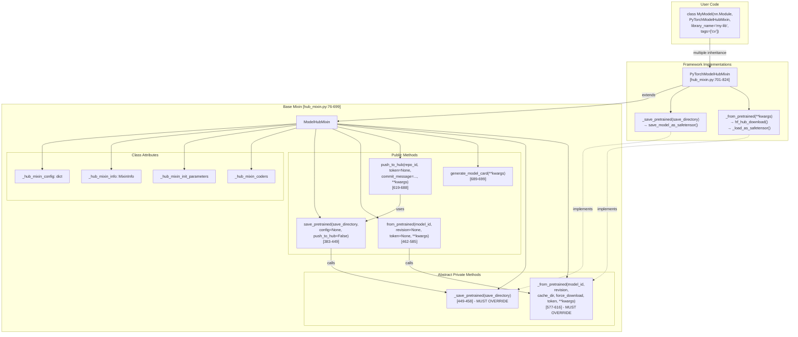

Sources: [src/huggingface_hub/hub_mixin.py:76-699](), [src/huggingface_hub/hub_mixin.py:701-824]()
</str>

<old_str>
### Class-Level Metadata Declaration

**`__init_subclass__` Processing Flow [hub_mixin.py:195-289]**

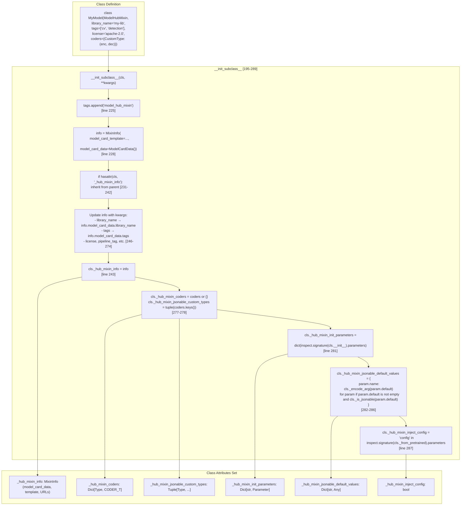

**Metadata Parameters Table** (keyword arguments to class definition):

| Parameter | Type | Stored In | Line Reference |
|-----------|------|-----------|----------------|
| `library_name` | `str` | `info.model_card_data.library_name` | [257] |
| `tags` | `List[str]` | `info.model_card_data.tags` (merged, sorted) | [224-274] |
| `license` | `str` | `info.model_card_data.license` | [259] |
| `license_name` | `str` | `info.model_card_data.license_name` | [261] |
| `license_link` | `str` | `info.model_card_data.license_link` | [263] |
| `language` | `List[str]` | `info.model_card_data.language` | [255] |
| `pipeline_tag` | `str` | `info.model_card_data.pipeline_tag` | [265] |
| `repo_url` | `str` | `info.repo_url` | [248-249] |
| `paper_url` | `str` | `info.paper_url` | [250-251] |
| `docs_url` | `str` | `info.docs_url` | [252-253] |
| `model_card_template` | `str` | `info.model_card_template` | [246-247] |
| `coders` | `Dict[Type, (Encoder, Decoder)]` | `_hub_mixin_coders` | [277] |

Sources: [src/huggingface_hub/hub_mixin.py:195-289]()
</old_str>
<new_str>
### Method Execution Flow

**Actual Method Call Sequence with File Locations**

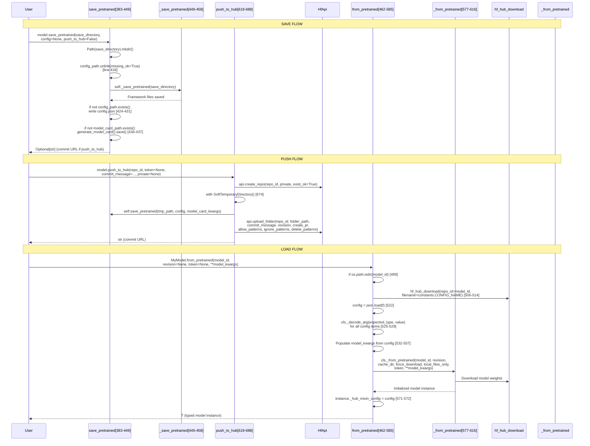

Sources: [src/huggingface_hub/hub_mixin.py:383-449](), [src/huggingface_hub/hub_mixin.py:462-585](), [src/huggingface_hub/hub_mixin.py:619-688]()

## Core Architecture

### Class Structure and Inheritance

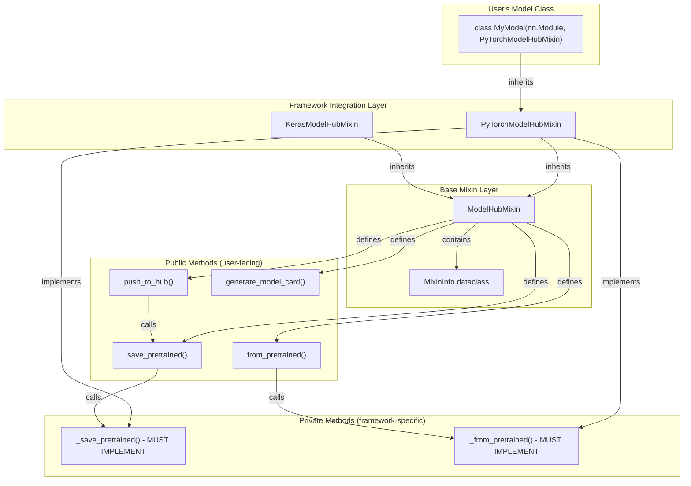

Sources: [src/huggingface_hub/hub_mixin.py:76-184](), [src/huggingface_hub/hub_mixin.py:717-767]()

### Method Execution Flow

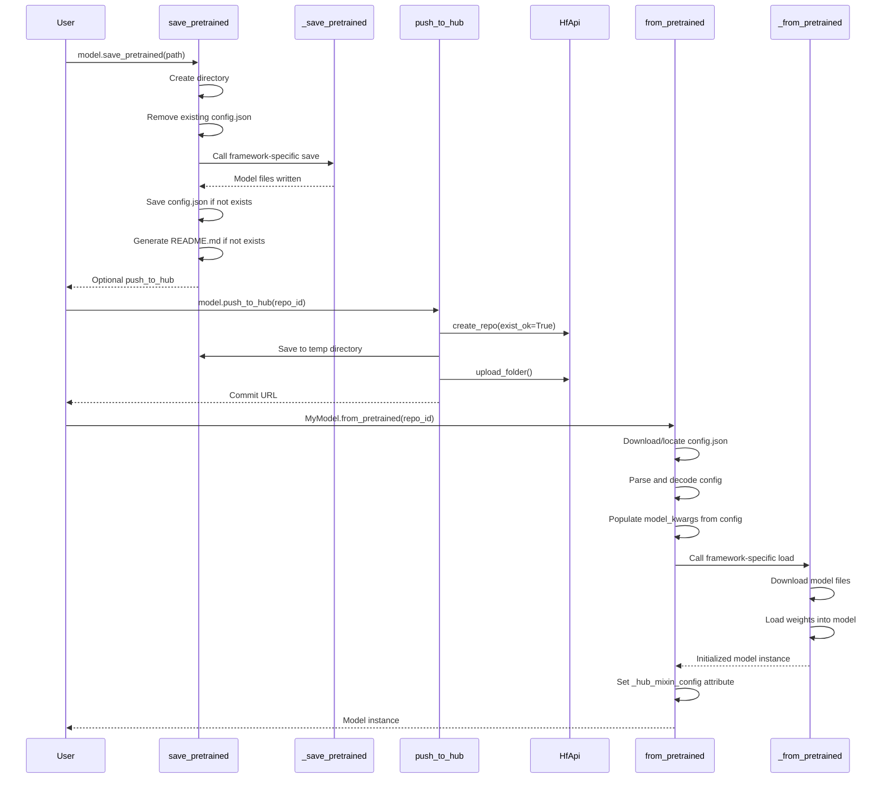

Sources: [src/huggingface_hub/hub_mixin.py:383-449](), [src/huggingface_hub/hub_mixin.py:462-585](), [src/huggingface_hub/hub_mixin.py:634-703]()

## Implementation Guide

### Automatic Config Extraction

**`__new__` Method Config Capture [hub_mixin.py:289-342]**

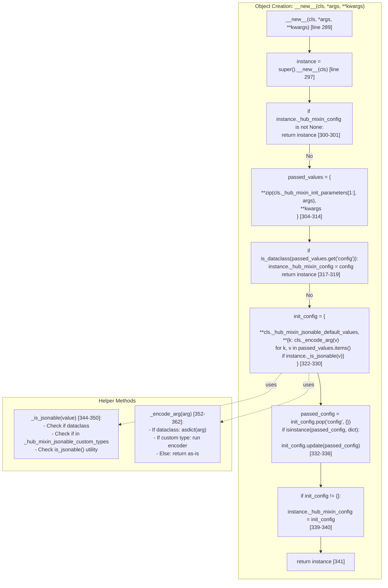

**Config Extraction Example**:

```python
class MyModel(ModelHubMixin):
    def __init__(self, size: int = 512, name: str = "default", custom_obj=None):
        pass

# At instantiation:
model = MyModel(size=256, name="custom")

# __new__ creates _hub_mixin_config:
# {
#   "size": 256,        # From passed arg (overrides default 512)
#   "name": "custom",   # From passed arg (overrides default "default")
#   # custom_obj not included (not jsonable, no custom coder)
# }
```

**Serialization/Deserialization**:
- **Save** [line 424-431]: `json.dumps(config)` → `config.json`
- **Load** [line 518-529]: `json.load()` → decode via `_decode_arg()` → populate `model_kwargs`

Sources: [src/huggingface_hub/hub_mixin.py:289-342](), [src/huggingface_hub/hub_mixin.py:344-381]()

## Custom Type Encoding/Decoding

### Coders System

**Encoding/Decoding Flow for Non-JSON Types**

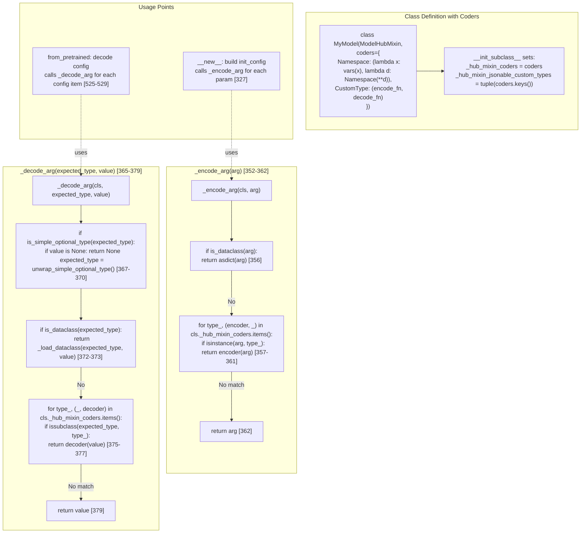

**Coder Type Definition**:

```python
# Type aliases from hub_mixin.py:48-50
ENCODER_T = Callable[[ARGS_T], Any]              # CustomType → JSON-able
DECODER_T = Callable[[Any], ARGS_T]              # JSON-able → CustomType
CODER_T = tuple[ENCODER_T, DECODER_T]            # (encoder, decoder)
```

**Real-World Example: argparse.Namespace**

```python
from argparse import Namespace
from huggingface_hub import ModelHubMixin

class VoiceCraftModel(
    ModelHubMixin,
    coders={
        Namespace: (
            lambda x: vars(x),              # Namespace → dict
            lambda data: Namespace(**data),  # dict → Namespace
        )
    }
):
    def __init__(self, args: Namespace):  # Type annotation required!
        self.pattern = args.pattern
        self.hidden_size = args.hidden_size

# Save/load cycle:
model = VoiceCraftModel(Namespace(pattern="delay", hidden_size=512))
model.save_pretrained("path")
# config.json: {"pattern": "delay", "hidden_size": 512}

reloaded = VoiceCraftModel.from_pretrained("path")
assert isinstance(reloaded.args, Namespace)  # Reconstructed correctly
```

Sources: [src/huggingface_hub/hub_mixin.py:352-379](), [src/huggingface_hub/hub_mixin.py:826-831]() (helper function), [tests/test_hub_mixin_pytorch.py:443-457](), [docs/source/en/guides/integrations.md:380-419]()

## Config Management System

## PyTorchModelHubMixin Implementation

### Overview

`PyTorchModelHubMixin` at [src/huggingface_hub/hub_mixin.py:701-824]() is a framework-specific implementation that extends `ModelHubMixin` for PyTorch `nn.Module` classes. It provides:
- **Save format**: SafeTensors (`model.safetensors` via `safetensors.torch.save_model`)
- **Load fallback**: Falls back to pickle (`pytorch_model.bin` via `torch.load(..., weights_only=True)`)
- **Shared tensors**: Preserves shared tensors in memory (e.g., tied embeddings)
- **Device placement**: Supports `map_location` parameter for loading onto specific devices
- **Auto-tagging**: Adds `"pytorch_model_hub_mixin"` tag to model cards

Sources: [src/huggingface_hub/hub_mixin.py:701-824]()

### Config Injection Modes

The mixin supports multiple ways to inject configuration during `from_pretrained()`:

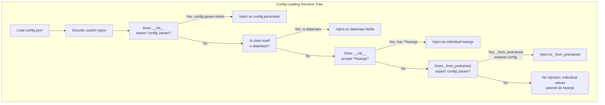

**Key attributes controlling config injection**:

- `_hub_mixin_inject_config` (bool): Set to `True` if `_from_pretrained` signature includes `config` parameter
- `_hub_mixin_init_parameters` (dict): Dictionary of `inspect.Parameter` objects from `__init__`

Sources: [src/huggingface_hub/hub_mixin.py:534-566](), [tests/test_hub_mixin.py:265-295]()

## Custom Type Encoding/Decoding

### Coders System

For initialization parameters that are not JSON-serializable (e.g., custom classes, `argparse.Namespace`, `OmegaConf`), the mixin provides a `coders` mechanism:

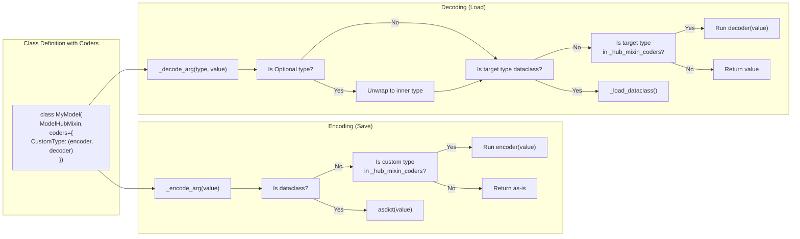

**Encoder/Decoder Format**:

```python
coders = {
    CustomType: (
        lambda x: x.to_dict(),           # Encoder: CustomType -> JSON-serializable
        lambda data: CustomType(data),   # Decoder: JSON-serializable -> CustomType
    )
}
```

**Example: Namespace Support**

```python
from argparse import Namespace

class MyModel(
    ModelHubMixin,
    coders={
        Namespace: (
            lambda x: vars(x),              # Convert Namespace to dict
            lambda data: Namespace(**data),  # Reconstruct from dict
        )
    }
):
    def __init__(self, config: Namespace):
        self.config = config
```

Sources: [src/huggingface_hub/hub_mixin.py:354-381](), [tests/test_hub_mixin_pytorch.py:106-120](), [docs/source/en/guides/integrations.md:395-423]()

### Type Checking Utilities

The mixin uses type checking utilities to determine JSON serializability and handle `Optional` types:

| Function | Purpose | Location |
|----------|---------|----------|
| `is_jsonable(value)` | Check if value is JSON-serializable | [src/huggingface_hub/utils/_typing.py:36-78]() |
| `is_simple_optional_type(type_)` | Check if type is `Optional[T]` or `Union[T, None]` | [src/huggingface_hub/utils/_typing.py:81-87]() |
| `unwrap_simple_optional_type(type_)` | Extract `T` from `Optional[T]` | [src/huggingface_hub/utils/_typing.py:90-95]() |

Sources: [src/huggingface_hub/hub_mixin.py:345-352](), [src/huggingface_hub/utils/_typing.py:1-96]()

## Model Card Generation

### MixinInfo Structure

Model card metadata is stored in the `MixinInfo` dataclass:

```python
@dataclass
class MixinInfo:
    model_card_template: str
    model_card_data: ModelCardData
    docs_url: Optional[str] = None
    paper_url: Optional[str] = None
    repo_url: Optional[str] = None
```

This structure is created and populated during `__init_subclass__` and stored in `_hub_mixin_info` class attribute.

Sources: [src/huggingface_hub/hub_mixin.py:67-74]()

### Template System

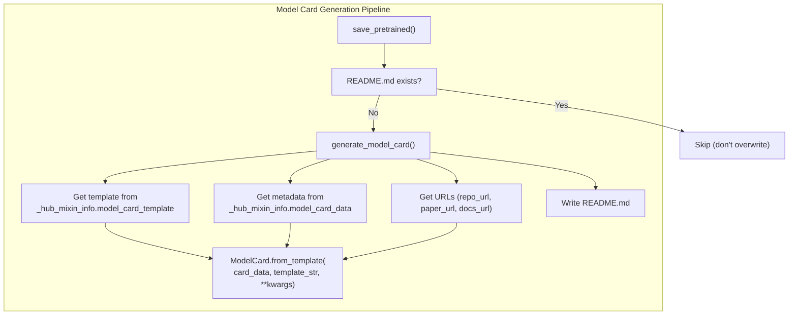

**Default model card template** (when not customized):

```markdown
---
{{ card_data }}
---

This model has been pushed to the Hub using the [PytorchModelHubMixin](...)
- Code: {{ repo_url | default("[More Information Needed]", true) }}
- Paper: {{ paper_url | default("[More Information Needed]", true) }}
- Docs: {{ docs_url | default("[More Information Needed]", true) }}
```

**Custom template example**:

```python
CUSTOM_TEMPLATE = """
---
{{ card_data }}
---

# My Custom Model

## Citation
@article{...}

## Usage
...
"""

class MyModel(
    ModelHubMixin,
    model_card_template=CUSTOM_TEMPLATE,
    library_name="my-lib",
    tags=["custom-task"]
):
    pass
```

Sources: [src/huggingface_hub/hub_mixin.py:53-64](), [src/huggingface_hub/hub_mixin.py:705-714](), [docs/source/en/guides/integrations.md:282-350]()

### Metadata Inheritance

When subclassing a class that already inherits from `ModelHubMixin`, metadata is inherited:

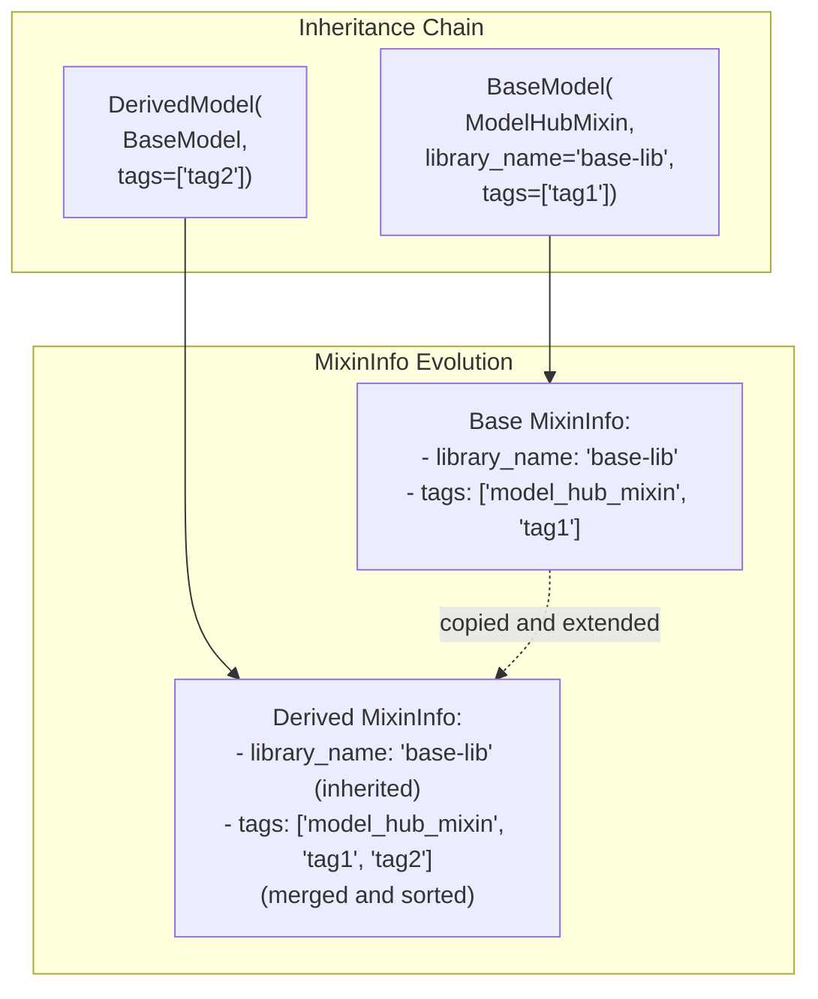

**Inheritance rules**:
- Template: Inherited if not explicitly overridden
- URLs: Inherited if not explicitly set
- ModelCardData: Deep copied and extended
- Tags: Merged and deduplicated

Sources: [src/huggingface_hub/hub_mixin.py:232-276](), [tests/test_hub_mixin.py:476-481]()

## PyTorchModelHubMixin Implementation

### Overview

`PyTorchModelHubMixin` is a concrete implementation of `ModelHubMixin` for PyTorch models. It handles:
- Saving models as SafeTensors (preferred) or pickle format
- Loading models with device placement
- Shared tensor preservation

Sources: [src/huggingface_hub/hub_mixin.py:717-848]()

### Load Implementation

**`_from_pretrained` Method [hub_mixin.py:759-801]**

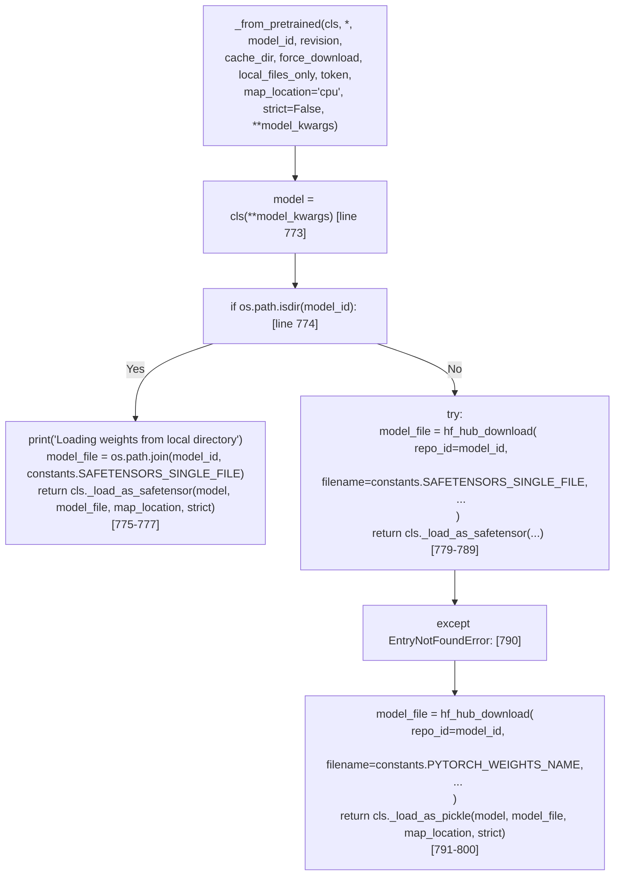

**Loading Helper Methods**:

1. **`_load_as_safetensor(model, model_file, map_location, strict)` [810-823]**:
```python
if packaging.version.parse(safetensors.__version__) < version.parse("0.4.3"):
    load_model_as_safetensor(model, model_file, strict=strict)
    # Old version: load to CPU, then move to device
    if map_location != "cpu":
        logger.warning("...slower loading time...")
        model.to(map_location)
else:
    # New version: direct device loading
    safetensors.torch.load_model(model, model_file, strict=strict, device=map_location)
```

2. **`_load_as_pickle(model, model_file, map_location, strict)` [803-808]**:
```python
state_dict = torch.load(model_file, map_location=torch.device(map_location), weights_only=True)
model.load_state_dict(state_dict, strict=strict)
model.eval()
return model
```

**Key constants**:
- `constants.SAFETENSORS_SINGLE_FILE = "model.safetensors"`
- `constants.PYTORCH_WEIGHTS_NAME = "pytorch_model.bin"`

**Security note**: `torch.load` uses `weights_only=True` to prevent arbitrary code execution (Python pickle vulnerability).

Sources: [src/huggingface_hub/hub_mixin.py:759-823](), [tests/test_hub_mixin_pytorch.py:196-252]()

### Load Implementation

```mermaid
graph TB
    subgraph "_from_pretrained Flow"
        FromPretrained["_from_pretrained(**kwargs)"]
        InitModel["model = cls(**model_kwargs)"]
        CheckLocal["Is model_id a directory?"]
        
        LocalPath["Load from local path"]
        HubPath["Download from Hub"]
        
        TrySafetensors["Try download<br/>'model.safetensors'"]
        CatchNotFound["EntryNotFoundError?"]
        FallbackPickle["Try download<br/>'pytorch_model.bin'"]
        
        LoadSafetensors["_load_as_safetensor()"]
        LoadPickle["_load_as_pickle()"]
        
        SetEval["model.eval()"]
        Return["return model"]
    end
    
    FromPretrained --> InitModel
    InitModel --> CheckLocal
    
    CheckLocal -->|"Yes"| LocalPath
    CheckLocal -->|"No"| HubPath
    
    LocalPath --> LoadSafetensors
    
    HubPath --> TrySafetensors
    TrySafetensors --> CatchNotFound
    CatchNotFound -->|"Not found"| FallbackPickle
    CatchNotFound -->|"Found"| LoadSafetensors
    
    FallbackPickle --> LoadPickle
    
    LoadSafetensors --> SetEval
    LoadPickle --> SetEval
    SetEval --> Return
```

**Loading strategies**:

1. **SafeTensors loading** (`_load_as_safetensor`):
   - Uses `safetensors.torch.load_model` 
   - Supports device placement via `map_location` (requires safetensors >= 0.4.3)
   - Preserves shared tensors in memory

2. **Pickle loading** (`_load_as_pickle`):
   - Fallback when SafeTensors not available
   - Uses `torch.load` with `weights_only=True` for security
   - Loads `state_dict` and applies with `load_state_dict`

3. **Additional parameters**:
   - `map_location`: Device to load weights onto (default: "cpu")
   - `strict`: Whether to strictly enforce state_dict keys match (default: False)

Sources: [src/huggingface_hub/hub_mixin.py:774-848](), [tests/test_hub_mixin_pytorch.py:400-428]()

### Tag Management

`PyTorchModelHubMixin` automatically adds `"pytorch_model_hub_mixin"` tag via `__init_subclass__`:

```python
def __init_subclass__(cls, *args, tags: Optional[List[str]] = None, **kwargs) -> None:
    tags = tags or []
    tags.append("pytorch_model_hub_mixin")
    kwargs["tags"] = tags
    return super().__init_subclass__(*args, **kwargs)
```

This ensures all PyTorch models using the mixin are tagged appropriately on the Hub.

Sources: [src/huggingface_hub/hub_mixin.py:763-767]()

## Advanced Features

### Dataclass Integration

The mixin supports models that are themselves dataclasses:

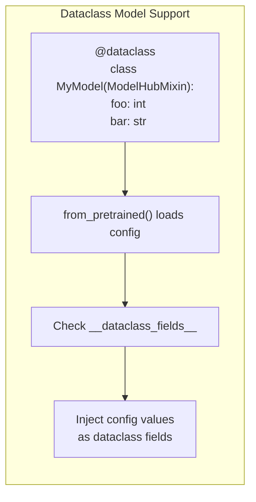

**Special handling**:
- When class is a dataclass, config values are injected as dataclass fields
- Dataclass parameters passed to `__init__` are automatically serialized via `asdict()`
- Works with nested dataclasses

Sources: [src/huggingface_hub/hub_mixin.py:555-558](), [tests/test_hub_mixin.py:430-443]()

### Config File Override Protection

The mixin implements special logic to prevent overwriting custom `config.json` files:

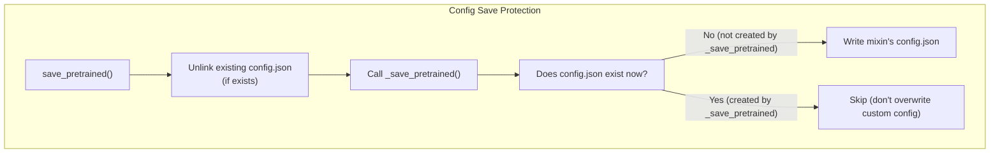

This allows framework-specific implementations to save their own `config.json` without being overwritten by the mixin's automatic config.

Sources: [src/huggingface_hub/hub_mixin.py:416-433](), [tests/test_hub_mixin.py:403-412]()

### Multi-Token Pattern

While not part of the mixin itself, users can leverage the mixin with multiple tokens by passing `token` parameter:

```python
# Use different tokens for different repos
model1.push_to_hub("org1/model", token=token1)
model2.push_to_hub("org2/model", token=token2)
```

All public methods (`save_pretrained`, `from_pretrained`, `push_to_hub`) accept a `token` parameter that overrides the default authentication.

Sources: [src/huggingface_hub/hub_mixin.py:634-703](), [src/huggingface_hub/hub_mixin.py:462-503]()

## Internal Attributes Reference

The `ModelHubMixin` uses several internal class attributes to manage configuration and metadata:

| Attribute | Type | Set By | Purpose |
|-----------|------|--------|---------|
| `_hub_mixin_config` | `Union[dict, DataclassInstance]` | `__new__` | Stores model configuration extracted from `__init__` |
| `_hub_mixin_info` | `MixinInfo` | `__init_subclass__` | Stores model card metadata and template |
| `_hub_mixin_inject_config` | `bool` | `__init_subclass__` | Whether `_from_pretrained` expects `config` parameter |
| `_hub_mixin_init_parameters` | `Dict[str, Parameter]` | `__init_subclass__` | Signature of `__init__` method |
| `_hub_mixin_jsonable_default_values` | `Dict[str, Any]` | `__init_subclass__` | Default values from `__init__` that are JSON-serializable |
| `_hub_mixin_jsonable_custom_types` | `Tuple[Type, ...]` | `__init_subclass__` | Custom types that have encoders/decoders |
| `_hub_mixin_coders` | `Dict[Type, CODER_T]` | `__init_subclass__` | Encoder/decoder functions for custom types |

**Usage example**:
```python
model = MyModel(size=256)
print(model._hub_mixin_config)  # {'size': 256, ...}
print(model._hub_mixin_info.model_card_data.library_name)  # 'my-lib'
```

Sources: [src/huggingface_hub/hub_mixin.py:186-195](), [src/huggingface_hub/hub_mixin.py:283-289]()

---

